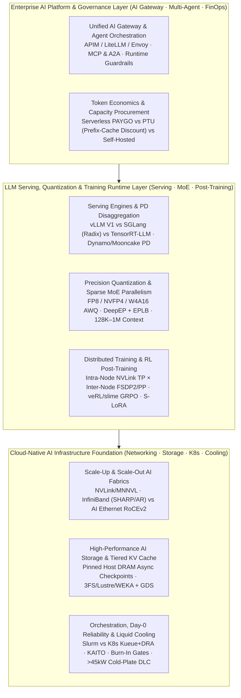

# Cloud & AI Infrastructure Solution Architect Playbook & Sizing Hub (`ai-infra-research`)

> **Language / 语言**: [简体中文](./README.md) | **English** · [Complete 579-Playbook Catalog](./docs/full-catalog-en.md) · [🎓 AI Infra H5 Panorama (`docs/h5/index.html`)](./docs/h5/index.html) · [📚 6-Module H5 Academy](./docs/h5-academy/index.html) · [🔥 Interactive H5 Learning Hub](./docs/h5/ai-infra-learning-hub.en.html) · [L0–L9 Stack Map](./docs/stack-map.en.md) · [SA Competency Roadmap](./docs/learning/roadmap.en.md) · [Interactive Sizing Workbench](./docs/reports/ai-infra-architect-workbench.html)

A bilingual (`zh-CN` & `en`), quantitative architecture decision hub purpose-built for **Cloud & AI Infrastructure Solution Architects**. Stripped of obscure non-SA scientific simulations and low-level commit noise, this repository focuses squarely on the **8 high-stakes infrastructure domains** architects face when designing GPU clusters, evaluating cloud vs. self-hosted platforms, and scaling production LLM/Agent systems — backed by **579 bilingual architecture guides (`#001–#577` + 2 flagship blueprints), 1147 self-contained interactive HTML sizers & 7-card visual benchmark decks, 190 interactive H5 study modules (`docs/h5/` & `docs/h5-academy/`), and 585 reproducible Python 3.12 analytical models**.

---

## 1. Solution Architect Decision Panorama



---

## 2. Flagship Full-Stack Case Studies & Interactive Workbench

| Flagship Deliverable | Target SA Scenario | Key Architectural Takeaways & Quantitative Levers | Quick Access |
|---|---|---|---|
| **Alibaba Cloud Full-Stack AI Infrastructure Review (`L0–L3`)** | Evaluating hyperscaler custom silicon, supernodes, RoCE fabrics, and managed MaaS tiers | Full-stack teardown of T-Head Zhenwu PPUs (`810E`→`M890 144G`→`V900 216G`), Panjiu `AL128` supernodes, `HPN 7.0` dual-plane multi-rail RDMA (`+14.9%` training goodput), `PAI` tidal preemption, and `Bailian` (`PAYGO / PTU / DTU / MU`) sizing | [English](./docs/alibaba-cloud-ai-infra/README.en.md) · [中文](./docs/alibaba-cloud-ai-infra/README.md) |
| **End-to-End 1,024-GPU Training & PD-Disaggregated Serving Architecture** | Designing a ~1,000-GPU enterprise hybrid training + low-latency inference cluster | 8-rail lossless fabric + two-phase async checkpointing (`9 TB` stall cut to `3.1 s`) + Dynamo/Mooncake PD disaggregation (`26.5%–34.2%` fewer GPUs under bursty traffic) + `126 kW` cold-plate DLC rack budgets | [English](./docs/architectures/end-to-end-ai-infra-case.en.md) · [中文](./docs/architectures/end-to-end-ai-infra-case.md) |
| **Cloud & AI Infrastructure Solution Architect Workbench (5-in-1 Console)** | Live customer sizing for 3-year TCO, PD instance ratios, 671B MoE precision, and KV offload | Zero-dependency single-file HTML console modeling `$/1M tokens`, NVLS+SHARP collective scaling, PD disaggregation ROI, MoE FP8/NVFP4 parallelism, and checkpoint/KV tiering | [Open Workbench](./docs/reports/ai-infra-architect-workbench.html) |
| **AI Infrastructure Interactive H5 Learning Center (7 Modules + Charts + Sandboxes)** | Interactive visual study hub for PD Disaggregation, TP/PP/DP/EP, NVLink vs. RDMA, 3-Watermark GPU Sizer, TPM/TPS & Little's Law, and TTFT/TPOT/Goodput | Self-contained responsive H5 app with Colocated vs. PD bar charts, stacked HBM waterfalls, Roofline ridge diagrams, Pareto curves, and live interactive sliders | [English H5 Hub](./docs/h5/ai-infra-learning-hub.en.html) · [中文 H5](./docs/h5/ai-infra-learning-hub.html) |
| **6-Volume Bilingual Inference, Sizing & AI Networking H5 Academy** | Deep-dive interactive H5 textbook series covering Evaluation Metrics, TPM/TPS Capacity, 3-Bound GPU Sizing, PD Disaggregation, TP/PP/DP/EP, and RDMA/RoCEv2/NVLink | 6 self-contained interactive H5 volumes (`01`–`06`) paired with bilingual worked-example manuals | [Open 6-Volume H5 Academy](./docs/h5-academy/index.html) · [EN Guide](./docs/inference-sizing-network/README.en.md) · [中文](./docs/inference-sizing-network/README.md) |

---

## 3. Curated Solution Architect Playbooks Across 8 Core Domains

Every component guide follows the absorbable decision-guide standard modeled on [`ib-vs-ethernet-roce-selection-faq.en.md`](./docs/components/ib-vs-ethernet-roce-selection-faq.en.md): **Executive Summary → Scenario Q&A → Architecture Trade-offs → Quantitative Decision Matrix → Pre-Production Checklist**. Browse all **397** deliverables in the **[Complete Bilingual Catalog](./docs/full-catalog-en.md)**。

### 3.1 AI Networking & High-Speed Interconnects

| Decision Scenario | Core Architecture Trade-offs | Recommended SA Pattern & Guardrails | Bilingual Guide & Tools |
|---|---|---|---|
| Building a 128–10,000+ GPU cluster: InfiniBand (NDR/XDR) vs. AI Ethernet (RoCEv2)? | IB provides native credit-based lossless transport, sub-2μs switch latency, and SHARP in-network reduction at higher switch CapEx & single-vendor lock-in; AI Ethernet lowers TCO & fits cloud operations if PFC storms and ECMP collisions are engineered out | Choose **InfiniBand NDR/XDR** for `≥1,000-GPU` synchronous frontier pre-training & heavy cross-node MoE `All-to-All`; choose **AI Ethernet / RoCEv2 (Spectrum-X / UEC class)** for `≤512-GPU` post-training, PD-disaggregated inference, and multi-tenant cloud pools | [English](./docs/components/ib-vs-ethernet-roce-selection-faq.en.md) · [中文](./docs/components/ib-vs-ethernet-roce-selection-faq.md) · [7-Card Deck](./docs/reports/rocev2-load-balancing-congestion-selection-cards.html) |
| Eliminating tail-latency spikes & PFC pause storms on multi-rail RoCEv2 fabrics | Static 5-tuple ECMP suffers severe hash polarization on low-entropy RDMA elephant flows; naive PFC cascades into head-of-line blocking across healthy queues | Combine **Rail-Optimized Leaf-Spine + early ECN/DCQCN marking + Flowlet DLB / Packet Spraying**, and mandate hardware **PFC Watchdog** auto-mitigation | [English](./docs/components/rocev2-load-balancing-congestion-selection-faq.en.md) · [中文](./docs/components/rocev2-load-balancing-congestion-selection-faq.md) · [Sizer](./docs/reports/rocev2-load-balancing-congestion-sizer.html) |
| Sizing intra-node NVLink vs. PCIe 5.0 and rack-scale NVLink supernodes (`MNNVL / NVL72`) | PCIe 5.0 (`64 GB/s`) starves Tensor Parallel `AllReduce`; rack-scale NVLink unlocks 72-GPU TP/EP domains but expands single-rack cooling and IMEX fault blast radius | **Pin `TP` strictly inside intra-node/rack NVLink**; treat the entire supernode clique and CDU manifold as an atomic scheduling and failure domain | [NVLink/PCIe/CXL](./docs/components/nvlink-pcie-cxl-scaleup-interconnect-selection-faq.en.md) · [MNNVL SuperPOD](./docs/components/gb200-mnnvl-imex-channels-nvlink-fabric-manager-isolation-selection-faq.en.md) · [Optical LPO/CPO](./docs/components/ai-cluster-optical-interconnect-selection-faq.en.md) |

### 3.2 LLM Serving Engines, PD Disaggregation & Low-Latency Scheduling

| Decision Scenario | Core Architecture Trade-offs | Recommended SA Pattern & Guardrails | Bilingual Guide & Tools |
|---|---|---|---|
| Standardizing production LLM inference: vLLM vs. SGLang vs. TensorRT-LLM? | Day-0 model breadth & multi-vendor hardware portability vs. multi-turn Radix prefix reuse & MoE throughput vs. homogeneous NVIDIA FP8/NVFP4 peak kernel extraction | Standardize on **vLLM V1** for broad multi-model fleets; **SGLang (`RadixAttention`)** for multi-turn Agents, shared-prefix RAG (`3.45×` lower TTFT), and DeepSeek MoE; **TensorRT-LLM** for pinned high-volume NVIDIA fleets | [English](./docs/components/llm-inference-engine-selection-faq.en.md) · [中文](./docs/components/llm-inference-engine-selection-faq.md) · [7-Card Deck](./docs/reports/llm-inference-engine-pd-selection-cards.html) |
| Long-prompt RAG/Agent requests causing P99 TPOT decode stalls | Co-located serving is operationally simple on small pools, but compute-heavy Prefills stall memory-bound Decode batches; PD disaggregation isolates SLAs over RDMA | Keep **co-located + Chunked Prefill** on `≤8–16 GPUs` or non-RDMA hosts; enable **Dynamo + Mooncake/NIXL PD Disaggregation** on `≥16 GPUs` with `100G–400G RDMA` (`3.76×` lower P99 TPOT, `-34.2%` `$/1M` SLA token cost) | [English](./docs/components/pd-disaggregation-kv-offload-selection-faq.en.md) · [中文](./docs/components/pd-disaggregation-kv-offload-selection-faq.md) · [7-Card Deck](./docs/reports/enterprise-pd-disaggregation-vs-colocated-inference-architecture-selection-cards.html) |
| Accelerating interactive coding/agent decode speed & enforcing 100% valid JSON | Autoregressive Decode underutilizes Tensor Cores at low-to-moderate batch sizes; naive regex post-validation wastes retries on invalid tool schemas | Enable lossless **native MTP or EAGLE-3 speculative decoding** (`1.8×–2.6×` faster TPOT) and zero-overhead **XGrammar / llguidance** bitmask constrained decoding | [Speculative Decoding](./docs/components/speculative-decoding-selection-faq.en.md) · [Prefix Caching](./docs/components/llm-inference-prefix-cache-radix-kv-routing-eviction-selection-faq.en.md) · [Structured Output](./docs/components/structured-output-constrained-decoding-selection-faq.en.md) |

### 3.3 Model Quantization, Sparse MoE & Long-Context Scaling

| Decision Scenario | Core Architecture Trade-offs | Recommended SA Pattern & Guardrails | Bilingual Guide & Tools |
|---|---|---|---|
| Choosing BF16 vs. W8A8 FP8 vs. W4A16 AWQ vs. Blackwell NVFP4 | Halving/quartering HBM footprint & doubling Tensor Core throughput vs. reasoning/coding accuracy sensitivity and W4A16 dequantization compute overhead at high batch | Default to **Block-Scaled FP8** on Hopper/MI300X high-QPS pools; **W4A16 AWQ** for memory-constrained low-concurrency nodes; hardware **NVFP4/MXFP4** on Blackwell/CDNA4 after eval gating | [English](./docs/components/llm-quantization-selection-faq.en.md) · [中文](./docs/components/llm-quantization-selection-faq.md) · [Sizer](./docs/reports/enterprise-llm-quantization-bf16-fp8-int4-awq-hardware-sizer.html) |
| Sizing private deployments of DeepSeek-R1/V3 671B or 397B+ sparse MoE models | All 671B weights must fit in HBM, yet dense-style cross-node TP collapses over network links and hot-expert skew bottlenecks `All-to-All` dispatch | Combine **`Attention DP + Expert EP` + `DeepEP` async dispatch + `EPLB` dynamic expert load balancing**; start compactly on 2× H200/MI300X nodes and scale out via multi-node EP+PD split | [MoE Parallelism](./docs/components/moe-parallelism-selection-faq.en.md) · [DeepSeek 671B Sizing](./docs/components/deepseek-v3-r1-671b-enterprise-private-deployment-sizing-selection-faq.en.md) · [MI300X MoE Case Study](./docs/components/mi300x-large-moe-bf16-mxfp4-and-aipc-decision-sft.en.md) |
| Scaling context windows to 128K–1M tokens and budgeting reasoning test-time compute | Quadratic prefill FLOPs & linear KV HBM explosion vs. Ring/Ulysses Context Parallelism and hybrid linear-attention architectures | Pair **FlashAttention-3/MLA + Ring/Ulysses CP + FP8 KV Cache**; apply **difficulty-aware routing cascades** to cap reasoning token blow-up | [Long-Context Attention](./docs/components/long-context-attention-parallelism-selection-faq.en.md) · [Hybrid 1M Context](./docs/components/hybrid-linear-attention-mamba-mla-kv-architecture-selection-faq.en.md) · [Test-Time Compute](./docs/components/test-time-compute-long-cot-prm-routing-selection-faq.en.md) |

### 3.4 Distributed Training, RLHF/GRPO Post-Training & Customization

| Decision Scenario | Core Architecture Trade-offs | Recommended SA Pattern & Guardrails | Bilingual Guide & Tools |
|---|---|---|---|
| Choosing Enterprise Customization: Prompt/RAG vs. SFT vs. RL (DPO/GRPO)? | Iteration speed, data curation cost, and GPU budget vs. real-time factual freshness, schema/style adherence, and multi-step verifiable reasoning | Use **RAG** for volatile knowledge & ACL governance; **SFT + Distillation** for deterministic formatting, tone, & SLM cost reduction; **GRPO/RL** for math, code, & agentic planning | [RAG vs SFT vs RL](./docs/components/enterprise-llm-customization-prompt-rag-sft-distillation-selection-faq.en.md) · [中文](./docs/components/enterprise-llm-customization-prompt-rag-sft-distillation-selection-faq.md) · [SLM Distillation](./docs/components/enterprise-slm-distillation-synthetic-data-flywheel-architecture-selection-faq.en.md) |
| Sharding 64–2,048 GPU training & eliminating rollout bubbles in RLHF/GRPO | FSDP2 offers clean PyTorch ergonomics up to ~64–128 GPUs; long-tail rollout generation dominates 70%+ of RL post-training wall-clock if coupled synchronously | Use **PyTorch FSDP2** up to `64 GPUs`; **intra-node TP=8 × inter-node FSDP2 × DualPipe/ZB PP** at scale; adopt **veRL / slime hybrid or async rollout engines** for RLHF/GRPO, and **S-LoRA** for 100+ tenant adapters | [FSDP2 vs TP/PP](./docs/components/distributed-training-memory-parallelism-selection-faq.en.md) · [RLHF/GRPO Architecture](./docs/components/llm-rl-post-training-colocated-vs-disaggregated-verl-slime-architecture-selection-faq.en.md) · [Multi-LoRA Serving](./docs/components/enterprise-multi-lora-serving-hundred-tenant-adapter-architecture-selection-faq.en.md) |

### 3.5 Cloud-Native GPU Orchestration, Serverless Cold-Start & Multi-Cloud

| Decision Scenario | Core Architecture Trade-offs | Recommended SA Pattern & Guardrails | Bilingual Guide & Tools |
|---|---|---|---|
| Cluster Orchestrator Selection: Bare-Metal Slurm vs. Kubernetes (`Kueue + DRA`)? | Slurm excels at pure batch HPC gang scheduling, whereas enterprises need unified K8s microservice lifecycle, ingress, and tidal training/serving preemption | Run **Kubernetes + Kueue TAS (Topology-Aware Scheduling) + DRA** for shared enterprise training/serving fleets (or Slurm-on-K8s via Slinky); enforce **hardware MIG** for multi-tenant small-model sharing | [Slurm vs K8s Kueue](./docs/components/ai-cluster-slurm-vs-kubernetes-kueue-dra-gang-scheduling-selection-faq.en.md) · [MIG vs MPS Sharing](./docs/components/enterprise-gpu-sharing-mig-mps-timeslicing-fractional-scheduling-selection-faq.en.md) · [AKS + KAITO Autoscaling](./docs/components/enterprise-k8s-aks-kaito-keda-autoscaling-model-asset-fast-load-selection-faq.en.md) |
| Cutting K8s GPU scale-out & AI Agent sandbox cold-start from minutes to sub-second | Pulling 20+ GB container images and deserializing weights over cold network links stalls elastic bursts for 3–8 minutes | Combine **OCI lazy image streaming + Dragonfly P2P**, **safetensors zero-copy / host-cached weight loading** or **CRIU + `cuda-checkpoint` GPU snapshots**, and **Firecracker/Kata MicroVM** isolation | [Serverless GPU Cold-Start](./docs/components/agentic-sandbox-gpu-coldstart-selection-faq.en.md) · [Fast Weight Loading](./docs/components/model-weight-loading-oci-streaming-safetensors-rdma-broadcast-selection-faq.en.md) · [Confidential GPU TEE](./docs/components/enterprise-confidential-ai-tee-gpu-attestation-privacy-selection-faq.en.md) |

### 3.6 High-Performance AI Storage, Tiered KV Cache & Production RAG

| Decision Scenario | Core Architecture Trade-offs | Recommended SA Pattern & Guardrails | Bilingual Guide & Tools |
|---|---|---|---|
| Preventing multi-TB training checkpoint stalls & multi-turn 64K KV recomputation | Synchronous remote checkpoint writes stall 512+ GPUs for minutes; recomputing evicted 64K multi-turn history burns Prefill GPUs and inflates TTFT | Stage checkpoints via **Pinned Host DRAM Two-Phase Async Flush** (`9 TB` stall cut `72×` to `3.1 s`) + **3FS/Lustre/WEKA + GDS**; offload multi-turn KV to **Pinned DRAM / RDMA+GDS pools** (`15×` faster resume TTFT) | [Checkpoint Architecture](./docs/components/training-checkpoint-architecture-selection-faq.en.md) · [Tiered KV Offload](./docs/components/kv-cache-tiered-offload-selection-faq.en.md) · [3FS/Lustre/WEKA GDS](./docs/components/ai-storage-3fs-lustre-weka-parallel-filesystem-selection-faq.en.md) |
| Architecting billion-scale vector search & high-precision enterprise RAG | Pure-RAM HNSW delivers sub-10ms latency at steep DRAM cost; NVMe DiskANN slashes memory CapEx; naive chunking fails on cross-document reasoning | Match **RAM HNSW + PQ/SQ** to hot `<100M` tiers, **NVMe DiskANN** to billion-scale warm corpora, and **GPU CAGRA** to high-batch indexing; standardize on **Hybrid Dense+BM25 + Cross-Encoder Reranking** | [Billion-Scale Vector DB](./docs/components/vector-database-billion-scale-hnsw-diskann-gpu-cagra-selection-faq.en.md) · [Enterprise Production RAG](./docs/components/enterprise-production-rag-architecture-acl-cdc-hybrid-graphrag-selection-faq.en.md) · [GraphRAG vs Vector RAG](./docs/components/graphrag-vs-dense-hybrid-rag-indexing-selection-faq.en.md) |

### 3.7 Cluster Reliability, Observability, Liquid Cooling & Token FinOps

| Decision Scenario | Core Architecture Trade-offs | Recommended SA Pattern & Guardrails | Bilingual Guide & Tools |
|---|---|---|---|
| Catching bad transceivers, grey-failure stragglers, & silent data corruption (`SDC`) | One degraded optical lane or thermal-throttled GPU drags synchronous 1,024-GPU goodput down 20%–40% while passing basic host ping checks | Enforce **Day-0 3-tier burn-in (per-GPU thermal soak + NVLink P2P + pairwise same-rail RDMA)** and stream **DCGM Xid/row-remap + OpenTelemetry GenAI spans** into automated cordon workflows | [Day-0 Burn-In Gates](./docs/components/ai-cluster-burn-in-acceptance-dcgm-nccl-validation-selection-faq.en.md) · [Straggler & Grey Failure](./docs/components/ai-cluster-gpu-straggler-grey-failure-telemetry-mitigation-selection-faq.en.md) · [GPU Observability & FinOps](./docs/components/enterprise-gpu-observability-dcgm-otel-genai-finops-governance-selection-faq.en.md) |
| Optimizing PAYGO vs. PTU vs. Self-Hosted GPU TCO & cooling >45 kW/rack clusters | Premature self-hosting at `<25%` utilization inflates `$/1M tokens` above serverless APIs; pushing air cooling above `45–50 kW/rack` triggers thermal throttling | Start spiky workloads on **PAYGO + Batch**; size **PTU (capturing Prefix Cache discounts) + PAYGO spillover** for steady base load; self-host high-duty/custom fleets. Mandate **Cold-Plate DLC above `45 kW/rack`** | [PAYGO vs PTU vs Self-Hosted](./docs/components/cloud-llm-deployment-paygo-ptu-self-hosted-aks-kaito-tco-selection-faq.en.md) · [Cooling & Power Guide](./docs/components/ai-datacenter-cooling-power-selection-faq.en.md) · [GPU Hardware SKU TCO](./docs/components/ai-gpu-hardware-sku-h100-h200-b200-gb200-mi325x-tco-selection-faq.en.md) |

### 3.8 Enterprise AI Gateway, Multi-Agent Fabrics & Industry Reference Solutions

| Decision Scenario | Core Architecture Trade-offs | Recommended SA Pattern & Guardrails | Bilingual Guide & Tools |
|---|---|---|---|
| Governing enterprise LLM traffic, MCP/A2A multi-agent workflows, & safety guardrails | Direct app-to-provider calls scatter API keys, trip 429 rate limits, and expose PII; stateful multi-agent loops require durable checkpointing and bounded tool scopes | Centralize traffic through an **Enterprise AI Gateway (token quotas, semantic caching, multi-region/provider failover)**; pair **MCP + OBO (`User ∩ Agent`) identity delegation + durable state orchestration** with dual-layer guardrails | [Enterprise AI Gateway](./docs/components/enterprise-ai-gateway-apim-litellm-kong-envoy-higress-selection-faq.en.md) · [Agent Orchestration](./docs/components/enterprise-agentic-orchestration-langgraph-temporal-autogen-foundry-selection-faq.en.md) · [Agent Identity & MCP OBO](./docs/components/enterprise-ai-agent-identity-delegated-auth-obo-tool-permission-selection-faq.en.md) · [Low-Latency Guardrails](./docs/components/enterprise-llm-guardrails-prompt-shield-content-safety-latency-selection-faq.en.md) |
| Full-TCO Cloud (`PAYGO vs PTU`) vs Self-Hosted K8s, Copilot Build-vs-Buy (`Adopt vs Extend vs Build`), & Multimodal RAG | Omitting 24×7 SRE payroll makes sub-scale GPU clusters cost-negative; building all 100+ enterprise scenarios in custom pro-code creates multi-month backlogs; naive 1-FPS video/VLM OCR explodes ingestion bills | Include SRE payroll: cross to **P55 PTU + PAYGO spillover at `>2,250 TPM`** and **Self-Hosted K8s above `4.6B tokens/mo`**; allocate **`50%` M365 Declarative + `30%` Copilot Studio + `20%` Foundry Pro-Code**; use **complexity-routed OCR & `pHash` keyframe Video-RAG** | [PAYGO vs PTU vs K8s Full TCO](./docs/components/enterprise-cloud-managed-paas-ptu-paygo-vs-self-hosted-k8s-tco-selection-faq.en.md) · [M365 vs Studio vs Foundry](./docs/components/enterprise-m365-copilot-extensibility-foundry-studio-pro-code-selection-faq.en.md) · [Multimodal Document Parsing](./docs/components/enterprise-multimodal-document-parsing-ocr-vlm-rag-ingestion-selection-faq.en.md) · [Video-RAG Selection](./docs/components/enterprise-multimodal-video-image-understanding-indexing-rag-selection-faq.en.md) |
| Delivering regulated vertical AI platforms (Finance, Manufacturing, Healthcare, Telco, Retail, Energy) | Industry deployments face strict sovereign residency, edge latency, multimodal document/DICOM pipelines, and legacy ERP/MES integration gates | Apply **270+ end-to-end platform & industry reference architectures** covering compliance boundaries, cloud-edge sizing, RAG/Agent topology, and TCO payback | Browse [Section 8 of the Complete Bilingual Catalog (279 Platform & Industry Playbooks)](./docs/full-catalog-en.md) |

---

## 4. Repository Structure & Zero-Dependency Verification

```text
ai-infra-research/
├── README.md / README.en.md                 # Bilingual Solution Architect hub & decision matrices
├── docs/
│   ├── full-catalog-zh.md / full-catalog-en.md  # Complete categorized index of all 397 SA deliverables
│   ├── h5/ai-infra-learning-hub.{html,en.html}  # Interactive H5 AI Infra Learning Center (charts & sandboxes)
│   ├── stack-map.md / stack-map.en.md           # L0–L9 Cloud & AI Infrastructure Stack Map
│   ├── learning/roadmap.{md,en.md}              # Cloud Architect → AI Infra SA 6-Stage Roadmap (incl. 7-Day Sprint)
│   ├── alibaba-cloud-ai-infra/README.{md,en.md} # Flagship: Alibaba Cloud L0–L3 Full-Stack Review
│   ├── architectures/end-to-end-ai-infra-case.{md,en.md} # Flagship: 1,024-GPU Training + PD Serving Blueprint
│   ├── components/*.{md,en.md}                  # 395 bilingual SA selection & architecture FAQs (790 files)
│   └── reports/*.html                           # 783 self-contained HTML sizers, 7-card decks & workbench
├── assets/svg/*.svg                         # High-readability architecture summary SVGs
├── experiments/*/                           # 403 Python 3.12 stdlib capacity, latency & TCO models
├── scripts/validate_research.py             # Broken-link, ledger, and sanitization validator
└── tests/                                   # Automated unit & validation test suite
```

### Verify Links, Models & Tests Locally (Python 3.12+ Standard Library Only)

```bash
# 1. Run all unit tests across retained analytical models and validator
python -m unittest discover -s tests

# 2. Validate zero broken Markdown links, research ledgers, and sanitization gates
python scripts/validate_research.py
```

See [`THIRD_PARTY_NOTICES.md`](./THIRD_PARTY_NOTICES.md) for provenance boundaries, upstream trademarks, and attribution notices.
