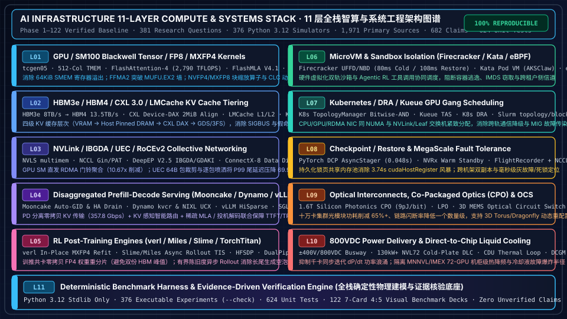

# AI Infrastructure Full-Stack Research & Architecture Workbench

> 🌐 **Language / 语言切换**: **[中文](README.md)** | **[English](README.en.md)** | **[📚 Full 133-Phase Catalog (`docs/full-catalog-en.md`)](docs/full-catalog-en.md)** | **[📚 完整 133 阶段中文全量目录 (`docs/full-catalog-zh.md`)](docs/full-catalog-zh.md)** | **[🗺️ 11-Layer Stack Map (`docs/stack-map.md`)](docs/stack-map.md)**

---

## 📌 Executive Overview Summary

> **Current Verified Baseline (Phase 1 – Phase 133 Complete on `main`, Priority 142 · 414-Question & 409-Experiment-Suite Baseline)**
> This repository delivers an evidence-driven engineering encyclopedia and deterministic simulation workbench across the **11-Layer AI Compute & Systems Stack**, grounded in pinned primary open-source implementations (`implementation`), architectural specifications (`specification`), and zero-dependency Python 3.12 physics/protocol models (`own-offline`):
> - **Scale & Verification Ledger**: **`414` core engineering research questions** (`412 done` + `2 blocked` on paywalled external standards; `414/414` covered by reproducible offline models), **`409` zero-dependency Python 3.12 experiment suites** (`--check`), **`2,301` pinned commit/blob primary source citations** ([`research/sources.json`](research/sources.json)), **`715` graded evidence claims** ([`research/evidence.json`](research/evidence.json)), **`657` passing unit tests**, and **`133` self-contained 7-Card 4:5 visual benchmark decks** (`docs/reports/`, latest **[Phase 134 7-Card Benchmark Deck](docs/reports/ai-infra-phase133-benchmark-cards.html)**).
> - **L01 GPU / SM100 Blackwell Kernels & Low-Precision Numerics**: Deep dives into `tcgen05`, 512-column `TMEM` in-place aliasing (eliminating `64 KiB` SMEM spill), `FlashAttention-4` (`FFMA2` polynomial emulation breaking the `MUFU.EX2` bottleneck to reach **`2,790.1 TFLOPS`** on B200 and **`3,200.0 TFLOPS`** on SM103 B300), `FlashMLA V4.1` (`+32B` TMA row padding eliminating 4-way `LDS.32` bank conflicts and `get_mla_metadata` cutting **`89.88%`** tail-wave skew), `CUTLASS CLC` dynamic work stealing, and `NVFP4/MXFP8` block scaling.
> - **L02 & L04 Tiered KV Cache & Disaggregated Prefill-Decode Serving**: Quantifies the 4-tier KV hierarchy (VRAM → Host Pinned DRAM → CXL 3.0 `Device-DAX` `2 MiB`-aligned arenas → GDS/3FS), `Mooncake Transfer Engine` (ConnectX-8 `Data Direct` zero-lock batching, 7-tier Auto-GID reprobing, and bounded `W=4` Scatter lifting throughput from **`313.0 -> 357.85 Gbps`**), `NVIDIA Dynamo` (2-tier `kvcr` connectors & `NIXL` UCX/Libfabric memory-type hints), `vLLM V1` (`HiSparse` MLA & rejection sampling), and `SGLang` (`HiRadixCache` & `EAGLE-3` speculative trees).
> - **L03 & L09 Supernode Fabrics, `IBGDA` GPU-Initiated RDMA & Co-Packaged Optics (`CPO`/`OCS`)**: Models `PyTorch CUDASymmetricMemory` + `NVLS multimem` (**`6.22x`** traffic reduction over unicast 1-Shot), `NCCL Gin` symmetric collectives & `PAT` binomial trees (`1,023 -> 7` hops at 1,024 GPUs), `DeepEP V2.5` GPU-initiated RDMA (**`10.67x`** doorbell reduction via Warp aggregation), `UEC 1.0` 64B packet trimming (**`69.9%`** lower P99 tail latency under 32-to-1 incast), and `1.6T CPO + 3D MEMS OCS` 100K-GPU optical power/blast-radius models.
> - **L05 & L08 6D Pre-Training, Async RL Post-Training (`verl` / `Slime` / `Miles`) & Fault Tolerance**: Covers `TorchTitan` 6D parallelism, `Megatron-FSDP` (`HFSDP` cutting 120B peak memory from **`244.20 -> 51.01 GiB/GPU`** with **`1.344x`** step speedup via Copy Engine AllGather), `verl` zero-copy in-place `MXFP4` weight refit, `Slime/Miles` bounded-staleness async rollout with token-level `TIS`, `PyTorch DCP AsyncStager` (**`3.737 s -> 0.048 s`** checkpoint staging via persistent pinned shared memory), and `FlightRecorder + NCCL RAS` **`< 650 ms`** silent-hang root-cause triage.
> - **L06, L07, L10 & L11 MicroVM Sandboxes, Topology-Aware Gang Scheduling & 800VDC Liquid Cooling**: Analyzes `Firecracker` / `Kata` / `eBPF` agentic sandbox co-scheduling, Kubernetes `TopologyManager` / `Kueue TAS` / `DRA` / Slurm `topology/block & tree`, `±400V/800VDC` busways + `130kW+` cold-plate DLC thermodynamics and `dP/dt` surge smoothing, and the deterministic verification harness.

---

## 🏗️ 11-Layer AI Compute & Systems Stack Architecture



### Architectural Walkthrough of the 11 Stack Layers

| Layer | Core Technologies & Representative Projects | Primary Physical Bottleneck Solved & Quantitative Impact |
| :--- | :--- | :--- |
| **L01 · GPU/SM100 Blackwell Tensor / FP8 / MXFP4 Kernels** | Blackwell `tcgen05` · `512-Col TMEM` · `FlashAttention-4` · `FlashMLA V4.1` · `FlashInfer Cake/Frost` · `DeepGEMM MegaMoE` · `CUTLASS CLC` | Eliminates `64 KiB` SMEM spill via 512-column TMEM aliasing; breaks the `MUFU.EX2` exponential ceiling via `FFMA2` Horner emulation (`2,790–3,200 TFLOPS`); enforces 512B bijective `NVFP4/MXFP8` block scaling. |
| **L02 · HBM3e/HBM4 / CXL / LMCache KV Tiering** | `HBM3e` (`8 TB/s`) / `HBM4` (`2048-bit`, `13.5 TB/s`) · `CXL 3.0 Device-DAX` · `LMCache` · `KIVI / NVFP4 KV` | Orchestrates 4-tier KV caching (VRAM → Pinned DRAM → CXL DAX → GDS/3FS); pre-validates `/sys/dev/char` `2 MiB` alignment and APC prefix attribution to eliminate `SIGBUS` faults and `37.5%` false L1 hit inflation. |
| **L03 · NVLink / IBGDA / UEC / RoCEv2 Collective Networking** | `NVLS multimem` · `NCCL Gin & PAT` · `DeepEP V2.5 IBGDA/GDAKI` · `ConnectX-8 Data Direct` · `UEC 1.0 Packet Trimming` | Enables direct GPU SM doorbell writes with `10.67x` Warp aggregation; pairs ConnectX-8 `Data Direct` across PCI Roots; cuts 800G 32-to-1 incast P99 tail latency by `69.9%` via UEC 64B packet trimming and packet spraying. |
| **L04 · Disaggregated Prefill-Decode Serving** | `Mooncake Transfer Engine` · `NVIDIA Dynamo (kvcr + NIXL)` · `vLLM V1 (HiSparse)` · `SGLang (HiRadixCache + EAGLE-3)` | Decouples compute-bound Prefill from memory-bandwidth-bound Decode; achieves `357.85 Gbps` zero-copy KV transfer via Mooncake 7-tier Auto-GID + bounded `W=4` scatter; pairs KV-aware routing with sparse MLA and speculative trees. |
| **L05 · RL Post-Training & Hybrid Parallel Engines** | `verl` · `THUDM/slime` · `Miles` · `TorchTitan FlexShard` · `Megatron-Core DualPipe & HFSDP` | Eliminates duplicate HBM weight peaks during Actor→Rollout transitions via `verl` in-place `_mxfp4_staging_data` refit; overlaps long-tail generation via `Slime` partial rollout and token-level importance sampling (`TIS`). |
| **L06 · MicroVM & Sandbox Isolation** | `Firecracker UFFD/NBD` · `Kata Containers (AKSClaw)` · `eBPF Cilium` · `Agentic Sandbox Co-Scheduler` | Enforces hardware-virtualized microVM boundaries (`80 ms` cold start / `108 ms` UFFD snapshot restore) for code-execution and tool-use agents while co-scheduling CPU sandboxes with GPU rollout workers. |
| **L07 · Kubernetes / DRA / Kueue GPU Gang Scheduling** | `K8s TopologyManager` · `Kueue TAS` · `Dynamic Resource Allocation (DRA)` · `Slurm topology/block & tree` · `NVIDIA Device Plugin` | Aligns CPU, GPU, and RDMA NIC NUMA masks via bitwise-AND admission and packs jobs into compact NVLink/Leaf domains; isolates MIG slice-level XID faults via `<UUID, GI, CI>` tuples. |
| **L08 · Checkpoint / Restore & Fault Tolerance** | `PyTorch DCP AsyncStager` · `NVRx In-Process Warm Standby` · `FlightRecorder + NCCL RAS` · `Grey-Failure Straggler Detector` | Compresses `cudaHostRegister` checkpoint stalls from `3.737 s` to `0.048 s` via persistent pinned shared-memory pools; pairs half-world cross-rack replication with `< 650 ms` silent-deadlock patient-zero localization. |
| **L09 · Optical Interconnects, CPO & OCS** | `1.6T Co-Packaged Optics (9 pJ/bit)` · `Linear Pluggable Optics (LPO)` · `3D MEMS OCS` · `ELSFP External Laser` | Cuts pluggable DSP optical power by `65%+`, isolates external laser thermal failure domains (`ELSFP`), and dynamically reconfigures spine topologies via 3D MEMS optical circuit switches. |
| **L10 · 800VDC Power & Direct-to-Chip Liquid Cooling** | `±400V / 800VDC Busway` · `130kW+ NVL72 Cold-Plate DLC` · `CDU Heat Exchanger` · `Slurm Token-Bucket & DCGM Power Brake` | Models CDU secondary loop thermodynamics, 72-GPU MNNVL `IMEX` rack blast radius, and hardware power smoothing + BESS peak shaving against synchronous Tensor Core `dP/dt` power transients. |
| **L11 · Deterministic Benchmark Harness** | `scripts/validate_research.py` · `409 Python 3.12 Experiments` · `657 Unit Tests` · `134 7-Card 4:5 Benchmark Decks` | Pure Python 3.12 standard-library verification engine reproducing all analytical bounds, state machines, and 7-card visual reports offline with zero external dependencies. |

---

## 🗂️ 6 Thematic Domain Summary Tables (Flagship Studies & Deep Dives)

> 💡 **Full 665 KB Encyclopedia Catalog**: The tables below highlight flagship studies across 6 thematic domains. For the complete, unabridged table of all **133 Phases, 414 Research Questions, and 409 Experiment Suites**, open:
> 👉 **[📚 English Complete Component & Phase Catalog (`docs/full-catalog-en.md`)](docs/full-catalog-en.md)** | **[📚 中文全量组件与阶段百科表 (`docs/full-catalog-zh.md`)](docs/full-catalog-zh.md)**

### Domain 1: GPU Silicon, SM90/SM100 Blackwell Kernels & Low-Precision Numerics (L01)

| Deep-Dive Study (中文 / English) | Core Mechanism & Pinned Source Scope | Deterministic Experiment (`experiments/`) |
| :--- | :--- | :--- |
| **[GPU/HBM Execution Model & Memory Hierarchy Foundations](docs/components/gpu-hbm.md)** | SM/Warp scheduling, register pressure, L2 persistence, HBM3e/HBM4 rooflines, and Tensor Core datapaths | [`capacity_roofline`](experiments/capacity_roofline/README.md) |
| **[SM100 Blackwell FMHA & FlashAttention-4 (`CuTe DSL`)](docs/components/sm100-blackwell-fmha-tmem-fa4.md)** | `512`-col `TMEM` aliasing (`sP=nullptr`), 16-Warp register reallocation, and `FFMA2` `ex2` emulation (`2,790 TFLOPS`) | [`sm100_blackwell_fmha_fa4`](experiments/sm100_blackwell_fmha_fa4/README.md) |
| **[FA4 Blackwell SM100 `hdim=256` Backward `M=64` TMEM Packing](docs/components/fa4-sm100-hd256-bwd-m64-tmem-accum-layout.en.md)** · **[中文](docs/components/fa4-sm100-hd256-bwd-m64-tmem-accum-layout.md)** | Eliminates `768/640`-column TMEM overflow and `sdS_xchg` shared-memory roundtrips in `hdim=256` backward pass | [`sm100_blackwell_fmha_fa4`](experiments/sm100_blackwell_fmha_fa4/README.md) |
| **[DeepSeek MLA & FlashMLA V4.1 Paged Decode Kernels](docs/components/deepseek-mla-flashmla-decode-kernels.md)** | SM90/SM100 2-CTA cooperative decode, `W_UK/W_UV` weight absorption (`496–910 FLOP/B`), and `get_mla_metadata` (`-89.9%` skew) | [`flashmla_paged_decode_scheduling`](experiments/flashmla_paged_decode_scheduling/README.md) |
| **[FlashMLA SM100 V4.1 Fused `Norm+RoPE+Attn` & `KVBlockDequantizer`](docs/components/flashmla-sm100-v41-fused-norm-rope-attn-dequant-kv.en.md)** · **[中文](docs/components/flashmla-sm100-v41-fused-norm-rope-attn-dequant-kv.md)** | `+32B` TMA row padding eliminating 4-way `LDS.32` bank conflicts, `e2m1*e4m3` exact BF16 dequant, and `512/480`-col TMEM | [`flashinfer_ds41_mixed_decode_sim`](experiments/flashinfer_ds41_mixed_decode_sim/README.md) |
| **[Blackwell SM100 Block-Scaled Microformats (`NVFP4` vs `MXFP4`)](docs/components/sm100-block-scaled-nvfp4-kernels.md)** | `Sm1xxBlockScaledBasicChunk` 512B atoms, UTCCP `MMA_N=256` padding, and Randomized Hadamard Transform (`RHT+SR`) | [`sm100_block_scaled_nvfp4_gemm`](experiments/sm100_block_scaled_nvfp4_gemm/README.md) · [`fp8_nvfp4_numerics`](experiments/fp8_nvfp4_numerics/README.md) |
| **[CUTLASS SM100 Ptr-Array / Grouped GEMM & `CLC` Dynamic Stealing](docs/components/cutlass-sm100-grouped-gemm-clc-scheduler.md)** | Non-blocking `TensorMapUpdater` (`tensormaps_perform_update<false>`) and 2-stage `clc_response` dynamic group stealing | [`cutlass_sm100_grouped_clc_gemm`](experiments/cutlass_sm100_grouped_clc_gemm/README.md) |
| **[DeepGEMM SM100 `MegaMoE` & `MegaMHC` Manifold Hyper-Connections](docs/components/deepgemm-sm100-mega-moe-mhc-hyperconnection.en.md)** · **[中文](docs/components/deepgemm-sm100-mega-moe-mhc-hyperconnection.md)** | Doubly stochastic Sinkhorn-Knopp MHC routing, CUDA Graph `64B` epoch barriers, and device-side MoE scale swizzling | [`deepgemm_mega_moe_mhc_sim`](experiments/deepgemm_mega_moe_mhc_sim/README.md) |
| **[Hopper → Blackwell → Vera Rubin (`VR200 NVL144` / `HBM4`) Evolution](docs/components/vera-rubin-nvl144-hbm4-architecture.md)** | `HBM4 2048-bit` (`13.5 TB/s`), `NVLink-6` (`3.6 TB/s`), and wafer-scale SRAM (Groq TSP / Cerebras WSE) speculative cascading | [`vera_rubin_hbm4_nvl144_roofline`](experiments/vera_rubin_hbm4_nvl144_roofline/README.md) · [`wafer_sram_gpu_cascaded_serving`](experiments/wafer_sram_gpu_cascaded_serving/README.md) |
| **[Batch-Invariant Deterministic Inference Kernels (`0-ULP`)](docs/components/batch-invariant-deterministic-inference.md)** | Fixed Split-KV / Split-K reduction trees eliminating floating-point non-associativity drift across dynamic batch sizes | [`batch_invariant_deterministic_inference`](experiments/batch_invariant_deterministic_inference/README.md) |

---

### Domain 2: HBM3e/CXL/LMCache Tiered KV Cache & Disaggregated Serving (L02 & L04)

| Deep-Dive Study (English / 中文) | Core Mechanism & Pinned Source Scope | Deterministic Experiment (`experiments/`) |
| :--- | :--- | :--- |
| **[4-Tier KV Cache Offload Hierarchy (VRAM → DRAM → CXL → NVMe/3FS)](docs/components/tiered-kv-cache-offload-hierarchy.md)** | Multi-tier hit-rate Pareto frontiers, PCIe Gen5 / CXL 3.0 bandwidth contention, and async prefetch masking windows | [`tiered_kv_cache_hierarchy`](experiments/tiered_kv_cache_hierarchy/README.md) · [`kv_cache_quant_kivi_nvfp4`](experiments/kv_cache_quant_kivi_nvfp4/README.md) |
| **[LMCache Device-DAX/CXL L1 Alignment & Mooncake OpLog Dedup](docs/components/lmcache-dax-cxl-l1-offset-grpc-codec-mooncake-oplog-dedup.en.md)** · **[中文](docs/components/lmcache-dax-cxl-l1-offset-grpc-codec-mooncake-oplog-dedup.md)** | `/sys/dev/char` `2 MiB` alignment pre-checks, non-overlapping multi-arena partitioning, and APC prefix hit attribution | [`megatron_vit_rope_fp32_nccl_nvls_te_zerotensor_fa4_mooncake_lmcache_dynamo_nixl_phase120`](experiments/megatron_vit_rope_fp32_nccl_nvls_te_zerotensor_fa4_mooncake_lmcache_dynamo_nixl_phase120/run.py) |
| **[Disaggregated Prefill/Decode & KV-Aware Routing](docs/components/disaggregated-kv-routing.md)** | Mooncake / Dynamo prefix-aware KV routing, zero-copy RDMA Write KV handoff, and joint TTFT/TPOT SLO scheduling | [`disaggregated_kv_routing`](experiments/disaggregated_kv_routing/README.md) · [`dynamo_kv_aware_router`](experiments/dynamo_kv_aware_router/README.md) |
| **[Mooncake ConnectX-8 `Data Direct` DMA & `BatchRdmaDeviceCache`](docs/components/mooncake-transfer-engine-cx8-data-direct-rdma.md)** | `mlx5dv_get_data_direct_sysfs_path` top-most PCI Root pairing, eliminating 4,096 hash-lock lookups and cross-root `ENOTSUPP` | [`mooncake_cx8_data_direct_rdma`](experiments/mooncake_cx8_data_direct_rdma/README.md) |
| **[Mooncake 7-Tier Auto-GID Reprobe & Bounded `W=4` Scatter](docs/components/mooncake-rdma-auto-gid-reprobe-bounded-reshard.en.md)** · **[中文](docs/components/mooncake-rdma-auto-gid-reprobe-bounded-reshard.md)** | Docker `172.17/12` GID avoidance, `RdmaCompletionToken` epoch filtering, and bounded scatter resharding (`357.85 Gbps`) | [`mooncake_cx8_data_direct_rdma`](experiments/mooncake_cx8_data_direct_rdma/README.md) |
| **[NIXL UCX VRAM `mem_type` Hints & `cuMemCreate` Libfabric Fallback](docs/components/nixl-ucx-vram-memtype-hint-libfabric-vmm-triton-cdna5-barrier.en.md)** · **[中文](docs/components/nixl-ucx-vram-memtype-hint-libfabric-vmm-triton-cdna5-barrier.md)** | `resolveMemoryTypeConfig` VRAM hints, `cudaUpdateCtxPtr` primary-context fallback, and UCX `8.32x` polling-bias removal | [`megatron_mfsdp_unpadded_hyperconnection_nccl_gin_te_compile_fa4_mooncake_lmcache_dynamo_nixl_phase121`](experiments/megatron_mfsdp_unpadded_hyperconnection_nccl_gin_te_compile_fa4_mooncake_lmcache_dynamo_nixl_phase121/run.py) |
| **[vLLM V1 Unified Token Budget, `HiSparse` MLA & SLO Goodput](docs/components/inference-slo.md)** | Chunked prefill interference bounds, 100% prefix-cache last-block recomputation, and `HiSparse` hierarchical sparse MLA | [`inference_slo_scheduler`](experiments/inference_slo_scheduler/README.md) · [`vllm_v1_sparse_mla_hisparse_sim`](experiments/vllm_v1_sparse_mla_hisparse_sim/README.md) |
| **[SGLang `HiRadixCache`, Dynamic PD Role Switch & `EAGLE-3` Trees](docs/components/ai-infra-innovators-v2.md)** | 3-tier radix cache eviction, lossless one-hot rejection sampling, and hardware-aware speculative tree depth control | [`sglang_hiradix_cache_controller`](experiments/sglang_hiradix_cache_controller/README.md) · [`eagle3_speculative_tree`](experiments/eagle3_speculative_tree/README.md) |

---

### Domain 3: Scale-Up / Scale-Out Fabrics, `IBGDA` RDMA & Optical Interconnects (`UEC` / `CPO` / `OCS`) (L03 & L09)

| Deep-Dive Study (English / 中文) | Core Mechanism & Pinned Source Scope | Deterministic Experiment (`experiments/`) |
| :--- | :--- | :--- |
| **[Interconnect Hierarchy & RDMA Verbs Queue Lifecycle](docs/components/interconnect-network.md)** · **[RDMA Lifecycle](docs/components/rdma-lifecycle.md)** | PCIe / NVLink / InfiniBand / RoCEv2 framing, MR pinning, QP state machine (`RESET→INIT→RTR→RTS`), and CQ completion | [`ring_cut`](experiments/ring_cut/README.md) · [`rail_channel_cut`](experiments/rail_channel_cut/README.md) |
| **[GPU-Initiated RDMA (`IBGDA` / `GDAKI`) & `DeepEP V2.5` Aggregation](docs/components/ibgda-gpu-initiated-rdma.md)** | Per-CTA dedicated RC QPs, direct GPU SM `BlueFlame`/MMIO doorbell writes, and Warp-level `10.67x` doorbell reduction | [`ibgda_gpu_initiated_rdma`](experiments/ibgda_gpu_initiated_rdma/README.md) · [`moe_ep_alltoall`](experiments/moe_ep_alltoall/README.md) |
| **[DeepEP Engram GPU RDMA Get & `HybridElasticSymmetricMemory`](docs/components/deepep-engram-hybrid-elastic-symmetric-memory.md)** | `pidfd_getfd` VMM cross-process mapping & host NUMA memory pooling saving `1,024 GiB` HBM across MoE tables | [`deepep_engram_hybrid_symmetric`](experiments/deepep_engram_hybrid_symmetric/README.md) |
| **[PyTorch `CUDASymmetricMemory` & NVLS `multimem` Hardware Multicast](docs/components/symmetric-memory-multimem-collectives.md)** | `multimem.ld_reduce.acc::f32` / `multimem.st` switch-assisted reduction cutting NVLink traffic by `6.22x` vs 1-Shot P2P | [`symm_mem_multimem_collective`](experiments/symm_mem_multimem_collective/README.md) |
| **[NCCL Device API (`ncclGin`), Copy Engine `P2P_CUMEM` & `PAT` Trees](docs/components/nccl-device-gin-symmetric-collectives.en.md)** · **[中文](docs/components/nccl-device-gin-symmetric-collectives.md)** | `0 SM CTA` Copy Engine DMA (eliminating `10.5%–21.1%` GEMM tail inflation) and `PAT` logarithmic hops (`7` hops at 1,024 GPUs) | [`nccl_gin_symmetric_sim`](experiments/nccl_gin_symmetric_sim/README.md) · [`nccl_ce_p2p_ras_plane`](experiments/nccl_ce_p2p_ras_plane/README.md) · [`nccl_pat_binomial_allgather_rs`](experiments/nccl_pat_binomial_allgather_rs/README.md) |
| **[UEC 1.0 Packet Trimming & Multi-Rail Spraying Congestion Control](docs/components/uec-packet-trimming-switch-buffering.md)** · **[UEC 1.1](docs/components/uec-transport-congestion.md)** | Dynamic Alpha buffer pools on 800G shallow-buffer switches and 64B trimmed headers (`-69.9%` P99 tail latency on 32:1 incast) | [`uec_packet_trimming_buffer`](experiments/uec_packet_trimming_buffer/README.md) · [`uec_fabric_congestion`](experiments/uec_fabric_congestion/README.md) |
| **[In-Network SHARP Collectives & Co-Packaged Optics (`CPO` / `OCS`)](docs/components/in-network-collectives-sharp.md)** · **[Optical CPO/OCS](docs/components/optical-interconnect-cpo-ocs.md)** | Quantum-2/3 SHARP tree saturation & bit-wise drift bounds; 1.6T CPO (`9 pJ/bit`) power savings and 3D MEMS OCS reconfiguration | [`sharp_in_network_collectives`](experiments/sharp_in_network_collectives/README.md) · [`optical_cpo_ocs_fabric`](experiments/optical_cpo_ocs_fabric/README.md) |

---

### Domain 4: 6D Distributed Pre-Training, RL Post-Training (`verl` / `Slime` / `Miles`) & Fault Tolerance (L05 & L08)

| Deep-Dive Study (English / 中文) | Core Mechanism & Pinned Source Scope | Deterministic Experiment (`experiments/`) |
| :--- | :--- | :--- |
| **[6D Training Parallelism & FSDP2/ZeRO State/Communication Mechanics](docs/components/training-parallelism.md)** | TorchTitan `ParallelDims`, FSDP2 per-parameter `DTensor` double-buffered prefetch, and 2D `USP (Ulysses × ZigZag Ring)` | [`training_parallelism`](experiments/training_parallelism/README.md) · [`fsdp2_async_tp_composability`](experiments/fsdp2_async_tp_composability/README.md) · [`context_parallel_usp_zigzag`](experiments/context_parallel_usp_zigzag/README.md) |
| **[Megatron-FSDP (`HFSDP`), `nccl_ub` Zero-SM Preemption & `DualPipe`](docs/components/training-parallelism.md)** | `HFSDP` cuts 120B peak memory from `244.20 -> 51.01 GiB/GPU`; `DualPipe` / `ZB-V` eliminates pipeline bubbles | [`megatron_fsdp_nccl_ub_hfsdp`](experiments/megatron_fsdp_nccl_ub_hfsdp/README.md) · [`zero_bubble_dualpipe`](experiments/zero_bubble_dualpipe/README.md) |
| **[Megatron-Core Auxiliary-Loss-Free MoE & DeepEP EPLB Rebalancing](docs/components/megatron-moe-auxfree-routing-token-drop.md)** | `expert_bias` sign updates, `qb_dual_update`, and dynamic hot-expert replication (`EPLB`) eliminating All-to-All stragglers | [`megatron_moe_auxfree_token_drop`](experiments/megatron_moe_auxfree_token_drop/README.md) · [`deepep_eplb_expert_rebalancing`](experiments/deepep_eplb_expert_rebalancing/README.md) |
| **[RL Post-Training: `verl` Zero-Copy FP4 Refit & `Slime` Async Rollout](docs/components/async-rl-staleness-weight-sync.md)** | In-place `_mxfp4_staging_data` resharding, partial rollout continuation, and token-level importance sampling (`TIS`) | [`rl_rollout_resharding`](experiments/rl_rollout_resharding/README.md) · [`async_rl_staleness_pareto`](experiments/async_rl_staleness_pareto/README.md) |
| **[Distributed Muon Optimizer (Quintic Newton-Schulz) & `FlexShard`](docs/components/distributed-muon-newton-schulz-optimizer.md)** | 5-step BF16 Newton-Schulz orthogonalization ($\kappa: 250 \to 1.02$) and `FSDP-Owner + TP-Gram` communication sharding | [`distributed_muon_optimizer`](experiments/distributed_muon_optimizer/README.md) · [`torchtitan_flexshard_hybridep_sim`](experiments/torchtitan_flexshard_hybridep_sim/README.md) |
| **[PyTorch DCP `AsyncStager`, 3FS/GDS Storage & MegaScale Fault Tolerance](docs/components/pytorch-dcp-async-stager-replication.md)** · **[GDS/DCP](docs/components/storage-checkpoint.md)** | Persistent pinned shared-memory pool cuts checkpoint stalls from `3.737s -> 0.048s`; `FlightRecorder + NCCL RAS` `< 650ms` triage | [`async_dcp_checkpoint_stager`](experiments/async_dcp_checkpoint_stager/README.md) · [`megascale_fault_tolerance`](experiments/megascale_fault_tolerance/README.md) · [`nccl_flight_recorder_hang_triage`](experiments/nccl_flight_recorder_hang_triage/README.md) |

---

### Domain 5: MicroVM Sandboxes (`Firecracker` / `Kata`) & K8s / DRA / Kueue / Slurm Gang Scheduling (L06 & L07)

| Deep-Dive Study (English / 中文) | Core Mechanism & Pinned Source Scope | Deterministic Experiment (`experiments/`) |
| :--- | :--- | :--- |
| **[Agentic RL Tool Sandboxes (Firecracker / Kata / eBPF) Co-Scheduling](docs/components/agentic-sandbox-coscheduling.md)** | Hardware-virtualized microVM UFFD/NBD snapshot cloning, tool-timeout isolation, and GPU-CPU pool sizing | [`agentic_sandbox_coscheduler`](experiments/agentic_sandbox_coscheduler/README.md) |
| **[Cluster Scheduling, Topology Awareness & Multi-Tenant Isolation](docs/components/cluster-orchestration.md)** | Kubelet `TopologyManager` bitwise-AND masks, Kueue TAS hierarchy, Slurm `topology/block & tree`, and MIG XID isolation | [`cluster_orchestration`](experiments/cluster_orchestration/README.md) · [`heterogeneous_cluster_scheduler`](experiments/heterogeneous_cluster_scheduler/README.md) |
| **[GPU ECC Predictive Drain & 10K-GPU Grey-Failure Straggler Detection](docs/components/gpu-ecc-row-remapping-predictive-failure.md)** | NVML Row-Remapper / Page Retirement thresholds, dual-end telemetry cross-correlation, and zero-downtime warm replacement | [`gpu_ecc_predictive_drain`](experiments/gpu_ecc_predictive_drain/README.md) · [`grey_failure_straggler_detector`](experiments/grey_failure_straggler_detector/README.md) |
| **[Confidential Computing GPU (NVIDIA H100/Blackwell TEE) Overhead](docs/components/confidential-gpu-tee.md)** | PCIe bounce-buffer encryption copy tax, SPDM/TDX attestation, and multi-GPU `PPCIE` NVLink confidential domain bounds | [`confidential_gpu_overhead`](experiments/confidential_gpu_overhead/README.md) |

---

### Domain 6: 800VDC Power, Direct-to-Chip Liquid Cooling, AI Factory Economics & Benchmark Harness (L10 & L11)

| Deep-Dive Study (English / 中文) | Core Mechanism & Pinned Source Scope | Deterministic Experiment (`experiments/`) |
| :--- | :--- | :--- |
| **[Rack Power Density, Liquid Cooling (DLC) & MNNVL Blast Radius](docs/components/rack-power-cooling.md)** | 130kW+ NVL72 cold-plate DLC & CDU thermodynamics, 72-GPU `IMEX` fault domains, and Slurm token-bucket surge control | [`rack_power_cooling`](experiments/rack_power_cooling/README.md) · [`rack_power_transients`](experiments/rack_power_transients/README.md) |
| **[Capacity, Token Economics & Goodput (`TorchTitan` MFU & `vLLM` SLO)](docs/components/capacity-economics.md)** | $/1M token training/inference cost accounting, Gamma burstiness queueing headroom, prefix-cache economics, and energy integration | [`capacity_economics`](experiments/capacity_economics/README.md) · [`ai_factory_tco_simulator`](experiments/ai_factory_tco_simulator/README.md) |
| **[AI Infra Innovators (Fireworks / Together / Groq / Cerebras)](docs/components/ai-infra-innovators.md)** · **[v2 Deep Dive](docs/components/ai-infra-innovators-v2.md)** | Block-sparse M3 Attention, Sequoia speculative offload, Groq TSP on-chip SRAM determinism, and Cerebras WSE 2D Mesh | [`innovator_arch_tradeoffs`](experiments/innovator_arch_tradeoffs/README.md) · [`innovator_pareto_v2`](experiments/innovator_pareto_v2/README.md) |
| **[Alibaba Cloud AI Infra ("Tong-Yun-Ge" Full-Stack Architecture)](docs/alibaba-cloud-ai-infra/README.md)** | T-Head Zhenwu PPU / Zhenyue SSD / Yitian CPU, Panjiu AL128 supernode, HPN 7.0 dual-plane RDMA, and PAI tidal scheduling | [`docs/alibaba-cloud-ai-infra/evidence.json`](docs/alibaba-cloud-ai-infra/evidence.json) |
| **[End-to-End Architecture Case](docs/architectures/end-to-end-ai-infra-case.md)** · **[Synthetic Budget](docs/architectures/synthetic-inference-budget.md)** · **[Architect Exercises](docs/learning/exercises.md)** | End-to-end cluster sizing combining memory ledgers, network fabrics, PD disaggregation, rack power, and self-assessment problems | **[📚 Full 131-Phase Catalog (`docs/full-catalog-en.md`)](docs/full-catalog-en.md)** |

---

## 🧪 Verification & Reproducibility Commands

All validation tools and 409 experiment suites use the **Python 3.12 standard library only** (no GPU or third-party packages required):

```powershell
# 1. Run the full unit test suite (669 unit tests)
python -m unittest discover -s tests

# 2. Validate research queue, evidence ledger, source citations, and all Markdown links
python scriptsalidate_research.py

# 3. Run representative deterministic physics & protocol simulations
python experiments\capacity_roofline
un.py --check
python experiments\sm100_blackwell_fmha_fa4
un.py --check
python experiments\disaggregated_kv_routing
un.py --check
python experiments\ibgda_gpu_initiated_rdma
un.py --check
python experimentsi_factory_tco_simulator
un.py --check
```

## 🛡️ Evidence Grading & Publication Boundaries

- **Strict Evidence Separation**: [`research/sources.json`](research/sources.json), [`research/evidence.json`](research/evidence.json), [`research/queue.json`](research/queue.json), and [`research/progress.json`](research/progress.json) separate `announcement`, `specification`, `implementation`, `author-benchmark`, `own-offline`, `own-hardware`, and `unverified` claims. Static source inspection and offline analytical models are never misrepresented as physical GPU cluster benchmarks.
- **Third-Party Rights**: This repository stores original engineering analysis, public source citations, and zero-dependency synthetic models. Third-party trademarks and referenced projects remain the property of their respective owners; see [`THIRD_PARTY_NOTICES.md`](THIRD_PARTY_NOTICES.md) and [`docs/research-operations.md`](docs/research-operations.md).
