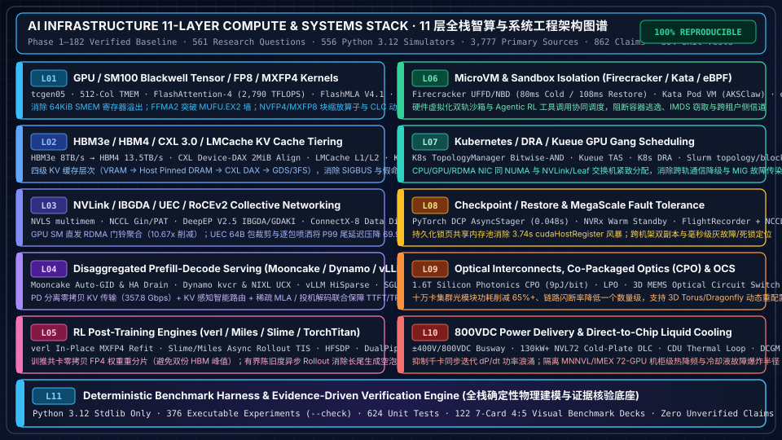
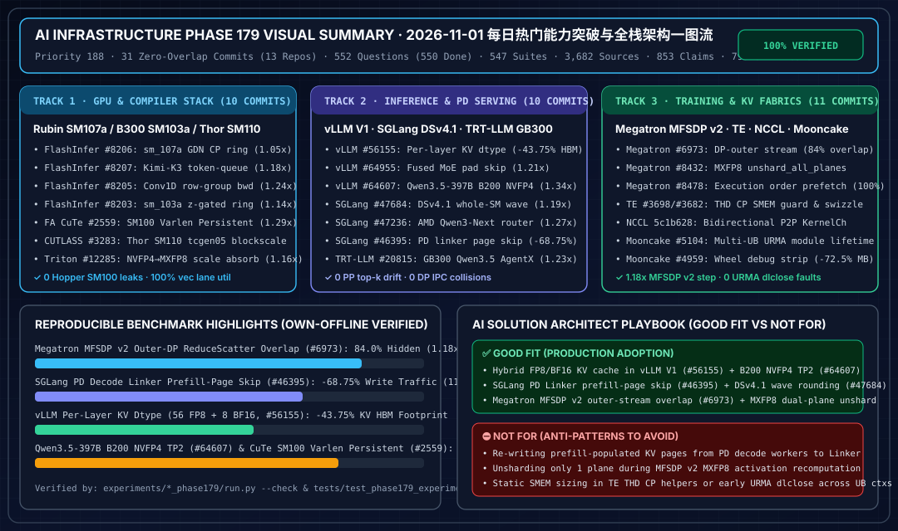
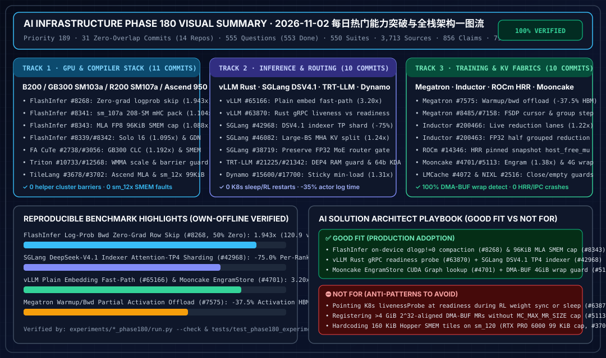
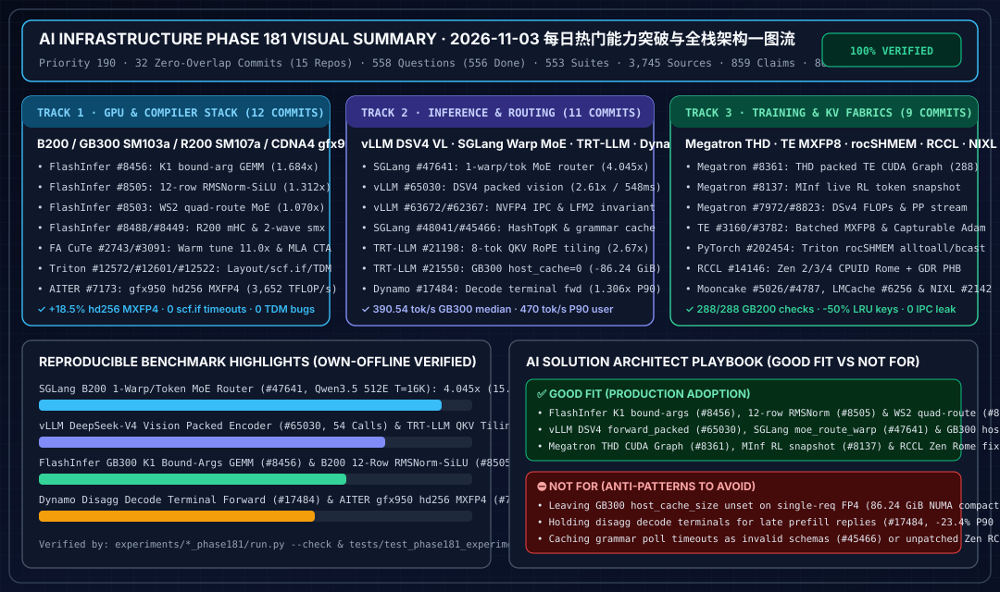
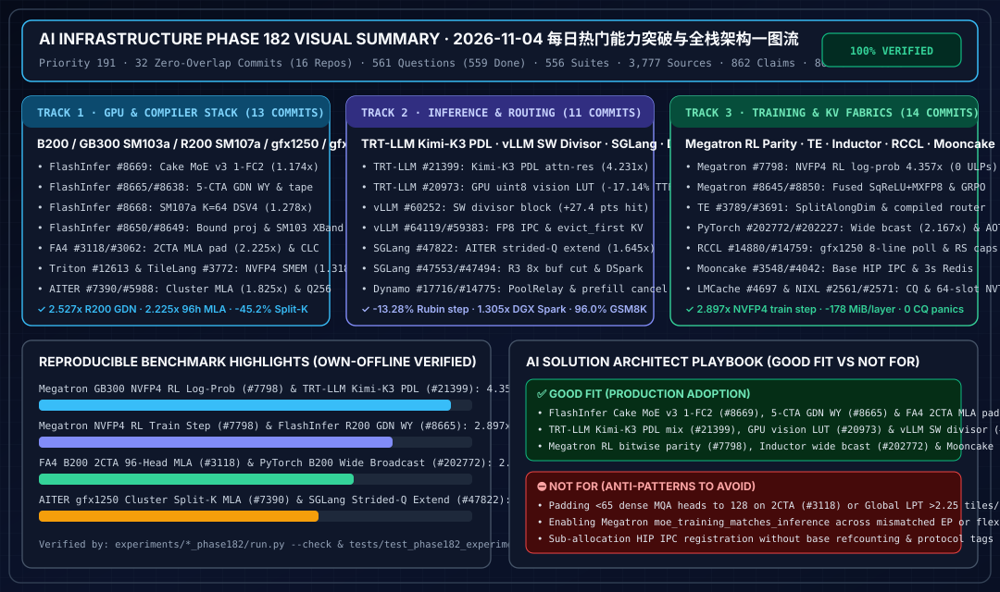
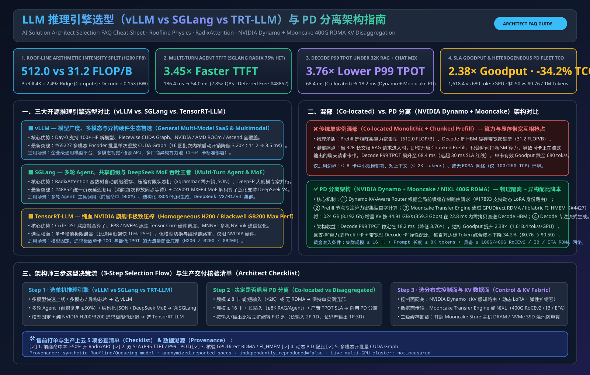
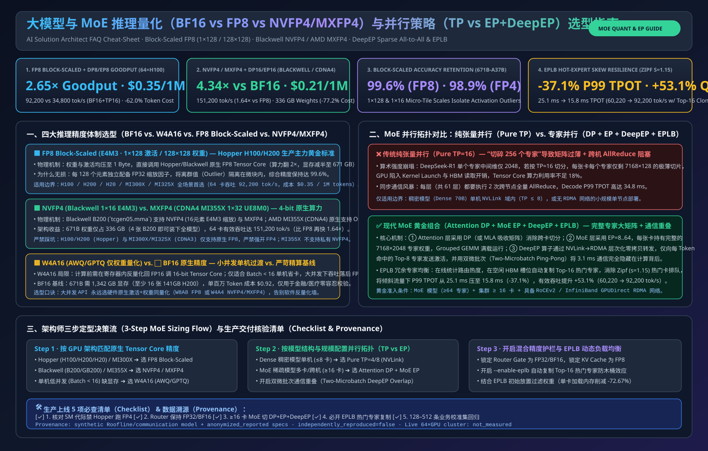
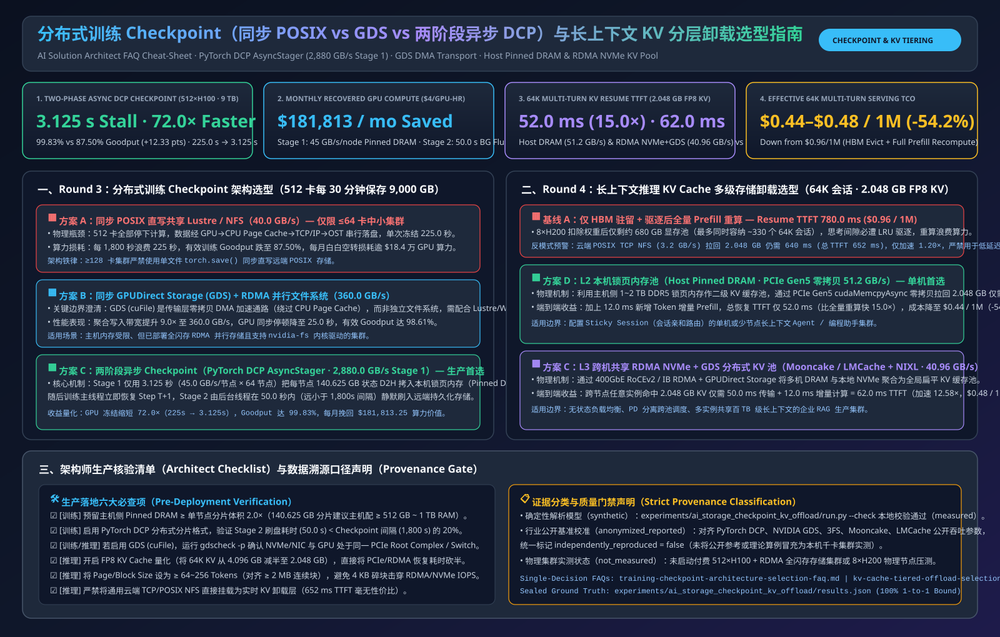

# AI Infrastructure Full-Stack Research & Architecture Workbench

> 🌐 **Language / 语言切换**: **[中文](README.md)** | **[English](README.en.md)** | **[📚 Full 133-Phase Catalog (`docs/full-catalog-en.md`)](docs/full-catalog-en.md)** | **[📚 完整 133 阶段中文全量目录 (`docs/full-catalog-zh.md`)](docs/full-catalog-zh.md)** | **[🗺️ 11-Layer Stack Map (`docs/stack-map.md`)](docs/stack-map.md)**

---

## 📌 Executive Overview Summary

> **Current Verified Baseline (Phase 1 – Phase 186 Complete on `main`, Priority 195 · 567-Question & 563-Experiment-Suite Baseline)**
> This repository delivers an evidence-driven engineering encyclopedia, AI Solution Architect selection FAQ library, and deterministic simulation workbench across the **11-Layer AI Compute & Systems Stack**, grounded in pinned primary open-source implementations (`implementation`), architectural specifications (`specification`), and zero-dependency Python 3.12 physics/protocol models (`own-offline`):
> - **Scale & Verification Ledger**: **`567` core engineering research questions** (`565 done` + `2 blocked` on paywalled external standards; `567/567` covered by reproducible offline models), **`563` zero-dependency Python 3.12 experiment suites** (`--check`), **`3,814` pinned commit/blob primary source citations** ([`research/sources.json`](research/sources.json)), **`868` graded evidence claims** ([`research/evidence.json`](research/evidence.json)), **`813` passing unit tests**, and **`186` self-contained 7-Card 4:5 visual benchmark decks** (`docs/reports/`, latest **[Training Checkpoint & KV Offload Selection 7-Card Benchmark Deck](docs/reports/ai-storage-checkpoint-kv-offload-selection-cards.html)**, **[Large Model & MoE Quantization & Parallelism Selection 7-Card Benchmark Deck](docs/reports/moe-quantization-parallelism-selection-cards.html)**, and **[LLM Inference Engine & PD Disaggregation Selection 7-Card Benchmark Deck](docs/reports/llm-inference-engine-pd-selection-cards.html)**).
> - **L01 GPU / SM100 Blackwell Kernels & Low-Precision Numerics**: Deep dives into `tcgen05`, 512-column `TMEM` in-place aliasing (eliminating `64 KiB` SMEM spill), `FlashAttention-4` (`FFMA2` polynomial emulation breaking the `MUFU.EX2` bottleneck to reach **`2,790.1 TFLOPS`** on B200 and **`3,200.0 TFLOPS`** on SM103 B300), `FlashMLA V4.1` (`+32B` TMA row padding eliminating 4-way `LDS.32` bank conflicts and `get_mla_metadata` cutting **`89.88%`** tail-wave skew), `CUTLASS CLC` dynamic work stealing, and `NVFP4/MXFP8` block scaling.
> - **L02 & L04 Tiered KV Cache & Disaggregated Prefill-Decode Serving**: Quantifies the 4-tier KV hierarchy (VRAM → Host Pinned DRAM → CXL 3.0 `Device-DAX` `2 MiB`-aligned arenas → GDS/3FS), `Mooncake Transfer Engine` (ConnectX-8 `Data Direct` zero-lock batching, 7-tier Auto-GID reprobing, and bounded `W=4` Scatter lifting throughput from **`313.0 -> 357.85 Gbps`**), `NVIDIA Dynamo` (2-tier `kvcr` connectors & `NIXL` UCX/Libfabric memory-type hints), `vLLM V1` (`HiSparse` MLA & rejection sampling), and `SGLang` (`HiRadixCache` & `EAGLE-3` speculative trees).
> - **L03 & L09 Supernode Fabrics, `IBGDA` GPU-Initiated RDMA & Co-Packaged Optics (`CPO`/`OCS`)**: Models `PyTorch CUDASymmetricMemory` + `NVLS multimem` (**`6.22x`** traffic reduction over unicast 1-Shot), `NCCL Gin` symmetric collectives & `PAT` binomial trees (`1,023 -> 7` hops at 1,024 GPUs), `DeepEP V2.5` GPU-initiated RDMA (**`10.67x`** doorbell reduction via Warp aggregation), `UEC 1.0` 64B packet trimming (**`69.9%`** lower P99 tail latency under 32-to-1 incast), and `1.6T CPO + 3D MEMS OCS` 100K-GPU optical power/blast-radius models.
> - **L05 & L08 6D Pre-Training, Async RL Post-Training (`verl` / `Slime` / `Miles`) & Fault Tolerance**: Covers `TorchTitan` 6D parallelism, `Megatron-FSDP` (`HFSDP` cutting 120B peak memory from **`244.20 -> 51.01 GiB/GPU`** with **`1.344x`** step speedup via Copy Engine AllGather), `verl` zero-copy in-place `MXFP4` weight refit, `Slime/Miles` bounded-staleness async rollout with token-level `TIS`, `PyTorch DCP AsyncStager` (**`3.737 s -> 0.048 s`** checkpoint staging via persistent pinned shared memory), and `FlightRecorder + NCCL RAS` **`< 650 ms`** silent-hang root-cause triage.
> - **L06, L07, L10 & L11 MicroVM Sandboxes, Topology-Aware Gang Scheduling & 800VDC Liquid Cooling**: Analyzes `Firecracker` / `Kata` / `eBPF` agentic sandbox co-scheduling, Kubernetes `TopologyManager` / `Kueue TAS` / `DRA` / Slurm `topology/block & tree`, `±400V/800VDC` busways + `130kW+` cold-plate DLC thermodynamics and `dP/dt` surge smoothing, and the deterministic verification harness.

---

## 🏗️ 11-Layer AI Compute & Systems Stack Architecture



### Architectural Walkthrough of the 11 Stack Layers

| Layer | Core Technologies & Representative Projects | Primary Physical Bottleneck Solved & Quantitative Impact |
| :--- | :--- | :--- |
| **L01 · GPU/SM100 Blackwell Tensor / FP8 / MXFP4 Kernels** | Blackwell `tcgen05` · `512-Col TMEM` · `FlashAttention-4` · `FlashMLA V4.1` · `FlashInfer Cake/Frost` · `DeepGEMM MegaMoE` · `CUTLASS CLC` | Eliminates `64 KiB` SMEM spill via 512-column TMEM aliasing; breaks the `MUFU.EX2` exponential ceiling via `FFMA2` Horner emulation (`2,790–3,200 TFLOPS`); enforces 512B bijective `NVFP4/MXFP8` block scaling. |
| **L02 · HBM3e/HBM4 / CXL / LMCache KV Tiering** | `HBM3e` (`8 TB/s`) / `HBM4` (`2048-bit`, `13.5 TB/s`) · `CXL 3.0 Device-DAX` · `LMCache` · `KIVI / NVFP4 KV` | Orchestrates 4-tier KV caching (VRAM → Pinned DRAM → CXL DAX → GDS/3FS); pre-validates `/sys/dev/char` `2 MiB` alignment and APC prefix attribution to eliminate `SIGBUS` faults and `37.5%` false L1 hit inflation. |
| **L03 · NVLink / IBGDA / UEC / RoCEv2 Collective Networking** | `NVLS multimem` · `NCCL Gin & PAT` · `DeepEP V2.5 IBGDA/GDAKI` · `ConnectX-8 Data Direct` · `UEC 1.0 Packet Trimming` | Enables direct GPU SM doorbell writes with `10.67x` Warp aggregation; pairs ConnectX-8 `Data Direct` across PCI Roots; cuts 800G 32-to-1 incast P99 tail latency by `69.9%` via UEC 64B packet trimming and packet spraying. |
| **L04 · Disaggregated Prefill-Decode Serving** | `Mooncake Transfer Engine` · `NVIDIA Dynamo (kvcr + NIXL)` · `vLLM V1 (HiSparse)` · `SGLang (HiRadixCache + EAGLE-3)` | Decouples compute-bound Prefill from memory-bandwidth-bound Decode; achieves `357.85 Gbps` zero-copy KV transfer via Mooncake 7-tier Auto-GID + bounded `W=4` scatter; pairs KV-aware routing with sparse MLA and speculative trees. |
| **L05 · RL Post-Training & Hybrid Parallel Engines** | `verl` · `THUDM/slime` · `Miles` · `TorchTitan FlexShard` · `Megatron-Core DualPipe & HFSDP` | Eliminates duplicate HBM weight peaks during Actor→Rollout transitions via `verl` in-place `_mxfp4_staging_data` refit; overlaps long-tail generation via `Slime` partial rollout and token-level importance sampling (`TIS`). |
| **L06 · MicroVM & Sandbox Isolation** | `Firecracker UFFD/NBD` · `Kata Containers (AKSClaw)` · `eBPF Cilium` · `Agentic Sandbox Co-Scheduler` | Enforces hardware-virtualized microVM boundaries (`80 ms` cold start / `108 ms` UFFD snapshot restore) for code-execution and tool-use agents while co-scheduling CPU sandboxes with GPU rollout workers. |
| **L07 · Kubernetes / DRA / Kueue GPU Gang Scheduling** | `K8s TopologyManager` · `Kueue TAS` · `Dynamic Resource Allocation (DRA)` · `Slurm topology/block & tree` · `NVIDIA Device Plugin` | Aligns CPU, GPU, and RDMA NIC NUMA masks via bitwise-AND admission and packs jobs into compact NVLink/Leaf domains; isolates MIG slice-level XID faults via `<UUID, GI, CI>` tuples. |
| **L08 · Checkpoint / Restore & Fault Tolerance** | `PyTorch DCP AsyncStager` · `NVRx In-Process Warm Standby` · `FlightRecorder + NCCL RAS` · `Grey-Failure Straggler Detector` | Compresses `cudaHostRegister` checkpoint stalls from `3.737 s` to `0.048 s` via persistent pinned shared-memory pools; pairs half-world cross-rack replication with `< 650 ms` silent-deadlock patient-zero localization. |
| **L09 · Optical Interconnects, CPO & OCS** | `1.6T Co-Packaged Optics (9 pJ/bit)` · `Linear Pluggable Optics (LPO)` · `3D MEMS OCS` · `ELSFP External Laser` | Cuts pluggable DSP optical power by `65%+`, isolates external laser thermal failure domains (`ELSFP`), and dynamically reconfigures spine topologies via 3D MEMS optical circuit switches. |
| **L10 · 800VDC Power & Direct-to-Chip Liquid Cooling** | `±400V / 800VDC Busway` · `130kW+ NVL72 Cold-Plate DLC` · `CDU Heat Exchanger` · `Slurm Token-Bucket & DCGM Power Brake` | Models CDU secondary loop thermodynamics, 72-GPU MNNVL `IMEX` rack blast radius, and hardware power smoothing + BESS peak shaving against synchronous Tensor Core `dP/dt` power transients. |
| **L11 · Deterministic Benchmark Harness** | `scripts/validate_research.py` · `409 Python 3.12 Experiments` · `657 Unit Tests` · `134 7-Card 4:5 Benchmark Decks` | Pure Python 3.12 standard-library verification engine reproducing all analytical bounds, state machines, and 7-card visual reports offline with zero external dependencies. |

---

## 🗂️ 6 Thematic Domain Summary Tables (Flagship Studies & Deep Dives)

> 💡 **Full 665 KB Encyclopedia Catalog**: The tables below highlight flagship studies across 6 thematic domains. For the complete, unabridged table of all **133 Phases, 414 Research Questions, and 409 Experiment Suites**, open:
> 👉 **[📚 English Complete Component & Phase Catalog (`docs/full-catalog-en.md`)](docs/full-catalog-en.md)** | **[📚 中文全量组件与阶段百科表 (`docs/full-catalog-zh.md`)](docs/full-catalog-zh.md)**

### Domain 1: GPU Silicon, SM90/SM100 Blackwell Kernels & Low-Precision Numerics (L01)

| Deep-Dive Study (中文 / English) | Core Mechanism & Pinned Source Scope | Deterministic Experiment (`experiments/`) |
| :--- | :--- | :--- |
| **[GPU/HBM Execution Model & Memory Hierarchy Foundations](docs/components/gpu-hbm.md)** | SM/Warp scheduling, register pressure, L2 persistence, HBM3e/HBM4 rooflines, and Tensor Core datapaths | [`capacity_roofline`](experiments/capacity_roofline/README.md) |
| **[SM100 Blackwell FMHA & FlashAttention-4 (`CuTe DSL`)](docs/components/sm100-blackwell-fmha-tmem-fa4.md)** | `512`-col `TMEM` aliasing (`sP=nullptr`), 16-Warp register reallocation, and `FFMA2` `ex2` emulation (`2,790 TFLOPS`) | [`sm100_blackwell_fmha_fa4`](experiments/sm100_blackwell_fmha_fa4/README.md) |
| **[FA4 Blackwell SM100 `hdim=256` Backward `M=64` TMEM Packing](docs/components/fa4-sm100-hd256-bwd-m64-tmem-accum-layout.en.md)** · **[中文](docs/components/fa4-sm100-hd256-bwd-m64-tmem-accum-layout.md)** | Eliminates `792/640`-column TMEM overflow and `sdS_xchg` shared-memory roundtrips in `hdim=256` backward pass | [`sm100_blackwell_fmha_fa4`](experiments/sm100_blackwell_fmha_fa4/README.md) |
| **[DeepSeek MLA & FlashMLA V4.1 Paged Decode Kernels](docs/components/deepseek-mla-flashmla-decode-kernels.md)** | SM90/SM100 2-CTA cooperative decode, `W_UK/W_UV` weight absorption (`496–910 FLOP/B`), and `get_mla_metadata` (`-89.9%` skew) | [`flashmla_paged_decode_scheduling`](experiments/flashmla_paged_decode_scheduling/README.md) |
| **[FlashMLA SM100 V4.1 Fused `Norm+RoPE+Attn` & `KVBlockDequantizer`](docs/components/flashmla-sm100-v41-fused-norm-rope-attn-dequant-kv.en.md)** · **[中文](docs/components/flashmla-sm100-v41-fused-norm-rope-attn-dequant-kv.md)** | `+32B` TMA row padding eliminating 4-way `LDS.32` bank conflicts, `e2m1*e4m3` exact BF16 dequant, and `512/483`-col TMEM | [`flashinfer_ds41_mixed_decode_sim`](experiments/flashinfer_ds41_mixed_decode_sim/README.md) |
| **[Blackwell SM100 Block-Scaled Microformats (`NVFP4` vs `MXFP4`)](docs/components/sm100-block-scaled-nvfp4-kernels.md)** | `Sm1xxBlockScaledBasicChunk` 512B atoms, UTCCP `MMA_N=256` padding, and Randomized Hadamard Transform (`RHT+SR`) | [`sm100_block_scaled_nvfp4_gemm`](experiments/sm100_block_scaled_nvfp4_gemm/README.md) · [`fp8_nvfp4_numerics`](experiments/fp8_nvfp4_numerics/README.md) |
| **[CUTLASS SM100 Ptr-Array / Grouped GEMM & `CLC` Dynamic Stealing](docs/components/cutlass-sm100-grouped-gemm-clc-scheduler.md)** | Non-blocking `TensorMapUpdater` (`tensormaps_perform_update<false>`) and 2-stage `clc_response` dynamic group stealing | [`cutlass_sm100_grouped_clc_gemm`](experiments/cutlass_sm100_grouped_clc_gemm/README.md) |
| **[DeepGEMM SM100 `MegaMoE` & `MegaMHC` Manifold Hyper-Connections](docs/components/deepgemm-sm100-mega-moe-mhc-hyperconnection.en.md)** · **[中文](docs/components/deepgemm-sm100-mega-moe-mhc-hyperconnection.md)** | Doubly stochastic Sinkhorn-Knopp MHC routing, CUDA Graph `64B` epoch barriers, and device-side MoE scale swizzling | [`deepgemm_mega_moe_mhc_sim`](experiments/deepgemm_mega_moe_mhc_sim/README.md) |
| **[Hopper → Blackwell → Vera Rubin (`VR200 NVL144` / `HBM4`) Evolution](docs/components/vera-rubin-nvl144-hbm4-architecture.md)** | `HBM4 2048-bit` (`13.5 TB/s`), `NVLink-6` (`3.6 TB/s`), and wafer-scale SRAM (Groq TSP / Cerebras WSE) speculative cascading | [`vera_rubin_hbm4_nvl144_roofline`](experiments/vera_rubin_hbm4_nvl144_roofline/README.md) · [`wafer_sram_gpu_cascaded_serving`](experiments/wafer_sram_gpu_cascaded_serving/README.md) |
| **[Batch-Invariant Deterministic Inference Kernels (`0-ULP`)](docs/components/batch-invariant-deterministic-inference.md)** | Fixed Split-KV / Split-K reduction trees eliminating floating-point non-associativity drift across dynamic batch sizes | [`batch_invariant_deterministic_inference`](experiments/batch_invariant_deterministic_inference/README.md) |

---

### Domain 2: HBM3e/CXL/LMCache Tiered KV Cache & Disaggregated Serving (L02 & L04)

| Deep-Dive Study (English / 中文) | Core Mechanism & Pinned Source Scope | Deterministic Experiment (`experiments/`) |
| :--- | :--- | :--- |
| **[LLM RLHF / GRPO Post-Training Infrastructure Selection FAQ (`Naive FSDP` vs `Static Ray Pools` vs `HybridEngine 3D Resharding` vs `Async Partial Rollout`)](docs/components/rlhf-post-training-infra-selection-faq.en.md)** · **[中文](docs/components/rlhf-post-training-infra-selection-faq.md)** | 4-tier post-training architecture matrix for 70B GRPO on 64×H100 (`$160/hr`: `Tier 3 HybridEngine verl` co-location + `3.2 s` zero-copy 3D resharding + `cuMemUnmap` Sleep cuts step latency from `612.0 s -> 158.2 s (3.87x)`; for `24K Long-CoT` with a `52.0%` synchronous straggler bubble, `Tier 4 Async Partial Rollout` reuses KV prefixes across steps with `τ<=2` Dual-Clip IS to slash bubble to `8.5%`, step time to `96.4 s`, throughput to `174,037.5 tok/s (6.35x)`, MFU to `73.0%`, and 1,000-step cost from `$27,200 -> $4,284.80`, saving `$22,915.20 (-84.2%)`) | [`rlhf_post_training_infra_selection`](experiments/rlhf_post_training_infra_selection/run.py) |
| **[AI Cluster Optical & Copper Interconnect Selection FAQ (`DAC/AEC Copper` vs `DSP Pluggables` vs `800G LPO` vs `Cold-Plate CPO + 3D MEMS OCS`)](docs/components/ai-cluster-optical-interconnect-selection-faq.en.md)** · **[中文](docs/components/ai-cluster-optical-interconnect-selection-faq.md)** | 4-tier optical/copper fabric selection across 2,048 GPUs (`8,192` × 800G endpoints over 3 years = `26,280 hrs`: `Tier 2 In-Rack DAC/AEC Copper <=7m` cuts lower-tier power from `16.0W -> 2.5W` and saves `$3.56M CapEx`; `Tier 3 800G LPO <=50m` removes in-module PAM4 DSPs to slash Spine PHY latency from `115.0 ns -> 8.0 ns (14.4x)` and 3-year TCO to `$3,923,443.71 (-58.5%)`; `Tier 4 Cold-Plate CPO + Hot-Swap ELS + 3D MEMS OCS` eliminates Spine transceivers and O-E-O conversions, cutting power to `20.89 kW (-84.1%)` and 3-year link flaps from `442.4 -> 36.9 (11.99x reduction)`) | [`ai_cluster_optical_interconnect_selection`](experiments/ai_cluster_optical_interconnect_selection/run.py) |
| **[Multimodal VLM & Long-Video Serving Selection FAQ (`Monolithic TP8` vs `EPD 3-Stage` vs `SHA-256 Vision Cache` vs `4x Token Compression`)](docs/components/multimodal-vlm-serving-selection-faq.en.md)** · **[中文](docs/components/multimodal-vlm-serving-selection-faq.md)** | 4-tier multimodal VLM serving matrix on 16×H100 (`$40/hr`) running a 72B VLM (`ViT-4B + 70B LLM`) on 64-frame video (`16,384` vision tokens: `Tier 2 GPU NVDEC + EPD 3-Stage Disaggregation 2E+8P+6D` isolates Decode from ViT/Prefill bursts to cut P99 TPOT from `385.0 ms -> 34.0 ms (11.3x)`; `Tier 3 + Distributed SHA-256 Vision Embedding Cache` skips ViT on 75% multi-turn hits to reach `680.0 ms` TTFT (`3.24x`) at `100.0%` lossless fidelity; `Tier 4 + 4.0x ToMe/FastV Spatio-Temporal Token Compression` cuts visual tokens to `4,096` and KV memory from `5.41 GB -> 1.47 GB/req (3.68x)`, achieving `245.0 ms` TTFT (`8.98x`), `24.6 req/s` (`7.69x`), and `$0.45 / 1k req (-87.0%)`) | [`multimodal_vlm_serving_selection`](experiments/multimodal_vlm_serving_selection/run.py) |
| **[AI Agent Code Sandbox & Serverless GPU Instant Cold-Start Selection FAQ (`K8s Cold Pull` vs `Lazy OCI + mmap` vs `Firecracker Snapshot` vs `CRIU + cuda-checkpoint`)](docs/components/agentic-sandbox-gpu-coldstart-selection-faq.en.md)** · **[中文](docs/components/agentic-sandbox-gpu-coldstart-selection-faq.md)** | 4-tier sandbox & serverless GPU cold-start selection across 256×H100 (`$2.50/GPU-hr`, `100,000` daily calls, `4.50 s` active work/call, `16 GB` image + `14 GB` weights: `Tier 1 K8s Cold Pull` hits `25,500 ms` P50, forces a `58.0%` idle warm pool, and costs `$186,880/mo`; `Tier 2 SOCI/eStargz + Safetensors mmap` cuts cold start to `5,200 ms (4.90x)`; `Tier 3 Firecracker MicroVM + UFFD Snapshot` provides hardware KVM isolation and `125.0 ms` P50 wake-up (`204.0x`) at `80/host` and `$16.30/1k (-73.8%)`; `Tier 4 CRIU + NVIDIA cuda-checkpoint + 45 GB/s RDMA Weight Stream` restores CUDA context in `75 ms` + weights in `310 ms` for `420.0 ms` P50 wake-up (`60.71x`), `4.0%` warm pool, `86.5%` GPU util, and `$42,340/mo (-77.3%)`) | [`agentic_sandbox_gpu_coldstart_selection`](experiments/agentic_sandbox_gpu_coldstart_selection/run.py) |
| **[AI Server Intra-Node & Supernode Scale-Up Interconnect Selection FAQ (`PCIe Gen5 Switch Tree` vs `8-GPU NVSwitch HGX` vs `72-GPU Copper NVL72 MNNVL` vs `CXL 3.0 Memory Pool`)](docs/components/nvlink-pcie-cxl-scaleup-interconnect-selection-faq.en.md)** · **[中文](docs/components/nvlink-pcie-cxl-scaleup-interconnect-selection-faq.md)** | 4-tier Scale-Up interconnect selection across a 72-GPU pod running 80-layer decode (`160` syncs/token, `TPOT <= 12.0 ms` SLA) and 128K KV expansion (`Tier 1 PCIe Gen5` fits `TP=1/2` saving 30%+ CapEx, but stalls `61.4%` at `TP=8` for `20.20 ms` TPOT and drops to `22 GB/s` across CPU UPI; `Tier 2 8-GPU NVSwitch HGX` `900 GB/s` + `NVLS` cuts `TP=8` comm from `12.40 -> 1.55 ms (8.0x)`, reaching `9.35 ms` TPOT, `428 tok/s/GPU (2.16x)`, and `$1.72/1M (-33.8%)`; `Tier 3 72-GPU Copper NVL72 MNNVL` `130 TB/s` rack fabric eliminates the 18x inter-node RoCE cliff, holding `EP=72` TPOT at `6.20 ms (5.06x faster than multi-node HGX)`, `890 tok/s/GPU (4.49x)`, and `$0.98/1M (-62.3%)`; `Tier 4 CXL 3.0 Type-3 2TB DAX Pool` expands memory at `$4.50/GB (-87%)` and reloads 128K KV in `18.5 ms` at `$1.13/1M (-56.5%)`) | [`nvlink_pcie_cxl_scaleup_selection`](experiments/nvlink_pcie_cxl_scaleup_selection/run.py) |
| **[Large-Scale Distributed Training Parallelism & Memory Optimization Selection FAQ (`DDP/ZeRO-1` vs `Full ZeRO-3` vs `Hybrid FSDP` vs `Megatron 3D + DualPipe`)](docs/components/distributed-training-memory-parallelism-selection-faq.en.md)** · **[中文](docs/components/distributed-training-memory-parallelism-selection-faq.md)** | 4-tier training parallelism matrix on 256×H100 80GB (`$640/hr`) training a 120B model for `1.0T` tokens (`Tier 1 DDP/ZeRO-1` demands `244.20 GB/GPU` unsharded -> OOM, or `58.6%` stall / `28.5%` MFU with PCIe CPU offload; `Tier 2 Full ZeRO-3` shrinks HBM to `46.80 GB` but stalls `44.2%` on per-layer 32-node RoCE `All-Gather` for `36.4%` MFU; `Tier 3 Hybrid FSDP (HFSDP)` shards inside NVLink (`58.40 GB`), cutting step time to `4.35 s (1.48x over ZeRO-3)` at `54.0%` MFU and `$184.3k/1T (-63.1%)`; `Tier 4 Megatron 3D (TP8+DualPipe PP4+DP8)` shrinks PP bubble to `3.8%` at `51.01 GB` HBM, `3.52 s/step (1.83x over ZeRO-3)`, `66.8%` MFU, and `$149.1k/1T (-70.2% / saving $124.1k vs ZeRO-3)`) | [`distributed_training_parallelism_selection`](experiments/distributed_training_parallelism_selection/run.py) |
| **[Enterprise AI GPU Cluster Scheduler & Topology Orchestration Selection FAQ (`Vanilla K8s` vs `Standalone Slurm` vs `Volcano/Kueue Gang` vs `Kueue TAS + K8s DRA`)](docs/components/gpu-cluster-scheduler-orchestration-selection-faq.en.md)** · **[中文](docs/components/gpu-cluster-scheduler-orchestration-selection-faq.md)** | 4-tier scheduler & topology matrix across 512×H100 (8 racks, `$934.4k/mo` lease: `Tier 1 Vanilla K8s` suffers `18.5%` pod-by-pod deadlock and `+38.0%` cross-Spine/UPI penalty for `48.2%` goodput, wasting `$484.0k/mo`; `Tier 2 Standalone Slurm + topology/tree` cuts comm penalty to `+4.5%` but incurs `14.0%` static train/infer silo waste at `74.0%` goodput; `Tier 3 K8s Basic Gang` cuts deadlock to `1.5%` but loses `+24.0%` to rack scatter at `71.5%` goodput; `Tier 4 Kueue TAS + K8s DRA + TopologyManager` packs jobs into single Leaf racks and aligns GPU+NIC PCIe Roots for `0.8%` waste, `+3.2%` comm, `88.6%` goodput (`1.84x`), and `$377,497.60/mo` recovered value (`-45.6%`)) | [`gpu_cluster_scheduler_selection`](experiments/gpu_cluster_scheduler_selection/run.py) |
| **[Billion-Scale Enterprise RAG Vector Search & Hybrid Indexing Selection FAQ (`FP32 HNSW` vs `SQ8/RaBitQ` vs `NVMe DiskANN` vs `GPU cuVS CAGRA`)](docs/components/rag-vector-index-ann-hardware-selection-faq.en.md)** · **[中文](docs/components/rag-vector-index-ann-hardware-selection-faq.md)** | 4-tier vector indexing & hardware matrix per 100M `1,536-dim` shard scaling to 1B vectors (`Tier 1 In-Memory FP32 HNSW` requires `890.9 GB` DRAM/100M, `14.50 hr` build, and `$6,480/mo` [`$64.8k/mo` @ 1B]; `Tier 2 SQ8/RaBitQ Quantized HNSW + Top-100 Rerank` cuts DRAM `3.78x` to `235.6 GB`, P99 to `3.10 ms`, Recall `97.4%`, and cost to `$1,820/mo (-71.9%)`; `Tier 3 NVMe SSD DiskANN Vamana` shrinks DRAM `18.56x` to `48.0 GB` PQ routing + `4KB` coupled SSD reads for `11.80 ms` P99, `95.8%` Recall, and `$580/mo (-91.0% / saving $708k/yr @ 1B)`; `Tier 4 GPU cuVS CAGRA` builds in `0.92 hr (15.76x faster)` with `1.35 ms` P99, `22,400 QPS (12.11x)`, and `$0.04 / 100M queries (-97.0%)`) | [`rag_vector_index_selection`](experiments/rag_vector_index_selection/run.py) |
| **[Confidential AI & Regulated Enterprise GPU TEE Inference Selection FAQ (`Plaintext Container` vs `PII Proxy` vs `Single-GPU CC-On TEE` vs `Multi-GPU PPCIE / Blackwell TEE`)](docs/components/confidential-ai-tee-gpu-security-selection-faq.en.md)** · **[中文](docs/components/confidential-ai-tee-gpu-security-selection-faq.md)** | 4-tier confidential LLM serving matrix for 70B (`TP=1`) and 405B (`TP=8`: `Tier 1 Plaintext Container` leaves HBM & weights `100%` exposed to Host Root; `Tier 2 Application PII Redaction Proxy` suffers `18.5%` residual quasi-identifier leakage and `-6.4%` accuracy loss (`93.6%`); `Tier 3 CPU CVM + Single-GPU H100/H200 CC-On` enforces `SPDM` attestation + `GPU CPR` HBM firewall with only `+4.8%` decode overhead on 70B `TP=1` (`11.20 -> 11.74 ms`, `0.0%` leak, `100.0%` accuracy); `Tier 4 Multi-GPU PPCIE + Blackwell Inline Encrypted NVLink` avoids the `42.60 ms (+280.4%)` naive bounce-buffer cliff on `TP=8`, holding 8-GPU confidential TPOT at `11.90 ms (+6.2%)`) | [`confidential_ai_tee_selection`](experiments/confidential_ai_tee_selection/run.py) |
| **[Thousand-GPU Model Weight & Container P2P Distribution Selection FAQ (`Central Pull` vs `Sharded CDN` vs `Dragonfly P2P Tree` vs `RDMA GDS + NCCL Ring Broadcast`)](docs/components/model-weights-distribution-p2p-registry-selection-faq.en.md)** · **[中文](docs/components/model-weights-distribution-p2p-registry-selection-faq.md)** | 4-tier weight & container rollout matrix across 512×H100 (64 nodes pulling `140GB` weights + `16GB` image = `9,984 GB` cluster payload, 12 rollouts/day: `Tier 1 Central OCI/S3 Pull` stalls for `2,180.0 s (36.3 min)` and wastes `$279,040/mo`; `Tier 2 200G Sharded CDN` takes `440.0 s`; `Tier 3 CNCF Dragonfly / Kraken P2P Tree + Lazy OCI` cuts origin egress by `98.4%` (`156.0 GB`) and finishes in `42.0 s (51.9x)`; `Tier 4 RDMA GDS + Mooncake/NCCL 400G Ring Broadcast` streams HBM-to-HBM at `45.0 GB/s` in `4.20 s (519.05x)` at 64 nodes and `5.10 s` at 256 nodes, cutting idle GPU waste to `$537.60/mo (-99.8% / saving $278.5k/mo)`) | [`model_weight_p2p_distribution_selection`](experiments/model_weight_p2p_distribution_selection/run.py) |
| **[Large-Scale AI Cluster Observability, Straggler & Silent Data Corruption (SDC) Selection FAQ (`Basic Polling` vs `DCGM+XID` vs `FlightRecorder+NCCL RAS` vs `Online SDC Guard`)](docs/components/ai-cluster-observability-silent-corruption-selection-faq.en.md)** · **[中文](docs/components/ai-cluster-observability-silent-corruption-selection-faq.md)** | 4-tier observability & SDC triage matrix across 2,048×H100 (`$3.74M/mo` lease: `Tier 1 Basic Polling + Manual Bisect` takes `8,700s (145m)` to locate hangs with `0.0%` SDC catch and `68.4%` goodput, wasting `$1.18M/mo`; `Tier 2 DCGM + XID Auto-Cordon` cuts hard-fault MTTR to `12.5m` (`82.2%` goodput) but misses `52%` of grey stragglers and `100%` of ALU SDC flips; `Tier 3 PyTorch FlightRecorder + NCCL RAS` pinpoints Patient Zero in `0.65s (650ms)` and catches `98.5%` of stragglers for `91.5%` goodput; `Tier 4 + Pre-AllReduce Norm Gate & 0-ULP Golden-Step Verifier` catches `99.6%` of silent Tensor Core corruptions at `0.35%` overhead, reaching `96.4%` goodput [`94.8%` @ 8,192 GPUs] and saving `$1,046,528/mo (-88.6%)`) | [`ai_cluster_observability_sdc_selection`](experiments/ai_cluster_observability_sdc_selection/run.py) |
| **[Enterprise Agent Structured Output & Constrained Decoding Selection FAQ (`Prompt Retry` vs `Vocab Scan` vs `Outlines FSM` vs `XGrammar + Jump-Forward`)](docs/components/structured-output-constrained-decoding-selection-faq.en.md)** · **[中文](docs/components/structured-output-constrained-decoding-selection-faq.md)** | 4-tier constrained decoding matrix on 70B FP8 (`128,256` vocab, `9.50 ms` unconstrained TPOT, `320-token` nested JSON tool calls: `Tier 1 Prompt Retry` achieves `84.5%` first-try validity and wastes `+38%` retry tokens for `13.11 ms` effective TPOT; `Tier 2 Naive Vocab Scan` stalls CPU `+18.50 ms/step` [`265.0 ms` @ BS=128]; `Tier 3 Outlines Precompiled FSM` cuts 16KB bitmask lookup to `0.45 ms` for `9.95 ms` TPOT; `Tier 4 XGrammar PDA Async Overlap + Jump-Forward` achieves `0.00 ms` exposed mask overhead and skips `35.8%` of deterministic JSON structural tokens, cutting effective TPOT to `6.10 ms` [`1.56x` faster than unconstrained, `2.07x` faster than Sync FSM @ BS=128] and cost from `$4.30 -> $2.10/10k (-51.2%)`) | [`structured_output_constrained_decoding_selection`](experiments/structured_output_constrained_decoding_selection/run.py) |
| **[Hundred-to-Thousand Adapter Multi-LoRA High-Density Serving Selection FAQ (`Merged Replicas` vs `Serial Swap` vs `vLLM BGMV` vs `S-LoRA Unified Paged + MBGMM`)](docs/components/multi-lora-adapter-serving-selection-faq.en.md)** · **[中文](docs/components/multi-lora-adapter-serving-selection-faq.md)** | 4-tier Multi-LoRA serving matrix hosting 128 × `320 MB` vertical adapters on a 70B FP8 base (`Tier 1 Dedicated Merged Replicas` requires `128 GPUs` at `6.8%` util for `$233,600/mo`; `Tier 2 Serial Hot-Swap` breaks batching and inflates P99 TTFT to `1,840.0 ms`; `Tier 3 vLLM Multi-LoRA BGMV` consolidates onto `4 GPUs` [`32.0x`, `$7,300/mo`, `-96.9%`] at `165.0 ms` TTFT and `168.0 req/s`; `Tier 4 S-LoRA Unified Paged Pool + Heterogeneous MBGMM + Async Prefetch` holds `4 GPUs` while cutting P99 TTFT to `92.0 ms` [`118.0 ms` @ 512 active LoRAs] and lifting throughput `1.57x` to `264.0 req/s`, saving `$226,300/mo (-96.9%)`) | [`multi_lora_serving_selection`](experiments/multi_lora_serving_selection/run.py) |
| **[Petabyte-Scale Multimodal Pre-Training Data Loader & Streaming Selection FAQ (`POSIX Small Files` vs `WebDataset Tar` vs `MosaicML MDS / LitData` vs `DALI GPU Decode + GDS`)](docs/components/ai-training-data-loader-storage-pipeline-selection-faq.en.md)** · **[中文](docs/components/ai-training-data-loader-storage-pipeline-selection-faq.md)** | 4-tier data pipeline matrix across 256×H100 (`$467.2k/mo` lease) on a `1.2 PB` multimodal dataset (`Tier 1 POSIX Small Files` chokes MDS at `11.2 GB/s` with `64.5%` GPU starvation, `68.0 min` resume, `22.0%` MFU, and `$301.3k/mo` waste; `Tier 2 WebDataset 1GB .tar + CPU Decode` lifts read BW to `72.0 GB/s` but saturates 128 CPU cores (`26.8%` stall); `Tier 3 MosaicML MDS / LitData` enables `0.40s` $O(1)$ sample-exact mid-epoch resume; `Tier 4 + NVIDIA DALI Hardware nvJPEG/NVDEC + GDS` slashes starvation to `1.8%` at `1,435 samples/s/GPU` [`6.14x` faster than CPU on 1080p video] and `68.2%` MFU, saving `$215,846.40/mo`) | [`ai_training_dataloader_selection`](experiments/ai_training_dataloader_selection/run.py) |
| **[Enterprise LLM API Gateway, Semantic Cache & Cascade Routing Selection FAQ (`Round-Robin` vs `TPM+Exact Cache` vs `KV-Prefix+SemCache` vs `Cascade Router`)](docs/components/llm-api-gateway-semantic-cache-routing-selection-faq.en.md)** · **[中文](docs/components/llm-api-gateway-semantic-cache-routing-selection-faq.md)** | 4-tier AI gateway matrix across 10M monthly requests on 8 replicas (`Tier 1 Stateless Round-Robin` dilutes GPU KV prefix hit rate to `8.1%` [`2.0%` @ 32 replicas] with `1,420.0 ms` P99 TTFT and `$142,000/mo` spend; `Tier 2 TPM + Exact Cache` hits `8.5%`; `Tier 3 KV-Prefix Affinity Router + Verified Semantic Cache` restores KV hits to `64.2% (7.93x)` and serves `26.4%` from cache, cutting P99 TTFT to `310.0 ms` and cost by `44.8%`; `Tier 4 + RouteLLM Cascade Router (8B->70B->671B)` retains `99.2%` quality at `185.0 ms` P99 TTFT (`7.68x`) and slashes monthly spend to `$26,980 (-81.0% / saving $115,020/mo)`) | [`llm_api_gateway_routing_selection`](experiments/llm_api_gateway_routing_selection/run.py) |
| **[Enterprise On-Premises Single-Node, Workstation & Edge LLM Hardware Selection FAQ (`4×RTX 4090` vs `Unified SoC` vs `2×RTX PRO 6000` vs `2×H200 NVL`)](docs/components/edge-on-prem-workstation-llm-deployment-selection-faq.en.md)** · **[中文](docs/components/edge-on-prem-workstation-llm-deployment-selection-faq.md)** | 4-tier on-premises hardware matrix for 70B FP8 + 16K RAG (`Tier 1 4×RTX 4090 96GB DIY` suffers driver-blocked P2P [`16.5 GB/s`], only `20 GB` free KV space, no ECC, and `14.5%` AFR; `Tier 2 Unified Memory SoC Mac Studio 192G / DGX Spark` fits giant MoE at `240W` and `$11,200` 3-yr TCO for 1–3 users but stalls `4,850.0 ms` on 16K prefill; `Tier 3 Dual RTX PRO 6000 Blackwell 96GB×2=192GB ECC` provides `116 GB` KV headroom, `285.0 ms` TTFT, `740 / 1,020 tok/s` @ BS=16/32 [`3.02x~4.86x` over 4×4090], and `$0.34/1M (-68.2%)`; `Tier 4 2×H200 NVL 282GB HBM3e + NVLink` hits `115.0 ms` TTFT, `1,680 tok/s`, and `$0.25/1M`) | [`onprem_edge_workstation_llm_selection`](experiments/onprem_edge_workstation_llm_selection/run.py) |
| **[Ultra-Low-Latency Real-Time Voice Agent Pipeline Selection FAQ (`Serial HTTP` vs `Streaming WebRTC Cascade` vs `Pure Audio S2S` vs `Dual-Stream Inner-Monologue S2S`)](docs/components/voice-realtime-speech-llm-pipeline-selection-faq.en.md)** · **[中文](docs/components/voice-realtime-speech-llm-pipeline-selection-faq.md)** | 4-tier real-time voice agent matrix (`Tier 1 Serial HTTP Cascade` hits `2,480.0 ms` P50 / `3,150.0 ms` P99; `Tier 2 UDP WebRTC Streaming Cascade + Semantic VAD + Clause TTS` cuts P50 to `540.0 ms (4.59x)` with `100.0%` text LLM tool IQ at `$0.028/min`; `Tier 3 Pure Audio-Token S2S` hits `195.0 ms` P50 but loses `-18.5%` reasoning IQ (`81.5%`) due to 100–400Hz audio bloat; `Tier 4 Dual-Stream Inner-Monologue Text+Acoustic S2S` emits a 12.5Hz text token + 8 RVQ codes per 80ms step for `220.0 ms` P50 / `285.0 ms` P99 [`10.88x` faster than TCP WebSocket under 5% mobile packet loss], `45ms` barge-in, and `98.4%` tool IQ) | [`realtime_voice_llm_pipeline_selection`](experiments/realtime_voice_llm_pipeline_selection/run.py) |
| **[GPU Cluster Power Capping, Phase-Aware DVFS & Liquid Cooling TCO Selection FAQ (`Uncapped 700W Air` vs `Static 550W` vs `Phase DVFS` vs `40°C Cold-Plate DLC + Oversub`)](docs/components/gpu-power-capping-dvfs-liquid-cooling-tco-selection-faq.en.md)** · **[中文](docs/components/gpu-power-capping-dvfs-liquid-cooling-tco-selection-faq.md)** | 4-tier power & cooling matrix for 1,024×H200 SXM under a `1.20 MW` facility cap (`Tier 1 Uncapped 700W + Legacy Air PUE 1.48` demands `1.485 MW`, stranding 200 GPUs and risking `+28% di/dt` breaker trips at `$3.90M` 3-yr OPEX; `Tier 2 Static nvidia-smi 550W Cap` cuts GPU power by `-21.4%`, retains `96.6%` speed [`99.1%` Decode], and fits all 1,024 GPUs in `1.115 MW`; `Tier 3 Phase-Aware DVFS [Prefill 650W / Decode 440W / Comm 350W]` retains `99.0%` speed at `1.41x` Tok/J; `Tier 4 40°C Cold-Plate DLC PUE 1.11 + BBU Peak-Shaving + 22% Oversubscription` cuts 1,024-GPU draw to `0.858 MW (-42.2%)`, fits `1,248 GPUs (+424 extra)` in 1.2MW for `121.3% (+40.8pt)` cluster goodput, and saves `$1,647,734` over 3 years) | [`gpu_power_capping_dvfs_cooling_tco`](experiments/gpu_power_capping_dvfs_cooling_tco/run.py) |
| **[AI Cluster Parallel Filesystem & High-Performance Storage Selection FAQ (`CephFS` vs `Lustre` vs `Commercial WEKA/VAST GDS` vs `Open-Source DeepSeek 3FS + USRBIO`)](docs/components/ai-storage-3fs-lustre-weka-parallel-filesystem-selection-faq.en.md)** · **[中文](docs/components/ai-storage-3fs-lustre-weka-parallel-filesystem-selection-faq.md)** | 4-tier parallel filesystem matrix across 180 all-NVMe storage nodes (`16×NVMe + 2×200G RDMA/node`, `7.2 TB/s` raw line rate) serving 1,024×H200 (`Tier 1 CephFS over TCP` bottlenecks on primary-OSD reads at `251 GB/s` and `44.5s` 10TB checkpoint restore; `Tier 2 HPC Lustre` collapses by `-55.8%` from `3.80 TB/s` to `1.68 TB/s` under 500TB shuffled reads due to OS Page Cache LRU lock contention; `Tier 3 Commercial WEKA/VAST GDS` delivers `5,850 GB/s`, `26.5M` IOPS, `1.8s` restore, and N+2 erasure coding at `$3.68M` 3-yr TCO; `Tier 4 Open-Source DeepSeek 3FS [CRAQ All-Replica Reads + USRBIO Zero-Copy Ring + FoundationDB]` hits `6,600 GB/s (91.7% line rate)`, `33.0M` IOPS [`7.33x` Lustre], `1.5s` 10TB restore, `0.42ms` KVCache P99, 2 CPU cores/node, and saves `$1.48M` in licensing) | [`ai_parallel_filesystem_3fs_lustre_weka_selection`](experiments/ai_parallel_filesystem_3fs_lustre_weka_selection/run.py) |
| **[Enterprise RAG & Multi-Hop Reasoning Architecture Selection FAQ (`Naive 512-Tok` vs `Hybrid BM25+Rerank` vs `Contextual / Late-Chunking` vs `LazyGraphRAG On-Demand Subgraph`)](docs/components/graphrag-vs-dense-hybrid-rag-indexing-selection-faq.en.md)** · **[中文](docs/components/graphrag-vs-dense-hybrid-rag-indexing-selection-faq.md)** | 4-tier enterprise RAG matrix across 50,000 docs (`10.0M tokens`, 1,500 daily updates) (`Tier 1 Naive 512-Token Chunking` loses subject context on pronouns [`54.0%`] and fails global synthesis [`24.5%`]; `Tier 2 Hybrid BM25+Dense+Rerank` hits `91.2%` single-hop but only `38.5%` on global/multi-hop; `Tier 3 Contextual Retrieval [Prefix-Cached Header] / Late-Chunking + Rerank` boosts single-hop to `94.6%` and pronoun accuracy to `91.8% (+37.8pt)` at `245ms` P95; `Tier 4 Adaptive Router + Contextual + LazyGraphRAG/LightRAG` cuts offline indexing cost by `-99.2%` [`$38` vs `$4,850` Eager GraphRAG] while achieving `88.5% (+50.0pt)` global/3-hop synthesis accuracy at `680ms` P95 [`6.18x` faster]) | [`enterprise_rag_graphrag_hybrid_selection`](experiments/enterprise_rag_graphrag_hybrid_selection/run.py) |
| **[LLM Low-Precision Pretraining & Continual Pretraining (FP8 / NVFP4 vs. BF16) Selection FAQ (`BF16` vs `Per-Tensor FP8` vs `DeepSeek-V3 Tile/Block FP8` vs `Blackwell MXFP8/NVFP4`)](docs/components/fp8-fp4-low-precision-pretraining-stability-selection-faq.en.md)** · **[中文](docs/components/fp8-fp4-low-precision-pretraining-stability-selection-faq.md)** | 4-tier low-precision pretraining matrix for 671B MoE over 10T tokens on 2,048 GPUs (`Tier 1 Standard BF16` runs at `2,950 tok/s`, `54.0 GB` activation mem, and `$4.59M`; `Tier 2 Coarse Per-Tensor FP8` suffers `-1.4 dB` SQNR under `1,000x` SwiGLU outliers and Hopper WGMMA 13-bit mantissa drift, causing `11 rollbacks/1T` and `+1.85%` loss degradation; `Tier 3 DeepSeek-V3 Fine-Grained FP8 [1×128 Act Tile + 128×128 Weight Block + Nc=128 CUDA Core FP32 Promotion]` achieves `4,366 tok/s (1.48x)`, `0.07%` lossless convergence [0 rollbacks], `28.2 GB (-47.8%)` mem, and saves `$1.49M`; `Tier 4 Blackwell Native MXFP8/NVFP4 + Hadamard + Stochastic Rounding` hits `6,342 tok/s (2.15x)` and saves `$2.455M`) | [`low_precision_fp8_fp4_pretraining_stability`](experiments/low_precision_fp8_fp4_pretraining_stability/run.py) |
| **[Kubernetes Serverless GPU Autoscaling & Sub-2s Cold-Start Selection FAQ (`Vanilla HPA` vs `KEDA+NVMe` vs `CRIU + cuda-checkpoint` vs `ServerlessLLM + RDMA P2P`)](docs/components/k8s-gpu-autoscaling-coldstart-serverless-selection-faq.en.md)** · **[中文](docs/components/k8s-gpu-autoscaling-coldstart-serverless-selection-faq.md)** | 4-tier Serverless GPU cold-start matrix across 24 hosted 70B FP8 models (`70GB` weights, `18GB` image) (`Tier 1 Vanilla HPA on DCGM_GPU_UTIL` reads `94.0%` at `Batch=1`, clamps at `100.0%` under `10x` bursts, and takes `285.0s` to cold-start [65s pull + 22s init + 100s mmap + 98s compile], causing `64.5%` burst timeouts at `$288k/mo`; `Tier 2 KEDA Queue/KV Trigger + Host NVMe & VLLM_CACHE_ROOT` cuts startup to `42.0s (6.79x)` and saves `43.1%`; `Tier 3 CRIU + NVIDIA cuda-checkpoint` evicts initialized CUDA contexts to host DRAM [`0 MB` VRAM] and restores in `4.6s (61.96x)`; `Tier 4 Pre-Warmed 0-VRAM Stub + ServerlessLLM 64MB Aligned DMA + RDMA P2P Weight Streaming` loads 70GB in `1.5s` for `1.8s (158.33x)` total Ready time, `0.0%` burst drops, and `$197,000/mo (-68.4%)` savings) | [`k8s_serverless_gpu_autoscaling_coldstart`](experiments/k8s_serverless_gpu_autoscaling_coldstart/run.py) |
| **[Enterprise LLM Evaluation, Debiased LLM-as-a-Judge & Verifiable Reward (RLVR) Selection FAQ (`BLEU` vs `Single-Pass API Judge` vs `Bidirectional Rubric Judge` vs `RLVR Sandbox + PRM`)](docs/components/llm-eval-judge-verifiable-reward-harness-selection-faq.en.md)** · **[中文](docs/components/llm-eval-judge-verifiable-reward-harness-selection-faq.md)** | 4-tier evaluation & RL reward matrix across 100,000 enterprise samples (`Tier 1 BLEU/ROUGE` fails on equivalent math/code [`48.5%` human agreement]; `Tier 2 Naive Single-Pass API Judge` suffers `28.4%` position-swap flip rate, `+24.0%` verbosity bias, and `31.5%` RL reward-hacking collapse at `$420/100K`; `Tier 3 Self-Hosted Prometheus-2 + (A,B)/(B,A) Swap Gate + 5-Pt Rubric + GLM Length Control` cuts flips to `2.1%`, boosts agreement to `86.4%`, and saves `-95.6% ($18.50/100K)` via Prefix Cache; `Tier 4 Hybrid RLVR Execution Sandbox [Wasm pytest + SymPy + AST] + Step PRM + Debiased Judge` hits `96.8%` human agreement, `0.4%` flip rate, `0.0%` RL hacking, and `680 evals/s`) | [`llm_eval_judge_verifiable_reward_selection`](experiments/llm_eval_judge_verifiable_reward_selection/run.py) |
| **[Multi-Tenant Fractional GPU Sharing & Isolation Selection FAQ (`Time-Slicing` vs `CUDA MPS` vs `Hardware MIG` vs `K8s DRA + HAMi`)](docs/components/multi-tenant-gpu-sharing-mig-mps-dra-selection-faq.en.md)** · **[中文](docs/components/multi-tenant-gpu-sharing-mig-mps-dra-selection-faq.md)** | 4-tier multi-tenant GPU sharing matrix for 56 microservices on NVIDIA H200 (`141 GB`) (`Tier 1 Vanilla K8s Time-Slicing` delivers `142 QPS`, `+215.0%` noisy-neighbor P99 jitter, and `100%` OOM neighbor kill; `Tier 2 NVIDIA CUDA MPS` boosts QPS by `2.35x` [`333.7 QPS`] via spatial SM sharing but suffers a `100%` fatal fate-sharing crash on any client's `XID 31` illegal memory pointer due to a shared GPU page table; `Tier 3 Hardware MIG 7×1g.20gb` physically isolates HBM controllers, L2, and crossbars for `+1.8%` P99 jitter and `0.0%` OOM/XID-31 blast radius; `Tier 4 K8s DRA Dynamic MIG + Intra-Tenant HAMi/MPS` achieves `352.0 QPS (2.48x)`, `88.5%` packing utilization, and fits all 56 services on `8 H200 GPUs` [`-71.4%` GPUs, saving `$480,000/yr`]) | [`multi_tenant_gpu_sharing_mig_mps_dra_selection`](experiments/multi_tenant_gpu_sharing_mig_mps_dra_selection/run.py) |
| **[LLM Attention & State-Space Architecture Evolution Selection FAQ (`Standard GQA-8` vs `Pure Mamba-2/SWA` vs `DeepSeek MLA` vs `3:1 Hybrid Linear/Mamba-2 + MambaRadixCache`)](docs/components/hybrid-linear-attention-mamba-mla-kv-architecture-selection-faq.en.md)** · **[中文](docs/components/hybrid-linear-attention-mamba-mla-kv-architecture-selection-faq.md)** | 4-tier 128K–1M long-context matrix for 70B/80B 64-layer models on 4×H200 (`Tier 1 Standard GQA-8` consumes `32.0 GB` KV/req at 128K, `260 tok/s` Decode, and stalls `310.0s` on 1M prefill; `Tier 2 Pure Mamba-2 / 4K SWA` uses `1.0 GB` state but collapses to `41.5%` on 128K RULER exact needle recall; `Tier 3 DeepSeek MLA 576-Dim Latent + Matrix Absorption` compresses 128K KV by `5.69x` to `5.62 GB`, hits `785 tok/s (3.02x)` Decode, and leads with `97.8%` needle accuracy; `Tier 4 3:1 Hybrid Linear/Mamba-2 [48 Linear + 16 Full-Attn + SGLang MambaRadixCache + FlashInfer KDA]` uses `8.32 GB (3.85x smaller)`, cuts 128K/1M prefill to `2.35s (2.89x) / 54.0s (5.74x)`, hits `950 tok/s (3.65x)` Decode, and retains `96.4%` needle recall) | [`hybrid_linear_attention_mamba_mla_selection`](experiments/hybrid_linear_attention_mamba_mla_selection/run.py) |
| **[Multi-Region Disaster Recovery, Session-Sticky Geo-Routing & Cross-Cloud LLM Bursting Selection FAQ (`Cold DR` vs `Stateless Geo-RR` vs `Metro Multi-AZ` vs `Sticky Geo-Active + 64KB Replay + Burst`)](docs/components/multi-region-disaster-recovery-cross-cloud-llm-serving-selection-faq.en.md)** · **[中文](docs/components/multi-region-disaster-recovery-cross-cloud-llm-serving-selection-faq.md)** | 4-tier multi-region DR matrix for 1,200 RPS 32K multi-turn agents (`Tier 1 Active-Passive Cold DR` suffers `340.0s` RTO and `100%` cutover drops; `Tier 2 Stateless Geo-Round-Robin` slashes KV cache hit rate to `44.0% (-47.2pt)` and inflates P95 TTFT by `6.62x` to `1,590.0ms` at `$6.40M/yr`; `Tier 3 Metro 3-AZ Dark Fiber Shared L2 KV` achieves `1.2s` RTO and `250ms` TTFT; `Tier 4 Bounded-Load Sticky Geo-Routing + 64KB Token-Transcript Replay [128,000x smaller than 8GB raw KV] + P60 Base / P95 Cloud Bursting` sustains `91.2%` KV hit rate, `240.0ms` TTFT, `1.8s` lazy-KV failover RTO, `-99.4%` WAN bandwidth [`0.12 Gbps`], and saves `$2,656,000/yr [-41.5%]`) | [`multi_region_dr_cross_cloud_llm_serving`](experiments/multi_region_dr_cross_cloud_llm_serving/run.py) |
| **[Enterprise LLM Guardrails, Jailbreak Defense & Low-Latency Streaming Moderation Selection FAQ (`CPU Regex` vs `Serial 8B Guard` vs `Speculative Parallel First-Token Gate` vs `Layer-20 Probe + Cedar`)](docs/components/llm-guardrails-safety-moderation-pipeline-selection-faq.en.md)** · **[中文](docs/components/llm-guardrails-safety-moderation-pipeline-selection-faq.md)** | 4-tier guardrails matrix on 70B FP8 (`240ms` base TTFT) across 10,000 red-team & benign prompts (`Tier 1 CPU Regex + 110M BERT` catches only `12.5%` of Base64 jailbreaks and `31.5%` of RAG injections with `18.5%` benign false positives; `Tier 2 Synchronous Serial 8B Input+Full Output Guard` adds `+580.0ms` TTFT penalty [`820.0ms`, `3.42x` slower] and `+25.0%` GPU tax; `Tier 3 Speculative Parallel Input Guard + First-Token Gate + 32-Token Rolling Output Scan` hides `98.6%` of latency [`+8.0ms` net TTFT]; `Tier 4 In-Engine Layer-20 Linear Activation Probe [RepE] + Rolling Scan + Cedar Tool Policy Sandbox` achieves `+1.5ms` net TTFT, `98.4%` jailbreak recall, `97.6%` RAG injection recall, `100.0%` unauthorized tool block, `1.1%` FPR, and `+2.0%` GPU tax) | [`llm_guardrails_parallel_safety_moderation`](experiments/llm_guardrails_parallel_safety_moderation/run.py) |
| **[AI Cluster In-Network Computing (NVLS + IB SHARP) & Collective Offload Selection FAQ (`NCCL Ring` vs `Double Binary Tree` vs `NVLS + IB SHARPv3` vs `Hierarchical SHARP + Cross-DC DiLoCo`)](docs/components/ai-cluster-in-network-computing-sharp-collective-selection-faq.en.md)** · **[中文](docs/components/ai-cluster-in-network-computing-sharp-collective-selection-faq.md)** | 4-tier collective offload matrix on 2,048×H200 SXM (`8×400G NDR`, `400 GB/s` node line rate, 256MB AllReduce) (`Tier 1 NCCL Ring` caps at `200.0 GB/s` algbw due to `2.0x` traffic amplification, stalls `14.8ms / 28.5ms` at 2,048/4,096 GPUs, and burns `20 GPU SMs`; `Tier 2 Double Binary Tree` cuts latency to `6.4ms` but still pays `2.0x` traffic and `20 SMs`; `Tier 3 Intra-Node NVSwitch NVLS + Inter-Node Quantum-2/3 IB SHARPv3` reduces in switch silicon to halve network traffic [`1.0x`], boost algbw by `1.84x` to `368.0 GB/s`, cut latency to `3.2ms (4.62x faster)`, and use only `4 SMs [reclaiming 16 SMs/GPU]`; `Tier 4 Hierarchical Communicator Isolation + Cross-DC DiLoCo H=50` hits `375.0 GB/s`, `57.6%` intra-DC MFU, and lifts 10ms cross-campus MFU from `11.2%` to `53.8%`) | [`in_network_computing_sharp_nvls_collective`](experiments/in_network_computing_sharp_nvls_collective/run.py) |
| **[Enterprise Model Distillation, Verifier-Gated Synthetic Data & Structured Pruning (`671B → 8B`) Selection FAQ (`Raw Logs SFT` vs `Unfiltered Synthetic` vs `RLVR Rejection CoT` vs `Minitron Pruning + Top-128 Logits KD`)](docs/components/synthetic-data-distillation-pruning-pipeline-selection-faq.en.md)** · **[中文](docs/components/synthetic-data-distillation-pruning-pipeline-selection-faq.md)** | 4-tier distillation & pruning matrix compressing a 671B teacher (`89.5%` acc, `$1.80/1M`) into an 8B student (`$0.10/1M`, `-94.4%` cost) (`Tier 1 Raw Human Logs SFT` lacks `<think>` steps and hits only `61.2%` acc with `16.8%` hallucinations; `Tier 2 Unfiltered 1-Pass Synthetic SFT` bakes in `11.4%` teacher errors and suffers `-48.5%` recursive Model Collapse [`54.0%` acc by Gen 3]; `Tier 3 RLVR-Verified Rejection Sampling CoT [Best-of-8 + Sandbox/SymPy Filter + MinHash]` reaches `86.2%` acc [`96.3%` of teacher] and improves to `87.1%` at Gen 3; `Tier 4 Minitron Activation-Importance Pruning [14B/32B→8B] + Online Top-128 Reverse-KL Logits KD` achieves `88.4%` acc [`98.8%` of 671B teacher] and `1.8%` hallucination rate) | [`synthetic_data_distillation_pruning_pipeline`](experiments/synthetic_data_distillation_pruning_pipeline/run.py) |
| **[Long-Horizon AI Agent Memory & State Persistence Selection FAQ (`200K Full-Context Stuffing` vs `Rolling Summary` vs `Flat Vector Store` vs `Pinned Core Block Letta + Bi-Temporal Graph Zep/Graphiti`)](docs/components/agentic-memory-state-persistence-store-selection-faq.en.md)** · **[中文](docs/components/agentic-memory-state-persistence-store-selection-faq.md)** | 4-tier agent memory matrix across 100 sessions (`200,000 tokens` history) (`Tier 1 200K Full-Context Stuffing` costs `$0.420/turn`, stalls `2,850ms` TTFT, and drops to `64.5%` [`38.5%` after 10 updates] due to stale-fact interference; `Tier 2 Rolling Recursive Summary` loses details [`52.0%` static recall, `34.0%` temporal logic]; `Tier 3 Flat Vector Store` suffers stale-chunk cosine collisions [`58.5%` update acc, `29.5%` after 10 updates]; `Tier 4 2K Pinned Core Memory Block [Letta In-Place Edit] + Bi-Temporal Knowledge Graph [Zep/Graphiti valid_from/invalid_at]` achieves `94.8%` state-update accuracy [`+36.3pt`], `93.2%` overall LongMemEval accuracy, `225ms` TTFT [`12.67x` faster], and `$0.005/turn` [`-98.8%` cost]) | [`agentic_memory_state_persistence_selection`](experiments/agentic_memory_state_persistence_selection/run.py) |
| **[High-Throughput Embedding & Cross-Encoder Reranker Serving Architecture Selection FAQ (`Padded PyTorch` vs `CPU ONNX INT8` vs `HF TEI / Infinity Unpadded` vs `TensorRT-FP8 + Matryoshka MRL`)](docs/components/embedding-reranker-serving-hardware-engine-selection-faq.en.md)** · **[中文](docs/components/embedding-reranker-serving-hardware-engine-selection-faq.md)** | 4-tier embedding & reranker matrix on BGE-M3 + Reranker-v2 (`100M` vectors) (`Tier 1 Naive Padded PyTorch` wastes `82.4%` of FLOPs on `[PAD]` zeros at `1,250 docs/s` and `380.0ms` Top-50 rerank P99; `Tier 2 CPU ONNX INT8` serves low-QPS edge nodes; `Tier 3 HuggingFace TEI / Infinity` uses 1D unpadded `cu_seqlens` FlashAttention [`0.0%` padding] for `10,500 docs/s (8.4x)` and `28.5ms` reranking; `Tier 4 TensorRT-FP8 Unpadded CUDA Graphs + Matryoshka MRL [256d INT8 Recall + FP8 Rerank]` hits `18,500 docs/s (14.8x)`, `14.2ms` Top-50 rerank P99 [`26.8x` faster], and shrinks 100M-vector RAM by `16.0x` [`409.6 GB → 25.6 GB`] at `99.6%` NDCG@10) | [`embedding_reranker_serving_engine_selection`](experiments/embedding_reranker_serving_engine_selection/run.py) |
| **[GPU-CPU Heterogeneous Memory Offloading & Single-Node 671B MoE Serving Selection FAQ (`Unified Memory` vs `Weight DMA` vs `FlexGen Zig-Zag` vs `KTransformers / Fiddler CPU-AMX In-Place`)](docs/components/gpu-cpu-host-offload-zero-infinity-flexgen-selection-faq.en.md)** · **[中文](docs/components/gpu-cpu-host-offload-zero-infinity-flexgen-selection-faq.md)** | 4-tier heterogeneous offload matrix for `DeepSeek-R1 671B MoE` on a single `$18,500` server (`1×48GB GPU + Dual-Socket 24-Ch 512GB DDR5 @ 760 GB/s`) (`Tier 1 CUDA Unified Memory` crawls at `0.35 tok/s`; `Tier 2 Layer-Wise Weight DMA` copies `17 GB` of active weights over PCIe per token [`327ms`], capping speed at `2.10 tok/s`; `Tier 3 FlexGen Zig-Zag Offload` sweeps 128 batches per weight load for `310.0 tok/s` offline throughput; `Tier 4 KTransformers / Fiddler In-Place Compute` pins MLA Attention+Shared Experts in GPU VRAM and computes cold routed experts in-place on Dual-Socket CPU AMX at `760 GB/s` DDR5, sending only `32 KB` of activations over PCIe [`531,250x` smaller] for `18.60 tok/s [8.86x faster]` interactive Decode and `6.8s` 16K prefill) | [`gpu_cpu_heterogeneous_moe_offload_selection`](experiments/gpu_cpu_heterogeneous_moe_offload_selection/run.py) |
| **[AI Cluster RoCEv2 Lossless Ethernet Congestion Control & PFC Storm Deadlock Prevention FAQ (`Lossy Go-Back-N` vs `Pure PFC Pause Storm` vs `DCQCN + PFC Watchdog` vs `Spectrum-X / UET Adaptive Spraying`)](docs/components/ai-cluster-roce-pfc-storm-congestion-control-selection-faq.en.md)** · **[中文](docs/components/ai-cluster-roce-pfc-storm-congestion-control-selection-faq.md)** | 4-tier 512-GPU H100 400G RoCEv2 matrix (`50 GB/s` line rate) (`Tier 1 Lossy RoCEv2` triggers RNIC Go-Back-N rollback, collapsing AllReduce to `11.4 GB/s [22.8%]`; `Tier 2 Pure PFC without ECN/Watchdog` causes `6.5` cascading PFC storm deadlocks/month; `Tier 3 DCQCN [ECN 150KB ≪ PFC 1.5MB] + 200ms Watchdog + Rail-Optimized` resolves 99% of micro-bursts via CNP before PFC fires for `41.8 GB/s [83.6%]` AllReduce; `Tier 4 Spectrum-X / UET Per-Packet Adaptive Spraying + ConnectX-7 Out-of-Order DDP` eliminates `42%` static ECMP elephant-flow hash collisions, achieving `47.6 GB/s [95.2%]` AllReduce, `45.2 GB/s [2.48x]` MoE All-to-All, and `0.0` PFC storm outages) | [`roce_pfc_congestion_control_selection`](experiments/roce_pfc_congestion_control_selection/run.py) |
| **[DiT Video Generation & World Model Multi-GPU Serving & Acceleration Selection FAQ (`Naive TP=8 AllReduce` vs `CFG + Pure Ring Attention` vs `xDiT USP [CFG × Ulysses All-to-All]` vs `USP + TeaCache + SageAttention-2`)](docs/components/video-dit-diffusion-serving-usp-teacache-selection-faq.en.md)** · **[中文](docs/components/video-dit-diffusion-serving-usp-teacache-selection-faq.md)** | 4-tier 8×H100 SXM5 (`$28.80/hr`) 14B Video DiT matrix on 720p 5s video (`75,600` 3D spatiotemporal tokens, `50` steps, `CFG=2`, `420.0s` on 1 GPU) (`Tier 1 Naive TP=8` triggers `8,000` full-sequence AllReduces [`3.02 TB/video`], stalling `38.5%` on comm at `58.4s` and `$467.50/1k`; `Tier 2 CFG=2 + Pure Ring=4` hits `34.2s`; `Tier 3 xDiT USP [CFG=2 × NVLink Ulysses=4]` uses `All-to-All` head transpose to cut traffic by `4x` [`7.8%` comm] for a lossless `2.58x` speedup [`22.6s`, `84.3%` VBench]; `Tier 4 USP + TeaCache Residual Caching [50→22 steps, 56% skipped] + SageAttention-2 [Mean-Smoothed INT8 QK^T + FP8 PV]` cuts latency to `6.8s [8.59x vs TP=8 / 61.8x vs 1 GPU]`, reaches `529.4 videos/hr`, and slashes cost by `-88.4% [$54.40/1k]` at `84.1% [-0.2pt]` VBench) | [`video_dit_usp_teacache_serving_selection`](experiments/video_dit_usp_teacache_serving_selection/run.py) |
| **[LLM GPU Kernel Execution Graph & Compilation Stack Selection FAQ (`PyTorch Eager` vs `Monolithic Static CUDA Graphs` vs `torch.compile + Piecewise CUDA Graphs` vs `Persistent Megakernel + PDL`)](docs/components/cuda-graphs-torch-compile-megakernel-execution-selection-faq.en.md)** · **[中文](docs/components/cuda-graphs-torch-compile-megakernel-execution-selection-faq.md)** | 4-tier 8×H100 SXM5 (`$28.80/hr`) 70B FP8 Decode matrix (`80 layers, TP=8, BS=8`) (`Tier 1 PyTorch Eager` issues `480` kernel launches/token where `8.5µs` CPU dispatch exceeds `3.2µs` GPU execution, leaving GPUs idle `62.4%` of the time at `24.8ms` TPOT [`40.3 tok/s`]; `Tier 2 Monolithic 38-Bucket Static CUDA Graphs` hits `11.2ms` but wastes `18.6 GB/GPU` VRAM and breaks on dynamic shapes; `Tier 3 torch.compile [Triton Fusion 480→165 ops] + vLLM V1 Piecewise CUDA Graphs` slashes graph VRAM to `2.4 GB/GPU [saving 16.2 GB/GPU]` and cuts TPOT `3.06x` to `8.1ms [123.5 tok/s]`; `Tier 4 Persistent Megakernel + Hopper/Blackwell PDL Overlap` cuts launches to `16/tok`, bubble to `0.9%`, TPOT to `5.4ms [185.2 tok/s, 4.60x]`, and cost by `-78.2% [$5.40/1M]`) | [`cuda_graphs_torch_compile_megakernel_selection`](experiments/cuda_graphs_torch_compile_megakernel_selection/run.py) |
| **[Large-Scale MoE Expert Parallelism All-to-All Engine & GPU-Initiated RDMA (`DeepEP` / `IBGDA`) Selection FAQ (`Standard NCCL Host Proxy` vs `Baseline NVSHMEM` vs `DeepEP NVLink→RDMA` vs `DeepEP Pure-IBGDA + 0-SM Hook + EPLB`)](docs/components/moe-deepep-ibgda-nvshmem-alltoall-engine-selection-faq.en.md)** · **[中文](docs/components/moe-deepep-ibgda-nvshmem-alltoall-engine-selection-faq.md)** | 4-tier 64×H800/H100 (`8 nodes × 8×400Gbps RDMA, EP=64`) `DeepSeek-V3/R1 671B` (`58` MoE layers) matrix (`Tier 1 Standard NCCL All-to-All` stalls `385.0µs/layer` [`22.3ms/tok`] on Host CPU proxy doorbell polling, hijacks `24 GPU SMs`, and caps Prefill BW at `18.5 GB/s [37%]` for `28.4ms` TPOT; `Tier 2 Baseline NVSHMEM` takes `210.0µs/layer` and `16 SMs`; `Tier 3 DeepEP High-Throughput Normal Kernel [NVLink Gather → RDMA Forwarding + IBGDA]` coalesces packets by `8x` to hit `46.2 GB/s [92.4% line rate]` using `8 SMs`; `Tier 4 DeepEP Low-Latency Pure-IBGDA + Two-Microbatch 0-SM Hook Overlap + EPLB Hot-Expert Replication` cuts layer comm `6.02x` to `64.0µs`, uses `0 GPU SMs` during background DMA overlap, cuts expert skew from `38.0% → 4.2%`, reaches `6.9ms` TPOT [`4.12x` faster] & `185.5 tok/s/GPU`, and cuts cost by `-75.7% [$360/1B]`) | [`moe_deepep_ibgda_alltoall_selection`](experiments/moe_deepep_ibgda_alltoall_selection/run.py) |
| **[Long-CoT & Test-Time Compute Scaling Inference Selection FAQ (`Unbounded Best-of-16` vs `Static N=8 Majority Vote` vs `Step-Level PRM Beam Search + Early-Exit` vs `Difficulty Router + RadixAttention Shared Tree`)](docs/components/test-time-compute-long-cot-prm-routing-selection-faq.en.md)** · **[中文](docs/components/test-time-compute-long-cot-prm-routing-selection-faq.md)** | 4-tier 8×H100 SXM5 (`$28.80/hr`) 70B Reasoning + 7B PRM matrix on mixed enterprise traffic (`50% Easy / 35% Med / 15% Hard`) (`Tier 1 Unbounded Best-of-16` generates `204,800 tokens/query` via easy-query overthinking, consumes `84.0 GB` KV VRAM, and stalls `68.5s` P95 at `$1,420/10k`; `Tier 2 Static N=8 Majority Vote` drops to `87.6%` acc under common hallucinations; `Tier 3 Step-Level 7B PRM Beam Search + Entropy H<0.08 Early-Exit` prunes 56% dead-end tokens, cuts P95 to `11.2s`, and lifts acc to `91.4% [+3.2pt]`; `Tier 4 1.5ms Difficulty Router + SGLang RadixAttention Zero-Copy Shared Tree + PRM` cuts tokens by `27.3x [7,500 tok]`, shrinks KV VRAM by `20.0x [4.2 GB]`, reaches `5.8s` P95 [`11.8x` faster], hits `92.1% [+3.9pt]` accuracy, and slashes cost by `-95.9% [$58/10k]`) | [`test_time_compute_long_cot_routing_selection`](experiments/test_time_compute_long_cot_routing_selection/run.py) |
| **[Enterprise Multimodal Document Intelligence (PDF / Financial Tables / Charts OCR & VLM Parsing) Pipeline Selection FAQ (`PyMuPDF/Tesseract` vs `MinerU/Docling` vs `Uniform 7B VLM` vs `Adaptive Page Router + OlmOCR Anchored VLM + ColQwen2`)](docs/components/document-intelligence-ocr-vlm-parsing-pipeline-selection-faq.en.md)** · **[中文](docs/components/document-intelligence-ocr-vlm-parsing-pipeline-selection-faq.md)** | 4-tier 1,000,000-page enterprise PDF ingestion matrix (`60% Multi-Col Text / 25% Merged Financial Tables / 15% Charts & Scans`) (`Tier 1 PyMuPDF + CPU Tesseract` scrambles 2-column order, shatters merged tables [`42.5%` TEDS], drops charts [`14.0%`], and caps RAG QA at `54.2%`; `Tier 2 MinerU / Docling Multi-Stage Pipeline` hits `86.4%` Table TEDS at `18.5 pages/s` and `$125/1M pages`; `Tier 3 Uniform End-to-End 7B VLM` crawls at `2.4 pages/s` [`$960/1M pages`] and suffers `3.8%` digit transposition/hallucination on dense financial tables; `Tier 4 1ms Page-Complexity Router + MinerU HTML + OlmOCR Coordinate-Anchored 7B VLM + ColQwen2 Visual Patch Index` slashes digit error `12.7x` to `0.3%`, achieves `94.6%` Table TEDS & `93.8% [+39.6pt]` RAG QA accuracy at `24.8 pages/s [10.3x faster]` and `$92.00/1M pages [-90.4% vs uniform VLM]`) | [`document_intelligence_ocr_vlm_pipeline_selection`](experiments/document_intelligence_ocr_vlm_pipeline_selection/run.py) |
| **[Heterogeneous GPU Cluster (`NVIDIA H100/B200` + `AMD MI300X/MI325X`) Compiler Stack & Cross-Vendor PD Disaggregation Selection FAQ (`Naive HIPIFY` vs `ONNX/OpenXLA` vs `Triton/TileLang + AMD AITER` vs `Cross-Vendor PD Split [H100 Prefill + MI300X 192GB Decode]`)](docs/components/heterogeneous-gpu-rocm-cuda-triton-tilelang-stack-selection-faq.en.md)** · **[中文](docs/components/heterogeneous-gpu-rocm-cuda-triton-tilelang-stack-selection-faq.md)** | 4-tier `8×H100-80GB (3.35 TB/s)` & `8×MI300X-192GB (5.30 TB/s, 1.53TB/node)` 70B FP8 32K matrix (`Tier 1 Naive HIPIFY Port` suffers `8-XCD` L2 cache thrashing and `64KB` LDS overflow at `41.5%` BW util and `1,120 tok/s`; `Tier 2 Static ONNX/OpenXLA` loses PagedAttention [`64` 32K sessions]; `Tier 3 OpenAI Triton / TileLang + AMD AITER [Wavefront-64 + 8-XCD Swizzling]` lifts BW util to `82.4%` and throughput `2.54x` to `2,850 tok/s`; `Tier 4 Cross-Vendor Heterogeneous PD Disaggregation [H100 Compute-Bound Prefill + MI300X 1.53TB Bandwidth/Capacity-Bound Decode via Mooncake 400G RoCEv2]` hits `89.6%` BW util, `3,840 tok/s [3.43x]`, `260` concurrent 32K sessions/node, `7.4ms` P99 TPOT, and `$1.48/1M tokens [-72.4%]`) | [`heterogeneous_gpu_rocm_cuda_triton_stack_selection`](experiments/heterogeneous_gpu_rocm_cuda_triton_stack_selection/run.py) |
| **[Enterprise Domain Continual Pre-Training (CPT) & Catastrophic Forgetting Prevention Selection FAQ (`Naive Full-FT` vs `QLoRA/DoRA` vs `25% Replay + WSD CPT` vs `GaLore Full-Rank Projection + DARE-TIES Model Merging`)](docs/components/continual-pretraining-lora-galore-forgetting-selection-faq.en.md)** · **[中文](docs/components/continual-pretraining-lora-galore-forgetting-selection-faq.md)** | 4-tier `Llama-3.3-70B` (`86.0%` general baseline) 20B-token domain CPT matrix (`Tier 1 Naive 100% Domain Full-FT` suffers `-28.4 pts` catastrophic forgetting [`57.6%` general] and demands `1,120 GB` VRAM [`16×H100`, `$25,800`]; `Tier 2 QLoRA / DoRA [r=64]` fits in `46.5 GB` (`1×H100`) but hits an FFN capacity ceiling at `64.2%` domain mastery; `Tier 3 Full-CPT + 25% Replay + WSD + 0.1x Embed LR` reaches `87.5%` domain and `84.2%` general; `Tier 4 GaLore Full-Rank Low-Rank Gradient Projection + 20% Replay + Post-CPT DARE-TIES Model Merging` shrinks VRAM by `-73.7%` to `295 GB [4×H100]` and cost by `-78.9% [$6,800]`, achieving `89.4% [+25.2pt vs LoRA]` domain mastery and `85.6% [-0.4pt near-zero forgetting]` general retention) | [`continual_pretraining_lora_galore_forgetting_selection`](experiments/continual_pretraining_lora_galore_forgetting_selection/run.py) |
| **[AI Cluster Day-0 Burn-In, Acceptance Testing & Straggler Isolation Selection FAQ (`Basic nvidia-smi Smoke` vs `Single-Node DCGM L4` vs `Hierarchical nccl-tests + Pairwise Bisection` vs `48h 700W Shock Burn-In + 90s Pre-Flight Gate`)](docs/components/ai-cluster-burn-in-acceptance-dcgm-nccl-validation-selection-faq.en.md)** · **[中文](docs/components/ai-cluster-burn-in-acceptance-dcgm-nccl-validation-selection-faq.md)** | 4-tier 1,024-GPU H100/H200 liquid-cooled cluster (`$2,560/hr`, `64` latent infant-mortality defects) matrix (`Tier 1 Basic nvidia-smi + 5-Min Smoke` misses `78%` of defects, causing `14.2` Month-1 crashes, `1,110 min [18.5h]` straggler hunts, `34.8%` MFU, and `$412,000` waste; `Tier 2 Single-Node DCGM L4` misses cross-rack optics and multi-hour thermal soak; `Tier 3 Hierarchical nccl-tests + 2-Round Overlapping Pairwise Ring & O(log N) Bisection` isolates any straggler in `4.5 min [246x faster]`; `Tier 4 Day-0 48h 700W Square-Wave Thermal-Shock SuperBench + Pre-FEC BER Gate + Day-1 90s Pre-Flight Auto-Swap` catches `99.2%` of defects before sign-off, auto-swaps degraded nodes in `1.2 min`, cuts Month-1 crashes to `0.2`, lifts MFU to `58.6% [+23.8pt]`, and saves `$388,000` in Month 1 alone) | [`ai_cluster_burnin_acceptance_dcgm_validation_selection`](experiments/ai_cluster_burnin_acceptance_dcgm_validation_selection/run.py) |
| **[Enterprise AI Agent Tool-Use (`MCP`) & Programmatic Execution Gateway Selection FAQ (`500-Schema Serial ReAct` vs `Vector Top-15 Retrieval` vs `Deferred Tool Search + KV-Pinned Gateway` vs `CodeAct Sandbox Loop + Output Projection`)](docs/components/agentic-tool-use-mcp-parallel-execution-gateway-selection-faq.en.md)** · **[中文](docs/components/agentic-tool-use-mcp-parallel-execution-gateway-selection-faq.md)** | 4-tier enterprise MCP gateway matrix across `25 MCP Servers` (`500` tools = `65,000` schema tokens, 12-call workflow) (`Tier 1 Full 500-Schema Stuffing + 13-Turn Serial ReAct` burns `210,000 tokens/task` and `38.5s` while attention dilution drops success to `61.5%` at `$420/1k tasks`; `Tier 2 Static Turn-0 Vector Top-15` misses mid-task cross-domain tools [`78.4%`]; `Tier 3 Deferred Tool Discovery [tool_search] + Sticky KV-Pinned Gateway` cuts schema tokens by `98.5%` and preserves a `96.5%` KV hit rate across API waits [`8.2s`, `88.6%`]; `Tier 4 Deferred Search + CodeAct Sandbox Loop [1 Script Runs 12 Calls & Filters 216KB JSON in RAM] + JMESPath Projection` compresses LLM turns from `13 → 2`, cuts tokens by `22.8x [9,200 tok]`, slashes latency `10.1x` to `3.8s`, reaches `94.2% [+32.7pt]` success, and cuts cost by `-95.6% [$18.50/1k]`) | [`agentic_mcp_tool_execution_gateway_selection`](experiments/agentic_mcp_tool_execution_gateway_selection/run.py) |
| **[Ultra-Long-Context (`128K–1M`) KV Cache Quantization & Dynamic Query-Aware Sparse Attention Selection FAQ (`Uncompressed BF16` vs `Permanent Eviction H2O/SnapKV` vs `Calibrated FP8 / KIVI` vs `FP8 KV + Quest Page-Bounding-Box Dynamic Sparse`)](docs/components/long-context-kv-cache-compression-quantization-selection-faq.en.md)** · **[中文](docs/components/long-context-kv-cache-compression-quantization-selection-faq.md)** | 4-tier 8×H100 `Llama-3.3-70B` `128K` Multi-Turn RULER matrix (`Tier 1 Uncompressed BF16 KV` consumes `40.0 GB/req` and reads `40.0 GB` HBM/step, crawling at `18.5 tok/s` with `14` max sessions; `Tier 2 Permanent Eviction H2O / SnapKV` deletes 75% of tokens after Turn 1, crashing by `-37.8 pts` to `58.4%` recall when Turn 2 shifts focus; `Tier 3 Calibrated FP8 E4M3 / Asymmetric KIVI [Per-Channel K + Per-Token V]` retains 100% of tokens at `20.0 GB/req`, `36.4 tok/s`, and `95.8%` recall; `Tier 4 Calibrated FP8 KV + Quest [K_min, K_max] Page-Bounding-Box Dynamic Sparse Attention` retains 100% of tokens while reading only the Top-12.5% [`2.5 GB/step`, `16.0x` less HBM read] query-relevant pages per step—reaching `108.0 tok/s [5.84x faster]`, `95.6% [+37.2pt]` multi-turn recall, and `$5.04/1M tokens [-83.6%]`) | [`long_context_kv_cache_compression_quantization_selection`](experiments/long_context_kv_cache_compression_quantization_selection/run.py) |
| **[LLM Inference Request Scheduling, Stall-Free Chunked Prefill & Preemption Selection FAQ (`Static Batching` vs `Prefill-Prioritized Continuous + Recompute` vs `Sarathi Chunked Prefill + Swap` vs `vLLM V1 Zero-Overhead Async + 85% Watermark Gate`)](docs/components/llm-request-scheduling-chunked-prefill-slo-preemption-selection-faq.en.md)** · **[中文](docs/components/llm-request-scheduling-chunked-prefill-slo-preemption-selection-faq.md)** | 4-tier 8×H100 `70B FP8` mixed 2K chat + 32K RAG burst matrix under dual SLOs (`TTFT<=1.5s, P99 TPOT<=45ms`) (`Tier 1 Static Batching` wastes `42.0%` on padding at `4.2 req/s` goodput; `Tier 2 Prefill-Prioritized Continuous + Recompute [vLLM v0]` freezes all 64 active streams for `1,840.0ms` on 32K Prefill bursts and wastes `24.5%` FLOPs on recompute preemption thrashing [`9.8 req/s` goodput]; `Tier 3 Sarathi Stall-Free Chunked Prefill [Budget=2048 Piggybacks 64 Decodes] + DRAM Swap` cuts P99 TPOT `43.8x` to `42.0ms` at `26.4 req/s` goodput; `Tier 4 vLLM V1 Zero-Overhead Async CPU-GPU Overlap [3.5ms→0.1ms CPU stall] + 85% KV Watermark Gate [0.2% preemption] + Dynamic Chunking` achieves `28.5ms` P99 TPOT, `680ms` P99 TTFT, `36.8 req/s [3.76x]` dual-SLO goodput, and `$1.53/1M SLO tokens [-73.4%]`) | [`llm_request_scheduling_chunked_prefill_slo_selection`](experiments/llm_request_scheduling_chunked_prefill_slo_selection/run.py) |
| **[Embodied AI & Vision-Language-Action (`VLA`) Real-Time Robot Control Inference Selection FAQ (`Autoregressive Discrete Tokens` vs `20-Step DDPM` vs `Parallel Action Chunking + Flow-Matching` vs `Async System-2/1 + 1-Step Flow + Temporal Ensembling`)](docs/components/vision-language-action-vla-embodied-robotics-inference-selection-faq.en.md)** · **[中文](docs/components/vision-language-action-vla-embodied-robotics-inference-selection-faq.md)** | 4-tier onboard `Jetson AGX Orin 64GB / Thor (<=120W)` `14-DoF` bimanual dexterous control matrix (`Tier 1 Vanilla OpenVLA/RT-2 Autoregressive 256-Bin Tokens` runs 14 serial decode steps in `320.0ms [3.1 Hz lurches]` with `52.4%` success; `Tier 2 Monolithic VLM + 20-Step DDPM` takes `145.0ms [6.9 Hz]`; `Tier 3 OpenVLA-OFT / π0 Parallel Action Chunking [H=50] + Flow-Matching` reaches `28.0ms [35.7 Hz]` and `88.2%` success; `Tier 4 Async Dual-System [System-2 7B VLM INT4 @ 5Hz + System-1 300M 1-Step Rectified Flow TensorRT FP8 @ 117.6Hz] + Exponential Temporal Ensembling` cuts latency `37.6x` to `8.5ms`, reduces mechanical jerk by `-91.2%`, fits in `9.4 GB` VRAM, and achieves `94.8% [+42.4pt]` dexterous task success) | [`vla_embodied_robotics_realtime_inference_selection`](experiments/vla_embodied_robotics_realtime_inference_selection/run.py) |
| **[LLM Inference Output Watermarking (`SynthID`), Distortion-Free Provenance & Entropy-Gated Sampling Selection FAQ (`Passive Classifier` vs `KGW Green/Red Logit Bias` vs `Distortion-Free SynthID` vs `GPU-Fused Entropy-Gated SynthID + Speculative + C2PA`)](docs/components/llm-inference-watermarking-cryptographic-provenance-selection-faq.en.md)** · **[中文](docs/components/llm-inference-watermarking-cryptographic-provenance-selection-faq.md)** | 4-tier 70B FP8 compliance watermarking matrix at `FPR <= 0.1%` (`Tier 1 Post-Hoc Passive Classifier [GPTZero/RoBERTa]` achieves only `41.2%` clean TPR and collapses to `18.5%` under 30% paraphrasing; `Tier 2 Naive KGW Green/Red Logit Bias [+2.0]` corrupts deterministic syntax tokens, crashing HumanEval Code Pass@1 by `-16.8 pts [82.4%→65.6%]` with `+2.40ms/tok` CPU stall; `Tier 3 Distortion-Free SynthID 3-Layer Tournament` preserves exact expected probabilities $\mathbb{E}[P_{\text{wm}}]=P_{\text{orig}}$ for `96.8%` TPR; `Tier 4 Triton-Fused Entropy-Gated SynthID [H<0.35 Code Bypass] + EAGLE-3 Speculative Coupling + C2PA 2.1 Manifests` reaches `98.6%` clean TPR [`89.2%` paraphrased], `82.3% [-0.1pt]` Code Pass@1, and `+0.08ms/tok [30x faster]` overhead) | [`llm_watermarking_cryptographic_provenance_selection`](experiments/llm_watermarking_cryptographic_provenance_selection/run.py) |
| **[10k-GPU AI Cluster Synchronous Power Transients (`dP/dt` Power Swing), Supercapacitor Peak-Shaving & Grid BESS Smoothing Selection FAQ (`Unbuffered AC UPS` vs `Static 500W Power Cap` vs `Software Dummy-GEMM Barrier Burn` vs `Rack ORv3 Supercap CBU + Firmware Ramp + Substation BESS`)](docs/components/ai-cluster-grid-power-transients-bess-smoothing-selection-faq.en.md)** · **[中文](docs/components/ai-cluster-grid-power-transients-bess-smoothing-selection-faq.md)** | 4-tier 16,384-GPU H100/B200 (`20.0 MW` GEMM peak ↔ `4.0 MW` barrier trough in `<10 ms`, `dP/dt = 1,600 MW/s`, `$50M/yr` compute value) matrix (`Tier 1 Unbuffered Legacy AC UPS` exposes substation to `80.0%` step swings, `4.8` trips/yr, and forces `35.0%` stranded power capacity [`$6.85M/yr` loss]; `Tier 2 Static nvidia-smi -pl 500W Cap` throttles GEMM clocks by `-16.5% MFU` [`$8.40M/yr` compute waste] while still dropping on job abort [`48.0%` swing]; `Tier 3 Software Dummy-GEMM Barrier Burn + 5s Staggered Ramp` cuts swing to `12.5%` with `0.0%` MFU loss [`$1.85M/yr` dummy electricity]; `Tier 4 Microsecond GPU Firmware Ramp + Millisecond Rack ORv3 Supercapacitor CBU + Minute Substation Grid-Forming BESS` compresses grid swing `25.0x` to `3.2%`, hits `0.0` trips/yr & `0.0%` MFU loss, reclaims `+33%` stranded power for 5,400 extra GPUs, and saves `$6.20M/yr`) | [`ai_cluster_power_transients_bess_smoothing_selection`](experiments/ai_cluster_power_transients_bess_smoothing_selection/run.py) |
| **[Trillion-Token Pretraining Data Curation, Global Deduplication (`MinHash LSH` / `Suffix Array`) & Synthetic Rephrasing Pipeline Selection FAQ (`Heuristic + SHA256 Dedup` vs `CPU Spark MinHash + KenLM Perplexity` vs `GPU NeMo Curator + FineWeb-Edu Classifier` vs `GPU Curator + Nemotron-CC Quality-Bucketed Synthetic Rephrasing`)](docs/components/pretraining-data-curating-dedup-quality-filtering-pipeline-selection-faq.en.md)** · **[中文](docs/components/pretraining-data-curating-dedup-quality-filtering-pipeline-selection-faq.md)** | 4-tier `100 TB` (`50T` raw tokens → `5T` curated tokens, 8B MMLU/GSM8K/HumanEval eval) matrix (`Tier 1 Heuristic Rules + Exact SHA256 Dedup` leaves `38.5%` near-duplicate SEO spam, wasting `$1.54M` in GPU FLOPs at `56.4%` 8B accuracy; `Tier 2 CPU Spark 128-Perm MinHash LSH + Wikipedia KenLM Perplexity` stalls `444.0 hours [18.5 days]` on disk shuffle and deletes valid Python code & LaTeX math [`64.8%` score]; `Tier 3 GPU NeMo Curator [RAPIDS cuDF MinHash + cuGraph + Suffix Array] + FineWeb-Edu Classifier` cuts deduplication `15.86x` to `28.0 hours`, `0.6%` dupes, and lifts 8B accuracy to `73.6% [+17.2pt]`; `Tier 4 GPU Curator + 5-Bucket Scorer + Grounded vLLM 3B-FP8 Synthetic Rephrasing on Middle 40% Bucket [Nemotron-CC Paradigm]` expands high-IQ unique token yield `2.80x`, boosts 8B score to `79.8% [+23.4pt]`, and saves `$1.938M [-48.2%]` in net pretraining + curation TCO) | [`pretraining_data_curation_dedup_synthetic_rephrasing_selection`](experiments/pretraining_data_curation_dedup_synthetic_rephrasing_selection/run.py) |
| **[LLM Pretraining Optimizer Architecture & Matrix Orthogonalization (`Muon` vs. `AdamW` / `Shampoo`) Selection FAQ (`Standard FP32 AdamW` vs `Block-Wise 8-Bit AdamW` vs `Distributed Shampoo / SOAP` vs `2D Distributed Muon [5-Step BF16 Newton-Schulz] + Embed/Head AdamW`)](docs/components/distributed-optimizer-adamw-8bit-muon-shampoo-selection-faq.en.md)** · **[中文](docs/components/distributed-optimizer-adamw-8bit-muon-shampoo-selection-faq.md)** | 4-tier `72B` LLM pretraining matrix on `512×H100 (FSDP=64 × TP=8)` to validation `Loss = 1.85` (`10.0T` baseline AdamW tokens, `$4.20M`) (`Tier 1 Standard FP32 Master-Weight AdamW` consumes `12.0 B/Param [864 GB]` and suffers singular-spectrum skew [`1.00x` efficiency]; `Tier 2 Block-Wise 8-Bit AdamW / Adafactor` cuts state VRAM to `6.0 B/Param` but provides zero convergence speedup [`0.99x`]; `Tier 3 Distributed Shampoo / SOAP` reaches `1.28x` efficiency but requires `14.0 B/Param` and `+145.0ms/step` FP32 SVD stalls; `Tier 4 2D Distributed Muon [5-Step BF16 Tensor Core Newton-Schulz + min(m,n) Gram Transpose + FSDP-Owner Sharding] + Embed/Head AdamW [Kimi Moonlight Paradigm]` drops second moment $v$ to halve state VRAM to `6.0 B/Param [-50%]`, runs in `42.5ms/step [1.1%]`, boosts token efficiency `1.38x [7.25T vs 10.0T tokens]`, and saves `$1.12M [-26.7%]` in GPU compute) | [`distributed_optimizer_adamw_8bit_muon_shampoo_selection`](experiments/distributed_optimizer_adamw_8bit_muon_shampoo_selection/run.py) |
| **[LLM Pipeline Parallelism (`PP`) Bubble Elimination & Bidirectional Compute-Communication Overlap Selection FAQ (`Naive GPipe` vs `Standard 1F1B` vs `Zero-Bubble ZB-V [B/W Split]` vs `DeepSeek-V3 DualPipe`)](docs/components/llm-pipeline-parallelism-1f1b-interleaved-zero-bubble-dualpipe-selection-faq.en.md)** · **[中文](docs/components/llm-pipeline-parallelism-1f1b-interleaved-zero-bubble-dualpipe-selection-faq.md)** | 4-tier `2,048×H800/H100 (PP=16 × EP=64, M=32 microbatches)` 671B MoE 10T-token pretraining matrix (`Tier 1 Naive GPipe` stashes all 32 microbatches in HBM [`64.0 GB/GPU` OOM] with `31.9%` bubble and `34.2%` MFU; `Tier 2 Standard 1F1B` caps activation HBM at `32.0 GB/GPU` but leaves `21.5%` bubble + `13.3%` exposed MoE All-to-All [`34.8%` total stall, `41.5%` MFU]; `Tier 3 Zero-Bubble ZB-V [V-Shape Folded Graph + B Input-Grad & W Weight-Grad Split]` plugs warmup/cooldown bubbles down to `1.8%` for `54.8%` Dense MFU; `Tier 4 DeepSeek-V3 DualPipe [Bidirectional Symmetric Streams + B/W Split + Cross-Stream Compute/RDMA Interlocking]` cuts total stalls `10.88x` to `3.2% [2.4% bubble + 0.8% exposed comm]`, lifts 2,048-GPU MoE MFU to `58.4% [1.41x faster]`, and saves `$1.395M` per 10T tokens) | [`llm_pipeline_parallelism_zero_bubble_dualpipe_selection`](experiments/llm_pipeline_parallelism_zero_bubble_dualpipe_selection/run.py) |
| **[Enterprise 10M-LOC Monorepo Coding Agent Retrieval, `Tree-sitter` AST Chunking & `SCIP` Symbol Graph (`SWE-Agent`) Selection FAQ (`Fixed-Line Vector RAG` vs `Index-Free Agentic Ripgrep Loop` vs `Tree-sitter AST + Merkle Sync` vs `SCIP/LSIF Compiler Symbol Graph + PageRank RepoMap`)](docs/components/code-generation-repository-rag-ast-indexing-swe-agent-selection-faq.en.md)** · **[中文](docs/components/code-generation-repository-rag-ast-indexing-swe-agent-selection-faq.md)** | 4-tier `10-Million-LOC` (`50,000` files) enterprise monorepo multi-file SWE-Bench matrix (`Tier 1 Fixed 50-Line Vector RAG` splits AST nodes mid-function and misses cross-file call edges [`31.5%` recall, `22.4%` resolve rate, `34%` compile failures]; `Tier 2 Index-Free Agentic Ripgrep/Bash Loop` wanders for `26 turns`, burning `148,000 tokens/task` and `64.0s` at `$444/1k tasks`; `Tier 3 Tree-sitter cAST Syntactic Chunking [Parent Scope Headers] + Hybrid Rerank + 180ms Merkle Delta Sync` reaches `81.2%` recall and `56.4%` resolve rate; `Tier 4 SCIP/LSIF Compiler Symbol Graph + Personalized PageRank RepoMap + Bounded 2-Hop AST Expansion` achieves `94.6%` cross-file recall and `68.4% [+46.0pt]` multi-file issue resolution in `8.5s [7.53x faster]` using `19,200 tokens [7.71x fewer]` at `$57.60/1k tasks [-87.0%]`) | [`code_repository_rag_ast_graph_swe_agent_selection`](experiments/code_repository_rag_ast_graph_swe_agent_selection/run.py) |
| **[10k-GPU Training Cluster "Grey Failure" (Runtime Straggler) Sub-Second Attribution, Dynamic Microbatch Shedding & Live Node Swap Selection FAQ (`Unmitigated Lockstep Wait` vs `Watchdog Kill-and-Restart` vs `2.8s Arrival Attribution + Dynamic Microbatch Shedding` vs `1.5s Telemetry + 4.2s Live Warm-Standby RDMA Swap`)](docs/components/ai-cluster-gpu-straggler-grey-failure-telemetry-mitigation-selection-faq.en.md)** · **[中文](docs/components/ai-cluster-gpu-straggler-grey-failure-telemetry-mitigation-selection-faq.md)** | 4-tier 10,240-GPU H100/B200 (`$25,600/hr`, 18 weekly sub-health grey failures @ `+45%` single-rank slowdown without crashing) matrix (`Tier 1 Unmitigated Lockstep Waiting` never trips 30-min `NCCL_TIMEOUT`, stalling 10,239 healthy GPUs for `4.5h` manual triage at `68.4%` Goodput [`$542k/wk` / `$28.18M/yr` wasted]; `Tier 2 Step Watchdog Kill & Checkpoint Restart` loses `22.5 min/event` on rollback/init at `81.2%` Goodput [`$308k/wk` loss]; `Tier 3 2.8s Barrier Arrival-Time Inversion [argmin(T_wait)=0] + Dynamic DP Microbatch Load Shedding` shifts 3/8 microbatches off the throttled rank in-place with zero restarts for `92.6%` Goodput; `Tier 4 1.5s Hardware+Kernel Attribution + Dynamic Shedding + 4.2s Live Warm-Standby 400G RDMA State Swap` clones `14.2 GB` live shard in `0.35s` and swaps at step boundary with `0` lost steps, reaching `98.6% [+30.2pt]` Goodput and cutting waste `23.6x` to `$23k/wk` [saving `$26.99M/yr`]) | [`ai_cluster_straggler_grey_failure_mitigation_selection`](experiments/ai_cluster_straggler_grey_failure_mitigation_selection/run.py) |
| **[Small Language Model (`SLM 1B–8B`) On-Device Mobile NPU, AI PC, Browser `WebGPU` & Cloud-Edge Hybrid Routing Selection FAQ (`100% Cloud 70B API` vs `Mobile CPU/GPU GGUF Q4_K_M / WebGPU` vs `On-Device NPU Static Graph + SpinQuant W4A8` vs `Confidence-Gated Cloud-Edge Hybrid Cascade`)](docs/components/small-language-model-slm-on-device-npu-webgpu-deployment-selection-faq.en.md)** · **[中文](docs/components/small-language-model-slm-on-device-npu-webgpu-deployment-selection-faq.md)** | 4-tier `10M DAU` (`100M queries/day`: 75% routine UI/rewrite + 25% complex reasoning/code) client AI matrix (`Tier 1 100% Cloud 70B API` suffers `380.0ms` cellular TTFT, zero offline availability, and burns `$42,000/day` [`$15.33M/yr`]; `Tier 2 Mobile CPU/GPU GGUF Q4_K_M / WebGPU` draws `8.5W` on `W4A16`, hitting the `44°C` thermal throttle limit in 90s [`14.2 tok/s`] at `70.8%` blended accuracy; `Tier 3 Pure On-Device NPU Static Graph [ExecuTorch/QNN/ANE] + SpinQuant W4A8` fuses orthogonal Hadamard rotations offline to smooth `100x` activation outliers, sustaining `54.0 tok/s` at `2.4W` [`13.48x` higher tok/J] and `65.0ms` TTFT; `Tier 4 Confidence-Gated Cloud-Edge Hybrid Cascade [75% Local 3.8B NPU @ $0 + 25% High-Entropy Queries Escalated to Cloud 70B]` achieves `89.8% [+18.3pt]` accuracy, `72.0ms [5.28x faster]` median TTFT, and saves `$11.46M/yr [-74.8%]`) | [`slm_on_device_mobile_npu_webgpu_hybrid_selection`](experiments/slm_on_device_mobile_npu_webgpu_hybrid_selection/run.py) |
| **[Enterprise Data Warehouse Text-to-SQL (`NL2SQL`), `LSH` Cell-Value Linking & Governed Semantic Layer Selection FAQ (`800-Table DDL Stuffing` vs `Vector Top-15 Table RAG` vs `LSH Value Linking + EXPLAIN Loop` vs `Governed Semantic Layer [Cube / MetricFlow / Fabric IQ] + LSH Dual-Track Router`)](docs/components/text-to-sql-semantic-layer-nl2sql-agent-selection-faq.en.md)** · **[中文](docs/components/text-to-sql-semantic-layer-nl2sql-agent-selection-faq.md)** | 4-tier `800-table` (`18,000` columns, `95,000` raw DDL tokens) enterprise warehouse BI matrix (`Tier 1 Full 800-Table DDL Stuffing + 1-Shot Raw SQL` suffers homonym column confusion for `38.5%` Execution Accuracy [`EX`], `28.4%` silent financial KPI formula drift, and `$289.50/1k queries`; `Tier 2 Vector Top-15 Table RAG + Few-Shot` misses coded cell literals [`'CA'` vs `'California'`] and returns 0 rows [`58.2%` EX, `16.5%` drift]; `Tier 3 Top-60 Column Pruning + MinHash LSH Cell-Value Inverted Index + Read-Only EXPLAIN Self-Correction` reaches `78.6%` EX; `Tier 4 Governed Semantic Layer [Cube / dbt MetricFlow / Fabric IQ Ontology] + LSH Dual-Track Router + SQLGlot AST Partition/RLS Guardrails` achieves `91.4% [+52.9pt]` EX, slashes silent KPI drift `35.5x` to `0.8%`, cuts tokens `17.87x` to `5,400 tok` [`2.1s`], and reduces cost by `-94.4% [$16.20/1k]`) | [`text_to_sql_semantic_layer_nl2sql_agent_selection`](experiments/text_to_sql_semantic_layer_nl2sql_agent_selection/run.py) |
| **[Enterprise Multi-Agent Orchestration, Deterministic `StateGraph` DAG & Scoped Typed Blackboard Selection FAQ (`All-to-All GroupChat` vs `Centralized Supervisor Relay` vs `Sequential StateGraph DAG` vs `Parallel Fan-Out DAG + Scoped Typed Blackboard + Direct 0-Hop Handoffs`)](docs/components/multi-agent-orchestration-dag-handoff-state-machine-selection-faq.en.md)** · **[中文](docs/components/multi-agent-orchestration-dag-handoff-state-machine-selection-faq.md)** | 4-tier 6-agent (`Planner / Log / Metric / Policy / PatchCoder / Verifier`) enterprise workflow matrix (`Tier 1 All-to-All Broadcast GroupChat` suffers $O(K^2)$ context bloat [`185,000 tok`], `18.5%` polite-chatter infinite loops, and `58.4%` accuracy at `48.0s` and `$555/1k runs`; `Tier 2 Centralized 70B Supervisor Hub Relay` doubles serial hops [`31.5s`] and drops `14.2%` of exact fields during prose summarization [`74.2%` acc]; `Tier 3 Deterministic Sequential StateGraph / Durable DAG` uses code-guarded edges for `0.2%` loops and `86.5%` accuracy [`14.2s`]; `Tier 4 Parallel Fan-Out DAG [Send API] + Scoped Pydantic Blackboard [Destroys 15K-Tok Private Scratchpads] + Direct 0-Hop Command Handoffs` achieves `0.0%` loops, `93.6% [+35.2pt]` completion accuracy, `18,500 tokens [10.0x fewer]`, `5.8s [8.28x faster]` latency, and `$42.00/1k runs [-92.4%]`) | [`multi_agent_orchestration_dag_blackboard_handoff_selection`](experiments/multi_agent_orchestration_dag_blackboard_handoff_selection/run.py) |
| **[Cluster-Wide LLM Prefix Cache (`RadixAttention` vs. `Block APC`), KV-Aware Load-Decayed Routing & Scan-Resistant `SLRU` Eviction Selection FAQ (`Stateless Round-Robin` vs `Naive Sticky Hash` vs `RadixAttention + Global KV Directory + Pure LRU` vs `Dynamo Rational Load-Decayed Router + RadixAttention + Tenant SLRU`)](docs/components/llm-inference-prefix-cache-radix-kv-routing-eviction-selection-faq.en.md)** · **[中文](docs/components/llm-inference-prefix-cache-radix-kv-routing-eviction-selection-faq.md)** | 4-tier `16 × 8-GPU H100` (`128 GPUs`) cluster matrix under Zipfian ($s=1.05$) 24K shared prefixes and 1,000-doc batch scans (`Tier 1 Stateless Round-Robin + Local Block APC` dilutes KV hit rate to `18.4%` [$1/16$], stalling at `1,420.0ms` P99 TTFT and `88.0 req/s` goodput; `Tier 2 Naive Sticky Prefix-Hash Without Queue Decay` pins viral prefixes onto 1 overloaded replica while 15 idle, exploding P99 TTFT to `2,760.0ms` [`64.0 req/s`]; `Tier 3 SGLang RadixAttention + Global KV Directory + Pure LRU` reaches `79.2%` hit rate and `385.0ms` P99 but suffers a `-28.5%` hit drop under 1-hit batch scans; `Tier 4 NVIDIA Dynamo Rational Queue-Decayed Router + RadixAttention + 20%/80% Segmented LRU [SLRU]` spills viral prefixes across idle workers and traps 1-hit scans in the 20% Probationary ring [`-1.8%` drop], achieving `86.8%` hit rate, `163.0ms [16.93x faster]` P99 TTFT, `301.0 req/s [3.42x]` goodput, and `$1.48M/yr` savings) | [`prefix_cache_radix_kv_routing_eviction_selection`](experiments/prefix_cache_radix_kv_routing_eviction_selection/run.py) |
| **[Discrete Diffusion LLMs (`Mercury` / `LLaDA` / `Block Diffusion BD3-LM`) Parallel Token Generation vs. Autoregressive Decoding Selection FAQ (`Standard AR Decode` vs `AR + EAGLE-3 Speculative` vs `Full-Sequence Masked Diffusion LLaDA/MDLM` vs `Block Diffusion + Inter-Block KV Cache + Confidence Early-Exit`)](docs/components/diffusion-llm-mercury-llada-parallel-token-generation-selection-faq.en.md)** · **[中文](docs/components/diffusion-llm-mercury-llada-parallel-token-generation-selection-faq.md)** | 4-tier 1×H100 SXM5 `8B` generation matrix on a `4,096-token` repo prompt generating `512` code tokens (`Tier 1 Standard Autoregressive Decode` reads weights `512` sequential times at `1.8%` Tensor Core util and `112.0 tok/s [4.57s]`; `Tier 2 Autoregressive + EAGLE-3 Speculative Decoding` accepts ~2.8 tok/step for `285.0 tok/s [2.54x, 180 weight reads]`; `Tier 3 Naive Full-Sequence Masked Diffusion [Vanilla LLaDA/MDLM]` lacks a causal KV cache and recomputes the 4K prompt 32 times [`195.0 tok/s`]; `Tier 4 Semi-Autoregressive Block Diffusion [BD3-LM / Inception Mercury Coder: Inter-Block Causal KV Cache + Intra-Block 128-Token Parallel Denoising + p>0.96 Confidence Early-Exit]` cuts weight reads `18.3x` to `28`, lifts Tensor Core util to `42.5%`, hits `1,180.0 tok/s [10.54x faster than AR, 0.43s]`, reaches `84.4%` code/infilling accuracy, and slashes cost by `-86.5% [$0.12/1M]`) | [`diffusion_llm_mercury_llada_parallel_decoding_selection`](experiments/diffusion_llm_mercury_llada_parallel_decoding_selection/run.py) |
| **[Enterprise Browser & GUI Computer-Use Agent (`CUA`) Observation Grounding & Execution Selection FAQ (`Raw Full HTML DOM` vs `Pure Vision (x,y) Pixel Regression` vs `Pruned Accessibility Tree [AXTree] + Set-of-Marks [SoM]` vs `Hybrid CDP API Interception Bypass + AXTree/SoM + Pre-Warmed Session Pool`)](docs/components/browser-gui-computer-use-agent-dom-accessibility-vision-selection-faq.en.md)** · **[中文](docs/components/browser-gui-computer-use-agent-dom-accessibility-vision-selection-faq.md)** | 4-tier 10-step enterprise SaaS/ERP automation matrix (`82,000` raw HTML tokens/page) (`Tier 1 Raw Full HTML DOM Dumping` burns `820,000 tok/task` [`$2,460/1k`] and suffers `29.5%` selector/hidden-node errors [`41.2%` success, `52.0s`]; `Tier 2 Pure Vision Screenshot (x,y) Pixel Regression` suffers `18.4%` off-by-15px mis-clicks on dense tables [`58.6%` success, `34.5s`]; `Tier 3 Pruned CDP Accessibility Tree [AXTree] + Set-of-Marks [#ID] Overlay` replaces continuous pixel guessing with discrete `click(id=14)` selection [`3.2%` click error, `78.4%` success, `16.8s`]; `Tier 4 Pre-Authenticated Session Pool + CDP In-Page fetch() API Bypass + AXTree/SoM Fallback` collapses multi-page pagination into 150ms authenticated JSON calls, achieving `91.8% [+50.6pt]` 10-step success in `4.2s [12.38x faster]` using `14,500 tokens [56.55x fewer]` at `$43.50/1k [-98.2%]`) | [`browser_gui_computer_use_agent_som_axtree_selection`](experiments/browser_gui_computer_use_agent_som_axtree_selection/run.py) |
| **[Multimodal VLM High-Resolution Dynamic Encoding (`NaViT` / `AnyRes`) & Visual Token Compression (`Pixel-Shuffle` / `FastV` / `VisionZip`) Selection FAQ (`Fixed 336px Thumbnail` vs `Uncompressed AnyRes 4×4 Tiling` vs `NaViT + 2×2 Pixel-Shuffle` vs `NaViT 2×2 + Layer-2 Cross-Modal Attention Pruning`)](docs/components/multimodal-vision-encoder-anyres-token-compression-selection-faq.en.md)** · **[中文](docs/components/multimodal-vision-encoder-anyres-token-compression-selection-faq.md)** | 4-tier `72B FP8 VLM` matrix on `2560×1440` high-res documents/screens (`Tier 1 Fixed 336×336 Downsampling` uses `576` tokens but blurs `<12pt` text [`44.5%` fine-grained VQA accuracy]; `Tier 2 Uncompressed AnyRes 4×4 Grid Tiling` feeds `9,216` visual tokens/image into the LLM, stalling at `1,680.0ms` TTFT and `18.40 GB` KV across 4 images [`$232/10k`]; `Tier 3 Native Dynamic Resolution NaViT [2D-RoPE] + 2×2 Pixel-Shuffle Merger` eliminates tile seams [`90.4%` accuracy] and cuts tokens `4.0x` to `2,304` [`430.0ms` TTFT]; `Tier 4 NaViT 2×2 Pixel-Shuffle + Layer-2 Cross-Modal Token Pruning [FastV / VisionZip]` drops `70%` blank margin/background tokens after Layer 2 to reach `720` tokens [`12.8x` compression], `195.0ms [8.62x faster]` TTFT, `1.44 GB` 4-image KV, `90.1% [+45.6pt]` accuracy, and `$21.50/10k [-90.7%]`) | [`vlm_anyres_visual_token_compression_pruning_selection`](experiments/vlm_anyres_visual_token_compression_pruning_selection/run.py) |
| **[GPU Memory Fragmentation, CUDA Virtual Memory Management (VMM / `expandable_segments`) & Zero-Copy Page-Table Selection FAQ (`empty_cache() Sync Stalls` vs `Fixed-Block Fragmentation OOM` vs `CUDA VMM expandable_segments` vs `vAttention MMU Contiguous KV + RL Graph-Safe Sleep/Wake`)](docs/components/gpu-memory-oversubscription-vmm-expandable-segments-defrag-selection-faq.en.md)** · **[中文](docs/components/gpu-memory-oversubscription-vmm-expandable-segments-defrag-selection-faq.md)** | 4-tier 64×H100 80GB variable-length training (`4K–64K`) & colocated RL matrix (`Tier 1 Frequent empty_cache()` triggers device-wide `cudaFree` sync stalls of `145.0ms/step`, dropping throughput to `0.72x`; `Tier 2 Standard PyTorch Caching Allocator` locks virtual & physical addresses 1:1, stranding `14.8 GB [18.5%]` in scattered holes and crashing with premature OOM at `65.2 GB`; `Tier 3 CUDA VMM Expandable Segments [expandable_segments:True]` stitches `2MB` physical slabs (`cuMemCreate` + `cuMemMap`) via the GPU MMU in `15µs`, cutting fragmentation to `3.2%` and reclaiming `+12.2 GB/GPU [77.4 GB usable]`; `Tier 4 VMM + vAttention MMU Contiguous KV Cache [+14.2% faster attention without software block_table] + RL CuMemAllocator Graph-Safe Sleep/Wake` slashes fragmentation `15.4x` to `1.2%`, reaches `79.0 GB [+13.8 GB/GPU]` usable HBM and `1.32x` throughput, and saves `$340,000/yr` on 64 GPUs) | [`gpu_vmm_expandable_segments_vattention_defrag_selection`](experiments/gpu_vmm_expandable_segments_vattention_defrag_selection/run.py) |
| **[Enterprise LLM Observability, OpenTelemetry GenAI Semantic Conventions & Tail-Based Anomaly Sampling Selection FAQ (`Unstructured JSON to Elasticsearch` vs `100% Sync Inline LLM Judge` vs `OTel GenAI + ClickHouse + 5% Random Async` vs `Tail-Based Anomaly Sampling + Stream PII Redaction`)](docs/components/llm-observability-opentelemetry-genai-semantic-drift-sampling-selection-faq.en.md)** · **[中文](docs/components/llm-observability-opentelemetry-genai-semantic-drift-sampling-selection-faq.md)** | 4-tier `50,000,000` req/mo enterprise RAG/Agent matrix (`12K` input tokens, `3.5%` silent anomaly rate) (`Tier 1 Raw JSON to Elasticsearch` burns `$48,000/mo` on inverted-index bloat with `100%` PII exposure and `4.2%` bug recall; `Tier 2 100% Synchronous Inline Judge` adds `+640.0ms` latency and wastes `$82,000/mo` judging 96.5% healthy traffic; `Tier 3 OTel GenAI + ClickHouse ZSTD + 5% Uniform Random Async` cuts storage `12x` [`$4,900/mo`] but misses `81.5%` of rare tail bugs [`18.5%` recall]; `Tier 4 OTel GenAI + Tail-Based Anomaly Sampling [100% on Entropy>1.4 / Rerank<0.45 / Retry + 2% Base] + Presidio/GLiNER Stream PII Redaction` captures `94.6% [+76.1pt]` of silent failures by judging only `6.8%` of traffic at `+0.2ms` overhead, `0.0%` PII leak, and `$5,800/mo [-92.9%]`) | [`llm_observability_otel_genai_tail_sampling_selection`](experiments/llm_observability_otel_genai_tail_sampling_selection/run.py) |
| **[Cluster-Scale Model Weight Loading, Nydus/SOCI Lazy OCI Streaming & RDMA P2P Broadcast Selection FAQ (`Concurrent S3/NFS mmap` vs `700GB Monolithic OCI Image` vs `Nydus Lazy OCI + Pre-Sharded O_DIRECT/GDS` vs `Striped 1-Read + 400G RDMA Broadcast + Pinned RAM Cache`)](docs/components/model-weight-loading-oci-streaming-safetensors-rdma-broadcast-selection-faq.en.md)** · **[中文](docs/components/model-weight-loading-oci-streaming-safetensors-rdma-broadcast-selection-faq.md)** | 4-tier 64-node (`512×H100`) rollout matrix for `DeepSeek-V3 671B FP8` (`685GB` weights + `22GB` image) (`Tier 1 Concurrent S3/NFS Pull + Unsharded mmap()` unleashes a `43.84 TB` storage read storm and 179M 4KB page faults, stalling `410.0s [6.8 min]` at `$318,000/yr` idle GPU cost; `Tier 2 Monolithic 700GB Weight-Baked OCI Image` stalls `540.0s` on CPU gunzip and triggers `68.0%` Kubelet `DiskPressure` evictions; `Tier 3 CNCF Nydus [3.2s Lazy Boot] + Pre-Sharded Safetensors + Run:ai O_DIRECT / GDS` cuts rollout to `38.5s [10.6x faster]`; `Tier 4 Nydus + 64-Way Striped Single Storage Read [43.84TB → 0.685TB, 64.0x less traffic] + 400G RDMA Ring Broadcast + /dev/shm Pinned RAM Daemon` hits `107.0 GB/s` load bandwidth, brings all 512 GPUs online in `6.4s [64.1x faster]`, and saves `$313,050/yr`) | [`model_weight_loading_oci_safetensors_rdma_broadcast_selection`](experiments/model_weight_loading_oci_safetensors_rdma_broadcast_selection/run.py) |
| **[Billion-Scale Enterprise Vector Search, DiskANN (Vamana) & GPU cuVS CAGRA / RaBitQ Hybrid Selection FAQ (`In-Memory HNSW` vs `Bare In-Memory IVF-PQ` vs `NVMe DiskANN / Vamana` vs `GPU cuVS CAGRA + Training-Free RaBitQ + NVMe Hybrid`)](docs/components/vector-database-billion-scale-hnsw-diskann-gpu-cagra-selection-faq.en.md)** · **[中文](docs/components/vector-database-billion-scale-hnsw-diskann-gpu-cagra-selection-faq.md)** | 4-tier `1,000,000,000` (1B) 1024-dim FP16 vector search matrix (`Tier 1 In-Memory Uncompressed HNSW` demands `2,650 GB` DRAM at `$38,400/mo` and `18.5h` CPU build time; `Tier 2 Bare In-Memory IVF-PQ 64B` fits in `88 GB` DRAM but suffers K-Means codebook drift, collapsing Recall@10 by `-28.1pt` to `68.4%`; `Tier 3 NVMe SSD DiskANN / Vamana` keeps a `96 GB` guide in RAM [`27.6x` less DRAM] and co-locates `[2048B Full Vector + 64 Neighbors]` inside single `4KB` NVMe sectors read via `io_uring`, achieving `95.2%` recall in `4.2ms` at `$5,200/mo [-86.5%]`; `Tier 4 GPU cuVS CAGRA + Training-Free RaBitQ 1-Bit Bounds + NVMe Hybrid` eliminates codebook drift, builds in `1.2h [15.4x faster]`, and hits `96.8%` recall, `1.4ms` P95, and `18,500 QPS [4.4x]` while saving `$405,600/yr`) | [`vector_database_billion_scale_diskann_cagra_selection`](experiments/vector_database_billion_scale_diskann_cagra_selection/run.py) |
| **[Multi-Tenant LLM Fair Queuing (`VTC` Virtual Token Counter), Asymmetric Token Accounting & Work-Conserving Rate Limiting Selection FAQ (`Vanilla FCFS` vs `Request Round-Robin / RPM` vs `Standard VTC + Hard Cap` vs `SLO Hierarchical VTC + Spot Borrow + 512-Token Chunk Preemption`)](docs/components/multi-tenant-llm-fair-queuing-vtc-token-rate-limiting-selection-faq.en.md)** · **[中文](docs/components/multi-tenant-llm-fair-queuing-vtc-token-rate-limiting-selection-faq.md)** | 4-tier 64×H100 shared multi-tenant platform matrix hosting 16 interactive chat tenants (`500 in / 200 out`) and 4 heavy batch tenants (`64K in / 4K out`, `105x` heavier per request) (`Tier 1 Vanilla FCFS` starves interactive P99 TTFT to `4,850.0ms` [`0.38` Jain fairness]; `Tier 2 Request Round-Robin / RPM` treats 64K jobs equal to 500-token chats, still stalling chat for `1,620.0ms` [`0.56` fairness]; `Tier 3 Standard VTC Virtual Token Counter [0.05*Cache + 1.0*In + 2.5*Out + Wake-Up Lift] + Static Hard Cap` restores `0.96` fairness and `285.0ms` TTFT but strands `28.5%` of GPUs idle [`71.5%` util]; `Tier 4 SLO Hierarchical VTC + Work-Conserving Spot Borrow + 512-Token Chunk Preemption [<18ms]` achieves `210.0ms [23.1x faster]` P99 TTFT, `0.99` fairness, `94.8% [+23.3pt]` GPU utilization, and saves `$385,000/yr`) | [`multi_tenant_llm_vtc_fair_queuing_rate_limiting_selection`](experiments/multi_tenant_llm_vtc_fair_queuing_rate_limiting_selection/run.py) |
| **[4,096-GPU AI Cluster RDMA Network Topology Selection FAQ (`2:1 Oversubscribed Cloud Spine-Leaf` vs `Standard 1:1 3-Tier Clos Fat-Tree` vs `Rail-Optimized Fat-Tree + NCCL PXN` vs `High-Radix Rail + 3D MEMS OCS / Dragonfly+ Dynamic Spine`)](docs/components/ai-cluster-rdma-network-topology-rail-optimized-fat-tree-dragonfly-selection-faq.en.md)** · **[中文](docs/components/ai-cluster-rdma-network-topology-rail-optimized-fat-tree-dragonfly-selection-faq.md)** | 4-tier `4,096-GPU` (`512 nodes × 8×400G NICs`, `400 GB/s/node` line rate) fabric matrix (`Tier 1 2:1 Oversubscribed Spine-Leaf` collapses collective BW to `154.0 GB/s [38.5%]` and MFU to `34.2%`; `Tier 2 Standard 1:1 Node-Aligned 3-Tier Clos Fat-Tree` traverses 5 switch hops [`3.8µs`] and demands `12,288` optical transceivers at `$18.40M` CAPEX and `1.42 MW`; `Tier 3 Rail-Optimized Fat-Tree + NCCL PXN Intra-Node NVSwitch Proxy` routes same-rail & PXN cross-rail flows in 1 Rail-switch hop [`1.1µs`], saving `4,096` optics [`-$5.80M` CAPEX] and reaching `369.6 GB/s [92.4%]`; `Tier 4 High-Radix Rail + 3D MEMS OCS / Dragonfly+ Dynamic Spine` eliminates Core O-E-O transceivers, cuts network power by `-46.5% [0.76 MW]`, saves `$7.80M` CAPEX [`$10.60M`], and hits `383.2 GB/s [95.8%]` & `58.4%` MFU) | [`ai_cluster_rdma_topology_rail_optimized_fat_tree_selection`](experiments/ai_cluster_rdma_topology_rail_optimized_fat_tree_selection/run.py) |
| **[LLM RL Post-Training (`RLHF / GRPO / RLVR`) Cluster Architecture Selection FAQ (`Static Disaggregated Ping-Pong` vs `Naive Colocated Host-Reload` vs `verl 3D-HybridEngine Colocated + VMM Sleep` vs `Slime / AReaL Async Streaming + Partial Rollout Continuation + TIS`)](docs/components/llm-rl-post-training-colocated-vs-disaggregated-verl-slime-architecture-selection-faq.en.md)** · **[中文](docs/components/llm-rl-post-training-colocated-vs-disaggregated-verl-slime-architecture-selection-faq.md)** | 4-tier `128×H100 80GB` 70B `GRPO (G=16, 32K Long-CoT)` matrix (`Tier 1 Static Disaggregated Ping-Pong` wastes `54.0%` of GPU time in alternating idle waits + `42.0s` TCP weight copy [`19.5%` MFU]; `Tier 2 Naive Colocated + Host DRAM Reload` stalls `34.0s` on PCIe weight reload and waits 140s on the slowest 5% of 32K trajectories [`41.5%` bubble]; `Tier 3 verl 3D-HybridEngine Colocated + CuMemAllocator Sleep/Wake` reshards `FSDP↔TP` in-place in `2.1s [16.2x faster]` while preserving CUDA Graphs [`41.8%` MFU, `2.14x` speedup]; `Tier 4 THUDM Slime / AReaL Async Streaming + 85%-Watermark Partial Rollout Continuation + Per-Token Importance Sampling [TIS]` slashes bubble `11.2x` to `4.8%`, hits `55.6%` MFU & `4,050 prompts/hr [2.85x]`, and saves `$1,640,000/yr`) | [`llm_rl_post_training_verl_slime_arch_selection`](experiments/llm_rl_post_training_verl_slime_arch_selection/run.py) |
| **[AI Cluster Scheduler & Topology-Aware Orchestration Selection FAQ (`Vanilla K8s Default Scheduler` vs `Split Bare-Metal Slurm + K8s Silos` vs `K8s + Kueue/Volcano Gang Scheduling` vs `Unified K8s + Kueue TAS + K8s DRA [GPU+NIC Co-Alloc] + Sunk [Slurm-on-K8s]`)](docs/components/ai-cluster-slurm-vs-kubernetes-kueue-dra-gang-scheduling-selection-faq.en.md)** · **[中文](docs/components/ai-cluster-slurm-vs-kubernetes-kueue-dra-gang-scheduling-selection-faq.md)** | 4-tier `1,024×H100/H200` mixed training & inference cluster matrix (`Tier 1 Vanilla K8s Default Scheduler` loses `18.5%` of GPU hours to partial-allocation gang deadlocks and drops to `36.4%` MFU [`$4.28M/yr` waste]; `Tier 2 Split 512-GPU Bare-Metal Slurm + 512-GPU K8s Silos` strands `26.2%` of GPUs across day/night shifts [`73.8%` util, `$3.52M/yr` waste]; `Tier 3 Unified K8s + Kueue/Volcano + Legacy Device Plugin` eliminates deadlocks [`86.5%` util] but suffers `42%` sub-node GPU-NIC PCIe Root mismatches; `Tier 4 Unified K8s + Kueue TAS Block Packing + K8s DRA [100% Same-PCIe-Switch GPU+NIC Binding] + Sunk [Native sbatch Bridge]` achieves `57.8%` training MFU, `94.6% [+20.8pt]` 24/7 utilization, and saves `$2,795,000/yr` vs. split silos) | [`ai_cluster_slurm_k8s_kueue_dra_scheduling_selection`](experiments/ai_cluster_slurm_k8s_kueue_dra_scheduling_selection/run.py) |
| **[Batch-Invariant Deterministic LLM Inference & 0-ULP Reproducibility Selection FAQ (`Default Dynamic Continuous Batching` vs `Naive BS=1 Serial Lock` vs `Thinking Machines Batch-Invariant Kernels` vs `Full-Stack 0-ULP Deterministic Engine [Fixed Split-Size=256 FlashDecode + Fixed-Order TP AllReduce + Per-Request Philox RNG]`)](docs/components/batch-invariant-deterministic-llm-inference-reproducibility-selection-faq.en.md)** · **[中文](docs/components/batch-invariant-deterministic-llm-inference-reproducibility-selection-faq.md)** | 4-tier `8×H100 SXM5 ($24/hr)` 70B `TP=8` reproducibility matrix across `BS=1..64` (`Tier 1 Default Dynamic Continuous Batching` switches `cuBLAS Split-K` and `FlashDecode num_splits` by active batch size, dropping cross-batch exact match to `61.5%` [`14.0 ULP` logit drift & `0.0185` false RL rollout-train KL]; `Tier 2 Naive BS=1 Serial Lock` crashes throughput by `-91.7% [285.0 tok/s]` at `$23.39/1M` [`$1.48M/yr` waste]; `Tier 3 Batch-Invariant Kernels [Fixed Split-Size=256 + Fixed K-Tile GEMM]` hits `99.4%` match [`100%` on 1-GPU] and retains `90.9% [3,110 tok/s]` throughput; `Tier 4 Full-Stack 0-ULP Engine [Batch-Invariant Kernels + Fixed-Order TP Tree AllReduce + Per-Request Philox 4x32 RNG]` guarantees `100.0% 0-ULP` bitwise parity, `0.0000` RL KL drift, and `3,180.0 tok/s [93.0% retained, 11.16x over BS=1]`, saving `$1,480,000/yr`) | [`batch_invariant_deterministic_llm_inference_selection`](experiments/batch_invariant_deterministic_llm_inference_selection/run.py) |
| **[Large-Scale Offline Batch LLM Inference (`Batch API`), Radix Prefix/Length Bucketing & Spot Elasticity Selection FAQ (`Naive FIFO Online Queue` vs `Unsorted Spot Pool` vs `Global Radix Prefix-Tree Sorting + Length Binning` vs `Spot Pool + 2D Bucketing + 512-Prompt Micro-Checkpoints + Host DRAM Prefetch`)](docs/components/offline-batch-llm-inference-spot-prefix-bucketing-throughput-selection-faq.en.md)** · **[中文](docs/components/offline-batch-llm-inference-spot-prefix-bucketing-throughput-selection-faq.md)** | 4-tier `10,000,000` daily offline prompts (`120` templates × `[3.5K shared prefix + 500 in + 400 out]`, `32×H100`) matrix (`Tier 1 Naive FIFO Online Queue` thrashes HBM across 120 templates for `11.5%` prefix hit rate, `48.0%` KV packing, `8,400 tok/s/node`, and `$8.52M/yr` TCO [`$0.53/1M`]; `Tier 2 Unsorted Spot Pool` pays `$0.85/hr` but loses `28.5%` of compute to preemption re-runs; `Tier 3 Global Radix Prefix Sorting + Length-Homogeneous Binning` executes same-template prompts back-to-back for `94.2% [+82.7pt]` prefix hits and `31,600 tok/s [3.76x]`; `Tier 4 Spot Pool + 2D Bucketing + 512-Prompt [~12s] Atomic Parquet Micro-Checkpoints + 30s SIGTERM Drain` cuts Spot lost work to `0.8%`, hits `33,400 tok/s [3.98x, or 6.49x on 16K multi-question docs]`, slashes cost `-90.9%` to `$0.048/1M`, and saves `$7,748,000/yr`) | [`offline_batch_llm_inference_spot_prefix_bucketing_selection`](experiments/offline_batch_llm_inference_spot_prefix_bucketing_selection/run.py) |
| **[MoE Expert Load Balancing, Aux-Loss-Free Bias Routing & Dynamic Expert Replication (`EPLB`) Selection FAQ (`Legacy Aux-Loss + Capacity Factor Dropping` vs `Dropless MegaBlocks Static Single-Replica` vs `Aux-Loss-Free Dynamic Bias + M=4 Node Cap` vs `Aux-Loss-Free + Dynamic EPLB [256 Logical -> 288 Physical Slots] + Zero-Downtime P2P Swap`)](docs/components/moe-expert-load-balancing-eplb-aux-loss-free-routing-selection-faq.en.md)** · **[中文](docs/components/moe-expert-load-balancing-eplb-aux-loss-free-routing-selection-faq.md)** | 4-tier `64×H100/H200 (EP=64)` 671B MoE (`256` routed experts, Top-8) matrix under `4.2x` domain-skewed bursts (`Tier 1 Legacy Aux-Loss + CF=1.25 Dropping` drops `14.8%` of overflow tokens and pollutes gradients, crashing benchmark accuracy by `-10.3pt` to `74.2%`; `Tier 2 Dropless Static Single-Replica` retains `0%` drop but stalls 63 GPUs waiting on 1 hot GPU [`4.20x` skew], inflating P99 TPOT to `42.8ms` and dropping goodput to `24,500 tok/s` [`$840k/yr` waste]; `Tier 3 Aux-Loss-Free Dynamic Bias Routing [b_i selection + unbiased s_i gating] + M=4 Node Cap` reaches `84.5% [+10.3pt]` accuracy; `Tier 4 Aux-Loss-Free + Dynamic EPLB [256 Logical -> 288 Physical Slots, +12.5% HBM] + 5-Min Async P2P Swap` clones Top-32 hot experts `2–4x`, flattening skew to `1.08x`, cutting P99 `3.82x` to `11.2ms`, lifting goodput `3.61x` to `88,400 tok/s`, and saving `$798,000/yr`) | [`moe_expert_load_balancing_eplb_auxfree_selection`](experiments/moe_expert_load_balancing_eplb_auxfree_selection/run.py) |
| **[Long-Context Prompt Pruning (`LLMLingua-2`), Sparse Prefill (`MInference`) & Query-Aware Dynamic KV Selection (`Quest`) Selection FAQ (`Full 128K Dense` vs `Hard Input Token Pruning [LLMLingua-2]` vs `Permanent KV Eviction [H2O / SnapKV]` vs `MInference Vertical-Slash Sparse Prefill + Quest Non-Destructive Page-Envelope Top-4K KV Selection`)](docs/components/long-context-prompt-pruning-minference-quest-sparse-kv-selection-faq.en.md)** · **[中文](docs/components/long-context-prompt-pruning-minference-quest-sparse-kv-selection-faq.md)** | 4-tier `8×H100 SXM5 ($24/hr)` 70B `TP=8` matrix on `128,000-token × 5-turn` multi-topic sessions (`Tier 1 Full 128K Dense` stalls `14.80s` on $O(N^2)$ prefill and `46.5ms` TPOT reading `41.9GB` KV/step [`68 sessions/hr`, `$352.94/1k`]; `Tier 2 Hard Input Token Pruning [LLMLingua-2 4x]` strips code/table syntax and drops 5-turn recall to `71.4% [-27.8pt]`; `Tier 3 Permanent KV Eviction [H2O / SnapKV 85% Drop]` permanently deletes KV blocks unselected in Turn 1, causing Turn 2–5 topic-shift amnesia [`64.8%` recall]; `Tier 4 MInference Vertical-Slash Sparse Prefill [88% tile skip] + Quest Non-Destructive [K_min, K_max] Page-Envelope Top-4K Selection` cuts TTFT `8.13x` to `1.82s` and TPOT `4.74x` to `9.8ms` while preserving `98.9% [+34.1pt]` multi-turn recall and `485 sessions/hr [7.13x]`, saving `$1,517,300/yr`) | [`long_context_prompt_pruning_minference_quest_selection`](experiments/long_context_prompt_pruning_minference_quest_selection/run.py) |
| **[LLM Training Activation Checkpointing, Selective Operator Recompute (`SAC`) & Async Host Offload Selection FAQ (`No Checkpointing OOM` vs `Full Layer Checkpointing [+33.3% FLOP Tax]` vs `PyTorch Selective Op Checkpointing [SAC]` vs `SAC + Zero-SM Async PCIe Gen5 Host Pinned DRAM Offload & 1-Layer Prefetch`)](docs/components/activation-checkpointing-selective-recompute-host-offload-selection-faq.en.md)** · **[中文](docs/components/activation-checkpointing-selective-recompute-host-offload-selection-faq.md)** | 4-tier `128×H100 80GB ($320/hr)` 70B `32K` training (`TP=8, CP=2, FSDP2`) activation matrix (`Tier 1 No Checkpointing` demands `118.4 GB/GPU` activations [`146.8 GB` total -> OOM]; `Tier 2 Full Layer Checkpointing` shrinks activations to `14.2 GB` but recomputes all QKV/FFN GEMMs for a `+33.3%` FLOP tax, dropping Goodput MFU to `43.2%` [`$698k/yr` waste]; `Tier 3 PyTorch Selective Op Checkpointing [SAC]` saves expensive GEMMs and recomputes only `SwiGLU/RMSNorm/RoPE/FlashAttn`, cutting activation HBM `-70.6%` [`34.8 GB`] for just `+2.8%` FLOPs [`54.6%` MFU]; `Tier 4 SAC + Zero-SM Copy-Engine Async PCIe Gen5 Pinned DRAM Offload + 1-Layer Prefetch` slashes activation HBM `-91.2%` to `10.4 GB` [fitting even `128K` context in `68.4 GB` total], runs `1.31x` faster than Full Checkpointing [`56.8%` MFU], and saves `$612,000/yr`) | [`activation_checkpointing_selective_recompute_offload_selection`](experiments/activation_checkpointing_selective_recompute_offload_selection/run.py) |
| **[Asynchronous Tensor Parallelism (`Async-TP`), CUDA SymmetricMemory & Zero-SM GEMM-Comm Overlap Selection FAQ (`Sequential TP+SP` vs `Naive 2-Stream Chunked NCCL [24-SM Stealing]` vs `PyTorch CUDASymmetricMemory Tile P2P Push` vs `Zero-SM Copy-Engine DMA AllGather + NVSwitch multimem.red Fused Epilogue`)](docs/components/async-tensor-parallelism-gemm-comm-overlap-symmetric-memory-selection-faq.en.md)** · **[中文](docs/components/async-tensor-parallelism-gemm-comm-overlap-symmetric-memory-selection-faq.md)** | 4-tier `8×H100/H200 (900GB/s NVSwitch)` 70B/405B `TP=8+SP` overlap matrix (`Tier 1 Sequential TP+SP` stalls Tensor Cores for `28.4%` of every layer waiting on AllGather/ReduceScatter [`14.80ms`, `44.2%` MFU]; `Tier 2 Naive 2-Stream Chunked NCCL` hijacks `24 out of 132 SMs`, breaking cuBLAS wave quantization and slowing GEMMs by `-18.5%`; `Tier 3 PyTorch CUDASymmetricMemory Tile Push` uses `cuMemMap` peer pointers to cut comm bubble to `4.5%` [`58.6%` MFU]; `Tier 4 Zero-SM Hardware Copy-Engine DMA AllGather [computes local 1/8 shard at t=0] + NVSwitch multimem.red Fused Epilogue` uses `0` comm SMs, retains `99.2%` GEMM speed, slashes bubble to `1.6%`, speeds up layers `1.40x [10.60ms, 1.48x in FP8, 1.61x at TP=16]`, lifts MFU to `61.7% [+17.5pt]`, and saves `$750,000/yr` on 128 GPUs) | [`async_tensor_parallelism_gemm_comm_overlap_selection`](experiments/async_tensor_parallelism_gemm_comm_overlap_selection/run.py) |
| **[Enterprise Real-Time RAG Incremental Indexing (`CDC`), Predicate-Aware Graph Search (`ACORN` / `Filtered-DiskANN`) & Fine-Grained ACL Filtering Selection FAQ (`Nightly Full Rebuild` vs `Vector Search + Post-Filtering [Starvation]` vs `Naive HNSW 1-Hop Pre-Filter [Graph Breakage]` vs `CDC Merkle Diff + ACORN 2-Hop Graph + Roaring Bitmap Sub-Second Revocation`)](docs/components/enterprise-rag-cdc-streaming-acl-permission-filtering-selection-faq.en.md)** · **[中文](docs/components/enterprise-rag-cdc-streaming-acl-permission-filtering-selection-faq.md)** | 4-tier `50,000,000` enterprise chunk RAG matrix (`5%` daily edits + `80k` daily ACL revocations, `1.5%` user access selectivity) (`Tier 1 Nightly Full Rebuild` leaves a `24h` stale ACL leak window and wastes `$1,850/day` re-embedding 95% unchanged text [`$912k/yr`]; `Tier 2 Global Top-100 + Post-Filtering` strips 98.5% of matches at 1.5% selectivity, collapsing Recall@10 to `24.6%` [`3.2%` at 0.1% selectivity]; `Tier 3 Naive HNSW 1-Hop Pre-Filter` disconnects hub bridges [`68.4%` recall, `64.0ms` P95]; `Tier 4 Paragraph SHA-256 Merkle CDC [$22.2/day, -98.8%] + In-Memory Roaring Bitmap 0.5s ACL Decoupling + ACORN 2-Hop Predicate Traversal & Low-Cardinality SIMD Router` hits `96.4% [+71.8pt]` recall in `6.8ms [9.41x faster]`, saving `$794,000/yr`) | [`enterprise_rag_cdc_streaming_acl_filtering_selection`](experiments/enterprise_rag_cdc_streaming_acl_filtering_selection/run.py) |
| **[AI Datacenter Rack Density, Power Delivery & Cooling Selection FAQ (`Forced-Air` vs `RDHx` vs `Single-Phase DLC` vs `Two-Phase / Immersion`)](docs/components/ai-datacenter-cooling-power-selection-faq.en.md)** · **[中文](docs/components/ai-datacenter-cooling-power-selection-faq.md)** | 4-tier cooling & power architecture matrix for 1,152 GPUs (`Single-Phase Cold-Plate DLC + CDU` + `ORv3 54V DC` busbar consolidates `64 -> 16 racks` at `128.34 kW/rack` (`4.0x` footprint reduction), cuts `PUE` from `1.48 -> 1.12` (saving `$3.15M` in 3-yr electricity), and unlocks a single-rack 100% passive copper NVLink backplane saving `$4.48M` in inter-rack optics for `$6.59M (-46.0%)` net 3-yr TCO savings; contrasts Immersion `$3.10M` CapEx and `88.0 min` swap MTTR) | [`ai_datacenter_cooling_power_selection`](experiments/ai_datacenter_cooling_power_selection/run.py) |
| **[Multi-Tenant GPU Fractional Sharing & Hardware Isolation Selection FAQ (`Time-Slicing` vs `CUDA MPS` vs `Hardware MIG` vs `Green Contexts / Multi-LoRA`)](docs/components/gpu-sharing-multi-tenant-isolation-selection-faq.en.md)** · **[中文](docs/components/gpu-sharing-multi-tenant-isolation-selection-faq.md)** | 4-tier GPU sharing & isolation matrix on H100 80GB (`Hardware MIG 7×1g.10gb` locks fault blast radius at `0.0%` and noisy-neighbor P99 at `25.0 ms (+4.2%)`, saving `$10,950/mo (-85.7%)`; contrasts `CUDA MPS` `100.0%` shared Xid 31 fault domain; `CUDA 12.4+ Green Contexts` `108+24 SMs` cuts Decode P99 `2.76x`; `Multi-LoRA` shrinks 28×70B models to 2 GPUs saving `$47,450/mo`) | [`gpu_sharing_isolation_selection`](experiments/gpu_sharing_isolation_selection/run.py) |
| **[LLM Speculative Decoding & Multi-Token Prediction Selection FAQ (`Autoregressive` vs `Prompt Lookup N-Gram` vs `7B Draft` vs `EAGLE-3 / DeepSeek-MTP`)](docs/components/speculative-decoding-selection-faq.en.md)** · **[中文](docs/components/speculative-decoding-selection-faq.md)** | 4-tier speculative decoding decision matrix for 70B FP8 (`EAGLE-3 / DeepSeek-MTP` adds only `+1.2 GB` VRAM with `1.95 ms` draft, `3.42 / 2.95` accepted tokens on Code/Reasoning, cutting `BS=4` TPOT from `18.40 -> 6.10 ms` at `163.9 tok/s` for a `3.02x` lossless speedup; zero-VRAM `Prompt Lookup` delivers `2.24x` on Code/RAG; dynamic gate at `BS>=48` locks in `1.00x`) | [`speculative_decoding_selection`](experiments/speculative_decoding_selection/run.py) |
| **[Distributed Training Checkpoint Architecture FAQ](docs/components/training-checkpoint-architecture-selection-faq.en.md)** · **[中文](docs/components/training-checkpoint-architecture-selection-faq.md)** · **[Long-Context KV Cache Tiered Offload FAQ](docs/components/kv-cache-tiered-offload-selection-faq.en.md)** · **[中文](docs/components/kv-cache-tiered-offload-selection-faq.md)** (**[Combined](docs/components/ai-storage-checkpoint-kv-offload-selection-faq.en.md)**) | 512-GPU `9,000 GB` Two-Phase Async DCP checkpointing (`3.125 s` stall vs `225.0 s` Sync POSIX, `72.0x` reduction, `87.50% -> 99.83%` goodput, `$181.8K/mo` saved) and 64K-token `2.048 GB` KV tiering (`51.2 GB/s` Host Pinned DRAM `52.0 ms` TTFT `15.0x` speedup, `40.96 GB/s` 400GbE RDMA NVMe+GDS `62.0 ms` TTFT `12.58x` speedup) | [`ai_storage_checkpoint_kv_offload`](experiments/ai_storage_checkpoint_kv_offload/README.md) |
| **[LLM Quantization Selection FAQ (`BF16` vs `W4A16` vs `FP8` vs `NVFP4/MXFP4`)](docs/components/llm-quantization-selection-faq.en.md)** · **[中文](docs/components/llm-quantization-selection-faq.md)** · **[Large MoE Parallelism FAQ (`TP` vs `DP+EP`)](docs/components/moe-parallelism-selection-faq.en.md)** · **[中文](docs/components/moe-parallelism-selection-faq.md)** (**[Combined](docs/components/moe-quantization-parallelism-selection-faq.en.md)**) | 4-way quantization decision boundaries for 671B/37B MoE (`FP8 1×128/128×128` retains `99.6%` accuracy, `2.65x` throughput, `-62.0%` TCO; Blackwell `NVFP4` delivers `4.34x` throughput, `-77.2%` TCO), `Attention DP + MoE EP + DeepEP` eliminating cross-node AllReduce & tiny MoE GEMM fragmentation, and `EPLB` cutting P99 TPOT by `37.1%` (`+53.1%` goodput) | [`moe_quantization_parallelism_selection`](experiments/moe_quantization_parallelism_selection/README.md) |
| **[LLM Inference Engine Selection FAQ (`vLLM` vs. `SGLang` vs. `TensorRT-LLM`)](docs/components/llm-inference-engine-selection-faq.en.md)** · **[中文](docs/components/llm-inference-engine-selection-faq.md)** · **[PD Disaggregation & KV Offload FAQ](docs/components/pd-disaggregation-kv-offload-selection-faq.en.md)** · **[中文](docs/components/pd-disaggregation-kv-offload-selection-faq.md)** (**[Combined](docs/components/llm-inference-engine-pd-disaggregation-selection-faq.en.md)**) | 3-way engine decision matrix, Prefill (`512.0 FLOP/B` compute-bound) vs. Decode (`31.2 FLOP/B` bandwidth-bound) roofline split, SGLang `RadixAttention` (`3.45x` TTFT), and NVIDIA Dynamo + Mooncake 400G RDMA PD disaggregation (`1.024 GB @ 44.91 GB/s = 22.8 ms`, `3.76x` lower P99 TPOT, `2.38x` goodput, `-34.2%` TCO) | [`llm_inference_engine_pd_selection`](experiments/llm_inference_engine_pd_selection/README.md) |
| **[4-Tier KV Cache Offload Hierarchy (VRAM → DRAM → CXL → NVMe/3FS)](docs/components/tiered-kv-cache-offload-hierarchy.md)** | Multi-tier hit-rate Pareto frontiers, PCIe Gen5 / CXL 3.0 bandwidth contention, and async prefetch masking windows | [`tiered_kv_cache_hierarchy`](experiments/tiered_kv_cache_hierarchy/README.md) · [`kv_cache_quant_kivi_nvfp4`](experiments/kv_cache_quant_kivi_nvfp4/README.md) |
| **[LMCache Device-DAX/CXL L1 Alignment & Mooncake OpLog Dedup](docs/components/lmcache-dax-cxl-l1-offset-grpc-codec-mooncake-oplog-dedup.en.md)** · **[中文](docs/components/lmcache-dax-cxl-l1-offset-grpc-codec-mooncake-oplog-dedup.md)** | `/sys/dev/char` `2 MiB` alignment pre-checks, non-overlapping multi-arena partitioning, and APC prefix hit attribution | [`megatron_vit_rope_fp32_nccl_nvls_te_zerotensor_fa4_mooncake_lmcache_dynamo_nixl_phase120`](experiments/megatron_vit_rope_fp32_nccl_nvls_te_zerotensor_fa4_mooncake_lmcache_dynamo_nixl_phase120/run.py) |
| **[Disaggregated Prefill/Decode & KV-Aware Routing](docs/components/disaggregated-kv-routing.md)** | Mooncake / Dynamo prefix-aware KV routing, zero-copy RDMA Write KV handoff, and joint TTFT/TPOT SLO scheduling | [`disaggregated_kv_routing`](experiments/disaggregated_kv_routing/README.md) · [`dynamo_kv_aware_router`](experiments/dynamo_kv_aware_router/README.md) |
| **[Mooncake ConnectX-8 `Data Direct` DMA & `BatchRdmaDeviceCache`](docs/components/mooncake-transfer-engine-cx8-data-direct-rdma.md)** | `mlx5dv_get_data_direct_sysfs_path` top-most PCI Root pairing, eliminating 4,096 hash-lock lookups and cross-root `ENOTSUPP` | [`mooncake_cx8_data_direct_rdma`](experiments/mooncake_cx8_data_direct_rdma/README.md) |
| **[Mooncake 7-Tier Auto-GID Reprobe & Bounded `W=4` Scatter](docs/components/mooncake-rdma-auto-gid-reprobe-bounded-reshard.en.md)** · **[中文](docs/components/mooncake-rdma-auto-gid-reprobe-bounded-reshard.md)** | Docker `172.17/12` GID avoidance, `RdmaCompletionToken` epoch filtering, and bounded scatter resharding (`357.85 Gbps`) | [`mooncake_cx8_data_direct_rdma`](experiments/mooncake_cx8_data_direct_rdma/README.md) |
| **[NIXL UCX VRAM `mem_type` Hints & `cuMemCreate` Libfabric Fallback](docs/components/nixl-ucx-vram-memtype-hint-libfabric-vmm-triton-cdna5-barrier.en.md)** · **[中文](docs/components/nixl-ucx-vram-memtype-hint-libfabric-vmm-triton-cdna5-barrier.md)** | `resolveMemoryTypeConfig` VRAM hints, `cudaUpdateCtxPtr` primary-context fallback, and UCX `8.32x` polling-bias removal | [`megatron_mfsdp_unpadded_hyperconnection_nccl_gin_te_compile_fa4_mooncake_lmcache_dynamo_nixl_phase121`](experiments/megatron_mfsdp_unpadded_hyperconnection_nccl_gin_te_compile_fa4_mooncake_lmcache_dynamo_nixl_phase121/run.py) |
| **[vLLM V1 Unified Token Budget, `HiSparse` MLA & SLO Goodput](docs/components/inference-slo.md)** | Chunked prefill interference bounds, 100% prefix-cache last-block recomputation, and `HiSparse` hierarchical sparse MLA | [`inference_slo_scheduler`](experiments/inference_slo_scheduler/README.md) · [`vllm_v1_sparse_mla_hisparse_sim`](experiments/vllm_v1_sparse_mla_hisparse_sim/README.md) |
| **[SGLang `HiRadixCache`, Dynamic PD Role Switch & `EAGLE-3` Trees](docs/components/ai-infra-innovators-v2.md)** | 3-tier radix cache eviction, lossless one-hot rejection sampling, and hardware-aware speculative tree depth control | [`sglang_hiradix_cache_controller`](experiments/sglang_hiradix_cache_controller/README.md) · [`eagle3_speculative_tree`](experiments/eagle3_speculative_tree/README.md) |

---

### Domain 3: Scale-Up / Scale-Out Fabrics, `IBGDA` RDMA & Optical Interconnects (`UEC` / `CPO` / `OCS`) (L03 & L09)

| Deep-Dive Study (English / 中文) | Core Mechanism & Pinned Source Scope | Deterministic Experiment (`experiments/`) |
| :--- | :--- | :--- |
| **[Interconnect Hierarchy & RDMA Verbs Queue Lifecycle](docs/components/interconnect-network.md)** · **[RDMA Lifecycle](docs/components/rdma-lifecycle.md)** | PCIe / NVLink / InfiniBand / RoCEv2 framing, MR pinning, QP state machine (`RESET→INIT→RTR→RTS`), and CQ completion | [`ring_cut`](experiments/ring_cut/README.md) · [`rail_channel_cut`](experiments/rail_channel_cut/README.md) |
| **[AI Infra Networking Selection & RoCEv2 Architecture FAQ: IB vs. Ethernet](docs/components/ib-vs-ethernet-roce-selection-faq.en.md)** · **[中文](docs/components/ib-vs-ethernet-roce-selection-faq.md)** | IB vs. Ethernet/RoCEv2 decision matrix, 5 scenarios where Ethernet excels, RoCEv1 vs. RoCEv2 UDP `4791` framing, and PFC/ECN/DCQCN/UEC 1.0 mechanics | [`uec_packet_trimming_buffer`](experiments/uec_packet_trimming_buffer/README.md) · [`uec_fabric_congestion`](experiments/uec_fabric_congestion/README.md) |
| **[GPU-Initiated RDMA (`IBGDA` / `GDAKI`) & `DeepEP V2.5` Aggregation](docs/components/ibgda-gpu-initiated-rdma.md)** | Per-CTA dedicated RC QPs, direct GPU SM `BlueFlame`/MMIO doorbell writes, and Warp-level `10.67x` doorbell reduction | [`ibgda_gpu_initiated_rdma`](experiments/ibgda_gpu_initiated_rdma/README.md) · [`moe_ep_alltoall`](experiments/moe_ep_alltoall/README.md) |
| **[DeepEP Engram GPU RDMA Get & `HybridElasticSymmetricMemory`](docs/components/deepep-engram-hybrid-elastic-symmetric-memory.md)** | `pidfd_getfd` VMM cross-process mapping & host NUMA memory pooling saving `1,024 GiB` HBM across MoE tables | [`deepep_engram_hybrid_symmetric`](experiments/deepep_engram_hybrid_symmetric/README.md) |
| **[PyTorch `CUDASymmetricMemory` & NVLS `multimem` Hardware Multicast](docs/components/symmetric-memory-multimem-collectives.md)** | `multimem.ld_reduce.acc::f32` / `multimem.st` switch-assisted reduction cutting NVLink traffic by `6.22x` vs 1-Shot P2P | [`symm_mem_multimem_collective`](experiments/symm_mem_multimem_collective/README.md) |
| **[NCCL Device API (`ncclGin`), Copy Engine `P2P_CUMEM` & `PAT` Trees](docs/components/nccl-device-gin-symmetric-collectives.en.md)** · **[中文](docs/components/nccl-device-gin-symmetric-collectives.md)** | `0 SM CTA` Copy Engine DMA (eliminating `10.5%–21.1%` GEMM tail inflation) and `PAT` logarithmic hops (`7` hops at 1,024 GPUs) | [`nccl_gin_symmetric_sim`](experiments/nccl_gin_symmetric_sim/README.md) · [`nccl_ce_p2p_ras_plane`](experiments/nccl_ce_p2p_ras_plane/README.md) · [`nccl_pat_binomial_allgather_rs`](experiments/nccl_pat_binomial_allgather_rs/README.md) |
| **[UEC 1.0 Packet Trimming & Multi-Rail Spraying Congestion Control](docs/components/uec-packet-trimming-switch-buffering.md)** · **[UEC 1.1](docs/components/uec-transport-congestion.md)** | Dynamic Alpha buffer pools on 800G shallow-buffer switches and 64B trimmed headers (`-69.9%` P99 tail latency on 32:1 incast) | [`uec_packet_trimming_buffer`](experiments/uec_packet_trimming_buffer/README.md) · [`uec_fabric_congestion`](experiments/uec_fabric_congestion/README.md) |
| **[In-Network SHARP Collectives & Co-Packaged Optics (`CPO` / `OCS`)](docs/components/in-network-collectives-sharp.md)** · **[Optical CPO/OCS](docs/components/optical-interconnect-cpo-ocs.md)** | Quantum-2/3 SHARP tree saturation & bit-wise drift bounds; 1.6T CPO (`9 pJ/bit`) power savings and 3D MEMS OCS reconfiguration | [`sharp_in_network_collectives`](experiments/sharp_in_network_collectives/README.md) · [`optical_cpo_ocs_fabric`](experiments/optical_cpo_ocs_fabric/README.md) |

---

### Domain 4: 6D Distributed Pre-Training, RL Post-Training (`verl` / `Slime` / `Miles`) & Fault Tolerance (L05 & L08)

| Deep-Dive Study (English / 中文) | Core Mechanism & Pinned Source Scope | Deterministic Experiment (`experiments/`) |
| :--- | :--- | :--- |
| **[6D Training Parallelism & FSDP2/ZeRO State/Communication Mechanics](docs/components/training-parallelism.md)** | TorchTitan `ParallelDims`, FSDP2 per-parameter `DTensor` double-buffered prefetch, and 2D `USP (Ulysses × ZigZag Ring)` | [`training_parallelism`](experiments/training_parallelism/README.md) · [`fsdp2_async_tp_composability`](experiments/fsdp2_async_tp_composability/README.md) · [`context_parallel_usp_zigzag`](experiments/context_parallel_usp_zigzag/README.md) |
| **[Megatron-FSDP (`HFSDP`), `nccl_ub` Zero-SM Preemption & `DualPipe`](docs/components/training-parallelism.md)** | `HFSDP` cuts 120B peak memory from `244.20 -> 51.01 GiB/GPU`; `DualPipe` / `ZB-V` eliminates pipeline bubbles | [`megatron_fsdp_nccl_ub_hfsdp`](experiments/megatron_fsdp_nccl_ub_hfsdp/README.md) · [`zero_bubble_dualpipe`](experiments/zero_bubble_dualpipe/README.md) |
| **[Megatron-Core Auxiliary-Loss-Free MoE & DeepEP EPLB Rebalancing](docs/components/megatron-moe-auxfree-routing-token-drop.md)** | `expert_bias` sign updates, `qb_dual_update`, and dynamic hot-expert replication (`EPLB`) eliminating All-to-All stragglers | [`megatron_moe_auxfree_token_drop`](experiments/megatron_moe_auxfree_token_drop/README.md) · [`deepep_eplb_expert_rebalancing`](experiments/deepep_eplb_expert_rebalancing/README.md) |
| **[RL Post-Training: `verl` Zero-Copy FP4 Refit & `Slime` Async Rollout](docs/components/async-rl-staleness-weight-sync.md)** | In-place `_mxfp4_staging_data` resharding, partial rollout continuation, and token-level importance sampling (`TIS`) | [`rl_rollout_resharding`](experiments/rl_rollout_resharding/README.md) · [`async_rl_staleness_pareto`](experiments/async_rl_staleness_pareto/README.md) |
| **[Distributed Muon Optimizer (Quintic Newton-Schulz) & `FlexShard`](docs/components/distributed-muon-newton-schulz-optimizer.md)** | 5-step BF16 Newton-Schulz orthogonalization ($\kappa: 250 \to 1.02$) and `FSDP-Owner + TP-Gram` communication sharding | [`distributed_muon_optimizer`](experiments/distributed_muon_optimizer/README.md) · [`torchtitan_flexshard_hybridep_sim`](experiments/torchtitan_flexshard_hybridep_sim/README.md) |
| **[PyTorch DCP `AsyncStager`, 3FS/GDS Storage & MegaScale Fault Tolerance](docs/components/pytorch-dcp-async-stager-replication.md)** · **[GDS/DCP](docs/components/storage-checkpoint.md)** | Persistent pinned shared-memory pool cuts checkpoint stalls from `3.737s -> 0.048s`; `FlightRecorder + NCCL RAS` `< 650ms` triage | [`async_dcp_checkpoint_stager`](experiments/async_dcp_checkpoint_stager/README.md) · [`megascale_fault_tolerance`](experiments/megascale_fault_tolerance/README.md) · [`nccl_flight_recorder_hang_triage`](experiments/nccl_flight_recorder_hang_triage/README.md) |

---

### Domain 5: MicroVM Sandboxes (`Firecracker` / `Kata`) & K8s / DRA / Kueue / Slurm Gang Scheduling (L06 & L07)

| Deep-Dive Study (English / 中文) | Core Mechanism & Pinned Source Scope | Deterministic Experiment (`experiments/`) |
| :--- | :--- | :--- |
| **[Agentic RL Tool Sandboxes (Firecracker / Kata / eBPF) Co-Scheduling](docs/components/agentic-sandbox-coscheduling.md)** | Hardware-virtualized microVM UFFD/NBD snapshot cloning, tool-timeout isolation, and GPU-CPU pool sizing | [`agentic_sandbox_coscheduler`](experiments/agentic_sandbox_coscheduler/README.md) |
| **[Cluster Scheduling, Topology Awareness & Multi-Tenant Isolation](docs/components/cluster-orchestration.md)** | Kubelet `TopologyManager` bitwise-AND masks, Kueue TAS hierarchy, Slurm `topology/block & tree`, and MIG XID isolation | [`cluster_orchestration`](experiments/cluster_orchestration/README.md) · [`heterogeneous_cluster_scheduler`](experiments/heterogeneous_cluster_scheduler/README.md) |
| **[GPU ECC Predictive Drain & 10K-GPU Grey-Failure Straggler Detection](docs/components/gpu-ecc-row-remapping-predictive-failure.md)** | NVML Row-Remapper / Page Retirement thresholds, dual-end telemetry cross-correlation, and zero-downtime warm replacement | [`gpu_ecc_predictive_drain`](experiments/gpu_ecc_predictive_drain/README.md) · [`grey_failure_straggler_detector`](experiments/grey_failure_straggler_detector/README.md) |
| **[Confidential Computing GPU (NVIDIA H100/Blackwell TEE) Overhead](docs/components/confidential-gpu-tee.md)** | PCIe bounce-buffer encryption copy tax, SPDM/TDX attestation, and multi-GPU `PPCIE` NVLink confidential domain bounds | [`confidential_gpu_overhead`](experiments/confidential_gpu_overhead/README.md) |

---

### Domain 6: 800VDC Power, Direct-to-Chip Liquid Cooling, AI Factory Economics & Benchmark Harness (L10 & L11)

| Deep-Dive Study (English / 中文) | Core Mechanism & Pinned Source Scope | Deterministic Experiment (`experiments/`) |
| :--- | :--- | :--- |
| **[Rack Power Density, Liquid Cooling (DLC) & MNNVL Blast Radius](docs/components/rack-power-cooling.md)** | 130kW+ NVL72 cold-plate DLC & CDU thermodynamics, 72-GPU `IMEX` fault domains, and Slurm token-bucket surge control | [`rack_power_cooling`](experiments/rack_power_cooling/README.md) · [`rack_power_transients`](experiments/rack_power_transients/README.md) |
| **[Capacity, Token Economics & Goodput (`TorchTitan` MFU & `vLLM` SLO)](docs/components/capacity-economics.md)** | $/1M token training/inference cost accounting, Gamma burstiness queueing headroom, prefix-cache economics, and energy integration | [`capacity_economics`](experiments/capacity_economics/README.md) · [`ai_factory_tco_simulator`](experiments/ai_factory_tco_simulator/README.md) |
| **[DeepSeek DeepInfer & "$38/GPU-Hour / 155T Tokens/Day" Production Ledger](reports/2026-11-01/ai-infra-phase167-deepinfer-v41-pd-economics-2026-11-01.en.md)** · **[中文](reports/2026-11-01/ai-infra-phase167-deepinfer-v41-pd-economics-2026-11-01.md)** | `V4.1-Flash` `1:1` E/P/D disaggregation, `DSpark` verification, `140-token` SWA replay, `100 PiB` 3FS (`890 B/tok`), and `$38/GPU-hr` ledger | [`simulate_deepinfer_economics.py`](experiments/phase167_deepinfer_v41_economics/simulate_deepinfer_economics.py) · [7-Card Deck](reports/2026-11-01/ai-infra-phase167-benchmark-cards.html) · [Visual Workbench](reports/2026-11-01/ai-infra-phase167-visual-workbench.html) |
| **[AI Infra Innovators (Fireworks / Together / Groq / Cerebras)](docs/components/ai-infra-innovators.md)** · **[v2 Deep Dive](docs/components/ai-infra-innovators-v2.md)** | Block-sparse M3 Attention, Sequoia speculative offload, Groq TSP on-chip SRAM determinism, and Cerebras WSE 2D Mesh | [`innovator_arch_tradeoffs`](experiments/innovator_arch_tradeoffs/README.md) · [`innovator_pareto_v2`](experiments/innovator_pareto_v2/README.md) |
| **[Alibaba Cloud AI Infra ("Tong-Yun-Ge" Full-Stack Architecture)](docs/alibaba-cloud-ai-infra/README.md)** | T-Head Zhenwu PPU / Zhenyue SSD / Yitian CPU, Panjiu AL128 supernode, HPN 7.0 dual-plane RDMA, and PAI tidal scheduling | [`docs/alibaba-cloud-ai-infra/evidence.json`](docs/alibaba-cloud-ai-infra/evidence.json) |
| **[End-to-End Architecture Case](docs/architectures/end-to-end-ai-infra-case.md)** · **[Synthetic Budget](docs/architectures/synthetic-inference-budget.md)** · **[Architect Exercises](docs/learning/exercises.md)** | End-to-end cluster sizing combining memory ledgers, network fabrics, PD disaggregation, rack power, and self-assessment problems | **[📚 Full 131-Phase Catalog (`docs/full-catalog-en.md`)](docs/full-catalog-en.md)** |

---

## 🧪 Verification & Reproducibility Commands

All validation tools and 409 experiment suites use the **Python 3.12 standard library only** (no GPU or third-party packages required):

```powershell
# 1. Run the full unit test suite (714 unit tests)
python -m unittest discover -s tests

# 2. Validate research queue, evidence ledger, source citations, and all Markdown links
python scriptsalidate_research.py

# 3. Run representative deterministic physics & protocol simulations
python experiments\capacity_roofline
un.py --check
python experiments\sm100_blackwell_fmha_fa4
un.py --check
python experiments\disaggregated_kv_routing
un.py --check
python experiments\ibgda_gpu_initiated_rdma
un.py --check
python experimentsi_factory_tco_simulator
un.py --check
```

## 🛡️ Evidence Grading & Publication Boundaries

- **Strict Evidence Separation**: [`research/sources.json`](research/sources.json), [`research/evidence.json`](research/evidence.json), [`research/queue.json`](research/queue.json), and [`research/progress.json`](research/progress.json) separate `announcement`, `specification`, `implementation`, `author-benchmark`, `own-offline`, `own-hardware`, and `unverified` claims. Static source inspection and offline analytical models are never misrepresented as physical GPU cluster benchmarks.
- **Third-Party Rights**: This repository stores original engineering analysis, public source citations, and zero-dependency synthetic models. Third-party trademarks and referenced projects remain the property of their respective owners; see [`THIRD_PARTY_NOTICES.md`](THIRD_PARTY_NOTICES.md) and [`docs/research-operations.md`](docs/research-operations.md).

### Phase 148 (2026-10-31 · priority: 157)
- [FlashInfer Cake VSA / QSA / SM120 GDN / MSA / MoE EP & Triton / TileLang (EN)](docs/components/flashinfer-cake-vsa-qsa-gdn-sm120-msa-triton-tilelang-phase147.en.md)
- [SGLang AMD Determinism / AITER & vLLM Qwen4Exp Int64 / Rust & TRT-LLM LTX-2.3 (EN)](docs/components/sglang-amd-aiter-ct-fp8-vllm-qwen4-rust-trtllm-glm-ltx23-phase147.en.md)
- [Megatron CG+CP / Fork-Free Cleanup & PyTorch NEON/MTIA & Mooncake S3 / LMCache / NIXL (EN)](docs/components/megatron-cg-cp-nofork-rl-pytorch-mooncake-s3-lmcache-nixl-phase147.en.md)
- [Phase 148 7-Card Visual Benchmark Deck](docs/reports/ai-infra-phase147-benchmark-cards.html)

### Phase 148 (2026-10-31 · priority: 157)
- [FlashInfer LM-Head Loss / FP4 RMSNorm / GDN / Cake FMHA & Triton / TileLang (EN)](docs/components/flashinfer-lmhead-rmsnorm-fp4-gdn-fmha-triton-tilelang-phase148.en.md)
- [SGLang AMD DSv4.1 FP8 wo_a & vLLM Anthropic/Rust & TRT-LLM Responses (EN)](docs/components/sglang-dsv4-woa-fp8-vllm-anthropic-rust-trtllm-responses-phase148.en.md)
- [Megatron RL/TrainState & PyTorch Metal/Dynamo & Mooncake/LMCache/Dynamo/NIXL GDS (EN)](docs/components/megatron-rl-trainstate-pytorch-mooncake-part-lmcache-nixl-gds-phase148.en.md)
- [Phase 148 7-Card Visual Benchmark Deck](docs/reports/ai-infra-phase148-benchmark-cards.html)

### Phase 149 (2026-10-31 · priority: 158)
- [FlashInfer MXFP8 Band-Path / MoK Rubin EP8 / KG1 128-Row / MiniMax-H3 & Triton / TileLang (EN)](docs/components/flashinfer-mxfp8-band-mok-rubin-kg1-minimax-triton-tilelang-phase149.en.md)
- [SGLang AMD AITER FAv3 / XPU page_size=1 / Ascend FIAS-v2 & vLLM Rust / TRT-LLM TPOT (EN)](docs/components/sglang-aiter-fav3-xpu-ascend-vllm-rust-trtllm-tpot-phase149.en.md)
- [Megatron WandB / MFSDP & PyTorch Metal/Dynamo & Mooncake / LMCache / Dynamo / NIXL (EN)](docs/components/megatron-wandb-mfsdp-pytorch-mooncake-lmcache-dynamo-nixl-phase149.en.md)
- [Phase 149 7-Card Visual Benchmark Deck](docs/reports/ai-infra-phase149-benchmark-cards.html)

### Phase 150 (2026-10-31 · priority: 159 · 150-Phase Milestone)
- [FlashInfer Rubin sm_107a SSD / Warp Decode / GB200 NVFP4 MLA / SM120 MQA & Triton / TileLang (EN)](docs/components/flashinfer-ssd-sm107a-warpdecode-nvfp4-mla-sm120-mqa-triton-tilelang-phase150.en.md)
- [SGLang NPU DSpark / MLA k_scale=1.0 Bypass & vLLM Rust UMBP / Fast-Start & TRT-LLM TF32 (EN)](docs/components/sglang-npu-dspark-mla-kscale-vllm-umbp-preload-trtllm-openengine-phase150.en.md)
- [Megatron Checkpoint Retain / Shortcut MoE & PyTorch Metal/Dynamo & Mooncake HA / Dynamo / NIXL (EN)](docs/components/megatron-ckpt-retain-shortcut-moe-pytorch-mooncake-ha-dynamo-nixl-phase150.en.md)
- [Phase 150 7-Card Visual Benchmark Deck](docs/reports/ai-infra-phase150-benchmark-cards.html)

### Phase 151 (`priority: 160`, 2026-10-31) — Cake LM-Head Valid-Row Budget, SM120 NVFP4 Varlen Overlap, ROCm W4A16 64-Bit Offsets, Muse Spark CUDA Routing & Mooncake/NIXL Concurrency
- **Track 1 (GPU Kernel & Compiler)**: [EN](docs/components/flashinfer-lmhead-minimax-kda-mxfp8-fmha-triton-gsan-tilelang-phase151.en.md) | [ZH](docs/components/flashinfer-lmhead-minimax-kda-mxfp8-fmha-triton-gsan-tilelang-phase151.md) — FlashInfer Cake LM-head valid-row & step-peak budget (`-37.5%` FLOPs, `512 MB` cap), SM120 NVFP4 varlen overlap (`1.2912x`), KDA N32 plain work bins (`1.3122x`), grouped MXFP8 L2 prefetch (`1.2842x`), GB300 FP8 FMHA S-column reuse (`1.1964x`), Triton GSan profiler & class constexpr serialization (`0` preload errors).
- **Track 2 (Inference & Serving)**: [EN](docs/components/sglang-paged-experts-mhc-vllm-w4a16-muse-trtllm-b12x-phase151.en.md) | [ZH](docs/components/sglang-paged-experts-mhc-vllm-w4a16-muse-trtllm-b12x-phase151.md) — SGLang exact paged-experts pinning (`-37.5%` host pinned RAM), `deep_select` 3-CTA tier (`1.3082x`), vLLM ROCm Triton W4A16 64-bit offsets, Muse Spark CUDA routing (`3.8222x`), GLM-5.3-Flash EPD metadata-only inputs (`400x` smaller), TensorRT-LLM DSpark target page size (`4.0x` fewer entries) & B12x MoE input contract.
- **Track 3 (Training & KV Fabric)**: [EN](docs/components/megatron-gdn-fp64-pytorch-mooncake-uring-dynamo-nixl-phase151.en.md) | [ZH](docs/components/megatron-gdn-fp64-pytorch-mooncake-uring-dynamo-nixl-phase151.md) — Megatron slot-indexed GDN decode (`1.4661x`) & FP64 batch-invariant MoE combine (`0.0` drift), PyTorch cuBLAS handle retry & ROCm Kineto exit guard, Mooncake TENT short `io_uring` rejection & dense indexing (`7.5897x`), Dynamo off-actor candidate building (`-83.81%` lock hold), NIXL Libfabric rail EP mutex.
- **7-Card 4:5 Visual Benchmark Deck**: [`docs/reports/ai-infra-phase151-benchmark-cards.html`](docs/reports/ai-infra-phase151-benchmark-cards.html) (`2,850` sources, `769` claims, `468` questions, `463` experiments, `711` unit tests).

### Phase 152 (`priority: 161`, 2026-10-31) — Muse Spark RMSNorm Route Tuning, SM120 GDN Element-Pair RW, NIXL Mamba Stride Fix, Megatron Min-Memory DSA & Dynamo Global Router
- **Track 1 (GPU Kernel & Compiler)**: [EN](docs/components/flashinfer-muse-norm-sm120-gdn-dproj-sampling-triton-tilelang-phase152.en.md) | [ZH](docs/components/flashinfer-muse-norm-sm120-gdn-dproj-sampling-triton-tilelang-phase152.md) — FlashInfer Cake LM-head valid_rows guard, Muse Spark RMSNorm routes on B200/GB300/R200 (`1.3396x`), SM120 GDN element-pair slot RW (`1.3609x`), SM100a 8-warp dense projection GEMM (`1.3393x`), GB300/B200 sampling launch tuning (`1.3113x`), TileLang cached IR traversal (`7.069x`) & variadic lazy JIT args.
- **Track 2 (Inference & Serving)**: [EN](docs/components/sglang-strided-moe-vllm-nixl-mamba-trtllm-minimax-indexk-phase152.en.md) | [ZH](docs/components/sglang-strided-moe-vllm-nixl-mamba-trtllm-minimax-indexk-phase152.md) — SGLang strided-grid MoE padded row fill (`1.9676x`) & unified `Req` finish-state methods, vLLM NIXL Mamba block-outermost stride fix (`0` corrupted blocks), tokenizer snapshot weight skip (`-99.86%` I/O), tool-call delta token counting, TensorRT-LLM MiniMax-M3 VL video timestamps & config-derived Index-K layers (`-75.0%` RAM).
- **Track 3 (Training & KV Fabric)**: [EN](docs/components/megatron-dsa-minmem-routing-mooncake-heal-dynamo-ucx-sgl-phase152.en.md) | [ZH](docs/components/megatron-dsa-minmem-routing-mooncake-heal-dynamo-ucx-sgl-phase152.md) — Megatron min-memory DSA attention (`-58.33%` activation RAM), async routing replay & MTP graph-replay reduction groups, PyTorch Dynamo dict-length guards & precompile custom-op imports, Mooncake LOCAL_DISK dangling replica self-heal & standby restore guard, Dynamo Global Frontend (`1.5850x` TTFT), NIXL UCX SGL `split_batch_size=4096` (`1.4850x`).
- **7-Card 4:5 Visual Benchmark Deck**: [`docs/reports/ai-infra-phase152-benchmark-cards.html`](docs/reports/ai-infra-phase152-benchmark-cards.html) (`2,871` sources, `772` claims, `471` questions, `466` experiments, `714` unit tests).
| Phase 156 (`priority: 164`) | [KDA TMEM & KCP Recompute](docs/components/flashinfer-kda-tmem-kcp-recompute-triton-hoist-tilelang-ue4m3-phase153.en.md) · [DSv4.1 EPLB & MI355X Mono](docs/components/sglang-dsv41-eplb-mamba-conv-vllm-mi355x-mono-trtllm-minimax-h3-phase153.en.md) · [MIMO CP & NIXL CPU Proxy](docs/components/megatron-mimo-cp-mtp-argmax-mooncake-repl-ctrl-dynamo-nixl-proxy-phase153.en.md) | [Phase 153 7-Card Report](docs/reports/ai-infra-phase153-benchmark-cards.html) |

- **Phase 154 (`priority: 163`, 2026-10-31)**:
  - [`docs/components/flashinfer-ulysses-gdn-kcp-kda-clc-triton-remat-tilelang-pto-phase154.en.md`](docs/components/flashinfer-ulysses-gdn-kcp-kda-clc-triton-remat-tilelang-pto-phase154.en.md) (ZH: [`.md`](docs/components/flashinfer-ulysses-gdn-kcp-kda-clc-triton-remat-tilelang-pto-phase154.md))
  - [`docs/components/sglang-lora-eplb-cp-vllm-nvfp4-engram-symmmem-trtllm-dsml-phase154.en.md`](docs/components/sglang-lora-eplb-cp-vllm-nvfp4-engram-symmmem-trtllm-dsml-phase154.en.md) (ZH: [`.md`](docs/components/sglang-lora-eplb-cp-vllm-nvfp4-engram-symmmem-trtllm-dsml-phase154.md))
  - [`docs/components/megatron-mla-rope-nvls-symmmem-mooncake-dfs-lmcache-nixl-redis-phase154.en.md`](docs/components/megatron-mla-rope-nvls-symmmem-mooncake-dfs-lmcache-nixl-redis-phase154.en.md) (ZH: [`.md`](docs/components/megatron-mla-rope-nvls-symmmem-mooncake-dfs-lmcache-nixl-redis-phase154.md))
  - 7-Card Report: [`docs/reports/ai-infra-phase154-benchmark-cards.html`](docs/reports/ai-infra-phase154-benchmark-cards.html)

- **Phase 155 (`priority: 164`, 2026-10-31)**:
  - [`docs/components/flashinfer-vsa-sdsa-fp4-minimax-triton-gluon-tti-tilelang-sm120-phase155.en.md`](docs/components/flashinfer-vsa-sdsa-fp4-minimax-triton-gluon-tti-tilelang-sm120-phase155.en.md) (ZH: [`.md`](docs/components/flashinfer-vsa-sdsa-fp4-minimax-triton-gluon-tti-tilelang-sm120-phase155.md))
  - [`docs/components/sglang-pd-poll-rust-cpuset-vllm-dsv41-kv-gather-trtllm-mamba-phase155.en.md`](docs/components/sglang-pd-poll-rust-cpuset-vllm-dsv41-kv-gather-trtllm-mamba-phase155.en.md) (ZH: [`.md`](docs/components/sglang-pd-poll-rust-cpuset-vllm-dsv41-kv-gather-trtllm-mamba-phase155.md))
  - [`docs/components/megatron-gtp-remat-owner-p2p-mhc-mooncake-mnnvl-lmcache-apc-nixl-phase155.en.md`](docs/components/megatron-gtp-remat-owner-p2p-mhc-mooncake-mnnvl-lmcache-apc-nixl-phase155.en.md) (ZH: [`.md`](docs/components/megatron-gtp-remat-owner-p2p-mhc-mooncake-mnnvl-lmcache-apc-nixl-phase155.md))
  - 7-Card Report: [`docs/reports/ai-infra-phase155-benchmark-cards.html`](docs/reports/ai-infra-phase155-benchmark-cards.html)

- **Phase 156 (`priority: 165`, 2026-10-31)**:
  - [`docs/components/flashinfer-megamoe-sm103a-mhc-kda-ulysses-triton-tilelang-phase156.en.md`](docs/components/flashinfer-megamoe-sm103a-mhc-kda-ulysses-triton-tilelang-phase156.en.md) (ZH: [`.md`](docs/components/flashinfer-megamoe-sm103a-mhc-kda-ulysses-triton-tilelang-phase156.md))
  - [`docs/components/sglang-pp-kv-minimax-glm5-vllm-hisparse-muse-trtllm-qwen38-phase156.en.md`](docs/components/sglang-pp-kv-minimax-glm5-vllm-hisparse-muse-trtllm-qwen38-phase156.en.md) (ZH: [`.md`](docs/components/sglang-pp-kv-minimax-glm5-vllm-hisparse-muse-trtllm-qwen38-phase156.md))
  - [`docs/components/megatron-fsdp-layout-rl-logprobs-dsa-mooncake-efa-lmcache-nixl-phase156.en.md`](docs/components/megatron-fsdp-layout-rl-logprobs-dsa-mooncake-efa-lmcache-nixl-phase156.en.md) (ZH: [`.md`](docs/components/megatron-fsdp-layout-rl-logprobs-dsa-mooncake-efa-lmcache-nixl-phase156.md))
  - 7-Card Report: [`docs/reports/ai-infra-phase156-benchmark-cards.html`](docs/reports/ai-infra-phase156-benchmark-cards.html)

- **Phase 157 (`priority: 166`, 2026-10-31)**:
  - [`docs/components/flashinfer-tns-detloss-mhc-sm107a-allreduce-megamoe-triton-tilelang-phase157.en.md`](docs/components/flashinfer-tns-detloss-mhc-sm107a-allreduce-megamoe-triton-tilelang-phase157.en.md) (ZH: [`.md`](docs/components/flashinfer-tns-detloss-mhc-sm107a-allreduce-megamoe-triton-tilelang-phase157.md))
  - [`docs/components/sglang-page-envelope-qwen3-dsa-vllm-skinny-reload-trtllm-minimax-phase157.en.md`](docs/components/sglang-page-envelope-qwen3-dsa-vllm-skinny-reload-trtllm-minimax-phase157.en.md) (ZH: [`.md`](docs/components/sglang-page-envelope-qwen3-dsa-vllm-skinny-reload-trtllm-minimax-phase157.md))
  - [`docs/components/megatron-mxfp8-refit-sigmoid-moe-rocm-mooncake-fmix64-lmcache-nixl-phase157.en.md`](docs/components/megatron-mxfp8-refit-sigmoid-moe-rocm-mooncake-fmix64-lmcache-nixl-phase157.en.md) (ZH: [`.md`](docs/components/megatron-mxfp8-refit-sigmoid-moe-rocm-mooncake-fmix64-lmcache-nixl-phase157.md))
  - 7-Card Report: [`docs/reports/ai-infra-phase157-benchmark-cards.html`](docs/reports/ai-infra-phase157-benchmark-cards.html)

- **Phase 158 (`priority: 167`, 2026-11-01)**:
  - [`docs/components/flashinfer-mqa-pdl-tinygemm2-conv1d-mhc-triton-tilelang-phase158.en.md`](docs/components/flashinfer-mqa-pdl-tinygemm2-conv1d-mhc-triton-tilelang-phase158.en.md) (ZH: [`.md`](docs/components/flashinfer-mqa-pdl-tinygemm2-conv1d-mhc-triton-tilelang-phase158.md))
  - [`docs/components/sglang-pd-aux-mxfp8-ulysses-vllm-nixl-pcp-trtllm-phase158.en.md`](docs/components/sglang-pd-aux-mxfp8-ulysses-vllm-nixl-pcp-trtllm-phase158.en.md) (ZH: [`.md`](docs/components/sglang-pd-aux-mxfp8-ulysses-vllm-nixl-pcp-trtllm-phase158.md))
  - [`docs/components/megatron-pretrain-inductor-avx2-mooncake-tls-lmcache-nixl-phase158.en.md`](docs/components/megatron-pretrain-inductor-avx2-mooncake-tls-lmcache-nixl-phase158.en.md) (ZH: [`.md`](docs/components/megatron-pretrain-inductor-avx2-mooncake-tls-lmcache-nixl-phase158.md))
  - 7-Card Report: [`docs/reports/ai-infra-phase158-benchmark-cards.html`](docs/reports/ai-infra-phase158-benchmark-cards.html)

- **Phase 159 (`priority: 168`, 2026-11-01)**:
  - [`docs/components/flashinfer-kimi-k3-fmha-fp8-sm120-mqa-triton-fp4-phase159.en.md`](docs/components/flashinfer-kimi-k3-fmha-fp8-sm120-mqa-triton-fp4-phase159.en.md) (ZH: [`.md`](docs/components/flashinfer-kimi-k3-fmha-fp8-sm120-mqa-triton-fp4-phase159.md))
  - [`docs/components/sglang-diffusion-subtile-vllm-weight-clone-trtllm-gdn-phase159.en.md`](docs/components/sglang-diffusion-subtile-vllm-weight-clone-trtllm-gdn-phase159.en.md) (ZH: [`.md`](docs/components/sglang-diffusion-subtile-vllm-weight-clone-trtllm-gdn-phase159.md))
  - [`docs/components/nccl-gin-coop-rccl-dmabuf-nixl-ep-mooncake-lmcache-phase159.en.md`](docs/components/nccl-gin-coop-rccl-dmabuf-nixl-ep-mooncake-lmcache-phase159.en.md) (ZH: [`.md`](docs/components/nccl-gin-coop-rccl-dmabuf-nixl-ep-mooncake-lmcache-phase159.md))
  - 7-Card Report: [`docs/reports/ai-infra-phase159-benchmark-cards.html`](docs/reports/ai-infra-phase159-benchmark-cards.html)

- **Phase 160 (`priority: 169`, 2026-11-01)**:
  - [`docs/components/flashinfer-gdn-bwd-rubin-megamoe-fa4-swapab-triton-gsan-phase160.en.md`](docs/components/flashinfer-gdn-bwd-rubin-megamoe-fa4-swapab-triton-gsan-phase160.en.md)
  - [`docs/components/sglang-ttft-fill-vllm-mori-ep-trtllm-nvfp4-deepep-gin-phase160.en.md`](docs/components/sglang-ttft-fill-vllm-mori-ep-trtllm-nvfp4-deepep-gin-phase160.en.md)
  - [`docs/components/nccl-gin-mcst-rccl-bf16-nixl-obj-mooncake-tent-lmcache-phase160.en.md`](docs/components/nccl-gin-mcst-rccl-bf16-nixl-obj-mooncake-tent-lmcache-phase160.en.md)
  - 7-Card Report: [`docs/reports/ai-infra-phase160-benchmark-cards.html`](docs/reports/ai-infra-phase160-benchmark-cards.html)

- **Phase 161 (`priority: 170`, 2026-11-01)**:
  - [`docs/components/flashinfer-cake-mqa-mhc-fa-sm100-cutlass-48-triton-proton-phase161.en.md`](docs/components/flashinfer-cake-mqa-mhc-fa-sm100-cutlass-48-triton-proton-phase161.en.md) (ZH: [`.md`](docs/components/flashinfer-cake-mqa-mhc-fa-sm100-cutlass-48-triton-proton-phase161.md))
  - [`docs/components/sglang-joint-lru-dp-abort-vllm-nixl152-trtllm-own-frag-phase161.en.md`](docs/components/sglang-joint-lru-dp-abort-vllm-nixl152-trtllm-own-frag-phase161.en.md) (ZH: [`.md`](docs/components/sglang-joint-lru-dp-abort-vllm-nixl152-trtllm-own-frag-phase161.md))
  - [`docs/components/nccl-2323-rccl-dmabuf-amdsmi-nixl-gpunetio-mooncake-lmcache-phase161.en.md`](docs/components/nccl-2323-rccl-dmabuf-amdsmi-nixl-gpunetio-mooncake-lmcache-phase161.en.md) (ZH: [`.md`](docs/components/nccl-2323-rccl-dmabuf-amdsmi-nixl-gpunetio-mooncake-lmcache-phase161.md))
  - 7-Card Report: [`docs/reports/ai-infra-phase161-benchmark-cards.html`](docs/reports/ai-infra-phase161-benchmark-cards.html)

- **Phase 162 (`priority: 171`, 2026-11-01 · 501-Question Milestone)**:
  - [`docs/components/flashinfer-det-loss-rmsnorm-fa-aiter-triton-mir-phase162.en.md`](docs/components/flashinfer-det-loss-rmsnorm-fa-aiter-triton-mir-phase162.en.md) (ZH: [`.md`](docs/components/flashinfer-det-loss-rmsnorm-fa-aiter-triton-mir-phase162.md))
  - [`docs/components/sglang-m3-enum-ltx25-vllm-gb300-mi355-trtllm-deepep-sm90-phase162.en.md`](docs/components/sglang-m3-enum-ltx25-vllm-gb300-mi355-trtllm-deepep-sm90-phase162.en.md) (ZH: [`.md`](docs/components/sglang-m3-enum-ltx25-vllm-gb300-mi355-trtllm-deepep-sm90-phase162.md))
  - [`docs/components/nccl4py-2323-rccl-nixl-mooncake-tent-tone-lmcache-xpu-phase162.en.md`](docs/components/nccl4py-2323-rccl-nixl-mooncake-tent-tone-lmcache-xpu-phase162.en.md) (ZH: [`.md`](docs/components/nccl4py-2323-rccl-nixl-mooncake-tent-tone-lmcache-xpu-phase162.md))
  - 7-Card Report: [`docs/reports/ai-infra-phase162-benchmark-cards.html`](docs/reports/ai-infra-phase162-benchmark-cards.html)

- **Phase 163 (`priority: 172`, 2026-11-01 · 504-Question Baseline)**:
  - [`docs/components/flashinfer-dw-fp32-wcx-fa-packgqa-flashmla-abi-phase163.en.md`](docs/components/flashinfer-dw-fp32-wcx-fa-packgqa-flashmla-abi-phase163.en.md) (ZH: [`.md`](docs/components/flashinfer-dw-fp32-wcx-fa-packgqa-flashmla-abi-phase163.md))
  - [`docs/components/sglang-late-staging-ulysses-3wave-vllm-aiter0127-deepep-v2-phase163.en.md`](docs/components/sglang-late-staging-ulysses-3wave-vllm-aiter0127-deepep-v2-phase163.en.md) (ZH: [`.md`](docs/components/sglang-late-staging-ulysses-3wave-vllm-aiter0127-deepep-v2-phase163.md))
  - [`docs/components/nccl-sm100-902-rccl-ll128-regs-nixl-torch216-lmcache-dsv4-hma-phase163.en.md`](docs/components/nccl-sm100-902-rccl-ll128-regs-nixl-torch216-lmcache-dsv4-hma-phase163.en.md) (ZH: [`.md`](docs/components/nccl-sm100-902-rccl-ll128-regs-nixl-torch216-lmcache-dsv4-hma-phase163.md))
  - 7-Card Report: [`docs/reports/ai-infra-phase163-benchmark-cards.html`](docs/reports/ai-infra-phase163-benchmark-cards.html)

- **Phase 164 (`priority: 173`, 2026-11-01 · 507-Question & 502-Suite Milestone)**:
  - [`docs/components/flashinfer-route-pref-fa-bwd-zero-flashmla-v41-phase164.en.md`](docs/components/flashinfer-route-pref-fa-bwd-zero-flashmla-v41-phase164.en.md) (ZH: [`.md`](docs/components/flashinfer-route-pref-fa-bwd-zero-flashmla-v41-phase164.md))
  - [`docs/components/sglang-pd-sampler-blake3-vllm-mxfp4-deepep-internode-phase164.en.md`](docs/components/sglang-pd-sampler-blake3-vllm-mxfp4-deepep-internode-phase164.en.md) (ZH: [`.md`](docs/components/sglang-pd-sampler-blake3-vllm-mxfp4-deepep-internode-phase164.md))
  - [`docs/components/nccl-efa-gda-niin-rocshmem-nixl-cuobject-lmcache-l2-shm-phase164.en.md`](docs/components/nccl-efa-gda-niin-rocshmem-nixl-cuobject-lmcache-l2-shm-phase164.en.md) (ZH: [`.md`](docs/components/nccl-efa-gda-niin-rocshmem-nixl-cuobject-lmcache-l2-shm-phase164.md))
  - 7-Card Report: [`docs/reports/ai-infra-phase164-benchmark-cards.html`](docs/reports/ai-infra-phase164-benchmark-cards.html)

- **Phase 165 (`priority: 174`, 2026-11-01 · 510-Question & 505-Suite Baseline)**:
  - [`docs/components/flashinfer-ssd-seq-idx-fa-bwd-swapab-flashmla-ascend-phase165.en.md`](docs/components/flashinfer-ssd-seq-idx-fa-bwd-swapab-flashmla-ascend-phase165.en.md) (ZH: [`.md`](docs/components/flashinfer-ssd-seq-idx-fa-bwd-swapab-flashmla-ascend-phase165.md))
  - [`docs/components/sglang-muse-2shot-nomas-kv-vllm-umbp-mori-deepep-v2-phase165.en.md`](docs/components/sglang-muse-2shot-nomas-kv-vllm-umbp-mori-deepep-v2-phase165.en.md) (ZH: [`.md`](docs/components/sglang-muse-2shot-nomas-kv-vllm-umbp-mori-deepep-v2-phase165.md))
  - [`docs/components/nccl-niin-tma-local-rocjitsu-py-nixl-gpunetio-mooncake-phase165.en.md`](docs/components/nccl-niin-tma-local-rocjitsu-py-nixl-gpunetio-mooncake-phase165.en.md) (ZH: [`.md`](docs/components/nccl-niin-tma-local-rocjitsu-py-nixl-gpunetio-mooncake-phase165.md))
  - 7-Card Report: [`docs/reports/ai-infra-phase165-benchmark-cards.html`](docs/reports/ai-infra-phase165-benchmark-cards.html)

- **Phase 167 (`priority: 176`, 2026-11-01 · DeepSeek DeepInfer & "$38/GPU-Hour / 155T Tokens/Day" Deep Dive)**:
  - Bilingual Monographs: [`reports/2026-11-01/ai-infra-phase167-deepinfer-v41-pd-economics-2026-11-01.en.md`](reports/2026-11-01/ai-infra-phase167-deepinfer-v41-pd-economics-2026-11-01.en.md) (ZH: [`.md`](reports/2026-11-01/ai-infra-phase167-deepinfer-v41-pd-economics-2026-11-01.md))
  - 7-Card 4:5 Benchmark Deck: [`reports/2026-11-01/ai-infra-phase167-benchmark-cards.html`](reports/2026-11-01/ai-infra-phase167-benchmark-cards.html)
  - Interactive Visual Workbench: [`reports/2026-11-01/ai-infra-phase167-visual-workbench.html`](reports/2026-11-01/ai-infra-phase167-visual-workbench.html)
  - Deterministic Economics Simulation Suite: [`experiments/phase167_deepinfer_v41_economics/simulate_deepinfer_economics.py`](experiments/phase167_deepinfer_v41_economics/simulate_deepinfer_economics.py) (Summary JSON: [`deepinfer_economics_summary.json`](experiments/phase167_deepinfer_v41_economics/deepinfer_economics_summary.json))

- **Phase 178 (`priority: 181`, 2026-11-01 · 531-Question & 526-Suite Baseline)**:
  - [`docs/components/flashinfer-megamoe-sm103a-fa-sm100-hd256-flashmla-1m-phase166.en.md`](docs/components/flashinfer-megamoe-sm103a-fa-sm100-hd256-flashmla-1m-phase166.en.md) (ZH: [`.md`](docs/components/flashinfer-megamoe-sm103a-fa-sm100-hd256-flashmla-1m-phase166.md))
  - [`docs/components/sglang-mori-aiter-megamoe-sym-vllm-logprobs-deepep-rdc-phase166.en.md`](docs/components/sglang-mori-aiter-megamoe-sym-vllm-logprobs-deepep-rdc-phase166.en.md) (ZH: [`.md`](docs/components/sglang-mori-aiter-megamoe-sym-vllm-logprobs-deepep-rdc-phase166.md))
  - [`docs/components/nccl-niin-multictx-rccl-dda-prefetch-nixl-prom-mooncake-phase166.en.md`](docs/components/nccl-niin-multictx-rccl-dda-prefetch-nixl-prom-mooncake-phase166.en.md) (ZH: [`.md`](docs/components/nccl-niin-multictx-rccl-dda-prefetch-nixl-prom-mooncake-phase166.md))
  - 7-Card Report: [`docs/reports/ai-infra-phase172-benchmark-cards.html`](docs/reports/ai-infra-phase172-benchmark-cards.html)

- **Phase 179 (`priority: 188`, 2026-11-01 · 552-Question & 547-Suite Baseline · 13-Repo 31-Commit Deep Dive)**:
  - 
  - [`docs/components/gpu-software-stack-flashinfer-gdn-sm107a-kimi-k3-cutlass-sm110-triton-nvfp4-phase179.en.md`](docs/components/gpu-software-stack-flashinfer-gdn-sm107a-kimi-k3-cutlass-sm110-triton-nvfp4-phase179.en.md) (ZH: [`.md`](docs/components/gpu-software-stack-flashinfer-gdn-sm107a-kimi-k3-cutlass-sm110-triton-nvfp4-phase179.md))
  - [`docs/components/inference-vllm-kv-dtype-moe-pad-sglang-dsv41-wave-pd-linker-phase179.en.md`](docs/components/inference-vllm-kv-dtype-moe-pad-sglang-dsv41-wave-pd-linker-phase179.en.md) (ZH: [`.md`](docs/components/inference-vllm-kv-dtype-moe-pad-sglang-dsv41-wave-pd-linker-phase179.md))
  - [`docs/components/distributed-training-megatron-mfsdp-v2-mxfp8-te-thd-cp-nccl-mooncake-urma-phase179.en.md`](docs/components/distributed-training-megatron-mfsdp-v2-mxfp8-te-thd-cp-nccl-mooncake-urma-phase179.en.md) (ZH: [`.md`](docs/components/distributed-training-megatron-mfsdp-v2-mxfp8-te-thd-cp-nccl-mooncake-urma-phase179.md))
  - 7-Card Report: [`docs/reports/ai-infra-phase179-benchmark-cards.html`](docs/reports/ai-infra-phase179-benchmark-cards.html)

- **Phase 180 (`priority: 189`, 2026-11-02 · 555-Question & 550-Suite Baseline · 14-Repo 31-Commit Deep Dive)**:
  - 
  - [`docs/components/gpu-software-stack-flashinfer-mla-fp8-gdn-sm107a-mhc-fa-gb300-triton-tilelang-phase180.en.md`](docs/components/gpu-software-stack-flashinfer-mla-fp8-gdn-sm107a-mhc-fa-gb300-triton-tilelang-phase180.en.md) (ZH: [`.md`](docs/components/gpu-software-stack-flashinfer-mla-fp8-gdn-sm107a-mhc-fa-gb300-triton-tilelang-phase180.md))
  - [`docs/components/inference-vllm-grpc-readiness-sglang-dsv41-tp-trtllm-dep4-dynamo-sticky-phase180.en.md`](docs/components/inference-vllm-grpc-readiness-sglang-dsv41-tp-trtllm-dep4-dynamo-sticky-phase180.en.md) (ZH: [`.md`](docs/components/inference-vllm-grpc-readiness-sglang-dsv41-tp-trtllm-dep4-dynamo-sticky-phase180.md))
  - [`docs/components/distributed-training-megatron-offload-fsdp-inductor-lanes-mooncake-engram-lmcache-phase180.en.md`](docs/components/distributed-training-megatron-offload-fsdp-inductor-lanes-mooncake-engram-lmcache-phase180.en.md) (ZH: [`.md`](docs/components/distributed-training-megatron-offload-fsdp-inductor-lanes-mooncake-engram-lmcache-phase180.md))
  - 7-Card Report: [`docs/reports/ai-infra-phase180-benchmark-cards.html`](docs/reports/ai-infra-phase180-benchmark-cards.html)
  - Daily Archive: [`docs/daily/2026-11-02.md`](docs/daily/2026-11-02.md)

- **Phase 181 (`priority: 190`, 2026-11-03 · 558-Question & 553-Suite Baseline · 15-Repo 32-Commit Deep Dive)**:
  - 
  - [`docs/components/gpu-software-stack-flashinfer-12row-rmsnorm-quadroute-moe-allreduce-k1-bound-args-mhc-r200-fa4-autotune-triton-aiter-hd256-mxfp4-phase181.en.md`](docs/components/gpu-software-stack-flashinfer-12row-rmsnorm-quadroute-moe-allreduce-k1-bound-args-mhc-r200-fa4-autotune-triton-aiter-hd256-mxfp4-phase181.en.md) (ZH: [`.md`](docs/components/gpu-software-stack-flashinfer-12row-rmsnorm-quadroute-moe-allreduce-k1-bound-args-mhc-r200-fa4-autotune-triton-aiter-hd256-mxfp4-phase181.md))
  - [`docs/components/inference-vllm-dsv4-packed-vision-weight-cache-sglang-warp-moe-router-trtllm-qkv-tiling-gb300-host-cache-dynamo-handoff-phase181.en.md`](docs/components/inference-vllm-dsv4-packed-vision-weight-cache-sglang-warp-moe-router-trtllm-qkv-tiling-gb300-host-cache-dynamo-handoff-phase181.en.md) (ZH: [`.md`](docs/components/inference-vllm-dsv4-packed-vision-weight-cache-sglang-warp-moe-router-trtllm-qkv-tiling-gb300-host-cache-dynamo-handoff-phase181.md))
  - [`docs/components/distributed-training-megatron-thd-cudagraph-minf-snapshot-dsv4-flops-te-batched-mxfp8-pytorch-rocshmem-rccl-mooncake-nixl-phase181.en.md`](docs/components/distributed-training-megatron-thd-cudagraph-minf-snapshot-dsv4-flops-te-batched-mxfp8-pytorch-rocshmem-rccl-mooncake-nixl-phase181.en.md) (ZH: [`.md`](docs/components/distributed-training-megatron-thd-cudagraph-minf-snapshot-dsv4-flops-te-batched-mxfp8-pytorch-rocshmem-rccl-mooncake-nixl-phase181.md))
  - 7-Card Report: [`docs/reports/ai-infra-phase181-benchmark-cards.html`](docs/reports/ai-infra-phase181-benchmark-cards.html)
  - Daily Archive: [`docs/daily/2026-11-03.md`](docs/daily/2026-11-03.md)

- **Phase 182 (`priority: 191`, 2026-11-04 · 561-Question & 556-Suite Baseline · 16-Repo 32-Commit Deep Dive)**:
  - 
  - [`docs/components/gpu-software-stack-flashinfer-cake-moe-v3-gdn-wy5cta-dsv4-k64-fa4-clc-triton-nvfp4-aiter-cluster-mla-phase182.en.md`](docs/components/gpu-software-stack-flashinfer-cake-moe-v3-gdn-wy5cta-dsv4-k64-fa4-clc-triton-nvfp4-aiter-cluster-mla-phase182.en.md) (ZH: [`.md`](docs/components/gpu-software-stack-flashinfer-cake-moe-v3-gdn-wy5cta-dsv4-k64-fa4-clc-triton-nvfp4-aiter-cluster-mla-phase182.md))
  - [`docs/components/inference-trtllm-kimi-k3-pdl-attn-res-gpu-vision-norm-vllm-sw-divisor-sglang-strided-q-r3-skip-dynamo-relay-phase182.en.md`](docs/components/inference-trtllm-kimi-k3-pdl-attn-res-gpu-vision-norm-vllm-sw-divisor-sglang-strided-q-r3-skip-dynamo-relay-phase182.en.md) (ZH: [`.md`](docs/components/inference-trtllm-kimi-k3-pdl-attn-res-gpu-vision-norm-vllm-sw-divisor-sglang-strided-q-r3-skip-dynamo-relay-phase182.md))
  - [`docs/components/distributed-training-megatron-moe-rl-parity-te-compiled-router-inductor-broadcast-rccl-gfx1250-dda-mooncake-hip-ipc-phase182.en.md`](docs/components/distributed-training-megatron-moe-rl-parity-te-compiled-router-inductor-broadcast-rccl-gfx1250-dda-mooncake-hip-ipc-phase182.en.md) (ZH: [`.md`](docs/components/distributed-training-megatron-moe-rl-parity-te-compiled-router-inductor-broadcast-rccl-gfx1250-dda-mooncake-hip-ipc-phase182.md))
  - 7-Card Report: [`docs/reports/ai-infra-phase182-benchmark-cards.html`](docs/reports/ai-infra-phase182-benchmark-cards.html)
  - Daily Archive: [`docs/daily/2026-11-04.md`](docs/daily/2026-11-04.md)

- **Phase 183 (`priority: 192`, 2026-11-05 · 564-Question & 560-Suite Baseline · 16-Repo 32-Commit Deep Dive)**:
  - 
  - [`docs/components/gpu-software-stack-flashinfer-kda-dbuf-vsa-sm120-fp8-bn256-fa4-mla-2cta-pad-triton-fp6-aiter-dsv4-route-phase183.en.md`](docs/components/gpu-software-stack-flashinfer-kda-dbuf-vsa-sm120-fp8-bn256-fa4-mla-2cta-pad-triton-fp6-aiter-dsv4-route-phase183.en.md) (ZH: [`.md`](docs/components/gpu-software-stack-flashinfer-kda-dbuf-vsa-sm120-fp8-bn256-fa4-mla-2cta-pad-triton-fp6-aiter-dsv4-route-phase183.md))
  - [`docs/components/inference-trtllm-helix-cp-conv1d-64b-vllm-moe-restorer-eplb-sglang-qwen3-qknorm-dflash-dynamo-router-phase183.en.md`](docs/components/inference-trtllm-helix-cp-conv1d-64b-vllm-moe-restorer-eplb-sglang-qwen3-qknorm-dflash-dynamo-router-phase183.en.md) (ZH: [`.md`](docs/components/inference-trtllm-helix-cp-conv1d-64b-vllm-moe-restorer-eplb-sglang-qwen3-qknorm-dflash-dynamo-router-phase183.md))
  - [`docs/components/distributed-training-megatron-batch-inv-router-dcp-v2-te-nvfp4-4over6-pytorch-philox-rccl-tdm-mooncake-uring-nixl-phase183.en.md`](docs/components/distributed-training-megatron-batch-inv-router-dcp-v2-te-nvfp4-4over6-pytorch-philox-rccl-tdm-mooncake-uring-nixl-phase183.en.md) (ZH: [`.md`](docs/components/distributed-training-megatron-batch-inv-router-dcp-v2-te-nvfp4-4over6-pytorch-philox-rccl-tdm-mooncake-uring-nixl-phase183.md))
  - 7-Card Report: [`docs/reports/ai-infra-phase183-benchmark-cards.html`](docs/reports/ai-infra-phase183-benchmark-cards.html)
  - Daily Archive: [`docs/daily/2026-11-05.md`](docs/daily/2026-11-05.md)

- **Cloud-to-Edge Special Study (2026-11-05 · Azure AMD MI300X Large MoE `BF16` vs `MXFP4` Deployment Validation & AIPC Edge Decision Model `Kev-0.8B/4B` Counterfactual SFT / `Q8_0` GGUF)**:
  - Bilingual Monographs: [`docs/components/mi300x-large-moe-bf16-mxfp4-and-aipc-decision-sft.en.md`](docs/components/mi300x-large-moe-bf16-mxfp4-and-aipc-decision-sft.en.md) (ZH: [`.md`](docs/components/mi300x-large-moe-bf16-mxfp4-and-aipc-decision-sft.md))
  - 7-Card 4:5 Benchmark Decks: [`docs/reports/mi300x-large-moe-bf16-mxfp4-cards.html`](docs/reports/mi300x-large-moe-bf16-mxfp4-cards.html) · [`docs/reports/aipc-kev-sft-q8-gguf-cards.html`](docs/reports/aipc-kev-sft-q8-gguf-cards.html)
  - Deterministic Verification Suite: [`experiments/mi300x_large_moe_aipc_kev_sft/run.py`](experiments/mi300x_large_moe_aipc_kev_sft/run.py) (Summary JSON: [`results.json`](experiments/mi300x_large_moe_aipc_kev_sft/results.json))

- **Phase 184 · Architect Selection FAQ Special Study (`priority: 193`, 2026-11-08 · LLM Inference Engine Selection `vLLM` vs `SGLang` vs `TensorRT-LLM` & `Dynamo`+`Mooncake` PD Disaggregation Guide)**:
  - 
  - Focused Short-Slug Bilingual FAQs: [`docs/components/llm-inference-engine-selection-faq.en.md`](docs/components/llm-inference-engine-selection-faq.en.md) ([`.md`](docs/components/llm-inference-engine-selection-faq.md)) · [`docs/components/pd-disaggregation-kv-offload-selection-faq.en.md`](docs/components/pd-disaggregation-kv-offload-selection-faq.en.md) ([`.md`](docs/components/pd-disaggregation-kv-offload-selection-faq.md)) · Combined Guide: [`docs/components/llm-inference-engine-pd-disaggregation-selection-faq.en.md`](docs/components/llm-inference-engine-pd-disaggregation-selection-faq.en.md) ([`.md`](docs/components/llm-inference-engine-pd-disaggregation-selection-faq.md))
  - 7-Card 4:5 Visual Benchmark Deck: [`docs/reports/llm-inference-engine-pd-selection-cards.html`](docs/reports/llm-inference-engine-pd-selection-cards.html)
  - Interactive Selection & Sizer Workbench: [`docs/reports/ai-infra-architect-workbench.html`](docs/reports/ai-infra-architect-workbench.html)
  - Deterministic Simulation Suite: [`experiments/llm_inference_engine_pd_selection/run.py`](experiments/llm_inference_engine_pd_selection/run.py) (Summary JSON: [`results.json`](experiments/llm_inference_engine_pd_selection/results.json))
  - Daily Archive: [`docs/daily/2026-11-08.md`](docs/daily/2026-11-08.md)

- **Phase 185 · Architect Selection FAQ Special Study (`priority: 194`, 2026-11-08 Round 2 · LLM Quantization Precision `llm-quantization-selection-faq` & Large MoE Parallelism `moe-parallelism-selection-faq` Focused Guides)**:
  - 
  - Focused Short-Slug Bilingual FAQs: [`docs/components/llm-quantization-selection-faq.en.md`](docs/components/llm-quantization-selection-faq.en.md) ([`.md`](docs/components/llm-quantization-selection-faq.md)) · [`docs/components/moe-parallelism-selection-faq.en.md`](docs/components/moe-parallelism-selection-faq.en.md) ([`.md`](docs/components/moe-parallelism-selection-faq.md)) · Combined Guide: [`docs/components/moe-quantization-parallelism-selection-faq.en.md`](docs/components/moe-quantization-parallelism-selection-faq.en.md) ([`.md`](docs/components/moe-quantization-parallelism-selection-faq.md))
  - 7-Card 4:5 Visual Benchmark Deck: [`docs/reports/moe-quantization-parallelism-selection-cards.html`](docs/reports/moe-quantization-parallelism-selection-cards.html)
  - Interactive Selection & Sizer Workbench (Section 2C): [`docs/reports/ai-infra-architect-workbench.html`](docs/reports/ai-infra-architect-workbench.html)
  - Deterministic Simulation Suite: [`experiments/moe_quantization_parallelism_selection/run.py`](experiments/moe_quantization_parallelism_selection/run.py) (Summary JSON: [`results.json`](experiments/moe_quantization_parallelism_selection/results.json))

- **Phase 186 · Architect Selection FAQ Special Study (`priority: 195`, 2026-11-08 Round 3 & Round 4 · Distributed Training Checkpoint Architecture `training-checkpoint-architecture-selection-faq` & Long-Context KV Cache Tiered Offload `kv-cache-tiered-offload-selection-faq` Focused Guides)**:
  - 
  - Focused Short-Slug Bilingual FAQs: [`docs/components/training-checkpoint-architecture-selection-faq.en.md`](docs/components/training-checkpoint-architecture-selection-faq.en.md) ([`.md`](docs/components/training-checkpoint-architecture-selection-faq.md)) · [`docs/components/kv-cache-tiered-offload-selection-faq.en.md`](docs/components/kv-cache-tiered-offload-selection-faq.en.md) ([`.md`](docs/components/kv-cache-tiered-offload-selection-faq.md)) · Combined Guide: [`docs/components/ai-storage-checkpoint-kv-offload-selection-faq.en.md`](docs/components/ai-storage-checkpoint-kv-offload-selection-faq.en.md) ([`.md`](docs/components/ai-storage-checkpoint-kv-offload-selection-faq.md))
  - 7-Card 4:5 Visual Benchmark Deck: [`docs/reports/ai-storage-checkpoint-kv-offload-selection-cards.html`](docs/reports/ai-storage-checkpoint-kv-offload-selection-cards.html)
  - Interactive Selection & Sizer Workbench (Section 2D): [`docs/reports/ai-infra-architect-workbench.html`](docs/reports/ai-infra-architect-workbench.html)
  - Deterministic Simulation Suite: [`experiments/ai_storage_checkpoint_kv_offload/run.py`](experiments/ai_storage_checkpoint_kv_offload/run.py) (Summary JSON: [`results.json`](experiments/ai_storage_checkpoint_kv_offload/results.json))


- 🆕 **[Ultra-Long Context (128K–1M Tokens) Attention & Sequence Parallelism Selection FAQ: FlashAttention-3 vs. DeepSpeed-Ulysses vs. 2D Unified Sequence Parallelism (`USP`) vs. Sparse / Linear-Hybrid Attention (`MLA + NSA / 3:1 GDN`) (`docs/components/long-context-attention-parallelism-selection-faq.en.md`)](docs/components/long-context-attention-parallelism-selection-faq.en.md)** | **[中文版 (`long-context-attention-parallelism-selection-faq.md`)](docs/components/long-context-attention-parallelism-selection-faq.md)** · **[7-Card Benchmark Deck (`long-context-attention-parallelism-selection-cards.html`)](docs/reports/long-context-attention-parallelism-selection-cards.html)** · **[Visual Summary SVG](assets/svg/long-context-attention-parallelism-selection-faq-summary.svg)** · **[Sealed Evaluator (`experiments/long_context_attention_parallelism_selection/`)](experiments/long_context_attention_parallelism_selection/results.json)**
- 🆕 **[1,024-GPU Training Cluster Fault Tolerance & NCCL Hang Recovery Selection FAQ: Stop-the-World Restart vs. Warm-Spare Swap vs. In-Place `ncclCommShrink` vs. `TorchFT` In-Memory Peer Recovery (`docs/components/gpu-cluster-fault-recovery-selection-faq.en.md`)](docs/components/gpu-cluster-fault-recovery-selection-faq.en.md)** | **[中文版 (`gpu-cluster-fault-recovery-selection-faq.md`)](docs/components/gpu-cluster-fault-recovery-selection-faq.md)** · **[7-Card Benchmark Deck (`gpu-cluster-fault-recovery-selection-cards.html`)](docs/reports/gpu-cluster-fault-recovery-selection-cards.html)** · **[Visual Summary SVG](assets/svg/gpu-cluster-fault-recovery-selection-faq-summary.svg)** · **[Sealed Evaluator (`experiments/gpu_cluster_fault_recovery_selection/`)](experiments/gpu_cluster_fault_recovery_selection/results.json)**
- 🆕 **[AI Cluster Ethernet RoCEv2 Load Balancing & Congestion Control Selection FAQ: Static ECMP + PFC/DCQCN vs. Multi-QP Scaling vs. Switch Flowlet DLB vs. Per-Packet Spraying + NIC Hardware Out-of-Order RDMA (`docs/components/rocev2-load-balancing-congestion-selection-faq.en.md`)](docs/components/rocev2-load-balancing-congestion-selection-faq.en.md)** | **[中文版 (`rocev2-load-balancing-congestion-selection-faq.md`)](docs/components/rocev2-load-balancing-congestion-selection-faq.md)** · **[7-Card Benchmark Deck (`rocev2-load-balancing-congestion-selection-cards.html`)](docs/reports/rocev2-load-balancing-congestion-selection-cards.html)** · **[Visual Summary SVG](assets/svg/rocev2-load-balancing-congestion-selection-faq-summary.svg)** · **[Sealed Evaluator (`experiments/rocev2_load_balancing_selection/`)](experiments/rocev2_load_balancing_selection/results.json)**
