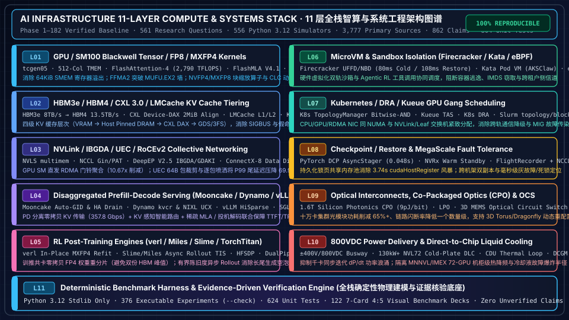
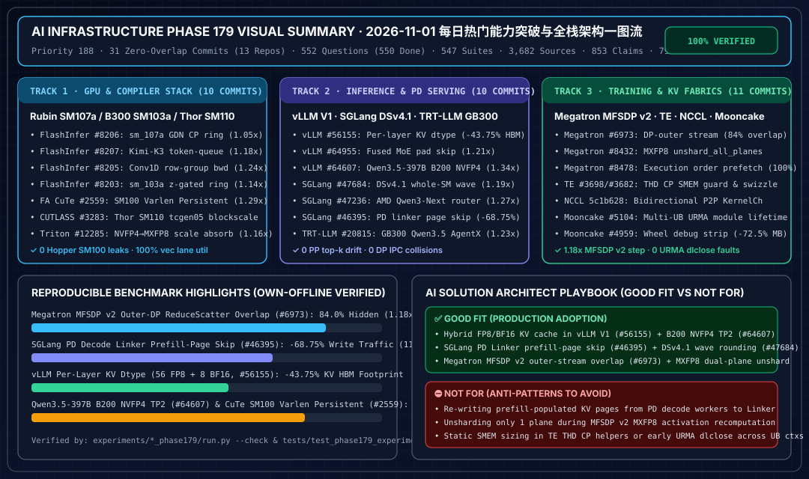
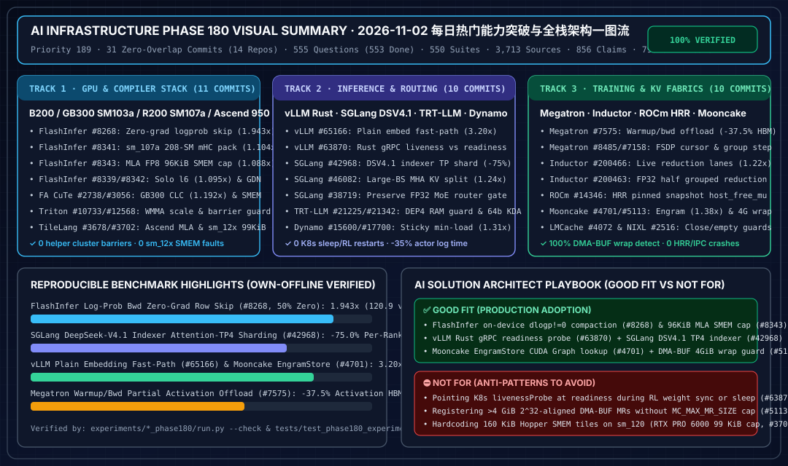
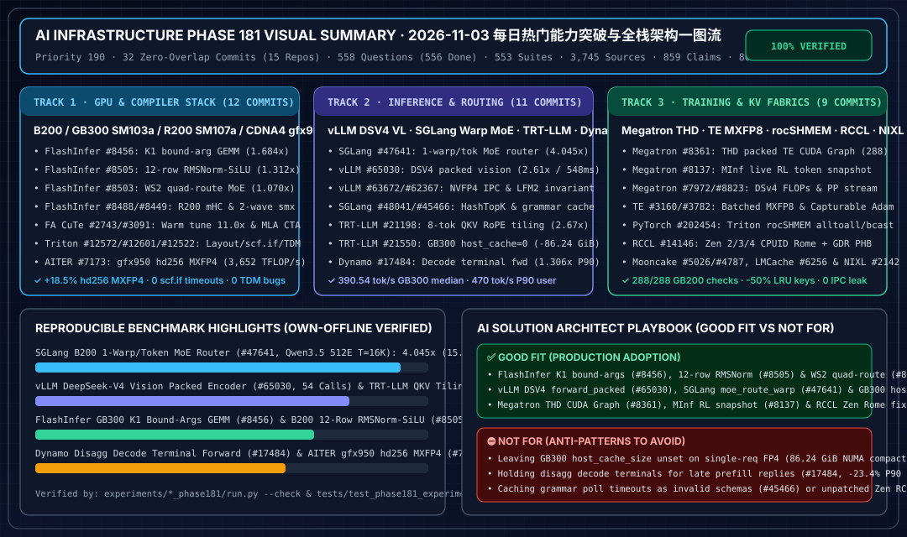
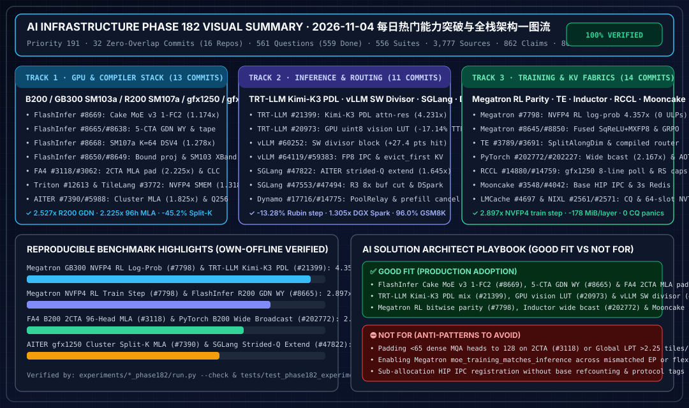
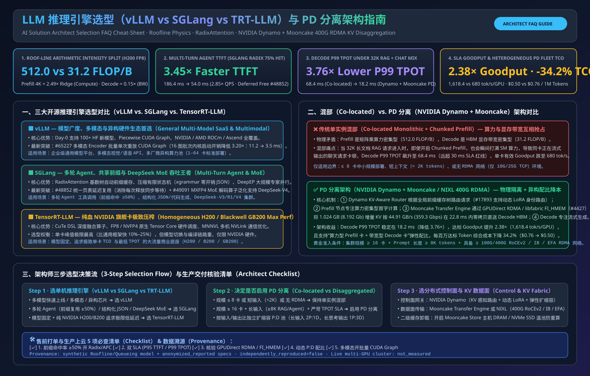
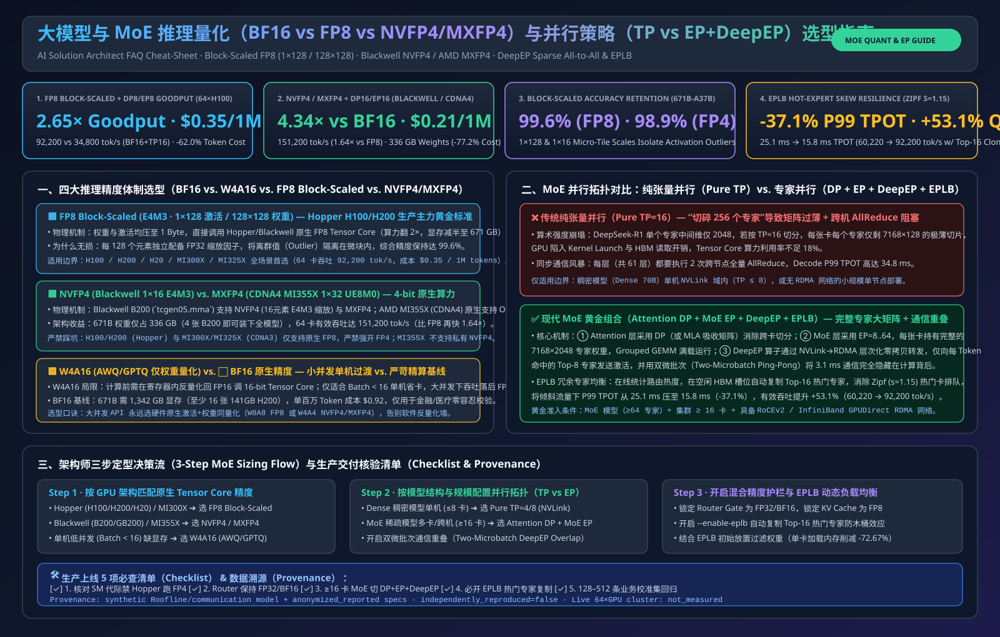
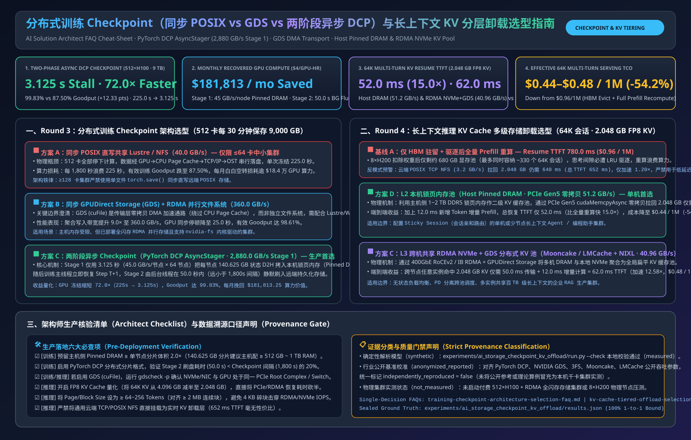

# AI Infra Research — 全栈智算与系统工程研究工作台

> 🌐 **Language / 语言切换**: **[中文](README.md)** | **[English](README.en.md)** | **[📚 完整 133 阶段全量目录归档 (`docs/full-catalog-zh.md`)](docs/full-catalog-zh.md)** | **[📚 Full 133-Phase Catalog (`docs/full-catalog-en.md`)](docs/full-catalog-en.md)** | **[🗺️ 11 层全栈地图 (`docs/stack-map.md`)](docs/stack-map.md)**

---

## 📌 Executive Overview Summary（执行摘要与核心架构结论）

> **核心研究基线（Phase 1 – Phase 186 全量合入 `main`，Priority 195 · 567 题 & 563 套实验基线）**
> 本仓库围绕 **11 层 AI 算力与分布式系统工程栈** 展开基于一手固定版本源码（`implementation`）、架构规范（`specification`）与零依赖 Python 3.12 确定性仿真模型（`own-offline`）的深度技术研究，累计完成 **155+ 篇双语深度专题报告与架构师选型 FAQ 指南**，所有定量结论均通过自动化校验测试，**零未核验主观臆断**：
> - **研究规模与可复现账本**：累计完成 **`567` 个核心工程研究问题**（`565 done` + `2 blocked` 外部闭源标准，公开可复现实验 100% 覆盖）、**`563` 套零依赖 Python 3.12 标准库实验**（全部通过 `--check`）、**`3,814` 条固定 Commit/Blob 第一手源码引用**（[`research/sources.json`](research/sources.json)）、**`868` 条分级证据主张**（[`research/evidence.json`](research/evidence.json)）、**`813` 项全绿单元测试** 以及 **`186` 份 7-Card 4:5 视觉评测报告**（`docs/reports/`，最新 **[训练 Checkpoint 与推理 KV 分层卸载选型 7-Card 评测报告](docs/reports/ai-storage-checkpoint-kv-offload-selection-cards.html)**、**[超大 MoE 推理量化与并行选型 7-Card 评测报告](docs/reports/moe-quantization-parallelism-selection-cards.html)** 与 **[LLM 推理引擎与 PD 分离选型 7-Card 评测报告](docs/reports/llm-inference-engine-pd-selection-cards.html)**）。
> - **L01 GPU / SM100 Blackwell 算子与低精度数值**：剖析 `tcgen05`、512 列 `TMEM` 原位混叠（消除 `64 KiB` SMEM 溢出）、`FlashAttention-4`（`FFMA2` 多项式仿真突破 `MUFU.EX2` 瓶颈，在 B200 达 **`2,790.1 TFLOPS`**、SM103 B300 达 **`3,200.0 TFLOPS`**）、`FlashMLA V4.1`（`+32B` TMA 行填充消除 `LDS.32` 4 路冲突，`get_mla_metadata` 削减 **`89.88%`** 偏斜尾波）、`CUTLASS CLC` 动态窃取及 `NVFP4/MXFP8` 分块缩放。
> - **L02 & L04 分层 KV 缓存与 Prefill-Decode 分离推理**：解构四级 KV 缓存层次（VRAM → Host Pinned DRAM → CXL 3.0 `Device-DAX` `2 MiB` 对齐 → GDS/3FS），结合 `Mooncake Transfer Engine`（ConnectX-8 `Data Direct` 零锁批处理、7 级 Auto-GID 重探测与 `W=4` 有界 Scatter 将有效带宽从 **`313.0 -> 357.85 Gbps`** 提升）、`NVIDIA Dynamo`（二级 `kvcr` 连接器与 `NIXL` UCX/Libfabric 显存类型探测）、`vLLM V1`（`HiSparse` 稀疏 MLA 与拒绝采样）及 `SGLang`（`HiRadixCache` 与 `EAGLE-3` 投机树）。
> - **L03 & L09 超节点互连、`IBGDA` 直发 RDMA 与共封装光学（CPO/OCS）**：验证 `PyTorch CUDASymmetricMemory` + `NVLS multimem`（流量较 Unicast 1-Shot 降低 **`6.22x`**）、`NCCL Gin` 对称集合通信与 `PAT` 并行聚合二项式树（1,024 卡跳数从 `1,023 -> 7`）、`DeepEP V2.5` GPU 直发 RDMA（Warp 门铃聚合削减 **`10.67x`** MMIO 开销）、`UEC 1.0` 64B 包裁剪 + 逐包喷洒（32-to-1 Incast 下 P99 尾延迟降低 **`69.9%`**），以及 `1.6T CPO + 3D MEMS OCS` 十万卡光互连功耗与故障半径模型。
> - **L05 & L08 6D 分布式预训练、RL 后训练引擎与容错恢复**：建立 `TorchTitan` 6D 并行与 `Megatron-FSDP`（`HFSDP` 将 120B 峰值显存从 **`244.20 -> 51.01 GiB/GPU`** 压降，Copy Engine AG 实现 **`1.344x`** 单步加速）、`verl` 原位零拷贝 `MXFP4` 权重重分片、`Slime/Miles` 有界陈旧度异步 RL Rollout（逐 Token `TIS` 重要性采样）、`PyTorch DCP AsyncStager`（持久化锁页共享内存池将保存阻塞从 **`3.737 s -> 0.048 s`** 压缩 **`77.8x`**）及 `FlightRecorder + NCCL RAS` **`< 650 ms`** 静默死锁定位。
> - **L06, L07, L10 & L11 安全沙箱、拓扑感知 Gang 调度与 800VDC 液冷智算中心**：覆盖 `Firecracker` / `Kata` / `eBPF` Agentic RL 沙箱协同调度、Kubernetes `TopologyManager` 按位与掩码 / `Kueue TAS` / `DRA` / Slurm `topology/block & tree`、`±400V/800VDC` 高压直流母线 + `130kW+` 冷板液冷（DLC）热力学与 `dP/dt` 浪涌平滑，以及全套确定性基准评测框架。

---

## 🏗️ 11 层 AI 算力与系统工程架构图谱（11-Layer AI Compute & Systems Stack）



### 架构分层详解（Architectural Walkthrough）

| 层级 | 核心技术栈与代表开源项目 | 解决的核心物理瓶颈与定量收益 |
| :--- | :--- | :--- |
| **L01 · GPU/SM100 算子与微格式** | Blackwell `tcgen05` · `512-Col TMEM` · `FlashAttention-4` · `FlashMLA V4.1` · `FlashInfer Cake/Frost` · `DeepGEMM MegaMoE` · `CUTLASS CLC` | 消除 256 维注意力反向与双缓冲 Ping-Pong 的 `64 KiB` SMEM 溢出；`FFMA2` 突破超越函数 `MUFU.EX2` 吞吐墙（达 `2,790–3,200 TFLOPS`）；`NVFP4/MXFP8` 512B 原子块缩放实现近无损训练与解码。 |
| **L02 · HBM3e/HBM4 与 CXL KV 分层** | `HBM3e` (`8 TB/s`) / `HBM4` (`2048-bit`, `13.5 TB/s`) · `CXL 3.0 Device-DAX` · `LMCache` · `KIVI / NVFP4 KV` | 建立四级 KV 缓存层次（VRAM → Host Pinned DRAM → CXL DAX → GDS/3FS），通过 `/sys/dev/char` `2 MiB` 硬件对齐检查与 APC 前缀去重消除 `SIGBUS` 崩溃及 `37.5%` 假 L1 命中率。 |
| **L03 · NVLink / IBGDA / UEC 集合通信** | `NVLS multimem` · `NCCL Gin & PAT` · `DeepEP V2.5 IBGDA/GDAKI` · `ConnectX-8 Data Direct` · `UEC 1.0 Packet Trimming` | GPU SM 直接写 NIC Doorbell 并以 Warp 聚合削减 `10.67x` PCIe 门铃；`ConnectX-8 Data Direct` 消除跨 PCI Root `ENOTSUPP`；UEC 64B 包裁剪在 800G 浅缓冲交换机上压降 `69.9%` P99 尾延迟。 |
| **L04 · Prefill-Decode 分离推理系统** | `Mooncake Transfer Engine` · `NVIDIA Dynamo (kvcr + NIXL)` · `vLLM V1 (HiSparse)` · `SGLang (HiRadixCache + EAGLE-3)` | 解耦计算密集型 Prefill 与访存密集型 Decode；Mooncake 7 级 Auto-GID + 有界 `W=4` Scatter 流水将跨机 KV 传输推至 `357.85 Gbps`；配合稀疏注意力与投机树保障百毫秒级 TTFT 与穩定 TPOT。 |
| **L05 · RL 后训练与混合并行引擎** | `verl` · `THUDM/slime` · `Miles` · `TorchTitan FlexShard` · `Megatron-Core DualPipe & HFSDP` | `verl` 原位 `_mxfp4_staging_data` 重分片消除 Actor→Rollout 双份权重显存峰值；`Slime` 异步 Rollout 配合逐 Token 重要性采样（TIS）消除长尾推理生成空泡，训练有效吞吐提升 `1.4x–1.8x`。 |
| **L06 · MicroVM 与 Agentic 沙箱隔离** | `Firecracker UFFD/NBD` · `Kata Containers (AKSClaw)` · `eBPF Cilium` · `Agentic Sandbox Co-Scheduler` | 在代码执行与工具调用型 RL/Agent 负载中提供硬件虚拟化边界（`80 ms` 冷启动 / `108 ms` UFFD 快照恢复），并通过 GPU Rollout Worker 与 CPU 沙箱池协同配比消除 I/O 饥饿。 |
| **L07 · K8s / DRA / Kueue / Slurm 拓扑调度** | `K8s TopologyManager` · `Kueue TAS` · `Dynamic Resource Allocation (DRA)` · `Slurm topology/block & tree` · `NVIDIA Device Plugin` | 通过 CPU/GPU/RDMA NIC 按位与亲和掩码及 NVLink Clique / Leaf 交换机紧致分配，杜绝跨 QPI/UPI 与跨 Spine 通信降速；基于 `<UUID, GI, CI>` 隔离 MIG 切片级 XID 故障。 |
| **L08 · Checkpoint 容错与万卡自愈** | `PyTorch DCP AsyncStager` · `NVRx In-Process Warm Standby` · `FlightRecorder + NCCL RAS` · `Grey-Failure Straggler Detector` | `WeakIdKeyDictionary` 持久化锁页共享内存池将每次保存的 `cudaHostRegister` 开销从 `3.737 s` 降至 `0.048 s`；跨机架半世界双副本与 `< 650 ms` 零号病人死锁定位将万卡有效训练时间（Goodput）保持在 `93%+`。 |
| **L09 · 硅光互连（CPO/LPO）与光交换（OCS）** | `1.6T Co-Packaged Optics (9 pJ/bit)` · `Linear Pluggable Optics (LPO)` · `3D MEMS OCS` · `ELSFP External Laser` | 将可插拔 DSP 光模块功耗降低 `65%+`，消除热敏激光器贴近 ASIC 引发的热失效爆炸半径，并通过 3D MEMS OCS 实现跨 Pod 拓扑动态重配置与故障绕行。 |
| **L10 · 800VDC 高压供电与冷板液冷** | `±400V / 800VDC Busway` · `130kW+ NVL72 Cold-Plate DLC` · `CDU Heat Exchanger` · `Slurm Token-Bucket & DCGM Power Brake` | 建模 CDU 二次侧流量/温升、MNNVL `IMEX` 72-GPU 机柜级热耦合故障域，以及通过硬件 `Power Smoothing`、Slurm 令牌桶与 BESS 储能削峰抑制千卡同步迭代 `dP/dt` 电网冲击。 |
| **L11 · 确定性物理仿真与证据核验底座** | `scripts/validate_research.py` · `409 Python 3.12 Experiments` · `657 Unit Tests` · `134 7-Card 4:5 Benchmark Decks` | 纯 Python 3.12 标准库实现，100% 离线确定性复现所有公式、协议状态机与性能边界，严格区分 `implementation`、`author-benchmark` 与 `own-offline`。 |

---

## 🗂️ 六大主题域核心研究报告索引（6 Thematic Domain Summary Tables）

> 💡 **完整百科全量表入口**：本页精选展示六大主题域的代表性旗舰专题。如需查阅全部 **133 个研究阶段、414 个研究问题与 409 套实验的完整 650KB+ 百科对照表**，请直接访问：
> 👉 **[📚 中文全量组件与阶段百科表 (`docs/full-catalog-zh.md`)](docs/full-catalog-zh.md)** | **[📚 English Complete Component & Phase Catalog (`docs/full-catalog-en.md`)](docs/full-catalog-en.md)**

### 域 1：GPU 架构、SM90/SM100 Blackwell 内核与低精度数值（L01）

| 专题研究报告（中文 / English） | 核心覆盖机制与源码锚点 | 配套确定性实验 (`experiments/`) |
| :--- | :--- | :--- |
| **[GPU/HBM 执行模型与显存层次基础](docs/components/gpu-hbm.md)** | SM/Warp 调度、寄存器压力、L2 持久化缓存、HBM3e/HBM4 屋脊线与张量核数据通路 | [`capacity_roofline`](experiments/capacity_roofline/README.md) |
| **[SM100 Blackwell FMHA 与 FlashAttention-4 (`CuTe DSL`)](docs/components/sm100-blackwell-fmha-tmem-fa4.md)** | `512` 列 `TMEM` 原位混叠（消除 `64 KiB` SMEM 溢出）、16-Warp 寄存器重分配、`FFMA2` 突破 `MUFU.EX2` 墙（`2,790 TFLOPS`） | [`sm100_blackwell_fmha_fa4`](experiments/sm100_blackwell_fmha_fa4/README.md) |
| **[FA4 Blackwell SM100 `hdim=256` 反向 `M=64` TMEM 打包](docs/components/fa4-sm100-hd256-bwd-m64-tmem-accum-layout.md)** · **[EN](docs/components/fa4-sm100-hd256-bwd-m64-tmem-accum-layout.en.md)** | 消除 `hdim=256` 反向传播 `792/640` 列 TMEM 溢出与 `sdS_xchg` 共享内存交换开销 | [`sm100_blackwell_fmha_fa4`](experiments/sm100_blackwell_fmha_fa4/README.md) |
| **[DeepSeek MLA 与 FlashMLA V4.1 分页解码内核](docs/components/deepseek-mla-flashmla-decode-kernels.md)** | SM90/SM100 2-CTA 协同、`W_UK/W_UV` 矩阵吸收（算术强度 `496–910 FLOP/B`）与 `get_mla_metadata` 消除 `89.9%` 尾波 | [`flashmla_paged_decode_scheduling`](experiments/flashmla_paged_decode_scheduling/README.md) |
| **[FlashMLA SM100 V4.1 融合 `Norm+RoPE+Attn` 与零冲突反量化](docs/components/flashmla-sm100-v41-fused-norm-rope-attn-dequant-kv.md)** · **[EN](docs/components/flashmla-sm100-v41-fused-norm-rope-attn-dequant-kv.en.md)** | `+32B` TMA 行填充消除 `LDS.32` 4 路 Bank 冲突、`e2m1*e4m3` 精确 BF16 转换与 `512/483` 列 TMEM 布局 | [`flashinfer_ds41_mixed_decode_sim`](experiments/flashinfer_ds41_mixed_decode_sim/README.md) |
| **[Blackwell SM100 块缩放微格式 (`NVFP4` vs `MXFP4`) 与 512B 原子](docs/components/sm100-block-scaled-nvfp4-kernels.md)** | `Sm1xxBlockScaledBasicChunk` 512B 雙射、UTCCP `MMA_N=256` 对齐填充、随机 Hadamard 变换 (`RHT+SR`) 预训练收敛性 | [`sm100_block_scaled_nvfp4_gemm`](experiments/sm100_block_scaled_nvfp4_gemm/README.md) · [`fp8_nvfp4_numerics`](experiments/fp8_nvfp4_numerics/README.md) |
| **[CUTLASS SM100 Ptr-Array / Grouped GEMM 与 `CLC` 动态窃取](docs/components/cutlass-sm100-grouped-gemm-clc-scheduler.md)** | 异步 `TensorMapUpdater`（`tensormaps_perform_update<false>`）与 Cluster Launch Control (`CLC`) 双级任务窃取 | [`cutlass_sm100_grouped_clc_gemm`](experiments/cutlass_sm100_grouped_clc_gemm/README.md) |
| **[DeepGEMM SM100 `MegaMoE` 融合专家池与 `MegaMHC` 超连接](docs/components/deepgemm-sm100-mega-moe-mhc-hyperconnection.md)** · **[EN](docs/components/deepgemm-sm100-mega-moe-mhc-hyperconnection.en.md)** | Sinkhorn-Knopp 双随机流形超连接（MHC）、CUDA Graph 纪元屏障（`Epoch 64B`）与分组 MoE 设备端 Swizzle | [`deepgemm_mega_moe_mhc_sim`](experiments/deepgemm_mega_moe_mhc_sim/README.md) |
| **[Hopper → Blackwell → Vera Rubin (`VR200 NVL144` / `HBM4`) 代际演进](docs/components/vera-rubin-nvl144-hbm4-architecture.md)** | `HBM4 2048-bit` (`13.5 TB/s`)、`NVLink-6` (`3.6 TB/s`) 与Groq TSP / Cerebras WSE 晶圆级 SRAM 异构投机级联对比 | [`vera_rubin_hbm4_nvl144_roofline`](experiments/vera_rubin_hbm4_nvl144_roofline/README.md) · [`wafer_sram_gpu_cascaded_serving`](experiments/wafer_sram_gpu_cascaded_serving/README.md) |
| **[批大小不变性确定性推理算子 (`Batch-Invariant Kernels`)](docs/components/batch-invariant-deterministic-inference.md)** | Split-KV / Split-K 固定归约树消除浮点非结合律引起的跨 Batch 1-ULP 漂移，实现 `0 ULP` 逐比特复现 | [`batch_invariant_deterministic_inference`](experiments/batch_invariant_deterministic_inference/README.md) |

---

### 域 2：HBM3e/CXL/LMCache 分层 KV 缓存与 Prefill-Decode 分离推理（L02 & L04）

| 专题研究报告（中文 / English） | 核心覆盖机制与源码锚点 | 配套确定性实验 (`experiments/`) |
| :--- | :--- | :--- |
| **[大模型 RLHF / GRPO 后训练基础设施选型 FAQ（`原生 FSDP 采样` vs `Ray 静态双池` vs `HybridEngine 3D 重分片` vs `异步 Partial Rollout`）](docs/components/rlhf-post-training-infra-selection-faq.md)** · **[EN](docs/components/rlhf-post-training-infra-selection-faq.en.md)** | 64×H100 (`$160/hr`) 70B GRPO 推理模型四档后训练架构选型（`Tier 3 HybridEngine verl` 同池复用 + `3.2 s` 零拷贝 3D 权重重分片 + `cuMemUnmap` Sleep 将单步耗时从 `612.0 s` 压至 `158.2 s (3.87x)`；针对 `24K Long-CoT` `52.0%` 同步长尾气泡，`Tier 4 异步流式 + Partial Rollout` 跨步复用 KV 前缀并配合 `τ<=2` Dual-Clip 重要性采样将气泡降至 `8.5%`、单步压至 `96.4 s`、吞吐达 `174,037.5 tok/s (6.35x)`、MFU `73.0%`，千步成本从 `$27,200` 降至 `$4,284.80` 立省 `$22,915.20 (-84.2%)`） | [`rlhf_post_training_infra_selection`](experiments/rlhf_post_training_infra_selection/run.py) |
| **[AI 智算集群光互连与铜缆架构选型 FAQ（`DAC/AEC 铜缆` vs `DSP 可插拔` vs `800G LPO` vs `冷板 CPO + 3D MEMS OCS`）](docs/components/ai-cluster-optical-interconnect-selection-faq.md)** · **[EN](docs/components/ai-cluster-optical-interconnect-selection-faq.en.md)** | 2,048 卡 (`8,192` 个 800G 端点，3 年 `26,280 小时`) 四档光/铜互连架构选型（`Tier 2 柜内 DAC/AEC 铜缆 <=7m` 将下联 4,096 端口功耗从 `16.0W` 压至 `2.5W`、立省 `$3.56M CapEx`；`Tier 3 800G LPO <=50m` 拔除光模块 PAM4 DSP 使脊层 PHY 延迟从 `115.0 ns` 降至 `8.0 ns (14.4x)`、3 年总 TCO 降至 `$3,923,443.71 (-58.5%)`；`Tier 4 冷板硅光 CPO + 外置热插拔 ELS + 3D MEMS OCS` 消灭全部 Spine 光模块与 O-E-O 转换，互连功耗降至 `20.89 kW (-84.1%)`、3 年链路闪断从 `442.4 次` 压至 `36.9 次 (降 11.99x)`） | [`ai_cluster_optical_interconnect_selection`](experiments/ai_cluster_optical_interconnect_selection/run.py) |
| **[多模态大模型与长视频推理架构选型 FAQ（`单体混部 VLM` vs `EPD 三阶段分离` vs `SHA-256 视觉缓存` vs `4x 时空 Token 压缩`）](docs/components/multimodal-vlm-serving-selection-faq.md)** · **[EN](docs/components/multimodal-vlm-serving-selection-faq.en.md)** | 16×H100 (`$40/hr`) 运行 72B VLM (`ViT-4B + 70B LLM`) 处理 64 帧视频 (`16,384` 视觉 tokens) 四档架构选型（`Tier 2 GPU NVDEC + EPD 三阶段池化分离 2E+8P+6D` 消除 ViT/Prefill 对流式生成的阻塞，将 P99 TPOT 从 `385.0 ms` 压至 `34.0 ms (降 11.3x)`；`Tier 3 + 分布式 SHA-256 Projector 后视觉特征缓存` 在 75% 多轮命中下免重算 ViT，平均 TTFT 压至 `680.0 ms (快 3.24x)` 且 `100.0%` 无损；`Tier 4 + ToMe/FastV 4.0x 时空 Token 压缩` 将视觉 Token 压至 `4,096`、单请求 KV 从 `5.41 GB` 降至 `1.47 GB (省 3.68x)`，平均 TTFT 达 `245.0 ms (快 8.98x)`、吞吐 `24.6 req/s (7.69x)`、千次成本从 `$3.47` 降至 `$0.45 (-87.0%)`） | [`multimodal_vlm_serving_selection`](experiments/multimodal_vlm_serving_selection/run.py) |
| **[AI Agent 代码沙箱与 Serverless GPU 极速冷启动架构选型 FAQ（`K8s 冷拉取` vs `Lazy OCI + mmap` vs `Firecracker 快照` vs `CRIU + cuda-checkpoint`）](docs/components/agentic-sandbox-gpu-coldstart-selection-faq.md)** · **[EN](docs/components/agentic-sandbox-gpu-coldstart-selection-faq.en.md)** | 256×H100 (`$2.50/GPU-hr`，日均 `100,000` 次突发调用，单次有效执行 `4.50 s`，`16 GB` 镜像 + `14 GB` 权重) 四档冷启动选型（`Tier 1 标准 K8s 冷拉取` P50 达 `25,500 ms`、被迫保留 `58.0%` 空闲热池、月成本 `$186,880`；`Tier 2 SOCI/eStargz + Safetensors mmap` 压至 `5,200 ms (4.90x)`；`Tier 3 Firecracker MicroVM + UFFD 内存快照` 提供 KVM 硬件隔离并将 Coding Agent 沙箱唤醒压至 `125.0 ms (204.0x)`、单机 `80` 沙箱、千次成本 `$16.30 (-73.8%)`；`Tier 4 CRIU + NVIDIA cuda-checkpoint + 45 GB/s RDMA 权重流` 在 `75 ms` 恢复 CUDA 上下文 + `310 ms` 注入权重，实现 `420.0 ms` P50 唤醒 (`60.71x`)、热池压至 `4.0%`、GPU 利用率 `86.5%`、月成本降至 `$42,340 (-77.3%)`） | [`agentic_sandbox_gpu_coldstart_selection`](experiments/agentic_sandbox_gpu_coldstart_selection/run.py) |
| **[AI 服务器机内与超节点 Scale-Up 互连架构选型 FAQ（`PCIe Gen5 交换树` vs `8 卡 NVSwitch HGX` vs `72 卡铜背板 NVL72 MNNVL` vs `CXL 3.0 内存池`）](docs/components/nvlink-pcie-cxl-scaleup-interconnect-selection-faq.md)** · **[EN](docs/components/nvlink-pcie-cxl-scaleup-interconnect-selection-faq.en.md)** | 72-GPU Pod 运行 80 层大模型解码（每 Token `160` 次同步，SLA `TPOT <= 12.0 ms`）与 128K KV 扩容四档选型（`Tier 1 PCIe Gen5` 适合 `TP=1/2` 省 30% CapEx，但 `TP=8` 通信占 `61.4%`、TPOT `20.20 ms` 违约且跨 CPU UPI 带宽跌至 `22 GB/s`；`Tier 2 8 卡 NVSwitch HGX` 凭 `900 GB/s` + `NVLS` 多播归约将 `TP=8` 通信从 `12.40 ms` 压至 `1.55 ms (快 8.0x)`、TPOT `9.35 ms`、吞吐 `428 tok/s (2.16x)`、成本 `$1.72/1M (-33.8%)`；`Tier 3 72 卡铜背板 NVL72 MNNVL` 以 `130 TB/s` 整柜无阻塞域消除 8 卡跨机 RoCE `18x` 带宽悬崖，`EP=72` TPOT `6.20 ms (比跨机 HGX 快 5.06x)`、吞吐 `890 tok/s (4.49x)`、成本 `$0.98/1M (-62.3%)`；`Tier 4 CXL 3.0 Type-3 2TB DAX 池` 以 `$4.50/GB (-87%)` 在 `18.5 ms` 恢复 128K KV，成本 `$1.13/1M (-56.5%)`） | [`nvlink_pcie_cxl_scaleup_selection`](experiments/nvlink_pcie_cxl_scaleup_selection/run.py) |
| **[大模型分布式训练并行与显存优化架构选型 FAQ（`DDP/ZeRO-1` vs `全量 ZeRO-3` vs `混合分片 HFSDP` vs `Megatron 3D + DualPipe`）](docs/components/distributed-training-memory-parallelism-selection-faq.md)** · **[EN](docs/components/distributed-training-memory-parallelism-selection-faq.en.md)** | 256×H100 80GB (`$640/hr`) 训练 120B 模型 `1.0T` Tokens 四档并行选型（`Tier 1 DDP/ZeRO-1` 因 `16×Ψ` 需 `244.20 GB/GPU` 爆 OOM，走 PCIe CPU 卸载阻塞 `58.6%`、MFU `28.5%`；`Tier 2 全量 ZeRO-3` 显存压至 `46.80 GB`，但每层跨 32 节点 RoCE `All-Gather` 阻塞 `44.2%`、MFU 仅 `36.4%`；`Tier 3 混合分片 HFSDP` 将分片锁在机内 NVLink (`58.40 GB`)，单步 `4.35 s (比 ZeRO-3 快 1.48x)`、MFU `54.0%`、成本 `$184.3k/1T (-63.1%)`；`Tier 4 Megatron 3D (TP8+DualPipe PP4+DP8)` 将 PP 气泡压至 `3.8%`、显存 `51.01 GB`、单步 `3.52 s (快 1.83x)`、MFU `66.8%`、1T 成本降至 `$149.1k (-70.2% / 比 ZeRO-3 省 $124.1k)`） | [`distributed_training_parallelism_selection`](experiments/distributed_training_parallelism_selection/run.py) |
| **[企业级 AI 智算集群调度器与拓扑编排架构选型 FAQ（`原生 K8s` vs `独立 Slurm` vs `Volcano/Kueue Gang` vs `Kueue TAS + K8s DRA`）](docs/components/gpu-cluster-scheduler-orchestration-selection-faq.md)** · **[EN](docs/components/gpu-cluster-scheduler-orchestration-selection-faq.en.md)** | 512×H100（8 机柜，月租 `$934.4k/月`）四档调度与拓扑选型（`Tier 1 原生 K8s` 因逐 Pod 调度引发 `18.5%` 互锁死锁与 `+38.0%` 跨脊/跨 UPI 通信惩罚，有效 Goodput 仅 `48.2%`、月浪费 `$484.0k`；`Tier 2 独立 Slurm + topology/tree` 通信仅 `+4.5%`，但训推静态分池存在 `14.0%` 孤岛浪费、Goodput `74.0%`；`Tier 3 K8s 基础 Gang` 压降死锁至 `1.5%`，但跨柜散落损耗 `+24.0%`、Goodput `71.5%`；`Tier 4 Kueue TAS 机柜紧致装箱 + K8s DRA + TopologyManager` 实现碎片率 `0.8%`、通信仅 `+3.2%`、综合 Goodput `88.6% (1.84x)`，每月净挽回 `$377,497.60 (-45.6%)`） | [`gpu_cluster_scheduler_selection`](experiments/gpu_cluster_scheduler_selection/run.py) |
| **[十亿级企业 RAG 向量检索与混合索引硬件架构选型 FAQ（`全内存 FP32 HNSW` vs `SQ8/RaBitQ` vs `NVMe DiskANN` vs `GPU cuVS CAGRA`）](docs/components/rag-vector-index-ann-hardware-selection-faq.md)** · **[EN](docs/components/rag-vector-index-ann-hardware-selection-faq.en.md)** | 单分片 1 亿条（扩展至 10 亿条）1,536 维向量四档选型（`Tier 1 全内存 FP32 HNSW` 需 `890.9 GB` DRAM/亿条、建库 `14.50h`、月租 `$6,480/亿条` [10 亿需 `$64.8k/月`]；`Tier 2 SQ8/RaBitQ 量化 HNSW + Top-100 精排` 将内存压至 `235.6 GB (3.78x)`、P99 `3.10 ms`、Recall `97.4%`、月租 `$1,820 (-71.9%)`；`Tier 3 NVMe SSD DiskANN Vamana` 内存仅留 `48.0 GB` PQ 表 (`18.56x` 缩减) + `4KB` 扇区耦合直读，P99 `11.80 ms`、Recall `95.8%`、月租 `$580/亿条 (-91.0% / 10 亿年省 $70.8 万)`；`Tier 4 GPU cuVS CAGRA` 将建库提速 `15.76x` 至 `0.92h (55 分钟)`、P99 `1.35 ms`、吞吐 `22,400 QPS (12.11x)`、每亿次查询仅 `$0.04 (-97.0%)`） | [`rag_vector_index_selection`](experiments/rag_vector_index_selection/run.py) |
| **[金融政企机密计算与隐私合规大模型推理架构选型 FAQ（`明文容器` vs `PII 脱敏网关` vs `单卡 CC-On TEE` vs `多卡 PPCIE / Blackwell TEE`）](docs/components/confidential-ai-tee-gpu-security-selection-faq.md)** · **[EN](docs/components/confidential-ai-tee-gpu-security-selection-faq.en.md)** | 金融医疗涉密 70B (`TP=1`) 与 405B (`TP=8`) 推理四档机密架构选型（`Tier 1 明文容器` 显存与权重 `100%` 暴露于宿主机 Root；`Tier 2 应用层 PII 脱敏网关` 存在 `18.5%` 准标识符残余泄露且破坏上下文致准确率掉点 `-6.4% (93.6%)`；`Tier 3 CPU CVM + 单卡 H100/H200 CC-On` 凭 `SPDM` 证明 + `GPU CPR` 防火墙，在 70B `TP=1` 解码下仅增加 `+4.8%` 延迟 [`11.20 -> 11.74 ms`] 实现 `0.0%` 泄露与 `100.0%` 精度；`Tier 4 多卡 PPCIE + Blackwell 内联加密 NVLink` 避开单卡 Bounce Buffer 跑 `TP=8` 的 `42.60 ms (+280.4%)` 悬崖，将 8 卡机密 TPOT 锁在 `11.90 ms (+6.2%)`） | [`confidential_ai_tee_selection`](experiments/confidential_ai_tee_selection/run.py) |
| **[千卡集群百 GB 大模型权重与容器镜像极速分发架构选型 FAQ（`中心直拉` vs `多副本 CDN` vs `Dragonfly P2P 树` vs `RDMA GDS + NCCL 环广播`）](docs/components/model-weights-distribution-p2p-registry-selection-faq.md)** · **[EN](docs/components/model-weights-distribution-p2p-registry-selection-faq.en.md)** | 512×H100（64 节点，单节点 `140GB` 权重 + `16GB` 镜像，日均 12 次发布）四档分发选型（`Tier 1 中心 OCI/S3 直拉` 因 `9,984 GB` 惊群雪崩耗时 `2,180.0 s [36.3m]`、月烧 `$279,040` 空转费；`Tier 2 200G 分片 CDN` 耗时 `440.0 s`；`Tier 3 CNCF Dragonfly/Kraken P2P 树 + Lazy OCI` 将源站回源流量砍至 `156.0 GB (-98.4%)`、64 节点耗时压至 `42.0 s (51.9x)`；`Tier 4 RDMA GDS + Mooncake/NCCL 400G 显存环广播` 以 `45.0 GB/s` 执行 $O(1)$ 零拷贝流水广播，64 节点仅需 `4.20 s (519.05x)`、256 节点仅需 `5.10 s`，月空转浪费降至 `$537.60 (-99.8% / 月省 $278.5k)`） | [`model_weight_p2p_distribution_selection`](experiments/model_weight_p2p_distribution_selection/run.py) |
| **[万卡 AI 集群可观测性、慢节点与静默数据损坏 (SDC) 排障选型 FAQ（`基础轮询` vs `DCGM+XID` vs `FlightRecorder+NCCL RAS` vs `在线 SDC 校验`）](docs/components/ai-cluster-observability-silent-corruption-selection-faq.md)** · **[EN](docs/components/ai-cluster-observability-silent-corruption-selection-faq.en.md)** | 2,048×H100（月租 `$3.74M/月`）四档可观测性与 SDC 防护选型（`Tier 1 基础轮询+人工二分` 根因定位需 `8,700s [145m]`、SDC 检出 `0.0%`、Goodput `68.4%`、月损 `$1.18M`；`Tier 2 DCGM+XID 自愈` 压降硬故障 MTTR 至 `12.5m`，但漏检 `52%` 灰色慢卡且 ALU SDC 检出 `0.0%`；`Tier 3 PyTorch FlightRecorder + NCCL RAS` 以 `0.65s (650ms)` 锁定零号病人并捕获 `98.5%` 慢卡，Goodput 达 `91.5%`；`Tier 4 + 在线张量范数门禁与 0-ULP Golden-Step 确定性校验` 仅耗 `0.35%` 算力即拦截 `99.6%` 静默算错，MTTR `0.85m`、Goodput 达 `96.4%` [8,192 卡达 `94.8%`]，月省 `$1,046,528 (-88.6%)`） | [`ai_cluster_observability_sdc_selection`](experiments/ai_cluster_observability_sdc_selection/run.py) |
| **[企业级 Agent 结构化输出与语法约束解码架构选型 FAQ（`Prompt 重试` vs `朴素词表扫描` vs `Outlines FSM` vs `XGrammar + Jump-Forward`）](docs/components/structured-output-constrained-decoding-selection-faq.md)** · **[EN](docs/components/structured-output-constrained-decoding-selection-faq.en.md)** | 70B FP8（128,256 词表，无约束 TPOT `9.50 ms`，320-Token 复杂嵌套 JSON 工具调用）四档选型（`Tier 1 Prompt 软约束重试` 首轮合格率仅 `84.5%`、重试浪费 `+38%` Token、等效 TPOT `13.11 ms`；`Tier 2 朴素逐 Token 词表扫描` 每步 CPU 阻塞 `+18.50 ms` [BS=128 崩至 `265.0 ms`]；`Tier 3 Outlines 预编译 FSM` 将 16KB 位掩码查表压至 `0.45 ms`、等效 TPOT `9.95 ms`；`Tier 4 XGrammar PDA 异步掩码重叠 + Jump-Forward 跳词` 实现 `0.00 ms` 暴露掩码并自动拼接跳过 `35.8%` 确定性 JSON 键值 Token，等效 TPOT 压至 `6.10 ms` [比自由生成快 `1.56x`，BS=128 下比同步 FSM 快 `2.07x`]，万次调用成本从 `$4.30` 降至 `$2.10 (-51.2%)`） | [`structured_output_constrained_decoding_selection`](experiments/structured_output_constrained_decoding_selection/run.py) |
| **[百至千级垂类微调模型 (Multi-LoRA) 在线高密推理选型 FAQ（`独立合并副本` vs `串行切换` vs `vLLM BGMV` vs `S-LoRA 统一分页 + MBGMM`）](docs/components/multi-lora-adapter-serving-selection-faq.md)** · **[EN](docs/components/multi-lora-adapter-serving-selection-faq.en.md)** | 70B FP8 基座托管 128 个 `320 MB` 垂类微调模型四档选型（`Tier 1 合并权重独立副本` 需 `128 GPUs`、利用率 `6.8%`、月烧 `$233,600`；`Tier 2 串行热切换` 虽缩至 8 卡但打碎 Batching 使 P99 TTFT 恶化至 `1,840.0 ms`；`Tier 3 vLLM Multi-LoRA BGMV` 靠共享基座 GEMM 将集群缩至 `4 GPUs ($7,300/月, -96.9%)`、TTFT `165.0 ms`、吞吐 `168.0 req/s`；`Tier 4 S-LoRA 统一分页显存池 + 异构秩 MBGMM + 异步预取` 在 `4 GPUs` 上将 P99 TTFT 压至 `92.0 ms` [512 活跃 LoRA 下稳守 `118.0 ms`]、吞吐提至 `264.0 req/s (1.57x)`，月省 `$226,300 (-96.9%)`） | [`multi_lora_serving_selection`](experiments/multi_lora_serving_selection/run.py) |
| **[PB 级多模态预训练数据加载与流式预处理选型 FAQ（`POSIX 小文件` vs `WebDataset Tar` vs `MosaicML MDS / LitData` vs `DALI GPU 解码 + GDS`）](docs/components/ai-training-data-loader-storage-pipeline-selection-faq.md)** · **[EN](docs/components/ai-training-data-loader-storage-pipeline-selection-faq.en.md)** | 256×H100（月租 `$467.2k/月`）训练 `1.2 PB` 多模态数据集四档选型（`Tier 1 POSIX 小文件直读` 因 MDS 锁死带宽仅 `11.2 GB/s`、GPU 饥饿 `64.5%`、断点恢复需 `68.0m`、MFU `22.0%`、月损 `$301.3k`；`Tier 2 WebDataset 1GB .tar + CPU 解码` 提速带宽至 `72.0 GB/s`，但 128 核 CPU 软解码满载仍留 `26.8%` 饥饿；`Tier 3 MosaicML MDS / LitData` 凭字节偏移索引实现 `0.40s` $O(1)$ 样本级精确断点恢复；`Tier 4 + NVIDIA DALI 硬件 nvJPEG/NVDEC + GDS` 将饥饿率压至 `1.8%`、单卡达 `1,435 samples/s` [1080p 视频比 CPU 快 `6.14x`]、MFU `68.2%`，月省 `$215,846.40`） | [`ai_training_dataloader_selection`](experiments/ai_training_dataloader_selection/run.py) |
| **[企业级大模型 API 网关、语义缓存与多模型级联路由选型 FAQ（`无状态轮询` vs `TPM+精确缓存` vs `KV 亲和+语义缓存` vs `难度级联路由`）](docs/components/llm-api-gateway-semantic-cache-routing-selection-faq.md)** · **[EN](docs/components/llm-api-gateway-semantic-cache-routing-selection-faq.en.md)** | 月均 1,000 万次请求（8 副本集群）四档网关选型（`Tier 1 无状态轮询` 将 GPU KV 前缀命中率稀释至 `8.1%` [32 副本跌至 `2.0%`]、P99 TTFT `1,420.0 ms`、月烧 `$142,000`；`Tier 2 TPM 限流+精确缓存` 仅命中 `8.5%`；`Tier 3 KV-Prefix 亲和路由 + 双层校验语义缓存` 将 KV 命中率恢复至 `64.2% (7.93x)` 并安全拦截 `26.4%` 同义提问，TTFT 压至 `310.0 ms`、月省 `44.8%`；`Tier 4 + RouteLLM 难度级联路由 (8B->70B->671B)` 保持 `99.2%` 质量、P99 TTFT `185.0 ms (7.68x)`，月账单降至 `$26,980 (-81.0% / 月省 $115,020)`） | [`llm_api_gateway_routing_selection`](experiments/llm_api_gateway_routing_selection/run.py) |
| **[政企私有化单机/工作站与边缘大模型推理硬件选型 FAQ（`4×RTX 4090` vs `统一内存工作站` vs `2×RTX PRO 6000` vs `2×H200 NVL`）](docs/components/edge-on-prem-workstation-llm-deployment-selection-faq.md)** · **[EN](docs/components/edge-on-prem-workstation-llm-deployment-selection-faq.en.md)** | 70B FP8（16K RAG 上下文，3 年 TCO）四档私有化单机硬件选型（`Tier 1 4×RTX 4090 96GB 攒机` 驱动锁死 P2P [`16.5 GB/s`]、仅剩 `20GB` KV 空间、无 ECC、年故障率 `14.5%`；`Tier 2 统一内存工作站 Mac Studio Ultra 192G / DGX Spark` 仅 `240W`、3 年 TCO `$11,200` 适合 1~3 人，但 16K Prefill 达 `4,850.0 ms`；`Tier 3 双卡 RTX PRO 6000 Blackwell 96GB×2=192GB ECC` 留出 `116GB` KV 空间，16K TTFT `285.0 ms`、BS=16/32 吞吐 `740 / 1,020 tok/s` [比 4×4090 高 `3.02x~4.86x`]、成本 `$0.34/1M (-68.2%)`；`Tier 4 2×H200 NVL 282GB HBM3e + NVLink` 实现 `115.0 ms` TTFT、`1,680 tok/s`、`$0.25/1M`） | [`onprem_edge_workstation_llm_selection`](experiments/onprem_edge_workstation_llm_selection/run.py) |
| **[超低延迟实时语音大模型 (Voice Agent) 端到端推理选型 FAQ（`HTTP 串行` vs `WebRTC 流式级联` vs `纯音频 S2S` vs `双轨内心独白 S2S`）](docs/components/voice-realtime-speech-llm-pipeline-selection-faq.md)** · **[EN](docs/components/voice-realtime-speech-llm-pipeline-selection-faq.en.md)** | 实时全双工语音对话（SLA `P99 <= 350ms`）四档选型（`Tier 1 HTTP 串行级联` P50 达 `2,480.0 ms`、P99 `3,150.0 ms`；`Tier 2 UDP WebRTC 流式级联 + 语义 VAD + 首句投机 TTS` 压至 `540.0 ms (4.59x)`、`100.0%` 工具调用智商、最低成本 `$0.028/min`；`Tier 3 纯音频 Token S2S` 虽达 `195.0 ms` 但序列膨胀 50 倍致推理智商暴跌 `-18.5% (81.5%)`；`Tier 4 双轨内心独白 Text+Acoustic S2S [Moshi/GLM-4-Voice 范式]` 每 `80ms` 先出同步文本 Token 再并发生成 8 路 RVQ 声学码本，实现 `220.0 ms` P50 / `285.0 ms` P99 [5% 移动丢包下比 TCP WebSocket 快 `10.88x`]、`45ms` 打断、`98.4%` 智商与原生情感） | [`realtime_voice_llm_pipeline_selection`](experiments/realtime_voice_llm_pipeline_selection/run.py) |
| **[GPU 集群功耗封顶、阶段感知 DVFS 与液冷 TCO 选型 FAQ（`700W 风冷` vs `静态 550W` vs `阶段感知 DVFS` vs `40°C 冷板液冷 + PDU 超配`）](docs/components/gpu-power-capping-dvfs-liquid-cooling-tco-selection-faq.md)** · **[EN](docs/components/gpu-power-capping-dvfs-liquid-cooling-tco-selection-faq.en.md)** | 1,024×H200 SXM（机房配电硬上限 `1.20 MW`，3 年电费 TCO）四档选型（`Tier 1 默认 700W + 传统风冷 PUE 1.48` 需 `1.485 MW` 致 200 张卡闲置、同步训练 `+28% di/dt` 跳闸、3 年电费 `$3.90M`；`Tier 2 静态 nvidia-smi 550W 封顶` 功耗降 `-21.4%`、吞吐保 `96.6%` [Decode 保 `99.1%`]、能效 `1.23x`、满编装下 1,024 卡；`Tier 3 算子阶段感知 DVFS [Prefill 650W / Decode 440W / 通信 350W]` 保持 `99.0%` 吞吐与 `1.41x` 能效；`Tier 4 40°C 冷板直接液冷 PUE 1.11 + BBU 削峰 + 22% 配电超配` 将千卡功耗压至 `0.858 MW (-42.2%)`、1.2MW 多装 `+424 张 GPU (共 1,248 张)`、总有效产出 `121.3% (+40.8pt)`、3 年省电 `$1,647,734`） | [`gpu_power_capping_dvfs_cooling_tco`](experiments/gpu_power_capping_dvfs_cooling_tco/run.py) |
| **[AI 智算集群分布式并行文件系统选型 FAQ（`通用 NAS/CephFS` vs `传统超算 Lustre` vs `商用 WEKA/VAST GDS` vs `开源 DeepSeek 3FS + USRBIO`）](docs/components/ai-storage-3fs-lustre-weka-parallel-filesystem-selection-faq.md)** · **[EN](docs/components/ai-storage-3fs-lustre-weka-parallel-filesystem-selection-faq.en.md)** | 180 台全闪存储节点（每台 `16×NVMe + 2×200G RDMA`，理论线速 `7.2 TB/s`）服务千卡 H200 四档选型（`Tier 1 CephFS TCP` 主 OSD 串行读瓶颈仅 `251 GB/s`、10TB Ckpt `44.5s`；`Tier 2 传统 Lustre` 在 500TB 随机 Shuffle 下因 OS Page Cache LRU 锁争用从 `3.80 TB/s` 暴跌 `-55.8%` 至 `1.68 TB/s` 且占 18 核；`Tier 3 商用 WEKA/VAST GDS` 达 `5,850 GB/s`、`26.5M` IOPS、`1.8s` Ckpt 与 N+2 纠删码，3 年 TCO `$3.68M`；`Tier 4 开源 DeepSeek 3FS [CRAQ 三副本并发读 + USRBIO 零拷贝环 + FoundationDB]` 跑出 `6,600 GB/s (91.7% 线速)`、`33.0M` IOPS [Lustre 的 `7.33x`]、`1.5s` 10TB Ckpt 恢复、`0.42ms` KVCache P99、仅占 2 核且省下 `$1.48M` 软件授权费） | [`ai_parallel_filesystem_3fs_lustre_weka_selection`](experiments/ai_parallel_filesystem_3fs_lustre_weka_selection/run.py) |
| **[企业级大模型知识检索与多跳推理 RAG 选型 FAQ（`512-Token 硬切片` vs `Hybrid BM25+精排` vs `Contextual / Late-Chunking` vs `LazyGraphRAG 按需子图归纳`）](docs/components/graphrag-vs-dense-hybrid-rag-indexing-selection-faq.md)** · **[EN](docs/components/graphrag-vs-dense-hybrid-rag-indexing-selection-faq.en.md)** | 50,000 篇政企文档（`1,000 万 Tokens`，日更 1,500 篇）四档 RAG 选型（`Tier 1 512-Token 硬切片` 丢失主语致跨段代词指代仅 `54.0%`、全局多跳仅 `24.5%`；`Tier 2 Hybrid BM25+Dense+Rerank` 单跳 `91.2%` 但全局归纳仅 `38.5%`；`Tier 3 Contextual Retrieval [Prefix Cache 背景头] / Late-Chunking + 精排` 将单跳推至 `94.6%`、跨段代词推至 `91.8% (+37.8pt)`、P95 `245ms`；`Tier 4 自适应路由 + Contextual + LazyGraphRAG/LightRAG` 建库期零 LLM 调用仅 `$38/10M Tok` [比初代全量 GraphRAG `$4,850` 省 `99.2%`]，全局与 3 跳推理准确率达 `88.5% (+50.0pt)`，P95 `680ms` [快 `6.18x`]） | [`enterprise_rag_graphrag_hybrid_selection`](experiments/enterprise_rag_graphrag_hybrid_selection/run.py) |
| **[大模型低精度预训练与持续微调（FP8 / NVFP4 vs. BF16）选型 FAQ（`BF16` vs `Per-Tensor FP8` vs `DeepSeek-V3 分块 FP8` vs `Blackwell MXFP8/NVFP4`）](docs/components/fp8-fp4-low-precision-pretraining-stability-selection-faq.md)** · **[EN](docs/components/fp8-fp4-low-precision-pretraining-stability-selection-faq.en.md)** | 671B MoE（10 万亿 Tokens 预训练，2,048 卡）四档低精度数值选型（`Tier 1 标准 BF16` `2,950 tok/s`、激活显存 `54.0GB`、10T 成本 `$4.59M`；`Tier 2 粗粒度 Per-Tensor FP8` 因 SwiGLU `1,000x` 离群值拉爆全局 `amax` [SQNR `-1.4 dB`] 与 Hopper WGMMA 13-bit 尾数累加漂移，每 1T 发生 `11 次` NaN 回滚、Loss 恶化 `+1.85%`；`Tier 3 DeepSeek-V3 分块 FP8 [1×128 Tile + 128×128 Block + Nc=128 CUDA 核 FP32 累加提升]` 实现 `4,366 tok/s (1.48x)`、`0.07%` 无损收敛 [0 回滚]、激活显存 `28.2GB (-47.8%)`、立省 `$1.49M`；`Tier 4 Blackwell 原生 MXFP8/NVFP4 + 哈达玛旋转 + 随机舍入` 达 `6,342 tok/s (2.15x)`、省 `$2.455M`） | [`low_precision_fp8_fp4_pretraining_stability`](experiments/low_precision_fp8_fp4_pretraining_stability/run.py) |
| **[Kubernetes Serverless GPU 自动弹性伸缩与秒级冷启动选型 FAQ（`原生 HPA` vs `KEDA+NVMe` vs `CRIU + cuda-checkpoint` vs `ServerlessLLM + RDMA P2P 直注`）](docs/components/k8s-gpu-autoscaling-coldstart-serverless-selection-faq.md)** · **[EN](docs/components/k8s-gpu-autoscaling-coldstart-serverless-selection-faq.en.md)** | 24 个 70B FP8 大模型混部池（70GB 权重 + 18GB 镜像，10× 突发流量）四档冷启动与弹性选型（`Tier 1 原生 HPA [DCGM_GPU_UTIL]` 在 Batch=1 时虚高至 `94.0%`、10× 洪峰锁死 `100.0%`，且冷启动达 `285.0s` [镜像65s+初始化22s+权重100s+编译98s]，洪峰超时率 `64.5%`、月账单 `$288k`；`Tier 2 KEDA 排队/KV 水位 + 本地 NVMe 与 VLLM_CACHE_ROOT` 压至 `42.0s (6.79x)`、月省 `43.1%`；`Tier 3 CRIU + NVIDIA cuda-checkpoint` 将已编译上下文迁回主机内存 [0MB 显存]，`4.6s (61.96x)` 恢复；`Tier 4 预热空壳 + ServerlessLLM 64MB 块对齐 DMA + RDMA P2P 直注` 仅需 `1.5s` 灌入权重、`1.8s (158.33x)` 端到端 Ready、洪峰 `0.0%` 超时、月省 `$197,000 [-68.4%]`） | [`k8s_serverless_gpu_autoscaling_coldstart`](experiments/k8s_serverless_gpu_autoscaling_coldstart/run.py) |
| **[企业级大模型自动化评测、LLM-as-a-Judge 去偏与可验证奖励 (RLVR) 选型 FAQ（`BLEU` vs `单次 API 裁判` vs `双向交换+原子量表裁判` vs `RLVR 确定性沙箱 + PRM`）](docs/components/llm-eval-judge-verifiable-reward-harness-selection-faq.md)** · **[EN](docs/components/llm-eval-judge-verifiable-reward-harness-selection-faq.en.md)** | 100,000 条企业评测与 GRPO 奖励样本四档选型（`Tier 1 BLEU/ROUGE` 误杀等价数学/代码解，人类一致率仅 `48.5%`；`Tier 2 单次直评商业 API 裁判` 存在 `28.4%` A/B 位置调换翻转率、`+24.0%` 啰嗦注水虚高率与 `31.5%` RL 刷分坍塌率，10万次耗资 `$420`；`Tier 3 自建 Prometheus-2 + (A,B)/(B,A) 双向门控 + 5 档原子量表 + GLM 长度去偏` 将位置翻转压至 `2.1%`、一致率提至 `86.4%`、Prefix Cache 降本 `-95.6% ($18.50)`；`Tier 4 RLVR 确定性沙箱 [Wasm pytest + SymPy + AST] + 步骤级 PRM + 去偏裁判` 达 `96.8%` 人类专家一致率、`0.4%` 翻转率、`0.0%` RL 刷分坍塌與 `680 条/s` 吞吐） | [`llm_eval_judge_verifiable_reward_selection`](experiments/llm_eval_judge_verifiable_reward_selection/run.py) |
| **[多租户 GPU 算力切分、共享与故障隔离选型 FAQ（`Time-Slicing` vs `CUDA MPS` vs `硬件 MIG` vs `K8s DRA + HAMi 软硬两级切分`）](docs/components/multi-tenant-gpu-sharing-mig-mps-dra-selection-faq.md)** · **[EN](docs/components/multi-tenant-gpu-sharing-mig-mps-dra-selection-faq.en.md)** | 56 个政企小模型/Embedding/Notebook 微服务混部于 H200 (141GB) 四档选型（`Tier 1 K8s 原生 Time-Slicing` 仅 `142 QPS`、吵闹邻居 P99 暴涨 `+215.0%`、1 个邻居 OOM 致全卡 `100%` 陪葬崩溃；`Tier 2 NVIDIA CUDA MPS` 空间并发达 `333.7 QPS (2.35x)`，但因共享单一 GPU 页表，任意 1 个算子触发指针越界 `XID 31` 即导致全卡 `100%` 连坐团灭；`Tier 3 静态硬件 MIG 7×1g.20gb` 硅片级物理隔离 HBM 通道与 L2，P99 抖动仅 `+1.8%`、OOM 与 XID 31 波及均为 `0.0%`；`Tier 4 K8s DRA 动态 MIG + 租户内 HAMi/MPS` 达 `352.0 QPS (2.48x)`、装箱率 `88.5%`、仅需 `8 张 H200` [省卡 `71.4%`、年省 `$480,000`]） | [`multi_tenant_gpu_sharing_mig_mps_dra_selection`](experiments/multi_tenant_gpu_sharing_mig_mps_dra_selection/run.py) |
| **[大模型注意力与状态空间架构演进选型 FAQ（`标准 GQA-8` vs `纯 Mamba-2/SWA` vs `DeepSeek MLA 矩阵吸收` vs `3:1 混合线性注意力/Mamba-2 + MambaRadixCache`）](docs/components/hybrid-linear-attention-mamba-mla-kv-architecture-selection-faq.md)** · **[EN](docs/components/hybrid-linear-attention-mamba-mla-kv-architecture-selection-faq.en.md)** | 70B/80B 级大模型（64 层）在 128K～1M 超长上下文下四档选型（`Tier 1 标准 GQA-8` 128K 单请求占 `32.0 GB` KV、Decode `260 tok/s`、1M Prefill 长达 `310.0s`；`Tier 2 纯 Mamba-2 / 4K 滑窗` 虽仅占 `1.0 GB` 状态但 128K 大海捞针精确召回暴跌至 `41.5%`；`Tier 3 DeepSeek MLA 576 维潜变量 + 矩阵吸收` 将 128K KV 压至 `5.62 GB (省 5.69x)`、Decode 提至 `785 tok/s (3.02x)`、大海捞针达 `97.8%`；`Tier 4 3:1 混合线性/Mamba-2 [48层线性 + 16层全注意力 + SGLang MambaRadixCache + FlashInfer KDA]` 128K KV 占 `8.32 GB (省 3.85x)`、128K Prefill `2.35s (快 2.89x)`、1M Prefill `54.0s (快 5.74x)`、Decode `950 tok/s (3.65x)`、大海捞针 `96.4%`） | [`hybrid_linear_attention_mamba_mla_selection`](experiments/hybrid_linear_attention_mamba_mla_selection/run.py) |
| **[跨地域/多云大模型高可用容灾（Multi-Region DR）与混合云弹性溢出选型 FAQ（`主备冷备` vs `无状态轮询双活` vs `同城三 AZ 共享 KV` vs `粘性双活 + 64KB 文本重放 + 混合云溢出`）](docs/components/multi-region-disaster-recovery-cross-cloud-llm-serving-selection-faq.md)** · **[EN](docs/components/multi-region-disaster-recovery-cross-cloud-llm-serving-selection-faq.en.md)** | 全球 1,200 RPS 峰值、32K 8 轮对话 Agent 四档跨地域容灾选型（`Tier 1 单地主备冷备` 故障切换 RTO 长达 `340.0s`、在途丢包 `100%`；`Tier 2 跨地域无状态轮询双活` 打碎多轮缓存致命中率跌至 `44.0% (-47.2pt)`、TTFT 恶化 `6.62x` 至 `1,590.0ms`、200% 静态冗余年耗 `$6.40M`；`Tier 3 同城三 AZ 裸光纤共享压缩二级 KV 池` 实现 `1.2s` RTO 与 `250ms` TTFT；`Tier 4 有界一致性哈希粘性双活 + 64KB 压缩 Token 流异步复制 [比 8GB 原始 KV 小 128,000 倍] + P60 底盘与 P95 公有云溢出` 稳守 `91.2%` 命中率与 `240.0ms` TTFT、按需重算恢复 RTO `1.8s [0% 丢包]`、WAN 带宽省 `-99.4% [0.12 Gbps]`、年省 `$2,656,000 [-41.5%]`） | [`multi_region_dr_cross_cloud_llm_serving`](experiments/multi_region_dr_cross_cloud_llm_serving/run.py) |
| **[企业级大模型安全护栏（Guardrails）、越狱防御与低延迟流式合规拦截选型 FAQ（`CPU 正则` vs `同步串行 8B` vs `异步双流首包门控` vs `第 20 层隐藏状态探针 + Cedar 沙箱`）](docs/components/llm-guardrails-safety-moderation-pipeline-selection-faq.md)** · **[EN](docs/components/llm-guardrails-safety-moderation-pipeline-selection-faq.en.md)** | 70B FP8 主模型（裸跑 TTFT `240ms`）与 10,000 条红队越狱/RAG 注入压测四档选型（`Tier 1 CPU 正则+小 BERT` Base64 越狱召回仅 `12.5%`、RAG 间接注入仅 `31.5%`、良性医疗/安全提问误杀率高达 `18.5%`；`Tier 2 同步串行 8B 输入+全文输出双审` 虽达 `96.2%` 召回但破坏流式吐字致 TTFT 暴涨 `+580.0ms` 至 `820.0ms (3.42x 慢)` 且加收 `+25%` GPU 算力税；`Tier 3 异步双流并行 + First-Token Gate + 32-Token 流式滑窗` 将净延迟压至 `+8.0ms [隐藏 98.6% 等待]`；`Tier 4 引擎内嵌第 20 层线性激活探针 [RepE] + 流式滑窗 + Cedar 工具策略沙箱` 净延迟仅 `+1.5ms`、越狱召回 `98.4%`、RAG 注入 `97.6%`、越权工具阻断 `100.0%`、误杀率仅 `1.1%`、算力税仅 `+2.0%`） | [`llm_guardrails_parallel_safety_moderation`](experiments/llm_guardrails_parallel_safety_moderation/run.py) |
| **[AI 集群网内计算（NVLS + IB SHARP）与集合通信拓扑卸载选型 FAQ（`Ring 环状` vs `Double Binary Tree` vs `NVLS + IB SHARPv3 交换机硬件规约` vs `分层通信域 + 跨园区 DiLoCo`）](docs/components/ai-cluster-in-network-computing-sharp-collective-selection-faq.md)** · **[EN](docs/components/ai-cluster-in-network-computing-sharp-collective-selection-faq.en.md)** | 2,048×H200 SXM（8×400G NDR，单节点线速 `400 GB/s`，256MB AllReduce）四档选型（`Tier 1 传统 Ring` 因 `2.0x` 流量放大税仅跑出 `200.0 GB/s` algbw、2048/4096卡延迟 `14.8ms / 28.5ms`、霸占 `20 个 GPU SM`；`Tier 2 Double Binary Tree` 降至 `6.4ms` 但仍受 `2.0x` 流量与 `20 SM` 限制；`Tier 3 机内 NVSwitch NVLS + 跨机 Quantum-2/3 IB SHARPv3` 在芯片内原位累加使网络流量砍半 [`1.0x`]、algbw 跃升 `1.84x` 至 `368.0 GB/s`、延迟压至 `3.2ms (快 4.62x)`、仅占 `4 个 SM [省出 16 个 SM]`；`Tier 4 分层通信域隔离 [防 SHARP 树耗尽] + 跨园区 H=50 DiLoCo` 达 `375.0 GB/s`、单中心 MFU `57.6%`、跨 10ms 园区光纤 MFU 从 `11.2%` 提升至 `53.8%`） | [`in_network_computing_sharp_nvls_collective`](experiments/in_network_computing_sharp_nvls_collective/run.py) |
| **[企业垂类大模型知识蒸馏、合成数据清洗与结构化剪枝（671B/70B → 8B）选型 FAQ（`原始日志直训` vs `未过滤盲目合成` vs `RLVR 拒绝采样 CoT` vs `Minitron 结构化剪枝 + Top-128 Logits KD`）](docs/components/synthetic-data-distillation-pruning-pipeline-selection-faq.md)** · **[EN](docs/components/synthetic-data-distillation-pruning-pipeline-selection-faq.en.md)** | 671B 旗舰教师（`89.5%` 准确率，`$1.80/1M`）浓缩至 8B 生产专精模型（`$0.10/1M`，省 `94.4%`）四档选型（`Tier 1 原始人工日志直训 SFT` 缺 `<think>` 推理步致准确率仅 `61.2%`、幻觉 `16.8%`；`Tier 2 未过滤教师单次合成` 固化 `11.4%` 幻觉且 3 代自循环后触发 `-48.5%` 模型坍塌 [跌至 `54.0%`]；`Tier 3 RLVR 拒绝采样思维链蒸馏 [Best-of-8 + 沙箱/SymPy 过滤 + MinHash 去重]` 达 `86.2%` 准确率 [继承教师 `96.3%` 智商] 且 3 代自进化至 `87.1%`；`Tier 4 Minitron 激活重要性结构化剪枝 + Top-128 Reverse-KL Logits KD` 达 `88.4%` 准确率 [继承 `98.8%` 智商]、幻觉仅 `1.8%`） | [`synthetic_data_distillation_pruning_pipeline`](experiments/synthetic_data_distillation_pruning_pipeline/run.py) |
| **[长周期 AI Agent 记忆系统与状态持久化选型 FAQ（`200K 全量塞入` vs `滚动递归摘要` vs `扁平向量库` vs `驻留核心块 Letta + 双时态图谱 Zep/Graphiti`）](docs/components/agentic-memory-state-persistence-store-selection-faq.md)** · **[EN](docs/components/agentic-memory-state-persistence-store-selection-faq.en.md)** | 跨 100 轮历史会话（累计 `200,000 Tokens`）长周期 Agent 记忆四档选型（`Tier 1 全量 200K 塞入` 每轮耗资 `$0.420`、TTFT `2,850ms`、旧状态干扰致更新准确率仅 `64.5%` [10次变更跌至 `38.5%`]；`Tier 2 滚动递归摘要` 细节蒸发致静态召回仅 `52.0%`、时序推理 `34.0%`；`Tier 3 扁平向量库` 因新旧切片余弦相似度撞车致状态更新准确率仅 `58.5%` [10次变更跌至 `29.5%`]；`Tier 4 2K 驻留核心记忆块 [Letta 原位覆写] + 双时态知识图谱 [Zep/Graphiti valid_from/invalid_at 边失效]` 达 `94.8%` 状态更新准确率 [`+36.3pt`]、`93.2%` LongMemEval 综合得分、`225ms` TTFT [快 `12.67x`]、单轮仅 `$0.005` [省 `-98.8%`]） | [`agentic_memory_state_persistence_selection`](experiments/agentic_memory_state_persistence_selection/run.py) |
| **[企业级高吞吐 Embedding 与 Cross-Encoder 精排推理架构选型 FAQ（`原生 PyTorch 补零` vs `CPU ONNX INT8` vs `HF TEI / Infinity 零填充` vs `TensorRT-FP8 + 俄罗斯套娃 MRL`）](docs/components/embedding-reranker-serving-hardware-engine-selection-faq.md)** · **[EN](docs/components/embedding-reranker-serving-hardware-engine-selection-faq.en.md)** | BGE-M3 + bge-reranker-v2（Top-50 精排，1 亿向量库）四档选型（`Tier 1 原生 PyTorch pad_sequence` 因 `82.4%` 算力空算 `[PAD]` 零元素仅跑出 `1,250 docs/s`、Top-50 精排 P99 高达 `380.0ms`；`Tier 2 CPU ONNX INT8` 适合无卡低频场景；`Tier 3 HuggingFace TEI / Infinity` 采用 `cu_seqlens` 一维零填充 FlashAttention [`0.0%` 补零] 提速 `8.4x` 至 `10,500 docs/s`、精排 `28.5ms`；`Tier 4 TensorRT-FP8 零填充图 + 俄罗斯套娃 MRL [256d INT8 粗召回 + FP8 精排]` 达 `18,500 docs/s (14.8x)`、Top-50 精排仅 `14.2ms (快 26.8x)`、1 亿向量内存从 `409.6GB` 降至 `25.6GB (省 16x)`、`NDCG@10` 保 `99.6%`） | [`embedding_reranker_serving_engine_selection`](experiments/embedding_reranker_serving_engine_selection/run.py) |
| **[GPU-CPU 异构内存卸载与单机跑 671B 超大 MoE 架构选型 FAQ（`Unified Memory 缺页` vs `按层权重 DMA` vs `FlexGen Zig-Zag` vs `KTransformers / Fiddler 异构原位计算`）](docs/components/gpu-cpu-host-offload-zero-infinity-flexgen-selection-faq.md)** · **[EN](docs/components/gpu-cpu-host-offload-zero-infinity-flexgen-selection-faq.en.md)** | 单台 `$18,500` 服务器（`1×48GB GPU + 双路 24 通道 512GB DDR5 @ 760 GB/s`）跑 `DeepSeek-R1 671B MoE` 四档选型（`Tier 1 CUDA Unified Memory` 64KB 缺页仅 `0.35 tok/s`；`Tier 2 按层权重 DMA [accelerate]` 每词跨 PCIe 搬 `17GB` 专家权重耗时 `327ms`，交互锁死在 `2.10 tok/s`；`Tier 3 FlexGen Zig-Zag 批量卸载` 搬 1 次权重算 128 个 Batch，离线吞吐达 `310.0 tok/s`；`Tier 4 KTransformers / Fiddler 异构原位协同` 将 MLA 注意力+共享专家锁在 GPU、让双路 CPU AMX 在 `760 GB/s` DDR5 原位算冷专家，每词仅跨 PCIe 传 `32 KB` 激活 [缩小 `531,250 倍`]，交互速度飙至 `18.60 tok/s [快 8.86x]`，16K Prefill `6.8s [快 6.18x]`） | [`gpu_cpu_heterogeneous_moe_offload_selection`](experiments/gpu_cpu_heterogeneous_moe_offload_selection/run.py) |
| **[AI 集群 RoCEv2 无损以太网流控与防 PFC 拥塞死锁架构选型 FAQ（`有损 Go-Back-N` vs `纯 PFC 暂停风暴` vs `DCQCN + PFC 看门狗` vs `Spectrum-X / UET 逐包自适应喷洒`）](docs/components/ai-cluster-roce-pfc-storm-congestion-control-selection-faq.md)** · **[EN](docs/components/ai-cluster-roce-pfc-storm-congestion-control-selection-faq.en.md)** | 512 卡 H100 400G RoCEv2（理论 `50 GB/s`）四档选型（`Tier 1 有损无流控` 触发网卡硬件 Go-Back-N 回退重发，AllReduce 跌至 `11.4 GB/s [22.8%]`；`Tier 2 纯 PFC 暂停帧` 引发反压树扩散，月均爆发 `6.5 次` 全网 PFC Storm 死锁；`Tier 3 DCQCN [ECN 150KB ≪ PFC 1.5MB] + 200ms 看门狗 + 轨优化` 让 99% 拥塞在触发 PFC 前由 CNP 点刹化解，AllReduce 达 `41.8 GB/s [83.6%]`；`Tier 4 Spectrum-X / UET 逐包自适应喷洒 + ConnectX-7 硬件乱序重组 [OOO DDP]` 消灭 `42%` 静态 ECMP 大象流碰撞，AllReduce 达 `47.6 GB/s [95.2%]`、MoE All-to-All 达 `45.2 GB/s [2.48x]`、`0` 死锁） | [`roce_pfc_congestion_control_selection`](experiments/roce_pfc_congestion_control_selection/run.py) |
| **[DiT 视频生成与世界模型多卡并行推理与加速架构选型 FAQ（`朴素 TP=8 AllReduce` vs `CFG + 纯 Ring Attention` vs `xDiT USP [CFG × Ulysses All-to-All]` vs `USP + TeaCache + SageAttention-2`）](docs/components/video-dit-diffusion-serving-usp-teacache-selection-faq.md)** · **[EN](docs/components/video-dit-diffusion-serving-usp-teacache-selection-faq.en.md)** | 8×H100 SXM5（`$28.80/hr`）运行 14B Video DiT 生成 720p 5秒视频（`75,600` 个 3D 时空 Token，`50` 步，`CFG=2`，单卡串行 `420.0s`）四档选型（`Tier 1 朴素 TP=8` 每视频触发 `8,000 次` 全序列 AllReduce [`3.02 TB`]，通信占 `38.5%`、耗时 `58.4s`、千条成本 `$467.50`；`Tier 2 CFG=2 + 纯 Ring=4` 耗时 `34.2s`；`Tier 3 xDiT USP [CFG=2 × 机内 NVLink Ulysses=4]` 通过 `All-to-All` 头转置将通信量砍至 `1/4` [`7.8%`]，无损提速 `2.58x` 至 `22.6s` [VBench `84.3%`]；`Tier 4 USP + TeaCache 时间步残差缓存 [跳过中段 56% 冗余步: 50→22步] + SageAttention-2 [均值平滑 INT8 QK^T + FP8 PV]` 将延迟压至 `6.8s [比 TP=8 快 8.59x / 比单卡快 61.8x]`、产能达 `529.4 条/h`、千条成本降至 `$54.40 [-88.4%]`、VBench 保 `84.1% [-0.2pt]`） | [`video_dit_usp_teacache_serving_selection`](experiments/video_dit_usp_teacache_serving_selection/run.py) |
| **[大模型 GPU 算子执行图与编译栈架构选型 FAQ（`PyTorch Eager` vs `整图静态 CUDA Graphs` vs `torch.compile + 分段 CUDA Graphs` vs `Persistent Megakernel + PDL`）](docs/components/cuda-graphs-torch-compile-megakernel-execution-selection-faq.md)** · **[EN](docs/components/cuda-graphs-torch-compile-megakernel-execution-selection-faq.en.md)** | 8×H100 SXM5（`$28.80/hr`）运行 70B FP8（80层，`TP=8`，交互小批量 `BS=8`）四档选型（`Tier 1 原生 PyTorch Eager` 每词触发 `480 次` 算子启动，因 CPU 派单 `8.5µs` > GPU 执行 `3.2µs` 致 `62.4%` 时间空转，TPOT `24.8ms [40.3 tok/s]`；`Tier 2 整图静态 38 桶 CUDA Graphs` 虽降至 `11.2ms` 但吃掉 `18.6 GB/卡` 显存且遇动态 Shape 断图；`Tier 3 torch.compile [Triton 融合 480→165 算子] + vLLM V1 Piecewise 分段图` 将图显存压至 `2.4 GB/卡 [省 16.2 GB/卡]`、TPOT 达 `8.1ms [123.5 tok/s, 快 3.06x]`；`Tier 4 Persistent Megakernel 持久大内核 + Hopper/Blackwell PDL 硬件级联启动` 将启动压至 `16 次`、气泡 `0.9%`、TPOT 达 `5.4ms [185.2 tok/s, 快 4.60x]`、成本直降 `-78.2% [$5.40/1M]`） | [`cuda_graphs_torch_compile_megakernel_selection`](experiments/cuda_graphs_torch_compile_megakernel_selection/run.py) |
| **[超大 MoE 专家并行 All-to-All 通信引擎与 GPU 直发 RDMA（DeepEP / IBGDA）架构选型 FAQ（`标准 NCCL CPU Proxy` vs `基础 NVSHMEM` vs `DeepEP NVLink→RDMA 合并转发` vs `DeepEP 纯 IBGDA + 0-SM Hook + EPLB`）](docs/components/moe-deepep-ibgda-nvshmem-alltoall-engine-selection-faq.md)** · **[EN](docs/components/moe-deepep-ibgda-nvshmem-alltoall-engine-selection-faq.en.md)** | 64×H800/H100（8机×8×400Gbps RDMA，`EP=64`）运行 `DeepSeek-V3/R1 671B`（58个MoE层）四档选型（`Tier 1 标准 NCCL All-to-All` 因等待 CPU Proxy 线程按网卡门铃单层耗时 `385µs` [58层 `22.3ms`]、霸占 `24 个 GPU SM`、Prefill 带宽仅 `18.5 GB/s [37%]`、TPOT `28.4ms`；`Tier 2 基础 NVSHMEM` 单层 `210µs`、占 `16 SM`；`Tier 3 DeepEP 高吞吐分层内核 [机内 NVLink 合并→RDMA 转发 + Warp 聚合 IBGDA]` 将 Prefill 网卡带宽推至 `46.2 GB/s [92.4% 线速]`、仅占 `8 SM`；`Tier 4 DeepEP 极低延迟纯 IBGDA + 双微批 0-SM Hook 重叠 + EPLB 热专家冗余复制` 将单层通信压至 `64.0µs [快 6.02x]`、后台 DMA 占 `0 个 SM`、专家倾斜从 `38.0%` 压至 `4.2%`、Decode TPOT 达 `6.9ms [快 4.12x]`、单卡吞吐 `185.5 tok/s`、成本直降 `-75.7% [$360/1B]`） | [`moe_deepep_ibgda_alltoall_selection`](experiments/moe_deepep_ibgda_alltoall_selection/run.py) |
| **[长思维链（Long-CoT）与测试时计算扩展（Test-Time Compute）推理架构选型 FAQ（`无界 Best-of-16` vs `固定 N=8 多数投票` vs `PRM 束搜索+早停` vs `难度感知路由 + RadixAttention 共享思维树`）](docs/components/test-time-compute-long-cot-prm-routing-selection-faq.md)** · **[EN](docs/components/test-time-compute-long-cot-prm-routing-selection-faq.en.md)** | 8×H100 SXM5（`$28.80/hr`）运行 70B 推理模型 + 7B PRM 处理企业混合流量（50%简单/35%中等/15%难题）四档选型（`Tier 1 无界 Best-of-16 暴力采样` 因简单题过度思考每题狂吐 `204,800 tokens`、占 `84.0 GB` KV 显存、P95 `68.5s`、万题成本 `$1,420`；`Tier 2 固定 N=8 多数投票` 遇集体幻觉准确率跌至 `87.6%`；`Tier 3 7B PRM 步骤级束搜索 [Beam=2] + 熵 H<0.08 置信度早停` 剔除 56% 死胡同 Token，准确率升至 `91.4% [+3.2pt]`、P95 `11.2s`；`Tier 4 1.5ms 难度感知路由器 [N=1 / N=4 / N=16 PRM 树] + SGLang RadixAttention 零拷贝共享思维树` 将每题均耗暴砍 `27.3x [7,500 tok]`、峰值 KV 压至 `4.2 GB [省 20x]`、P95 达 `5.8s [快 11.8x]`、准确率达 `92.1% [+3.9pt]`、万题成本暴降至 `$58.00 [-95.9%]`） | [`test_time_compute_long_cot_routing_selection`](experiments/test_time_compute_long_cot_routing_selection/run.py) |
| **[企业级多模态文档解析（PDF/财报表格/公式图表 OCR）与视觉语言入库流水线架构选型 FAQ（`PyMuPDF/Tesseract` vs `MinerU/Docling 专模` vs `全量 7B VLM` vs `页面自适应路由 + OlmOCR 锚点 + ColQwen2 视觉索引`）](docs/components/document-intelligence-ocr-vlm-parsing-pipeline-selection-faq.md)** · **[EN](docs/components/document-intelligence-ocr-vlm-parsing-pipeline-selection-faq.en.md)** | 100 万页企业混合 PDF（60%多栏正文/25%复杂合并财务表/15%趋势图表扫描）四档选型（`Tier 1 PyMuPDF + CPU Tesseract` 双栏串行且合并表格散架 [TEDS `42.5%`]、图表全丢 [`14.0%`]、下游 RAG 问答仅 `54.2%`；`Tier 2 MinerU / Docling 多阶段专模` 达 `86.4%` 表格 TEDS、`18.5 页/s`、`$125/百万页`；`Tier 3 全量页面一刀切 7B VLM` 吞吐跌至 `2.4 页/s`、耗资 `$960/百万页`，且在密集报表上发生 `3.8%` 数字串行幻觉；`Tier 4 1ms 页面复杂度自适应路由 + MinerU HTML + OlmOCR 原生坐标文本锚点 7B VLM + ColQwen2 视觉补丁双路索引` 将财务数字幻觉压低 `12.7x [0.3%]`、表格 TEDS 达 `94.6%`、RAG 问答准确率达 `93.8% [+39.6pt]`、速度 `24.8 页/s [快 10.3x]`、百万页成本仅 `$92.00 [比全量 VLM 省 -90.4%]`） | [`document_intelligence_ocr_vlm_pipeline_selection`](experiments/document_intelligence_ocr_vlm_pipeline_selection/run.py) |
| **[跨异构 GPU 集群（NVIDIA H100/B200 + AMD MI300X/MI325X）统一编译栈与跨架构 PD 分离选型 FAQ（`朴素 HIPIFY` vs `ONNX/OpenXLA` vs `Triton/TileLang + AMD AITER` vs `跨厂商异构 PD 分离 [H100 Prefill + MI300X 192GB Decode]`）](docs/components/heterogeneous-gpu-rocm-cuda-triton-tilelang-stack-selection-faq.md)** · **[EN](docs/components/heterogeneous-gpu-rocm-cuda-triton-tilelang-stack-selection-faq.en.md)** | `8×H100-80GB (3.35 TB/s)` 与 `8×MI300X-192GB (5.30 TB/s, 1.53TB/机)` 运行 70B FP8（32K 上下文）四档选型（`Tier 1 朴素 HIPIFY 源码硬转` 因照搬 CUDA Warp-32 分块且跨 8 颗 XCD 小芯片抢缓存致带宽利用率仅 `41.5%`、吞吐 `1,120 tok/s`；`Tier 2 静态 ONNX/OpenXLA` 丢失分页 KV 致 32K 并发仅 `64`；`Tier 3 OpenAI Triton / TileLang + AMD AITER [Wavefront-64 + 8-XCD 缓存亲和重排]` 将带宽利用率提至 `82.4%`、吞吐暴涨 `2.54x` 达 `2,850 tok/s`；`Tier 4 跨厂商异构 PD 分离 [H100 算力池跑 Prefill + MI300X 1.53TB 显存池跑 Decode + Mooncake 400G RoCEv2 跨厂商传 KV]` 达 `89.6%` 带宽利用率、`3,840 tok/s [快 3.43x]`、`260 个` 32K 并发会话、`7.4ms` P99 TPOT、百万词成本降至 `$1.48 [-72.4%]`） | [`heterogeneous_gpu_rocm_cuda_triton_stack_selection`](experiments/heterogeneous_gpu_rocm_cuda_triton_stack_selection/run.py) |
| **[企业垂类大模型持续预训练（CPT）与防灾难性遗忘架构选型 FAQ（`纯领域全参数微调 Full-FT` vs `QLoRA/DoRA` vs `25% 通用回放 + WSD CPT` vs `GaLore 全秩梯度投影 + DARE-TIES 模型融合`）](docs/components/continual-pretraining-lora-galore-forgetting-selection-faq.md)** · **[EN](docs/components/continual-pretraining-lora-galore-forgetting-selection-faq.en.md)** | 基于 `Llama-3.3-70B`（86.0% 通用基线）注入 `20B Tokens` 私有行业语料四档选型（`Tier 1 纯领域全参微调` 因无回放梯度冲击致通用推理狂掉 `-28.4 pts [57.6%]` 且需 `1,120 GB` 显存 [`16×H100`, `$25,800`]；`Tier 2 低秩 QLoRA/DoRA [r=64]` 虽仅需 `46.5 GB` 显存但受限于 FFN 低秩容量天花板，领域准确率卡在 `64.2%`；`Tier 3 全参 CPT + 25% 通用回放 + WSD + Embedding 0.1x 降速` 达 `87.5%` 领域分与 `84.2%` 通用保留；`Tier 4 GaLore 全秩低维梯度投影 + 20% 回放 + 训练后 DARE-TIES 稀疏去噪模型融合` 将显存压至 `295 GB [省 73.7%, 仅需 4×H100]`、训练费降至 `$6,800 [省 -78.9%]`，同时拿下 `89.4% [+25.2pt]` 领域最高分与 `85.6% [仅 -0.4pt 零遗忘]` 通用保留） | [`continual_pretraining_lora_galore_forgetting_selection`](experiments/continual_pretraining_lora_galore_forgetting_selection/run.py) |
| **[AI 智算集群交付验收（Day-0 Burn-In）、慢节点（Straggler）二分定位与自动化烤机架构选型 FAQ（`基础 nvidia-smi 冒烟` vs `单机 DCGM L4` vs `分层 nccl-tests + 二分定位` vs `48h 700W 方波烤机 SuperBench + 90s Pre-Flight 门禁`）](docs/components/ai-cluster-burn-in-acceptance-dcgm-nccl-validation-selection-faq.md)** · **[EN](docs/components/ai-cluster-burn-in-acceptance-dcgm-nccl-validation-selection-faq.en.md)** | 1,024 卡 H100/H200 液冷集群（`$2,560/hr`，初装潜伏 `64` 处早夭期隐患）四档选型（`Tier 1 基础 nvidia-smi + 5分钟单机冒烟` 漏检 `78%` 隐患，致首月崩溃 `14.2 次`、找慢节点耗 `1,110 分钟 [18.5h]`、MFU 跌至 `34.8%`、月亏 `$412,000`；`Tier 2 单机 DCGM L4` 漏检跨柜光模块与长时热浸；`Tier 3 分层 nccl-tests + 错位滑窗/O(log N) 二分搜索` 将慢节点定位压至 `4.5 分钟 [快 246x]`；`Tier 4 Day-0 48h 700W 方波脉冲热冲击 + Pre-FEC BER 门禁 + Day-1 每次作业前 90s Pre-Flight 自动换机` 在签收前揪出 `99.2%` 隐患，慢节点 `1.2 分钟` 自动换入热备，首月崩溃仅 `0.2 次`、MFU 达 `58.6% [+23.8pt]`、首月立省 `$388,000`） | [`ai_cluster_burnin_acceptance_dcgm_validation_selection`](experiments/ai_cluster_burnin_acceptance_dcgm_validation_selection/run.py) |
| **[企业级 AI Agent 工具调用（MCP）与程序化编排网关架构选型 FAQ（`500工具硬塞+串行 ReAct` vs `向量 Top-15 预检索` vs `按需延迟发现 + KV 驻留网关` vs `CodeAct 沙箱循环编排 + 响应投影裁剪`）](docs/components/agentic-tool-use-mcp-parallel-execution-gateway-selection-faq.md)** · **[EN](docs/components/agentic-tool-use-mcp-parallel-execution-gateway-selection-faq.en.md)** | 接入 25 个 MCP Server（`500` 个工具 = `65,000` 词 Schema）执行 12 步跨系统工作流四档选型（`Tier 1 全量 500 工具硬塞 + 13 轮串行 ReAct` 因每轮 65K 门票税与回灌 216KB 原始 JSON 狂烧 `210,000 tok/任务`、耗时 `38.5s`、注意力混淆致成功率跌至 `61.5%`、千次成本 `$420`；`Tier 2 静态向量 Top-15 预检索` 中途漏跨域工具；`Tier 3 按需延迟工具发现 [tool_search] + 外部 I/O 等待期粘性 KV 驻留网关` 砍掉 `98.5%` Schema 词并保住 `96.5%` 缓存命中，耗时 `8.2s`；`Tier 4 延迟发现 + CodeAct 沙箱循环编排 [1段脚本并发执行 12 次调用与内存过滤] + JMESPath 投影` 将 LLM 轮数从 13 轮压至 `2 轮`、Token 暴减 `22.8x [9,200 tok]`、延迟压至 `3.8s [快 10.1x]`、成功率达 `94.2% [+32.7pt]`、千次成本降至 `$18.50 [-95.6%]`） | [`agentic_mcp_tool_execution_gateway_selection`](experiments/agentic_mcp_tool_execution_gateway_selection/run.py) |
| **[超长上下文（128K～1M）KV Cache 量化与动态稀疏检索架构选型 FAQ（`原生 BF16 全量 KV` vs `静态永久丢弃 H2O/SnapKV` vs `校准 FP8 / 非对称 KIVI` vs `FP8 KV + Quest 页面边界框动态稀疏检索`）](docs/components/long-context-kv-cache-compression-quantization-selection-faq.md)** · **[EN](docs/components/long-context-kv-cache-compression-quantization-selection-faq.en.md)** | 8×H100 SXM5 运行 `Llama-3.3-70B` 处理 `128K` 多轮大海捞针（Multi-Turn RULER）四档选型（`Tier 1 原生 BF16 全量 KV` 单请求占 `40.0 GB` 且每吐 1 词重读 40GB HBM，速度卡在 `18.5 tok/s`、仅容 `14 个` 并发；`Tier 2 H2O/SnapKV 静态永久删除 75% 词` 在第 2 轮换角度追问时发生永久失忆，多轮召回从 `96.2%` 崩塌至 `58.4% [-37.8pt]`；`Tier 3 校准 FP8 E4M3 / KIVI 非对称量化 [按通道 K + 按词 V]` 100% 保留全部词并将显存砍半至 `20.0 GB`、多轮召回 `95.8%`；`Tier 4 校准 FP8 KV + Quest 页面边界框 [K_min, K_max] 动态稀疏检索` 1 个词都不删，每步仅按需加载最相关的 Top-12.5% 页面 [`2.5 GB/词`，少读 `16.0x` HBM]，单流吐字飙升 `5.84x` 至 `108.0 tok/s`、多轮召回保 `95.6% [+37.2pt]`、百万词成本降至 `$5.04 [-83.6%]`） | [`long_context_kv_cache_compression_quantization_selection`](experiments/long_context_kv_cache_compression_quantization_selection/run.py) |
| **[大模型推理批处理调度（Batching）、分块预填充（Chunked Prefill）与防抢占雪崩选型 FAQ（`静态批处理` vs `Prefill 优先连续批处理+重算抢占` vs `Sarathi 分块预填充+Swap` vs `vLLM V1 零开销异步调度+85%水位线`）](docs/components/llm-request-scheduling-chunked-prefill-slo-preemption-selection-faq.md)** · **[EN](docs/components/llm-request-scheduling-chunked-prefill-slo-preemption-selection-faq.en.md)** | 8×H100 SXM5 运行 `70B FP8` 承载混合交互与 32K RAG 突发流量（双 SLO：`TTFT<=1.5s, P99 TPOT<=45ms`）四档选型（`Tier 1 请求级静态批处理` 因短请求陪跑最长请求及 `42%` 补零浪费致达标吞吐仅 `4.2 req/s`；`Tier 2 Prefill 优先连续批处理 [vLLM v0 默认]` 在 32K 请求到达时独占 GPU 1.8s，导致全场 64 个流式用户冻结 [`P99 TPOT = 1,840ms`]，且满显存触发重算抢占死循环白烧 `24.5%` 算力，达标吞吐仅 `9.8 req/s`；`Tier 3 Sarathi 分块预填充 [Budget=2048 顺风车混跑 Decode] + 内存 Swap` 将 P99 TPOT 压低 `43.8x` 至 `42.0ms`、达标吞吐 `26.4 req/s`；`Tier 4 vLLM V1 零开销异步 CPU-GPU 重叠调度 [CPU 停顿从 3.5ms 压至 0.1ms] + 85% 水位线预防性控流 [抢占 0.2%] + 动态分块` 达 `28.5ms` P99 TPOT、`680ms` P99 TTFT、`36.8 req/s [提升 3.76x]` 达标吞吐、成本降至 `$1.53/1M [-73.4%]`） | [`llm_request_scheduling_chunked_prefill_slo_selection`](experiments/llm_request_scheduling_chunked_prefill_slo_selection/run.py) |
| **[具身智能与视觉-语言-动作（VLA）机器人实时控制推理架构选型 FAQ（`自回归离散动作词` vs `20步 DDPM 扩散` vs `双向并行动作块 + 流匹配` vs `System-2/1 异步双系统 + 1步流匹配 + 时间集成`）](docs/components/vision-language-action-vla-embodied-robotics-inference-selection-faq.md)** · **[EN](docs/components/vision-language-action-vla-embodied-robotics-inference-selection-faq.en.md)** | 机载 `Jetson AGX Orin 64GB / Thor (<=120W)` 驱动 `14-DoF` 双臂灵巧机器人四档选型（`Tier 1 原版 OpenVLA/RT-2 自回归 256-Bin 离散词` 串行跑 14 步 Decode 耗时 `320.0ms [3.1 Hz 抽搐]`、毫米级量化误差致成功率仅 `52.4%`；`Tier 2 单体 VLM + 20 步 DDPM 扩散头` 耗时 `145.0ms [6.9 Hz]`；`Tier 3 OpenVLA-OFT / π0 双向并行动作块 [H=50 整块直出] + 流匹配` 将延迟压至 `28.0ms [35.7 Hz]`、成功率 `88.2%`；`Tier 4 System-2 [7B VLM INT4 @ 5Hz 异步更新潜目标] + System-1 [300M 1-Step Rectified Flow TensorRT FP8 @ 117.6Hz] + 指数时间集成平滑` 将控制延迟砸穿至 `8.5ms [快 37.6x]`、轨迹抖动降低 `-91.2%`、显存仅占 `9.4 GB`、双臂精密灵巧成功率跃升至 `94.8% [+42.4pt]`） | [`vla_embodied_robotics_realtime_inference_selection`](experiments/vla_embodied_robotics_realtime_inference_selection/run.py) |
| **[大模型推理合规水印（LLM Watermarking）、无损分布采样（SynthID）与可验证溯源选型 FAQ（`被动分类器 GPTZero` vs `KGW 红绿表硬加分` vs `无损 SynthID 锦标赛` vs `GPU 融合熵门控 SynthID + 投机验证集成 + C2PA`）](docs/components/llm-inference-watermarking-cryptographic-provenance-selection-faq.md)** · **[EN](docs/components/llm-inference-watermarking-cryptographic-provenance-selection-faq.en.md)** | 70B FP8 企业模型（代码基线 `82.4%`）在 `FPR<=0.1%` 千分之一误报红线下四档选型（`Tier 1 事后被动分类器 GPTZero/RoBERTa` 干净检出仅 `41.2%`、30% 同义改写后暴跌至 `18.5%`；`Tier 2 KGW 红绿词表硬加分 [+2.0]` 篡改低熵语法词致代码 Pass@1 狂掉 `-16.8 pts [65.6%]` 且 CPU 掩码拖慢 `2.40ms/词`；`Tier 3 Google SynthID-Text 3 层锦标赛采样` 数学保持精确期望分布 $\mathbb{E}[P_{\text{wm}}]=P_{\text{orig}}$，检出率 `96.8%`；`Tier 4 Triton 融合香农熵门控 SynthID [H<0.35 代码语法位自动旁路] + EAGLE-3 投机验证集成 + C2PA 2.1 硬件签名` 达 `98.6%` 干净检出 [改写后 `89.2%`]、`82.3% [-0.1pt 零降智]` 代码准确率、采样开销仅 `0.08ms/词 [快 30x]`） | [`llm_watermarking_cryptographic_provenance_selection`](experiments/llm_watermarking_cryptographic_provenance_selection/run.py) |
| **[万卡 AI 智算集群同步功率阶跃冲击（dP/dt Power Swing）、超级电容削峰与电网协同平滑架构选型 FAQ（`传统 AC UPS 裸跑` vs `静态 500W 功耗封顶` vs `软件空转底噪填谷 Dummy GEMM` vs `机柜级超级电容 CBU + GPU 固件斜率控制 + 园区 BESS 储能`）](docs/components/ai-cluster-grid-power-transients-bess-smoothing-selection-faq.md)** · **[EN](docs/components/ai-cluster-grid-power-transients-bess-smoothing-selection-faq.en.md)** | 16,384 卡 H100/B200（峰值 `20.0 MW` ↔ 通信波谷 `4.0 MW`，`<10ms` 内 `16MW` 阶跃 `dP/dt = 1,600 MW/s`，年算力产值 `$5,000万`）四档选型（`Tier 1 传统 AC UPS 裸跑无缓冲` 电网侧承受 `80.0%` 锯齿方波冲击、年跳闸 `4.8 次`、被迫闲置 `35.0%` 配电容量 [年损 `$6.85M`]；`Tier 2 静态 nvidia-smi -pl 500W 封顶` 永久降频致训练吞吐暴跌 `-16.5% MFU` [年烧 `$8.40M` 算力] 且作业崩溃依然掉底 [`48.0%` 波动]；`Tier 3 软件 Dummy GEMM 通信屏障空转填谷 + 5s 慢爬坡` 零硬件成本将波动压至 `12.5%`、`0.0%` MFU 损失 [多付 `$1.85M/年` 空转电费]；`Tier 4 微秒级 GPU 固件斜率控制 + 毫秒级机柜 ORv3 超级电容 CBU 就地充放循环 + 分钟级变电站构网 BESS 储能` 将电网波动压低 `25.0x` 至 `3.2%`、`0` 跳闸、`0.0%` MFU 损失、释放 `+33%` 搁浅电力多装 5,400 张卡、每年净省 `$6.20M`） | [`ai_cluster_power_transients_bess_smoothing_selection`](experiments/ai_cluster_power_transients_bess_smoothing_selection/run.py) |
| **[万亿 Token 大模型预训练语料清洗、全局去重（MinHash LSH / 后缀数组）与合成改写流水线架构选型 FAQ（`传统规则 + SHA256 精确去重` vs `CPU Spark MinHash + KenLM 困惑度` vs `GPU NeMo Curator + FineWeb-Edu 分类器` vs `GPU Curator + 质量分桶合成改写 Nemotron-CC`）](docs/components/pretraining-data-curating-dedup-quality-filtering-pipeline-selection-faq.md)** · **[EN](docs/components/pretraining-data-curating-dedup-quality-filtering-pipeline-selection-faq.en.md)** | `100 TB` 原始语料（`50 万亿 Raw Tokens` → `5 万亿` 精品预训练 Tokens，8B 模型 MMLU/GSM8K/HumanEval 评测）四档选型（`Tier 1 传统正则规则 + SHA256 精确去重` 漏检改时间戳软文致残留 `38.5%` 近似重复垃圾、白烧 `$1.54M` GPU 算力、8B 综合得分仅 `56.4%`；`Tier 2 CPU Spark 128-perm MinHash LSH + 维基百科 KenLM 困惑度过滤` 全网 Shuffle 耗时 `444.0 小时 [18.5天]` 且将高熵 Python 代码与 LaTeX 数学证明当乱码误杀 [`64.8%` 得分]；`Tier 3 GPU 加速 NeMo Curator [RAPIDS cuDF MinHash + cuGraph + 后缀数组] + FineWeb-Edu 教育推理分类器` 将去重压至 `28.0 小时 [快 15.86x]`、重复率 `0.6%`、8B 得分跃升至 `73.6% [+17.2pt]`；`Tier 4 GPU Curator + 质量五档分桶 + 中等 40% 脏语料经 vLLM 3B-FP8 保真合成教材改写 [Nemotron-CC 范式]` 将高智商独立 Token 产率扩增至 `2.80x`、8B 得分冲上 `79.8% [+23.4pt]`、综合总成本净省 `$1.938M [-48.2%]`） | [`pretraining_data_curation_dedup_synthetic_rephrasing_selection`](experiments/pretraining_data_curation_dedup_synthetic_rephrasing_selection/run.py) |
| **[大模型预训练优化器架构与正交化加速（Muon vs. AdamW / Shampoo）选型 FAQ（`标准 FP32 AdamW` vs `分块量化 8-Bit AdamW` vs `二阶 Kronecker 预条件器 Shampoo/SOAP` vs `2D 分布式 Muon [Newton-Schulz 5步矩阵正交化] + Embedding AdamW`）](docs/components/distributed-optimizer-adamw-8bit-muon-shampoo-selection-faq.md)** · **[EN](docs/components/distributed-optimizer-adamw-8bit-muon-shampoo-selection-faq.en.md)** | 512×H100（`FSDP=64 × TP=8`）预训练 `72B` 大模型达目标验证集 `Loss = 1.85`（基线需 `10.0T Tokens` / `$4.20M`）四档选型（`Tier 1 标准 FP32 Master-Weight AdamW` 占 `12.0 B/Param [864GB]`，因逐元素 $m/\sqrt{v}$ 忽略矩阵奇异值谱导致次要推理特征更新极慢 [`1.00x` 效率]；`Tier 2 分块量化 8-Bit AdamW / Adafactor` 虽将状态减半至 `6.0 B/Param` 但完全不加速收敛 [`0.99x` 效率]；`Tier 3 二阶 Distributed Shampoo / SOAP` 达 `1.28x` 效率但需 `14.0 B/Param` 且每步 FP32 特征分解耗时 `+145.0ms`；`Tier 4 2D 分布式 Muon [5步 BF16 Tensor Core Newton-Schulz 正交化 + min(m,n) 短边转置 + FSDP Owner 归属] + Embedding/Head AdamW [Kimi Moonlight 范式]` 砍掉二阶方差 $v$ 将状态显存减半至 `6.0 B/Param [-50%]`、单步仅 `42.5ms [1.1%]`、样本收敛提速 `1.38x [仅需 7.25T Tokens，少训 2.75T]`、立省 `$1.12M [-26.7%]` GPU 算力账单） | [`distributed_optimizer_adamw_8bit_muon_shampoo_selection`](experiments/distributed_optimizer_adamw_8bit_muon_shampoo_selection/run.py) |
| **[大模型流水线并行（Pipeline Parallelism）气泡消除与双向计算通信重叠架构选型 FAQ（`朴素 GPipe` vs `标准 1F1B` vs `Zero-Bubble ZB-V [B/W 拆分]` vs `DeepSeek-V3 DualPipe 双向对称流水线`）](docs/components/llm-pipeline-parallelism-1f1b-interleaved-zero-bubble-dualpipe-selection-faq.md)** · **[EN](docs/components/llm-pipeline-parallelism-1f1b-interleaved-zero-bubble-dualpipe-selection-faq.en.md)** | 2,048×H800/H100（`PP=16 × EP=64`，`M=32` 微批，671B MoE 10T Tokens 预训练）四档选型（`Tier 1 朴素 GPipe` 攒齐 32 个前向再反向导致激活显存爆至 `64.0 GB/卡`、气泡 `31.9%`、暴露通信 `18.5%`、MFU 仅 `34.2%`；`Tier 2 标准 1F1B 单向流水线` 虽将激活显存砍半至 `32.0 GB/卡` 但仍残留 `21.5%` 气泡与 `13.3%` MoE All-to-All 暴露阻塞 [`34.8%` 总空转，MFU `41.5%`]；`Tier 3 Zero-Bubble ZB-V [V型折叠拓扑 + B 输入导数与 W 权重导数解耦填洞]` 将气泡压至 `1.8%`、Dense 模型 MFU 达 `54.8%`；`Tier 4 DeepSeek-V3 DualPipe 双向对称流水线 [Stage 0↔15 相向双流 + B/W 拆分 + 跨流计算/All-to-All 互锁]` 将总空转暴砍 `10.88x` 至 `3.2% [2.4% 气泡 + 0.8% 暴露通信]`、2,048 卡 MoE MFU 飙至 `58.4% [快 1.41x]`、10T 预训练净省 `$1.395M`） | [`llm_pipeline_parallelism_zero_bubble_dualpipe_selection`](experiments/llm_pipeline_parallelism_zero_bubble_dualpipe_selection/run.py) |
| **[企业级千万行代码库（Monorepo）智能体检索、AST 语法树切块与 SCIP 符号调用图谱（SWE-Agent）架构选型 FAQ（`50行固定切块向量 RAG` vs `无索引 Agentic Ripgrep 暴搜` vs `Tree-sitter AST 切块 + Merkle 增量索引` vs `SCIP/LSIF 编译器级符号图谱 + PageRank RepoMap`）](docs/components/code-generation-repository-rag-ast-indexing-swe-agent-selection-faq.md)** · **[EN](docs/components/code-generation-repository-rag-ast-indexing-swe-agent-selection-faq.en.md)** | `1,000 万行代码`（`50,000` 个文件）企业 Monorepo 多文件 Bug 修复与重构（SWE-Bench Verified）四档选型（`Tier 1 固定 50 行切块向量 RAG` 腰斩函数语法树且丢失外层 Class/Import 与调用链，跨文件召回仅 `31.5%`、多文件修复率仅 `22.4%` [34% 补丁编译报错]；`Tier 2 无索引纯 Agentic Ripgrep/Bash 暴搜循环` 在万级文件里盲目翻找 `26 轮`、单任务狂烧 `148,000 Tokens`、耗时 `64.0s`、千次成本 `$444`；`Tier 3 Tree-sitter cAST 完整函数切块 [注入父作用域签名头] + 混合精排 + Merkle 哈希树 180ms 增量同步` 将召回率提至 `81.2%`、修复率 `56.4%`；`Tier 4 SCIP/LSIF 编译器级跨文件符号图谱 + Personalized PageRank RepoMap + 2 跳 AST 按需展开` 3 轮精准锁定零字面重合的深层被调函数，跨文件召回达 `94.6%`、多文件修复率冲上 `68.4% [+46.0pt]`、单任务耗词暴降 `7.71x` 至 `19,200 tok`、耗时 `8.5s [快 7.53x]`、成本直降 `-87.0% [$57.60/千次]`） | [`code_repository_rag_ast_graph_swe_agent_selection`](experiments/code_repository_rag_ast_graph_swe_agent_selection/run.py) |
| **[万卡训练集群“亚健康灰故障（Grey Failure / Runtime Straggler）”秒级归因、动态微批削减与无中断热替换选型 FAQ（`被动死等最慢卡` vs `粗粒度看门狗杀作业重拉` vs `2.8秒到达时间戳归因 + 动态 DP 微批削减` vs `1.5秒内核/硬件联合归因 + 4.2秒热备节点 RDMA 零重算热替换`）](docs/components/ai-cluster-gpu-straggler-grey-failure-telemetry-mitigation-selection-faq.md)** · **[EN](docs/components/ai-cluster-gpu-straggler-grey-failure-telemetry-mitigation-selection-faq.en.md)** | 10,240 卡 H100/B200（`$25,600/hr`，每周发生 `18 次` 冷板微堵降频/PCIe 掉速/光模块重传等单卡变慢 `+45%` 但不崩溃的亚健康灰故障）四档选型（`Tier 1 被动死等最慢卡 [30min NCCL 超时]` 因慢卡永不超时致其余 10,239 张好卡每步干等 `1.45s`，人工排查耗 `4.5h`、集群 Goodput 跌至 `68.4%`、每周白烧 `$542,000` [年损 `$28.18M`]；`Tier 2 粗粒度步长看门狗 Kill + 退回 Checkpoint 重拉` 每次浪费 `22.5 分钟` 全群回滚与重初始化，Goodput 仅 `81.2%` [周损 `$308,000`]；`Tier 3 2.8s 屏障最后到达时间反转归因 [argmin(T_wait)=0] + 动态 DP 微批削减调平` 零重启将慢卡微批从 8 减至 5 分摊给同伴，Goodput 恢复至 `92.6%`；`Tier 4 1.5s 内核/硬件联合归因 + 动态微批缓冲 + 4.2s 热备节点 400G RDMA 状态克隆无感热替换` 实现 `0` 丢步、`0` 回滚、Goodput 高达 `98.6% [+30.2pt]`、每周损耗压低 `23.6x` 至 `$23,000` [全年净挽回 `$2,699 万`]） | [`ai_cluster_straggler_grey_failure_mitigation_selection`](experiments/ai_cluster_straggler_grey_failure_mitigation_selection/run.py) |
| **[端侧小模型（SLM 1B～8B）手机 NPU、AI PC 与浏览器 WebGPU 推理及端云协同路由架构选型 FAQ（`100% 纯云端 70B API` vs `端侧 CPU/GPU GGUF Q4_K_M / WebGPU` vs `专用 NPU 静态图 + SpinQuant W4A8` vs `端云协同置信度路由 [75% 端侧 NPU + 25% 云端 70B]`）](docs/components/small-language-model-slm-on-device-npu-webgpu-deployment-selection-faq.md)** · **[EN](docs/components/small-language-model-slm-on-device-npu-webgpu-deployment-selection-faq.en.md)** | `1,000 万日活`（日均 `1 亿次` 请求：75% 常规润色/摘要 + 25% 复杂代码/推理）智能终端应用四档选型（`Tier 1 100% 纯云端 70B API` 移动网络 TTFT 高达 `380.0ms`、弱网断联即废、年烧 `$1,533 万 [$42k/天]`；`Tier 2 端侧移动端 GPU/CPU GGUF Q4_K_M / WebGPU` 跑 W4A16 功耗高达 `8.5W`、90秒触及 44°C 热保护降频至 `14.2 tok/s`、复杂题拉胯致综合准确率仅 `70.8%`；`Tier 3 专用 NPU 静态图 [ExecuTorch/QNN/CoreML ANE] + SpinQuant 正交哈达玛旋转 W4A8` 离线抹平百倍激活离群尖峰，以 `2.4W` 冰凉功耗飙出 `54.0 tok/s [每瓦能效提升 13.48x]` 与 `65.0ms` TTFT；`Tier 4 端云协同置信度级联路由 [75% 本地 3.8B NPU 零成本秒回 + 25% 高熵难题 12ms 无感上云 70B]` 达成 `89.8% [+18.3pt]` 旗舰级准确率、`72.0ms [快 5.28x]` 中位首字响应，每年净省 `$1,146 万 [-74.8%]` 云算力账单） | [`slm_on_device_mobile_npu_webgpu_hybrid_selection`](experiments/slm_on_device_mobile_npu_webgpu_hybrid_selection/run.py) |
| **[企业级数据仓库 Text-to-SQL（NL2SQL）、LSH 值倒排链接与受管语义层（Semantic Layer）架构选型 FAQ（`全量 800表 DDL 硬塞` vs `向量 Top-15 表 RAG` vs `LSH 单元格值链接 + EXPLAIN 自纠错` vs `声明式受管语义层 [Cube / MetricFlow / Fabric IQ] + LSH 双轨路由`）](docs/components/text-to-sql-semantic-layer-nl2sql-agent-selection-faq.md)** · **[EN](docs/components/text-to-sql-semantic-layer-nl2sql-agent-selection-faq.en.md)** | `800 张表`（`18,000` 个字段，`95,000` 词原始 DDL）企业数仓 BI 问数四档选型（`Tier 1 全量 800 表 DDL 硬塞 + 单次直出 SQL` 因同名字段注意力迷失致执行准确率 EX 仅 `38.5%`、静默财务口径漂移率高达 `28.4%`、千次耗资 `$289.50`；`Tier 2 向量检索 Top-15 表 DDL + Few-Shot` 看不见表内真实枚举码 ['SH_021' vs '上海'] 频繁查出 0 行 [`58.2%` EX，`16.5%` 漂移]；`Tier 3 Top-60 列精排裁剪 + MinHash LSH 单元格值倒排链接 + 只读沙箱 EXPLAIN 自纠错` 将准确率提至 `78.6%`；`Tier 4 声明式受管语义层 [Cube / dbt MetricFlow / Fabric IQ Ontology 固化 JOIN 与财务公式] + LSH 双轨路由 + SQLGlot AST 分区/RLS 护栏` 将执行准确率推至 `91.4% [+52.9pt]`、静默口径漂移砸穿至 `0.8% [降低 35.5x]`、单次耗词压至 `5,400 tok [省 17.9x]`、延迟 `2.1s`、成本直降 `-94.4% [$16.20/千次]`） | [`text_to_sql_semantic_layer_nl2sql_agent_selection`](experiments/text_to_sql_semantic_layer_nl2sql_agent_selection/run.py) |
| **[企业级多智能体编排（Multi-Agent Orchestration）、确定性状态机（StateGraph DAG）与强类型黑板交接架构选型 FAQ（`全员广播群聊 GroupChat` vs `中心化 Supervisor 传话筒` vs `显式串行 StateGraph DAG` vs `并行 Fan-Out DAG + 强类型作用域黑板 + 零跳直接交接 Command Handoff`）](docs/components/multi-agent-orchestration-dag-handoff-state-machine-selection-faq.md)** · **[EN](docs/components/multi-agent-orchestration-dag-handoff-state-machine-selection-faq.en.md)** | 6 个专职智能体（`Planner / Log / Metric / Policy / PatchCoder / Verifier`）企业级排障闭环四档选型（`Tier 1 全员广播群聊 GroupChat` 因共享全量消息致上下文 $O(K^2)$ 膨胀 [`185,000 tok`]、互相客套触发 `18.5%` 死循环、完成准确率仅 `58.4%`、耗时 `48.0s`、千次耗资 `$555`；`Tier 2 中心化 70B Supervisor 传话筒` 串行轮数翻倍 [`31.5s`] 且自然语言复述丢失 `14.2%` 精确字段 [`74.2%` 准确率]；`Tier 3 显式串行 StateGraph / Durable DAG` 用代码守卫边将死循环压至 `0.2%`、准确率 `86.5%` [`14.2s`]；`Tier 4 并行 Fan-Out DAG [Send 三路并发] + Pydantic 强类型作用域黑板 [就地销毁 15K 词私有排查草稿，仅投射 2.4K 切片] + Command 零跳直接交接` 实现 `0.0%` 死循环、完成准确率跃升至 `93.6% [+35.2pt]`、单次耗词暴降 `10.0x` 至 `18,500 tok`、耗时压至 `5.8s [快 8.28x]`、千次成本降至 `$42.00 [-92.4%]`） | [`multi_agent_orchestration_dag_blackboard_handoff_selection`](experiments/multi_agent_orchestration_dag_blackboard_handoff_selection/run.py) |
| **[大模型推理集群全局 Prefix Cache 树（RadixAttention vs. Block APC）、KV 亲和路由与防污染淘汰（SLRU）架构选型 FAQ（`无状态 Round-Robin 轮询` vs `朴素粘性哈希路由` vs `RadixAttention + 全局 KV 目录 + 纯 LRU` vs `Dynamo 队列衰减有理路由 + RadixAttention + 双段 SLRU 租户隔离`）](docs/components/llm-inference-prefix-cache-radix-kv-routing-eviction-selection-faq.md)** · **[EN](docs/components/llm-inference-prefix-cache-radix-kv-routing-eviction-selection-faq.en.md)** | 16 台 8×H100 推理副本（`128 GPUs`，承载 Zipf $s=1.05$ 热门共享 24K 前缀与 1,000 篇一次性离线批量扫描）四档选型（`Tier 1 无状态 Round-Robin 轮询网关 + 单机 APC` 将同一会话拆散至 16 台机器致集群有效命中率被稀释至 `18.4%`、P99 TTFT `1,420.0ms`、达标吞吐仅 `88.0 req/s`；`Tier 2 朴素粘性前缀哈希 [无队列衰减]` 在遇到全员共用爆款提示词时将 40% 流量钉死在 1 台机器上，排队雪崩致 P99 TTFT 飙至 `2,760.0ms`、达标吞吐跌至 `64.0 req/s`；`Tier 3 SGLang RadixAttention 基数树 + 全局目录 + 纯 LRU` 达 `79.2%` 命中率与 `385.0ms` P99，但被一次性批量扫描冲刷掉点 `-28.5%`；`Tier 4 NVIDIA Dynamo 有理队列衰减路由 + RadixAttention + 20%/80% 双段 SLRU 试用/保护池隔离` 自动溢出复制热点前缀并将一步游批量扫描关在 20% 试用池内 [掉点仅 `-1.8%`]，全群有效命中率达 `86.8%`、P99 TTFT 压至 `163.0ms [比粘性哈希快 16.93x]`、达标吞吐飙至 `301.0 req/s [提升 3.42x]`、每年净省 `$1.48M`） | [`prefix_cache_radix_kv_routing_eviction_selection`](experiments/prefix_cache_radix_kv_routing_eviction_selection/run.py) |
| **[扩散大语言模型（Diffusion LLM：Mercury / LLaDA / BD3-LM）并行双向去噪生成与自回归（Autoregressive）架构选型 FAQ（`标准自回归逐词 Decode` vs `自回归 + EAGLE-3 投机解码` vs `全序列无缓存掩码扩散 LLaDA/MDLM` vs `分块半自回归扩散 + 跨块 KV Cache + 置信度早停 [Mercury / BD3-LM]`）](docs/components/diffusion-llm-mercury-llada-parallel-token-generation-selection-faq.md)** · **[EN](docs/components/diffusion-llm-mercury-llada-parallel-token-generation-selection-faq.en.md)** | 单张 H100 SXM5 运行 `8B` 模型在 `4,096` 词代码上下文下生成 `512` 词代码补全四档选型（`Tier 1 标准自回归逐词 Decode` 必须串行从 HBM 搬运 `512 次` 权重，Tensor Core 利用率仅 `1.8%`、速度锁死在 `112.0 tok/s [4.57s]`；`Tier 2 自回归 + EAGLE-3 投机解码` 单步接受 ~2.8 词，提速 `2.54x` 至 `285.0 tok/s [180 次权重读取]`；`Tier 3 原版全序列无缓存掩码扩散 LLaDA/MDLM` 因全双向注意力无法缓存 4K Prompt，每步重算全序列致速度跌至 `195.0 tok/s`；`Tier 4 分块半自回归扩散 Block Diffusion [BD3-LM / Inception Mercury Coder 范式：块间因果 KV Cache + 块内 128 词双向并行去噪 + p>0.96 置信度动态早停]` 仅需 `28 次` 权重读取 [少读 `18.3x`]、Tensor Core 利用率跃升至 `42.5%`、单流吐字飙至 `1,180.0 tok/s [比 AR 快 10.54x，0.43s 完成]`、代码补全准确率 `84.4%`、百万词成本降至 `$0.12 [-86.5%]`） | [`diffusion_llm_mercury_llada_parallel_decoding_selection`](experiments/diffusion_llm_mercury_llada_parallel_decoding_selection/run.py) |
| **[企业级浏览器与桌面 GUI 智能体（Computer-Use / Browser Agent）页面感知表示与执行架构选型 FAQ（`原始全量 HTML DOM 硬塞` vs `纯视觉截图 (x,y) 像素坐标回归` vs `精简无障碍树 (AXTree) + Set-of-Marks (SoM) 编号标注` vs `CDP 网络 API 逆向旁路 + AXTree/SoM 视觉兜底 + 持久认证会话池`）](docs/components/browser-gui-computer-use-agent-dom-accessibility-vision-selection-faq.md)** · **[EN](docs/components/browser-gui-computer-use-agent-dom-accessibility-vision-selection-faq.en.md)** | 10 步企业级 SaaS/ERP 自动化工作流（单页原始 HTML `82,000 Tokens`）四档选型（`Tier 1 原始全量 HTML DOM 硬塞` 10 步狂烧 `820,000 tok` [千次耗资 `$2,460`]，因隐藏节点与混淆类名致定位错误率 `29.5%`、成功率仅 `41.2%`；`Tier 2 纯视觉截图裸猜 (x,y) 像素坐标` 在密集表格上存在 `18.4%` 偏离 15px 手滑点歪率，10 步成功率仅 `58.6%` [耗时 `34.5s`]；`Tier 3 CDP 精简无障碍树 AXTree + Set-of-Marks [#ID] 视觉数字框对齐` 让模型输出离散编号 `click(id=14)`，将点歪率压至 `3.2%`、成功率提至 `78.4%`；`Tier 4 预认证持久会话池 + CDP 网络嗅探内生 fetch() API 旁路 + AXTree/SoM 视觉兜底` 将 8 步慢速翻页点击折叠为 1 次 `150ms` 内生 API 调用，10 步总耗时压至 `4.2s [快 12.38x]`、耗词压至 `14,500 tok [省 56.55x]`、端到端成功率冲上 `91.8% [+50.6pt]`、千次成本降至 `$43.50 [-98.2%]`） | [`browser_gui_computer_use_agent_som_axtree_selection`](experiments/browser_gui_computer_use_agent_som_axtree_selection/run.py) |
| **[多模态视觉语言模型（VLM）高分辨率动态编码（NaViT / AnyRes）与视觉 Token 压缩剪枝（Pixel-Shuffle / FastV / VisionZip）架构选型 FAQ（`固定 336px 缩略图` vs `无压缩 AnyRes 4×4 切片` vs `NaViT + 2×2 Pixel-Shuffle 空间折叠` vs `NaViT 2×2 折叠 + 第 2 层跨模态注意力引导剪枝`）](docs/components/multimodal-vision-encoder-anyres-token-compression-selection-faq.md)** · **[EN](docs/components/multimodal-vision-encoder-anyres-token-compression-selection-faq.en.md)** | `72B FP8 VLM` 处理 `2560×1440` 高清财报/工程图/UI 截图四档选型（`Tier 1 固定 336×336 缩略图缩放` 仅 `576` 视觉词但小字彻底模糊，细粒度 VQA 准确率跌至 `44.5%`；`Tier 2 无压缩 AnyRes 4×4 切片` 单图塞入 `9,216` 视觉词，触发 LLM $O(N^2)$ 阻塞致 TTFT 飙至 `1,680.0ms`、4 图吃掉 `18.40 GB` KV 显存、万次耗资 `$232`；`Tier 3 原生动态分辨率 NaViT [2D-RoPE] + 2×2 Pixel-Shuffle 空间四合一折叠` 消除切图接缝（准确率升至 `90.4%`）并将视觉词压缩 `4.0x` 至 `2,304` 词 [`430.0ms` TTFT]；`Tier 4 NaViT 2×2 折叠 + 第 2 层跨模态注意力动态剪枝 [FastV / VisionZip 剔除 70% 空白纸边与无关背景]` 将第 3～80 层视觉词压缩 `12.8x` 至 `720` 词、单图 TTFT 压低 `8.62x` 至 `195.0ms`、4 图 KV 显存仅 `1.44 GB`、准确率稳守 `90.1% [+45.6pt]`、万次成本降至 `$21.50 [-90.7%]`） | [`vlm_anyres_visual_token_compression_pruning_selection`](experiments/vlm_anyres_visual_token_compression_pruning_selection/run.py) |
| **[GPU 显存碎片治理、CUDA 虚拟内存管理（VMM / expandable_segments）与零拷贝页表架构选型 FAQ（`empty_cache() 全局同步卡顿` vs `标准固定块碎片 OOM` vs `CUDA VMM expandable_segments` vs `vAttention 硬件页表连续 KV Cache + RL 保指针休眠`）](docs/components/gpu-memory-oversubscription-vmm-expandable-segments-defrag-selection-faq.md)** · **[EN](docs/components/gpu-memory-oversubscription-vmm-expandable-segments-defrag-selection-faq.en.md)** | 64×H100 80GB 变长训练（`4K–64K`）与同卡 RL 混部四档选型（`Tier 1 频繁调用 empty_cache()` 触发全局 `cudaFree` 跨流同步，每步卡死 `145.0ms` 致集群吞吐跌至 `0.72x`；`Tier 2 标准 PyTorch Caching Allocator` 因 `cudaMalloc` 虚拟与物理地址 1:1 死锁，在散落 `14.8 GB [18.5%]` 空闲碎片时提前在 `65.2 GB` 报 OOM 崩溃；`Tier 3 CUDA VMM 可扩展段 [expandable_segments:True]` 用 `cuMemCreate` 2MB 物理页 + `cuMemMap` 硬件 MMU 页表在 `15µs` 内把离散空洞拼成连续虚拟张量，碎片压至 `3.2%`、可用显存升至 `77.4 GB [+12.2 GB/卡]`；`Tier 4 VMM + vAttention 硬件页表连续 KV [免除软件 block_table 查表税，Attention 提速 +14.2%] + RL CuMemAllocator 保虚拟指针零拷贝休眠` 将碎片压低 `15.4x` 至 `1.2%`、可用显存达 `79.0 GB [+13.8 GB/卡]`、有效吞吐达 `1.32x`、64卡集群年省 `$340,000`） | [`gpu_vmm_expandable_segments_vattention_defrag_selection`](experiments/gpu_vmm_expandable_segments_vattention_defrag_selection/run.py) |
| **[企业级大模型全链路可观测性、OpenTelemetry GenAI 语义规范与尾部自适应异常抽样架构选型 FAQ（`原始 JSON 写 Elasticsearch` vs `100% 同步阻塞 LLM 裁判` vs `OTel GenAI + ClickHouse + 5% 随机抽样` vs `尾部自适应异常采样 + 流式 PII 脱敏`）](docs/components/llm-observability-opentelemetry-genai-semantic-drift-sampling-selection-faq.md)** · **[EN](docs/components/llm-observability-opentelemetry-genai-semantic-drift-sampling-selection-faq.en.md)** | 月均 `5,000 万次` 企业 RAG/Agent 请求（`12K` Prompt，`3.5%` 静默异常）四档选型（`Tier 1 原始 JSON 直写 Elasticsearch` 因全文倒排索引月烧 `$48,000` 存储、PII `100%` 裸奔且静默故障召回仅 `4.2%`；`Tier 2 100% 同步阻塞 LLM 裁判` 给每笔请求增加 `+640.0ms` 延迟并在 96.5% 正常流量上白烧 `$82,000/月`；`Tier 3 OTel GenAI + ClickHouse ZSTD + 5% 均匀随机抽样` 将存储压低 12 倍 [`$4,900/月`]，但抛硬币盲抽漏掉 `81.5%` 的罕见长尾故障 [召回仅 `18.5%`]；`Tier 4 OTel GenAI + 尾部自适应异常采样 [高熵>1.4 / Rerank<0.45 / 工具重试 100%必采 + 2%基线] + Presidio/GLiNER 流式 PII 脱敏` 仅评 `6.8%` 流量即捕获 `94.6% [+76.1pt]` 静默故障、主链路延迟仅 `+0.2ms`、PII 泄露 `0.0%`、月总成本 `$5,800 [-92.9%]`） | [`llm_observability_otel_genai_tail_sampling_selection`](experiments/llm_observability_otel_genai_tail_sampling_selection/run.py) |
| **[百卡/千卡 GPU 集群大模型权重极速加载、Nydus/SOCI 按需流式镜像与 RDMA P2P 环状多播架构选型 FAQ（`S3/NFS 并发直拉 mmap` vs `700GB 权重打入 OCI 镜像` vs `Nydus 按需镜像 + 预切分 O_DIRECT/GDS` vs `单次分条读存储 + 400G RDMA P2P 广播 + Pinned RAM 缓存`）](docs/components/model-weight-loading-oci-streaming-safetensors-rdma-broadcast-selection-faq.md)** · **[EN](docs/components/model-weight-loading-oci-streaming-safetensors-rdma-broadcast-selection-faq.en.md)** | 64 台 `8×H100` 节点（`512 GPUs`）同时拉起 `DeepSeek-V3 671B FP8`（`685GB` 权重 + `22GB` 镜像）四档选型（`Tier 1 64节点并发拉 S3/NFS + mmap()` 制造 `43.84 TB` 存储读风暴与 1.79 亿次 4KB 缺页中断，卡死 `410.0s [6.8分钟]`、年浪费 `$318,000`；`Tier 2 700GB 权重打入巨型 OCI 容器镜像` 因本地 CPU 单核解压耗时 `540.0s` 并触发 `68.0%` 节点 Kubelet `DiskPressure` 驱逐；`Tier 3 CNCF Nydus [3.2s 块流式挂载] + 预切分 Safetensors + Run:ai O_DIRECT / GDS` 将就绪时间压至 `38.5s [快 10.6x]`；`Tier 4 Nydus + 64节点分条单次读存储 [总流量从 43.84TB 压至 0.685TB，省 64.0x] + 400G RDMA Ring P2P 广播 + /dev/shm Pinned RAM 守护缓存` 实现 `107.0 GB/s` 加载带宽，512 卡仅需 `6.4s [快 64.1x]` 全部就绪，年省 `$313,050`） | [`model_weight_loading_oci_safetensors_rdma_broadcast_selection`](experiments/model_weight_loading_oci_safetensors_rdma_broadcast_selection/run.py) |
| **[十亿级（Billion-Scale）企业向量检索、DiskANN (Vamana) 与 GPU cuVS CAGRA / RaBitQ 混合架构选型 FAQ（`全内存未压缩 HNSW` vs `纯内存 IVF-PQ 强有损量化` vs `NVMe 原生 DiskANN / Vamana` vs `GPU cuVS CAGRA + 免训练 RaBitQ + NVMe 分层`）](docs/components/vector-database-billion-scale-hnsw-diskann-gpu-cagra-selection-faq.md)** · **[EN](docs/components/vector-database-billion-scale-hnsw-diskann-gpu-cagra-selection-faq.en.md)** | `10 亿条 (1B)` 1024 维 FP16 向量（`2.0 TB` 原始数据）四档选型（`Tier 1 全内存未压缩 HNSW` 需常驻 `2,650 GB` DRAM、月烧 `$38,400` 且 CPU 串行建库耗时 `18.5 小时`；`Tier 2 纯内存 IVF-PQ 64B 无重排` 虽压至 `88 GB` 但 K-Means 码本对专业词汇与新数据严重失真，Recall@10 暴跌 `-28.1pt` 至 `68.4%`；`Tier 3 NVMe 原生 DiskANN / Vamana` 在内存仅留 `96 GB` 导航码 [省 `27.6x`]，将全精度向量与 64 个邻居同块打包进 `4KB` NVMe 扇区并经 `io_uring` 6 跳直读，达 `95.2%` 召回、`4.2ms` P95、`$5,200/月 [-86.5%]`；`Tier 4 GPU cuVS CAGRA + 免训练 RaBitQ 1-Bit 边界 + NVMe 精排` 零码本漂移、建库提速 `15.4x [1.2小时]`、达 `96.8%` 召回、`1.4ms` P95、`18,500 QPS [4.4x]`、年省 `$405,600`） | [`vector_database_billion_scale_diskann_cagra_selection`](experiments/vector_database_billion_scale_diskann_cagra_selection/run.py) |
| **[多租户大模型推理公平队列（VTC 虚拟令牌计数）、异构 Prefill/Decode 权重计费与弹性借用限流架构选型 FAQ（`全局 FCFS 先来先服务` vs `按请求数 Round-Robin / RPM` vs `标准 VTC + 静态硬限流` vs `SLO 分层 VTC + 弹性空闲借用 + 512词分块抢占`）](docs/components/multi-tenant-llm-fair-queuing-vtc-token-rate-limiting-selection-faq.md)** · **[EN](docs/components/multi-tenant-llm-fair-queuing-vtc-token-rate-limiting-selection-faq.en.md)** | 64×H100 共享推理集群混部 16 个交互对话租户（`500 in / 200 out`）与 4 个重度批量租户（`64K in / 4K out`，单请求重 `105 倍`）四档选型（`Tier 1 全局 FCFS` 被 64K 批量洪水独占，交互 P99 TTFT 飙至 `4,850.0ms`、Jain 公平度仅 `0.38`；`Tier 2 按请求数 RPM 轮询` 把 64K 巨型请求与 500 词对话当成 1:1 等价，交互仍卡顿 `1,620.0ms` [公平度 `0.56`]；`Tier 3 标准 VTC 虚拟令牌队列 [C=0.05*Cache+1.0*In+2.5*Out + 唤醒对齐] + 静态硬限流` 将交互 TTFT 压至 `285.0ms` [公平度 `0.96`]，但死守静态限流导致低谷期 `28.5%` GPU 空转 [满载率仅 `71.5%`]；`Tier 4 SLO 分层 VTC + 弹性空闲借用 [Spot Borrow] + 512-Token 分块 18ms 抢占` 实现 `210.0ms [快 23.1x]` 交互 TTFT、`0.99` 公平度、`94.8% [+23.3pt]` 集群满载率、年省 `$385,000`） | [`multi_tenant_llm_vtc_fair_queuing_rate_limiting_selection`](experiments/multi_tenant_llm_vtc_fair_queuing_rate_limiting_selection/run.py) |
| **[万卡 AI 智算集群 RDMA 网络拓扑架构选型 FAQ（`2:1 超订传统云 Spine-Leaf` vs `标准 1:1 三层胖树` vs `轨优化胖树 [Rail-Optimized + NCCL PXN]` vs `高基数轨优化 + 3D MEMS 光电路交换 [OCS] / Dragonfly+ 动态光脊`）](docs/components/ai-cluster-rdma-network-topology-rail-optimized-fat-tree-dragonfly-selection-faq.md)** · **[EN](docs/components/ai-cluster-rdma-network-topology-rail-optimized-fat-tree-dragonfly-selection-faq.en.md)** | `4,096 卡`（512 节点 × `8×400G` 网卡，单机理论线速 `400 GB/s`）四档网络拓扑选型（`Tier 1 2:1 超订 Spine-Leaf` 因上行砍半致集合通信带宽暴跌至 `154.0 GB/s [38.5%]`、训练 MFU 仅 `34.2%`；`Tier 2 标准 1:1 节点对齐三层胖树` 跨柜必走 5 跳 [`3.8µs`] 且需 `12,288 个` 光模块，耗资 `$18,400,000`、功耗 `1.42 MW`；`Tier 3 轨优化胖树 [同号网卡插同 Rail 交换机] + NCCL PXN 机内 900GB/s NVSwitch 跨轨代理` 将跨轨 5 跳变同轨 1 跳 [`1.1µs`]，省去 `4,096 个` 光模块 [立省 `$5.80M`]、有效带宽达 `369.6 GB/s [92.4%]`；`Tier 4 高基数轨优化 + 3D MEMS OCS 无源动态光脊` 消灭顶层光电转换，省电 `-46.5% [0.76 MW]`、省 `$7.80M` CAPEX [`$10.60M`]、有效带宽达 `383.2 GB/s [95.8%]`、MFU 达 `58.4%`） | [`ai_cluster_rdma_topology_rail_optimized_fat_tree_selection`](experiments/ai_cluster_rdma_topology_rail_optimized_fat_tree_selection/run.py) |
| **[大模型强化学习后训练（RLHF / GRPO / RLVR）集群架构选型 FAQ（`静态切卡 Ping-Pong` vs `朴素同卡混部 + 主机重载` vs `verl 3D-HybridEngine 同卡混部` vs `Slime / AReaL 异步流式 + Partial Rollout 截断续生 + TIS`）](docs/components/llm-rl-post-training-colocated-vs-disaggregated-verl-slime-architecture-selection-faq.md)** · **[EN](docs/components/llm-rl-post-training-colocated-vs-disaggregated-verl-slime-architecture-selection-faq.en.md)** | `128×H100 80GB` 训练 `70B` 推理大模型（`GRPO G=16`，最大 `32K` 长思维链）四档选型（`Tier 1 静态切卡分离式 Ping-Pong` 64 卡采样与 64 卡训练交替干等且 TCP 权重拷贝耗时 `42.0s`，空泡率高达 `54.0%`、有效 MFU 仅 `19.5%`；`Tier 2 朴素同卡混部 + 主机内存倒腾` 因 PCIe 重载耗时 `34.0s` 且 90% 机器同步死等最后 5% 的 32K 难题，空泡率 `41.5%`；`Tier 3 verl 3D-HybridEngine 同卡混部 + CuMemAllocator 休眠` 以 `512MB` 微桶在 `2.1s [快 16.2x]` 内零冗余完成 `FSDP↔TP` 原位重分片并保住 CUDA Graph，MFU 提至 `41.8% [2.14x]`；`Tier 4 THUDM Slime / AReaL 异步流 + 85% 水位 Partial Rollout 截断续生 + TIS 逐词重要性采样` 将空泡砸穿至 `4.8% [降 11.2x]`、MFU 飙至 `55.6%`、吞吐达 `4,050 prompts/hr [2.85x]`、年省 `$1,640,000`） | [`llm_rl_post_training_verl_slime_arch_selection`](experiments/llm_rl_post_training_verl_slime_arch_selection/run.py) |
| **[AI 智算集群作业调度器与拓扑感知编排架构选型 FAQ（`原生 K8s 默认调度器` vs `Slurm + K8s 物理双孤岛` vs `K8s + Kueue/Volcano 成组调度` vs `统一 K8s + Kueue TAS 拓扑亲和 + K8s DRA [GPU+网卡原子绑定] + Sunk [Slurm-on-K8s 双栖融合]`）](docs/components/ai-cluster-slurm-vs-kubernetes-kueue-dra-gang-scheduling-selection-faq.md)** · **[EN](docs/components/ai-cluster-slurm-vs-kubernetes-kueue-dra-gang-scheduling-selection-faq.en.md)** | `1,024×H100/H200` 训推混合集群（128 节点 × 8 卡 + `8×400G RDMA` 网卡）四档选型（`Tier 1 原生 K8s 默认调度器` 因无成组调度爆发 `18.5%` 半截互锁死锁且跨机柜打散，MFU 跌至 `36.4%`、年损 `$4.28M`；`Tier 2 物理拆成 512卡裸机 Slurm + 512卡独立 K8s` 夜间推理闲置 300 卡却无法借给训练，全天候利用率卡在 `73.8%` [年搁浅 `$3.52M`]；`Tier 3 统一 K8s + Kueue/Volcano + 传统整数插件` 消灭死锁，但 GPU 与网卡插件独立抓阄导致 `42%` 子卡任务跨 PCIe/NUMA 错配；`Tier 4 统一 K8s + Kueue TAS 超节点拓扑装箱 + K8s DRA [GPU i + mlx5_i 100% 同 PCIe Switch 原子绑定] + Sunk [保留原生 sbatch]` 达 `57.8%` 训练 MFU、`94.6% [+20.8pt]` 全天候满载率、比双孤岛年省 `$2,795,000`） | [`ai_cluster_slurm_k8s_kueue_dra_scheduling_selection`](experiments/ai_cluster_slurm_k8s_kueue_dra_scheduling_selection/run.py) |
| **[大模型确定性推理与跨批大小逐比特可复现架构选型 FAQ（`默认动态连续批处理` vs `粗暴锁死 BS=1 串行确定性` vs `Thinking Machines 批大小不变算子库 [Batch-Invariant Kernels]` vs `全栈 0-ULP 确定性推理引擎 [固定 Split-Size=256 注意力 + 固定序 TP 规约 + 请求级 Philox 采样]`）](docs/components/batch-invariant-deterministic-llm-inference-reproducibility-selection-faq.md)** · **[EN](docs/components/batch-invariant-deterministic-llm-inference-reproducibility-selection-faq.en.md)** | `8×H100 SXM5 ($24/hr)` 运行 `70B TP=8` 在动态并发负载（`BS=1..64`）下的逐比特可复现四档选型（`Tier 1 默认连续批处理` 因 `cuBLAS` 动态切换 `Split-K` 与 `FlashDecode` 按空闲 SM 动态改变 `num_splits` 触发浮点加法非结合律，跨负载完全一致率仅 `61.5%` [漂移 `14.0 ULP`、RL 采样-训练虚假 KL 偏移 `0.0185`]；`Tier 2 粗暴锁死 BS=1 串行` 虽一致但吞吐暴跌 `-91.7% [285 tok/s]`、成本飙至 `$23.39/1M` [单机年损 `$1.48M`]；`Tier 3 批大小不变算子库` 将注意力锁死 `Fixed Split-Size=256` 并禁用动态 `Split-K`，单卡 `100%` 一致且保住 `90.9% [3,110 tok/s]` 吞吐；`Tier 4 全栈 0-ULP 引擎 [批不变算子 + 固定树序 TP AllReduce + 绑定 Request-ID 独立 Philox RNG]` 实现跨 `BS=1..64` 与缓存命中的 `100.0% 0-ULP` 逐比特复现、`0.0000` RL KL 漂移、`3,180 tok/s [93.0% 满血，比锁 BS=1 快 11.16x]`，年省 `$1,480,000`） | [`batch_invariant_deterministic_llm_inference_selection`](experiments/batch_invariant_deterministic_llm_inference_selection/run.py) |
| **[大规模离线批量推理（Offline Batch API）、Radix 前缀/长度双维分桶与 Spot 竞价弹性架构选型 FAQ（`原始 FIFO 乱序硬塞在线队列` vs `粗放 Spot 实例无检查点跑批` vs `全局 Radix 共享前缀分桶 + 长度同质打包` vs `Spot 竞价池 + 双维分桶 + 512条微片原子续跑 + 主机内存 KV 预取`）](docs/components/offline-batch-llm-inference-spot-prefix-bucketing-throughput-selection-faq.md)** · **[EN](docs/components/offline-batch-llm-inference-spot-prefix-bucketing-throughput-selection-faq.en.md)** | 日处理 `1,000 万条` 离线请求（`120` 套业务模板 × `[3.5K 共享前缀 + 500 输入 + 400 输出]`，`32×H100`）四档选型（`Tier 1 原始 FIFO 乱序塞在线队列` 因 120 模板交错互踢致 Prefix Cache 命中率跌至 `11.5%`、紧致度 `48.0%`、单机仅 `8,400 tok/s`、年烧 `$8.52M`；`Tier 2 粗放 Spot 实例无检查点` 虽享 `$0.85/hr` 单价但每小时回收丢失在途批次，重跑浪费 `28.5%` 算力；`Tier 3 全局 Radix 前缀字典序分桶 + 长度同质打包` 让同模板请求 100% 背靠背连续上卡，缓存命中飙升至 `94.2% [+82.7pt]`、吞吐达 `31,600 tok/s [3.76x]`；`Tier 4 Spot 池 + 双维分桶 + 512条 Parquet 微片 [~12s] 原子提交 + SIGTERM 30s 优雅排空` 将抢占损耗压至 `0.8%`、单机吞吐达 `33,400 tok/s [3.98x，16K 长文档多问达 6.49x]`、百万词成本从 `$0.53` 砸穿 `-90.9%` 至 `$0.048`，年省 `$7,748,000`） | [`offline_batch_llm_inference_spot_prefix_bucketing_selection`](experiments/offline_batch_llm_inference_spot_prefix_bucketing_selection/run.py) |
| **[MoE 混合专家模型负载均衡、免辅助损失路由（Aux-Loss-Free Bias Routing）与动态专家副本重平衡（Dynamic EPLB）架构选型 FAQ（`传统 Aux-Loss + Capacity Factor 丢词截断` vs `无丢词 Dropless MegaBlocks 热门卡拖尾` vs `免辅助损失动态偏置路由 + M=4 节点受限` vs `免损路由 + 动态 EPLB 冗余槽位复制 [256逻辑→288物理槽位] + 零停机热迁移`）](docs/components/moe-expert-load-balancing-eplb-aux-loss-free-routing-selection-faq.md)** · **[EN](docs/components/moe-expert-load-balancing-eplb-aux-loss-free-routing-selection-faq.en.md)** | `64×H100/H200 (EP=64)` 运行 `671B` 细粒度 MoE（`256` 路由专家，Top-8）在代码/数学 `4.2x` 偏斜流量下的四档选型（`Tier 1 传统 Aux-Loss + CF=1.25 丢词` 因干扰梯度与 `14.8%` 溢出丢词导致代码/数学准确率暴跌 `-10.3pt` 至 `74.2%`；`Tier 2 静态单副本 Dropless` 虽保住 `0%` 丢词，但 1 张热门代码专家卡收到 `4.20x` 流量导致其余 63 张卡在 `All-to-All Combine` 屏障干等 `31ms`，P99 TPOT 恶化至 `42.8ms`、吞吐跌至 `24,500 tok/s` [年损 `$840k`]；`Tier 3 免辅助损失动态偏置路由 [选路加 b_i，乘回用原始 s_i] + M=4 节点受限` 消除梯度污染使准确率升至 `84.5% [+10.3pt]`；`Tier 4 免损路由 + 动态 EPLB [256逻辑→288物理槽位，+12.5% HBM 复制 Top-32 热门专家] + 5min 后台 P2P 零停机热交换` 将负载偏斜从 `4.20x` 削平至 `1.08x`、P99 压至 `11.2ms [快 3.82x]`、吞吐达 `88,400 tok/s [3.61x]`，年省 `$798,000`） | [`moe_expert_load_balancing_eplb_auxfree_selection`](experiments/moe_expert_load_balancing_eplb_auxfree_selection/run.py) |
| **[超长上下文词元剪枝（LLMLingua-2）、预填充稀疏注意力（MInference）与查询感知动态 KV 检索（Quest）架构选型 FAQ（`全量 128K 稠密推理` vs `输入端硬删词 [LLMLingua-2]` vs `永久性 KV 驱逐 [H2O / SnapKV]` vs `预填充 MInference 垂直-斜线稀疏 + 解码期 Quest 页面包络非破坏性检索 [存全量 KV 仅读 Top-4K]`）](docs/components/long-context-prompt-pruning-minference-quest-sparse-kv-selection-faq.md)** · **[EN](docs/components/long-context-prompt-pruning-minference-quest-sparse-kv-selection-faq.en.md)** | `8×H100 SXM5 ($24/hr)` 运行 `70B TP=8` 处理 `128,000-Token × 5 轮跨章节连续追问` 四档选型（`Tier 1 全量 128K 稠密推理` 因 $O(N^2)$ Prefill 卡死 `14.80s` 且每步 Decode 读取 `41.9GB` KV 耗时 `46.5ms`，单机仅 `68 会话/hr` [千次成本 `$352.94`]；`Tier 2 输入端 LLMLingua-2 4x 硬删词` 不可逆删坏代码语法与表格数字，5 轮追问召回跌至 `71.4% [-27.8pt]` 并打碎 Prefix Cache；`Tier 3 永久性 KV 驱逐 [H2O / SnapKV]` 按第 1 问注意力永久删掉 `85%` KV，导致第 2～5 轮用户换章节追问时爆发严重“多轮失忆”[召回跌至 `64.8%`]；`Tier 4 预填充 MInference 垂直-斜线动态稀疏 [跳过 88% 空块] + 解码期 Quest [K_min, K_max] 页面包络框非破坏性选 Top-256 页 [4,096词]` 将 TTFT 压至 `1.82s [快 8.13x]`、TPOT 压至 `9.8ms [快 4.74x]`、5 轮召回稳守 `98.9% [+34.1pt]`、吞吐达 `485 会话/hr [7.13x]`，年省 `$1,517,300`） | [`long_context_prompt_pruning_minference_quest_selection`](experiments/long_context_prompt_pruning_minference_quest_selection/run.py) |
| **[大模型训练激活重计算（Activation Checkpointing）、选择性算子重算（SAC）与异步主机内存激活卸载架构选型 FAQ（`不开重计算 OOM` vs `全量层边界重计算 [Full Checkpointing +33.3% 算力税]` vs `算子级选择性重计算 [PyTorch SAC]` vs `SAC + 零 SM 异步 PCIe Gen5 主机内存激活卸载与单层预取`）](docs/components/activation-checkpointing-selective-recompute-host-offload-selection-faq.md)** · **[EN](docs/components/activation-checkpointing-selective-recompute-host-offload-selection-faq.en.md)** | `128×H100 80GB ($320/hr)` 训练 `70B`（`32K` 序列，`TP=8, CP=2, FSDP2`）四档激活值显存优化选型（`Tier 1 不开重计算` 仅 80 层激活值即达 `118.4 GB/GPU` [总 `146.8 GB` 瞬间 OOM]；`Tier 2 全量层边界重计算 [Full Checkpointing]` 虽将激活压至 `14.2 GB` 但反向传播把全部 QKV/FFN 巨型矩阵乘重算一遍，白交 `+33.3%` 算力税、有效 Goodput MFU 跌至 `43.2%` [年白烧 `$698k`]；`Tier 3 算子级选择性重算 [PyTorch SAC]` 保留占 97% 算力的 GEMM 输出，仅重算占 `70.6%` 显存的 `SwiGLU/RMSNorm/RoPE/FlashAttn`，重算税骤降至 `+2.8%`、MFU 升至 `54.6%`；`Tier 4 SAC + 零 SM 硬件 Copy Engine 异步 PCIe Gen5 主机锁页内存卸载 + 反向提前 1 层预取` 将激活显存压降 `-91.2%` 至 `10.4 GB` [128K 序列亦仅 `68.4 GB` 不爆显存]、真实训练提速 `1.31x [56.8% MFU]`，年省 `$612,000`） | [`activation_checkpointing_selective_recompute_offload_selection`](experiments/activation_checkpointing_selective_recompute_offload_selection/run.py) |
| **[大模型异步张量并行（Async-TP）、CUDA 对称内存（SymmetricMemory）与零 SM 计算-通信重叠架构选型 FAQ（`传统串行 TP+SP` vs `粗放双流分块 NCCL 重叠 [抢占 24 SM]` vs `PyTorch CUDASymmetricMemory 瓦片级 P2P 直推` vs `零 SM 硬件 Copy Engine DMA 预取 + NVSwitch multimem 融合尾声`）](docs/components/async-tensor-parallelism-gemm-comm-overlap-symmetric-memory-selection-faq.md)** · **[EN](docs/components/async-tensor-parallelism-gemm-comm-overlap-symmetric-memory-selection-faq.en.md)** | `8×H100/H200 (900GB/s NVSwitch)` 运行 `70B/405B TP=8+SP` 四档重叠选型（`Tier 1 传统串行 TP+SP` 因严格前后依赖导致每层 `28.4%` 时间 Tensor Core 空等通信 [单层 `14.80ms`、MFU 仅 `44.2%`]；`Tier 2 粗放双流分块 NCCL 重叠` 虽切 4 块并发，但 NCCL 抢走 `24 个 SM` 破坏 `cuBLAS` 132-SM 波次量化，导致并发矩阵乘自身掉速 `-18.5%`；`Tier 3 PyTorch CUDASymmetricMemory 瓦片直推` 用 `cuMemMap` 跨卡指针直写将通信核压至 `4 SM`、空泡压至 `4.5%`；`Tier 4 零 SM 硬件 Copy Engine DMA 预取 AllGather [第 0ms 先算本地 1/8 分片] + NVSwitch multimem.red 尾声内联归约` 实现 `0` 通信 SM 抢占、`99.2%` 满血矩阵乘、暴露空泡仅 `1.6%`、单层提速 `1.40x [10.60ms，FP8 下快 1.48x，跨机 TP=16 快 1.61x]`、MFU 飙至 `61.7% [+17.5pt]`，128 卡年省 `$750,000`） | [`async_tensor_parallelism_gemm_comm_overlap_selection`](experiments/async_tensor_parallelism_gemm_comm_overlap_selection/run.py) |
| **[企业级多源实时 RAG 增量索引（CDC）、谓词感知向量图检索（ACORN / Filtered-DiskANN）与细粒度文档权限过滤（ACL）架构选型 FAQ（`每晚全量删库重建` vs `先向量检索再后置权限过滤 [Post-Filtering 饥饿]` vs `传统 HNSW 遍历硬跳过无权节点 [图断连]` vs `CDC 块级 Merkle 差分 + ACORN 二跳谓词图 + Roaring 位图秒级吊销`）](docs/components/enterprise-rag-cdc-streaming-acl-permission-filtering-selection-faq.md)** · **[EN](docs/components/enterprise-rag-cdc-streaming-acl-permission-filtering-selection-faq.en.md)** | `5,000 万` 企业文档块（日更 `5%` + 日均 `8 万次` 权限变更，员工平均权限可见度 `1.5%`）四档选型（`Tier 1 每晚全量重建` 存在 `24 小时` 越权泄密窗口且日烧 `$1,850` 重复算 Embedding [年 TCO `$912k`]；`Tier 2 全局 Top-100 + 后置权限过滤` 在 1.5% 可见度下 98.5% 结果被删光，触发“零结果饥饿”致 Recall@10 暴跌至 `24.6%` [0.1% 高管密级下跌至 `3.2%`]；`Tier 3 传统 HNSW 单跳硬屏蔽无权点` 切断小世界图桥梁节点，召回卡在 `68.4%`、P95 恶化至 `64.0ms`；`Tier 4 CDC 段落 SHA-256 Merkle 差分 [日算力降至 $22.2，省 98.8%] + 内存 Roaring Bitmap 0.5s 权限解耦 + ACORN 二跳搭桥与低基数 SIMD 自适应路由` 达 `96.4% [+71.8pt]` 召回、`6.8ms [快 9.41x]` P95，年省 `$794,000`） | [`enterprise_rag_cdc_streaming_acl_filtering_selection`](experiments/enterprise_rag_cdc_streaming_acl_filtering_selection/run.py) |
| **[大模型指令微调（SFT）变长无填充打包（`cu_seqlens`）、融合线性交叉熵（Liger-Kernel）与秩稳定化 `rsLoRA / DoRA` 架构选型 FAQ（`传统 Pad-to-Max 硬填充` vs `粗放首尾拼接无掩码隔离` vs `cu_seqlens 变长块对角打包` vs `变长打包 + Liger FusedLinearCrossEntropy + rsLoRA/DoRA`）](docs/components/sft-sequence-packing-cross-sample-mask-liger-rslora-selection-faq.md)** · **[EN](docs/components/sft-sequence-packing-cross-sample-mask-liger-rslora-selection-faq.en.md)** | `32×H100 80GB ($80/hr)` 微调 `70B`（词表 `128,256`，最大 `16K`，50万条 SFT 样本均长 `1,850` 词）四档选型（`Tier 1 传统 Pad-to-Max 硬填充` 因 78.4% 算力全在算 `<pad>` 空气，有效吞吐仅 `14,200 tok/s` [耗时 `18.1h`，年烧 `$640k`]；`Tier 2 粗放 <eos> 首尾拼接无掩码隔离` 导致 100% 跨样本注意力串味与 RoPE 位置偏移，基准准确率暴跌 `-13.3pt` 至 `72.5%`；`Tier 3 cu_seqlens 变长块对角打包 + 逐样本 position_ids 归零` 实现 `0.0%` 串味与 `4.31x` 提速，但原生 128K 词表 `LM-Head` 仍狂吞 `16.80 GB` 峰值显存；`Tier 4 cu_seqlens 打包 + Liger FusedLinearCrossEntropy [1024词分块原位求导，词表显存暴降 32.3x 至 0.52GB] + rsLoRA [α/√r 防高秩坍塌]` 实现 `78,500 tok/s [快 5.53x]`、`85.8%` 准确率，年省 `$525,000`） | [`sft_sequence_packing_cross_sample_mask_liger_selection`](experiments/sft_sequence_packing_cross_sample_mask_liger_selection/run.py) |
| **[大模型推理 Prefix Cache 跨租户侧信道防护、首字延迟计时攻击（Timing Side-Channel）与双层 HMAC 命名空间架构选型 FAQ（`全局无隔离共享缓存 [98.4% 窃密]` vs `彻底关闭 Prefix Cache [吞吐暴跌 -68.6%]` vs `随机 TTFT 延迟混淆 [连测 10 次破防]` vs `双层密码学前缀树 [平台签名公共根共享 + 租户 HMAC 私有子树硬隔离] + 卸载块 AES-GCM 加密`）](docs/components/llm-prefix-cache-side-channel-timing-isolation-security-selection-faq.md)** · **[EN](docs/components/llm-prefix-cache-side-channel-timing-isolation-security-selection-faq.en.md)** | `32×H100 ($80/hr)` 承载 200 个企业租户共享 `70B` 推理平台（`2K` 公共模板 + `4K` 私有文档 + `512` 提问）四档安全选型（`Tier 1 全局无隔离共享缓存` 因命中 `42ms` 与未命中 `520ms` 存在 `12.4x` 首字延迟差，攻击者可 100% 探测机密文档存在性并逐块窃取私有 Prompt [窃密率 `98.4%`]；`Tier 2 彻底关闭 Prefix Cache` 虽安全但吞吐暴跌 `-68.6% [46.5 req/s]`、每年多烧 `$1,512,000`；`Tier 3 随机延迟噪声` 拖慢正常用户至 `290ms` 且被 10 次采样均值滤波轻易破防 [`64.2%` 泄密]；`Tier 4 双层密码学前缀树 [平台签名公共根跨租户共享 + 网关注入 HMAC-SHA256 租户专属 cache_salt 私有子树] + SLRU 保底配额 + NVMe 瞬态 AES-256-GCM 加密` 实现 `0.0%` 侧信道泄露、`82.8%` 命中率、`122.0ms [比关缓存快 4.26x]` TTFT，年省 `$1,512,000`） | [`llm_prefix_cache_side_channel_timing_isolation_selection`](experiments/llm_prefix_cache_side_channel_timing_isolation_selection/run.py) |
| **[企业级多云大模型故障转移（Multi-Cloud Failover）、429 配额预判路由、流式断点续写（Mid-Stream Resume）与 PTU 混合溢出架构选型 FAQ（`单端点指数退避重试` vs `被动报错/超时后跨区切换` vs `网关本地 TPM 令牌桶预判 + 首字投机对冲` vs `保底 PTU/自建基荷 + 主动溢出 + 流式已生成前缀续写 + 跨云 Schema 转换`）](docs/components/multi-cloud-llm-failover-429-rate-limit-hedging-selection-faq.md)** · **[EN](docs/components/multi-cloud-llm-failover-429-rate-limit-hedging-selection-faq.en.md)** | 月均 `3,000 万次` 企业调用（`3.2K` 输入 + `600` 输出，白天 `3.5x` 突发）四档选型（`Tier 1 单端点客户端指数退避重试` 遇 429 睡 `2s→4s→8s` 引发重试雪崩，P99 TTFT 飙至 `24,800ms`、可用率跌至 `94.20%`；`Tier 2 被动报错/超时切换` 遇静默挂起需先傻等 `5,000ms` 超时且流式断网时把已吐出的 450 字全作废重算 [断流损耗 `14.2%`]；`Tier 3 网关本地 TPM 令牌桶预判 + 850ms 首字投机对冲` 在 95% 水位 `0.2ms` 提前绕行并将 P99 压至 `920ms`；`Tier 4 92% 满载保底 PTU/自建 vLLM 基荷 + 主动溢出 PayGo + 流式断流 Assistant 前缀无缝续写 [断流损耗压至 0.6%] + 跨云 AST Schema 转换` 达 `99.995%` 可用率、`640.0ms [快 38.8x]` P99 TTFT，年省 `$2,640,000 [-47.0%]`） | [`multi_cloud_llm_failover_429_rate_limit_hedging_selection`](experiments/multi_cloud_llm_failover_429_rate_limit_hedging_selection/run.py) |
| **[大模型无离群值激活与 KV 量化：正交 Hadamard 旋转（QuaRot / SpinQuant）与 W4A4 / FP4 架构选型 FAQ（`FP16 基线` vs `朴素对角缩放 SmoothQuant W4A4 [PPL 29.85 崩盘]` vs `AWQ W4A16 + FP8 KV` vs `QuaRot 随机 Hadamard W4A4+KV4` vs `SpinQuant Cayley 流形学习旋转 W4A4+KV4`）](docs/components/quarot-spinquant-hadamard-rotation-w4a4-kv-quantization-selection-faq.md)** · **[EN](docs/components/quarot-spinquant-hadamard-rotation-w4a4-kv-quantization-selection-faq.en.md)** | `Llama-3.1-70B`（`d=8192`，`32K` 上下文，`Batch=32`）五档量化与正交旋转选型（`S1 FP16 基线` 存在 `78.5x` 极端通道离群尖峰 [峰度 $\kappa=482.4$]，显存高达 `274.2 GB [需 4×80GB]`；`S2 朴素 SmoothQuant 对角缩放 W4A4+KV4` 因无法跨通道均摊尖峰致 99% 正常通道在 INT4 15 格内下溢归零，`WikiText-2 PPL` 暴跌至 `29.85 [+24.73 崩盘]`；`S3 AWQ W4A16+FP8 KV` 保持 FP16 激活致 Prefill 仅 `1.18x [16,800 tok/s]` 且需 `102.1 GB`；`S4 QuaRot 随机 Hadamard W4A4+KV4` 零校准将峰度压至 `3.24`、显存压至 `68.6 GB [-75%]`、提速 `2.55x [PPL 5.46]`；`S5 SpinQuant Cayley Stiefel 流形学习 R1/R2 [100% 离线融合进权重，0ms 在线开销] + 仅 1.42% 耗时的在线分块 FWHT R3/R4` 将峰度压至 `2.92 [-99.4%]`、PPL 锁在 `5.24 [仅 +0.12]`、128K INT4 KV 大海捞针达 `99.1% [+57.6pt]`、单卡 80GB 跑出 `36,900 tok/s [提速 2.60x]`） | [`quarot_spinquant_hadamard_rotation_w4a4_kv_quantization_selection`](experiments/quarot_spinquant_hadamard_rotation_w4a4_kv_quantization_selection/run.py) |
| **[企业级 RAG 上下文检索（Contextual Retrieval）、延迟切块（Late Chunking）与多向量重排（ColBERT / BGE-M3）架构选型 FAQ（`传统 512 词先切块 [22.4% 漏召]` vs `Late Chunking 16K 全文自注意力分段池化` vs `全库 ColBERTv2 PLAID [564GB 内存爆炸]` vs `无缓存 Contextual [$148k 陷阱]` vs `94.1% Prefix-Cached 上下文头 + Late Chunking + BGE-M3 MaxSim 重排`）](docs/components/rag-contextual-retrieval-late-chunking-colbert-reranking-selection-faq.md)** · **[EN](docs/components/rag-contextual-retrieval-late-chunking-colbert-reranking-selection-faq.en.md)** | `1,000 万` 企业文档块（`312,500` 篇 `16K` 财报/法务合同/手册，每篇 32 块）五档选型（`S1 传统先切块 Naive Chunk-First` 截断主语/财年/章节致 Top-20 漏召率达 `22.4%` [代词题漏召 `38.6%`、跨年张冠李戴率 `28.5%`]；`S2 Late Chunking 延迟切块` 先跑 16K 全文 Self-Attention 再按 512 词区间池化，以 `$0` LLM 成本将漏召率砍半至 `10.6%` [建库仅 `$165`]；`S3 全库 ColBERTv2 PLAID` 存 50 亿 Token 向量致内存暴涨 `18.5x` 至 `564.0 GB`；`S4 无缓存 Contextual` 重复 Prefill 全文 32 次狂烧 `$148,000`；`S5 同文档顺序调度 94.1% Prefix-Cached 64词背景头 [建库降至 $9,800，省 93.4%] + Contextual BM25/Late-Chunk Dense + Top-100 BGE-M3 MaxSim 重排` 将漏召率压低 `6.22x` 至 `3.6% [Recall@20=96.4%, NDCG@10=93.8%]`、内存仅 `34.2 GB [-93.9%]`） | [`rag_contextual_retrieval_late_chunking_colbert_reranking_selection`](experiments/rag_contextual_retrieval_late_chunking_colbert_reranking_selection/run.py) |
| **[大模型 GPU+CPU 异构混合 MoE 推理（KTransformers）、Intel AMX 矩阵加速、冷热专家卸载与 NUMA 绑定架构选型 FAQ（`按需 PCIe 权重换入 [1.9 tok/s 卡死]` vs `未绑 NUMA 默认 CPU-MoE [5.4 tok/s]` vs `KTransformers AVX-512 + 50/50 子专家 NUMA 绑定` vs `KTransformers Intel AMX 2D Tile + NUMA + GPU Top-16 热专家缓存` vs `纯 GPU 8×H800`）](docs/components/hybrid-gpu-cpu-moe-inference-ktransformers-amx-numa-selection-faq.md)** · **[EN](docs/components/hybrid-gpu-cpu-moe-inference-ktransformers-amx-numa-selection-faq.en.md)** | 单张 `48GB GPU` + 双路 24 通道 `512GB DDR5`（`$22,000` 整机 vs `$180,000` 8×H800）运行满血 `DeepSeek-R1/V3 671B`（`37B` 激活）五档选型（`S1 按需 PCIe 权重换入` 每词搬运 `16,500 MB` 权重耗 `515ms` 致 Decode 卡死在 `1.9 tok/s`；`S2 默认未绑核 CPU-MoE` 因跨插槽 UPI 总线争用 [`48.5%` 停顿] 与每词 366 次 Python 发射致速度仅 `5.4 tok/s`；`S3 KTransformers AVX-512 + 50/50 子专家 NUMA 条带化 + 单次 CUDA Graph` 将 UPI 阻塞压至 `1.8%`、速度提至 `16.8 tok/s`；`S4 KTransformers Intel AMX 二维矩阵核 + 50/50 NUMA [实测带宽 692 GB/s] + GPU Top-16 热专家缓存 [拦截 24.5% 流量]` 每词仅传 `1.42 MB` 激活 [少传 `9,428x`]，4K Prefill 飙至 `285.0 tok/s [快 3.1x]`、单流 Decode 达 `26.8 tok/s [快 14.11x，Batch=8 达 84.0 tok/s]`，硬件 CapEx 立省 `$158,000 [-87.8%]`） | [`hybrid_gpu_cpu_moe_inference_ktransformers_amx_numa_selection`](experiments/hybrid_gpu_cpu_moe_inference_ktransformers_amx_numa_selection/run.py) |
| **[万亿 Token 大模型有状态数据加载器（Stateful DataLoader）、O(1) 字节偏移断点秒级续训与在线动态领域配比（DoReMi / 退火课程学习）架构选型 FAQ（`无状态重置 [18.4% 重复过拟合]` vs `朴素循环空跳 [34.5分钟 NCCL 超时]` vs `静态预混盘片 [改配比重写 80TB]` vs `TorchData Stateful O(1) 固定配比` vs `Stateful O(1) 字节寻址 + Feistel 置换 + 在线 DoReMi 分域游标复用`）](docs/components/stateful-dataloader-checkpoint-resume-dynamic-data-mixing-selection-faq.md)** · **[EN](docs/components/stateful-dataloader-checkpoint-resume-dynamic-data-mixing-selection-faq.en.md)** | `4,096×H100 ($10,240/hr)` 预训练 `15T Tokens`（`80 TB` 分片，经历 40 次重启与第 150,000 步恢复）五档选型（`S1 无状态重置` 重启后重读前序分片致 `18.4%` 重复 Token 背诵、验证集 Loss 恶化 `+0.085`、白烧 `$495,000`；`S2 朴素 CPU 循环空跳` 空读解压前 15 万步让 4,096 卡干等 `2,070s [34.5分钟]` 直接触发 30 分钟 `NCCL_TIMEOUT` 崩溃 [浪费 `$235,520`]；`S3 静态预混盘片` 虽能 4.8s 恢复但调整领域配比需停机重写 `80 TB` 磁盘；`S4 TorchData Stateful O(1) 固定配比` 达 `0.4s` 恢复；`S5 O(1) .idx 字节偏移直跳 [0.4s 恢复，快 5,175x] + 4 轮 Feistel 双射密码置换 [<1MB 内存省 64GB/节点] + 全局分域单调游标 c_k(t) 在线退火复用` 实现 512→384 卡弹性缩容 `0.0%` 样本重叠、`0 TB` 磁盘重写实时课程退火，数学/代码准确率提升 `+6.8 pts [73.9%]`） | [`stateful_dataloader_checkpoint_resume_dynamic_data_mixing_selection`](experiments/stateful_dataloader_checkpoint_resume_dynamic_data_mixing_selection/run.py) |
| **[AI 智算中心高密机柜供电与液冷散热架构选型 FAQ（`强制风冷` vs `背门热交换 RDHx` vs `单相冷板液冷 DLC` vs `两相/浸没式液冷`）](docs/components/ai-datacenter-cooling-power-selection-faq.md)** · **[EN](docs/components/ai-datacenter-cooling-power-selection-faq.en.md)** | 1,152 卡（16×72 卡域）四档散热与供电架构选型边界（`单相冷板液冷 1-Phase DLC + CDU` + `ORv3 54V DC` 母排将机柜从 `64 柜` 压至 `16 柜`（`128.34 kW/柜`、占地缩减 `4.0x`），`PUE` 从 `1.48` 降至 `1.12`（3 年省电费 `$3.15M`），更解锁单柜 100% 无源铜缆 NVLink 背板立省 `$4.48M` 跨柜光模块，3 年综合基建 TCO 净省 `$6.59M (-46.0%)`；对比浸没式液冷 `$3.10M` CapEx 与 `88 分钟` 换件 MTTR） | [`ai_datacenter_cooling_power_selection`](experiments/ai_datacenter_cooling_power_selection/run.py) |
| **[多租户 GPU 切分共享与硬件隔离选型 FAQ（`Time-Slicing` vs `CUDA MPS` vs `硬件 MIG` vs `Green Contexts / Multi-LoRA`）](docs/components/gpu-sharing-multi-tenant-isolation-selection-faq.md)** · **[EN](docs/components/gpu-sharing-multi-tenant-isolation-selection-faq.en.md)** | H100 80GB 四档 GPU 切分与隔离边界（硬件 `MIG 7×1g.10gb` 将跨租户故障爆炸半径锁在 `0.0%`、噪音邻居 P99 稳定 `25.0 ms (+4.2%)`，7 合 1 月省 `$10,950 (-85.7%)`；区分 `CUDA MPS` `100.0%` Xid 31 致命连坐域；`CUDA 12.4+ Green Contexts` 同进程切 `108+24 SMs` 将 Decode P99 压降 `2.76x`；`Multi-LoRA` 将 28 个 70B 部门模型缩至 2 卡省 `$47,450/月`） | [`gpu_sharing_isolation_selection`](experiments/gpu_sharing_isolation_selection/run.py) |
| **[大模型投机解码与多 Token 预测选型 FAQ（`Autoregressive` vs `Prompt Lookup N-Gram` vs `7B Draft` vs `EAGLE-3 / DeepSeek-MTP`）](docs/components/speculative-decoding-selection-faq.md)** · **[EN](docs/components/speculative-decoding-selection-faq.en.md)** | 70B FP8 (TP=8) 四档投机解码选型边界（`EAGLE-3 / DeepSeek-MTP` 仅 `+1.2 GB` 显存、`1.95 ms` 草稿，代码/推理接受长度 `3.42 / 2.95`，`BS=4` 有效 TPOT 从 `18.40 ms` 压至 `6.10 ms` 达 `163.9 tok/s` 提速 `3.02x`；零显存 `Prompt Lookup N-Gram` 代码提速 `2.24x`；动态门限 `BS>=48` 自动旁路防高并发劣化） | [`speculative_decoding_selection`](experiments/speculative_decoding_selection/run.py) |
| **[分布式训练 Checkpoint 架构选型 FAQ](docs/components/training-checkpoint-architecture-selection-faq.md)** · **[EN](docs/components/training-checkpoint-architecture-selection-faq.en.md)** · **[长上下文 KV Cache 分层卸载选型 FAQ](docs/components/kv-cache-tiered-offload-selection-faq.md)** · **[EN](docs/components/kv-cache-tiered-offload-selection-faq.en.md)**（**[合集](docs/components/ai-storage-checkpoint-kv-offload-selection-faq.md)**） | 512 卡 `9,000 GB` 训练 Checkpoint 两阶段异步 DCP（`3.125 s` 冻结 vs 同步 POSIX `225.0 s`，压缩 `72.0x`，有效吞吐 `87.50% -> 99.83%`，月省 `$181.8K`）与 64K 长上下文 `2.048 GB` KV 卸载（Host Pinned DRAM `51.2 GB/s` 恢复 TTFT `52.0 ms` 加速 `15.0x`、400GbE RDMA NVMe+GDS `40.96 GB/s` 达 `62.0 ms` 加速 `12.58x`） | [`ai_storage_checkpoint_kv_offload`](experiments/ai_storage_checkpoint_kv_offload/README.md) |
| **[大模型推理量化选型 FAQ（`BF16` vs `W4A16` vs `FP8` vs `NVFP4/MXFP4`）](docs/components/llm-quantization-selection-faq.md)** · **[EN](docs/components/llm-quantization-selection-faq.en.md)** · **[超大 MoE 并行选型 FAQ（`TP` vs `DP+EP`）](docs/components/moe-parallelism-selection-faq.md)** · **[EN](docs/components/moe-parallelism-selection-faq.en.md)**（**[合集](docs/components/moe-quantization-parallelism-selection-faq.md)**） | 671B/37B MoE 4 种量化精度选型边界（`FP8 1×128/128×128` 保留 `99.6%` 精度、`2.65x` 吞吐、`62.0%` 降本；Blackwell `NVFP4` `4.34x` 吞吐、`77.2%` 降本）、`Attention DP + MoE EP + DeepEP` 消除跨机 AllReduce 与 MoE 小矩阵碎片、以及 `EPLB` 冗余专家复制压降 `37.1%` P99 尾延迟（Goodput `+53.1%`） | [`moe_quantization_parallelism_selection`](experiments/moe_quantization_parallelism_selection/README.md) |
| **[LLM 推理引擎选型 FAQ（vLLM vs. SGLang vs. TensorRT-LLM）](docs/components/llm-inference-engine-selection-faq.md)** · **[EN](docs/components/llm-inference-engine-selection-faq.en.md)** · **[PD 分离与 KV 卸载 FAQ](docs/components/pd-disaggregation-kv-offload-selection-faq.md)** · **[EN](docs/components/pd-disaggregation-kv-offload-selection-faq.en.md)**（**[合集](docs/components/llm-inference-engine-pd-disaggregation-selection-faq.md)**） | 三大开源推理引擎选型边界、Prefill（算力受限 `512.0 FLOP/B`）vs Decode（显存带宽受限 `31.2 FLOP/B`）屋脊线拆解、SGLang `RadixAttention`（`3.45x` TTFT）与 NVIDIA Dynamo + Mooncake 400G RDMA PD 分离（`1.024 GB @ 44.91 GB/s = 22.8 ms`，`3.76x` P99 TPOT 降低、`2.38x` Goodput、`-34.2%` TCO） | [`llm_inference_engine_pd_selection`](experiments/llm_inference_engine_pd_selection/README.md) |
| **[四级 KV 缓存卸载层次（VRAM → Host DRAM → CXL → NVMe/3FS）](docs/components/tiered-kv-cache-offload-hierarchy.md)** | 多级缓存命中率帕累托边界、PCIe Gen5/CXL 3.0 带宽争用与异步换入掩盖窗口 | [`tiered_kv_cache_hierarchy`](experiments/tiered_kv_cache_hierarchy/README.md) · [`kv_cache_quant_kivi_nvfp4`](experiments/kv_cache_quant_kivi_nvfp4/README.md) |
| **[LMCache Device-DAX/CXL L1 偏移对齐与 Mooncake OpLog 去重](docs/components/lmcache-dax-cxl-l1-offset-grpc-codec-mooncake-oplog-dedup.md)** · **[EN](docs/components/lmcache-dax-cxl-l1-offset-grpc-codec-mooncake-oplog-dedup.en.md)** | `/sys/dev/char` `2 MiB` 硬件对齐预检、多 Arena 不交叠分区与 APC 前缀去重（消除 `37.5%` 假命中率） | [`megatron_vit_rope_fp32_nccl_nvls_te_zerotensor_fa4_mooncake_lmcache_dynamo_nixl_phase120`](experiments/megatron_vit_rope_fp32_nccl_nvls_te_zerotensor_fa4_mooncake_lmcache_dynamo_nixl_phase120/run.py) |
| **[Prefill/Decode 分离与分层 KV 缓存智能路由](docs/components/disaggregated-kv-routing.md)** | Mooncake / Dynamo KV 感知前缀路由、跨节点 RDMA Write 零拷贝传输与 TTFT/TPOT 联合 SLO 约束 | [`disaggregated_kv_routing`](experiments/disaggregated_kv_routing/README.md) · [`dynamo_kv_aware_router`](experiments/dynamo_kv_aware_router/README.md) |
| **[Mooncake ConnectX-8 `Data Direct` DMA 与 `BatchRdmaDeviceCache`](docs/components/mooncake-transfer-engine-cx8-data-direct-rdma.md)** | `mlx5dv_get_data_direct_sysfs_path` 顶层 PCI Root 配对，消除 4,096 次哈希锁竞争与跨 Root `ENOTSUPP` | [`mooncake_cx8_data_direct_rdma`](experiments/mooncake_cx8_data_direct_rdma/README.md) |
| **[Mooncake 7 级 Auto-GID 重探测、双端点确认与有界 Scatter](docs/components/mooncake-rdma-auto-gid-reprobe-bounded-reshard.md)** · **[EN](docs/components/mooncake-rdma-auto-gid-reprobe-bounded-reshard.en.md)** | 规避 Docker `172.17/12` GID 误选，`RdmaCompletionToken` 纪元过滤与 `W=4` 有界重分片（`357.85 Gbps`） | [`mooncake_cx8_data_direct_rdma`](experiments/mooncake_cx8_data_direct_rdma/README.md) |
| **[NIXL UCX VRAM `mem_type` 探测与 `cuMemCreate` Libfabric 回退](docs/components/nixl-ucx-vram-memtype-hint-libfabric-vmm-triton-cdna5-barrier.md)** · **[EN](docs/components/nixl-ucx-vram-memtype-hint-libfabric-vmm-triton-cdna5-barrier.en.md)** | `resolveMemoryTypeConfig` 显存类型提示、`cudaUpdateCtxPtr` 主上下文回退与 UCX `8.32x` 轮询偏差剔除 | [`megatron_mfsdp_unpadded_hyperconnection_nccl_gin_te_compile_fa4_mooncake_lmcache_dynamo_nixl_phase121`](experiments/megatron_mfsdp_unpadded_hyperconnection_nccl_gin_te_compile_fa4_mooncake_lmcache_dynamo_nixl_phase121/run.py) |
| **[vLLM V1 统一 Token Budget 调度、稀疏 MLA (`HiSparse`) 与 SLO](docs/components/inference-slo.md)** | Chunked Prefill 干扰边界、100% Prefix Cache 末块重算与 `vLLM HiSparse` 分层稀疏解码 | [`inference_slo_scheduler`](experiments/inference_slo_scheduler/README.md) · [`vllm_v1_sparse_mla_hisparse_sim`](experiments/vllm_v1_sparse_mla_hisparse_sim/README.md) |
| **[SGLang `HiRadixCache`、PD 动态角色切换与 `EAGLE-3` 投机树](docs/components/ai-infra-innovators-v2.md)** | 前缀基数树三级淘汰策略、无损 One-Hot 拒绝采样与硬件感知自适应投机步长 | [`sglang_hiradix_cache_controller`](experiments/sglang_hiradix_cache_controller/README.md) · [`eagle3_speculative_tree`](experiments/eagle3_speculative_tree/README.md) |

---

### 域 3：Scale-Up / Scale-Out 集合通信、直发 RDMA (`IBGDA`) 与光互连 (`UEC` / `CPO` / `OCS`)（L03 & L09）

| 专题研究报告（中文 / English） | 核心覆盖机制与源码锚点 | 配套确定性实验 (`experiments/`) |
| :--- | :--- | :--- |
| **[互连与网络分层及 RDMA Verbs 生命周期](docs/components/interconnect-network.md)** · **[RDMA 生命周期](docs/components/rdma-lifecycle.md)** | PCIe / NVLink / InfiniBand / RoCEv2 帧封装、MR 锁页注册、QP 状态机（`RESET→INIT→RTR→RTS`）与 CQ 轮询 | [`ring_cut`](experiments/ring_cut/README.md) · [`rail_channel_cut`](experiments/rail_channel_cut/README.md) |
| **[AI Infra 网络选型与 RoCEv2 架构 FAQ：InfiniBand vs. Ethernet](docs/components/ib-vs-ethernet-roce-selection-faq.md)** · **[EN](docs/components/ib-vs-ethernet-roce-selection-faq.en.md)** | IB vs. Ethernet/RoCEv2 选型边界、多租户/训推存融合/跨机房五大以太网优势场景、RoCEv1/v2 协议栈与 PFC/ECN/DCQCN/UEC 演进 | [`uec_packet_trimming_buffer`](experiments/uec_packet_trimming_buffer/README.md) · [`uec_fabric_congestion`](experiments/uec_fabric_congestion/README.md) |
| **[GPU 直发 RDMA (`IBGDA` / `GDAKI`) 与 `DeepEP V2.5` 门铃聚合](docs/components/ibgda-gpu-initiated-rdma.md)** | CTA 独占 RC QP、GPU SM 直接写 `BlueFlame`/MMIO 门铃、Warp 级 `AggregateRequests` 削减 `10.67x` 门铃流量 | [`ibgda_gpu_initiated_rdma`](experiments/ibgda_gpu_initiated_rdma/README.md) · [`moe_ep_alltoall`](experiments/moe_ep_alltoall/README.md) |
| **[DeepEP Engram 表 GPU 直发 RDMA Get 与异构对称虚拟内存](docs/components/deepep-engram-hybrid-elastic-symmetric-memory.md)** | `HybridElasticSymmetricMemory` `pidfd_getfd` VMM 跨进程映射，用 Host NUMA 内存池节省 `1,024 GiB` HBM | [`deepep_engram_hybrid_symmetric`](experiments/deepep_engram_hybrid_symmetric/README.md) |
| **[PyTorch `CUDASymmetricMemory` 与 NVLS `multimem` 硬件多播](docs/components/symmetric-memory-multimem-collectives.md)** | `multimem.ld_reduce.acc::f32` / `multimem.st` 机柜级 NVSwitch 硬件归约，较 1-Shot P2P 削减 `6.22x` 流量 | [`symm_mem_multimem_collective`](experiments/symm_mem_multimem_collective/README.md) |
| **[NCCL Device API (`ncclGin`)、Copy Engine `P2P_CUMEM` 与 `PAT` 算法](docs/components/nccl-device-gin-symmetric-collectives.md)** · **[EN](docs/components/nccl-device-gin-symmetric-collectives.en.md)** | `0 SM CTA` 硬件 Copy Engine DMA（消除 `10.5%–21.1%` GEMM 尾波膨胀）与 1,024 卡 `PAT` 对数跳数（`7` 跳） | [`nccl_gin_symmetric_sim`](experiments/nccl_gin_symmetric_sim/README.md) · [`nccl_ce_p2p_ras_plane`](experiments/nccl_ce_p2p_ras_plane/README.md) · [`nccl_pat_binomial_allgather_rs`](experiments/nccl_pat_binomial_allgather_rs/README.md) |
| **[UEC 1.0 数据包裁剪 (`Packet Trimming`) 与多轨喷洒拥塞控制](docs/components/uec-packet-trimming-switch-buffering.md)** · **[UEC 1.1](docs/components/uec-transport-congestion.md)** | 800G 浅缓冲交换机动态 Alpha 缓冲池、64B 裁剪报头 `0.5-RTT` 快速重传，32-to-1 Incast P99 尾延迟降低 `69.9%` | [`uec_packet_trimming_buffer`](experiments/uec_packet_trimming_buffer/README.md) · [`uec_fabric_congestion`](experiments/uec_fabric_congestion/README.md) |
| **[网内计算 SHARP 集合通信与共封装光学 (`CPO` / `LPO` / `OCS`)](docs/components/in-network-collectives-sharp.md)** · **[光学互连](docs/components/optical-interconnect-cpo-ocs.md)** | Quantum-2/3 SHARP 交换机归约树饱和与位级非确定性边界；1.6T CPO (`9 pJ/bit`) 与 3D MEMS OCS 重配置 | [`sharp_in_network_collectives`](experiments/sharp_in_network_collectives/README.md) · [`optical_cpo_ocs_fabric`](experiments/optical_cpo_ocs_fabric/README.md) |

---

### 域 4：6D 分布式预训练、RL 后训练引擎 (`verl` / `Slime` / `Miles`) 与 Checkpoint 容错（L05 & L08）

| 专题研究报告（中文 / English） | 核心覆盖机制与源码锚点 | 配套确定性实验 (`experiments/`) |
| :--- | :--- | :--- |
| **[Round 92：DDP 梯度通信压缩、PowerSGD 与误差反馈选型](docs/components/ddp-gradient-compression-powersgd-error-feedback-selection-faq.md)** · **[EN](docs/components/ddp-gradient-compression-powersgd-error-feedback-selection-faq.en.md)** | **合成解析模型，非 GPU 实测**：FP32/BF16/低秩因子、严格形状门槛、两阶段归约、残差账本与通信重叠；示例载荷减少 `455.22×`，单步仅 `1.65×`，快网络收益为零；质量未测 | [`ddp_gradient_compression_selection`](experiments/ddp_gradient_compression_selection/README.md) · [H5](docs/reports/ddp-gradient-compression-powersgd-error-feedback-sizer.html) · [七卡](docs/reports/ddp-gradient-compression-powersgd-error-feedback-selection-cards.html) |
| **[Round 93：对比式 Embedding 全局负样本、可微 Gather 与 GradCache 重放](docs/components/contrastive-embedding-global-negatives-gradcache-selection-faq.md)** · **[EN](docs/components/contrastive-embedding-global-negatives-gradcache-selection-faq.en.md)** | **合成数值验证，非模型评测**：梯度累积不合并候选池；toy 中远端 detach 的 loss 相同但参数梯度误差 `45.18%`；固定 RNG 重放对齐有限差分；内存预算与额外前向计算显式分离 | [`contrastive_gradcache_selection`](experiments/contrastive_gradcache_selection/README.md) · [H5](docs/reports/contrastive-embedding-global-negatives-gradcache-sizer.html) · [七卡](docs/reports/contrastive-embedding-global-negatives-gradcache-selection-cards.html) |
| **[Round 94：词表并行 CE、全局 Log-Sum-Exp 与 Target 归属](docs/components/vocabulary-parallel-cross-entropy-global-logsumexp-selection-faq.md)** · **[EN](docs/components/vocabulary-parallel-cross-entropy-global-logsumexp-selection-faq.en.md)** | **合成正确性与通信预算**：三统计归约保持完整词表目标；相同 loss 可隐藏 owner 梯度错误；FP32 logits 空间 `8×` 不代表峰值；单 token 时三次启动反而更慢 | [`vocab_parallel_cross_entropy_selection`](experiments/vocab_parallel_cross_entropy_selection/README.md) · [H5](docs/reports/vocabulary-parallel-cross-entropy-global-logsumexp-sizer.html) · [七卡](docs/reports/vocabulary-parallel-cross-entropy-global-logsumexp-selection-cards.html) |
| **[Round 95：流式 Codec 卷积状态、Stride 与无 Bias Overlap-Add](docs/components/streaming-codec-convolution-state-stride-overlap-add-selection-faq.md)** · **[EN](docs/components/streaming-codec-convolution-state-stride-overlap-add-selection-faq.en.md)** | **原创标量状态机**：任意包经对齐 adapter 仍与离线相同；丢余数导致 `2/5` 帧；重复 carry bias 产生 `0.4` seam 误差；36 KiB 层对缓存不是完整 codec 内存 | [`streaming_codec_state_selection`](experiments/streaming_codec_state_selection/README.md) · [H5](docs/reports/streaming-codec-convolution-state-stride-overlap-add-sizer.html) · [七卡](docs/reports/streaming-codec-convolution-state-stride-overlap-add-selection-cards.html) |
| **[Round 96：稀疏 Embedding 表 TW/RW/CW、Jagged Pooling 与子组 Root](docs/components/sparse-embedding-table-row-column-sharding-selection-faq.md)** · **[EN](docs/components/sparse-embedding-table-row-column-sharding-selection-faq.en.md)** | **合成数值＋原创 CPU 函数实测**：全局计数、重复 ID、维度顺序与表梯度；明确区分源码 `count+1e-6` 与理想均值；近期 subgroup root 修复；logical bytes 不冒充 wire bytes | [`sparse_embedding_sharding_selection`](experiments/sparse_embedding_sharding_selection/README.md) · [H5](docs/reports/sparse-embedding-table-row-column-sharding-sizer.html) · [七卡](docs/reports/sparse-embedding-table-row-column-sharding-selection-cards.html) |
| **[Round 97：GNN 邻居采样、依赖跳数与 Fanout 偏差](docs/components/gnn-neighbor-sampling-dependency-fanout-selection-faq.md)** · **[EN](docs/components/gnn-neighbor-sampling-dependency-fanout-selection-faq.en.md)** | **原创数值与精确子集枚举**：Seed-first 与全局 n_id；少一跳误差 `0.1963`；采样均值无偏不代表 ReLU 后无偏；节点上界不冒充真实去重数 | [`gnn_neighbor_sampling_selection`](experiments/gnn_neighbor_sampling_selection/README.md) · [H5](docs/reports/gnn-neighbor-sampling-dependency-fanout-sizer.html) · [七卡](docs/reports/gnn-neighbor-sampling-dependency-fanout-selection-cards.html) |
| **[Round 98：Fourier 神经算子、Real FFT 与 Hermitian 边界](docs/components/fourier-neural-operator-real-fft-hermitian-selection-faq.md)** · **[EN](docs/components/fourier-neural-operator-real-fft-hermitian-selection-faq.en.md)** | **原创 DFT/循环卷积验证**：只压缩末轴；先逆其他轴再约束边界；奇数 inverse 错长保持 error=null；模式截断与 complex buffers 不冒充 PDE 质量或峰值 HBM | [`spectral_operator_fft_selection`](experiments/spectral_operator_fft_selection/README.md) · [H5](docs/reports/fourier-neural-operator-real-fft-hermitian-sizer.html) · [七卡](docs/reports/fourier-neural-operator-real-fft-hermitian-selection-cards.html) |
| **[Round 99：DP-SGD 逐样本裁剪、Sequence Ghost Norm 与逻辑批](docs/components/dp-sgd-ghost-clipping-per-example-sequence-norm-selection-faq.md)** · **[EN](docs/components/dp-sgd-ghost-clipping-per-example-sequence-norm-selection-faq.en.md)** | **原创算术，非私人训练**：完整序列 Gram 与固定系数 replay 对齐逐例梯度；丢交叉项导致 norm `2.3094 > C=2`；T² buffer 不一定省；epsilon/delta 保持 null | [`ghost_clipping_selection`](experiments/ghost_clipping_selection/README.md) · [H5](docs/reports/dp-sgd-ghost-clipping-per-example-sequence-norm-sizer.html) · [七卡](docs/reports/dp-sgd-ghost-clipping-per-example-sequence-norm-selection-cards.html) |
| **[Round 100：2:4 半结构化稀疏 GEMM、Metadata 与复用门槛](docs/components/semi-structured-2-4-sparse-gemm-metadata-selection-faq.md)** · **[EN](docs/components/semi-structured-2-4-sparse-gemm-metadata-selection-faq.en.md)** | **原创逻辑编码，非 GPU 实测**：同一剪枝参照乘法正确；row-valid 不保证 transpose-valid；FP16 逻辑存储 `56.25%`；单 token padding 可消除复用收益 | [`semi_structured_sparsity_selection`](experiments/semi_structured_sparsity_selection/README.md) · [H5](docs/reports/semi-structured-2-4-sparse-gemm-metadata-sizer.html) · [七卡](docs/reports/semi-structured-2-4-sparse-gemm-metadata-selection-cards.html) |
| **[Round 101：CTC Prefix Beam、Blank/Repeat 与流式状态](docs/components/ctc-prefix-beam-blank-streaming-state-selection-faq.md)** · **[EN](docs/components/ctc-prefix-beam-blank-streaming-state-selection-faq.en.md)** | **合成后验＋原创 CPU 实测**：greedy 空串并非最大文本；Blank 末状态决定重复扩展；重置拼接凭空产生 `aa`；log-space 区分下溢与不可能事件，不冒充 ASR 质量 | [`ctc_prefix_decoding_selection`](experiments/ctc_prefix_decoding_selection/README.md) · [H5](docs/reports/ctc-prefix-beam-blank-streaming-state-sizer.html) · [七卡](docs/reports/ctc-prefix-beam-blank-streaming-state-selection-cards.html) |
| **[Round 102：集合预测一对一匹配与全局 Object 分母](docs/components/set-prediction-hungarian-matching-global-normalization-selection-faq.md)** · **[EN](docs/components/set-prediction-hungarian-matching-global-normalization-selection-faq.en.md)** | **原创 solver＋CPU 实测**：全局 cost `4` 对 greedy `81`；stale indices 破坏排列不变性；DDP clamp 等价 `max(N,P)`；同图块匹配不等于跨图监督，array bytes 不代表 peak HBM | [`set_prediction_matching_selection`](experiments/set_prediction_matching_selection/README.md) · [H5](docs/reports/set-prediction-hungarian-matching-global-normalization-sizer.html) · [七卡](docs/reports/set-prediction-hungarian-matching-global-normalization-selection-cards.html) |
| **[Round 103：Neural ODE 离散/连续梯度与 Checkpoint 重放](docs/components/neural-ode-discrete-continuous-adjoint-checkpoint-selection-faq.md)** · **[EN](docs/components/neural-ode-discrete-continuous-adjoint-checkpoint-selection-faq.en.md)** | **原创 Euler＋CPU 实测**：数值/连续目标梯度异号；所有 block 重放保持离散梯度；恢复观测不等于 discrete reverse；saved observations/parameter adjoints 不可忽略，selected buffers 不冒充 peak HBM | [`neural_ode_adjoint_selection`](experiments/neural_ode_adjoint_selection/README.md) · [H5](docs/reports/neural-ode-discrete-continuous-adjoint-checkpoint-sizer.html) · [七卡](docs/reports/neural-ode-discrete-continuous-adjoint-checkpoint-selection-cards.html) |
| **[Round 104：Gaussian Splat Tile、Alpha 与宽 Offset](docs/components/gaussian-splat-tile-alpha-wide-offset-selection-faq.md)** · **[EN](docs/components/gaussian-splat-tile-alpha-wide-offset-selection-faq.en.md)** | **原创 compositing＋CPU 实测**：相同 alpha 可隐藏 RGB `.3` 误差；exclusive cutoff 要看 pre-T；小 alpha 可累计；2026 int64 offsets 不代表 ID/局部 counter 全变宽，sort payload 不冒充峰值 | [`gaussian_tile_rasterization_selection`](experiments/gaussian_tile_rasterization_selection/README.md) · [H5](docs/reports/gaussian-splat-tile-alpha-wide-offset-sizer.html) · [七卡](docs/reports/gaussian-splat-tile-alpha-wide-offset-selection-cards.html) |
| **[Round 105：多分辨率 Hash Grid 碰撞梯度与 LoD](docs/components/multires-hash-grid-collision-lod-selection-faq.md)** · **[EN](docs/components/multires-hash-grid-collision-lod-selection-faq.en.md)** | **原创标量参考＋CPU 实测**：四角点共享两桶，覆盖梯度丢失 `.5913`；soft forward/backward 权重一致；2026 native hard/soft LoD 的 epsilon 边界、未加权 base buffer 和参数分配分开核验 | [`multires_hashgrid_lod_selection`](experiments/multires_hashgrid_lod_selection/README.md) · [H5](docs/reports/multires-hash-grid-collision-lod-sizer.html) · [七卡](docs/reports/multires-hash-grid-collision-lod-selection-cards.html) |
| **[Round 106：稀疏卷积坐标图、Submanifold 与 Cached Inverse](docs/components/sparse-convolution-coordinate-map-submanifold-inverse-selection-faq.md)** · **[EN](docs/components/sparse-convolution-coordinate-map-submanifold-inverse-selection-faq.en.md)** | **原创 batched scalar＋CPU 实测**：第二层相同位置 `[7,8]` 对 `[6,6]`；零 feature 不删坐标；cached inverse 不等于数值逆或 transpose support；行置换复用 stale pairs 误差九，pair payload 不冒充 peak HBM | [`sparse_conv_coordinate_map_selection`](experiments/sparse_conv_coordinate_map_selection/README.md) · [H5](docs/reports/sparse-convolution-coordinate-map-submanifold-inverse-sizer.html) · [七卡](docs/reports/sparse-convolution-coordinate-map-submanifold-inverse-selection-cards.html) |
| **[Round 107：VFR 视频 PTS、Clip 尾部与重复输出](docs/components/vfr-video-timestamp-clip-sampling-selection-faq.md)** · **[EN](docs/components/vfr-video-timestamp-clip-sampling-selection-faq.en.md)** | **原创时间戳参考＋CPU 实测**：平均 FPS 在 synthetic VFR 九请求中有五处不同；wrap 循环有效请求列表；unique targets 不等于实际解码帧数，完整输出 slots 和 logical bytes 保留；跟踪 2026-11 stable decoder API | [`vfr_timestamp_sampling_selection`](experiments/vfr_timestamp_sampling_selection/README.md) · [H5](docs/reports/vfr-video-timestamp-clip-sampling-sizer.html) · [七卡](docs/reports/vfr-video-timestamp-clip-sampling-selection-cards.html) |
| **[Round 108：Arrow 可空 List、Slice 偏移与 Buffer 驻留](docs/components/arrow-nullable-list-slice-buffer-retention-selection-faq.md)** · **[EN](docs/components/arrow-nullable-list-slice-buffer-retention-selection-faq.en.md)** | **原创 immutable buffers＋CPU 实测**：区分 null/empty/child-null，validity bit 与 child 坐标不可混用；32 行 synthetic view 保留 38,928,388 backing bytes；跟踪 2026-11-13 必需对象 None 检查 | [`arrow_nullable_slice_selection`](experiments/arrow_nullable_slice_selection/README.md) · [H5](docs/reports/arrow-nullable-list-slice-buffer-retention-sizer.html) · [七卡](docs/reports/arrow-nullable-list-slice-buffer-retention-selection-cards.html) |
| **[Round 109：符号 Shape、整数维度与 Export 分层](docs/components/symbolic-shape-export-dimension-contract-selection-faq.md)** · **[EN](docs/components/symbolic-shape-export-dimension-contract-selection-faq.en.md)** | **原创 affine solver＋CPU oracle**：整除/正数/一致性分开检查，inconclusive inequality 不等于 false；一次导出不等于一个 executable；synthetic 七签名补齐为三，增加 3456 logical bytes | [`symbolic_shape_contract_selection`](experiments/symbolic_shape_contract_selection/README.md) · [H5](docs/reports/symbolic-shape-export-dimension-contract-sizer.html) · [七卡](docs/reports/symbolic-shape-export-dimension-contract-selection-cards.html) |
| **[Round 110：SyncBatchNorm 计数加权矩与全局梯度](docs/components/sync-batchnorm-count-weighted-moments-selection-faq.md)** · **[EN](docs/components/sync-batchnorm-count-weighted-moments-selection-faq.en.md)** | **原创 scalar moments＋CPU 实测**：不等长 shards 不能平均均值/方差；empty rank 仍参与；global backward 与有限差分一致，local-only sums 出错；population 与 unbiased estimator 分开 | [`sync_batchnorm_moments_selection`](experiments/sync_batchnorm_moments_selection/README.md) · [H5](docs/reports/sync-batchnorm-count-weighted-moments-sizer.html) · [七卡](docs/reports/sync-batchnorm-count-weighted-moments-selection-cards.html) |
| **[Round 111：分布式 AUROC、Ties 与固定阈值状态](docs/components/distributed-auroc-ties-threshold-state-selection-faq.md)** · **[EN](docs/components/distributed-auroc-ties-threshold-state-selection-faq.en.md)** | **原创 grouped ROC＋CPU pairwise oracle**：两 local AUC=1，global=0.75；固定 grid counters 可精确 SUM，但不消除近似/endpoint 差异；4096-byte state 可伴随 51.2 MB 选定 update matrix | [`distributed_auroc_threshold_selection`](experiments/distributed_auroc_threshold_selection/README.md) · [H5](docs/reports/distributed-auroc-ties-threshold-state-sizer.html) · [七卡](docs/reports/distributed-auroc-ties-threshold-state-selection-cards.html) |
| **[Round 112：Parquet、SQL NULL 与保守 Row Group 剪枝](docs/components/parquet-sql-null-row-group-pruning-selection-faq.md)** · **[EN](docs/components/parquet-sql-null-row-group-pruning-selection-faq.en.md)** | **原创三值 truth sets＋CPU 行扫描 oracle**：4 组仅读 2 组仍保留 6 matches；NOT(may-match) 漏 3 行；min=max 不证明 no-null，missing stats 扩大候选，metadata/selected chunk 分开预算 | [`parquet_predicate_pruning_selection`](experiments/parquet_predicate_pruning_selection/README.md) · [H5](docs/reports/parquet-sql-null-row-group-pruning-sizer.html) · [七卡](docs/reports/parquet-sql-null-row-group-pruning-selection-cards.html) |
| **[Round 113：指数直方图、Signed Index 与 Downscale](docs/components/exponential-histogram-signed-index-downscale-selection-faq.md)** · **[EN](docs/components/exponential-histogram-signed-index-downscale-selection-faq.en.md)** | **原创 exact-rational buckets＋CPU merge/replay**：span 8→3 保留 10 counts，错误 truncation 却错放 3 条 interval；exact p99=32 只确定落在 (16,256]；logical span 160 对应选定 fresh capacity 256 | [`exponential_histogram_downscale_selection`](experiments/exponential_histogram_downscale_selection/README.md) · [H5](docs/reports/exponential-histogram-signed-index-downscale-sizer.html) · [七卡](docs/reports/exponential-histogram-signed-index-downscale-selection-cards.html) |
| **[Round 114：RoPE Layout、Partial Prefix 与 Cache 状态](docs/components/rope-interleaved-neox-partial-rotary-layout-selection-faq.md)** · **[EN](docs/components/rope-interleaved-neox-partial-rotary-layout-selection-faq.en.md)** | **原创 scalar rotation＋complex oracle**：Head 8/Rotary 6 的两条 tail 不动；Q/K permutation 后 layout 等价，仅切 flag 则跨位置 error 0.749357，same-position 却仍通过；核验 11 月 10 日 cache/layout 修复 | [`rope_layout_partial_dimension_selection`](experiments/rope_layout_partial_dimension_selection/README.md) · [H5](docs/reports/rope-interleaved-neox-partial-rotary-layout-sizer.html) · [七卡](docs/reports/rope-interleaved-neox-partial-rotary-layout-selection-cards.html) |
| **[Round 115：DLPack Capsule、Strides、生命周期与 Stream](docs/components/dlpack-versioned-capsule-strides-stream-lifetime-selection-faq.md)** · **[EN](docs/components/dlpack-versioned-capsule-strides-stream-lifetime-selection-faq.en.md)** | **原创 descriptor/state/schedule models＋CPU buffer 计时**：Element strides 当 bytes 时 6 值错 5 个；capsule 只消费一次、借用不转移 allocation；删除 wait edge 后 6 个枚举顺序中 1 个允许 stale read，不是 GPU 竞态概率 | [`dlpack_lifetime_stream_selection`](experiments/dlpack_lifetime_stream_selection/README.md) · [H5](docs/reports/dlpack-versioned-capsule-strides-stream-lifetime-sizer.html) · [七卡](docs/reports/dlpack-versioned-capsule-strides-stream-lifetime-selection-cards.html) |
| **[Round 116：Mel Filter Cast Order、坐标轴与 Frame 契约](docs/components/mel-filterbank-cast-order-axis-frame-contract-selection-faq.md)** · **[EN](docs/components/mel-filterbank-cast-order-axis-frame-contract-selection-faq.en.md)** | **原创 scalar filters＋CPU projection**：Float32 cast order 改变 115/10,280 weights，最多 1 ULP；frame 400/401 同 hop 却为 101/100 frames；核验 11 月 12 日 audio dependency migration，不冒充 native parity 或 ASR quality | [`mel_frontend_contract_selection`](experiments/mel_frontend_contract_selection/README.md) · [H5](docs/reports/mel-filterbank-cast-order-axis-frame-contract-sizer.html) · [七卡](docs/reports/mel-filterbank-cast-order-axis-frame-contract-selection-cards.html) |
| **[Round 117：Top-k/Top-p Law 与 Request Random Identity](docs/components/categorical-topk-topp-request-identity-selection-faq.md)** · **[EN](docs/components/categorical-topk-topp-request-identity-selection-faq.en.md)** | **原创 exact filters/CDF＋CPU lookup**：k=2/p=1/2 的两种 composition 有 3/7 total-variation distance；同 u 输出 0/1；rebatch 时 request uniforms 保留 2/2、slot uniforms 0/2；核验 11 月 13 日 basic invariant sampler，未复现 native RNG | [`sampling_filter_identity_selection`](experiments/sampling_filter_identity_selection/README.md) · [H5](docs/reports/categorical-topk-topp-request-identity-sizer.html) · [七卡](docs/reports/categorical-topk-topp-request-identity-selection-cards.html) |
| **[Round 118：Float Radix、Signed Zero 与 Transformed Bits](docs/components/float-radix-signed-zero-transformed-bit-range-selection-faq.md)** · **[EN](docs/components/float-radix-signed-zero-transformed-bit-range-selection-faq.en.md)** | **原创 stable keys＋CPU byte buckets**：numeric key 对齐 10/10、raw uint32 仅 1/10；signed-zero 稳定性不能靠 reverse 输出；partial range 在 transform 后截取；11 月 10 日为 ADL 维护，非新算法；不冒充 CUB/GPU benchmark | [`float_radix_contract_selection`](experiments/float_radix_contract_selection/README.md) · [H5](docs/reports/float-radix-signed-zero-transformed-bit-range-sizer.html) · [七卡](docs/reports/float-radix-signed-zero-transformed-bit-range-selection-cards.html) |
| **[Round 119：Autograd Fan-in 与 Explicit Precision](docs/components/autograd-implicit-fanin-explicit-precision-selection-faq.md)** · **[EN](docs/components/autograd-implicit-fanin-explicit-precision-selection-faq.en.md)** | **原创 task-slots＋IEEE control**：11 月 12 日新 guard 拒绝 same-task second defined gradient，不禁止跨次 .grad；[2²⁴,1,−2²⁴] narrow/wide 为 0/1，六顺序 exact agreement 4/6 与 6/6；未复现 native engine | [`autograd_fanin_contract_selection`](experiments/autograd_fanin_contract_selection/README.md) · [H5](docs/reports/autograd-implicit-fanin-explicit-precision-sizer.html) · [七卡](docs/reports/autograd-implicit-fanin-explicit-precision-selection-cards.html) |
| **[Round 120：SparseAdam Coalesce、Mask 与 Parameter Time](docs/components/sparse-adam-coalescing-mask-step-state-selection-faq.md)** · **[EN](docs/components/sparse-adam-coalescing-mask-step-state-selection-faq.en.md)** | **原创 scalar updates＋CPU grouping**：duplicate gradients 应先 sum 后 square，9≠5；absent row≠stored zero；首次 row 在 t=2 delta .081650≠.1；sparse gradients 仍有两个 dense moments；既有契约非新算法 | [`sparse_adam_contract_selection`](experiments/sparse_adam_contract_selection/README.md) · [H5](docs/reports/sparse-adam-coalescing-mask-step-state-sizer.html) · [七卡](docs/reports/sparse-adam-coalescing-mask-step-state-selection-cards.html) |
| **[Round 121：QuantizeLinear RNE、Zero Point 与 Axis](docs/components/quantize-linear-rne-zero-point-axis-selection-faq.md)** · **[EN](docs/components/quantize-linear-rne-zero-point-axis-selection-faq.en.md)** | **原创 Fraction/BigInt＋CPU ratios**：odd zero point 与 half-tie RNE 不交换，1≠2；square shape 错 axis 仍 valid，但仅对齐 2/4；明确 int8/uint8 saturation 与 native precision 边界，不冒充 FP6/GPU 测试 | [`quantize_linear_contract_selection`](experiments/quantize_linear_contract_selection/README.md) · [H5](docs/reports/quantize-linear-rne-zero-point-axis-sizer.html) · [七卡](docs/reports/quantize-linear-rne-zero-point-axis-selection-cards.html) |
| **[Round 122：Conformal Finite Rank 与 Unbounded Boundary](docs/components/split-conformal-finite-rank-unbounded-boundary-selection-faq.md)** · **[EN](docs/components/split-conformal-finite-rank-unbounded-boundary-selection-faq.en.md)** | **原创 exact ranks＋CPU selection**：n=9 的 85% target 需 rank9 非8，synthetic holdouts 9/10 vs8/10；95% 小样本应 unbounded，clip-max 只有90%；marginal exchangeability 不等于 per-query confidence | [`conformal_rank_contract_selection`](experiments/conformal_rank_contract_selection/README.md) · [H5](docs/reports/split-conformal-finite-rank-unbounded-boundary-sizer.html) · [七卡](docs/reports/split-conformal-finite-rank-unbounded-boundary-selection-cards.html) |
| **[Round 123：Kernel Cholesky、Shift 与 Factor Cache](docs/components/kernel-cholesky-jitter-factor-reuse-variance-selection-faq.md)** · **[EN](docs/components/kernel-cholesky-jitter-factor-reuse-variance-selection-faq.en.md)** | **原创 scalar factor＋rational oracle**：duplicate K 无 shift 奇异；noise=1/10 时 mean20/21、latent1/21、noisy31/210；改 matrix 用旧 factor residual .047619；native rescue jitter 不自动等于 observation noise | [`kernel_cholesky_contract_selection`](experiments/kernel_cholesky_contract_selection/README.md) · [H5](docs/reports/kernel-cholesky-jitter-factor-reuse-variance-sizer.html) · [七卡](docs/reports/kernel-cholesky-jitter-factor-reuse-variance-selection-cards.html) |
| **[Round 124：Regional Capture、Detach 与 Clone Storage](docs/components/regional-aoti-capture-detach-clone-storage-contract-selection-faq.md)** · **[EN](docs/components/regional-aoti-capture-detach-clone-storage-contract-selection-faq.en.md)** | **11月14日 upstream capability＋原创 model**：detach 非 frozen，mutation 后3/4 vs clone4/4；logical16B/layout40B；同 identity 与 distinct shared-storage views 不同；pending 非 compiled | [`regional_capture_snapshot_selection`](experiments/regional_capture_snapshot_selection/README.md) · [H5](docs/reports/regional-aoti-capture-detach-clone-storage-contract-sizer.html) · [七卡](docs/reports/regional-aoti-capture-detach-clone-storage-contract-selection-cards.html) |
| **[Round 125：Polyphase Rational Resampling、Phase 与 Anti-alias](docs/components/polyphase-rational-resampling-phase-antialias-selection-faq.md)** · **[EN](docs/components/polyphase-rational-resampling-phase-antialias-selection-faq.en.md)** | **原创 exact FIR＋dense oracle**：44.1k→48k约分160/147；错phase改8/8；alternating fixture interior energy7→0非audio quality；boundary/ceiling/gain要成套 | [`polyphase_resampling_contract_selection`](experiments/polyphase_resampling_contract_selection/README.md) · [H5](docs/reports/polyphase-rational-resampling-phase-antialias-sizer.html) · [七卡](docs/reports/polyphase-rational-resampling-phase-antialias-selection-cards.html) |
| **[Round 126：Resize Integer Size、Half-pixel 与 Align Corners](docs/components/resize-integer-size-half-pixel-align-corners-selection-faq.md)** · **[EN](docs/components/resize-integer-size-half-pixel-align-corners-selection-faq.en.md)** | **原创 Fraction geometry＋hat oracle**：N4/scale3/5实际M2，fixed[1,4]非[1,22/7]；singleton5/2 vs1；nearest tie独立；same shape非same grid | [`resize_coordinate_contract_selection`](experiments/resize_coordinate_contract_selection/README.md) · [H5](docs/reports/resize-integer-size-half-pixel-align-corners-sizer.html) · [七卡](docs/reports/resize-integer-size-half-pixel-align-corners-selection-cards.html) |
| **[Round 127：Ordered Affine Scan、Reset 与 Chunk Carry](docs/components/ordered-affine-prefix-scan-segment-reset-selection-faq.md)** · **[EN](docs/components/ordered-affine-prefix-scan-segment-reset-selection-faq.en.md)** | **原创exactalgebra＋expansionoracle**：scan4/4、reverse1/4；resetfinal13非993；paddingidentity(1,0)；chunkrestart153非993；CPUtree更慢非GPUspeedup | [`affine_scan_contract_selection`](experiments/affine_scan_contract_selection/README.md) · [H5](docs/reports/ordered-affine-prefix-scan-segment-reset-sizer.html) · [七卡](docs/reports/ordered-affine-prefix-scan-segment-reset-selection-cards.html) |
| **[Round 128：NMS Optional Scalars、Per-class 与 IoU Boundary](docs/components/nms-optional-scalars-per-class-iou-boundary-selection-faq.md)** · **[EN](docs/components/nms-optional-scalars-per-class-iou-boundary-selection-faq.en.md)** | **原创exactIoU＋独立oracles**：omittedcap返回[0,3]非unlimited；scoreabsent3boxes vs explicitzero1；IoUequality保留、cap分class、输出indextriples；reference非universalnativecertificate | [`nms_optional_contract_selection`](experiments/nms_optional_contract_selection/README.md) · [H5](docs/reports/nms-optional-scalars-per-class-iou-boundary-sizer.html) · [七卡](docs/reports/nms-optional-scalars-per-class-iou-boundary-selection-cards.html) |
| **[Round 129：Event-time Watermark、Idleness 与 Cleanup](docs/components/event-time-watermark-idleness-lateness-cleanup-selection-faq.md)** · **[EN](docs/components/event-time-watermark-idleness-lateness-cleanup-selection-faq.en.md)** | **原创discreteeventmodel**：WM26/6取6，idle后26；resume旧input需realign；window[0,10)lateness5在WM13accept、14reject；pinnedallidlemaxflush保orderindependence；非exactly-once | [`watermark_lateness_contract_selection`](experiments/watermark_lateness_contract_selection/README.md) · [H5](docs/reports/event-time-watermark-idleness-lateness-cleanup-sizer.html) · [七卡](docs/reports/event-time-watermark-idleness-lateness-cleanup-selection-cards.html) |
| **[Round 130：非方形因果掩码、缓存位置与布尔极性](docs/components/non-square-causal-mask-cache-position-polarity-selection-faq.md)** · **[EN](docs/components/non-square-causal-mask-cache-position-polarity-selection-faq.en.md)** | **原创精确位置模型**：L2/S5左上允许1/2、后缀右下4/5；SDPA True允许、MHA True禁止；间隙key需真实位置；空行显式null，非原生SDPA评测 | [`causal_mask_position_selection`](experiments/causal_mask_position_selection/README.md) · [H5](docs/reports/non-square-causal-mask-cache-position-polarity-sizer.html) · [七卡](docs/reports/non-square-causal-mask-cache-position-polarity-selection-cards.html) |
| **[Round 131：ScatterND Mean、负别名与切片合同](docs/components/scatternd-mean-negative-alias-slice-contract-selection-faq.md)** · **[EN](docs/components/scatternd-mean-negative-alias-slice-contract-selection-faq.en.md)** | **核实11月12日opset29mean**：原值计一次，10+2+8的整数mean为6非5/7；负索引先归一；none拒绝重复；整数floor与k0whole tensor；非原生FP/GPU | [`scatter_mean_contract_selection`](experiments/scatter_mean_contract_selection/README.md) · [H5](docs/reports/scatternd-mean-negative-alias-slice-contract-sizer.html) · [七卡](docs/reports/scatternd-mean-negative-alias-slice-contract-selection-cards.html) |
| **[Round 132：LoRA HRW、Sticky Slots 与全满回退](docs/components/lora-hrw-sticky-slot-fallback-placement-selection-faq.md)** · **[EN](docs/components/lora-hrw-sticky-slot-fallback-placement-selection-faq.en.md)** | **原创显式score-table＋subset oracle**：sticky保留2/2对比natural0/2；worker/DP完整身份；partial仅1home、allfull回退可选2full；unknown非已知空闲；非nativehash/load/GPU | [`lora_hrw_sticky_selection`](experiments/lora_hrw_sticky_selection/README.md) · [H5](docs/reports/lora-hrw-sticky-slot-fallback-placement-sizer.html) · [七卡](docs/reports/lora-hrw-sticky-slot-fallback-placement-selection-cards.html) |
| **[Round 133：Checkpoint 纠删条带、GF256 与故障域](docs/components/checkpoint-erasure-stripe-gf256-failure-domain-selection-faq.md)** · **[EN](docs/components/checkpoint-erasure-stripe-gf256-failure-domain-selection-faq.en.md)** | **原创finite-field＋Lagrange oracle**：3+2两片丢失10/10恢复；同rack丢3片则不足k；silentcorruption需独立integrity；classicstripe预算非FastEC布局/耐久度认证 | [`erasure_stripe_contract_selection`](experiments/erasure_stripe_contract_selection/README.md) · [H5](docs/reports/checkpoint-erasure-stripe-gf256-failure-domain-sizer.html) · [七卡](docs/reports/checkpoint-erasure-stripe-gf256-failure-domain-selection-cards.html) |
| **[Round 134：Bloom 负向门控、分层预算与删除来源](docs/components/bloom-negative-gate-layer-budget-safe-deletion-selection-faq.md)** · **[EN](docs/components/bloom-negative-gate-layer-budget-safe-deletion-selection-faq.en.md)** | **原创finite coordinate universe**：7/254absentpairs假阳性；阴性依赖完整freshfilter；清共享位与不可信countdelete破坏成员；分层7/800界非nativeFPR，packedPython更慢 | [`bloom_negative_gate_selection`](experiments/bloom_negative_gate_selection/README.md) · [H5](docs/reports/bloom-negative-gate-layer-budget-safe-deletion-sizer.html) · [七卡](docs/reports/bloom-negative-gate-layer-budget-safe-deletion-selection-cards.html) |
| **[Round 135：Checkpoint Multipart、ETag 与完成完整性](docs/components/checkpoint-multipart-completion-etag-integrity-selection-faq.md)** · **[EN](docs/components/checkpoint-multipart-completion-etag-integrity-selection-faq.en.md)** | **原创ledger状态模型**：part替换淘汰旧token；suppliedlist可漏part需length/hash；HTTP200可嵌Error；ETag非通用fullMD5；单对象完成非globalcheckpointatomicity | [`multipart_completion_contract_selection`](experiments/multipart_completion_contract_selection/README.md) · [H5](docs/reports/checkpoint-multipart-completion-etag-integrity-sizer.html) · [七卡](docs/reports/checkpoint-multipart-completion-etag-integrity-selection-cards.html) |
| **[Round 136：HLL 寄存器 MAX 并集与估计器边界](docs/components/hll-register-max-union-cardinality-estimator-selection-faq.md)** · **[EN](docs/components/hll-register-max-union-cardinality-estimator-selection-faq.en.md)** | **原创有限 digest 模型**：30 个真实身份≠局部计数和 40；MAX 幂等不等于 hash 质量；classic teaching 非 native Ertl；渐近 RSE 非逐样本上界 | [`hll_register_union_selection`](experiments/hll_register_union_selection/README.md) · [H5](docs/reports/hll-register-max-union-cardinality-estimator-sizer.html) · [七卡](docs/reports/hll-register-max-union-cardinality-estimator-selection-cards.html) |
| **[Round 137：Roaring Array / Bitset / Run 与高位身份](docs/components/roaring-array-bitset-run-container-payload-selection-faq.md)** · **[EN](docs/components/roaring-array-bitset-run-container-payload-selection-faq.en.md)** | **原创 container payload 模型**：4096 非 run 边界；连续 4097 值可用 6B run；high16 不可丢；payload 非完整文件/native memory；只计数与物化成本分开 | [`roaring_container_contract_selection`](experiments/roaring_container_contract_selection/README.md) · [H5](docs/reports/roaring-array-bitset-run-container-payload-sizer.html) · [七卡](docs/reports/roaring-array-bitset-run-container-payload-selection-cards.html) |
| **[Round 138：PixelShuffle DCR / CRD、可逆重排与 Opset](docs/components/pixel-shuffle-depth-space-dcr-crd-layout-selection-faq.md)** · **[EN](docs/components/pixel-shuffle-depth-space-dcr-crd-layout-selection-faq.en.md)** | **原创整数置换**：同 shape 只有 4/16 标签匹配；单输出通道会藏错；inverse=adjoint；SpaceToDepth CRD direct-op 需28；map retained 非 native zero-copy | [`pixel_shuffle_layout_selection`](experiments/pixel_shuffle_layout_selection/README.md) · [H5](docs/reports/pixel-shuffle-depth-space-dcr-crd-layout-sizer.html) · [七卡](docs/reports/pixel-shuffle-depth-space-dcr-crd-layout-selection-cards.html) |
| **[Round 139：ConvTranspose Output Padding 与有限域伴随](docs/components/dense-transpose-output-padding-finite-adjoint-selection-faq.md)** · **[EN](docs/components/dense-transpose-output-padding-finite-adjoint-selection-faq.en.md)** | **原创 scalar / matrix oracle**：output_padding1 可露出非零6，非末尾补0；Aᵀ 非 inverse；requested-size 歧义区间；grouped payload 非 native workspace | [`transpose_output_padding_selection`](experiments/transpose_output_padding_selection/README.md) · [H5](docs/reports/dense-transpose-output-padding-finite-adjoint-sizer.html) · [七卡](docs/reports/dense-transpose-output-padding-finite-adjoint-selection-cards.html) |
| **[Round 140：io_uring Credit、回绕与 Buffer 生命周期](docs/components/io-uring-ring-credits-wraparound-buffer-lifetime-selection-faq.md)** · **[EN](docs/components/io-uring-ring-credits-wraparound-buffer-lifetime-selection-faq.en.md)** | **原创 one-shot read 状态机**：SQ 空仍可3个 buffer 在途；uint32 回绕深度4；slot0复用非旧operation identity；负值/短读不假报完整；无native IOPS | [`uring_ring_lifetime_selection`](experiments/uring_ring_lifetime_selection/README.md) · [H5](docs/reports/io-uring-ring-credits-wraparound-buffer-lifetime-sizer.html) · [七卡](docs/reports/io-uring-ring-credits-wraparound-buffer-lifetime-selection-cards.html) |
| **[Round 141：NUMA First Write 与 Weighted Interleave](docs/components/numa-first-write-weighted-interleave-page-placement-selection-faq.md)** · **[EN](docs/components/numa-first-write-weighted-interleave-page-placement-selection-faq.en.md)** | **原创 ideal page placement**：12页串行初始化9次远端、weighted4次；相同3:9页数非逐页reader匹配；policy改变不迁旧页；无native带宽 | [`numa_page_policy_selection`](experiments/numa_page_policy_selection/README.md) · [H5](docs/reports/numa-first-write-weighted-interleave-page-placement-sizer.html) · [七卡](docs/reports/numa-first-write-weighted-interleave-page-placement-selection-cards.html) |
| **[Round 142：SQLite WAL Reader 快照与 Checkpoint 完成](docs/components/sqlite-wal-reader-endmark-checkpoint-visibility-selection-faq.md)** · **[EN](docs/components/sqlite-wal-reader-endmark-checkpoint-visibility-selection-faq.en.md)** | **原创ledger + 原生隔离fixture**：PASSIVE`(0,2,0)`非回填完成；旧snapshot保留；延迟首次SELECT才建DEFERRED读视图；本机3.49.1patch状态未认证 | [`wal_snapshot_checkpoint_selection`](experiments/wal_snapshot_checkpoint_selection/README.md) · [H5](docs/reports/sqlite-wal-reader-endmark-checkpoint-visibility-sizer.html) · [七卡](docs/reports/sqlite-wal-reader-endmark-checkpoint-visibility-selection-cards.html) |
| **[Round 143：SQLite 64KiB 页 Sentinel 与空间核算](docs/components/sqlite-64k-page-size-content-offset-sentinels-selection-faq.md)** · **[EN](docs/components/sqlite-64k-page-size-content-offset-sentinels-selection-faq.en.md)** | **11月14日fix source-verified + 原生raw pages**：content0解码65536后空leaf unused65528，非−8；page-size1不同语境；dbstat缺失保留null，不伪造新版复现 | [`sqlite_page_sentinel_selection`](experiments/sqlite_page_sentinel_selection/README.md) · [H5](docs/reports/sqlite-64k-page-size-content-offset-sentinels-sizer.html) · [七卡](docs/reports/sqlite-64k-page-size-content-offset-sentinels-selection-cards.html) |
| **[Round 144：Ragged All-to-All Split 与 Token 逆排列](docs/components/ragged-all-to-all-split-matrix-token-inverse-selection-faq.md)** · **[EN](docs/components/ragged-all-to-all-split-matrix-token-inverse-selection-faq.en.md)** | **原创4rank/8token transport**：同sum3非peer匹配；rank1收0仍发2；naive回程仅4/8位置正确；dim0行数非feature标量；无native网络认证 | [`ragged_alltoall_contract_selection`](experiments/ragged_alltoall_contract_selection/README.md) · [H5](docs/reports/ragged-all-to-all-split-matrix-token-inverse-sizer.html) · [七卡](docs/reports/ragged-all-to-all-split-matrix-token-inverse-selection-cards.html) |
| **[Round 145：NCCL2 TCP TLS 与进程级 Key 门控](docs/components/nccl2-tcp-tls-process-key-capability-gates-selection-faq.md)** · **[EN](docs/components/nccl2-tcp-tls-process-key-capability-gates-selection-faq.en.md)** | **11月14日真实feature + 原创metadata automaton**：first group/env precedence/destroy不重置；≥32byte非恰好32；TLS build/runtime需probe；无真实key或native crypto | [`nccl2_process_key_gate_selection`](experiments/nccl2_process_key_gate_selection/README.md) · [H5](docs/reports/nccl2-tcp-tls-process-key-capability-gates-sizer.html) · [七卡](docs/reports/nccl2-tcp-tls-process-key-capability-gates-selection-cards.html) |
| **[Round 146：Shrink Survivor Rank 与 Shard Ownership](docs/components/nccl-shrink-survivor-rank-shard-ownership-selection-faq.md)** · **[EN](docs/components/nccl-shrink-survivor-rank-shard-ownership-selection-faq.en.md)** | **原创6→4rank/12row ledger**：4rows需checkpoint；仅2/8留存rows已就位；excluded不调用非NULL返回；abort/share仅metadata request，无native恢复认证 | [`nccl_shrink_ownership_selection`](experiments/nccl_shrink_ownership_selection/README.md) · [H5](docs/reports/nccl-shrink-survivor-rank-shard-ownership-sizer.html) · [七卡](docs/reports/nccl-shrink-survivor-rank-shard-ownership-selection-cards.html) |
| **[Round 147：ONNX Pack/Unpack Axis/Radix/Word 契约](docs/components/onnx-pack-unpack-axis-radix-word-contract-selection-faq.md)** · **[EN](docs/components/onnx-pack-unpack-axis-radix-word-contract-selection-faq.en.md)** | **Nov13BJT新opset29 + 原创strict packing**：独立lane4B非flatten3B；count不能靠word数反推；五ternary codes1B；UINT32/63bit精确整数，无native ONNX认证 | [`onnx_pack_axis_selection`](experiments/onnx_pack_axis_selection/README.md) · [H5](docs/reports/onnx-pack-unpack-axis-radix-word-contract-sizer.html) · [七卡](docs/reports/onnx-pack-unpack-axis-radix-word-contract-selection-cards.html) |
| **[Round 148：Finite FP4/FP6 RNE、Signed Zero 与 NaN Policy](docs/components/onnx-finite-fp4-fp6-cast-rne-nan-policy-selection-faq.md)** · **[EN](docs/components/onnx-finite-fp4-fp6-cast-rne-nan-policy-selection-faq.en.md)** | **Nov13BJT契约澄清 + 原创exact math**：NaN未规定非0或max；0.75FP4→1/FP6exact；signed0 raw8/32；finite-error排除NaN/Inf，无native Cast认证 | [`finite_float_cast_policy_selection`](experiments/finite_float_cast_policy_selection/README.md) · [H5](docs/reports/onnx-finite-fp4-fp6-cast-rne-nan-policy-sizer.html) · [七卡](docs/reports/onnx-finite-fp4-fp6-cast-rne-nan-policy-selection-cards.html) |
| **[Round 149：STRING Tensor UTF-8、Opaque Bytes 与 NUL Identity](docs/components/onnx-string-tensor-utf8-opaque-bytes-nul-contract-selection-faq.md)** · **[EN](docs/components/onnx-string-tensor-utf8-opaque-bytes-nul-contract-selection-faq.en.md)** | **Nov13BJT helper修正 + 原创byte ledger**：11Bpayload，trim损坏3/4；invalid UTF-8保留；scalar-empty与zero tensor不同；无native NumPy/protobuf认证 | [`string_tensor_bytes_selection`](experiments/string_tensor_bytes_selection/README.md) · [H5](docs/reports/onnx-string-tensor-utf8-opaque-bytes-nul-contract-sizer.html) · [七卡](docs/reports/onnx-string-tensor-utf8-opaque-bytes-nul-contract-selection-cards.html) |
| **[Round 150：ImageDecoder Source Mode 与 RGB/BGR Contract](docs/components/onnx-image-decoder-source-mode-rgb-bgr-contract-selection-faq.md)** · **[EN](docs/components/onnx-image-decoder-source-mode-rgb-bgr-contract-selection-faq.en.md)** | **Nov13BJT reference修正 + 原创mode ledger**：六modes×两orders；raw path错10/12；alpha discard非composite；RGB/BGR非contiguity保证，无native codec认证 | [`image_mode_channel_selection`](experiments/image_mode_channel_selection/README.md) · [H5](docs/reports/onnx-image-decoder-source-mode-rgb-bgr-contract-sizer.html) · [七卡](docs/reports/onnx-image-decoder-source-mode-rgb-bgr-contract-selection-cards.html) |
| **[Round 151：ROCm CK Backward Optional dbias Allocation](docs/components/rocm-ck-flash-backward-optional-dbias-allocation-selection-faq.md)** · **[EN](docs/components/rocm-ck-flash-backward-optional-dbias-allocation-selection-faq.en.md)** | **Nov14实质修正 + 原创exact subledger**：unrequested64GiBplaceholder省略；requested caller buffer保留；max lengths/Hq非Hkv；无native peak/gradient/latency认证 | [`optional_dbias_allocation_selection`](experiments/optional_dbias_allocation_selection/README.md) · [H5](docs/reports/rocm-ck-flash-backward-optional-dbias-allocation-sizer.html) · [七卡](docs/reports/rocm-ck-flash-backward-optional-dbias-allocation-selection-cards.html) |
| **[Round 152：Dynamo Dictionary Order/Type/Length/kwargs Guards](docs/components/dynamo-dictionary-order-type-length-kwargs-guards-selection-faq.md)** · **[EN](docs/components/dynamo-dictionary-order-type-length-kwargs-guards-selection-faq.en.md)** | **Nov14修正 + 原创guard cache/CPython oracle**：key-set-only错5/12；named可忽略order；protocol73非storage28；len77非storage2，无native Torch compile认证 | [`dictionary_guard_contract_selection`](experiments/dictionary_guard_contract_selection/README.md) · [H5](docs/reports/dynamo-dictionary-order-type-length-kwargs-guards-sizer.html) · [七卡](docs/reports/dynamo-dictionary-order-type-length-kwargs-guards-selection-cards.html) |
| **[Round 153：HiCache Logical KV Dtype Storage Namespace](docs/components/hicache-logical-kv-dtype-storage-namespace-selection-faq.md)** · **[EN](docs/components/hicache-logical-kv-dtype-storage-namespace-selection-faq.en.md)** | **Nov14prefix修正 + 原创object witness**：四formats留1/3/4objects；两FP8共uint8非同dtype；cold无fallback；非native SGLang key/quality认证 | [`logical_kv_dtype_namespace_selection`](experiments/logical_kv_dtype_namespace_selection/README.md) · [H5](docs/reports/hicache-logical-kv-dtype-storage-namespace-sizer.html) · [七卡](docs/reports/hicache-logical-kv-dtype-storage-namespace-selection-cards.html) |
| **[Round 154：Sampler Row-Drop Top-K Flag Refresh](docs/components/sglang-sampler-row-drop-top-k-flag-refresh-selection-faq.md)** · **[EN](docs/components/sglang-sampler-row-drop-top-k-flag-refresh-selection-faq.en.md)** | **Nov14优化 + 原创support ledger**：safe sticky非错tokens；0/6miss，5plans缩窄；seed/capture保留fullsort；小CPU尺寸bounded更慢，无native加速认证 | [`sampler_flag_refresh_selection`](experiments/sampler_flag_refresh_selection/README.md) · [H5](docs/reports/sglang-sampler-row-drop-top-k-flag-refresh-sizer.html) · [七卡](docs/reports/sglang-sampler-row-drop-top-k-flag-refresh-selection-cards.html) |
| **[Round 155：Context-K/V-Only Draft Metadata/Layout](docs/components/vllm-context-kv-only-draft-metadata-layout-selection-faq.md)** · **[EN](docs/components/vllm-context-kv-only-draft-metadata-layout-selection-faq.en.md)** | **Nov14修正 + 原创builder/layout planner**：builders4→2但kernel64/offsets/KV保留；mixed保留，provided32不重选64；attention-onlyALWAYS非全局graph认证 | [`draft_metadata_layout_selection`](experiments/draft_metadata_layout_selection/README.md) · [H5](docs/reports/vllm-context-kv-only-draft-metadata-layout-sizer.html) · [七卡](docs/reports/vllm-context-kv-only-draft-metadata-layout-selection-cards.html) |
| **[Round 156：Multimodal Placement/Feature Transport](docs/components/multimodal-preprocessing-placement-feature-transport-selection-faq.md)** · **[EN](docs/components/multimodal-preprocessing-placement-feature-transport-selection-faq.en.md)** | **Nov14refactor + 原创policy projection**：transport-only错10/18；NPUunset非CPU，auto/manual分开；IPCbudget按tokenizer processes拆，不按threads；无native吞吐认证 | [`multimodal_placement_transport_selection`](experiments/multimodal_placement_transport_selection/README.md) · [H5](docs/reports/multimodal-preprocessing-placement-feature-transport-sizer.html) · [七卡](docs/reports/multimodal-preprocessing-placement-feature-transport-selection-cards.html) |
| **[Round 157：ROCm Extensible KV FD/Registration Capabilities](docs/components/rocm-extensible-kv-fd-export-registration-capabilities-selection-faq.md)** · **[EN](docs/components/rocm-extensible-kv-fd-export-registration-capabilities-selection-faq.en.md)** | **Nov14修正 + 原创typed-policy ledger**：5/12config结果改变；FD非registration，mixed仍blocked；FDexplicitoff/driver失败不能普通fallback；无nativeFD认证 | [`rocm_fd_cache_capability_selection`](experiments/rocm_fd_cache_capability_selection/README.md) · [H5](docs/reports/rocm-extensible-kv-fd-export-registration-capabilities-sizer.html) · [七卡](docs/reports/rocm-extensible-kv-fd-export-registration-capabilities-selection-cards.html) |
| **[Round 158：Rounded SiLU Bit-pattern LUT/Cache](docs/components/rounded-silu-bit-pattern-lut-capture-cache-selection-faq.md)** · **[EN](docs/components/rounded-silu-bit-pattern-lut-capture-cache-selection-faq.en.md)** | **Nov14新增 + 原创有限word模型**：single-round错7/16，bit-key错0/16；±0身份、FP32overflow、dtype/device预热；128KiBshared非额外HBM；无nativebyte/吞吐认证 | [`rounded_silu_bit_table_selection`](experiments/rounded_silu_bit_table_selection/README.md) · [H5](docs/reports/rounded-silu-bit-pattern-lut-capture-cache-sizer.html) · [七卡](docs/reports/rounded-silu-bit-pattern-lut-capture-cache-selection-cards.html) |
| **[Round 159：Grouped MoE Padding/Coverage/Sentinel](docs/components/grouped-moe-padding-mask-coverage-sentinel-selection-faq.md)** · **[EN](docs/components/grouped-moe-padding-mask-coverage-sentinel-selection-faq.en.md)** | **Nov14修正 + 原创precomputed route ledger**：scalar calls16→8，live错0/4；mask必须覆盖rows，AITER仍需optin，ungrouped提前返回；route128B不减，无nativeGEMM认证 | [`grouped_moe_padding_mask_selection`](experiments/grouped_moe_padding_mask_selection/README.md) · [H5](docs/reports/grouped-moe-padding-mask-coverage-sentinel-sizer.html) · [七卡](docs/reports/grouped-moe-padding-mask-coverage-sentinel-selection-cards.html) |
| **[Round 160：Multimodal Graph Cumulative Padding](docs/components/multimodal-graph-cumulative-offset-padding-selection-faq.md)** · **[EN](docs/components/multimodal-graph-cumulative-offset-padding-selection-faq.en.md)** | **Nov14修正 + 原创metadata overwrite**：无效case3→0，single-tail错2/5；packed Q/K分段、override优先、scalar绕过、shared全写；无nativegraph/attention认证 | [`cumulative_graph_buffer_selection`](experiments/cumulative_graph_buffer_selection/README.md) · [H5](docs/reports/multimodal-graph-cumulative-offset-padding-sizer.html) · [七卡](docs/reports/multimodal-graph-cumulative-offset-padding-selection-cards.html) |
| **[Round 161：SPF Aging/Clock/Page Reservation](docs/components/shortest-prefill-aging-clock-page-reservation-selection-faq.md)** · **[EN](docs/components/shortest-prefill-aging-clock-page-reservation-selection-faq.en.md)** | **Nov14opt-in + 原创有理数oracle**：已到达固定队列公共clock项消去；new arrivals、deferral和page admission分开；extend-only计数，非wall-time SLA | [`shortest_prefill_aging_selection`](experiments/shortest_prefill_aging_selection/README.md) · [H5](docs/reports/shortest-prefill-aging-clock-page-reservation-sizer.html) · [七卡](docs/reports/shortest-prefill-aging-clock-page-reservation-selection-cards.html) |
| **[Round 162：HiCache Page Owner/Staged Rotation](docs/components/hicache-logical-page-backend-staged-rotation-selection-faq.md)** · **[EN](docs/components/hicache-logical-page-backend-staged-rotation-selection-faq.en.md)** | **Nov14显式out-of-tree registry + 原创owner ledger**：detached proposal错7/7、chain-aware0/7；staged rotation变更refetch；上游集合仍为空，非nativeIO评测 | [`hicache_page_rotation_selection`](experiments/hicache_page_rotation_selection/README.md) · [H5](docs/reports/hicache-logical-page-backend-staged-rotation-sizer.html) · [七卡](docs/reports/hicache-logical-page-backend-staged-rotation-selection-cards.html) |
| **[Round 163：Rust Joint Full/SWA Eviction](docs/components/rust-joint-full-swa-eviction-recency-strip-only-selection-faq.md)** · **[EN](docs/components/rust-joint-full-swa-eviction-recency-strip-only-selection-faq.en.md)** | **Nov14Rust joint walk + 原创victim oracle**：target8释放8、保留Full80，错误collapse仅48；parent重入、split recency、strip-only；非nativeallocator或backup认证 | [`joint_full_swa_eviction_selection`](experiments/joint_full_swa_eviction_selection/README.md) · [H5](docs/reports/rust-joint-full-swa-eviction-recency-strip-only-sizer.html) · [七卡](docs/reports/rust-joint-full-swa-eviction-recency-strip-only-selection-cards.html) |
| **[Round 164：Worker Startup GC Freeze Epoch](docs/components/worker-startup-gc-freeze-epochs-refcount-warmup-selection-faq.md)** · **[EN](docs/components/worker-startup-gc-freeze-epochs-refcount-warmup-selection-faq.en.md)** | **Nov14early freeze + 原创ledger/CPython probe**：modeled visits192→0，实测frozen cycles64→0在unfreeze后；refcount仍有效、capture opt-out需warmup reset；非nativeworker认证 | [`gc_heap_epoch_selection`](experiments/gc_heap_epoch_selection/README.md) · [H5](docs/reports/worker-startup-gc-freeze-epochs-refcount-warmup-sizer.html) · [七卡](docs/reports/worker-startup-gc-freeze-epochs-refcount-warmup-selection-cards.html) |
| **[Round 165：Slotted Metadata/Dictionary Contracts](docs/components/slotted-worker-metadata-dictionary-inheritance-serialization-selection-faq.md)** · **[EN](docs/components/slotted-worker-metadata-dictionary-inheritance-serialization-selection-faq.en.md)** | **Nov14internal slots + 原创CPython records**：64shells9216B→3584B，payload/RSS不计；inherited dict可为空、weakref/pickle独立；native scheduler exceptions仍plain | [`slotted_metadata_selection`](experiments/slotted_metadata_selection/README.md) · [H5](docs/reports/slotted-worker-metadata-dictionary-inheritance-serialization-sizer.html) · [七卡](docs/reports/slotted-worker-metadata-dictionary-inheritance-serialization-selection-cards.html) |
| **[Round 166：Kimi-K3 Metadata-only Image/EPD](docs/components/kimi-k3-metadata-only-image-original-dimensions-placeholder-selection-faq.md)** · **[EN](docs/components/kimi-k3-metadata-only-image-original-dimensions-placeholder-selection-faq.en.md)** | **Nov14原始尺寸元数据 + 原创ordered planner**：3次出现15/1/15pads，31row计划；metadata admission不等于embedding delivery，几何memo不删重复占位符 | [`image_metadata_placeholder_selection`](experiments/image_metadata_placeholder_selection/README.md) · [H5](docs/reports/kimi-k3-metadata-only-image-original-dimensions-placeholder-sizer.html) · [七卡](docs/reports/kimi-k3-metadata-only-image-original-dimensions-placeholder-selection-cards.html) |
| **[Round 167：Included-router Leaf Auth/Key Profile](docs/components/included-router-auth-level-leaf-resolution-policy-selection-faq.md)** · **[EN](docs/components/included-router-auth-level-leaf-resolution-policy-selection-faq.en.md)** | **Nov14leaf metadata修正 + 原创symbolic registry**：5leaf/2include，首个FULL与Enum metadata；NORMAL/OPTIONAL/FORCE独立，60policy组合，非真实auth/安全认证 | [`included_router_auth_selection`](experiments/included_router_auth_selection/README.md) · [H5](docs/reports/included-router-auth-level-leaf-resolution-policy-sizer.html) · [七卡](docs/reports/included-router-auth-level-leaf-resolution-policy-selection-cards.html) |
| **[Round 168：Managed Engine Drain/Launcher TERM](docs/components/managed-engine-launcher-sigterm-frontend-drain-budget-selection-faq.md)** · **[EN](docs/components/managed-engine-launcher-sigterm-frontend-drain-budget-selection-faq.en.md)** | **Nov14Rust停机顺序 + 原创无signal ledger**：先frontend drain、TERM仅launcher、group KILL清尾；remaining4s仍有5s floor，2/2模型完成不是native SLA | [`managed_engine_drain_selection`](experiments/managed_engine_drain_selection/README.md) · [H5](docs/reports/managed-engine-launcher-sigterm-frontend-drain-budget-sizer.html) · [七卡](docs/reports/managed-engine-launcher-sigterm-frontend-drain-budget-selection-cards.html) |
| **[Round 169：MOSS-Audio Profiling Dummy/Budget](docs/components/moss-audio-profiling-dummy-sample-rate-budget-selection-faq.md)** · **[EN](docs/components/moss-audio-profiling-dummy-sample-rate-budget-selection-faq.en.md)** | **Nov14sample-rate dummy修正 + 原创integer sizing**：480000samples/375声明audio tokens，旧16000仅13；span/markers/shared waveform/mel batch与nativepeak分开 | [`audio_profile_budget_selection`](experiments/audio_profile_budget_selection/README.md) · [H5](docs/reports/moss-audio-profiling-dummy-sample-rate-budget-sizer.html) · [七卡](docs/reports/moss-audio-profiling-dummy-sample-rate-budget-selection-cards.html) |
| **[Round 170：ROCm XCD Balanced Tail/One-round](docs/components/rocm-minimax-xcd-balanced-tail-one-round-placement-selection-faq.md)** · **[EN](docs/components/rocm-minimax-xcd-balanced-tail-one-round-placement-selection-faq.en.md)** | **Nov14MiniMax sparse-decode placement + 原创ownership**：10requests时3BAL/240launch/0padding vs2REQ/256/96；one-round代理不认证GPU速度或bitwise | [`xcd_tail_placement_selection`](experiments/xcd_tail_placement_selection/README.md) · [H5](docs/reports/rocm-minimax-xcd-balanced-tail-one-round-placement-sizer.html) · [七卡](docs/reports/rocm-minimax-xcd-balanced-tail-one-round-placement-selection-cards.html) |
| **[分布式训练 6D 并行与 FSDP2/ZeRO 联合状态与通信机制](docs/components/training-parallelism.md)** | TorchTitan `ParallelDims`、FSDP2 逐参数 `DTensor` 双缓冲预取、2D `USP (Ulysses × ZigZag Ring)` 长序列注意力 | [`training_parallelism`](experiments/training_parallelism/README.md) · [`fsdp2_async_tp_composability`](experiments/fsdp2_async_tp_composability/README.md) · [`context_parallel_usp_zigzag`](experiments/context_parallel_usp_zigzag/README.md) |
| **[Megatron-FSDP (`HFSDP`)、`nccl_ub` 零 SM 抢占与 `DualPipe` 零气泡流水](docs/components/training-parallelism.md)** | `HFSDP` 将 120B 模型峰值显存从 `244.20 -> 51.01 GiB/GPU` 压降；`DualPipe` / `ZB-V` 消除流水线气泡 | [`megatron_fsdp_nccl_ub_hfsdp`](experiments/megatron_fsdp_nccl_ub_hfsdp/README.md) · [`zero_bubble_dualpipe`](experiments/zero_bubble_dualpipe/README.md) |
| **[Megatron-Core MoE 免辅助损失路由与 DeepEP EPLB 专家重平衡](docs/components/megatron-moe-auxfree-routing-token-drop.md)** | `expert_bias` 整数符号更新、`qb_dual_update` 与动态热门专家副本复制（EPLB）消除 All-to-All 木桶效应 | [`megatron_moe_auxfree_token_drop`](experiments/megatron_moe_auxfree_token_drop/README.md) · [`deepep_eplb_expert_rebalancing`](experiments/deepep_eplb_expert_rebalancing/README.md) |
| **[RL 后训练引擎：`verl` 零拷贝 FP4 重分片与 `Slime` 异步陈旧度控制](docs/components/async-rl-staleness-weight-sync.md)** | Actor→Rollout 原位 `_mxfp4_staging_data` 重分片、Partial Rollout 截断续生与逐 Token 重要性采样 (`TIS`) | [`rl_rollout_resharding`](experiments/rl_rollout_resharding/README.md) · [`async_rl_staleness_pareto`](experiments/async_rl_staleness_pareto/README.md) |
| **[分布式 Muon 优化器（五次 Newton-Schulz）与 `FlexShard`](docs/components/distributed-muon-newton-schulz-optimizer.md)** | 5 步 BF16 Newton-Schulz 正交化（条件数 $\kappa: 250 \to 1.02$）与 `FSDP-Owner + TP-Gram` 低通信分片 | [`distributed_muon_optimizer`](experiments/distributed_muon_optimizer/README.md) · [`torchtitan_flexshard_hybridep_sim`](experiments/torchtitan_flexshard_hybridep_sim/README.md) |
| **[PyTorch DCP `AsyncStager`、3FS/GDS 存储管线与万卡灰故障容错](docs/components/pytorch-dcp-async-stager-replication.md)** · **[GDS/DCP](docs/components/storage-checkpoint.md)** | 锁页共享内存池将 Checkpoint 停顿从 `3.737s -> 0.048s` 压缩；`FlightRecorder + NCCL RAS` `< 650ms` 死锁定位 | [`async_dcp_checkpoint_stager`](experiments/async_dcp_checkpoint_stager/README.md) · [`megascale_fault_tolerance`](experiments/megascale_fault_tolerance/README.md) · [`nccl_flight_recorder_hang_triage`](experiments/nccl_flight_recorder_hang_triage/README.md) |

---

### 域 5：MicroVM 安全沙箱 (`Firecracker` / `Kata`) 与 K8s / DRA / Kueue / Slurm 拓扑调度（L06 & L07）

| 专题研究报告（中文 / English） | 核心覆盖机制与源码锚点 | 配套确定性实验 (`experiments/`) |
| :--- | :--- | :--- |
| **[Agentic RL 工具沙箱（Firecracker / Kata / eBPF）与 GPU Rollout 协同调度](docs/components/agentic-sandbox-coscheduling.md)** | 硬件虚拟化 MicroVM 快照克隆（UFFD/NBD）、工具执行长尾超时隔离与 GPU-CPU 并发池配比寻优 | [`agentic_sandbox_coscheduler`](experiments/agentic_sandbox_coscheduler/README.md) |
| **[集群调度、拓扑感知与多租户故障隔离（K8s / Kueue TAS / Slurm）](docs/components/cluster-orchestration.md)** | Kubelet `TopologyManager` 按位与掩码、Kueue TAS 层级域、Slurm `topology/block & tree` 与 MIG XID 隔离 | [`cluster_orchestration`](experiments/cluster_orchestration/README.md) · [`heterogeneous_cluster_scheduler`](experiments/heterogeneous_cluster_scheduler/README.md) |
| **[GPU ECC 预测性排空（Predictive Drain）与万卡慢节点（Straggler）检测](docs/components/gpu-ecc-row-remapping-predictive-failure.md)** | NVML Row-Remapper / Page Retirement 阈值预警、双端遥测交叉定位灰故障节点与零中断热备替换 | [`gpu_ecc_predictive_drain`](experiments/gpu_ecc_predictive_drain/README.md) · [`grey_failure_straggler_detector`](experiments/grey_failure_straggler_detector/README.md) |
| **[机密计算 GPU（NVIDIA H100/Blackwell Confidential Computing）开销建模](docs/components/confidential-gpu-tee.md)** | PCIe Bounce Buffer 加密拷贝、SPDM/TDX 远程证明与多卡 NVLink 机密域 (`PPCIE`) 吞吐损耗边界 | [`confidential_gpu_overhead`](experiments/confidential_gpu_overhead/README.md) |

---

### 域 6：800VDC 供电、冷板液冷、AI Factory 成本经济学与评测基准（L10 & L11）

| 专题研究报告（中文 / English） | 核心覆盖机制与源码锚点 | 配套确定性实验 (`experiments/`) |
| :--- | :--- | :--- |
| **[机架功率密度、液冷/风冷边界与 MNNVL 机柜级故障域](docs/components/rack-power-cooling.md)** | 130kW+ NVL72 冷板液冷（DLC）与 CDU 热力学、DCGM `IMEX` 72-GPU 爆炸半径、Slurm 令牌桶浪涌限流 | [`rack_power_cooling`](experiments/rack_power_cooling/README.md) · [`rack_power_transients`](experiments/rack_power_transients/README.md) |
| **[容量、成本与吞吐经济学（TorchTitan MFU、vLLM Goodput 与 PD 配比）](docs/components/capacity-economics.md)** | 单 Token 真实训练/推理成本核算、Gamma 突发到达下的排队冗余、Prefix Cache 命中经济学与能耗积分 | [`capacity_economics`](experiments/capacity_economics/README.md) · [`ai_factory_tco_simulator`](experiments/ai_factory_tco_simulator/README.md) |
| **[DeepSeek DeepInfer 与“单卡时薪 $38 / 日吞吐 155T”生产经济学](reports/2026-11-01/ai-infra-phase167-deepinfer-v41-pd-economics-2026-11-01.md)** · **[EN](reports/2026-11-01/ai-infra-phase167-deepinfer-v41-pd-economics-2026-11-01.en.md)** | `V4.1-Flash` `1:1` E/P/D 分离、`DSpark` 动态投机、`140-token` SWA 重放、`100 PiB` 3FS (`890 B/tok`) 与 `$38/GPU-hr` 拆账 | [`simulate_deepinfer_economics.py`](experiments/phase167_deepinfer_v41_economics/simulate_deepinfer_economics.py) · [7-Card 报告](reports/2026-11-01/ai-infra-phase167-benchmark-cards.html) · [视觉工作台](reports/2026-11-01/ai-infra-phase167-visual-workbench.html) |
| **[AI Infra 创新公司深挖（Fireworks / Together / Groq / Cerebras）](docs/components/ai-infra-innovators.md)** · **[v2 进阶](docs/components/ai-infra-innovators-v2.md)** | 块稀疏 M3 Attention、Sequoia 投机卸载、Groq TSP 片上 SRAM 确定性流水与 Cerebras WSE 晶圆级 2D Mesh | [`innovator_arch_tradeoffs`](experiments/innovator_arch_tradeoffs/README.md) · [`innovator_pareto_v2`](experiments/innovator_pareto_v2/README.md) |
| **[阿里云 AI Infra（“通-云-哥”全栈架构）深度测评报告](docs/alibaba-cloud-ai-infra/README.md)** | 平头哥真武 PPU / 镇岳 SSD / 倚天 CPU、磐久 AL128 超节点、HPN 7.0 双平面网络与 PAI 灵骏潮汐调度 | [`docs/alibaba-cloud-ai-infra/evidence.json`](docs/alibaba-cloud-ai-infra/evidence.json) |
| **[端到端综合架构设计案例](docs/architectures/end-to-end-ai-infra-case.md)** · **[合成容量预算](docs/architectures/synthetic-inference-budget.md)** · **[架构师实战题库](docs/learning/exercises.md)** | 将显存账本、通信拓扑、PD 分离配比、机架功耗与故障恢复串联为可落地的集群架构方案与自测练习 | **[📚 完整 131 阶段目录 (`docs/full-catalog-zh.md`)](docs/full-catalog-zh.md)** |

---

## 🧪 验证与可复现运行命令（Verification & Reproducibility）

本仓库所有验证脚本与 409 套实验均仅使用 **Python 3.12 标准库**，无需 GPU 或第三方依赖：

```powershell
# 1. 运行全量单元测试套件（657 项单元测试）
python -m unittest discover -s tests

# 2. 校验研究队列、证据台账、一手信源引用、隐私边界与全部 Markdown 相对链接
python scriptsalidate_research.py

# 3. 抽检代表性确定性物理仿真实验
python experiments\capacity_roofline
un.py --check
python experiments\sm100_blackwell_fmha_fa4
un.py --check
python experiments\disaggregated_kv_routing
un.py --check
python experiments\ibgda_gpu_initiated_rdma
un.py --check
python experimentsi_factory_tco_simulator
un.py --check
```

## 🛡️ 证据分级与公开边界（Evidence & Publication Boundaries）

- **严格证据分级**：[`research/sources.json`](research/sources.json)、[`research/evidence.json`](research/evidence.json)、[`research/queue.json`](research/queue.json) 与 [`research/progress.json`](research/progress.json) 将证据严格划分为 `announcement`、`specification`、`implementation`、`author-benchmark`、`own-offline`、`own-hardware` 与 `unverified`，绝不将静态源码分析或离线解析算例伪装为实机硬件跑分。
- **版权与第三方声明**：仓库仅保存原创技术分析、公开来源链接与自研标准库合成实验；第三方项目与商标权利归原作者所有，详见 [`THIRD_PARTY_NOTICES.md`](THIRD_PARTY_NOTICES.md) 与 [`docs/research-operations.md`](docs/research-operations.md)。

### Phase 148（2026-10-31 · priority: 157）
- [FlashInfer Cake VSA / QSA / SM120 GDN / MSA / MoE EP 与 Triton / TileLang（中文）](docs/components/flashinfer-cake-vsa-qsa-gdn-sm120-msa-triton-tilelang-phase147.md)
- [SGLang AMD 确定性 / AITER 与 vLLM Qwen4Exp Int64 / Rust 及 TRT-LLM LTX-2.3（中文）](docs/components/sglang-amd-aiter-ct-fp8-vllm-qwen4-rust-trtllm-glm-ltx23-phase147.md)
- [Megatron CG+CP / 无 Fork 清理与 PyTorch NEON/MTIA 及 Mooncake S3 / LMCache / NIXL（中文）](docs/components/megatron-cg-cp-nofork-rl-pytorch-mooncake-s3-lmcache-nixl-phase147.md)
- [Phase 148 7-Card 视觉基准报告卡](docs/reports/ai-infra-phase147-benchmark-cards.html)

### Phase 148（2026-10-31 · priority: 157）
- [FlashInfer LM-Head Loss / FP4 RMSNorm / GDN / Cake FMHA 与 Triton / TileLang（中文）](docs/components/flashinfer-lmhead-rmsnorm-fp4-gdn-fmha-triton-tilelang-phase148.md)
- [SGLang AMD DSv4.1 FP8 wo_a 与 vLLM Anthropic/Rust 及 TRT-LLM Responses（中文）](docs/components/sglang-dsv4-woa-fp8-vllm-anthropic-rust-trtllm-responses-phase148.md)
- [Megatron RL/TrainState 与 PyTorch Metal/Dynamo 及 Mooncake/LMCache/Dynamo/NIXL GDS（中文）](docs/components/megatron-rl-trainstate-pytorch-mooncake-part-lmcache-nixl-gds-phase148.md)
- [Phase 148 7-Card 视觉基准报告卡](docs/reports/ai-infra-phase148-benchmark-cards.html)

### Phase 149（2026-10-31 · priority: 158）
- [FlashInfer MXFP8 Band-Path / MoK Rubin EP8 / KG1 128-Row / MiniMax-H3 与 Triton / TileLang（中文）](docs/components/flashinfer-mxfp8-band-mok-rubin-kg1-minimax-triton-tilelang-phase149.md)
- [SGLang AMD AITER FAv3 / XPU page_size=1 / Ascend FIAS-v2 与 vLLM Rust / TRT-LLM TPOT（中文）](docs/components/sglang-aiter-fav3-xpu-ascend-vllm-rust-trtllm-tpot-phase149.md)
- [Megatron WandB / MFSDP 与 PyTorch Metal/Dynamo 及 Mooncake / LMCache / Dynamo / NIXL（中文）](docs/components/megatron-wandb-mfsdp-pytorch-mooncake-lmcache-dynamo-nixl-phase149.md)
- [Phase 149 7-Card 视觉基准报告卡](docs/reports/ai-infra-phase149-benchmark-cards.html)

### Phase 150（2026-10-31 · priority: 159 · 150 阶段里程碑）
- [FlashInfer Rubin sm_107a SSD / Warp Decode / GB200 NVFP4 MLA / SM120 MQA 与 Triton / TileLang（中文）](docs/components/flashinfer-ssd-sm107a-warpdecode-nvfp4-mla-sm120-mqa-triton-tilelang-phase150.md)
- [SGLang NPU DSpark / MLA k_scale=1.0 旁路与 vLLM Rust UMBP / Fast-Start 及 TRT-LLM TF32（中文）](docs/components/sglang-npu-dspark-mla-kscale-vllm-umbp-preload-trtllm-openengine-phase150.md)
- [Megatron 检查点保留 / Shortcut MoE 与 PyTorch Metal/Dynamo 及 Mooncake HA / Dynamo / NIXL（中文）](docs/components/megatron-ckpt-retain-shortcut-moe-pytorch-mooncake-ha-dynamo-nixl-phase150.md)
- [Phase 150 7-Card 视觉基准报告卡](docs/reports/ai-infra-phase150-benchmark-cards.html)

### Phase 151 (`priority: 160`, 2026-10-31) — Cake LM-Head 有效行预算、SM120 NVFP4 变长重叠、ROCm W4A16 64 位偏移、Muse Spark CUDA 路由与 Mooncake/NIXL 并发加固
- **Track 1 (GPU 内核与编译器栈)**：[中文](docs/components/flashinfer-lmhead-minimax-kda-mxfp8-fmha-triton-gsan-tilelang-phase151.md) | [EN](docs/components/flashinfer-lmhead-minimax-kda-mxfp8-fmha-triton-gsan-tilelang-phase151.en.md) — FlashInfer Cake LM-Head 有效行与峰值预算（算力节省 `37.5%`，激活封顶 `512 MB`）、SM120 NVFP4 变长重叠 (`1.2912x`)、KDA N32 直发 (`1.3122x`)、Grouped MXFP8 预取 (`1.2842x`)、GB300 FP8 FMHA 跨阶段 `S` 列复用 (`1.1964x`)、Triton GSan 剖析器与类 `constexpr` 预加载序列化。
- **Track 2 (推理与服务引擎)**：[中文](docs/components/sglang-paged-experts-mhc-vllm-w4a16-muse-trtllm-b12x-phase151.md) | [EN](docs/components/sglang-paged-experts-mhc-vllm-w4a16-muse-trtllm-b12x-phase151.en.md) — SGLang Paged-Experts 精确锁页（节省 `37.5%` 锁页内存）、`deep_select` 3-CTA 档位 (`1.3082x`)、vLLM ROCm Triton W4A16 64 位行偏移、Muse Spark CUDA 路由 (`3.8222x`)、GLM-5.3-Flash EPD 仅传元数据（缩减 `400x`）、TensorRT-LLM DSpark 保持 Target 页大小与 B12x MoE 参数强校验。
- **Track 3 (分布式训练与 KV 传输网)**：[中文](docs/components/megatron-gdn-fp64-pytorch-mooncake-uring-dynamo-nixl-phase151.md) | [EN](docs/components/megatron-gdn-fp64-pytorch-mooncake-uring-dynamo-nixl-phase151.en.md) — Megatron 槽位原地 GDN 解码 (`1.4661x`) 与 FP64 批次不变 MoE 合并（`0.0` 漂移）、PyTorch cuBLAS 句柄重试与 ROCm Kineto 退出防崩、Mooncake TENT 拒绝短 `io_uring` 完成事件与稠密索引 (`7.5897x`)、Dynamo 移出 Actor 构建候选行（锁持有削减 `83.81%`）、NIXL Libfabric Rail EP 锁串行化。
- **7-Card 4:5 视觉基准报告卡**：[`docs/reports/ai-infra-phase151-benchmark-cards.html`](docs/reports/ai-infra-phase151-benchmark-cards.html)（`2,850` 来源 / `769` 证据条目 / `468` 问题 / `463` 实验 / `711` 单元测试）。

### Phase 152 (`priority: 161`, 2026-10-31) — Muse Spark RMSNorm 路由调优、SM120 GDN 元素对槽位读写、NIXL Mamba 跨距修复、Megatron 最小显存 DSA 与 Dynamo 全局路由
- **Track 1 (GPU 内核与编译器栈)**：[中文](docs/components/flashinfer-muse-norm-sm120-gdn-dproj-sampling-triton-tilelang-phase152.md) | [EN](docs/components/flashinfer-muse-norm-sm120-gdn-dproj-sampling-triton-tilelang-phase152.en.md) — FlashInfer Cake LM-Head `valid_rows` 边界校验、Muse Spark RMSNorm 路由调优 (`1.3396x`)、SM120 GDN 元素对槽位读写 (`1.3609x`)、SM100a 8-Warp 稠密投影 GEMM (`1.3393x`)、GB300/B200 采样启动调优 (`1.3113x`)、TileLang 缓存式 IR 遍历 (`7.069x`) 与惰性变长参数保留。
- **Track 2 (推理与服务引擎)**：[中文](docs/components/sglang-strided-moe-vllm-nixl-mamba-trtllm-minimax-indexk-phase152.md) | [EN](docs/components/sglang-strided-moe-vllm-nixl-mamba-trtllm-minimax-indexk-phase152.en.md) — SGLang 跨步网格 MoE 填充 (`1.9676x`) 与统一 `Req` 完成状态写入、vLLM NIXL Mamba `block-outermost` 跨距修复（消除 `526/512` 块覆写）、Tokenizer 快照跳过权重 (`-99.86%` 流量)、Tool Call Delta Token 统计、TensorRT-LLM MiniMax-M3 VL 视频时间戳与稀疏 Index-K 层推导 (`-75.0%` 显存)。
- **Track 3 (分布式训练与 KV 传输网)**：[中文](docs/components/megatron-dsa-minmem-routing-mooncake-heal-dynamo-ucx-sgl-phase152.md) | [EN](docs/components/megatron-dsa-minmem-routing-mooncake-heal-dynamo-ucx-sgl-phase152.en.md) — Megatron 最小显存 DSA 注意力（激活节省 `58.33%`）、异步调度路由重放与 MTP 归约组保留、PyTorch Dynamo 字典长度 Guard 与预编译自定义算子导入、Mooncake 本地磁盘悬空副本自愈与备库恢复未挂载段跳过、Dynamo 负载/会话感知 Global Frontend (`1.5850x` TTFT)、NIXL UCX SGL `split_batch_size=4096` (`1.4850x`)。
- **7-Card 4:5 视觉基准报告卡**：[`docs/reports/ai-infra-phase152-benchmark-cards.html`](docs/reports/ai-infra-phase152-benchmark-cards.html)（`2,871` 来源 / `772` 证据条目 / `471` 问题 / `466` 实验 / `714` 单元测试）。
| Phase 156 (`priority: 164`) | [KDA TMEM & KCP 重计算](docs/components/flashinfer-kda-tmem-kcp-recompute-triton-hoist-tilelang-ue4m3-phase153.md) · [DSv4.1 EPLB & MI355X Mono](docs/components/sglang-dsv41-eplb-mamba-conv-vllm-mi355x-mono-trtllm-minimax-h3-phase153.md) · [MIMO CP & NIXL CPU Proxy](docs/components/megatron-mimo-cp-mtp-argmax-mooncake-repl-ctrl-dynamo-nixl-proxy-phase153.md) | [Phase 153 7-Card 报告](docs/reports/ai-infra-phase153-benchmark-cards.html) |

- **Phase 154 (`priority: 163`，2026-10-31）**：
  - [`docs/components/flashinfer-ulysses-gdn-kcp-kda-clc-triton-remat-tilelang-pto-phase154.md`](docs/components/flashinfer-ulysses-gdn-kcp-kda-clc-triton-remat-tilelang-pto-phase154.md)（英文版：[`.en.md`](docs/components/flashinfer-ulysses-gdn-kcp-kda-clc-triton-remat-tilelang-pto-phase154.en.md)）
  - [`docs/components/sglang-lora-eplb-cp-vllm-nvfp4-engram-symmmem-trtllm-dsml-phase154.md`](docs/components/sglang-lora-eplb-cp-vllm-nvfp4-engram-symmmem-trtllm-dsml-phase154.md)（英文版：[`.en.md`](docs/components/sglang-lora-eplb-cp-vllm-nvfp4-engram-symmmem-trtllm-dsml-phase154.en.md)）
  - [`docs/components/megatron-mla-rope-nvls-symmmem-mooncake-dfs-lmcache-nixl-redis-phase154.md`](docs/components/megatron-mla-rope-nvls-symmmem-mooncake-dfs-lmcache-nixl-redis-phase154.md)（英文版：[`.en.md`](docs/components/megatron-mla-rope-nvls-symmmem-mooncake-dfs-lmcache-nixl-redis-phase154.en.md)）
  - 7-Card 报告：[`docs/reports/ai-infra-phase154-benchmark-cards.html`](docs/reports/ai-infra-phase154-benchmark-cards.html)

- **Phase 155 (`priority: 164`，2026-10-31）**：
  - [`docs/components/flashinfer-vsa-sdsa-fp4-minimax-triton-gluon-tti-tilelang-sm120-phase155.md`](docs/components/flashinfer-vsa-sdsa-fp4-minimax-triton-gluon-tti-tilelang-sm120-phase155.md)（英文版：[`.en.md`](docs/components/flashinfer-vsa-sdsa-fp4-minimax-triton-gluon-tti-tilelang-sm120-phase155.en.md)）
  - [`docs/components/sglang-pd-poll-rust-cpuset-vllm-dsv41-kv-gather-trtllm-mamba-phase155.md`](docs/components/sglang-pd-poll-rust-cpuset-vllm-dsv41-kv-gather-trtllm-mamba-phase155.md)（英文版：[`.en.md`](docs/components/sglang-pd-poll-rust-cpuset-vllm-dsv41-kv-gather-trtllm-mamba-phase155.en.md)）
  - [`docs/components/megatron-gtp-remat-owner-p2p-mhc-mooncake-mnnvl-lmcache-apc-nixl-phase155.md`](docs/components/megatron-gtp-remat-owner-p2p-mhc-mooncake-mnnvl-lmcache-apc-nixl-phase155.md)（英文版：[`.en.md`](docs/components/megatron-gtp-remat-owner-p2p-mhc-mooncake-mnnvl-lmcache-apc-nixl-phase155.en.md)）
  - 7-Card 报告：[`docs/reports/ai-infra-phase155-benchmark-cards.html`](docs/reports/ai-infra-phase155-benchmark-cards.html)

- **Phase 156 (`priority: 165`，2026-10-31）**：
  - [`docs/components/flashinfer-megamoe-sm103a-mhc-kda-ulysses-triton-tilelang-phase156.md`](docs/components/flashinfer-megamoe-sm103a-mhc-kda-ulysses-triton-tilelang-phase156.md)（英文版：[`.en.md`](docs/components/flashinfer-megamoe-sm103a-mhc-kda-ulysses-triton-tilelang-phase156.en.md)）
  - [`docs/components/sglang-pp-kv-minimax-glm5-vllm-hisparse-muse-trtllm-qwen38-phase156.md`](docs/components/sglang-pp-kv-minimax-glm5-vllm-hisparse-muse-trtllm-qwen38-phase156.md)（英文版：[`.en.md`](docs/components/sglang-pp-kv-minimax-glm5-vllm-hisparse-muse-trtllm-qwen38-phase156.en.md)）
  - [`docs/components/megatron-fsdp-layout-rl-logprobs-dsa-mooncake-efa-lmcache-nixl-phase156.md`](docs/components/megatron-fsdp-layout-rl-logprobs-dsa-mooncake-efa-lmcache-nixl-phase156.md)（英文版：[`.en.md`](docs/components/megatron-fsdp-layout-rl-logprobs-dsa-mooncake-efa-lmcache-nixl-phase156.en.md)）
  - 7-Card 报告：[`docs/reports/ai-infra-phase156-benchmark-cards.html`](docs/reports/ai-infra-phase156-benchmark-cards.html)

- **Phase 157 (`priority: 166`，2026-10-31）**：
  - [`docs/components/flashinfer-tns-detloss-mhc-sm107a-allreduce-megamoe-triton-tilelang-phase157.md`](docs/components/flashinfer-tns-detloss-mhc-sm107a-allreduce-megamoe-triton-tilelang-phase157.md)（英文版：[`.en.md`](docs/components/flashinfer-tns-detloss-mhc-sm107a-allreduce-megamoe-triton-tilelang-phase157.en.md)）
  - [`docs/components/sglang-page-envelope-qwen3-dsa-vllm-skinny-reload-trtllm-minimax-phase157.md`](docs/components/sglang-page-envelope-qwen3-dsa-vllm-skinny-reload-trtllm-minimax-phase157.md)（英文版：[`.en.md`](docs/components/sglang-page-envelope-qwen3-dsa-vllm-skinny-reload-trtllm-minimax-phase157.en.md)）
  - [`docs/components/megatron-mxfp8-refit-sigmoid-moe-rocm-mooncake-fmix64-lmcache-nixl-phase157.md`](docs/components/megatron-mxfp8-refit-sigmoid-moe-rocm-mooncake-fmix64-lmcache-nixl-phase157.md)（英文版：[`.en.md`](docs/components/megatron-mxfp8-refit-sigmoid-moe-rocm-mooncake-fmix64-lmcache-nixl-phase157.en.md)）
  - 7-Card 报告：[`docs/reports/ai-infra-phase157-benchmark-cards.html`](docs/reports/ai-infra-phase157-benchmark-cards.html)

- **Phase 158 (`priority: 167`，2026-11-01）**：
  - [`docs/components/flashinfer-mqa-pdl-tinygemm2-conv1d-mhc-triton-tilelang-phase158.md`](docs/components/flashinfer-mqa-pdl-tinygemm2-conv1d-mhc-triton-tilelang-phase158.md)（英文版：[`.en.md`](docs/components/flashinfer-mqa-pdl-tinygemm2-conv1d-mhc-triton-tilelang-phase158.en.md)）
  - [`docs/components/sglang-pd-aux-mxfp8-ulysses-vllm-nixl-pcp-trtllm-phase158.md`](docs/components/sglang-pd-aux-mxfp8-ulysses-vllm-nixl-pcp-trtllm-phase158.md)（英文版：[`.en.md`](docs/components/sglang-pd-aux-mxfp8-ulysses-vllm-nixl-pcp-trtllm-phase158.en.md)）
  - [`docs/components/megatron-pretrain-inductor-avx2-mooncake-tls-lmcache-nixl-phase158.md`](docs/components/megatron-pretrain-inductor-avx2-mooncake-tls-lmcache-nixl-phase158.md)（英文版：[`.en.md`](docs/components/megatron-pretrain-inductor-avx2-mooncake-tls-lmcache-nixl-phase158.en.md)）
  - 7-Card 报告：[`docs/reports/ai-infra-phase158-benchmark-cards.html`](docs/reports/ai-infra-phase158-benchmark-cards.html)

- **Phase 159 (`priority: 168`，2026-11-01）**：
  - [`docs/components/flashinfer-kimi-k3-fmha-fp8-sm120-mqa-triton-fp4-phase159.md`](docs/components/flashinfer-kimi-k3-fmha-fp8-sm120-mqa-triton-fp4-phase159.md)（英文版：[`.en.md`](docs/components/flashinfer-kimi-k3-fmha-fp8-sm120-mqa-triton-fp4-phase159.en.md)）
  - [`docs/components/sglang-diffusion-subtile-vllm-weight-clone-trtllm-gdn-phase159.md`](docs/components/sglang-diffusion-subtile-vllm-weight-clone-trtllm-gdn-phase159.md)（英文版：[`.en.md`](docs/components/sglang-diffusion-subtile-vllm-weight-clone-trtllm-gdn-phase159.en.md)）
  - [`docs/components/nccl-gin-coop-rccl-dmabuf-nixl-ep-mooncake-lmcache-phase159.md`](docs/components/nccl-gin-coop-rccl-dmabuf-nixl-ep-mooncake-lmcache-phase159.md)（英文版：[`.en.md`](docs/components/nccl-gin-coop-rccl-dmabuf-nixl-ep-mooncake-lmcache-phase159.en.md)）
  - 7-Card 报告：[`docs/reports/ai-infra-phase159-benchmark-cards.html`](docs/reports/ai-infra-phase159-benchmark-cards.html)

- **Phase 160 (`priority: 169`，2026-11-01）**：
  - [`docs/components/flashinfer-gdn-bwd-rubin-megamoe-fa4-swapab-triton-gsan-phase160.md`](docs/components/flashinfer-gdn-bwd-rubin-megamoe-fa4-swapab-triton-gsan-phase160.md)
  - [`docs/components/sglang-ttft-fill-vllm-mori-ep-trtllm-nvfp4-deepep-gin-phase160.md`](docs/components/sglang-ttft-fill-vllm-mori-ep-trtllm-nvfp4-deepep-gin-phase160.md)
  - [`docs/components/nccl-gin-mcst-rccl-bf16-nixl-obj-mooncake-tent-lmcache-phase160.md`](docs/components/nccl-gin-mcst-rccl-bf16-nixl-obj-mooncake-tent-lmcache-phase160.md)
  - 7-Card 报告：[`docs/reports/ai-infra-phase160-benchmark-cards.html`](docs/reports/ai-infra-phase160-benchmark-cards.html)

- **Phase 161 (`priority: 170`，2026-11-01）**：
  - [`docs/components/flashinfer-cake-mqa-mhc-fa-sm100-cutlass-48-triton-proton-phase161.md`](docs/components/flashinfer-cake-mqa-mhc-fa-sm100-cutlass-48-triton-proton-phase161.md)（英文版：[`.en.md`](docs/components/flashinfer-cake-mqa-mhc-fa-sm100-cutlass-48-triton-proton-phase161.en.md)）
  - [`docs/components/sglang-joint-lru-dp-abort-vllm-nixl152-trtllm-own-frag-phase161.md`](docs/components/sglang-joint-lru-dp-abort-vllm-nixl152-trtllm-own-frag-phase161.md)（英文版：[`.en.md`](docs/components/sglang-joint-lru-dp-abort-vllm-nixl152-trtllm-own-frag-phase161.en.md)）
  - [`docs/components/nccl-2323-rccl-dmabuf-amdsmi-nixl-gpunetio-mooncake-lmcache-phase161.md`](docs/components/nccl-2323-rccl-dmabuf-amdsmi-nixl-gpunetio-mooncake-lmcache-phase161.md)（英文版：[`.en.md`](docs/components/nccl-2323-rccl-dmabuf-amdsmi-nixl-gpunetio-mooncake-lmcache-phase161.en.md)）
  - 7-Card 报告：[`docs/reports/ai-infra-phase161-benchmark-cards.html`](docs/reports/ai-infra-phase161-benchmark-cards.html)

- **Phase 162 (`priority: 171`，2026-11-01 · 501 题里程碑）**：
  - [`docs/components/flashinfer-det-loss-rmsnorm-fa-aiter-triton-mir-phase162.md`](docs/components/flashinfer-det-loss-rmsnorm-fa-aiter-triton-mir-phase162.md)（英文版：[`.en.md`](docs/components/flashinfer-det-loss-rmsnorm-fa-aiter-triton-mir-phase162.en.md)）
  - [`docs/components/sglang-m3-enum-ltx25-vllm-gb300-mi355-trtllm-deepep-sm90-phase162.md`](docs/components/sglang-m3-enum-ltx25-vllm-gb300-mi355-trtllm-deepep-sm90-phase162.md)（英文版：[`.en.md`](docs/components/sglang-m3-enum-ltx25-vllm-gb300-mi355-trtllm-deepep-sm90-phase162.en.md)）
  - [`docs/components/nccl4py-2323-rccl-nixl-mooncake-tent-tone-lmcache-xpu-phase162.md`](docs/components/nccl4py-2323-rccl-nixl-mooncake-tent-tone-lmcache-xpu-phase162.md)（英文版：[`.en.md`](docs/components/nccl4py-2323-rccl-nixl-mooncake-tent-tone-lmcache-xpu-phase162.en.md)）
  - 7-Card 报告：[`docs/reports/ai-infra-phase162-benchmark-cards.html`](docs/reports/ai-infra-phase162-benchmark-cards.html)

- **Phase 163 (`priority: 172`，2026-11-01 · 504 题基线）**：
  - [`docs/components/flashinfer-dw-fp32-wcx-fa-packgqa-flashmla-abi-phase163.md`](docs/components/flashinfer-dw-fp32-wcx-fa-packgqa-flashmla-abi-phase163.md)（英文版：[`.en.md`](docs/components/flashinfer-dw-fp32-wcx-fa-packgqa-flashmla-abi-phase163.en.md)）
  - [`docs/components/sglang-late-staging-ulysses-3wave-vllm-aiter0127-deepep-v2-phase163.md`](docs/components/sglang-late-staging-ulysses-3wave-vllm-aiter0127-deepep-v2-phase163.md)（英文版：[`.en.md`](docs/components/sglang-late-staging-ulysses-3wave-vllm-aiter0127-deepep-v2-phase163.en.md)）
  - [`docs/components/nccl-sm100-902-rccl-ll128-regs-nixl-torch216-lmcache-dsv4-hma-phase163.md`](docs/components/nccl-sm100-902-rccl-ll128-regs-nixl-torch216-lmcache-dsv4-hma-phase163.md)（英文版：[`.en.md`](docs/components/nccl-sm100-902-rccl-ll128-regs-nixl-torch216-lmcache-dsv4-hma-phase163.en.md)）
  - 7-Card 报告：[`docs/reports/ai-infra-phase163-benchmark-cards.html`](docs/reports/ai-infra-phase163-benchmark-cards.html)

- **Phase 164 (`priority: 173`，2026-11-01 · 507 题与 502 实验里程碑）**：
  - [`docs/components/flashinfer-route-pref-fa-bwd-zero-flashmla-v41-phase164.md`](docs/components/flashinfer-route-pref-fa-bwd-zero-flashmla-v41-phase164.md)（英文版：[`.en.md`](docs/components/flashinfer-route-pref-fa-bwd-zero-flashmla-v41-phase164.en.md)）
  - [`docs/components/sglang-pd-sampler-blake3-vllm-mxfp4-deepep-internode-phase164.md`](docs/components/sglang-pd-sampler-blake3-vllm-mxfp4-deepep-internode-phase164.md)（英文版：[`.en.md`](docs/components/sglang-pd-sampler-blake3-vllm-mxfp4-deepep-internode-phase164.en.md)）
  - [`docs/components/nccl-efa-gda-niin-rocshmem-nixl-cuobject-lmcache-l2-shm-phase164.md`](docs/components/nccl-efa-gda-niin-rocshmem-nixl-cuobject-lmcache-l2-shm-phase164.md)（英文版：[`.en.md`](docs/components/nccl-efa-gda-niin-rocshmem-nixl-cuobject-lmcache-l2-shm-phase164.en.md)）
  - 7-Card 报告：[`docs/reports/ai-infra-phase164-benchmark-cards.html`](docs/reports/ai-infra-phase164-benchmark-cards.html)

- **Phase 165 (`priority: 174`，2026-11-01 · 510 题与 505 实验基线）**：
  - [`docs/components/flashinfer-ssd-seq-idx-fa-bwd-swapab-flashmla-ascend-phase165.md`](docs/components/flashinfer-ssd-seq-idx-fa-bwd-swapab-flashmla-ascend-phase165.md)（英文版：[`.en.md`](docs/components/flashinfer-ssd-seq-idx-fa-bwd-swapab-flashmla-ascend-phase165.en.md)）
  - [`docs/components/sglang-muse-2shot-nomas-kv-vllm-umbp-mori-deepep-v2-phase165.md`](docs/components/sglang-muse-2shot-nomas-kv-vllm-umbp-mori-deepep-v2-phase165.md)（英文版：[`.en.md`](docs/components/sglang-muse-2shot-nomas-kv-vllm-umbp-mori-deepep-v2-phase165.en.md)）
  - [`docs/components/nccl-niin-tma-local-rocjitsu-py-nixl-gpunetio-mooncake-phase165.md`](docs/components/nccl-niin-tma-local-rocjitsu-py-nixl-gpunetio-mooncake-phase165.md)（英文版：[`.en.md`](docs/components/nccl-niin-tma-local-rocjitsu-py-nixl-gpunetio-mooncake-phase165.en.md)）
  - 7-Card 报告：[`docs/reports/ai-infra-phase165-benchmark-cards.html`](docs/reports/ai-infra-phase165-benchmark-cards.html)

- **Phase 167 (`priority: 176`，2026-11-01 · DeepSeek DeepInfer & "$38/GPU-Hour / 155T Tokens/Day" 专题）**：
  - 专题研究报告：[`reports/2026-11-01/ai-infra-phase167-deepinfer-v41-pd-economics-2026-11-01.md`](reports/2026-11-01/ai-infra-phase167-deepinfer-v41-pd-economics-2026-11-01.md)（英文版：[`.en.md`](reports/2026-11-01/ai-infra-phase167-deepinfer-v41-pd-economics-2026-11-01.en.md)）
  - 7-Card 4:5 视觉评测卡片：[`reports/2026-11-01/ai-infra-phase167-benchmark-cards.html`](reports/2026-11-01/ai-infra-phase167-benchmark-cards.html)
  - 交互式视觉工作台：[`reports/2026-11-01/ai-infra-phase167-visual-workbench.html`](reports/2026-11-01/ai-infra-phase167-visual-workbench.html)
  - 确定性经济学仿真套件：[`experiments/phase167_deepinfer_v41_economics/simulate_deepinfer_economics.py`](experiments/phase167_deepinfer_v41_economics/simulate_deepinfer_economics.py)（汇总数据：[`deepinfer_economics_summary.json`](experiments/phase167_deepinfer_v41_economics/deepinfer_economics_summary.json)）

- **Phase 178 (`priority: 181`，2026-11-01 · 549 题与 526 实验基线）**：
  - [`docs/components/flashinfer-megamoe-sm103a-fa-sm100-hd256-flashmla-1m-phase166.md`](docs/components/flashinfer-megamoe-sm103a-fa-sm100-hd256-flashmla-1m-phase166.md)（英文版：[`.en.md`](docs/components/flashinfer-megamoe-sm103a-fa-sm100-hd256-flashmla-1m-phase166.en.md)）
  - [`docs/components/sglang-mori-aiter-megamoe-sym-vllm-logprobs-deepep-rdc-phase166.md`](docs/components/sglang-mori-aiter-megamoe-sym-vllm-logprobs-deepep-rdc-phase166.md)（英文版：[`.en.md`](docs/components/sglang-mori-aiter-megamoe-sym-vllm-logprobs-deepep-rdc-phase166.en.md)）
  - [`docs/components/nccl-niin-multictx-rccl-dda-prefetch-nixl-prom-mooncake-phase166.md`](docs/components/nccl-niin-multictx-rccl-dda-prefetch-nixl-prom-mooncake-phase166.md)（英文版：[`.en.md`](docs/components/nccl-niin-multictx-rccl-dda-prefetch-nixl-prom-mooncake-phase166.en.md)）
  - 7-Card 报告：[`docs/reports/ai-infra-phase172-benchmark-cards.html`](docs/reports/ai-infra-phase172-benchmark-cards.html)

- **Phase 179 (`priority: 188`，2026-11-01 · 552 题与 547 实验基线 · 13 仓 31 项突破）**：
  - 
  - [`docs/components/gpu-software-stack-flashinfer-gdn-sm107a-kimi-k3-cutlass-sm110-triton-nvfp4-phase179.md`](docs/components/gpu-software-stack-flashinfer-gdn-sm107a-kimi-k3-cutlass-sm110-triton-nvfp4-phase179.md)（英文版：[`.en.md`](docs/components/gpu-software-stack-flashinfer-gdn-sm107a-kimi-k3-cutlass-sm110-triton-nvfp4-phase179.en.md)）
  - [`docs/components/inference-vllm-kv-dtype-moe-pad-sglang-dsv41-wave-pd-linker-phase179.md`](docs/components/inference-vllm-kv-dtype-moe-pad-sglang-dsv41-wave-pd-linker-phase179.md)（英文版：[`.en.md`](docs/components/inference-vllm-kv-dtype-moe-pad-sglang-dsv41-wave-pd-linker-phase179.en.md)）
  - [`docs/components/distributed-training-megatron-mfsdp-v2-mxfp8-te-thd-cp-nccl-mooncake-urma-phase179.md`](docs/components/distributed-training-megatron-mfsdp-v2-mxfp8-te-thd-cp-nccl-mooncake-urma-phase179.md)（英文版：[`.en.md`](docs/components/distributed-training-megatron-mfsdp-v2-mxfp8-te-thd-cp-nccl-mooncake-urma-phase179.en.md)）
  - 7-Card 报告：[`docs/reports/ai-infra-phase179-benchmark-cards.html`](docs/reports/ai-infra-phase179-benchmark-cards.html)

- **Phase 180 (`priority: 189`，2026-11-02 · 555 题与 550 实验基线 · 14 仓 31 项突破）**：
  - 
  - [`docs/components/gpu-software-stack-flashinfer-mla-fp8-gdn-sm107a-mhc-fa-gb300-triton-tilelang-phase180.md`](docs/components/gpu-software-stack-flashinfer-mla-fp8-gdn-sm107a-mhc-fa-gb300-triton-tilelang-phase180.md)（英文版：[`.en.md`](docs/components/gpu-software-stack-flashinfer-mla-fp8-gdn-sm107a-mhc-fa-gb300-triton-tilelang-phase180.en.md)）
  - [`docs/components/inference-vllm-grpc-readiness-sglang-dsv41-tp-trtllm-dep4-dynamo-sticky-phase180.md`](docs/components/inference-vllm-grpc-readiness-sglang-dsv41-tp-trtllm-dep4-dynamo-sticky-phase180.md)（英文版：[`.en.md`](docs/components/inference-vllm-grpc-readiness-sglang-dsv41-tp-trtllm-dep4-dynamo-sticky-phase180.en.md)）
  - [`docs/components/distributed-training-megatron-offload-fsdp-inductor-lanes-mooncake-engram-lmcache-phase180.md`](docs/components/distributed-training-megatron-offload-fsdp-inductor-lanes-mooncake-engram-lmcache-phase180.md)（英文版：[`.en.md`](docs/components/distributed-training-megatron-offload-fsdp-inductor-lanes-mooncake-engram-lmcache-phase180.en.md)）
  - 7-Card 报告：[`docs/reports/ai-infra-phase180-benchmark-cards.html`](docs/reports/ai-infra-phase180-benchmark-cards.html)
  - 每日归档：[`docs/daily/2026-11-02.md`](docs/daily/2026-11-02.md)

- **Phase 181 (`priority: 190`，2026-11-03 · 558 题与 553 实验基线 · 15 仓 32 项突破）**：
  - 
  - [`docs/components/gpu-software-stack-flashinfer-12row-rmsnorm-quadroute-moe-allreduce-k1-bound-args-mhc-r200-fa4-autotune-triton-aiter-hd256-mxfp4-phase181.md`](docs/components/gpu-software-stack-flashinfer-12row-rmsnorm-quadroute-moe-allreduce-k1-bound-args-mhc-r200-fa4-autotune-triton-aiter-hd256-mxfp4-phase181.md)（英文版：[`.en.md`](docs/components/gpu-software-stack-flashinfer-12row-rmsnorm-quadroute-moe-allreduce-k1-bound-args-mhc-r200-fa4-autotune-triton-aiter-hd256-mxfp4-phase181.en.md)）
  - [`docs/components/inference-vllm-dsv4-packed-vision-weight-cache-sglang-warp-moe-router-trtllm-qkv-tiling-gb300-host-cache-dynamo-handoff-phase181.md`](docs/components/inference-vllm-dsv4-packed-vision-weight-cache-sglang-warp-moe-router-trtllm-qkv-tiling-gb300-host-cache-dynamo-handoff-phase181.md)（英文版：[`.en.md`](docs/components/inference-vllm-dsv4-packed-vision-weight-cache-sglang-warp-moe-router-trtllm-qkv-tiling-gb300-host-cache-dynamo-handoff-phase181.en.md)）
  - [`docs/components/distributed-training-megatron-thd-cudagraph-minf-snapshot-dsv4-flops-te-batched-mxfp8-pytorch-rocshmem-rccl-mooncake-nixl-phase181.md`](docs/components/distributed-training-megatron-thd-cudagraph-minf-snapshot-dsv4-flops-te-batched-mxfp8-pytorch-rocshmem-rccl-mooncake-nixl-phase181.md)（英文版：[`.en.md`](docs/components/distributed-training-megatron-thd-cudagraph-minf-snapshot-dsv4-flops-te-batched-mxfp8-pytorch-rocshmem-rccl-mooncake-nixl-phase181.en.md)）
  - 7-Card 报告：[`docs/reports/ai-infra-phase181-benchmark-cards.html`](docs/reports/ai-infra-phase181-benchmark-cards.html)
  - 每日归档：[`docs/daily/2026-11-03.md`](docs/daily/2026-11-03.md)

- **Phase 182 (`priority: 191`，2026-11-04 · 561 题与 556 实验基线 · 16 仓 32 项突破）**：
  - 
  - [`docs/components/gpu-software-stack-flashinfer-cake-moe-v3-gdn-wy5cta-dsv4-k64-fa4-clc-triton-nvfp4-aiter-cluster-mla-phase182.md`](docs/components/gpu-software-stack-flashinfer-cake-moe-v3-gdn-wy5cta-dsv4-k64-fa4-clc-triton-nvfp4-aiter-cluster-mla-phase182.md)（英文版：[`.en.md`](docs/components/gpu-software-stack-flashinfer-cake-moe-v3-gdn-wy5cta-dsv4-k64-fa4-clc-triton-nvfp4-aiter-cluster-mla-phase182.en.md)）
  - [`docs/components/inference-trtllm-kimi-k3-pdl-attn-res-gpu-vision-norm-vllm-sw-divisor-sglang-strided-q-r3-skip-dynamo-relay-phase182.md`](docs/components/inference-trtllm-kimi-k3-pdl-attn-res-gpu-vision-norm-vllm-sw-divisor-sglang-strided-q-r3-skip-dynamo-relay-phase182.md)（英文版：[`.en.md`](docs/components/inference-trtllm-kimi-k3-pdl-attn-res-gpu-vision-norm-vllm-sw-divisor-sglang-strided-q-r3-skip-dynamo-relay-phase182.en.md)）
  - [`docs/components/distributed-training-megatron-moe-rl-parity-te-compiled-router-inductor-broadcast-rccl-gfx1250-dda-mooncake-hip-ipc-phase182.md`](docs/components/distributed-training-megatron-moe-rl-parity-te-compiled-router-inductor-broadcast-rccl-gfx1250-dda-mooncake-hip-ipc-phase182.md)（英文版：[`.en.md`](docs/components/distributed-training-megatron-moe-rl-parity-te-compiled-router-inductor-broadcast-rccl-gfx1250-dda-mooncake-hip-ipc-phase182.en.md)）
  - 7-Card 报告：[`docs/reports/ai-infra-phase182-benchmark-cards.html`](docs/reports/ai-infra-phase182-benchmark-cards.html)
  - 每日归档：[`docs/daily/2026-11-04.md`](docs/daily/2026-11-04.md)

- **Phase 183 (`priority: 192`，2026-11-05 · 564 题与 560 实验基线 · 16 仓 32 项突破）**：
  - 
  - [`docs/components/gpu-software-stack-flashinfer-kda-dbuf-vsa-sm120-fp8-bn256-fa4-mla-2cta-pad-triton-fp6-aiter-dsv4-route-phase183.md`](docs/components/gpu-software-stack-flashinfer-kda-dbuf-vsa-sm120-fp8-bn256-fa4-mla-2cta-pad-triton-fp6-aiter-dsv4-route-phase183.md)（英文版：[`.en.md`](docs/components/gpu-software-stack-flashinfer-kda-dbuf-vsa-sm120-fp8-bn256-fa4-mla-2cta-pad-triton-fp6-aiter-dsv4-route-phase183.en.md)）
  - [`docs/components/inference-trtllm-helix-cp-conv1d-64b-vllm-moe-restorer-eplb-sglang-qwen3-qknorm-dflash-dynamo-router-phase183.md`](docs/components/inference-trtllm-helix-cp-conv1d-64b-vllm-moe-restorer-eplb-sglang-qwen3-qknorm-dflash-dynamo-router-phase183.md)（英文版：[`.en.md`](docs/components/inference-trtllm-helix-cp-conv1d-64b-vllm-moe-restorer-eplb-sglang-qwen3-qknorm-dflash-dynamo-router-phase183.en.md)）
  - [`docs/components/distributed-training-megatron-batch-inv-router-dcp-v2-te-nvfp4-4over6-pytorch-philox-rccl-tdm-mooncake-uring-nixl-phase183.md`](docs/components/distributed-training-megatron-batch-inv-router-dcp-v2-te-nvfp4-4over6-pytorch-philox-rccl-tdm-mooncake-uring-nixl-phase183.md)（英文版：[`.en.md`](docs/components/distributed-training-megatron-batch-inv-router-dcp-v2-te-nvfp4-4over6-pytorch-philox-rccl-tdm-mooncake-uring-nixl-phase183.en.md)）
  - 7-Card 报告：[`docs/reports/ai-infra-phase183-benchmark-cards.html`](docs/reports/ai-infra-phase183-benchmark-cards.html)
  - 每日归档：[`docs/daily/2026-11-05.md`](docs/daily/2026-11-05.md)

- **云边协同专题（2026-11-05 · Azure AMD MI300X 超大 MoE `BF16` vs `MXFP4` 部署验证 & AIPC 端侧决策模型 `Kev-0.8B/4B` 反事实 SFT / `Q8_0` GGUF 量化）**：
  - 双语工程白皮书：[`docs/components/mi300x-large-moe-bf16-mxfp4-and-aipc-decision-sft.md`](docs/components/mi300x-large-moe-bf16-mxfp4-and-aipc-decision-sft.md)（英文版：[`.en.md`](docs/components/mi300x-large-moe-bf16-mxfp4-and-aipc-decision-sft.en.md)）
  - 7-Card 4:5 视觉评测报告：[`docs/reports/mi300x-large-moe-bf16-mxfp4-cards.html`](docs/reports/mi300x-large-moe-bf16-mxfp4-cards.html) · [`docs/reports/aipc-kev-sft-q8-gguf-cards.html`](docs/reports/aipc-kev-sft-q8-gguf-cards.html)
  - 确定性校验实验：[`experiments/mi300x_large_moe_aipc_kev_sft/run.py`](experiments/mi300x_large_moe_aipc_kev_sft/run.py)（结果：[`results.json`](experiments/mi300x_large_moe_aipc_kev_sft/results.json)）

- **Phase 184 · 架构师选型 FAQ 专题（`priority: 193`，2026-11-08 · LLM 推理引擎选型 `vLLM` vs `SGLang` vs `TensorRT-LLM` 与 `Dynamo`+`Mooncake` PD 分离架构指南）**：
  - 
  - 独立短主题双语 FAQ：[`docs/components/llm-inference-engine-selection-faq.md`](docs/components/llm-inference-engine-selection-faq.md)（[`.en.md`](docs/components/llm-inference-engine-selection-faq.en.md)）· [`docs/components/pd-disaggregation-kv-offload-selection-faq.md`](docs/components/pd-disaggregation-kv-offload-selection-faq.md)（[`.en.md`](docs/components/pd-disaggregation-kv-offload-selection-faq.en.md)）· 合集入口：[`docs/components/llm-inference-engine-pd-disaggregation-selection-faq.md`](docs/components/llm-inference-engine-pd-disaggregation-selection-faq.md)（[`.en.md`](docs/components/llm-inference-engine-pd-disaggregation-selection-faq.en.md)）
  - 7-Card 4:5 视觉评测报告：[`docs/reports/llm-inference-engine-pd-selection-cards.html`](docs/reports/llm-inference-engine-pd-selection-cards.html)
  - 交互式选型与定容工作台：[`docs/reports/ai-infra-architect-workbench.html`](docs/reports/ai-infra-architect-workbench.html)
  - 确定性仿真算例：[`experiments/llm_inference_engine_pd_selection/run.py`](experiments/llm_inference_engine_pd_selection/run.py)（结果：[`results.json`](experiments/llm_inference_engine_pd_selection/results.json)）
  - 每日归档：[`docs/daily/2026-11-08.md`](docs/daily/2026-11-08.md)

- **Phase 185 · 架构师选型 FAQ 专题（`priority: 194`，2026-11-08 Round 2 · 超大模型推理量化 `llm-quantization-selection-faq` 与 MoE 分布式并行 `moe-parallelism-selection-faq` 独立双语指南）**：
  - 
  - 独立短主题双语 FAQ：[`docs/components/llm-quantization-selection-faq.md`](docs/components/llm-quantization-selection-faq.md)（[`.en.md`](docs/components/llm-quantization-selection-faq.en.md)）· [`docs/components/moe-parallelism-selection-faq.md`](docs/components/moe-parallelism-selection-faq.md)（[`.en.md`](docs/components/moe-parallelism-selection-faq.en.md)）· 合集入口：[`docs/components/moe-quantization-parallelism-selection-faq.md`](docs/components/moe-quantization-parallelism-selection-faq.md)（[`.en.md`](docs/components/moe-quantization-parallelism-selection-faq.en.md)）
  - 7-Card 4:5 视觉评测报告：[`docs/reports/moe-quantization-parallelism-selection-cards.html`](docs/reports/moe-quantization-parallelism-selection-cards.html)
  - 交互式选型与定容工作台（Section 2C）：[`docs/reports/ai-infra-architect-workbench.html`](docs/reports/ai-infra-architect-workbench.html)
  - 确定性仿真算例：[`experiments/moe_quantization_parallelism_selection/run.py`](experiments/moe_quantization_parallelism_selection/run.py)（结果：[`results.json`](experiments/moe_quantization_parallelism_selection/results.json)）

- **Phase 186 · 架构师选型 FAQ 专题（`priority: 195`，2026-11-08 Round 3 & Round 4 · 分布式训练 Checkpoint 架构 `training-checkpoint-architecture-selection-faq` 与长上下文推理 KV Cache 分层卸载 `kv-cache-tiered-offload-selection-faq` 独立双语指南）**：
  - 
  - 独立短主题双语 FAQ：[`docs/components/training-checkpoint-architecture-selection-faq.md`](docs/components/training-checkpoint-architecture-selection-faq.md)（[`.en.md`](docs/components/training-checkpoint-architecture-selection-faq.en.md)）· [`docs/components/kv-cache-tiered-offload-selection-faq.md`](docs/components/kv-cache-tiered-offload-selection-faq.md)（[`.en.md`](docs/components/kv-cache-tiered-offload-selection-faq.en.md)）· 合集入口：[`docs/components/ai-storage-checkpoint-kv-offload-selection-faq.md`](docs/components/ai-storage-checkpoint-kv-offload-selection-faq.md)（[`.en.md`](docs/components/ai-storage-checkpoint-kv-offload-selection-faq.en.md)）
  - 7-Card 4:5 视觉评测报告：[`docs/reports/ai-storage-checkpoint-kv-offload-selection-cards.html`](docs/reports/ai-storage-checkpoint-kv-offload-selection-cards.html)
  - 交互式选型与定容工作台（Section 2D）：[`docs/reports/ai-infra-architect-workbench.html`](docs/reports/ai-infra-architect-workbench.html)
  - 确定性仿真算例：[`experiments/ai_storage_checkpoint_kv_offload/run.py`](experiments/ai_storage_checkpoint_kv_offload/run.py)（结果：[`results.json`](experiments/ai_storage_checkpoint_kv_offload/results.json)）


- 🆕 **[企业级多区域高可用容灾（HA/DR）与跨区/多云大模型流量调度架构选型指南：单区裸奔 vs. 主备 1:1 冷备 vs. 60/40 双活 + Global 溢出 vs. 跨云双活 + P95 尾延迟对冲 (`docs/components/enterprise-multi-region-ha-dr-cross-cloud-llm-routing-selection-faq.md`)](docs/components/enterprise-multi-region-ha-dr-cross-cloud-llm-routing-selection-faq.md)** | **[English Version (`enterprise-multi-region-ha-dr-cross-cloud-llm-routing-selection-faq.en.md`)](docs/components/enterprise-multi-region-ha-dr-cross-cloud-llm-routing-selection-faq.en.md)** · **[7-Card 视觉评测报告 (`enterprise-multi-region-ha-dr-cross-cloud-llm-routing-selection-cards.html`)](docs/reports/enterprise-multi-region-ha-dr-cross-cloud-llm-routing-selection-cards.html)** · **[交互式定容计算器 (`enterprise-multi-region-ha-dr-cross-cloud-llm-routing-sizer.html`)](docs/reports/enterprise-multi-region-ha-dr-cross-cloud-llm-routing-sizer.html)** · **[一图流总结 SVG](assets/svg/enterprise-multi-region-ha-dr-cross-cloud-llm-routing-selection-faq-summary.svg)** · **[封存算例 (`experiments/enterprise_multi_region_ha_dr_cross_cloud_routing_selection/`)](experiments/enterprise_multi_region_ha_dr_cross_cloud_routing_selection/results.json)**
- 🆕 **[企业级多智能体（Multi-Agent）生产服务、MCP 工具网关与大小模型协同架构选型指南：180工具全塞入单体Prompt vs. 无状态内存多Agent vs. 持久化状态图+MCP动态检索 vs. 70B规划+8B执行+追加式缓存 (`docs/components/enterprise-agentic-workflow-durable-state-mcp-small-large-routing-selection-faq.md`)](docs/components/enterprise-agentic-workflow-durable-state-mcp-small-large-routing-selection-faq.md)** | **[English Version (`enterprise-agentic-workflow-durable-state-mcp-small-large-routing-selection-faq.en.md`)](docs/components/enterprise-agentic-workflow-durable-state-mcp-small-large-routing-selection-faq.en.md)** · **[7-Card 视觉评测报告 (`enterprise-agentic-workflow-durable-state-mcp-small-large-routing-selection-cards.html`)](docs/reports/enterprise-agentic-workflow-durable-state-mcp-small-large-routing-selection-cards.html)** · **[交互式定容计算器 (`enterprise-agentic-workflow-durable-state-mcp-small-large-routing-sizer.html`)](docs/reports/enterprise-agentic-workflow-durable-state-mcp-small-large-routing-sizer.html)** · **[一图流总结 SVG](assets/svg/enterprise-agentic-workflow-durable-state-mcp-small-large-routing-selection-faq-summary.svg)** · **[封存算例 (`experiments/enterprise_agentic_workflow_durable_state_mcp_routing_selection/`)](experiments/enterprise_agentic_workflow_durable_state_mcp_routing_selection/results.json)**
- 🆕 **[企业级 GPU 可观测性、SLO 告警与 FinOps 成本治理架构选型指南：nvidia-smi 基础监控盲区 vs. Prometheus + DCGM 硬件遥测 vs. vLLM/SGLang 引擎指标 vs. 全栈 OpenTelemetry GenAI + 单任务成本熔断 (`docs/components/enterprise-gpu-observability-dcgm-otel-genai-finops-governance-selection-faq.md`)](docs/components/enterprise-gpu-observability-dcgm-otel-genai-finops-governance-selection-faq.md)** | **[English Version (`enterprise-gpu-observability-dcgm-otel-genai-finops-governance-selection-faq.en.md`)](docs/components/enterprise-gpu-observability-dcgm-otel-genai-finops-governance-selection-faq.en.md)** · **[7-Card 视觉评测报告 (`enterprise-gpu-observability-dcgm-otel-genai-finops-governance-selection-cards.html`)](docs/reports/enterprise-gpu-observability-dcgm-otel-genai-finops-governance-selection-cards.html)** · **[交互式定容计算器 (`enterprise-gpu-observability-dcgm-otel-genai-finops-governance-sizer.html`)](docs/reports/enterprise-gpu-observability-dcgm-otel-genai-finops-governance-sizer.html)** · **[一图流总结 SVG](assets/svg/enterprise-gpu-observability-dcgm-otel-genai-finops-governance-selection-faq-summary.svg)** · **[封存算例 (`experiments/enterprise_gpu_observability_dcgm_otel_genai_finops_selection/`)](experiments/enterprise_gpu_observability_dcgm_otel_genai_finops_selection/results.json)**
- 🆕 **[海量离线文档批处理与知识抽取吞吐架构选型指南：多线程刷实时 API vs. 云端托管 Batch API (5折) vs. Spot GPU + Ray Data vs. 二维前缀分桶 + 夜间预留填谷 (`docs/components/massive-document-batch-extraction-async-spot-prefix-throughput-selection-faq.md`)](docs/components/massive-document-batch-extraction-async-spot-prefix-throughput-selection-faq.md)** | **[English Version (`massive-document-batch-extraction-async-spot-prefix-throughput-selection-faq.en.md`)](docs/components/massive-document-batch-extraction-async-spot-prefix-throughput-selection-faq.en.md)** · **[7-Card 视觉评测报告 (`massive-document-batch-extraction-async-spot-prefix-throughput-selection-cards.html`)](docs/reports/massive-document-batch-extraction-async-spot-prefix-throughput-selection-cards.html)** · **[交互式定容计算器 (`massive-document-batch-extraction-async-spot-prefix-throughput-sizer.html`)](docs/reports/massive-document-batch-extraction-async-spot-prefix-throughput-sizer.html)** · **[一图流总结 SVG](assets/svg/massive-document-batch-extraction-async-spot-prefix-throughput-selection-faq-summary.svg)** · **[封存算例 (`experiments/massive_document_batch_extraction_async_spot_prefix_selection/`)](experiments/massive_document_batch_extraction_async_spot_prefix_selection/results.json)**
- 🆕 **[高并发低延迟实时客服与企业 Copilot 端到端推理架构选型指南：五步串行瀑布流 vs. 语义缓存+8B分流 vs. 异步并行护栏+滑动审查 vs. 流式投机预取 (Speculative RAG) + EAGLE-3 (`docs/components/realtime-customer-service-copilot-low-latency-architecture-selection-faq.md`)](docs/components/realtime-customer-service-copilot-low-latency-architecture-selection-faq.md)** | **[English Version (`realtime-customer-service-copilot-low-latency-architecture-selection-faq.en.md`)](docs/components/realtime-customer-service-copilot-low-latency-architecture-selection-faq.en.md)** · **[7-Card 视觉评测报告 (`realtime-customer-service-copilot-low-latency-architecture-selection-cards.html`)](docs/reports/realtime-customer-service-copilot-low-latency-architecture-selection-cards.html)** · **[交互式定容计算器 (`realtime-customer-service-copilot-low-latency-architecture-sizer.html`)](docs/reports/realtime-customer-service-copilot-low-latency-architecture-sizer.html)** · **[一图流总结 SVG](assets/svg/realtime-customer-service-copilot-low-latency-architecture-selection-faq-summary.svg)** · **[封存算例 (`experiments/realtime_customer_service_copilot_low_latency_selection/`)](experiments/realtime_customer_service_copilot_low_latency_selection/results.json)**
- 🆕 **[企业大模型推理服务引擎架构师选型指南：Ollama / llama.cpp vs. TensorRT-LLM vs. vLLM V1 vs. SGLang (`docs/components/enterprise-llm-serving-engine-vllm-sglang-trtllm-ollama-architect-selection-faq.md`)](docs/components/enterprise-llm-serving-engine-vllm-sglang-trtllm-ollama-architect-selection-faq.md)** | **[English Version (`enterprise-llm-serving-engine-vllm-sglang-trtllm-ollama-architect-selection-faq.en.md`)](docs/components/enterprise-llm-serving-engine-vllm-sglang-trtllm-ollama-architect-selection-faq.en.md)** · **[7-Card 视觉评测报告 (`enterprise-llm-serving-engine-vllm-sglang-trtllm-ollama-architect-selection-cards.html`)](docs/reports/enterprise-llm-serving-engine-vllm-sglang-trtllm-ollama-architect-selection-cards.html)** · **[交互式定容计算器 (`enterprise-llm-serving-engine-vllm-sglang-trtllm-ollama-architect-sizer.html`)](docs/reports/enterprise-llm-serving-engine-vllm-sglang-trtllm-ollama-architect-sizer.html)** · **[一图流总结 SVG](assets/svg/enterprise-llm-serving-engine-vllm-sglang-trtllm-ollama-architect-selection-faq-summary.svg)** · **[封存算例 (`experiments/enterprise_llm_serving_engine_vllm_sglang_trtllm_ollama_selection/`)](experiments/enterprise_llm_serving_engine_vllm_sglang_trtllm_ollama_selection/results.json)**
- 🆕 **[金融政企私有化与混合云大模型落地架构（Hybrid Cloud & Regulated AI Landing Zone）选型指南：公网裸调 SaaS vs. 100% 本地自建孤岛 vs. 云专线 Private Link + 零数据留存 (ZDR) vs. 混合云数据分级与可逆脱敏路由 (`docs/components/hybrid-cloud-on-prem-regulated-enterprise-ai-landing-zone-selection-faq.md`)](docs/components/hybrid-cloud-on-prem-regulated-enterprise-ai-landing-zone-selection-faq.md)** | **[English Version (`hybrid-cloud-on-prem-regulated-enterprise-ai-landing-zone-selection-faq.en.md`)](docs/components/hybrid-cloud-on-prem-regulated-enterprise-ai-landing-zone-selection-faq.en.md)** · **[7-Card 视觉评测报告 (`hybrid-cloud-on-prem-regulated-enterprise-ai-landing-zone-selection-cards.html`)](docs/reports/hybrid-cloud-on-prem-regulated-enterprise-ai-landing-zone-selection-cards.html)** · **[交互式定容计算器 (`hybrid-cloud-on-prem-regulated-enterprise-ai-landing-zone-sizer.html`)](docs/reports/hybrid-cloud-on-prem-regulated-enterprise-ai-landing-zone-sizer.html)** · **[一图流总结 SVG](assets/svg/hybrid-cloud-on-prem-regulated-enterprise-ai-landing-zone-selection-faq-summary.svg)** · **[封存算例 (`experiments/hybrid_cloud_on_prem_regulated_enterprise_ai_landing_zone_selection/`)](experiments/hybrid_cloud_on_prem_regulated_enterprise_ai_landing_zone_selection/results.json)**
- 🆕 **[多团队共享企业级模型服务中台（Internal Enterprise MaaS）与 FinOps 分账架构选型指南：部门烟囱孤岛 vs. K8s 静态占卡配额 vs. Multi-LoRA 共享底座池 vs. Token 计费分账 + 三级 QoS 潮汐混部 (`docs/components/enterprise-internal-maas-platform-finops-chargeback-multi-tenant-selection-faq.md`)](docs/components/enterprise-internal-maas-platform-finops-chargeback-multi-tenant-selection-faq.md)** | **[English Version (`enterprise-internal-maas-platform-finops-chargeback-multi-tenant-selection-faq.en.md`)](docs/components/enterprise-internal-maas-platform-finops-chargeback-multi-tenant-selection-faq.en.md)** · **[7-Card 视觉评测报告 (`enterprise-internal-maas-platform-finops-chargeback-multi-tenant-selection-cards.html`)](docs/reports/enterprise-internal-maas-platform-finops-chargeback-multi-tenant-selection-cards.html)** · **[交互式定容计算器 (`enterprise-internal-maas-platform-finops-chargeback-multi-tenant-sizer.html`)](docs/reports/enterprise-internal-maas-platform-finops-chargeback-multi-tenant-sizer.html)** · **[一图流总结 SVG](assets/svg/enterprise-internal-maas-platform-finops-chargeback-multi-tenant-selection-faq-summary.svg)** · **[封存算例 (`experiments/enterprise_internal_maas_platform_finops_chargeback_selection/`)](experiments/enterprise_internal_maas_platform_finops_chargeback_selection/results.json)**
- 🆕 **[主流云端 GPU 推理机型选型与并发容量估算（Sizer）指南：A10G / L4 (24GB) vs. L40S 48GB (Ada FP8) vs. A100 80GB vs. H100 80GB / H200 141GB (`docs/components/cloud-gpu-instance-sku-l40s-a10g-a100-h100-h200-capacity-sizing-selection-faq.md`)](docs/components/cloud-gpu-instance-sku-l40s-a10g-a100-h100-h200-capacity-sizing-selection-faq.md)** | **[English Version (`cloud-gpu-instance-sku-l40s-a10g-a100-h100-h200-capacity-sizing-selection-faq.en.md`)](docs/components/cloud-gpu-instance-sku-l40s-a10g-a100-h100-h200-capacity-sizing-selection-faq.en.md)** · **[7-Card 视觉评测报告 (`cloud-gpu-instance-sku-l40s-a10g-a100-h100-h200-capacity-sizing-selection-cards.html`)](docs/reports/cloud-gpu-instance-sku-l40s-a10g-a100-h100-h200-capacity-sizing-selection-cards.html)** · **[交互式定容计算器 (`cloud-gpu-instance-sku-l40s-a10g-a100-h100-h200-capacity-sizing-sizer.html`)](docs/reports/cloud-gpu-instance-sku-l40s-a10g-a100-h100-h200-capacity-sizing-sizer.html)** · **[一图流总结 SVG](assets/svg/cloud-gpu-instance-sku-l40s-a10g-a100-h100-h200-capacity-sizing-selection-faq-summary.svg)** · **[封存算例 (`experiments/cloud_gpu_sku_l40s_a10g_a100_h100_h200_capacity_sizing_selection/`)](experiments/cloud_gpu_sku_l40s_a10g_a100_h100_h200_capacity_sizing_selection/results.json)**
- 🆕 **[企业大模型定制路径与 ROI 选型指南：Prompt + 上下文缓存 vs. 混合检索 RAG vs. LoRA SFT 微调 vs. 大模型蒸馏垂直小模型 + 级联路由 (`docs/components/enterprise-llm-customization-prompt-rag-sft-distillation-selection-faq.md`)](docs/components/enterprise-llm-customization-prompt-rag-sft-distillation-selection-faq.md)** | **[English Version (`enterprise-llm-customization-prompt-rag-sft-distillation-selection-faq.en.md`)](docs/components/enterprise-llm-customization-prompt-rag-sft-distillation-selection-faq.en.md)** · **[7-Card 视觉评测报告 (`enterprise-llm-customization-prompt-rag-sft-distillation-selection-cards.html`)](docs/reports/enterprise-llm-customization-prompt-rag-sft-distillation-selection-cards.html)** · **[交互式定容计算器 (`enterprise-llm-customization-prompt-rag-sft-distillation-sizer.html`)](docs/reports/enterprise-llm-customization-prompt-rag-sft-distillation-sizer.html)** · **[一图流总结 SVG](assets/svg/enterprise-llm-customization-prompt-rag-sft-distillation-selection-faq-summary.svg)** · **[封存算例 (`experiments/enterprise_llm_customization_prompt_rag_sft_distillation_selection/`)](experiments/enterprise_llm_customization_prompt_rag_sft_distillation_selection/results.json)**
- 🆕 **[企业级 AI Gateway（AI 网关）选型与统一接入层架构设计指南：直连 SDK / Nginx vs. LiteLLM Proxy vs. Envoy AI Gateway / Higress / Kong vs. Azure API Management (APIM AI Gateway) (`docs/components/enterprise-ai-gateway-apim-litellm-kong-envoy-higress-selection-faq.md`)](docs/components/enterprise-ai-gateway-apim-litellm-kong-envoy-higress-selection-faq.md)** | **[English Version (`enterprise-ai-gateway-apim-litellm-kong-envoy-higress-selection-faq.en.md`)](docs/components/enterprise-ai-gateway-apim-litellm-kong-envoy-higress-selection-faq.en.md)** · **[7-Card 视觉评测报告 (`enterprise-ai-gateway-apim-litellm-kong-envoy-higress-selection-cards.html`)](docs/reports/enterprise-ai-gateway-apim-litellm-kong-envoy-higress-selection-cards.html)** · **[交互式定容计算器 (`enterprise-ai-gateway-apim-litellm-kong-envoy-higress-sizer.html`)](docs/reports/enterprise-ai-gateway-apim-litellm-kong-envoy-higress-sizer.html)** · **[一图流总结 SVG](assets/svg/enterprise-ai-gateway-apim-litellm-kong-envoy-higress-selection-faq-summary.svg)** · **[封存算例 (`experiments/enterprise_ai_gateway_apim_litellm_kong_envoy_selection/`)](experiments/enterprise_ai_gateway_apim_litellm_kong_envoy_selection/results.json)**
- 🆕 **[企业大模型部署模式与 TCO 拐点选型指南：Serverless API (MaaS PAYGO) vs. 预留吞吐单元 (Azure Foundry PTU / Bedrock Provisioned) vs. 容器化自建 (AKS + KAITO / vLLM) vs. 混合基荷+溢出架构 (`docs/components/cloud-llm-deployment-paygo-ptu-self-hosted-aks-kaito-tco-selection-faq.md`)](docs/components/cloud-llm-deployment-paygo-ptu-self-hosted-aks-kaito-tco-selection-faq.md)** | **[English Version (`cloud-llm-deployment-paygo-ptu-self-hosted-aks-kaito-tco-selection-faq.en.md`)](docs/components/cloud-llm-deployment-paygo-ptu-self-hosted-aks-kaito-tco-selection-faq.en.md)** · **[7-Card 视觉评测报告 (`cloud-llm-deployment-paygo-ptu-self-hosted-aks-kaito-tco-selection-cards.html`)](docs/reports/cloud-llm-deployment-paygo-ptu-self-hosted-aks-kaito-tco-selection-cards.html)** · **[交互式定容计算器 (`cloud-llm-deployment-paygo-ptu-self-hosted-aks-kaito-tco-sizer.html`)](docs/reports/cloud-llm-deployment-paygo-ptu-self-hosted-aks-kaito-tco-sizer.html)** · **[一图流总结 SVG](assets/svg/cloud-llm-deployment-paygo-ptu-self-hosted-aks-kaito-tco-selection-faq-summary.svg)** · **[封存算例 (`experiments/cloud_llm_deployment_paygo_ptu_aks_kaito_tco_selection/`)](experiments/cloud_llm_deployment_paygo_ptu_aks_kaito_tco_selection/results.json)**
- 🆕 **[PyTorch 自回归循环 torch.cat([past_kv, new_kv]) 二次方 O(S^2) 显存重分配拷贝爆炸（4,096 步狂搬 536.87 GB）与预分配 StaticCache + index_copy_ 选型：为什么每步调 torch.cat 会把写入流量放大 2,065 倍并制造 4,096 次显存碎片，而用 Python 整数切片 kv[:, :, step] = new_kv 又会导致 CUDAGraph 永远覆盖第 0 位？基于预分配定长缓冲区 + 1D GPU 张量 index_copy_(2, cache_position, new_kv)（流量降至 0.26 GB，提速 150.4x 至 1.12 ms）选型指南 (`docs/components/pytorch-autoregressive-torch-cat-quadratic-kv-copy-preallocated-index-copy-selection-faq.md`)](docs/components/pytorch-autoregressive-torch-cat-quadratic-kv-copy-preallocated-index-copy-selection-faq.md)** | **[English Version (`pytorch-autoregressive-torch-cat-quadratic-kv-copy-preallocated-index-copy-selection-faq.en.md`)](docs/components/pytorch-autoregressive-torch-cat-quadratic-kv-copy-preallocated-index-copy-selection-faq.en.md)** · **[7-Card 视觉评测报告 (`pytorch-autoregressive-torch-cat-quadratic-kv-copy-preallocated-index-copy-selection-cards.html`)](docs/reports/pytorch-autoregressive-torch-cat-quadratic-kv-copy-preallocated-index-copy-selection-cards.html)** · **[交互式定容计算器 (`pytorch-autoregressive-torch-cat-quadratic-kv-copy-preallocated-index-copy-sizer.html`)](docs/reports/pytorch-autoregressive-torch-cat-quadratic-kv-copy-preallocated-index-copy-sizer.html)** · **[一图流总结 SVG](assets/svg/pytorch-autoregressive-torch-cat-quadratic-kv-copy-preallocated-index-copy-selection-faq-summary.svg)** · **[封存算例 (`experiments/pytorch_autoregressive_torch_cat_quadratic_kv_copy_preallocated_index_copy_selection/`)](experiments/pytorch_autoregressive_torch_cat_quadratic_kv_copy_preallocated_index_copy_selection/results.json)**
- 🆕 **[PyTorch nn.Module.register_buffer(persistent=True vs False) 长上下文 RoPE 频率静默覆盖 Bug（64K PPL 从 5.42 崩至 184.60）与 +18.40 GB Checkpoint 膨胀选型：为什么默认 persistent=True 会在 load_state_dict() 时用旧权重的 rope_theta=10,000 悄悄覆盖你新设的 500,000？基于 persistent=False 确定性缓冲区 + 顶层共享 RotaryEmbedding（0.00 GB 冗余体积，根除覆盖 Bug）选型指南 (`docs/components/pytorch-register-buffer-persistent-false-rope-overwrite-checkpoint-bloat-selection-faq.md`)](docs/components/pytorch-register-buffer-persistent-false-rope-overwrite-checkpoint-bloat-selection-faq.md)** | **[English Version (`pytorch-register-buffer-persistent-false-rope-overwrite-checkpoint-bloat-selection-faq.en.md`)](docs/components/pytorch-register-buffer-persistent-false-rope-overwrite-checkpoint-bloat-selection-faq.en.md)** · **[7-Card 视觉评测报告 (`pytorch-register-buffer-persistent-false-rope-overwrite-checkpoint-bloat-selection-cards.html`)](docs/reports/pytorch-register-buffer-persistent-false-rope-overwrite-checkpoint-bloat-selection-cards.html)** · **[交互式定容计算器 (`pytorch-register-buffer-persistent-false-rope-overwrite-checkpoint-bloat-sizer.html`)](docs/reports/pytorch-register-buffer-persistent-false-rope-overwrite-checkpoint-bloat-sizer.html)** · **[一图流总结 SVG](assets/svg/pytorch-register-buffer-persistent-false-rope-overwrite-checkpoint-bloat-selection-faq-summary.svg)** · **[封存算例 (`experiments/pytorch_register_buffer_persistent_false_rope_overwrite_checkpoint_bloat_selection/`)](experiments/pytorch_register_buffer_persistent_false_rope_overwrite_checkpoint_bloat_selection/results.json)**
- 🆕 **[PyTorch torch.einsum 多操作数收缩顺序爆炸（32.00 GB 中间张量 OOM 与 64x 算力浪费）及隐式 .permute().contiguous() vs. 显式结合律 torch.bmm / F.linear 选型：为什么从左到右算 (Q @ K^T) @ V 会狂吞 32.00 GB 显存，且 einsum 内部会偷偷复制 6.40 GB？基于瓶颈优先显式括号结合律 Q @ (K^T @ V)（中间状态缩至 8 MB，耗时从 18.40 ms 降至 0.12 ms，提速 153.3x）选型指南 (`docs/components/pytorch-einsum-contraction-order-intermediate-oom-bmm-linear-selection-faq.md`)](docs/components/pytorch-einsum-contraction-order-intermediate-oom-bmm-linear-selection-faq.md)** | **[English Version (`pytorch-einsum-contraction-order-intermediate-oom-bmm-linear-selection-faq.en.md`)](docs/components/pytorch-einsum-contraction-order-intermediate-oom-bmm-linear-selection-faq.en.md)** · **[7-Card 视觉评测报告 (`pytorch-einsum-contraction-order-intermediate-oom-bmm-linear-selection-cards.html`)](docs/reports/pytorch-einsum-contraction-order-intermediate-oom-bmm-linear-selection-cards.html)** · **[交互式定容计算器 (`pytorch-einsum-contraction-order-intermediate-oom-bmm-linear-sizer.html`)](docs/reports/pytorch-einsum-contraction-order-intermediate-oom-bmm-linear-sizer.html)** · **[一图流总结 SVG](assets/svg/pytorch-einsum-contraction-order-intermediate-oom-bmm-linear-selection-faq-summary.svg)** · **[封存算例 (`experiments/pytorch_einsum_contraction_order_intermediate_oom_bmm_linear_selection/`)](experiments/pytorch_einsum_contraction_order_intermediate_oom_bmm_linear_selection/results.json)**
- 🆕 **[PyTorch torch.inference_mode() vs. torch.no_grad() 版本计数器开销（960 次分发慢 1.66x）与混合训练 SavedVariable 反向传播崩溃选型：为什么 no_grad() 仍在后台分配原子 VariableVersion 计数器与视图钩子，而直接把 @torch.inference_mode() 的输出喂给可训练 nn.Linear 又会 100% 报 Inference tensors cannot be saved for backward？基于内部 inference_mode() + 出口单次 .clone() 桥接（提速 1.66x 至 2.92 ms 且 0% 崩溃）选型指南 (`docs/components/pytorch-inference-mode-vs-no-grad-version-counter-saved-for-backward-selection-faq.md`)](docs/components/pytorch-inference-mode-vs-no-grad-version-counter-saved-for-backward-selection-faq.md)** | **[English Version (`pytorch-inference-mode-vs-no-grad-version-counter-saved-for-backward-selection-faq.en.md`)](docs/components/pytorch-inference-mode-vs-no-grad-version-counter-saved-for-backward-selection-faq.en.md)** · **[7-Card 视觉评测报告 (`pytorch-inference-mode-vs-no-grad-version-counter-saved-for-backward-selection-cards.html`)](docs/reports/pytorch-inference-mode-vs-no-grad-version-counter-saved-for-backward-selection-cards.html)** · **[交互式定容计算器 (`pytorch-inference-mode-vs-no-grad-version-counter-saved-for-backward-sizer.html`)](docs/reports/pytorch-inference-mode-vs-no-grad-version-counter-saved-for-backward-sizer.html)** · **[一图流总结 SVG](assets/svg/pytorch-inference-mode-vs-no-grad-version-counter-saved-for-backward-selection-faq-summary.svg)** · **[封存算例 (`experiments/pytorch_inference_mode_vs_no_grad_version_counter_saved_for_backward_selection/`)](experiments/pytorch_inference_mode_vs_no_grad_version_counter_saved_for_backward_selection/results.json)**
- 🆕 **[PyTorch .transpose().contiguous() 与 .reshape() 隐式全量显存拷贝爆炸（每层浪费 24.00 GB 带宽与 +4.00 GB 显存）及步幅感知原生 [B, S, H, D] 布局选型：为什么把 .view() 改成 .reshape() 会掩盖非连续张量的静默 .contiguous() 分配，且 rotate_half 拼接会白白复制 1.00 GB？基于原生 [B, S, H, D] 零拷贝视图（stride(-1) == 1）+ 原地融合 RoPE（耗时从 7.16 ms 降至 0.18 ms，提速 39.8x）选型指南 (`docs/components/pytorch-transpose-contiguous-copy-explosion-stride-aware-layout-selection-faq.md`)](docs/components/pytorch-transpose-contiguous-copy-explosion-stride-aware-layout-selection-faq.md)** | **[English Version (`pytorch-transpose-contiguous-copy-explosion-stride-aware-layout-selection-faq.en.md`)](docs/components/pytorch-transpose-contiguous-copy-explosion-stride-aware-layout-selection-faq.en.md)** · **[7-Card 视觉评测报告 (`pytorch-transpose-contiguous-copy-explosion-stride-aware-layout-selection-cards.html`)](docs/reports/pytorch-transpose-contiguous-copy-explosion-stride-aware-layout-selection-cards.html)** · **[交互式定容计算器 (`pytorch-transpose-contiguous-copy-explosion-stride-aware-layout-sizer.html`)](docs/reports/pytorch-transpose-contiguous-copy-explosion-stride-aware-layout-sizer.html)** · **[一图流总结 SVG](assets/svg/pytorch-transpose-contiguous-copy-explosion-stride-aware-layout-selection-faq-summary.svg)** · **[封存算例 (`experiments/pytorch_transpose_contiguous_copy_explosion_stride_aware_layout_selection/`)](experiments/pytorch_transpose_contiguous_copy_explosion_stride_aware_layout_selection/results.json)**
- 🆕 **[PyTorch dist.all_gather_object 与 broadcast_object_list 隐式 GPU 同步停顿（14.80 ms/step 双轮 NCCL + .cpu() 屏障）与定长张量打包（all_gather_into_tensor）选型：为什么在 NCCL 通信组上交换一个 4 KB 的 Python 字典会触发 2 次动态显存分配 + 2 次全流同步阻塞（甚至因残留 CUDA 张量引发 cuda:0 爆显存）？基于预分配定长 [world_size, K] 张量单轮聚合（耗时降至 0.08 ms，提速 185x）与节点内共享内存环（SHM Broadcast）选型指南 (`docs/components/pytorch-dist-all-gather-object-pickle-cuda-sync-stall-selection-faq.md`)](docs/components/pytorch-dist-all-gather-object-pickle-cuda-sync-stall-selection-faq.md)** | **[English Version (`pytorch-dist-all-gather-object-pickle-cuda-sync-stall-selection-faq.en.md`)](docs/components/pytorch-dist-all-gather-object-pickle-cuda-sync-stall-selection-faq.en.md)** · **[7-Card 视觉评测报告 (`pytorch-dist-all-gather-object-pickle-cuda-sync-stall-selection-cards.html`)](docs/reports/pytorch-dist-all-gather-object-pickle-cuda-sync-stall-selection-cards.html)** · **[交互式定容计算器 (`pytorch-dist-all-gather-object-pickle-cuda-sync-stall-sizer.html`)](docs/reports/pytorch-dist-all-gather-object-pickle-cuda-sync-stall-sizer.html)** · **[一图流总结 SVG](assets/svg/pytorch-dist-all-gather-object-pickle-cuda-sync-stall-selection-faq-summary.svg)** · **[封存算例 (`experiments/pytorch_dist_all_gather_object_pickle_cuda_sync_stall_selection/`)](experiments/pytorch_dist_all_gather_object_pickle_cuda_sync_stall_selection/results.json)**
- 🆕 **[PyTorch 主机到设备（H2D）.to("cuda", non_blocking=True) 可分页内存静默同步回退与预分配锁页环形缓冲区（Pinned Ring Buffer）选型：为什么对普通 CPU 张量调 non_blocking=True 会被 CUDA 驱动静默退化为同步阻塞（卡死 Python 线程 8.40 ms），而在循环里调 .pin_memory() 又会因 cudaHostAlloc / mmap_lock 锁竞争暴涨至 24.60 ms？基于启动期预分配双缓冲锁页环（N_ring=2）+ 单块合并打包 + 独立 h2d_stream 事件保护（暴露停顿降至 0.06 ms，提速 140x）选型指南 (`docs/components/pytorch-h2d-non-blocking-pageable-fallback-pinned-ring-buffer-selection-faq.md`)](docs/components/pytorch-h2d-non-blocking-pageable-fallback-pinned-ring-buffer-selection-faq.md)** | **[English Version (`pytorch-h2d-non-blocking-pageable-fallback-pinned-ring-buffer-selection-faq.en.md`)](docs/components/pytorch-h2d-non-blocking-pageable-fallback-pinned-ring-buffer-selection-faq.en.md)** · **[7-Card 视觉评测报告 (`pytorch-h2d-non-blocking-pageable-fallback-pinned-ring-buffer-selection-cards.html`)](docs/reports/pytorch-h2d-non-blocking-pageable-fallback-pinned-ring-buffer-selection-cards.html)** · **[交互式定容计算器 (`pytorch-h2d-non-blocking-pageable-fallback-pinned-ring-buffer-sizer.html`)](docs/reports/pytorch-h2d-non-blocking-pageable-fallback-pinned-ring-buffer-sizer.html)** · **[一图流总结 SVG](assets/svg/pytorch-h2d-non-blocking-pageable-fallback-pinned-ring-buffer-selection-faq-summary.svg)** · **[封存算例 (`experiments/pytorch_h2d_non_blocking_pageable_fallback_pinned_ring_buffer_selection/`)](experiments/pytorch_h2d_non_blocking_pageable_fallback_pinned_ring_buffer_selection/results.json)**
- 🆕 **[PyTorch AdamW 优化器执行模式（foreach=True 临时缓冲区 17.50 GB 峰值 OOM vs. fused=True, capturable=True 单趟融合与 0-D 张量 lr）选型：为什么默认 foreach=True 会在第一步 optimizer.step() 里突然因 torch._foreach_sqrt(exp_avg_sq) 额外申请 17.50 GB 临时显存直接 OOM，且修改 Python float lr 会触发 64 次 torch.compile 重编译？基于寄存器单趟融合（fused=True 临时显存 0.00 GB，提速 7.5x 至 3.80 ms）+ capturable=True 0-D GPU 张量 lr 选型指南 (`docs/components/pytorch-adamw-foreach-temp-buffer-oom-fused-capturable-selection-faq.md`)](docs/components/pytorch-adamw-foreach-temp-buffer-oom-fused-capturable-selection-faq.md)** | **[English Version (`pytorch-adamw-foreach-temp-buffer-oom-fused-capturable-selection-faq.en.md`)](docs/components/pytorch-adamw-foreach-temp-buffer-oom-fused-capturable-selection-faq.en.md)** · **[7-Card 视觉评测报告 (`pytorch-adamw-foreach-temp-buffer-oom-fused-capturable-selection-cards.html`)](docs/reports/pytorch-adamw-foreach-temp-buffer-oom-fused-capturable-selection-cards.html)** · **[交互式定容计算器 (`pytorch-adamw-foreach-temp-buffer-oom-fused-capturable-sizer.html`)](docs/reports/pytorch-adamw-foreach-temp-buffer-oom-fused-capturable-sizer.html)** · **[一图流总结 SVG](assets/svg/pytorch-adamw-foreach-temp-buffer-oom-fused-capturable-selection-faq-summary.svg)** · **[封存算例 (`experiments/pytorch_adamw_foreach_temp_buffer_oom_fused_capturable_selection/`)](experiments/pytorch_adamw_foreach_temp_buffer_oom_fused_capturable_selection/results.json)**
- 🆕 **[大模型强化学习（GRPO / PPO / RLOO）KL 散度估计器（Schulman k1 vs k2 vs k3 vs 全词表解析 KL）选型：为什么直接用 k1 = log_pi - log_ref 会在 48.5% 的 Token 上算出负数 KL（把惩罚变成奖励并让方差暴涨 14.8x），而全词表求和又会狂吞 39.86 GB 显存直接 OOM？基于一维采样 Token 上的对称截断 Schulman k3 估计器（exp(clamp(d, -10, 10)) - 1 - d，显存降至 0.12 MB，100% 无偏且恒正）选型指南 (`docs/components/llm-rl-kl-divergence-schulman-k3-estimator-vocab-oom-selection-faq.md`)](docs/components/llm-rl-kl-divergence-schulman-k3-estimator-vocab-oom-selection-faq.md)** | **[English Version (`llm-rl-kl-divergence-schulman-k3-estimator-vocab-oom-selection-faq.en.md`)](docs/components/llm-rl-kl-divergence-schulman-k3-estimator-vocab-oom-selection-faq.en.md)** · **[7-Card 视觉评测报告 (`llm-rl-kl-divergence-schulman-k3-estimator-vocab-oom-selection-cards.html`)](docs/reports/llm-rl-kl-divergence-schulman-k3-estimator-vocab-oom-selection-cards.html)** · **[交互式定容计算器 (`llm-rl-kl-divergence-schulman-k3-estimator-vocab-oom-sizer.html`)](docs/reports/llm-rl-kl-divergence-schulman-k3-estimator-vocab-oom-sizer.html)** · **[一图流总结 SVG](assets/svg/llm-rl-kl-divergence-schulman-k3-estimator-vocab-oom-selection-faq-summary.svg)** · **[封存算例 (`experiments/llm_rl_kl_divergence_schulman_k3_estimator_vocab_oom_selection/`)](experiments/llm_rl_kl_divergence_schulman_k3_estimator_vocab_oom_selection/results.json)**
- 🆕 **[多 LoRA 推理服务 CPU-GPU 适配器换页（vLLM max_loras vs max_cpu_loras / S-LoRA）主计算流同步阻塞（64.0 ms Decode 冻结）与预置准入异步 DMA（Stage-Before-Admit）选型：为什么当 1 个新请求命中冷门 r=64 LoRA（320 MB）时，在主计算流上换入权重会让同批次正在流式吐字的 255 个正常请求集体卡死 64.0 ms（P99 TPOT 飙升 5.5x）？基于锁页主机缓存（max_cpu_loras）+ 独立 lora_h2d_stream 预置就绪准入 + 亲和分组（Decode 停顿从 64.0 ms 缩至 0.08 ms，降低 800x）选型指南 (`docs/components/llm-multi-lora-cpu-gpu-paging-default-stream-stall-async-copy-selection-faq.md`)](docs/components/llm-multi-lora-cpu-gpu-paging-default-stream-stall-async-copy-selection-faq.md)** | **[English Version (`llm-multi-lora-cpu-gpu-paging-default-stream-stall-async-copy-selection-faq.en.md`)](docs/components/llm-multi-lora-cpu-gpu-paging-default-stream-stall-async-copy-selection-faq.en.md)** · **[7-Card 视觉评测报告 (`llm-multi-lora-cpu-gpu-paging-default-stream-stall-async-copy-selection-cards.html`)](docs/reports/llm-multi-lora-cpu-gpu-paging-default-stream-stall-async-copy-selection-cards.html)** · **[交互式定容计算器 (`llm-multi-lora-cpu-gpu-paging-default-stream-stall-async-copy-sizer.html`)](docs/reports/llm-multi-lora-cpu-gpu-paging-default-stream-stall-async-copy-sizer.html)** · **[一图流总结 SVG](assets/svg/llm-multi-lora-cpu-gpu-paging-default-stream-stall-async-copy-selection-faq-summary.svg)** · **[封存算例 (`experiments/llm_multi_lora_cpu_gpu_paging_default_stream_stall_async_copy_selection/`)](experiments/llm_multi_lora_cpu_gpu_paging_default_stream_stall_async_copy_selection/results.json)**
- 🆕 **[大模型激活重计算（torch.utils.checkpoint: use_reentrant=True vs False）在冻结基座 LoRA / VLM 下丢失 100% 梯度与算子级选择性重计算（Op-Level SAC）选型：为什么开启 gradient_checkpointing 时使用 use_reentrant=True 会导致 LoRA 权重梯度全部变成 None（报错 does not require grad），而整层重计算又会白白增加 35.8% 的单步耗时？基于 use_reentrant=False + create_selective_checkpoint_contexts 算子级选择性保存（100% 梯度存活，节省 72.0% 激活显存，重计算开销压至 4.8%）选型指南 (`docs/components/pytorch-checkpoint-use-reentrant-true-lora-frozen-base-grad-drop-selection-faq.md`)](docs/components/pytorch-checkpoint-use-reentrant-true-lora-frozen-base-grad-drop-selection-faq.md)** | **[English Version (`pytorch-checkpoint-use-reentrant-true-lora-frozen-base-grad-drop-selection-faq.en.md`)](docs/components/pytorch-checkpoint-use-reentrant-true-lora-frozen-base-grad-drop-selection-faq.en.md)** · **[7-Card 视觉评测报告 (`pytorch-checkpoint-use-reentrant-true-lora-frozen-base-grad-drop-selection-cards.html`)](docs/reports/pytorch-checkpoint-use-reentrant-true-lora-frozen-base-grad-drop-selection-cards.html)** · **[交互式定容计算器 (`pytorch-checkpoint-use-reentrant-true-lora-frozen-base-grad-drop-sizer.html`)](docs/reports/pytorch-checkpoint-use-reentrant-true-lora-frozen-base-grad-drop-sizer.html)** · **[一图流总结 SVG](assets/svg/pytorch-checkpoint-use-reentrant-true-lora-frozen-base-grad-drop-selection-faq-summary.svg)** · **[封存算例 (`experiments/pytorch_checkpoint_use_reentrant_true_lora_frozen_base_grad_drop_selection/`)](experiments/pytorch_checkpoint_use_reentrant_true_lora_frozen_base_grad_drop_selection/results.json)**
- 🆕 **[PyTorch F.scaled_dot_product_attention（SDPA）静默回退 Math 后端（32.0 GB 显存爆炸与 13.8x 降速）、attn_mask 16 字节对齐陷阱与 FlexAttention BlockMask 选型：为什么往 SDPA 里传一个显式 attn_mask（或奇偶不齐的序列长度 S=4099、RoPE 未转回 BF16）会让算子一声不吭地从 FlashAttention 跌落到原生 Math 矩阵乘当场 OOM？基于 sdpa_kernel(FLASH_ATTENTION) 强制门控 + is_causal=True / FlexAttention BlockMask（耗时从 52.40 ms 缩至 3.80 ms，显存从 32 GB 降至 0.25 GB）选型指南 (`docs/components/pytorch-sdpa-silent-math-fallback-attn-mask-stride-alignment-selection-faq.md`)](docs/components/pytorch-sdpa-silent-math-fallback-attn-mask-stride-alignment-selection-faq.md)** | **[English Version (`pytorch-sdpa-silent-math-fallback-attn-mask-stride-alignment-selection-faq.en.md`)](docs/components/pytorch-sdpa-silent-math-fallback-attn-mask-stride-alignment-selection-faq.en.md)** · **[7-Card 视觉评测报告 (`pytorch-sdpa-silent-math-fallback-attn-mask-stride-alignment-selection-cards.html`)](docs/reports/pytorch-sdpa-silent-math-fallback-attn-mask-stride-alignment-selection-cards.html)** · **[交互式定容计算器 (`pytorch-sdpa-silent-math-fallback-attn-mask-stride-alignment-sizer.html`)](docs/reports/pytorch-sdpa-silent-math-fallback-attn-mask-stride-alignment-sizer.html)** · **[一图流总结 SVG](assets/svg/pytorch-sdpa-silent-math-fallback-attn-mask-stride-alignment-selection-faq-summary.svg)** · **[封存算例 (`experiments/pytorch_sdpa_silent_math_fallback_attn_mask_stride_alignment_selection/`)](experiments/pytorch_sdpa_silent_math_fallback_attn_mask_stride_alignment_selection/results.json)**
- 🆕 **[大模型混合精度训练 torch.amp.GradScaler 在 BF16 下的误开启同步阻塞（found_inf.item() 14.6 ms 卡顿）与 FP8 延迟缩放（Delayed Scaling）vs. 细粒度块级实时缩放（1x128 / 128x128 Blockwise JIT Scaling）选型：为什么从 FP16 迁移到 BF16 时忘了关 GradScaler 会让每步多搬运 28 GB 显存并强制 CPU-GPU 同步，而在 MoE 模型上 FP8 全局延迟缩放又会频繁触发异常值截断？ (`docs/components/pytorch-amp-gradscaler-bf16-found-inf-sync-stall-fp8-scaling-selection-faq.md`)](docs/components/pytorch-amp-gradscaler-bf16-found-inf-sync-stall-fp8-scaling-selection-faq.md)** | **[English Version (`pytorch-amp-gradscaler-bf16-found-inf-sync-stall-fp8-scaling-selection-faq.en.md`)](docs/components/pytorch-amp-gradscaler-bf16-found-inf-sync-stall-fp8-scaling-selection-faq.en.md)** · **[7-Card 视觉评测报告 (`pytorch-amp-gradscaler-bf16-found-inf-sync-stall-fp8-scaling-selection-cards.html`)](docs/reports/pytorch-amp-gradscaler-bf16-found-inf-sync-stall-fp8-scaling-selection-cards.html)** · **[交互式定容计算器 (`pytorch-amp-gradscaler-bf16-found-inf-sync-stall-fp8-scaling-sizer.html`)](docs/reports/pytorch-amp-gradscaler-bf16-found-inf-sync-stall-fp8-scaling-sizer.html)** · **[一图流总结 SVG](assets/svg/pytorch-amp-gradscaler-bf16-found-inf-sync-stall-fp8-scaling-selection-faq-summary.svg)** · **[封存算例 (`experiments/pytorch_amp_gradscaler_bf16_found_inf_sync_stall_fp8_scaling_selection/`)](experiments/pytorch_amp_gradscaler_bf16_found_inf_sync_stall_fp8_scaling_selection/results.json)**
- 🆕 **[代码大模型中间补全（FIM: SPM vs PSM）与 BPE 词边界回溯治愈（Token Healing）选型：为什么程序员把光标停在半截变量名（def calculate_tot|）或 URL（https://|）时，BPE 分词断裂会让代码补全准确率暴跌 -18.4 pt（76.2% -> 57.8%），而用 PSM 格式又会让每次敲键盘时后缀缓存全部失效？基于 SPM（后缀前置）格式 + 末位 Token 回溯与字典树前缀掩码治愈（Token Healing，准确率拉升至 76.2%，缓存命中率 91.4%，TTFT 提速 4.25x）选型指南 (`docs/components/llm-code-fim-token-healing-bpe-prefix-boundary-backtracking-selection-faq.md`)](docs/components/llm-code-fim-token-healing-bpe-prefix-boundary-backtracking-selection-faq.md)** | **[English Version (`llm-code-fim-token-healing-bpe-prefix-boundary-backtracking-selection-faq.en.md`)](docs/components/llm-code-fim-token-healing-bpe-prefix-boundary-backtracking-selection-faq.en.md)** · **[7-Card 视觉评测报告 (`llm-code-fim-token-healing-bpe-prefix-boundary-backtracking-selection-cards.html`)](docs/reports/llm-code-fim-token-healing-bpe-prefix-boundary-backtracking-selection-cards.html)** · **[交互式定容计算器 (`llm-code-fim-token-healing-bpe-prefix-boundary-backtracking-sizer.html`)](docs/reports/llm-code-fim-token-healing-bpe-prefix-boundary-backtracking-sizer.html)** · **[一图流总结 SVG](assets/svg/llm-code-fim-token-healing-bpe-prefix-boundary-backtracking-selection-faq-summary.svg)** · **[封存算例 (`experiments/llm_code_fim_token_healing_bpe_prefix_boundary_backtracking_selection/`)](experiments/llm_code_fim_token_healing_bpe_prefix_boundary_backtracking_selection/results.json)**
- 🆕 **[大模型 PD 分离推理（Disaggregated Prefill-Decode: vLLM KVConnector / SGLang Mooncake / NIXL）逐层流水线异步 KV 推送（Layerwise Pipelined KV Push）与连续块聚合打包选型：为什么等 80 层全部算完再按分页块发 16,000 个小 RDMA 请求会在第 1 个词与第 2 个词之间产生 148.0 ms 的断层卡顿（网卡利用率仅 35.8%）？基于逐层 cudaEvent 流水线推送 + 单层连续缓冲聚合（暴露卡顿从 148.0 ms 缩至 4.2 ms，提速 35.2x，网卡利用率达 94.6%）选型指南 (`docs/components/llm-disaggregated-pd-layerwise-pipelined-kv-transfer-strided-block-packing-selection-faq.md`)](docs/components/llm-disaggregated-pd-layerwise-pipelined-kv-transfer-strided-block-packing-selection-faq.md)** | **[English Version (`llm-disaggregated-pd-layerwise-pipelined-kv-transfer-strided-block-packing-selection-faq.en.md`)](docs/components/llm-disaggregated-pd-layerwise-pipelined-kv-transfer-strided-block-packing-selection-faq.en.md)** · **[7-Card 视觉评测报告 (`llm-disaggregated-pd-layerwise-pipelined-kv-transfer-strided-block-packing-selection-cards.html`)](docs/reports/llm-disaggregated-pd-layerwise-pipelined-kv-transfer-strided-block-packing-selection-cards.html)** · **[交互式定容计算器 (`llm-disaggregated-pd-layerwise-pipelined-kv-transfer-strided-block-packing-sizer.html`)](docs/reports/llm-disaggregated-pd-layerwise-pipelined-kv-transfer-strided-block-packing-sizer.html)** · **[一图流总结 SVG](assets/svg/llm-disaggregated-pd-layerwise-pipelined-kv-transfer-strided-block-packing-selection-faq-summary.svg)** · **[封存算例 (`experiments/llm_disaggregated_pd_layerwise_pipelined_kv_transfer_strided_block_packing_selection/`)](experiments/llm_disaggregated_pd_layerwise_pipelined_kv_transfer_strided_block_packing_selection/results.json)**
- 🆕 **[大模型 torch.device("meta") 零内存初始化、to_empty() 未初始化 NaN 陷阱与 FSDP2 分片物化顺序选型：为什么单机 8 卡直接 Model(config) 会狂吞 1,120 GB 主机内存触发 OOM Killed，而用 meta 设备调 to_empty("cuda") 加载权重后又会在第 1 步输出 100% NaN（RoPE inv_freq 非持久化 Buffer 变野值）？基于 meta 建模 -> 先 fully_shard() -> 后 to_empty("cuda") -> 重算非持久化 Buffer（内存从 1,120 GB 降至 0.20 GB，启动缩至 1.8 s，提速 102.8x）选型指南 (`docs/components/pytorch-meta-device-init-to-empty-uninitialized-nan-fsdp2-reset-parameters-selection-faq.md`)](docs/components/pytorch-meta-device-init-to-empty-uninitialized-nan-fsdp2-reset-parameters-selection-faq.md)** | **[English Version (`pytorch-meta-device-init-to-empty-uninitialized-nan-fsdp2-reset-parameters-selection-faq.en.md`)](docs/components/pytorch-meta-device-init-to-empty-uninitialized-nan-fsdp2-reset-parameters-selection-faq.en.md)** · **[7-Card 视觉评测报告 (`pytorch-meta-device-init-to-empty-uninitialized-nan-fsdp2-reset-parameters-selection-cards.html`)](docs/reports/pytorch-meta-device-init-to-empty-uninitialized-nan-fsdp2-reset-parameters-selection-cards.html)** · **[交互式定容计算器 (`pytorch-meta-device-init-to-empty-uninitialized-nan-fsdp2-reset-parameters-sizer.html`)](docs/reports/pytorch-meta-device-init-to-empty-uninitialized-nan-fsdp2-reset-parameters-sizer.html)** · **[一图流总结 SVG](assets/svg/pytorch-meta-device-init-to-empty-uninitialized-nan-fsdp2-reset-parameters-selection-faq-summary.svg)** · **[封存算例 (`experiments/pytorch_meta_device_init_to_empty_uninitialized_nan_fsdp2_reset_parameters_selection/`)](experiments/pytorch_meta_device_init_to_empty_uninitialized_nan_fsdp2_reset_parameters_selection/results.json)**
- 🆕 **[PyTorch 张量切片视图（Tensor View / Slice）底层 UntypedStorage 引用计数钉死显存泄漏与 lm_head 前置切片 .clone() 选型：为什么缓存一个仅 128 KB 的末尾隐状态切片 H[:, -1, :] 会把整块 1.00 GB 的序列显存死死钉在 HBM 里不释放（放大 8,192 倍，32 步狂漏 32 GB），而写 lm_head(H)[:, -1, :] 又会白白多算 40.80 ms？基于 lm_head 前置末位收集（logits_to_keep=1）+ 跨生命周期 .clone() 存储剥离（显存从 32 GB 降至 4 MB，Prefill 输出头提速 510x）选型指南 (`docs/components/pytorch-tensor-view-slice-untyped-storage-pinning-memory-leak-clone-selection-faq.md`)](docs/components/pytorch-tensor-view-slice-untyped-storage-pinning-memory-leak-clone-selection-faq.md)** | **[English Version (`pytorch-tensor-view-slice-untyped-storage-pinning-memory-leak-clone-selection-faq.en.md`)](docs/components/pytorch-tensor-view-slice-untyped-storage-pinning-memory-leak-clone-selection-faq.en.md)** · **[7-Card 视觉评测报告 (`pytorch-tensor-view-slice-untyped-storage-pinning-memory-leak-clone-selection-cards.html`)](docs/reports/pytorch-tensor-view-slice-untyped-storage-pinning-memory-leak-clone-selection-cards.html)** · **[交互式定容计算器 (`pytorch-tensor-view-slice-untyped-storage-pinning-memory-leak-clone-sizer.html`)](docs/reports/pytorch-tensor-view-slice-untyped-storage-pinning-memory-leak-clone-sizer.html)** · **[一图流总结 SVG](assets/svg/pytorch-tensor-view-slice-untyped-storage-pinning-memory-leak-clone-selection-faq-summary.svg)** · **[封存算例 (`experiments/pytorch_tensor_view_slice_untyped_storage_pinning_memory_leak_clone_selection/`)](experiments/pytorch_tensor_view_slice_untyped_storage_pinning_memory_leak_clone_selection/results.json)**
- 🆕 **[大模型偏好对齐（DPO / IPO / KTO / SimPO）参考模型双倍显存爆炸、正负样本不对称 Padding 浪费与预计算 ref_logps + 融合线性 DPO 算子选型：为什么单机 8 卡 H100-80GB 跑得动 70B SFT，一跑 70B DPO 就飙到 88.40 GB/GPU 当场 OOM 且吞吐腰斩？基于离线预计算参考对数概率（precompute_ref_log_probs）+ cu_seqlens 无 Padding 紧凑拼装 + Liger 融合线性 DPO 损失（峰值显存降至 51.20 GB，省 37.20 GB，吞吐提升 2.45x）选型指南 (`docs/components/llm-dpo-post-training-reference-model-oom-precomputed-logprobs-fused-loss-selection-faq.md`)](docs/components/llm-dpo-post-training-reference-model-oom-precomputed-logprobs-fused-loss-selection-faq.md)** | **[English Version (`llm-dpo-post-training-reference-model-oom-precomputed-logprobs-fused-loss-selection-faq.en.md`)](docs/components/llm-dpo-post-training-reference-model-oom-precomputed-logprobs-fused-loss-selection-faq.en.md)** · **[7-Card 视觉评测报告 (`llm-dpo-post-training-reference-model-oom-precomputed-logprobs-fused-loss-selection-cards.html`)](docs/reports/llm-dpo-post-training-reference-model-oom-precomputed-logprobs-fused-loss-selection-cards.html)** · **[交互式定容计算器 (`llm-dpo-post-training-reference-model-oom-precomputed-logprobs-fused-loss-sizer.html`)](docs/reports/llm-dpo-post-training-reference-model-oom-precomputed-logprobs-fused-loss-sizer.html)** · **[一图流总结 SVG](assets/svg/llm-dpo-post-training-reference-model-oom-precomputed-logprobs-fused-loss-selection-faq-summary.svg)** · **[封存算例 (`experiments/llm_dpo_post_training_reference_model_oom_precomputed_logprobs_fused_loss_selection/`)](experiments/llm_dpo_post_training_reference_model_oom_precomputed_logprobs_fused_loss_selection/results.json)**
- 🆕 **[大规模分布式训练与推理（TorchTitan / Megatron / vLLM）Python 垃圾回收（gc.collect()）跨卡失步慢节点（GC Desync Straggler）与 gc.freeze() 锁步回收选型：为什么单卡每次仅 125 ms 的自动 Gen-2 GC 停顿会在 512 卡集群上放大成 34.2% 的全局等待浪费（单步耗时从 310 ms 暴涨至 471 ms），而无脑 gc.disable() 又会泄漏 18.5 GB 内存？基于初始化后 gc.freeze() + gc.disable() + 跨卡同频 step % 50 锁步回收（单次停顿缩至 3.2 ms，提速 39.1x，集群吞吐暴涨 +51.9%）选型指南 (`docs/components/python-gc-pause-desync-straggler-gc-freeze-coordinated-collect-selection-faq.md`)](docs/components/python-gc-pause-desync-straggler-gc-freeze-coordinated-collect-selection-faq.md)** | **[English Version (`python-gc-pause-desync-straggler-gc-freeze-coordinated-collect-selection-faq.en.md`)](docs/components/python-gc-pause-desync-straggler-gc-freeze-coordinated-collect-selection-faq.en.md)** · **[7-Card 视觉评测报告 (`python-gc-pause-desync-straggler-gc-freeze-coordinated-collect-selection-cards.html`)](docs/reports/python-gc-pause-desync-straggler-gc-freeze-coordinated-collect-selection-cards.html)** · **[交互式定容计算器 (`python-gc-pause-desync-straggler-gc-freeze-coordinated-collect-sizer.html`)](docs/reports/python-gc-pause-desync-straggler-gc-freeze-coordinated-collect-sizer.html)** · **[一图流总结 SVG](assets/svg/python-gc-pause-desync-straggler-gc-freeze-coordinated-collect-selection-faq-summary.svg)** · **[封存算例 (`experiments/python_gc_pause_desync_straggler_gc_freeze_coordinated_collect_selection/`)](experiments/python_gc_pause_desync_straggler_gc_freeze_coordinated_collect_selection/results.json)**
- 🆕 **[大模型 CUDA error: device-side assert triggered（cudaErrorAssert = 710）越界查表导致 CUcontext 永久报废与零同步寄存器截断门控（Zero-Sync Clamping Guard）选型：为什么 1 条脏数据的越界 Token ID（-100 或 >= V）会让整台 8 卡推理服务连 try...except 都无法恢复，而用 if (ids >= V).any() 检查又会阻塞流同步 1.85 ms 并打断 CUDAGraph？基于 CPU 接入层 0.02 ms 预检 + GPU 寄存器无分支 clamp 与异步计数（100% 上下文存活，99.8% 吞吐，完全兼容 CUDAGraph）选型指南 (`docs/components/cuda-device-side-assert-embedding-oob-sticky-context-destruction-guard-selection-faq.md`)](docs/components/cuda-device-side-assert-embedding-oob-sticky-context-destruction-guard-selection-faq.md)** | **[English Version (`cuda-device-side-assert-embedding-oob-sticky-context-destruction-guard-selection-faq.en.md`)](docs/components/cuda-device-side-assert-embedding-oob-sticky-context-destruction-guard-selection-faq.en.md)** · **[7-Card 视觉评测报告 (`cuda-device-side-assert-embedding-oob-sticky-context-destruction-guard-selection-cards.html`)](docs/reports/cuda-device-side-assert-embedding-oob-sticky-context-destruction-guard-selection-cards.html)** · **[交互式定容计算器 (`cuda-device-side-assert-embedding-oob-sticky-context-destruction-guard-sizer.html`)](docs/reports/cuda-device-side-assert-embedding-oob-sticky-context-destruction-guard-sizer.html)** · **[一图流总结 SVG](assets/svg/cuda-device-side-assert-embedding-oob-sticky-context-destruction-guard-selection-faq-summary.svg)** · **[封存算例 (`experiments/cuda_device_side_assert_embedding_oob_sticky_context_destruction_guard_selection/`)](experiments/cuda_device_side_assert_embedding_oob_sticky_context_destruction_guard_selection/results.json)**
- 🆕 **[大模型 RDMA 与 CUDA 进程 fork() 写时复制（Copy-on-Write）物理页重映射静默数据损坏、ibv_fork_init（MADV_DONTFORK）与 ForkServer / posix_spawn 选型：为什么在 ibv_reg_mr() 注册完内存后调用一次普通的 os.fork() 会让 22.5% 正在传输的 KV Cache / 梯度变成全零乱码（且网卡不报任何错误），还会锁死父进程页表 1,450 ms？基于 2MB 页对齐 MADV_DONTFORK 内存池 + 预启动 ForkServer / posix_spawn（0% 损坏，拉起子进程从 1,450 ms 缩至 1.8 ms，提速 805.6x）选型指南 (`docs/components/rdma-cuda-fork-cow-page-corruption-ibv-fork-init-madv-dontfork-selection-faq.md`)](docs/components/rdma-cuda-fork-cow-page-corruption-ibv-fork-init-madv-dontfork-selection-faq.md)** | **[English Version (`rdma-cuda-fork-cow-page-corruption-ibv-fork-init-madv-dontfork-selection-faq.en.md`)](docs/components/rdma-cuda-fork-cow-page-corruption-ibv-fork-init-madv-dontfork-selection-faq.en.md)** · **[7-Card 视觉评测报告 (`rdma-cuda-fork-cow-page-corruption-ibv-fork-init-madv-dontfork-selection-cards.html`)](docs/reports/rdma-cuda-fork-cow-page-corruption-ibv-fork-init-madv-dontfork-selection-cards.html)** · **[交互式定容计算器 (`rdma-cuda-fork-cow-page-corruption-ibv-fork-init-madv-dontfork-sizer.html`)](docs/reports/rdma-cuda-fork-cow-page-corruption-ibv-fork-init-madv-dontfork-sizer.html)** · **[一图流总结 SVG](assets/svg/rdma-cuda-fork-cow-page-corruption-ibv-fork-init-madv-dontfork-selection-faq-summary.svg)** · **[封存算例 (`experiments/rdma_cuda_fork_cow_page_corruption_ibv_fork_init_madv_dontfork_selection/`)](experiments/rdma_cuda_fork_cow_page_corruption_ibv_fork_init_madv_dontfork_selection/results.json)**
- 🆕 **[大模型流式工具调用解析器（Streaming Tool-Call Parser: Hermes / Qwen2.5 / Qwen3 / DeepSeek-V3）O(L^2) 正则与 partial_json_parser 重解析死锁及 O(Δl) 增量下推词法状态机选型：为什么当 Coding Agent 调用 write_file 生成 4,096 Token 代码时，每步全量正则 + 半截 JSON 重解析会让主线程卡死 42.50 ms/step 并损坏 16.4% 的转义字符流？基于 O(Δl) 增量下推 JSON 词法机 + 反斜杠暂存区（耗时降至 0.09 ms/step，提速 472.2x，0% 流损坏）选型指南 (`docs/components/llm-serving-streaming-tool-call-parser-quadratic-regex-partial-json-lexer-selection-faq.md`)](docs/components/llm-serving-streaming-tool-call-parser-quadratic-regex-partial-json-lexer-selection-faq.md)** | **[English Version (`llm-serving-streaming-tool-call-parser-quadratic-regex-partial-json-lexer-selection-faq.en.md`)](docs/components/llm-serving-streaming-tool-call-parser-quadratic-regex-partial-json-lexer-selection-faq.en.md)** · **[7-Card 视觉评测报告 (`llm-serving-streaming-tool-call-parser-quadratic-regex-partial-json-lexer-selection-cards.html`)](docs/reports/llm-serving-streaming-tool-call-parser-quadratic-regex-partial-json-lexer-selection-cards.html)** · **[交互式定容计算器 (`llm-serving-streaming-tool-call-parser-quadratic-regex-partial-json-lexer-sizer.html`)](docs/reports/llm-serving-streaming-tool-call-parser-quadratic-regex-partial-json-lexer-sizer.html)** · **[一图流总结 SVG](assets/svg/llm-serving-streaming-tool-call-parser-quadratic-regex-partial-json-lexer-selection-faq-summary.svg)** · **[封存算例 (`experiments/llm_serving_streaming_tool_call_parser_quadratic_regex_partial_json_lexer_selection/`)](experiments/llm_serving_streaming_tool_call_parser_quadratic_regex_partial_json_lexer_selection/results.json)**
- 🆕 **[大模型词表并行（VocabParallelEmbedding / lm_head）TP × 128 硬件对齐 Padding、幽灵词（Ghost Tokens）-inf 掩码与流水线共享词表梯度同步选型：为什么 Qwen2.5 / Qwen3 的分词器只有 151,665 个词，模型 config.vocab_size 却要硬补 399 行变成 152,064（让 lm_head 提速 1.63x）？如果推理时忘了对这 399 个幽灵行屏蔽 -inf 或在 PP=8 下漏掉首尾 Stage 共享梯度同步会引发什么事故？ (`docs/components/llm-vocab-parallel-embedding-lmhead-padding-alignment-tied-weights-selection-faq.md`)](docs/components/llm-vocab-parallel-embedding-lmhead-padding-alignment-tied-weights-selection-faq.md)** | **[English Version (`llm-vocab-parallel-embedding-lmhead-padding-alignment-tied-weights-selection-faq.en.md`)](docs/components/llm-vocab-parallel-embedding-lmhead-padding-alignment-tied-weights-selection-faq.en.md)** · **[7-Card 视觉评测报告 (`llm-vocab-parallel-embedding-lmhead-padding-alignment-tied-weights-selection-cards.html`)](docs/reports/llm-vocab-parallel-embedding-lmhead-padding-alignment-tied-weights-selection-cards.html)** · **[交互式定容计算器 (`llm-vocab-parallel-embedding-lmhead-padding-alignment-tied-weights-sizer.html`)](docs/reports/llm-vocab-parallel-embedding-lmhead-padding-alignment-tied-weights-sizer.html)** · **[一图流总结 SVG](assets/svg/llm-vocab-parallel-embedding-lmhead-padding-alignment-tied-weights-selection-faq-summary.svg)** · **[封存算例 (`experiments/llm_vocab_parallel_embedding_lmhead_padding_alignment_tied_weights_selection/`)](experiments/llm_vocab_parallel_embedding_lmhead_padding_alignment_tied_weights_selection/results.json)**
- 🆕 **[大模型分布式强化学习与推理（verl / OpenRLHF / vLLM RayExecutor）Ray PlacementGroup（STRICT_PACK vs PACK）、CUDA_VISIBLE_DEVICES 设备号错位崩溃（cudaErrorInvalidDevice）与 NOSET_CUDA_VISIBLE_DEVICES 排序选型：为什么在 Ray Actor 里调用 torch.cuda.set_device(local_rank) 会导致 87.5% 的进程当场崩溃，而用 strategy="PACK" 又会把 TP=8 拆到两台机器上慢 8.3 倍？基于 STRICT_PACK + NOSET_CUDA_VISIBLE_DEVICES=1 + (node_ip, gpu_id) 物理卡号排序（0% 崩溃，TPOT 14.2 ms，原生支持同机零拷贝 CUDA IPC）选型指南 (`docs/components/ray-placement-group-cuda-visible-devices-local-rank-mismatch-noset-selection-faq.md`)](docs/components/ray-placement-group-cuda-visible-devices-local-rank-mismatch-noset-selection-faq.md)** | **[English Version (`ray-placement-group-cuda-visible-devices-local-rank-mismatch-noset-selection-faq.en.md`)](docs/components/ray-placement-group-cuda-visible-devices-local-rank-mismatch-noset-selection-faq.en.md)** · **[7-Card 视觉评测报告 (`ray-placement-group-cuda-visible-devices-local-rank-mismatch-noset-selection-cards.html`)](docs/reports/ray-placement-group-cuda-visible-devices-local-rank-mismatch-noset-selection-cards.html)** · **[交互式定容计算器 (`ray-placement-group-cuda-visible-devices-local-rank-mismatch-noset-sizer.html`)](docs/reports/ray-placement-group-cuda-visible-devices-local-rank-mismatch-noset-sizer.html)** · **[一图流总结 SVG](assets/svg/ray-placement-group-cuda-visible-devices-local-rank-mismatch-noset-selection-faq-summary.svg)** · **[封存算例 (`experiments/ray_placement_group_cuda_visible_devices_local_rank_mismatch_noset_selection/`)](experiments/ray_placement_group_cuda_visible_devices_local_rank_mismatch_noset_selection/results.json)**
- 🆕 **[大模型分布式训练线性层反向传播（dgrad vs wgrad）拆分、FP32 main_grad 原位累加融合（gradient_accumulation_fusion=True / beta=1.0）与 dgrad 优先调度选型：为什么标准 nn.Linear 反向会多吃 14.00 GB/GPU 梯度显存并让流水线气泡高达 23.8%？基于 Tensor Core beta=1.0 原位 FP32 累加 + dgrad-First 延迟 wgrad 调度（省 14 GB 显存，气泡压至 4.2%，端到端吞吐提升 +27.4%）选型指南 (`docs/components/llm-linear-backward-wgrad-main-grad-accumulation-fusion-dgrad-first-selection-faq.md`)](docs/components/llm-linear-backward-wgrad-main-grad-accumulation-fusion-dgrad-first-selection-faq.md)** | **[English Version (`llm-linear-backward-wgrad-main-grad-accumulation-fusion-dgrad-first-selection-faq.en.md`)](docs/components/llm-linear-backward-wgrad-main-grad-accumulation-fusion-dgrad-first-selection-faq.en.md)** · **[7-Card 视觉评测报告 (`llm-linear-backward-wgrad-main-grad-accumulation-fusion-dgrad-first-selection-cards.html`)](docs/reports/llm-linear-backward-wgrad-main-grad-accumulation-fusion-dgrad-first-selection-cards.html)** · **[交互式定容计算器 (`llm-linear-backward-wgrad-main-grad-accumulation-fusion-dgrad-first-sizer.html`)](docs/reports/llm-linear-backward-wgrad-main-grad-accumulation-fusion-dgrad-first-sizer.html)** · **[一图流总结 SVG](assets/svg/llm-linear-backward-wgrad-main-grad-accumulation-fusion-dgrad-first-selection-faq-summary.svg)** · **[封存算例 (`experiments/llm_linear_backward_wgrad_main_grad_accumulation_fusion_dgrad_first_selection/`)](experiments/llm_linear_backward_wgrad_main_grad_accumulation_fusion_dgrad_first_selection/results.json)**
- 🆕 **[推理大模型（DeepSeek-R1 / Qwen3 / QwQ）`<think>` 思维链预算强控（Thinking-Budget Forcing）、空正文截断（content=""）与多轮历史剥离选型：为什么设 max_tokens=4096 会导致 29.4% 的复杂请求在 `<think>` 内耗尽全部配额并返回空回答（content=""），而把历史轮次的思维链塞回多轮上下文又会白白浪费 68.8% 的 KV 显存并掉点 -4.8 pt？基于软句界思维预算封顶（\n</think>\n\n 桥接注入 + 预留 1,024 回答配额）+ 多轮 `<think>` 自动剥离（0% 空回答，完成率升至 94.8%，KV 显存省 3.2x）选型指南 (`docs/components/llm-reasoning-thinking-budget-forcing-empty-content-truncation-stream-parser-selection-faq.md`)](docs/components/llm-reasoning-thinking-budget-forcing-empty-content-truncation-stream-parser-selection-faq.md)** | **[English Version (`llm-reasoning-thinking-budget-forcing-empty-content-truncation-stream-parser-selection-faq.en.md`)](docs/components/llm-reasoning-thinking-budget-forcing-empty-content-truncation-stream-parser-selection-faq.en.md)** · **[7-Card 视觉评测报告 (`llm-reasoning-thinking-budget-forcing-empty-content-truncation-stream-parser-selection-cards.html`)](docs/reports/llm-reasoning-thinking-budget-forcing-empty-content-truncation-stream-parser-selection-cards.html)** · **[交互式定容计算器 (`llm-reasoning-thinking-budget-forcing-empty-content-truncation-stream-parser-sizer.html`)](docs/reports/llm-reasoning-thinking-budget-forcing-empty-content-truncation-stream-parser-sizer.html)** · **[一图流总结 SVG](assets/svg/llm-reasoning-thinking-budget-forcing-empty-content-truncation-stream-parser-selection-faq-summary.svg)** · **[封存算例 (`experiments/llm_reasoning_thinking_budget_forcing_empty_content_truncation_stream_parser_selection/`)](experiments/llm_reasoning_thinking_budget_forcing_empty_content_truncation_stream_parser_selection/results.json)**
- 🆕 **[大模型推理 apply_chat_template（Jinja2）CPU 阻塞、双 BOS / 末尾空格分词漂移与 Rust minijinja 预分词缓存选型：为什么携带 40 个 MCP 工具的请求在 Python Jinja2 下每单要烧掉 16.80 ms（单核 QPS 卡死在 59.5），且多传一个 add_special_tokens=True 或末尾空格就会让工具调用准确率暴跌 -7.2 pt？基于无 GIL 的 Rust minijinja + 规范化工具前缀 Token 缓存 + 分词卫生门控（耗时缩至 0.30 ms/req，提速 56.0x，准确率升至 96.4%）选型指南 (`docs/components/llm-serving-chat-template-jinja2-cpu-overhead-whitespace-mismatch-minijinja-selection-faq.md`)](docs/components/llm-serving-chat-template-jinja2-cpu-overhead-whitespace-mismatch-minijinja-selection-faq.md)** | **[English Version (`llm-serving-chat-template-jinja2-cpu-overhead-whitespace-mismatch-minijinja-selection-faq.en.md`)](docs/components/llm-serving-chat-template-jinja2-cpu-overhead-whitespace-mismatch-minijinja-selection-faq.en.md)** · **[7-Card 视觉评测报告 (`llm-serving-chat-template-jinja2-cpu-overhead-whitespace-mismatch-minijinja-selection-cards.html`)](docs/reports/llm-serving-chat-template-jinja2-cpu-overhead-whitespace-mismatch-minijinja-selection-cards.html)** · **[交互式定容计算器 (`llm-serving-chat-template-jinja2-cpu-overhead-whitespace-mismatch-minijinja-sizer.html`)](docs/reports/llm-serving-chat-template-jinja2-cpu-overhead-whitespace-mismatch-minijinja-sizer.html)** · **[一图流总结 SVG](assets/svg/llm-serving-chat-template-jinja2-cpu-overhead-whitespace-mismatch-minijinja-selection-faq-summary.svg)** · **[封存算例 (`experiments/llm_serving_chat_template_jinja2_cpu_overhead_whitespace_mismatch_minijinja_selection/`)](experiments/llm_serving_chat_template_jinja2_cpu_overhead_whitespace_mismatch_minijinja_selection/results.json)**
- 🆕 **[大规模集群 Triton / TorchInductor / DeepGEMM JIT 编译缓存共享 NFS 并发写踩踏（CUDA_ERROR_INVALID_IMAGE）与节点本地 LOCAL_RANK==0 屏障预热选型：为什么 512 卡作业默认指向共享 NFS ~/.triton/cache 会导致 38.5% 的启动崩溃与 840 秒（14 分钟）编译风暴，而按 Rank 隔离 /tmp 又会造成 8 倍本地 CPU 重复编译？基于节点本地 /tmp + LOCAL_RANK==0 单路预编译屏障 + 原子重命名（启动缩至 24.9 s，提速 33.7x，0% 崩溃）选型指南 (`docs/components/triton-jit-cache-nfs-race-corrupt-cubin-local-shm-rank0-warmup-selection-faq.md`)](docs/components/triton-jit-cache-nfs-race-corrupt-cubin-local-shm-rank0-warmup-selection-faq.md)** | **[English Version (`triton-jit-cache-nfs-race-corrupt-cubin-local-shm-rank0-warmup-selection-faq.en.md`)](docs/components/triton-jit-cache-nfs-race-corrupt-cubin-local-shm-rank0-warmup-selection-faq.en.md)** · **[7-Card 视觉评测报告 (`triton-jit-cache-nfs-race-corrupt-cubin-local-shm-rank0-warmup-selection-cards.html`)](docs/reports/triton-jit-cache-nfs-race-corrupt-cubin-local-shm-rank0-warmup-selection-cards.html)** · **[交互式定容计算器 (`triton-jit-cache-nfs-race-corrupt-cubin-local-shm-rank0-warmup-sizer.html`)](docs/reports/triton-jit-cache-nfs-race-corrupt-cubin-local-shm-rank0-warmup-sizer.html)** · **[一图流总结 SVG](assets/svg/triton-jit-cache-nfs-race-corrupt-cubin-local-shm-rank0-warmup-selection-faq-summary.svg)** · **[封存算例 (`experiments/triton_jit_cache_nfs_race_corrupt_cubin_local_shm_rank0_warmup_selection/`)](experiments/triton_jit_cache_nfs_race_corrupt_cubin_local_shm_rank0_warmup_selection/results.json)**
- 🆕 **[大模型多进程推理引擎（vLLM V1 / SGLang）Kubernetes 探针“假 200 OK”流量黑洞与共享内存 cudaEventQuery 硬件进度看门狗租约（Watchdog Lease）选型：为什么前后端分离架构下 GPU Worker 卡死在 ncclKernel 时 FastAPI /health 依然持续返回 200 OK（吞噬 100% 线上流量），而往探针里塞 1-Token 真实推理又会在大并发下引发 42.0% 的正常节点被 K8s 误杀重启？基于共享内存 cudaEventQuery 硬件步进时间戳 + 动态负载租约（100% 死锁检出，0.0% 误杀，探针延迟 0.05 ms）选型指南 (`docs/components/llm-serving-liveness-probe-false-200-ok-gpu-worker-watchdog-lease-selection-faq.md`)](docs/components/llm-serving-liveness-probe-false-200-ok-gpu-worker-watchdog-lease-selection-faq.md)** | **[English Version (`llm-serving-liveness-probe-false-200-ok-gpu-worker-watchdog-lease-selection-faq.en.md`)](docs/components/llm-serving-liveness-probe-false-200-ok-gpu-worker-watchdog-lease-selection-faq.en.md)** · **[7-Card 视觉评测报告 (`llm-serving-liveness-probe-false-200-ok-gpu-worker-watchdog-lease-selection-cards.html`)](docs/reports/llm-serving-liveness-probe-false-200-ok-gpu-worker-watchdog-lease-selection-cards.html)** · **[交互式定容计算器 (`llm-serving-liveness-probe-false-200-ok-gpu-worker-watchdog-lease-sizer.html`)](docs/reports/llm-serving-liveness-probe-false-200-ok-gpu-worker-watchdog-lease-sizer.html)** · **[一图流总结 SVG](assets/svg/llm-serving-liveness-probe-false-200-ok-gpu-worker-watchdog-lease-selection-faq-summary.svg)** · **[封存算例 (`experiments/llm_serving_liveness_probe_false_200_ok_gpu_worker_watchdog_lease_selection/`)](experiments/llm_serving_liveness_probe_false_200_ok_gpu_worker_watchdog_lease_selection/results.json)**
- 🆕 **[大模型并行采样（n=16 / GRPO G=16 组采样）共享 Prompt KV 引用计数与非对齐尾块写时复制（Tail-Block Copy-on-Write, CoW）选型：为什么一条 4,005 Token 的 Prompt 在 n=16 并行采样时，要么白白浪费 16 倍 Prefill 算力与 31.36 GB 显存，要么因为尾块未对齐（4005 % 16 = 5）导致 93.75%（15/16）的子序列在 Decode 第一步发生并发写踩踏？基于满块零拷贝引用计数（ref_count=16）+ 半满尾块写时复制（CoW，TTFT 提速 15.6x，KV 显存降至 1.98 GB，0% 踩踏）选型指南 (`docs/components/llm-serving-parallel-sampling-n-rollout-shared-prefix-cow-tail-block-selection-faq.md`)](docs/components/llm-serving-parallel-sampling-n-rollout-shared-prefix-cow-tail-block-selection-faq.md)** | **[English Version (`llm-serving-parallel-sampling-n-rollout-shared-prefix-cow-tail-block-selection-faq.en.md`)](docs/components/llm-serving-parallel-sampling-n-rollout-shared-prefix-cow-tail-block-selection-faq.en.md)** · **[7-Card 视觉评测报告 (`llm-serving-parallel-sampling-n-rollout-shared-prefix-cow-tail-block-selection-cards.html`)](docs/reports/llm-serving-parallel-sampling-n-rollout-shared-prefix-cow-tail-block-selection-cards.html)** · **[交互式定容计算器 (`llm-serving-parallel-sampling-n-rollout-shared-prefix-cow-tail-block-sizer.html`)](docs/reports/llm-serving-parallel-sampling-n-rollout-shared-prefix-cow-tail-block-sizer.html)** · **[一图流总结 SVG](assets/svg/llm-serving-parallel-sampling-n-rollout-shared-prefix-cow-tail-block-selection-faq-summary.svg)** · **[封存算例 (`experiments/llm_serving_parallel_sampling_n_rollout_shared_prefix_cow_tail_block_selection/`)](experiments/llm_serving_parallel_sampling_n_rollout_shared_prefix_cow_tail_block_selection/results.json)**
- 🆕 **[大模型推理引擎重复惩罚（Repetition / Frequency / Presence Penalty）与 logit_bias 稀疏 CSR 算子选型：为什么每步重扫 [B, L_max] 历史 Token 序列会在 32K 上下文下让采样耗时暴增 9.40 ms/step 并吃掉 2.45 GB 临时显存，且对负 Logit 直接除以 rep_penalty 会反向鼓励复读？基于 O(1) 增量词频累加器 + 稀疏已见词 CSR 融合 Triton 算子（耗时降至 0.14 ms/step，提速 67.1x，显存缩至 0.04 GB）选型指南 (`docs/components/llm-serving-repetition-frequency-penalty-logit-bias-sparse-csr-selection-faq.md`)](docs/components/llm-serving-repetition-frequency-penalty-logit-bias-sparse-csr-selection-faq.md)** | **[English Version (`llm-serving-repetition-frequency-penalty-logit-bias-sparse-csr-selection-faq.en.md`)](docs/components/llm-serving-repetition-frequency-penalty-logit-bias-sparse-csr-selection-faq.en.md)** · **[7-Card 视觉评测报告 (`llm-serving-repetition-frequency-penalty-logit-bias-sparse-csr-selection-cards.html`)](docs/reports/llm-serving-repetition-frequency-penalty-logit-bias-sparse-csr-selection-cards.html)** · **[交互式定容计算器 (`llm-serving-repetition-frequency-penalty-logit-bias-sparse-csr-sizer.html`)](docs/reports/llm-serving-repetition-frequency-penalty-logit-bias-sparse-csr-sizer.html)** · **[一图流总结 SVG](assets/svg/llm-serving-repetition-frequency-penalty-logit-bias-sparse-csr-selection-faq-summary.svg)** · **[封存算例 (`experiments/llm_serving_repetition_frequency_penalty_logit_bias_sparse_csr_selection/`)](experiments/llm_serving_repetition_frequency_penalty_logit_bias_sparse_csr_selection/results.json)**
- 🆕 **[多租户大模型推理前缀缓存（Automatic Prefix Caching / RadixAttention）TTFT 时序侧信道攻击、跨 LoRA/多模态哈希碰撞与抗扫描 S3-FIFO 淘汰选型：为什么开启全局无盐前缀缓存会让攻击者通过 18.2 ms vs 165.0 ms 的首字延迟差窃取其他租户 98.4% 的私密 Prompt，而平面 LRU 又会被单次 128K RAG 扫描冲垮命中率（跌至 41.2%）？基于只读公共根 + 租户加盐复合 SHA-256（cache_salt + lora_id + mm_hash）+ 抗扫描 S3-FIFO（0.0% 侧信道泄露，命中率拉升至 84.6%）选型指南 (`docs/components/llm-prefix-cache-timing-side-channel-tenant-salted-sha256-eviction-selection-faq.md`)](docs/components/llm-prefix-cache-timing-side-channel-tenant-salted-sha256-eviction-selection-faq.md)** | **[English Version (`llm-prefix-cache-timing-side-channel-tenant-salted-sha256-eviction-selection-faq.en.md`)](docs/components/llm-prefix-cache-timing-side-channel-tenant-salted-sha256-eviction-selection-faq.en.md)** · **[7-Card 视觉评测报告 (`llm-prefix-cache-timing-side-channel-tenant-salted-sha256-eviction-selection-cards.html`)](docs/reports/llm-prefix-cache-timing-side-channel-tenant-salted-sha256-eviction-selection-cards.html)** · **[交互式定容计算器 (`llm-prefix-cache-timing-side-channel-tenant-salted-sha256-eviction-sizer.html`)](docs/reports/llm-prefix-cache-timing-side-channel-tenant-salted-sha256-eviction-sizer.html)** · **[一图流总结 SVG](assets/svg/llm-prefix-cache-timing-side-channel-tenant-salted-sha256-eviction-selection-faq-summary.svg)** · **[封存算例 (`experiments/llm_prefix_cache_timing_side_channel_tenant_salted_sha256_eviction_selection/`)](experiments/llm_prefix_cache_timing_side_channel_tenant_salted_sha256_eviction_selection/results.json)**
- 🆕 **[大模型 5D 并行（TP × PP × CP × EP × DP）NCCL 子通信域初始化风暴与通道显存爆炸（dist.new_group() Loop vs. ncclCommSplit + splitShare=1）选型：为什么在 4,096 卡集群上用循环创建子进程组会让初始化卡死 1,152 秒（19.2 分钟），且每张 GPU 被 18 个 NCCL 通信器悄悄吃掉 14.80 GB 隐形显存？基于 dist.split_group（ncclCommSplit 并行分裂 + splitShare=1 共享父子缓冲区，启动缩至 18.5 s，每卡省回 12.95 GB HBM）选型指南 (`docs/components/nccl-commsplit-5d-parallel-sub-group-init-eager-memory-explosion-selection-faq.md`)](docs/components/nccl-commsplit-5d-parallel-sub-group-init-eager-memory-explosion-selection-faq.md)** | **[English Version (`nccl-commsplit-5d-parallel-sub-group-init-eager-memory-explosion-selection-faq.en.md`)](docs/components/nccl-commsplit-5d-parallel-sub-group-init-eager-memory-explosion-selection-faq.en.md)** · **[7-Card 视觉评测报告 (`nccl-commsplit-5d-parallel-sub-group-init-eager-memory-explosion-selection-cards.html`)](docs/reports/nccl-commsplit-5d-parallel-sub-group-init-eager-memory-explosion-selection-cards.html)** · **[交互式定容计算器 (`nccl-commsplit-5d-parallel-sub-group-init-eager-memory-explosion-sizer.html`)](docs/reports/nccl-commsplit-5d-parallel-sub-group-init-eager-memory-explosion-sizer.html)** · **[一图流总结 SVG](assets/svg/nccl-commsplit-5d-parallel-sub-group-init-eager-memory-explosion-selection-faq-summary.svg)** · **[封存算例 (`experiments/nccl_commsplit_5d_parallel_sub_group_init_eager_memory_explosion_selection/`)](experiments/nccl_commsplit_5d_parallel_sub_group_init_eager_memory_explosion_selection/results.json)**
- 🆕 **[大模型推理引擎（vLLM / SGLang / TGI）stop 停止词 BPE 分词边界分裂（Token-Boundary Split）、流式输出残留泄露与增量 Aho-Corasick 自动机选型：为什么把 stop=["\nObservation:"] 简单转成 stop_token_ids 会在 BPE 合并 ":\n" 时漏判 31.4% 的停止位，而每步全量字符串 .find() 又会泄漏流式前缀并白白烧掉 18.40 ms CPU？基于增量 Aho-Corasick 状态机 + 动态前缀重叠暂存区（Dynamic Prefix-Overlap Holdback，0.12 ms/step，153.3x 提速，漏停与流式泄露双清零）选型指南 (`docs/components/llm-serving-stop-string-bpe-boundary-split-streaming-holdback-aho-corasick-selection-faq.md`)](docs/components/llm-serving-stop-string-bpe-boundary-split-streaming-holdback-aho-corasick-selection-faq.md)** | **[English Version (`llm-serving-stop-string-bpe-boundary-split-streaming-holdback-aho-corasick-selection-faq.en.md`)](docs/components/llm-serving-stop-string-bpe-boundary-split-streaming-holdback-aho-corasick-selection-faq.en.md)** · **[7-Card 视觉评测报告 (`llm-serving-stop-string-bpe-boundary-split-streaming-holdback-aho-corasick-selection-cards.html`)](docs/reports/llm-serving-stop-string-bpe-boundary-split-streaming-holdback-aho-corasick-selection-cards.html)** · **[交互式定容计算器 (`llm-serving-stop-string-bpe-boundary-split-streaming-holdback-aho-corasick-sizer.html`)](docs/reports/llm-serving-stop-string-bpe-boundary-split-streaming-holdback-aho-corasick-sizer.html)** · **[一图流总结 SVG](assets/svg/llm-serving-stop-string-bpe-boundary-split-streaming-holdback-aho-corasick-selection-faq-summary.svg)** · **[封存算例 (`experiments/llm_serving_stop_string_bpe_boundary_split_streaming_holdback_aho_corasick_selection/`)](experiments/llm_serving_stop_string_bpe_boundary_split_streaming_holdback_aho_corasick_selection/results.json)**
- 🆕 **[大模型微调与强化学习（SFT / GRPO / DPO）梯度累积与多卡数据并行中的损失归一化偏差（Loss Reduction Length Bias: mean() / K vs Global Valid-Token Sum）排障选型：为什么写标准的 (loss.mean() / grad_accum_steps).backward() 会让 32 Token 短回答的梯度权重比 2,560 Token 长回答高出整整 80 倍（导致长文与长思维链准确率暴跌 -9.4 pt）？基于 reduction="sum" + 跨微步与跨 DP 卡全局有效 Token 数 All-Reduce 精确归一化（1.0x 等权，梯度偏差 0.0%）选型指南 (`docs/components/llm-sft-gradient-accumulation-token-weighted-loss-reduction-bias-selection-faq.md`)](docs/components/llm-sft-gradient-accumulation-token-weighted-loss-reduction-bias-selection-faq.md)** | **[English Version (`llm-sft-gradient-accumulation-token-weighted-loss-reduction-bias-selection-faq.en.md`)](docs/components/llm-sft-gradient-accumulation-token-weighted-loss-reduction-bias-selection-faq.en.md)** · **[7-Card 视觉评测报告 (`llm-sft-gradient-accumulation-token-weighted-loss-reduction-bias-selection-cards.html`)](docs/reports/llm-sft-gradient-accumulation-token-weighted-loss-reduction-bias-selection-cards.html)** · **[交互式定容计算器 (`llm-sft-gradient-accumulation-token-weighted-loss-reduction-bias-sizer.html`)](docs/reports/llm-sft-gradient-accumulation-token-weighted-loss-reduction-bias-sizer.html)** · **[一图流总结 SVG](assets/svg/llm-sft-gradient-accumulation-token-weighted-loss-reduction-bias-selection-faq-summary.svg)** · **[封存算例 (`experiments/llm_sft_gradient_accumulation_token_weighted_loss_reduction_bias_selection/`)](experiments/llm_sft_gradient_accumulation_token_weighted_loss_reduction_bias_selection/results.json)**
- 🆕 **[大模型推理引擎 CUDAGraph 批大小分桶（Batch Bucketing）、Padding 算力浪费与共享图内存池（Shared graph_pool_handle + Piecewise CUDAGraph）选型：为什么录制 40 个 CUDAGraph 档位却不共享 graph_pool_handle 会白白吃掉 8.50 GB/GPU 显存，而粗粒度 2 的幂次分桶又会在 Batch=129 时浪费 49.6% 算力？基于从大到小（256 -> 1）共享单一图内存池 + 步长 8 细粒度分桶 + 分段图捕获（图显存从 8.50 GB -> 0.95 GB，Padding 浪费压至 2.8%）选型指南 (`docs/components/llm-serving-cudagraph-batch-bucketing-padding-waste-shared-mempool-selection-faq.md`)](docs/components/llm-serving-cudagraph-batch-bucketing-padding-waste-shared-mempool-selection-faq.md)** | **[English Version (`llm-serving-cudagraph-batch-bucketing-padding-waste-shared-mempool-selection-faq.en.md`)](docs/components/llm-serving-cudagraph-batch-bucketing-padding-waste-shared-mempool-selection-faq.en.md)** · **[7-Card 视觉评测报告 (`llm-serving-cudagraph-batch-bucketing-padding-waste-shared-mempool-selection-cards.html`)](docs/reports/llm-serving-cudagraph-batch-bucketing-padding-waste-shared-mempool-selection-cards.html)** · **[交互式定容计算器 (`llm-serving-cudagraph-batch-bucketing-padding-waste-shared-mempool-sizer.html`)](docs/reports/llm-serving-cudagraph-batch-bucketing-padding-waste-shared-mempool-sizer.html)** · **[一图流总结 SVG](assets/svg/llm-serving-cudagraph-batch-bucketing-padding-waste-shared-mempool-selection-faq-summary.svg)** · **[封存算例 (`experiments/llm_serving_cudagraph_batch_bucketing_padding_waste_shared_mempool_selection/`)](experiments/llm_serving_cudagraph_batch_bucketing_padding_waste_shared_mempool_selection/results.json)**
- 🆕 **[大规模分布式训练 NCCL All-Reduce / Reduce-Scatter BF16 环状归约“大数吃小数（Mantissa Swamping）”与分层二叉树 FP32 累加选型：为什么在 256 卡数据并行下用线性 Ring 归约 BF16 梯度会在第 128 跳后把后续所有机器的梯度 100% 吞没归零（丢失 62% 小梯度信号），而全网传 FP32 又会让通信慢一倍（91.5 ms）？基于机内 NVLS FP32 硬件归约 + 机间成对二叉树（Pairwise Tree 等数量级相加）+ 归约后置缩放（保留 99.95% 梯度信号，耗时 44.2 ms）选型指南 (`docs/components/nccl-allreduce-bf16-fp32-accumulation-ring-tree-swamping-precision-selection-faq.md`)](docs/components/nccl-allreduce-bf16-fp32-accumulation-ring-tree-swamping-precision-selection-faq.md)** | **[English Version (`nccl-allreduce-bf16-fp32-accumulation-ring-tree-swamping-precision-selection-faq.en.md`)](docs/components/nccl-allreduce-bf16-fp32-accumulation-ring-tree-swamping-precision-selection-faq.en.md)** · **[7-Card 视觉评测报告 (`nccl-allreduce-bf16-fp32-accumulation-ring-tree-swamping-precision-selection-cards.html`)](docs/reports/nccl-allreduce-bf16-fp32-accumulation-ring-tree-swamping-precision-selection-cards.html)** · **[交互式定容计算器 (`nccl-allreduce-bf16-fp32-accumulation-ring-tree-swamping-precision-sizer.html`)](docs/reports/nccl-allreduce-bf16-fp32-accumulation-ring-tree-swamping-precision-sizer.html)** · **[一图流总结 SVG](assets/svg/nccl-allreduce-bf16-fp32-accumulation-ring-tree-swamping-precision-selection-faq-summary.svg)** · **[封存算例 (`experiments/nccl_allreduce_bf16_fp32_accumulation_ring_tree_swamping_precision_selection/`)](experiments/nccl_allreduce_bf16_fp32_accumulation_ring_tree_swamping_precision_selection/results.json)**
- 🆕 **[大模型优化器参数组路由（RMSNorm / Bias 零权重衰减隔离与 Muon 2D vs. AdamW 1D/Embedding 分流）选型：为什么把 model.parameters() 直接塞进同一个 AdamW(weight_decay=0.1) 会让 RMSNorm 权重 γ 坍缩至 0.14（导致验证集困惑度劣化 +1.85 PPL），而把 Embedding / lm_head 塞进 Muon 正交化又会引发 11.20 PPL 发散？基于三路参数分流（2D 内部矩阵 -> Muon | 词表头尾 -> AdamW | 1D 归一化/偏置 -> WD=0.0，收敛提速 1.42x，PPL 降至 6.60）选型指南 (`docs/components/llm-optimizer-param-group-weight-decay-rmsnorm-muon-1d-2d-routing-selection-faq.md`)](docs/components/llm-optimizer-param-group-weight-decay-rmsnorm-muon-1d-2d-routing-selection-faq.md)** | **[English Version (`llm-optimizer-param-group-weight-decay-rmsnorm-muon-1d-2d-routing-selection-faq.en.md`)](docs/components/llm-optimizer-param-group-weight-decay-rmsnorm-muon-1d-2d-routing-selection-faq.en.md)** · **[7-Card 视觉评测报告 (`llm-optimizer-param-group-weight-decay-rmsnorm-muon-1d-2d-routing-selection-cards.html`)](docs/reports/llm-optimizer-param-group-weight-decay-rmsnorm-muon-1d-2d-routing-selection-cards.html)** · **[交互式定容计算器 (`llm-optimizer-param-group-weight-decay-rmsnorm-muon-1d-2d-routing-sizer.html`)](docs/reports/llm-optimizer-param-group-weight-decay-rmsnorm-muon-1d-2d-routing-sizer.html)** · **[一图流总结 SVG](assets/svg/llm-optimizer-param-group-weight-decay-rmsnorm-muon-1d-2d-routing-selection-faq-summary.svg)** · **[封存算例 (`experiments/llm_optimizer_param_group_weight_decay_rmsnorm_muon_1d_2d_routing_selection/`)](experiments/llm_optimizer_param_group_weight_decay_rmsnorm_muon_1d_2d_routing_selection/results.json)**
- 🆕 **[大模型跨进程显存共享（CUDA IPC：cudaIpcOpenMemHandle vs cuMemExportToShareableHandle）页表映射卡顿（18.4 ms/步）、文件描述符耗尽（EMFILE: 1024）与虚拟显存基址偏移池（VMM Base-Slab + Offset）选型：为什么每步调 cudaIpcOpenMemHandle 会引发 GPU MMU 同步停顿，且一旦开启 expandable_segments:True 就报 CUDA_ERROR_NOT_SUPPORTED 崩溃？基于 cuMemExportToShareableHandle（POSIX FD / FABRIC）物理大块单次映射 + cuMemMap 后立即 close(fd) + 纯指针偏移算术（开销从 18.4 ms -> 0.002 ms，提速 9,200x，完美支持 VMM 与 GB200 MNNVL）选型指南 (`docs/components/cuda-ipc-memhandle-cache-leak-fd-exhaustion-fabric-handle-pool-selection-faq.md`)](docs/components/cuda-ipc-memhandle-cache-leak-fd-exhaustion-fabric-handle-pool-selection-faq.md)** | **[English Version (`cuda-ipc-memhandle-cache-leak-fd-exhaustion-fabric-handle-pool-selection-faq.en.md`)](docs/components/cuda-ipc-memhandle-cache-leak-fd-exhaustion-fabric-handle-pool-selection-faq.en.md)** · **[7-Card 视觉评测报告 (`cuda-ipc-memhandle-cache-leak-fd-exhaustion-fabric-handle-pool-selection-cards.html`)](docs/reports/cuda-ipc-memhandle-cache-leak-fd-exhaustion-fabric-handle-pool-selection-cards.html)** · **[交互式定容计算器 (`cuda-ipc-memhandle-cache-leak-fd-exhaustion-fabric-handle-pool-sizer.html`)](docs/reports/cuda-ipc-memhandle-cache-leak-fd-exhaustion-fabric-handle-pool-sizer.html)** · **[一图流总结 SVG](assets/svg/cuda-ipc-memhandle-cache-leak-fd-exhaustion-fabric-handle-pool-selection-faq-summary.svg)** · **[封存算例 (`experiments/cuda_ipc_memhandle_cache_leak_fd_exhaustion_fabric_handle_pool_selection/`)](experiments/cuda_ipc_memhandle_cache_leak_fd_exhaustion_fabric_handle_pool_selection/results.json)**
- 🆕 **[大模型变长序列注意力（FlashAttention Varlen cu_seqlens）长短序列偏斜（1x 64K + 63x 512）、空块早退风暴与持久内核动态瓦片调度（Persistent LPT + Split-KV）选型：为什么已经用了去填充 flash_attn_varlen_func，混入 1 条 64K 长序列仍会让 H100 的 SM 利用率暴跌至 16.4%（耗时 18.50 ms）？基于 132-CTA 持久工作窃取 + 因果工作量最长优先（Causal-Cost LPT）+ 自适应 Split-KV（SM 利用率升至 89.2%，提速 5.44x）选型指南 (`docs/components/llm-flashattention-varlen-sequence-length-skew-persistent-tile-scheduler-selection-faq.md`)](docs/components/llm-flashattention-varlen-sequence-length-skew-persistent-tile-scheduler-selection-faq.md)** | **[English Version (`llm-flashattention-varlen-sequence-length-skew-persistent-tile-scheduler-selection-faq.en.md`)](docs/components/llm-flashattention-varlen-sequence-length-skew-persistent-tile-scheduler-selection-faq.en.md)** · **[7-Card 视觉评测报告 (`llm-flashattention-varlen-sequence-length-skew-persistent-tile-scheduler-selection-cards.html`)](docs/reports/llm-flashattention-varlen-sequence-length-skew-persistent-tile-scheduler-selection-cards.html)** · **[交互式定容计算器 (`llm-flashattention-varlen-sequence-length-skew-persistent-tile-scheduler-sizer.html`)](docs/reports/llm-flashattention-varlen-sequence-length-skew-persistent-tile-scheduler-sizer.html)** · **[一图流总结 SVG](assets/svg/llm-flashattention-varlen-sequence-length-skew-persistent-tile-scheduler-selection-faq-summary.svg)** · **[封存算例 (`experiments/llm_flashattention_varlen_sequence_length_skew_persistent_tile_scheduler_selection/`)](experiments/llm_flashattention_varlen_sequence_length_skew_persistent_tile_scheduler_selection/results.json)**
- 🆕 **[大模型推理引擎混合温度与贪婪采样（Mixed Greedy T=0.0 + Stochastic Batching）极小温度溢出崩溃（Logits / 1e-5 -> NaN）与乘性 Gumbel-Max 融合算子选型：为什么把 temperature=0.0 替换为 1e-5 走 Softmax 会触发 torch.multinomial device-side assert 全站崩溃，而按布尔掩码拆分 Batch 又会打断 CUDAGraph 并慢 7.5x？基于零除法乘性 Gumbel-Max argmax_v(logit_v + T_b * G_v) 单趟 Triton 归约（0.38 ms，0% NaN，HBM 流量降 6.0x）选型指南 (`docs/components/llm-serving-mixed-greedy-temperature-zero-nan-gumbel-max-fusion-selection-faq.md`)](docs/components/llm-serving-mixed-greedy-temperature-zero-nan-gumbel-max-fusion-selection-faq.md)** | **[English Version (`llm-serving-mixed-greedy-temperature-zero-nan-gumbel-max-fusion-selection-faq.en.md`)](docs/components/llm-serving-mixed-greedy-temperature-zero-nan-gumbel-max-fusion-selection-faq.en.md)** · **[7-Card 视觉评测报告 (`llm-serving-mixed-greedy-temperature-zero-nan-gumbel-max-fusion-selection-cards.html`)](docs/reports/llm-serving-mixed-greedy-temperature-zero-nan-gumbel-max-fusion-selection-cards.html)** · **[交互式定容计算器 (`llm-serving-mixed-greedy-temperature-zero-nan-gumbel-max-fusion-sizer.html`)](docs/reports/llm-serving-mixed-greedy-temperature-zero-nan-gumbel-max-fusion-sizer.html)** · **[一图流总结 SVG](assets/svg/llm-serving-mixed-greedy-temperature-zero-nan-gumbel-max-fusion-selection-faq-summary.svg)** · **[封存算例 (`experiments/llm_serving_mixed_greedy_temperature_zero_nan_gumbel_max_fusion_selection/`)](experiments/llm_serving_mixed_greedy_temperature_zero_nan_gumbel_max_fusion_selection/results.json)**
- 🆕 **[大模型投机解码（EAGLE-3 / DeepSeek-V3 MTP / Medusa）拒绝槽位回滚（KV Page Rollback）、预分配 +K 影子槽位与惰性前缀哈希提交选型：为什么每步在 CPU 上逐个分配/释放被拒绝的草稿 KV 块会产生 6.80 ms/步 的调度开销（吃掉 58% 投机加速比，净加速跌至 1.38x），而提前计算前缀哈希又会引发缓存投毒？基于预留 +K 影子槽位 + 设备端 kv_seqlens 原地游标回退 + 仅对已验证完整 16-Token 块惰性提交哈希（开销压至 0.28 ms/步，净加速恢复 2.45x）选型指南 (`docs/components/llm-speculative-decoding-kv-page-rollback-shadow-slot-lazy-hash-selection-faq.md`)](docs/components/llm-speculative-decoding-kv-page-rollback-shadow-slot-lazy-hash-selection-faq.md)** | **[English Version (`llm-speculative-decoding-kv-page-rollback-shadow-slot-lazy-hash-selection-faq.en.md`)](docs/components/llm-speculative-decoding-kv-page-rollback-shadow-slot-lazy-hash-selection-faq.en.md)** · **[7-Card 视觉评测报告 (`llm-speculative-decoding-kv-page-rollback-shadow-slot-lazy-hash-selection-cards.html`)](docs/reports/llm-speculative-decoding-kv-page-rollback-shadow-slot-lazy-hash-selection-cards.html)** · **[交互式定容计算器 (`llm-speculative-decoding-kv-page-rollback-shadow-slot-lazy-hash-sizer.html`)](docs/reports/llm-speculative-decoding-kv-page-rollback-shadow-slot-lazy-hash-sizer.html)** · **[一图流总结 SVG](assets/svg/llm-speculative-decoding-kv-page-rollback-shadow-slot-lazy-hash-selection-faq-summary.svg)** · **[封存算例 (`experiments/llm_speculative_decoding_kv_page_rollback_shadow_slot_lazy_hash_selection/`)](experiments/llm_speculative_decoding_kv_page_rollback_shadow_slot_lazy_hash_selection/results.json)**
- 🆕 **[实时语音智能体（Voice Agent：LiveKit / Pipecat / OpenAI Realtime）流式声学 VAD、思考停顿误切句（34.5% 抢话率）与语义轮次检测（Semantic EoU + Speculative Prefill）选型：为什么固定 300 ms 静音阈值会在用户边想边说时频繁抢话打断，而调到 1,100 ms 又会让每次回答慢 1.38 秒？基于声学 VAD + 135M 语义轮次检测模型（Semantic EoU）+ 停顿窗投机预填充（响应压至 235 ms，提速 5.87x，误抢话率降至 2.1%）选型指南 (`docs/components/voice-agent-streaming-vad-semantic-eou-turn-detection-speculative-prefill-selection-faq.md`)](docs/components/voice-agent-streaming-vad-semantic-eou-turn-detection-speculative-prefill-selection-faq.md)** | **[English Version (`voice-agent-streaming-vad-semantic-eou-turn-detection-speculative-prefill-selection-faq.en.md`)](docs/components/voice-agent-streaming-vad-semantic-eou-turn-detection-speculative-prefill-selection-faq.en.md)** · **[7-Card 视觉评测报告 (`voice-agent-streaming-vad-semantic-eou-turn-detection-speculative-prefill-selection-cards.html`)](docs/reports/voice-agent-streaming-vad-semantic-eou-turn-detection-speculative-prefill-selection-cards.html)** · **[交互式定容计算器 (`voice-agent-streaming-vad-semantic-eou-turn-detection-speculative-prefill-sizer.html`)](docs/reports/voice-agent-streaming-vad-semantic-eou-turn-detection-speculative-prefill-sizer.html)** · **[一图流总结 SVG](assets/svg/voice-agent-streaming-vad-semantic-eou-turn-detection-speculative-prefill-selection-faq-summary.svg)** · **[封存算例 (`experiments/voice_agent_streaming_vad_semantic_eou_turn_detection_speculative_prefill_selection/`)](experiments/voice_agent_streaming_vad_semantic_eou_turn_detection_speculative_prefill_selection/results.json)**
- 🆕 **[大模型激活检查点（Activation Checkpointing）与张量/序列并行（TP + SP）中的随机数状态失步（CUDA RNG Philox Offset Desync）排障选型：为什么重计算时漏存 Philox 状态会导致梯度产生 34.8% 错误并在百步内发散，而每层调 get_rng_state() 又会打断 CUDAGraph 并白耗 38 ms？基于双轨 TensorParallelRNGTracker（分离 TP-Synced 与 TP-Sharded 种子）+ 设备端 16B Philox (seed, offset) 零同步快照（开销压至 0.4 ms，提速 95x，100% 逐比特对齐）选型指南 (`docs/components/llm-activation-checkpointing-tp-rng-philox-offset-desync-fork-rng-selection-faq.md`)](docs/components/llm-activation-checkpointing-tp-rng-philox-offset-desync-fork-rng-selection-faq.md)** | **[English Version (`llm-activation-checkpointing-tp-rng-philox-offset-desync-fork-rng-selection-faq.en.md`)](docs/components/llm-activation-checkpointing-tp-rng-philox-offset-desync-fork-rng-selection-faq.en.md)** · **[7-Card 视觉评测报告 (`llm-activation-checkpointing-tp-rng-philox-offset-desync-fork-rng-selection-cards.html`)](docs/reports/llm-activation-checkpointing-tp-rng-philox-offset-desync-fork-rng-selection-cards.html)** · **[交互式定容计算器 (`llm-activation-checkpointing-tp-rng-philox-offset-desync-fork-rng-sizer.html`)](docs/reports/llm-activation-checkpointing-tp-rng-philox-offset-desync-fork-rng-sizer.html)** · **[一图流总结 SVG](assets/svg/llm-activation-checkpointing-tp-rng-philox-offset-desync-fork-rng-selection-faq-summary.svg)** · **[封存算例 (`experiments/llm_activation_checkpointing_tp_rng_philox_offset_desync_fork_rng_selection/`)](experiments/llm_activation_checkpointing-tp-rng-philox-offset-desync-fork-rng-selection/results.json)**
- 🆕 **[大模型推理引擎提示词对数概率（prompt_logprobs=1 / echo=True）全词表显存爆炸（79.7 GB OOM）、分块预填充边界丢字（Chunk Seam Bug）与微瓦片流式 LSE 选型：为什么平时跑 32K Prefill 稳如泰山的 vLLM / SGLang 集群，只要客户端一传 prompt_logprobs=1 就会当场爆出 CUDA OOM 崩溃？基于 1,024 Token 微瓦片 lm_head + Triton 在线 LogSumExp 抽取 + 跨分块尾态传递（显存骤降 249x 至 0.32 GB，提速 3.15x，零边界丢字）选型指南 (`docs/components/llm-serving-prompt-logprobs-chunked-prefill-vocab-oom-streaming-lse-selection-faq.md`)](docs/components/llm-serving-prompt-logprobs-chunked-prefill-vocab-oom-streaming-lse-selection-faq.md)** | **[English Version (`llm-serving-prompt-logprobs-chunked-prefill-vocab-oom-streaming-lse-selection-faq.en.md`)](docs/components/llm-serving-prompt-logprobs-chunked-prefill-vocab-oom-streaming-lse-selection-faq.en.md)** · **[7-Card 视觉评测报告 (`llm-serving-prompt-logprobs-chunked-prefill-vocab-oom-streaming-lse-selection-cards.html`)](docs/reports/llm-serving-prompt-logprobs-chunked-prefill-vocab-oom-streaming-lse-selection-cards.html)** · **[交互式定容计算器 (`llm-serving-prompt-logprobs-chunked-prefill-vocab-oom-streaming-lse-sizer.html`)](docs/reports/llm-serving-prompt-logprobs-chunked-prefill-vocab-oom-streaming-lse-sizer.html)** · **[一图流总结 SVG](assets/svg/llm-serving-prompt-logprobs-chunked-prefill-vocab-oom-streaming-lse-selection-faq-summary.svg)** · **[封存算例 (`experiments/llm_serving_prompt_logprobs_chunked_prefill_vocab_oom_streaming_lse_selection/`)](experiments/llm_serving_prompt_logprobs_chunked_prefill_vocab_oom_streaming_lse_selection/results.json)**
- 🆕 **[AI 智算服务器 nvidia-persistenced 守护进程冷启动惩罚（14.5 s BAR1 重初始化）与 UVM（cudaMallocManaged）缺页中断风暴选型：为什么漏启 nvidia-persistenced 会让 8×H100 每次启动容器或敲 nvidia-smi 都卡死 14.5 s，而用 cudaMallocManaged 解决显存不足又会让 PCIe Gen5 带宽从 55.4 GB/s 暴跌至 4.2 GB/s（慢 12.6x）？基于 nvidia-persistenced --uvm-persistence-mode 常驻热态 + 显式锁页双缓冲异步 DMA（初始化 0.12 s，提速 120.8x）选型指南 (`docs/components/gpu-nvidia-persistenced-cold-init-uvm-page-fault-thrash-selection-faq.md`)](docs/components/gpu-nvidia-persistenced-cold-init-uvm-page-fault-thrash-selection-faq.md)** | **[English Version (`gpu-nvidia-persistenced-cold-init-uvm-page-fault-thrash-selection-faq.en.md`)](docs/components/gpu-nvidia-persistenced-cold-init-uvm-page-fault-thrash-selection-faq.en.md)** · **[7-Card 视觉评测报告 (`gpu-nvidia-persistenced-cold-init-uvm-page-fault-thrash-selection-cards.html`)](docs/reports/gpu-nvidia-persistenced-cold-init-uvm-page-fault-thrash-selection-cards.html)** · **[交互式定容计算器 (`gpu-nvidia-persistenced-cold-init-uvm-page-fault-thrash-sizer.html`)](docs/reports/gpu-nvidia-persistenced-cold-init-uvm-page-fault-thrash-sizer.html)** · **[一图流总结 SVG](assets/svg/gpu-nvidia-persistenced-cold-init-uvm-page-fault-thrash-selection-faq-summary.svg)** · **[封存算例 (`experiments/gpu_nvidia_persistenced_cold_init_uvm_page_fault_thrash_selection/`)](experiments/gpu_nvidia_persistenced_cold_init_uvm_page_fault_thrash_selection/results.json)**
- 🆕 **[大模型注意力软截断（Attention Logit Soft-Capping: Gemma-2/3 & Grok cap * tanh(S / cap)）在 FlashAttention 中的超越函数单元（SFU MUFU.TANH）瓶颈与有理帕德近似（Rational Padé FMA）选型：为什么开启 softcap=50.0 会让 H100 FlashAttention 算力从 640 暴跌至 275 TFLOPS（降速 2.33x）？基于 FP32 FFMA 有理多项式卸载 SFU 拥堵 + 预折叠 1/cap 与 cap * log2(e) 缩放系数（算力恢复 585 TFLOPS，提速 2.13x，误差 < 1.2e-5）选型指南 (`docs/components/llm-flashattention-logit-softcapping-tanh-sfu-bottleneck-pade-fma-selection-faq.md`)](docs/components/llm-flashattention-logit-softcapping-tanh-sfu-bottleneck-pade-fma-selection-faq.md)** | **[English Version (`llm-flashattention-logit-softcapping-tanh-sfu-bottleneck-pade-fma-selection-faq.en.md`)](docs/components/llm-flashattention-logit-softcapping-tanh-sfu-bottleneck-pade-fma-selection-faq.en.md)** · **[7-Card 视觉评测报告 (`llm-flashattention-logit-softcapping-tanh-sfu-bottleneck-pade-fma-selection-cards.html`)](docs/reports/llm-flashattention-logit-softcapping-tanh-sfu-bottleneck-pade-fma-selection-cards.html)** · **[交互式定容计算器 (`llm-flashattention-logit-softcapping-tanh-sfu-bottleneck-pade-fma-sizer.html`)](docs/reports/llm-flashattention-logit-softcapping-tanh-sfu-bottleneck-pade-fma-sizer.html)** · **[一图流总结 SVG](assets/svg/llm-flashattention-logit-softcapping-tanh-sfu-bottleneck-pade-fma-selection-faq-summary.svg)** · **[封存算例 (`experiments/llm_flashattention_logit_softcapping_tanh_sfu_bottleneck_pade_fma_selection/`)](experiments/llm_flashattention_logit_softcapping_tanh_sfu_bottleneck_pade_fma_selection/results.json)**
- 🆕 **[大模型推理引擎零停机权重热替换（Zero-Downtime Weight Hot-Swapping / In-Place DMA Refit）与 CUDAGraph 显存指针保持选型：为什么在 K8s 上直接滚动重启 70B 推理 Pod 会造成单节点长达 185 s 的服务黑洞（重新初始化 NCCL 与重捕获 CUDAGraph），而蓝绿部署又要多花 +100% 的闲置 GPU 成本？基于后台主机锁页内存预加载 + 显存地址不变原位 DMA 覆写（切换耗时从 185.0 s -> 0.45 s，提速 411x，零重编译 CUDAGraph）选型指南 (`docs/components/llm-serving-zero-downtime-weight-hotswap-cumemunmap-kv-drain-selection-faq.md`)](docs/components/llm-serving-zero-downtime-weight-hotswap-cumemunmap-kv-drain-selection-faq.md)** | **[English Version (`llm-serving-zero-downtime-weight-hotswap-cumemunmap-kv-drain-selection-faq.en.md`)](docs/components/llm-serving-zero-downtime-weight-hotswap-cumemunmap-kv-drain-selection-faq.en.md)** · **[7-Card 视觉评测报告 (`llm-serving-zero-downtime-weight-hotswap-cumemunmap-kv-drain-selection-cards.html`)](docs/reports/llm-serving-zero-downtime-weight-hotswap-cumemunmap-kv-drain-selection-cards.html)** · **[交互式定容计算器 (`llm-serving-zero-downtime-weight-hotswap-cumemunmap-kv-drain-sizer.html`)](docs/reports/llm-serving-zero-downtime-weight-hotswap-cumemunmap-kv-drain-sizer.html)** · **[一图流总结 SVG](assets/svg/llm-serving-zero-downtime-weight-hotswap-cumemunmap-kv-drain-selection-faq-summary.svg)** · **[封存算例 (`experiments/llm_serving_zero_downtime_weight_hotswap_cumemunmap_kv_drain_selection/`)](experiments/llm_serving_zero_downtime_weight_hotswap_cumemunmap_kv_drain_selection/results.json)**
- 🆕 **[大模型无分类器引导（CFG）与防幻觉上下文对比解码（Context-Aware Decoding, CAD / DoLa）成对锁步批处理与融合 Logits 外推选型：为什么每步串行调两次 forward() 会让 70B 模型 TPOT 翻倍至 42.5 ms，而把正负分支拆成两个独立请求又会在显存抢占时触发采样器死锁？基于原子成对序列组（Atomic Paired SequenceGroup）+ 共享前缀/负分支局部窗口 KV + 单趟 Triton 置信掩码外推内核（21.9 ms TPOT，提速 1.94x，省 45.9% 显存）选型指南 (`docs/components/llm-cfg-contrastive-decoding-paired-batch-shared-kv-logits-fusion-selection-faq.md`)](docs/components/llm-cfg-contrastive-decoding-paired-batch-shared-kv-logits-fusion-selection-faq.md)** | **[English Version (`llm-cfg-contrastive-decoding-paired-batch-shared-kv-logits-fusion-selection-faq.en.md`)](docs/components/llm-cfg-contrastive-decoding-paired-batch-shared-kv-logits-fusion-selection-faq.en.md)** · **[7-Card 视觉评测报告 (`llm-cfg-contrastive-decoding-paired-batch-shared-kv-logits-fusion-selection-cards.html`)](docs/reports/llm-cfg-contrastive-decoding-paired-batch-shared-kv-logits-fusion-selection-cards.html)** · **[交互式定容计算器 (`llm-cfg-contrastive-decoding-paired-batch-shared-kv-logits-fusion-sizer.html`)](docs/reports/llm-cfg-contrastive-decoding-paired-batch-shared-kv-logits-fusion-sizer.html)** · **[一图流总结 SVG](assets/svg/llm-cfg-contrastive-decoding-paired-batch-shared-kv-logits-fusion-selection-faq-summary.svg)** · **[封存算例 (`experiments/llm_cfg_contrastive_decoding_paired_batch_shared_kv_logits_fusion_selection/`)](experiments/llm_cfg_contrastive_decoding_paired_batch_shared_kv_logits_fusion_selection/results.json)**
- 🆕 **[AI 智算服务器 Linux 内核透明大页规整（THP Direct Compaction）与自动 NUMA 平衡（kernel.numa_balancing）跨核 TLB Shootdown 慢节点毛刺排障选型：为什么 512 卡训练集群每隔几步就会随机出现一次 620 ms 的神秘 CPU 冻结（导致全局 All-Reduce 步时突增 +44.5%，MFU 跌至 39.8%），查遍 GPU 与网络却零报错？基于 numa_balancing=0 + THP=madvise (defer+madvise) + 静态 HugeTLB 锁页池（毛刺压至 0.4 ms，降低 1,550x）选型指南 (`docs/components/ai-server-linux-thp-khugepaged-compaction-numa-balancing-jitter-selection-faq.md`)](docs/components/ai-server-linux-thp-khugepaged-compaction-numa-balancing-jitter-selection-faq.md)** | **[English Version (`ai-server-linux-thp-khugepaged-compaction-numa-balancing-jitter-selection-faq.en.md`)](docs/components/ai-server-linux-thp-khugepaged-compaction-numa-balancing-jitter-selection-faq.en.md)** · **[7-Card 视觉评测报告 (`ai-server-linux-thp-khugepaged-compaction-numa-balancing-jitter-selection-cards.html`)](docs/reports/ai-server-linux-thp-khugepaged-compaction-numa-balancing-jitter-selection-cards.html)** · **[交互式定容计算器 (`ai-server-linux-thp-khugepaged-compaction-numa-balancing-jitter-sizer.html`)](docs/reports/ai-server-linux-thp-khugepaged-compaction-numa-balancing-jitter-sizer.html)** · **[一图流总结 SVG](assets/svg/ai-server-linux-thp-khugepaged-compaction-numa-balancing-jitter-selection-faq-summary.svg)** · **[封存算例 (`experiments/ai_server_linux_thp_khugepaged_compaction_numa_balancing_jitter_selection/`)](experiments/ai_server_linux_thp_khugepaged_compaction_numa_balancing_jitter_selection/results.json)**
- 🆕 **[大模型强化学习（GRPO / PPO：verl / Slime / OpenRLHF）推理端与训练端对数概率数值漂移（Rollout-Trainer Logprob Drift）与重要性采样比率（IS Ratio）异常尖峰选型：为什么直接拿 vLLM 吐出的 logprobs 当作 old_logprobs 会让第 0 步还未更新权重时就有 29.5% 的 Token 被误裁剪（数学 Pass@1 跌至 51.2%）？基于训练端 no_grad 重算 pi_old + 行为策略截断重要性采样（TIS）+ 双重裁剪（Dual-Clip c=3.0，提升 +20.2 pt）选型指南 (`docs/components/llm-rl-rollout-trainer-logprob-numerical-drift-is-ratio-spike-selection-faq.md`)](docs/components/llm-rl-rollout-trainer-logprob-numerical-drift-is-ratio-spike-selection-faq.md)** | **[English Version (`llm-rl-rollout-trainer-logprob-numerical-drift-is-ratio-spike-selection-faq.en.md`)](docs/components/llm-rl-rollout-trainer-logprob-numerical-drift-is-ratio-spike-selection-faq.en.md)** · **[7-Card 视觉评测报告 (`llm-rl-rollout-trainer-logprob-numerical-drift-is-ratio-spike-selection-cards.html`)](docs/reports/llm-rl-rollout-trainer-logprob-numerical-drift-is-ratio-spike-selection-cards.html)** · **[交互式定容计算器 (`llm-rl-rollout-trainer-logprob-numerical-drift-is-ratio-spike-sizer.html`)](docs/reports/llm-rl-rollout-trainer-logprob-numerical-drift-is-ratio-spike-sizer.html)** · **[一图流总结 SVG](assets/svg/llm-rl-rollout-trainer-logprob-numerical-drift-is-ratio-spike-selection-faq-summary.svg)** · **[封存算例 (`experiments/llm_rl_rollout_trainer_logprob_numerical_drift_is_ratio_spike_selection/`)](experiments/llm_rl_rollout_trainer_logprob_numerical_drift_is_ratio_spike_selection/results.json)**
- 🆕 **[全模态大模型（Omni-Modal：Qwen2.5-Omni / GPT-4o-Style）混合请求模态偏斜（Modality Skew）、TP=8 分支发散与异构预编码池分离（Disaggregated Encoder Pool）选型：为什么在 TP=8 单体引擎里混跑图文音请求会让纯文本 P99 TTFT 暴涨 17.1x 至 890 ms（产生 62% 跨卡同步空泡）？基于独立 TP=1 视觉/音频编码微池 + 统一 inputs_embeds 特征槽注入（文本 P99 TTFT 恢复 52 ms，吞吐提升 2.84x）选型指南 (`docs/components/llm-omni-modal-vision-audio-skew-disaggregated-encoder-unified-embed-selection-faq.md`)](docs/components/llm-omni-modal-vision-audio-skew-disaggregated-encoder-unified-embed-selection-faq.md)** | **[English Version (`llm-omni-modal-vision-audio-skew-disaggregated-encoder-unified-embed-selection-faq.en.md`)](docs/components/llm-omni-modal-vision-audio-skew-disaggregated-encoder-unified-embed-selection-faq.en.md)** · **[7-Card 视觉评测报告 (`llm-omni-modal-vision-audio-skew-disaggregated-encoder-unified-embed-selection-cards.html`)](docs/reports/llm-omni-modal-vision-audio-skew-disaggregated-encoder-unified-embed-selection-cards.html)** · **[交互式定容计算器 (`llm-omni-modal-vision-audio-skew-disaggregated-encoder-unified-embed-sizer.html`)](docs/reports/llm-omni-modal-vision-audio-skew-disaggregated-encoder-unified-embed-sizer.html)** · **[一图流总结 SVG](assets/svg/llm-omni-modal-vision-audio-skew-disaggregated-encoder-unified-embed-selection-faq-summary.svg)** · **[封存算例 (`experiments/llm_omni_modal_vision_audio_skew_disaggregated_encoder_unified_embed_selection/`)](experiments/llm_omni_modal_vision_audio_skew_disaggregated_encoder_unified_embed_selection/results.json)**
- 🆕 **[大模型万亿 Token 预训练内存映射数据集（Megatron IndexedDataset .bin/.idx）与 50 亿样本全局洗牌（np.random.permutation 内存爆炸 vs. O(1) Feistel 密码学双射置换）选型：为什么每个 Rank 调一次 np.random.permutation(5B) 会在单机 8 卡上瞬间吃掉 320 GB 主机内存直接触发 OOMKilled？基于 4 轮 Cycle-Walking Feistel 零内存全局置换 + mmap MADV_DONTNEED 页缓存回收（内存从 320 GB -> 0.001 GB，启动提速 1,775x）选型指南 (`docs/components/llm-pretraining-mmap-indexed-dataset-feistel-o1-shuffle-memory-selection-faq.md`)](docs/components/llm-pretraining-mmap-indexed-dataset-feistel-o1-shuffle-memory-selection-faq.md)** | **[English Version (`llm-pretraining-mmap-indexed-dataset-feistel-o1-shuffle-memory-selection-faq.en.md`)](docs/components/llm-pretraining-mmap-indexed-dataset-feistel-o1-shuffle-memory-selection-faq.en.md)** · **[7-Card 视觉评测报告 (`llm-pretraining-mmap-indexed-dataset-feistel-o1-shuffle-memory-selection-cards.html`)](docs/reports/llm-pretraining-mmap-indexed-dataset-feistel-o1-shuffle-memory-selection-cards.html)** · **[交互式定容计算器 (`llm-pretraining-mmap-indexed-dataset-feistel-o1-shuffle-memory-sizer.html`)](docs/reports/llm-pretraining-mmap-indexed-dataset-feistel-o1-shuffle-memory-sizer.html)** · **[一图流总结 SVG](assets/svg/llm-pretraining-mmap-indexed-dataset-feistel-o1-shuffle-memory-selection-faq-summary.svg)** · **[封存算例 (`experiments/llm_pretraining_mmap_indexed_dataset_feistel_o1_shuffle_memory_selection/`)](experiments/llm_pretraining_mmap_indexed_dataset_feistel_o1_shuffle_memory_selection/results.json)**
- 🆕 **[大模型流式推理网关 SSE / gRPC 慢客户端反压（Slow-Client TCP Backpressure）、无界队列 OOM 与原位 Token 合并缓冲（Token-Coalescing Ring Buffer）选型：为什么 10% 的弱网手机客户端（TCP ZeroWindow）会把其余 90% 正常用户的 P99 TPOT 拖慢至 195 ms，而无界 asyncio.Queue 又会撑爆 34.8 GB 内存触发网关 OOMKilled？基于原位字符串追加合并 + 15 s 慢写超时熔断（正常用户 18.5 ms TPOT，内存仅 1.1 GB）选型指南 (`docs/components/llm-serving-sse-slow-client-tcp-backpressure-bounded-coalescing-selection-faq.md`)](docs/components/llm-serving-sse-slow-client-tcp-backpressure-bounded-coalescing-selection-faq.md)** | **[English Version (`llm-serving-sse-slow-client-tcp-backpressure-bounded-coalescing-selection-faq.en.md`)](docs/components/llm-serving-sse-slow-client-tcp-backpressure-bounded-coalescing-selection-faq.en.md)** · **[7-Card 视觉评测报告 (`llm-serving-sse-slow-client-tcp-backpressure-bounded-coalescing-selection-cards.html`)](docs/reports/llm-serving-sse-slow-client-tcp-backpressure-bounded-coalescing-selection-cards.html)** · **[交互式定容计算器 (`llm-serving-sse-slow-client-tcp-backpressure-bounded-coalescing-sizer.html`)](docs/reports/llm-serving-sse-slow-client-tcp-backpressure-bounded-coalescing-sizer.html)** · **[一图流总结 SVG](assets/svg/llm-serving-sse-slow-client-tcp-backpressure-bounded-coalescing-selection-faq-summary.svg)** · **[封存算例 (`experiments/llm_serving_sse_slow_client_tcp_backpressure_bounded_coalescing_selection/`)](experiments/llm_serving_sse_slow_client_tcp_backpressure_bounded_coalescing_selection/results.json)**
- 🆕 **[大模型计算与通信多流重叠（CUDA Multi-Stream Overlap）中的遗留默认流（Legacy Stream 0）隐式全局屏障与 .item() / nonzero() 同步空泡排障选型：为什么混入 1 个未传 stream 的 C++ 算子会让 Compute + NCCL 重叠率从 94.2% 暴跌至 4.5%（慢 1.68x），而跨流漏写 record_stream 又会引发静默数值污染？基于 getCurrentCUDAStream、cudaStreamNonBlocking 与零主机同步掩码（0 ms 同步空泡）选型指南 (`docs/components/cuda-multi-stream-legacy-default-stream-sync-item-nonzero-stall-selection-faq.md`)](docs/components/cuda-multi-stream-legacy-default-stream-sync-item-nonzero-stall-selection-faq.md)** | **[English Version (`cuda-multi-stream-legacy-default-stream-sync-item-nonzero-stall-selection-faq.en.md`)](docs/components/cuda-multi-stream-legacy-default-stream-sync-item-nonzero-stall-selection-faq.en.md)** · **[7-Card 视觉评测报告 (`cuda-multi-stream-legacy-default-stream-sync-item-nonzero-stall-selection-cards.html`)](docs/reports/cuda-multi-stream-legacy-default-stream-sync-item-nonzero-stall-selection-cards.html)** · **[交互式定容计算器 (`cuda-multi-stream-legacy-default-stream-sync-item-nonzero-stall-sizer.html`)](docs/reports/cuda-multi-stream-legacy-default-stream-sync-item-nonzero-stall-sizer.html)** · **[一图流总结 SVG](assets/svg/cuda-multi-stream-legacy-default-stream-sync-item-nonzero-stall-selection-faq-summary.svg)** · **[封存算例 (`experiments/cuda_multi_stream_legacy_default_stream_sync_item_nonzero_stall_selection/`)](experiments/cuda_multi_stream_legacy_default_stream_sync_item_nonzero_stall_selection/results.json)**
- 🆕 **[大模型分布式训练 CPU 显存卸载（ZeRO-Offload / FSDP CPUOffload）PCIe 全双工重叠与 AVX-512 CPUAdam 逐层流水选型：为什么开启标准 FSDP(CPUOffload) 会让单步耗时从 3.20 s 暴涨至 18.60 s（MFU 暴跌至 11.2%），而把优化器留到反向传播末尾同步更新仍要白等 6.2 s？基于“保留 4 GB BF16 权重驻留 GPU + 仅卸载 48 GB 优化器/梯度 + 反向传播逐层重叠 D2H 与 AVX-512 CPUAdam”（单步 3.45 s，隐藏 94.5% 卸载开销）选型指南 (`docs/components/llm-zero-offload-async-pcie-overlap-simd-cpuadam-layerwise-step-selection-faq.md`)](docs/components/llm-zero-offload-async-pcie-overlap-simd-cpuadam-layerwise-step-selection-faq.md)** | **[English Version (`llm-zero-offload-async-pcie-overlap-simd-cpuadam-layerwise-step-selection-faq.en.md`)](docs/components/llm-zero-offload-async-pcie-overlap-simd-cpuadam-layerwise-step-selection-faq.en.md)** · **[7-Card 视觉评测报告 (`llm-zero-offload-async-pcie-overlap-simd-cpuadam-layerwise-step-selection-cards.html`)](docs/reports/llm-zero-offload-async-pcie-overlap-simd-cpuadam-layerwise-step-selection-cards.html)** · **[交互式定容计算器 (`llm-zero-offload-async-pcie-overlap-simd-cpuadam-layerwise-step-sizer.html`)](docs/reports/llm-zero-offload-async-pcie-overlap-simd-cpuadam-layerwise-step-sizer.html)** · **[一图流总结 SVG](assets/svg/llm-zero-offload-async-pcie-overlap-simd-cpuadam-layerwise-step-selection-faq-summary.svg)** · **[封存算例 (`experiments/llm_zero_offload_async_pcie_overlap_simd_cpuadam_layerwise_step_selection/`)](experiments/llm_zero_offload_async_pcie_overlap_simd_cpuadam_layerwise_step_selection/results.json)**
- 🆕 **[企业级 RAG 多文档非前缀 KV Cache 复用（CacheBlend / LMCache）、Pre-RoPE 位置重旋转与 15% 稀疏交叉重计算选型：为什么第 1 篇检索文档改变会让传统 Prefix Cache 后面 9 篇文档全部失效（TTFT 暴涨至 2,850 ms），而直接拼接预计算 KV 块又会导致多跳推理准确率崩塌 -19.4 pt？基于未旋转 Pre-RoPE 存储 + 第 1 层引导的 15% 高偏移 Token 选择性重算（390 ms TTFT，提速 7.31x，78.1 F1 无损）选型指南 (`docs/components/llm-rag-modular-kv-cache-blend-position-rerotation-sparse-recompute-selection-faq.md`)](docs/components/llm-rag-modular-kv-cache-blend-position-rerotation-sparse-recompute-selection-faq.md)** | **[English Version (`llm-rag-modular-kv-cache-blend-position-rerotation-sparse-recompute-selection-faq.en.md`)](docs/components/llm-rag-modular-kv-cache-blend-position-rerotation-sparse-recompute-selection-faq.en.md)** · **[7-Card 视觉评测报告 (`llm-rag-modular-kv-cache-blend-position-rerotation-sparse-recompute-selection-cards.html`)](docs/reports/llm-rag-modular-kv-cache-blend-position-rerotation-sparse-recompute-selection-cards.html)** · **[交互式定容计算器 (`llm-rag-modular-kv-cache-blend-position-rerotation-sparse-recompute-sizer.html`)](docs/reports/llm-rag-modular-kv-cache-blend-position-rerotation-sparse-recompute-sizer.html)** · **[一图流总结 SVG](assets/svg/llm-rag-modular-kv-cache-blend-position-rerotation-sparse-recompute-selection-faq-summary.svg)** · **[封存算例 (`experiments/llm_rag_modular_kv_cache_blend_position_rerotation_sparse_recompute_selection/`)](experiments/llm_rag_modular_kv_cache_blend_position_rerotation_sparse_recompute_selection/results.json)**
- 🆕 **[万卡/千卡分布式训练 PyTorch Elastic (torchrun / rdzv) 容错重整、C10d TCPStore 单主屏障风暴与残留僵尸进程（Orphaned CUDA Context）治理选型：为什么 4,096 卡在单节点故障重连时会被 Rank 0 的 TCPStore 卡死 420 s，且重启后有 68% 概率因 DataLoader 僵尸子进程占死显存报 CUDA OOM？基于两级节点汇聚存储、PDEATHSIG + cgroup.kill 清场与进程内热恢复（In-Process Warm Abort，耗时从 420 s -> 6.8 s，提速 61.8x）选型指南 (`docs/components/pytorch-elastic-torchrun-rdzv-tcpstore-barrier-zombie-recovery-selection-faq.md`)](docs/components/pytorch-elastic-torchrun-rdzv-tcpstore-barrier-zombie-recovery-selection-faq.md)** | **[English Version (`pytorch-elastic-torchrun-rdzv-tcpstore-barrier-zombie-recovery-selection-faq.en.md`)](docs/components/pytorch-elastic-torchrun-rdzv-tcpstore-barrier-zombie-recovery-selection-faq.en.md)** · **[7-Card 视觉评测报告 (`pytorch-elastic-torchrun-rdzv-tcpstore-barrier-zombie-recovery-selection-cards.html`)](docs/reports/pytorch-elastic-torchrun-rdzv-tcpstore-barrier-zombie-recovery-selection-cards.html)** · **[交互式定容计算器 (`pytorch-elastic-torchrun-rdzv-tcpstore-barrier-zombie-recovery-sizer.html`)](docs/reports/pytorch-elastic-torchrun-rdzv-tcpstore-barrier-zombie-recovery-sizer.html)** · **[一图流总结 SVG](assets/svg/pytorch-elastic-torchrun-rdzv-tcpstore-barrier-zombie-recovery-selection-faq-summary.svg)** · **[封存算例 (`experiments/pytorch_elastic_torchrun_rdzv_tcpstore_barrier_zombie_recovery_selection/`)](experiments/pytorch_elastic_torchrun_rdzv_tcpstore_barrier_zombie_recovery_selection/results.json)**
- 🆕 **[大模型推理引擎请求级中断取消（Client Disconnect / Timeout Abort）与 PD 分离跨节点孤儿 KV 块泄漏（Orphaned Remote KV Block Leak）治理选型：为什么客户端超时断开连接后，Prefill 节点仍在盲跑 64K 计算导致 38.5% 算力浪费，且未认领的远端 KV 块每小时泄漏 64 GB 显存直接打崩 Decode 节点？基于 2K 分块边界中断、前缀缓存抢救与 5s Lease-TTL 租约回收（零泄漏，有效吞吐提升 1.64x）选型指南 (`docs/components/llm-serving-request-cancellation-abort-pd-orphan-kv-leak-selection-faq.md`)](docs/components/llm-serving-request-cancellation-abort-pd-orphan-kv-leak-selection-faq.md)** | **[English Version (`llm-serving-request-cancellation-abort-pd-orphan-kv-leak-selection-faq.en.md`)](docs/components/llm-serving-request-cancellation-abort-pd-orphan-kv-leak-selection-faq.en.md)** · **[7-Card 视觉评测报告 (`llm-serving-request-cancellation-abort-pd-orphan-kv-leak-selection-cards.html`)](docs/reports/llm-serving-request-cancellation-abort-pd-orphan-kv-leak-selection-cards.html)** · **[交互式定容计算器 (`llm-serving-request-cancellation-abort-pd-orphan-kv-leak-sizer.html`)](docs/reports/llm-serving-request-cancellation-abort-pd-orphan-kv-leak-sizer.html)** · **[一图流总结 SVG](assets/svg/llm-serving-request-cancellation-abort-pd-orphan-kv-leak-selection-faq-summary.svg)** · **[封存算例 (`experiments/llm_serving_request_cancellation_abort_pd_orphan_kv_leak_selection/`)](experiments/llm_serving_request_cancellation_abort_pd_orphan_kv_leak_selection/results.json)**
- 🆕 **[大模型大词表（152K–256K Vocab）长上下文训练显存爆炸与融合线性交叉熵（Liger-Kernel / Apple Cut-Cross-Entropy）选型：为什么 8B 模型在 32K 序列下仅最后一层 lm_head + CrossEntropyLoss 就会瞬间吃掉 39.1 GB 显存直接触发 OOM，而只融合 Softmax 仍需读写 19.8 GB Logits？基于 Token 分块原位求导与 SRAM 在线 LSE 零 Logits 落盘（显存骤降 244x 至 0.16 GB，提速 1.46x）选型指南 (`docs/components/llm-large-vocab-fused-linear-cross-entropy-liger-cce-memory-selection-faq.md`)](docs/components/llm-large-vocab-fused-linear-cross-entropy-liger-cce-memory-selection-faq.md)** | **[English Version (`llm-large-vocab-fused-linear-cross-entropy-liger-cce-memory-selection-faq.en.md`)](docs/components/llm-large-vocab-fused-linear-cross-entropy-liger-cce-memory-selection-faq.en.md)** · **[7-Card 视觉评测报告 (`llm-large-vocab-fused-linear-cross-entropy-liger-cce-memory-selection-cards.html`)](docs/reports/llm-large-vocab-fused-linear-cross-entropy-liger-cce-memory-selection-cards.html)** · **[交互式定容计算器 (`llm-large-vocab-fused-linear-cross-entropy-liger-cce-memory-sizer.html`)](docs/reports/llm-large-vocab-fused-linear-cross-entropy-liger-cce-memory-sizer.html)** · **[一图流总结 SVG](assets/svg/llm-large-vocab-fused-linear-cross-entropy-liger-cce-memory-selection-faq-summary.svg)** · **[封存算例 (`experiments/llm_large_vocab_fused_linear_cross_entropy_liger_cce_memory_selection/`)](experiments/llm_large_vocab_fused_linear_cross_entropy_liger_cce_memory_selection/results.json)**
- 🆕 **[大模型强化学习可验证奖励（RLVR：DeepSeek-R1 / verl / OpenRLHF）代码沙箱与数学验证器（Sandbox / SymPy / Lean4）异步流水线选型：为什么在 16,384 条 Rollout 结束后同步起 Docker 容器会让 64×H100 空转 48.5 s（利用率跌至 41.8%），而直接在 GPU 宿主机无界 fork 又会打爆 PID 与 CPU 事件循环？基于 EOS 单样本流式触发 + 预热 nsjail / UserNS 远端 CPU 池 + 按组（G=16）就绪归约（等待压至 1.6 s，端到端提速 3.42x）选型指南 (`docs/components/llm-rlvr-code-math-verifier-sandbox-async-reward-pipeline-selection-faq.md`)](docs/components/llm-rlvr-code-math-verifier-sandbox-async-reward-pipeline-selection-faq.md)** | **[English Version (`llm-rlvr-code-math-verifier-sandbox-async-reward-pipeline-selection-faq.en.md`)](docs/components/llm-rlvr-code-math-verifier-sandbox-async-reward-pipeline-selection-faq.en.md)** · **[7-Card 视觉评测报告 (`llm-rlvr-code-math-verifier-sandbox-async-reward-pipeline-selection-cards.html`)](docs/reports/llm-rlvr-code-math-verifier-sandbox-async-reward-pipeline-selection-cards.html)** · **[交互式定容计算器 (`llm-rlvr-code-math-verifier-sandbox-async-reward-pipeline-sizer.html`)](docs/reports/llm-rlvr-code-math-verifier-sandbox-async-reward-pipeline-sizer.html)** · **[一图流总结 SVG](assets/svg/llm-rlvr-code-math-verifier-sandbox-async-reward-pipeline-selection-faq-summary.svg)** · **[封存算例 (`experiments/llm_rlvr_code_math_verifier_sandbox_async_reward_pipeline_selection/`)](experiments/llm_rlvr_code_math_verifier_sandbox_async_reward_pipeline_selection/results.json)**
- 🆕 **[端到端实时语音大模型（Moshi / Qwen2.5-Omni / GLM-4-Voice）RVQ 音频编码、双层自回归（Dual-AR）与首包语音延迟（TTFA）选型：为什么把 8 层码本直接展平会让 7B 模型每帧耗时 96 ms（超过 80 ms 实时红线持续卡顿），而并行多头又会导致音质崩塌（2.85 MOS）？12.5 Hz 时间主干 + 100M 深度 Transformer（13.8 ms/帧，145 ms TTFA）选型指南 (`docs/components/llm-realtime-speech-audio-codec-rvq-delay-pattern-dual-ar-ttfa-selection-faq.md`)](docs/components/llm-realtime-speech-audio-codec-rvq-delay-pattern-dual-ar-ttfa-selection-faq.md)** | **[English Version (`llm-realtime-speech-audio-codec-rvq-delay-pattern-dual-ar-ttfa-selection-faq.en.md`)](docs/components/llm-realtime-speech-audio-codec-rvq-delay-pattern-dual-ar-ttfa-selection-faq.en.md)** · **[7-Card 视觉评测报告 (`llm-realtime-speech-audio-codec-rvq-delay-pattern-dual-ar-ttfa-selection-cards.html`)](docs/reports/llm-realtime-speech-audio-codec-rvq-delay-pattern-dual-ar-ttfa-selection-cards.html)** · **[交互式定容计算器 (`llm-realtime-speech-audio-codec-rvq-delay-pattern-dual-ar-ttfa-sizer.html`)](docs/reports/llm-realtime-speech-audio-codec-rvq-delay-pattern-dual-ar-ttfa-sizer.html)** · **[一图流总结 SVG](assets/svg/llm-realtime-speech-audio-codec-rvq-delay-pattern-dual-ar-ttfa-selection-faq-summary.svg)** · **[封存算例 (`experiments/llm_audio_speech_codec_rvq_delayed_pattern_streaming_ttfa_selection/`)](experiments/llm_audio_speech_codec_rvq_delayed_pattern_streaming_ttfa_selection/results.json)**
- 🆕 **[大模型算子级选择性激活重计算（Op-Level SAC: create_selective_checkpoint_contexts）与 SwiGLU 显存优化选型：为什么整层重计算（Full Checkpointing）会白白吃掉 +33.3% 算力，而旧版“只重算 Attention”又省不下 SwiGLU 的 44.5 GB 显存？保留高算力 mm/FlashAttn、仅重算高显存 SwiGLU/RMSNorm/RoPE（省 72.5% 显存，仅 +2.4% 算力开销，提速 1.30x）选型指南 (`docs/components/llm-selective-activation-checkpointing-sac-op-level-policy-selection-faq.md`)](docs/components/llm-selective-activation-checkpointing-sac-op-level-policy-selection-faq.md)** | **[English Version (`llm-selective-activation-checkpointing-sac-op-level-policy-selection-faq.en.md`)](docs/components/llm-selective-activation-checkpointing-sac-op-level-policy-selection-faq.en.md)** · **[7-Card 视觉评测报告 (`llm-selective-activation-checkpointing-sac-op-level-policy-selection-cards.html`)](docs/reports/llm-selective-activation-checkpointing-sac-op-level-policy-selection-cards.html)** · **[交互式定容计算器 (`llm-selective-activation-checkpointing-sac-op-level-policy-sizer.html`)](docs/reports/llm-selective-activation-checkpointing-sac-op-level-policy-sizer.html)** · **[一图流总结 SVG](assets/svg/llm-selective-activation-checkpointing-sac-op-level-policy-selection-faq-summary.svg)** · **[封存算例 (`experiments/llm_activation_checkpointing_selective_op_sac_offload_memory_selection/`)](experiments/llm_activation_checkpointing_selective_op_sac_offload_memory_selection/results.json)**
- 🆕 **[企业级 RAG 向量化（Embedding）与重排序（Reranker：Qwen3-Embedding-8B / BGE-M3）高吞吐推理选型：为什么传统 padding=True 矩形 Batch 会因为 1 条 8K 长文档产生 95.4% 的零填充算力浪费（卡死 1,420 ms）？一维变长拼接（1D Varlen cu_seqlens）、零 KV 显存池回收与重排序共享 Query 前缀缓存（112 ms，12.7x 提速）选型指南 (`docs/components/llm-embedding-reranker-serving-padded-batching-vs-varlen-flashattention-selection-faq.md`)](docs/components/llm-embedding-reranker-serving-padded-batching-vs-varlen-flashattention-selection-faq.md)** | **[English Version (`llm-embedding-reranker-serving-padded-batching-vs-varlen-flashattention-selection-faq.en.md`)](docs/components/llm-embedding-reranker-serving-padded-batching-vs-varlen-flashattention-selection-faq.en.md)** · **[7-Card 视觉评测报告 (`llm-embedding-reranker-serving-padded-batching-vs-varlen-flashattention-selection-cards.html`)](docs/reports/llm-embedding-reranker-serving-padded-batching-vs-varlen-flashattention-selection-cards.html)** · **[交互式定容计算器 (`llm-embedding-reranker-serving-padded-batching-vs-varlen-flashattention-sizer.html`)](docs/reports/llm-embedding-reranker-serving-padded-batching-vs-varlen-flashattention-sizer.html)** · **[一图流总结 SVG](assets/svg/llm-embedding-reranker-serving-padded-batching-vs-varlen-flashattention-selection-faq-summary.svg)** · **[封存算例 (`experiments/llm_embeddings_reranker_bidirectional_attention_varlen_batching_selection/`)](experiments/llm_embeddings_reranker_bidirectional_attention_varlen_batching_selection/results.json)**
- 🆕 **[并行文件系统（Lustre / BeeGFS / GPFS）亿级小文件元数据风暴（MDS Storm）与分片流式加载（WebDataset / MosaicML MDS）选型：为什么 200 GB/s 的存储集群读 1 亿张图片只能跑出 1.4 GB/s（GPU 空转 84%）？512 MB 索引分片、Lustre stripe_count=1 与节点级 NVMe 缓存（186.0 GB/s，132.9x 提速）选型指南 (`docs/components/ai-cluster-parallel-filesystem-small-file-mds-storm-webdataset-mds-selection-faq.md`)](docs/components/ai-cluster-parallel-filesystem-small-file-mds-storm-webdataset-mds-selection-faq.md)** | **[English Version (`ai-cluster-parallel-filesystem-small-file-mds-storm-webdataset-mds-selection-faq.en.md`)](docs/components/ai-cluster-parallel-filesystem-small-file-mds-storm-webdataset-mds-selection-faq.en.md)** · **[7-Card 视觉评测报告 (`ai-cluster-parallel-filesystem-small-file-mds-storm-webdataset-mds-selection-cards.html`)](docs/reports/ai-cluster-parallel-filesystem-small-file-mds-storm-webdataset-mds-selection-cards.html)** · **[交互式定容计算器 (`ai-cluster-parallel-filesystem-small-file-mds-storm-webdataset-mds-sizer.html`)](docs/reports/ai-cluster-parallel-filesystem-small-file-mds-storm-webdataset-mds-sizer.html)** · **[一图流总结 SVG](assets/svg/ai-cluster-parallel-filesystem-small-file-mds-storm-webdataset-mds-selection-faq-summary.svg)** · **[封存算例 (`experiments/ai_cluster_lustre_beegfs_small_file_webdataset_mds_bottleneck_selection/`)](experiments/ai_cluster_lustre_beegfs_small_file_webdataset_mds_bottleneck_selection/results.json)**
- 🆕 **[FlashAttention-3 FP8（E4M3）量化离群值崩塌与非相干哈达玛变换（Incoherent Hadamard Processing）选型：为什么直接开 Per-Tensor FP8 Attention 会被第 0 个 Attention Sink 撑大缩放因子导致长文精度暴跌 -11.2 pt？64x128 分块量化（隔离 Sink 块）+ 正交哈达玛旋转 (QH)(KH)^T = QK^T（误差降 16x，1,180 TFLOPS）选型指南 (`docs/components/llm-flashattention3-fp8-attention-sink-outlier-quantization-drift-selection-faq.md`)](docs/components/llm-flashattention3-fp8-attention-sink-outlier-quantization-drift-selection-faq.md)** | **[English Version (`llm-flashattention3-fp8-attention-sink-outlier-quantization-drift-selection-faq.en.md`)](docs/components/llm-flashattention3-fp8-attention-sink-outlier-quantization-drift-selection-faq.en.md)** · **[7-Card 视觉评测报告 (`llm-flashattention3-fp8-attention-sink-outlier-quantization-drift-selection-cards.html`)](docs/reports/llm-flashattention3-fp8-attention-sink-outlier-quantization-drift-selection-cards.html)** · **[交互式定容计算器 (`llm-flashattention3-fp8-attention-sink-outlier-quantization-drift-sizer.html`)](docs/reports/llm-flashattention3-fp8-attention-sink-outlier-quantization-drift-sizer.html)** · **[一图流总结 SVG](assets/svg/llm-flashattention3-fp8-attention-sink-outlier-quantization-drift-selection-faq-summary.svg)** · **[封存算例 (`experiments/llm_flashattention_sinks_fp8_online_softmax_quantization_drift_selection/`)](experiments/llm_flashattention_sinks_fp8_online_softmax_quantization_drift_selection/results.json)**
- 🆕 **[MoE 专家并行 Grouped GEMM（DeepGEMM / CUTLASS）动态 Token 数 M_e 对齐（M_BLOCK=64/128）与静态 TMA 描述符选型：为什么不规则专家 Token 数（M=13, 47...）会导致 TMA 地址错位崩盘至 185 TFLOPS，而每层在 CPU 重建 CUtensorMap 又会卡死 420 μs/层？重排融合 64/128 整数倍对齐 + 单一静态连续 TMA（1,140 TFLOPS，0 μs 更新开销）选型指南 (`docs/components/llm-moe-grouped-gemm-token-bucket-m-alignment-tma-padding-selection-faq.md`)](docs/components/llm-moe-grouped-gemm-token-bucket-m-alignment-tma-padding-selection-faq.md)** | **[English Version (`llm-moe-grouped-gemm-token-bucket-m-alignment-tma-padding-selection-faq.en.md`)](docs/components/llm-moe-grouped-gemm-token-bucket-m-alignment-tma-padding-selection-faq.en.md)** · **[7-Card 视觉评测报告 (`llm-moe-grouped-gemm-token-bucket-m-alignment-tma-padding-selection-cards.html`)](docs/reports/llm-moe-grouped-gemm-token-bucket-m-alignment-tma-padding-selection-cards.html)** · **[交互式定容计算器 (`llm-moe-grouped-gemm-token-bucket-m-alignment-tma-padding-sizer.html`)](docs/reports/llm-moe-grouped-gemm-token-bucket-m-alignment-tma-padding-sizer.html)** · **[一图流总结 SVG](assets/svg/llm-moe-grouped-gemm-token-bucket-m-alignment-tma-padding-selection-faq-summary.svg)** · **[封存算例 (`experiments/llm_moe_grouped_gemm_m_alignment_tma_padding_cutlass_selection/`)](experiments/llm_moe_grouped_gemm_m_alignment_tma_padding_cutlass_selection/results.json)**
- 🆕 **[滑动窗口注意力（SWA）、注意力汇聚点（Attention Sink）与 5:1 混合架构（Gemma-3 / Mistral）双池 KV Cache 选型：为什么纯 SWA 滑出第 0 个 Token 时困惑度暴涨至 1,240，而混合模型用传统分配器又会浪费 82% 显存（40.0 GB）？5:1 局部环形页池 + 全局层全量池分离架构（7.25 GB 显存，5.52x 压缩，99.4% 召回）选型指南 (`docs/components/llm-sliding-window-attention-swa-attention-sink-hybrid-full-layer-selection-faq.md`)](docs/components/llm-sliding-window-attention-swa-attention-sink-hybrid-full-layer-selection-faq.md)** | **[English Version (`llm-sliding-window-attention-swa-attention-sink-hybrid-full-layer-selection-faq.en.md`)](docs/components/llm-sliding-window-attention-swa-attention-sink-hybrid-full-layer-selection-faq.en.md)** · **[7-Card 视觉评测报告 (`llm-sliding-window-attention-swa-attention-sink-hybrid-full-layer-selection-cards.html`)](docs/reports/llm-sliding-window-attention-swa-attention-sink-hybrid-full-layer-selection-cards.html)** · **[交互式定容计算器 (`llm-sliding-window-attention-swa-attention-sink-hybrid-full-layer-sizer.html`)](docs/reports/llm-sliding-window-attention-swa-attention-sink-hybrid-full-layer-sizer.html)** · **[一图流总结 SVG](assets/svg/llm-sliding-window-attention-swa-attention-sink-hybrid-full-layer-selection-faq-summary.svg)** · **[封存算例 (`experiments/llm_long_context_sliding_window_attention_swa_sink_hybrid_kv_selection/`)](experiments/llm_long_context_sliding_window_attention_swa_sink_hybrid_kv_selection/results.json)**
- 🆕 **[多机 RoCEv2 集群 NCCL_IB_GID_INDEX、NCCL_IB_TC（DSCP 无损队列错配）与静默退化 NET/Socket（380 GB/s -> 1.8 GB/s）排障：为什么配对了 GID_INDEX=3 但漏配 NCCL_IB_TC=106 会让 400G RDMA 流量误入交换机有损队列（带宽崩至 24.5 GB/s）？动态 GID 发现、DSCP 26 双向绑定与虚拟网卡过滤选型指南 (`docs/components/nccl-ib-gid-index-rocev2-v1-fallback-socket-ifname-misconfig-selection-faq.md`)](docs/components/nccl-ib-gid-index-rocev2-v1-fallback-socket-ifname-misconfig-selection-faq.md)** | **[English Version (`nccl-ib-gid-index-rocev2-v1-fallback-socket-ifname-misconfig-selection-faq.en.md`)](docs/components/nccl-ib-gid-index-rocev2-v1-fallback-socket-ifname-misconfig-selection-faq.en.md)** · **[7-Card 视觉评测报告 (`nccl-ib-gid-index-rocev2-v1-fallback-socket-ifname-misconfig-selection-cards.html`)](docs/reports/nccl-ib-gid-index-rocev2-v1-fallback-socket-ifname-misconfig-selection-cards.html)** · **[交互式定容计算器 (`nccl-ib-gid-index-rocev2-v1-fallback-socket-ifname-misconfig-sizer.html`)](docs/reports/nccl-ib-gid-index-rocev2-v1-fallback-socket-ifname-misconfig-sizer.html)** · **[一图流总结 SVG](assets/svg/nccl-ib-gid-index-rocev2-v1-fallback-socket-ifname-misconfig-selection-faq-summary.svg)** · **[封存算例 (`experiments/ai_cluster_nccl_socket_ifname_gid_index_rocev2_dscp_fallback_selection/`)](experiments/ai_cluster_nccl_socket_ifname_gid_index_rocev2_dscp_fallback_selection/results.json)**
- 🆕 **[高并发大模型推理分词（Tokenizer）与流式增量反分词（Detokenizer）CPU 瓶颈排障：为什么 128K 压缩 JSON 会触发正则回溯卡死 640 ms、每步全量 decode 烧掉 4.8 ms/step、而单 Token 解码又会把中文截断成乱码 ？ZMQ 独立进程 32KB 分块并行 BPE 与 O(1) 滑动窗口 UTF-8 状态机（11.5 ms 分词，0.08 ms 反分词）选型指南 (`docs/components/llm-serving-tokenizer-detokenizer-regex-bpe-cpu-overhead-rust-async-selection-faq.md`)](docs/components/llm-serving-tokenizer-detokenizer-regex-bpe-cpu-overhead-rust-async-selection-faq.md)** | **[English Version (`llm-serving-tokenizer-detokenizer-regex-bpe-cpu-overhead-rust-async-selection-faq.en.md`)](docs/components/llm-serving-tokenizer-detokenizer-regex-bpe-cpu-overhead-rust-async-selection-faq.en.md)** · **[7-Card 视觉评测报告 (`llm-serving-tokenizer-detokenizer-regex-bpe-cpu-overhead-rust-async-selection-cards.html`)](docs/reports/llm-serving-tokenizer-detokenizer-regex-bpe-cpu-overhead-rust-async-selection-cards.html)** · **[交互式定容计算器 (`llm-serving-tokenizer-detokenizer-regex-bpe-cpu-overhead-rust-async-sizer.html`)](docs/reports/llm-serving-tokenizer-detokenizer-regex-bpe-cpu-overhead-rust-async-sizer.html)** · **[一图流总结 SVG](assets/svg/llm-serving-tokenizer-detokenizer-regex-bpe-cpu-overhead-rust-async-selection-faq-summary.svg)** · **[封存算例 (`experiments/llm_tokenizer_bpe_regex_pretokenization_cpu_bottleneck_rust_selection/`)](experiments/llm_tokenizer_bpe_regex_pretokenization_cpu_bottleneck_rust_selection/results.json)**
- 🆕 **[流水线并行（PP=8）调度与显存倾斜深水区：为什么标准 1F1B 存在 8:1 首尾显存不均（Stage 0 占 32 GB 率先 OOM），而 Interleaved 1F1B (VPP=4) 又会让通信翻 4x、显存涨到 39 GB？ZB-V / DualPipe V 型双向折叠（全 Stage 均匀 16.0 GB 显存，1.8% 极低空泡）选型指南 (`docs/components/llm-pipeline-parallel-interleaved-1f1b-vs-dualpipe-v-schedule-memory-selection-faq.md`)](docs/components/llm-pipeline-parallel-interleaved-1f1b-vs-dualpipe-v-schedule-memory-selection-faq.md)** | **[English Version (`llm-pipeline-parallel-interleaved-1f1b-vs-dualpipe-v-schedule-memory-selection-faq.en.md`)](docs/components/llm-pipeline-parallel-interleaved-1f1b-vs-dualpipe-v-schedule-memory-selection-faq.en.md)** · **[7-Card 视觉评测报告 (`llm-pipeline-parallel-interleaved-1f1b-vs-dualpipe-v-schedule-memory-selection-cards.html`)](docs/reports/llm-pipeline-parallel-interleaved-1f1b-vs-dualpipe-v-schedule-memory-selection-cards.html)** · **[交互式定容计算器 (`llm-pipeline-parallel-interleaved-1f1b-vs-dualpipe-v-schedule-memory-sizer.html`)](docs/reports/llm-pipeline-parallel-interleaved-1f1b-vs-dualpipe-v-schedule-memory-sizer.html)** · **[一图流总结 SVG](assets/svg/llm-pipeline-parallel-interleaved-1f1b-vs-dualpipe-v-schedule-memory-selection-faq-summary.svg)** · **[封存算例 (`experiments/llm_megatron_pp_virtual_pipeline_interleaved_1f1b_v_schedule_selection/`)](experiments/llm_megatron_pp_virtual_pipeline_interleaved_1f1b_v_schedule_selection/results.json)**
- 🆕 **[万卡集群同步功率尖峰（EDPp 960W 瞬态过冲）、0x80 Power Brake 与 GPU 功耗封顶（Power Capping）甜点选型：为什么 All-Reduce -> GEMM 齐步走会触发微秒级 960W 浪涌跳闸，而单柜限电 500W 又会拖垮全网 22%？三次方 V-F 甜点区（全集群统一 600W–620W 锁频 + 通信计算重叠，省电 14% 性能保留 98.6%）选型指南 (`docs/components/gpu-power-capping-tdp-edpp-transient-spike-sw-power-cap-selection-faq.md`)](docs/components/gpu-power-capping-tdp-edpp-transient-spike-sw-power-cap-selection-faq.md)** | **[English Version (`gpu-power-capping-tdp-edpp-transient-spike-sw-power-cap-selection-faq.en.md`)](docs/components/gpu-power-capping-tdp-edpp-transient-spike-sw-power-cap-selection-faq.en.md)** · **[7-Card 视觉评测报告 (`gpu-power-capping-tdp-edpp-transient-spike-sw-power-cap-selection-cards.html`)](docs/reports/gpu-power-capping-tdp-edpp-transient-spike-sw-power-cap-selection-cards.html)** · **[交互式定容计算器 (`gpu-power-capping-tdp-edpp-transient-spike-sw-power-cap-sizer.html`)](docs/reports/gpu-power-capping-tdp-edpp-transient-spike-sw-power-cap-sizer.html)** · **[一图流总结 SVG](assets/svg/gpu-power-capping-tdp-edpp-transient-spike-sw-power-cap-selection-faq-summary.svg)** · **[封存算例 (`experiments/gpu_power_capping_psu_ats_inrush_transient_spike_throttling_selection/`)](experiments/gpu_power_capping_psu_ats_inrush_transient_spike_throttling_selection/results.json)**
- 🆕 **[企业级 Agent 多轮前缀缓存（Prefix Caching / RadixAttention）命中率归零（1.2%）排障：为什么在 System Prompt 第 12 个 Token 插入时间戳、每轮滑动窗口 pop(1) 或 <think> 模板剥离会让 32K KV Cache 全军覆没？静态前置范式、每 K=8 轮分块压缩与思考链边界对齐（94.2% 命中率，9.74x 首字提速）选型指南 (`docs/components/llm-prefix-caching-chat-template-system-prompt-mutation-kv-invalidation-selection-faq.md`)](docs/components/llm-prefix-caching-chat-template-system-prompt-mutation-kv-invalidation-selection-faq.md)** | **[English Version (`llm-prefix-caching-chat-template-system-prompt-mutation-kv-invalidation-selection-faq.en.md`)](docs/components/llm-prefix-caching-chat-template-system-prompt-mutation-kv-invalidation-selection-faq.en.md)** · **[7-Card 视觉评测报告 (`llm-prefix-caching-chat-template-system-prompt-mutation-kv-invalidation-selection-cards.html`)](docs/reports/llm-prefix-caching-chat-template-system-prompt-mutation-kv-invalidation-selection-cards.html)** · **[交互式定容计算器 (`llm-prefix-caching-chat-template-system-prompt-mutation-kv-invalidation-sizer.html`)](docs/reports/llm-prefix-caching-chat-template-system-prompt-mutation-kv-invalidation-sizer.html)** · **[一图流总结 SVG](assets/svg/llm-prefix-caching-chat-template-system-prompt-mutation-kv-invalidation-selection-faq-summary.svg)** · **[封存算例 (`experiments/llm_prefix_cache_multiturn_chat_template_bos_system_drift_selection/`)](experiments/llm_prefix_cache_multiturn_chat_template_bos_system_drift_selection/results.json)**
- 🆕 **[DeepSeek-V3 / MoE 节点受限路由（Node-Limited Routing M=4）与 DeepEP 两阶段去重分发（RDMA -> NVLink）选型：为什么开启了 topk_group=4 但直接调扁平 ncclAllToAllv 依然会跨网卡重复发送 7.0 份 Token（耗时 6.60 ms）？跨机 RDMA 单副本去重 + 机内 NVLink 二次扇出与 FP8 Dispatch / BF16 Combine（1.42 ms，100% 掩盖）选型指南 (`docs/components/llm-moe-hierarchical-node-limited-routing-m4-deepep-alltoall-selection-faq.md`)](docs/components/llm-moe-hierarchical-node-limited-routing-m4-deepep-alltoall-selection-faq.md)** | **[English Version (`llm-moe-hierarchical-node-limited-routing-m4-deepep-alltoall-selection-faq.en.md`)](docs/components/llm-moe-hierarchical-node-limited-routing-m4-deepep-alltoall-selection-faq.en.md)** · **[7-Card 视觉评测报告 (`llm-moe-hierarchical-node-limited-routing-m4-deepep-alltoall-selection-cards.html`)](docs/reports/llm-moe-hierarchical-node-limited-routing-m4-deepep-alltoall-selection-cards.html)** · **[交互式定容计算器 (`llm-moe-hierarchical-node-limited-routing-m4-deepep-alltoall-sizer.html`)](docs/reports/llm-moe-hierarchical-node-limited-routing-m4-deepep-alltoall-sizer.html)** · **[一图流总结 SVG](assets/svg/llm-moe-hierarchical-node-limited-routing-m4-deepep-alltoall-selection-faq-summary.svg)** · **[封存算例 (`experiments/llm_moe_alltoall_ep_node_limit_hierarchical_routing_selection/`)](experiments/llm_moe_alltoall_ep_node_limit_hierarchical_routing_selection/results.json)**
- 🆕 **[Kubernetes AI 训练容器莫名 OOMKilled (Exit Code 137) 与 Kubelet workingSetBytes 驱逐排障：为什么 Python 进程只占了 180 GiB 内存，却在保存 Checkpoint 时撑爆 512 GiB Cgroup 上限被杀？/dev/shm、Safetensors mmap 页缓存、O_DIRECT + FADV_DONTNEED 与 cgroup v2 memory.high（0.0% 误杀）选型指南 (`docs/components/k8s-gpu-pod-cgroup-memory-oomkill-page-cache-pleg-eviction-selection-faq.md`)](docs/components/k8s-gpu-pod-cgroup-memory-oomkill-page-cache-pleg-eviction-selection-faq.md)** | **[English Version (`k8s-gpu-pod-cgroup-memory-oomkill-page-cache-pleg-eviction-selection-faq.en.md`)](docs/components/k8s-gpu-pod-cgroup-memory-oomkill-page-cache-pleg-eviction-selection-faq.en.md)** · **[7-Card 视觉评测报告 (`k8s-gpu-pod-cgroup-memory-oomkill-page-cache-pleg-eviction-selection-cards.html`)](docs/reports/k8s-gpu-pod-cgroup-memory-oomkill-page-cache-pleg-eviction-selection-cards.html)** · **[交互式定容计算器 (`k8s-gpu-pod-cgroup-memory-oomkill-page-cache-pleg-eviction-sizer.html`)](docs/reports/k8s-gpu-pod-cgroup-memory-oomkill-page-cache-pleg-eviction-sizer.html)** · **[一图流总结 SVG](assets/svg/k8s-gpu-pod-cgroup-memory-oomkill-page-cache-pleg-eviction-selection-faq-summary.svg)** · **[封存算例 (`experiments/ai_cluster_k8s_kubelet_gpu_pleg_pod_oomkill_dmesg_eviction_selection/`)](experiments/ai_cluster_k8s_kubelet_gpu_pleg_pod_oomkill_dmesg_eviction_selection/results.json)**
- 🆕 **[大模型投机解码（EAGLE-3 vs. 独立 7B Draft 小模型）在 TP=8 下的拓扑放置与算子融合选型：为什么把 28 层独立 Draft 模型切到 TP=8 会触发每轮 280 次微小 All-Reduce（耗时 11.8 ms 反比主模型更慢）？EAGLE-3 多层特征融合单层头、高频 32K 词表剪枝与联合 CUDAGraph（1.15 ms 起草，3.49x 端到端提速）选型指南 (`docs/components/llm-speculative-decoding-eagle3-draft-model-colocation-vs-disaggregation-selection-faq.md`)](docs/components/llm-speculative-decoding-eagle3-draft-model-colocation-vs-disaggregation-selection-faq.md)** | **[English Version (`llm-speculative-decoding-eagle3-draft-model-colocation-vs-disaggregation-selection-faq.en.md`)](docs/components/llm-speculative-decoding-eagle3-draft-model-colocation-vs-disaggregation-selection-faq.en.md)** · **[7-Card 视觉评测报告 (`llm-speculative-decoding-eagle3-draft-model-colocation-vs-disaggregation-selection-cards.html`)](docs/reports/llm-speculative-decoding-eagle3-draft-model-colocation-vs-disaggregation-selection-cards.html)** · **[交互式定容计算器 (`llm-speculative-decoding-eagle3-draft-model-colocation-vs-disaggregation-sizer.html`)](docs/reports/llm-speculative-decoding-eagle3-draft-model-colocation-vs-disaggregation-sizer.html)** · **[一图流总结 SVG](assets/svg/llm-speculative-decoding-eagle3-draft-model-colocation-vs-disaggregation-selection-faq-summary.svg)** · **[封存算例 (`experiments/llm_cross_node_speculative_decoding_eagle3_draft_placement_selection/`)](experiments/llm_cross_node_speculative_decoding_eagle3_draft_placement_selection/results.json)**
- 🆕 **[AI 服务器 PCIe Gen5（32 GT/s x16）静默降速降宽（LnkSta < LnkCap）、Retimer 信号完整性与 LTSSM Recovery 风暴排障：为什么 1 张网卡/GPU 静默降为 Gen4 x4（7.8 GB/s）不报任何 XID 却把千卡集群拖慢 85%？LnkSta 准入拦截、实时 AER Replay / LTSSM 监控与硬件眼图裕度（Lane Margining >= 25mV）选型指南 (`docs/components/gpu-pcie-gen5-retimer-link-speed-downgrade-eye-margin-xid79-selection-faq.md`)](docs/components/gpu-pcie-gen5-retimer-link-speed-downgrade-eye-margin-xid79-selection-faq.md)** | **[English Version (`gpu-pcie-gen5-retimer-link-speed-downgrade-eye-margin-xid79-selection-faq.en.md`)](docs/components/gpu-pcie-gen5-retimer-link-speed-downgrade-eye-margin-xid79-selection-faq.en.md)** · **[7-Card 视觉评测报告 (`gpu-pcie-gen5-retimer-link-speed-downgrade-eye-margin-xid79-selection-cards.html`)](docs/reports/gpu-pcie-gen5-retimer-link-speed-downgrade-eye-margin-xid79-selection-cards.html)** · **[交互式定容计算器 (`gpu-pcie-gen5-retimer-link-speed-downgrade-eye-margin-xid79-sizer.html`)](docs/reports/gpu-pcie-gen5-retimer-link-speed-downgrade-eye-margin-xid79-sizer.html)** · **[一图流总结 SVG](assets/svg/gpu-pcie-gen5-retimer-link-speed-downgrade-eye-margin-xid79-selection-faq-summary.svg)** · **[封存算例 (`experiments/gpu_pcie_gen5_retimer_signal_integrity_link_downgrade_xid79_selection/`)](experiments/gpu_pcie_gen5_retimer_signal_integrity_link_downgrade_xid79_selection/results.json)**
- 🆕 **[大模型 LoRA / QLoRA 权重合并（merge_and_unload()）与二次量化精度崩塌排障：为什么把微调好的 LoRA 直接 Merge 进 NF4 / INT4 基座再重导出 AWQ / FP8 会吃掉 82% 的微调增量（准确率暴跌 -8.4 pt）？不合并 BF16 SGMV 旁路、原生 BF16 主权重合并 + SFT 校准量化与 LoftQ 残差补偿选型指南 (`docs/components/llm-lora-adapter-merge-fp8-int4-quantization-drift-dequant-refit-selection-faq.md`)](docs/components/llm-lora-adapter-merge-fp8-int4-quantization-drift-dequant-refit-selection-faq.md)** | **[English Version (`llm-lora-adapter-merge-fp8-int4-quantization-drift-dequant-refit-selection-faq.en.md`)](docs/components/llm-lora-adapter-merge-fp8-int4-quantization-drift-dequant-refit-selection-faq.en.md)** · **[7-Card 视觉评测报告 (`llm-lora-adapter-merge-fp8-int4-quantization-drift-dequant-refit-selection-cards.html`)](docs/reports/llm-lora-adapter-merge-fp8-int4-quantization-drift-dequant-refit-selection-cards.html)** · **[交互式定容计算器 (`llm-lora-adapter-merge-fp8-int4-quantization-drift-dequant-refit-sizer.html`)](docs/reports/llm-lora-adapter-merge-fp8-int4-quantization-drift-dequant-refit-sizer.html)** · **[一图流总结 SVG](assets/svg/llm-lora-adapter-merge-fp8-int4-quantization-drift-dequant-refit-selection-faq-summary.svg)** · **[封存算例 (`experiments/llm_lora_merge_fp8_nf4_quantization_drift_dequant_refit_selection/`)](experiments/llm_lora_merge_fp8_nf4_quantization_drift_dequant_refit_selection/results.json)**
- 🆕 **[长思维链（32K Long-CoT）异步强化学习（AReaL / Slime / verl）训推解耦、Ray Object Store 旁路与策略陈旧度（Staleness τ）选型：为什么用 Ray Plasma 传权重每步卡死 48.0 s、同步等待长尾轨迹浪费 54.0% 算力，而无界异步（τ=5）又会触发奖励崩塌？τ<=1 有界异步 + 可中断部分采样（Partial Rollout）+ NCCL RDMA 直传（1.8 s 同步，2.82x 吞吐）选型指南 (`docs/components/llm-async-rl-rollout-trainer-disaggregation-ray-staleness-selection-faq.md`)](docs/components/llm-async-rl-rollout-trainer-disaggregation-ray-staleness-selection-faq.md)** | **[English Version (`llm-async-rl-rollout-trainer-disaggregation-ray-staleness-selection-faq.en.md`)](docs/components/llm-async-rl-rollout-trainer-disaggregation-ray-staleness-selection-faq.en.md)** · **[7-Card 视觉评测报告 (`llm-async-rl-rollout-trainer-disaggregation-ray-staleness-selection-cards.html`)](docs/reports/llm-async-rl-rollout-trainer-disaggregation-ray-staleness-selection-cards.html)** · **[交互式定容计算器 (`llm-async-rl-rollout-trainer-disaggregation-ray-staleness-sizer.html`)](docs/reports/llm-async-rl-rollout-trainer-disaggregation-ray-staleness-sizer.html)** · **[一图流总结 SVG](assets/svg/llm-async-rl-rollout-trainer-disaggregation-ray-staleness-selection-faq-summary.svg)** · **[封存算例 (`experiments/llm_async_rl_rollout_trainer_disaggregation_ray_staleness_selection/`)](experiments/llm_async_rl_rollout_trainer_disaggregation_ray_staleness_selection/results.json)**
- 🆕 **[132 kW 液冷 AI 机柜（GB200 NVL72 / H200 DLC）冷板进水温度、流量定容与漏液联动选型：为什么激进 42°C 高温供水会导致 HBM3e 率先撞墙触发 0x40 降频（集群吞吐腰斩至 62.0%）且 800G 光模块高温闪断？32°C 黄金进水（1.5 LPM/kW）+ 背门热交换器（RDHx）+ 露点防结露与 BMC 漏液优雅排空选型指南 (`docs/components/gpu-liquid-cooling-cdu-manifold-leak-inlet-temp-thermal-throttling-selection-faq.md`)](docs/components/gpu-liquid-cooling-cdu-manifold-leak-inlet-temp-thermal-throttling-selection-faq.md)** | **[English Version (`gpu-liquid-cooling-cdu-manifold-leak-inlet-temp-thermal-throttling-selection-faq.en.md`)](docs/components/gpu-liquid-cooling-cdu-manifold-leak-inlet-temp-thermal-throttling-selection-faq.en.md)** · **[7-Card 视觉评测报告 (`gpu-liquid-cooling-cdu-manifold-leak-inlet-temp-thermal-throttling-selection-cards.html`)](docs/reports/gpu-liquid-cooling-cdu-manifold-leak-inlet-temp-thermal-throttling-selection-cards.html)** · **[交互式定容计算器 (`gpu-liquid-cooling-cdu-manifold-leak-inlet-temp-thermal-throttling-sizer.html`)](docs/reports/gpu-liquid-cooling-cdu-manifold-leak-inlet-temp-thermal-throttling-sizer.html)** · **[一图流总结 SVG](assets/svg/gpu-liquid-cooling-cdu-manifold-leak-inlet-temp-thermal-throttling-selection-faq-summary.svg)** · **[封存算例 (`experiments/gpu_liquid_cooling_cdu_manifold_leak_inlet_temp_throttling_selection/`)](experiments/gpu_liquid_cooling_cdu_manifold_leak_inlet_temp_throttling_selection/results.json)**
- 🆕 **[DeepSeek-V3 / Qwen3 多 Token 预测（MTP）训练与自投机解码选型：为什么朴素多头同时物化 D+1 份词表 Logits 会撑爆 39.8 GB 显存触发 OOM？顺序因果链式 MTP、共享 Embedding/LM Head 与逐深度 Fused Linear-CE（0.3 GB 峰值显存，2.45x 解码提速）选型指南 (`docs/components/llm-multi-token-prediction-mtp-training-auxiliary-head-memory-selection-faq.md`)](docs/components/llm-multi-token-prediction-mtp-training-auxiliary-head-memory-selection-faq.md)** | **[English Version (`llm-multi-token-prediction-mtp-training-auxiliary-head-memory-selection-faq.en.md`)](docs/components/llm-multi-token-prediction-mtp-training-auxiliary-head-memory-selection-faq.en.md)** · **[7-Card 视觉评测报告 (`llm-multi-token-prediction-mtp-training-auxiliary-head-memory-selection-cards.html`)](docs/reports/llm-multi-token-prediction-mtp-training-auxiliary-head-memory-selection-cards.html)** · **[交互式定容计算器 (`llm-multi-token-prediction-mtp-training-auxiliary-head-memory-sizer.html`)](docs/reports/llm-multi-token-prediction-mtp-training-auxiliary-head-memory-sizer.html)** · **[一图流总结 SVG](assets/svg/llm-multi-token-prediction-mtp-training-auxiliary-head-memory-selection-faq-summary.svg)** · **[封存算例 (`experiments/llm_multi_token_prediction_mtp_training_aux_head_memory_selection/`)](experiments/llm_multi_token_prediction_mtp_training_aux_head_memory_selection/results.json)**
- 🆕 **[万卡 RoCEv2 无损网络 PFC 死锁与风暴熔断（PFC Watchdog）深水区：为什么 1 张故障网卡狂发 XOFF 会传染锁死整棵 Clos 交换树（0 GB/s 全网停摆）？PFC Watchdog 触发动作 DROP vs. FORWARD 权衡、网卡 50ms 自愈与 BGP 防环选型指南 (`docs/components/ai-cluster-rocev2-pfc-deadlock-watchdog-drop-vs-forward-selection-faq.md`)](docs/components/ai-cluster-rocev2-pfc-deadlock-watchdog-drop-vs-forward-selection-faq.md)** | **[English Version (`ai-cluster-rocev2-pfc-deadlock-watchdog-drop-vs-forward-selection-faq.en.md`)](docs/components/ai-cluster-rocev2-pfc-deadlock-watchdog-drop-vs-forward-selection-faq.en.md)** · **[7-Card 视觉评测报告 (`ai-cluster-rocev2-pfc-deadlock-watchdog-drop-vs-forward-selection-cards.html`)](docs/reports/ai-cluster-rocev2-pfc-deadlock-watchdog-drop-vs-forward-selection-cards.html)** · **[交互式定容计算器 (`ai-cluster-rocev2-pfc-deadlock-watchdog-drop-vs-forward-sizer.html`)](docs/reports/ai-cluster-rocev2-pfc-deadlock-watchdog-drop-vs-forward-sizer.html)** · **[一图流总结 SVG](assets/svg/ai-cluster-rocev2-pfc-deadlock-watchdog-drop-vs-forward-selection-faq-summary.svg)** · **[封存算例 (`experiments/ai_cluster_roce_infiniband_pfc_deadlock_watchdog_ttl_selection/`)](experiments/ai_cluster_roce_infiniband_pfc_deadlock_watchdog_ttl_selection/results.json)**
- 🆕 **[大模型在线推理有效吞吐（Goodput vs. 原始 Throughput）与抢占驱逐（Preemption: Recompute vs. Swap）选型：为什么盲目调大 max_num_seqs = 256 会让总 Token/s 看似很高，但满足 TTFT/TPOT SLA 的有效请求率（Goodput）却崩盘至 14.0%？KV 水位准入控制与异步锁页换出选型指南 (`docs/components/llm-serving-goodput-ttft-tpot-slo-preemption-swap-vs-recompute-selection-faq.md`)](docs/components/llm-serving-goodput-ttft-tpot-slo-preemption-swap-vs-recompute-selection-faq.md)** | **[English Version (`llm-serving-goodput-ttft-tpot-slo-preemption-swap-vs-recompute-selection-faq.en.md`)](docs/components/llm-serving-goodput-ttft-tpot-slo-preemption-swap-vs-recompute-selection-faq.en.md)** · **[7-Card 视觉评测报告 (`llm-serving-goodput-ttft-tpot-slo-preemption-swap-vs-recompute-selection-cards.html`)](docs/reports/llm-serving-goodput-ttft-tpot-slo-preemption-swap-vs-recompute-selection-cards.html)** · **[交互式定容计算器 (`llm-serving-goodput-ttft-tpot-slo-preemption-swap-vs-recompute-sizer.html`)](docs/reports/llm-serving-goodput-ttft-tpot-slo-preemption-swap-vs-recompute-sizer.html)** · **[一图流总结 SVG](assets/svg/llm-serving-goodput-ttft-tpot-slo-preemption-swap-vs-recompute-selection-faq-summary.svg)** · **[封存算例 (`experiments/llm_serving_goodput_ttft_tpot_slo_admission_control_preemption_selection/`)](experiments/llm_serving_goodput_ttft_tpot_slo_admission_control_preemption_selection/results.json)**
- 🆕 **[GB200 NVL72 / GH200 超节点 NVLink-C2C（900 GB/s 硬件一致性互连）与 ATS（地址转换服务）页表调优深水区：为什么 ARM64 默认 4KB 内核页会导致 SMMU/GMMU TLB 击穿（实测带宽暴跌至 85 GB/s）？64KB 基础页内核 + 512MB THP 透明巨页 + 零拷贝 KV Cache 卸载（跑满 425 GB/s）选型指南 (`docs/components/gb200-gh200-nvlink-c2c-ats-64kb-page-thp-tlb-thrash-selection-faq.md`)](docs/components/gb200-gh200-nvlink-c2c-ats-64kb-page-thp-tlb-thrash-selection-faq.md)** | **[English Version (`gb200-gh200-nvlink-c2c-ats-64kb-page-thp-tlb-thrash-selection-faq.en.md`)](docs/components/gb200-gh200-nvlink-c2c-ats-64kb-page-thp-tlb-thrash-selection-faq.en.md)** · **[7-Card 视觉评测报告 (`gb200-gh200-nvlink-c2c-ats-64kb-page-thp-tlb-thrash-selection-cards.html`)](docs/reports/gb200-gh200-nvlink-c2c-ats-64kb-page-thp-tlb-thrash-selection-cards.html)** · **[交互式定容计算器 (`gb200-gh200-nvlink-c2c-ats-64kb-page-thp-tlb-thrash-sizer.html`)](docs/reports/gb200-gh200-nvlink-c2c-ats-64kb-page-thp-tlb-thrash-sizer.html)** · **[一图流总结 SVG](assets/svg/gb200-gh200-nvlink-c2c-ats-64kb-page-thp-tlb-thrash-selection-faq-summary.svg)** · **[封存算例 (`experiments/llm_grace_hopper_blackwell_nvlink_c2c_ats_page_size_selection/`)](experiments/llm_grace_hopper_blackwell_nvlink_c2c_ats_page_size_selection/results.json)**
- 🆕 **[千节点 AI 容器镜像（25 GB PyTorch/CUDA 巨型镜像）冷启动与 import torch 风暴选型：中心化 Harbor 拉取拥塞（1,680 秒）+ 共享存储 NFS/Lustre 4.5 亿次 stat() 卡死 vs. Dragonfly P2P + Nydus / OverlayBD 按需块级懒加载与本地 SquashFS 虚拟环境挂载（12.5 秒极速就绪）选型指南 (`docs/components/ai-cluster-container-image-p2p-nydus-lazy-load-import-storm-selection-faq.md`)](docs/components/ai-cluster-container-image-p2p-nydus-lazy-load-import-storm-selection-faq.md)** | **[English Version (`ai-cluster-container-image-p2p-nydus-lazy-load-import-storm-selection-faq.en.md`)](docs/components/ai-cluster-container-image-p2p-nydus-lazy-load-import-storm-selection-faq.en.md)** · **[7-Card 视觉评测报告 (`ai-cluster-container-image-p2p-nydus-lazy-load-import-storm-selection-cards.html`)](docs/reports/ai-cluster-container-image-p2p-nydus-lazy-load-import-storm-selection-cards.html)** · **[交互式定容计算器 (`ai-cluster-container-image-p2p-nydus-lazy-load-import-storm-sizer.html`)](docs/reports/ai-cluster-container-image-p2p-nydus-lazy-load-import-storm-sizer.html)** · **[一图流总结 SVG](assets/svg/ai-cluster-container-image-p2p-nydus-lazy-load-import-storm-selection-faq-summary.svg)** · **[封存算例 (`experiments/ai_cluster_container_image_pull_oci_soci_nydus_dragonfly_p2p_selection/`)](experiments/ai_cluster_container_image_pull_oci_soci_nydus_dragonfly_p2p_selection/results.json)**
- 🆕 **[万卡智算集群两大“隐形杀手”——静默数据损坏（Silent Data Corruption, SDC 硬件算错数不报错）与慢节点木桶传染（Straggler 为什么快节点在 Profiler 里反而显示 NCCL 最慢？）精准定位与自愈选型指南 (`docs/components/ai-cluster-silent-data-corruption-sdc-straggler-detection-selection-faq.md`)](docs/components/ai-cluster-silent-data-corruption-sdc-straggler-detection-selection-faq.md)** | **[English Version (`ai-cluster-silent-data-corruption-sdc-straggler-detection-selection-faq.en.md`)](docs/components/ai-cluster-silent-data-corruption-sdc-straggler-detection-selection-faq.en.md)** · **[7-Card 视觉评测报告 (`ai-cluster-silent-data-corruption-sdc-straggler-detection-selection-cards.html`)](docs/reports/ai-cluster-silent-data-corruption-sdc-straggler-detection-selection-cards.html)** · **[交互式定容计算器 (`ai-cluster-silent-data-corruption-sdc-straggler-detection-sizer.html`)](docs/reports/ai-cluster-silent-data-corruption-sdc-straggler-detection-sizer.html)** · **[一图流总结 SVG](assets/svg/ai-cluster-silent-data-corruption-sdc-straggler-detection-selection-faq-summary.svg)** · **[封存算例 (`experiments/ai_cluster_straggler_detection_sdc_merkle_pp_overlap_selection/`)](experiments/ai_cluster_straggler_detection_sdc_merkle_pp_overlap_selection/results.json)**
- 🆕 **[大模型测试时计算扩展（Test-Time Compute Scaling: Best-of-N / PRM 过程奖励树搜索）推理架构选型：独立重复 N=64 路 Prompt 显存爆炸（128 GB）vs. 页表写时复制（CoW 虽省显存但仍读 64 遍 HBM 带宽陷阱）+ Cascade FlashInfer 共享前缀树注意力（提速 9.23x）选型指南 (`docs/components/llm-test-time-compute-best-of-n-prm-tree-kv-cow-fork-selection-faq.md`)](docs/components/llm-test-time-compute-best-of-n-prm-tree-kv-cow-fork-selection-faq.md)** | **[English Version (`llm-test-time-compute-best-of-n-prm-tree-kv-cow-fork-selection-faq.en.md`)](docs/components/llm-test-time-compute-best-of-n-prm-tree-kv-cow-fork-selection-faq.en.md)** · **[7-Card 视觉评测报告 (`llm-test-time-compute-best-of-n-prm-tree-kv-cow-fork-selection-cards.html`)](docs/reports/llm-test-time-compute-best-of-n-prm-tree-kv-cow-fork-selection-cards.html)** · **[交互式定容计算器 (`llm-test-time-compute-best-of-n-prm-tree-kv-cow-fork-sizer.html`)](docs/reports/llm-test-time-compute-best-of-n-prm-tree-kv-cow-fork-sizer.html)** · **[一图流总结 SVG](assets/svg/llm-test-time-compute-best-of-n-prm-tree-kv-cow-fork-selection-faq-summary.svg)** · **[封存算例 (`experiments/llm_reasoning_test_time_compute_prm_tree_search_kv_fork_selection/`)](experiments/llm_reasoning_test_time_compute_prm_tree_search_kv_fork_selection/results.json)**
- 🆕 **[GPU HBM3/HBM3e 硬件级显存自愈（Row Remapping 行重映射）与 XID 63 / XID 64 运维决策：为什么出现 REMAPPED_ROWS_PENDING > 0 后不执行 nvidia-smi -r 重置 GPU 会导致同一行反复引爆二次 DBE 崩溃？SBE 累积风暴与 ROW_REMAP_FAILURE 硬件 RMA 报修红线选型指南 (`docs/components/gpu-hbm-row-remapping-sbe-dbe-xid63-xid64-pending-reset-selection-faq.md`)](docs/components/gpu-hbm-row-remapping-sbe-dbe-xid63-xid64-pending-reset-selection-faq.md)** | **[English Version (`gpu-hbm-row-remapping-sbe-dbe-xid63-xid64-pending-reset-selection-faq.en.md`)](docs/components/gpu-hbm-row-remapping-sbe-dbe-xid63-xid64-pending-reset-selection-faq.en.md)** · **[7-Card 视觉评测报告 (`gpu-hbm-row-remapping-sbe-dbe-xid63-xid64-pending-reset-selection-cards.html`)](docs/reports/gpu-hbm-row-remapping-sbe-dbe-xid63-xid64-pending-reset-selection-cards.html)** · **[交互式定容计算器 (`gpu-hbm-row-remapping-sbe-dbe-xid63-xid64-pending-reset-sizer.html`)](docs/reports/gpu-hbm-row-remapping-sbe-dbe-xid63-xid64-pending-reset-sizer.html)** · **[一图流总结 SVG](assets/svg/gpu-hbm-row-remapping-sbe-dbe-xid63-xid64-pending-reset-selection-faq-summary.svg)** · **[封存算例 (`experiments/gpu_dcgm_ecc_sbe_dbe_page_retirement_row_remapping_selection/`)](experiments/gpu_dcgm_ecc_sbe_dbe_page_retirement_row_remapping_selection/results.json)**
- 🆕 **[混合线性注意力与状态空间模型（Hybrid Linear Attention: Qwen3-Next / Gated DeltaNet / Mamba-2）推理引擎架构选型：纯线性 RNN 精确复制召回坍塌（NIAH 38.0%）vs. 3:1 混合架构（75% Gated DeltaNet + 25% Full GQA）与 Prefix Caching / 投机解码循环状态快照回滚（State Checkpointing）选型指南 (`docs/components/llm-hybrid-linear-attention-gated-deltanet-mamba2-paged-state-selection-faq.md`)](docs/components/llm-hybrid-linear-attention-gated-deltanet-mamba2-paged-state-selection-faq.md)** | **[English Version (`llm-hybrid-linear-attention-gated-deltanet-mamba2-paged-state-selection-faq.en.md`)](docs/components/llm-hybrid-linear-attention-gated-deltanet-mamba2-paged-state-selection-faq.en.md)** · **[7-Card 视觉评测报告 (`llm-hybrid-linear-attention-gated-deltanet-mamba2-paged-state-selection-cards.html`)](docs/reports/llm-hybrid-linear-attention-gated-deltanet-mamba2-paged-state-selection-cards.html)** · **[交互式定容计算器 (`llm-hybrid-linear-attention-gated-deltanet-mamba2-paged-state-sizer.html`)](docs/reports/llm-hybrid-linear-attention-gated-deltanet-mamba2-paged-state-sizer.html)** · **[一图流总结 SVG](assets/svg/llm-hybrid-linear-attention-gated-deltanet-mamba2-paged-state-selection-faq-summary.svg)** · **[封存算例 (`experiments/llm_hybrid_linear_attention_mamba2_ssd_gdn_fla_kv_cache_selection/`)](experiments/llm_hybrid_linear_attention_mamba2_ssd_gdn_fla_kv_cache_selection/results.json)**
- 🆕 **[大模型 4-Bit 权重量化（W4A16 / W4A8）选型悖论：为什么用 bitsandbytes NF4 (QLoRA) 跑线上推理反而比 BF16 原版还慢 1.8 倍（显存反量化物化陷阱）？GPTQ desc_act=True 乱序访存降速与 AWQ / GPTQ + Marlin / Machete 寄存器级 lop3 位解包融合算子（提速 3.17x）选型指南 (`docs/components/llm-4bit-weight-quantization-qlora-nf4-vs-awq-gptq-marlin-machete-selection-faq.md`)](docs/components/llm-4bit-weight-quantization-qlora-nf4-vs-awq-gptq-marlin-machete-selection-faq.md)** | **[English Version (`llm-4bit-weight-quantization-qlora-nf4-vs-awq-gptq-marlin-machete-selection-faq.en.md`)](docs/components/llm-4bit-weight-quantization-qlora-nf4-vs-awq-gptq-marlin-machete-selection-faq.en.md)** · **[7-Card 视觉评测报告 (`llm-4bit-weight-quantization-qlora-nf4-vs-awq-gptq-marlin-machete-selection-cards.html`)](docs/reports/llm-4bit-weight-quantization-qlora-nf4-vs-awq-gptq-marlin-machete-selection-cards.html)** · **[交互式定容计算器 (`llm-4bit-weight-quantization-qlora-nf4-vs-awq-gptq-marlin-machete-sizer.html`)](docs/reports/llm-4bit-weight-quantization-qlora-nf4-vs-awq-gptq-marlin-machete-sizer.html)** · **[一图流总结 SVG](assets/svg/llm-4bit-weight-quantization-qlora-nf4-vs-awq-gptq-marlin-machete-selection-faq-summary.svg)** · **[封存算例 (`experiments/llm_qlora_nf4_double_quant_dequant_marlin_awq_selection/`)](experiments/llm_qlora_nf4_double_quant_dequant_marlin_awq_selection/results.json)**
- 🆕 **[多租户百路 Multi-LoRA 并发推理（Punica / S-LoRA / vLLM）选型：权重合并切换抖动（merge_and_unload 阻断跨租户 Batching）vs. 朴素 for 循环逐 Adapter 发射算子（42.0 ms/step）vs. SGMV / BGMV（分段聚集矩阵乘 + 统一分页内存池 Unified Paged Pool）选型指南 (`docs/components/llm-multi-lora-serving-punica-slora-sgmv-bgmv-selection-faq.md`)](docs/components/llm-multi-lora-serving-punica-slora-sgmv-bgmv-selection-faq.md)** | **[English Version (`llm-multi-lora-serving-punica-slora-sgmv-bgmv-selection-faq.en.md`)](docs/components/llm-multi-lora-serving-punica-slora-sgmv-bgmv-selection-faq.en.md)** · **[7-Card 视觉评测报告 (`llm-multi-lora-serving-punica-slora-sgmv-bgmv-selection-cards.html`)](docs/reports/llm-multi-lora-serving-punica-slora-sgmv-bgmv-selection-cards.html)** · **[交互式定容计算器 (`llm-multi-lora-serving-punica-slora-sgmv-bgmv-sizer.html`)](docs/reports/llm-multi-lora-serving-punica-slora-sgmv-bgmv-sizer.html)** · **[一图流总结 SVG](assets/svg/llm-multi-lora-serving-punica-slora-sgmv-bgmv-selection-faq-summary.svg)** · **[封存算例 (`experiments/llm_multi_lora_serving_punica_sgmv_bgmv_rank_heterogeneity_selection/`)](experiments/llm_multi_lora_serving_punica_sgmv_bgmv_rank_heterogeneity_selection/results.json)**
- 🆕 **[Kubernetes 多卡/多网卡拓扑感知调度深水区（Device Plugin vs. Topology Manager vs. DRA）：为什么申请 2 张 GPU + 2 张 400G RDMA 网卡时，K8s 竟把 GPU 0 与远端 NUMA 1 的 mlx5_7 配在了一起（跨 Socket SYS 绕行暴跌 -76%）？single-numa-node 误拒 8 卡 Pod 陷阱与 DRA 联合 PIX 绑定选型指南 (`docs/components/k8s-gpu-rdma-nic-topology-manager-dra-numa-affinity-selection-faq.md`)](docs/components/k8s-gpu-rdma-nic-topology-manager-dra-numa-affinity-selection-faq.md)** | **[English Version (`k8s-gpu-rdma-nic-topology-manager-dra-numa-affinity-selection-faq.en.md`)](docs/components/k8s-gpu-rdma-nic-topology-manager-dra-numa-affinity-selection-faq.en.md)** · **[7-Card 视觉评测报告 (`k8s-gpu-rdma-nic-topology-manager-dra-numa-affinity-selection-cards.html`)](docs/reports/k8s-gpu-rdma-nic-topology-manager-dra-numa-affinity-selection-cards.html)** · **[交互式定容计算器 (`k8s-gpu-rdma-nic-topology-manager-dra-numa-affinity-sizer.html`)](docs/reports/k8s-gpu-rdma-nic-topology-manager-dra-numa-affinity-sizer.html)** · **[一图流总结 SVG](assets/svg/k8s-gpu-rdma-nic-topology-manager-dra-numa-affinity-selection-faq-summary.svg)** · **[封存算例 (`experiments/ai_cluster_k8s_dra_nri_topo_lstopo_nic_gpu_numa_affinity_selection/`)](experiments/ai_cluster_k8s_dra_nri_topo_lstopo_nic_gpu_numa_affinity_selection/results.json)**
- 🆕 **[多模态视觉大模型（VLM: Qwen2.5-VL / InternVL）高分辨率推理与训练瓶颈：图像 Padding 补齐浪费（68% 空白 Patch）与全图 O(N^2) ViT 算力爆炸 vs. Varlen Windowed ViT（cu_seqlens + 局部窗口注意力）+ 2x2 Pixel Unshuffle 视觉 Token 4x 压缩选型指南 (`docs/components/llm-vlm-dynamic-resolution-vit-varlen-pixel-unshuffle-selection-faq.md`)](docs/components/llm-vlm-dynamic-resolution-vit-varlen-pixel-unshuffle-selection-faq.md)** | **[English Version (`llm-vlm-dynamic-resolution-vit-varlen-pixel-unshuffle-selection-faq.en.md`)](docs/components/llm-vlm-dynamic-resolution-vit-varlen-pixel-unshuffle-selection-faq.en.md)** · **[7-Card 视觉评测报告 (`llm-vlm-dynamic-resolution-vit-varlen-pixel-unshuffle-selection-cards.html`)](docs/reports/llm-vlm-dynamic-resolution-vit-varlen-pixel-unshuffle-selection-cards.html)** · **[交互式定容计算器 (`llm-vlm-dynamic-resolution-vit-varlen-pixel-unshuffle-sizer.html`)](docs/reports/llm-vlm-dynamic-resolution-vit-varlen-pixel-unshuffle-sizer.html)** · **[一图流总结 SVG](assets/svg/llm-vlm-dynamic-resolution-vit-varlen-pixel-unshuffle-selection-faq-summary.svg)** · **[封存算例 (`experiments/llm_vlm_vision_encoder_vit_padding_varlen_pixel_unshuffle_selection/`)](experiments/llm_vlm_vision_encoder_vit_padding_varlen_pixel_unshuffle_selection/results.json)**
- 🆕 **[PyTorch CUDAGraph 算子图捕获三大静默灾难：为什么 graph.replay() 永远在重复输出第一条请求的结果？Python 引用重绑定（x = new_x）导致显存指针脱钩、标量参数冻结（Frozen Scalar）与自定义算子 Philox RNG 随机掩码锁死选型指南 (`docs/components/pytorch-cudagraph-capture-static-buffer-copy-rng-philox-selection-faq.md`)](docs/components/pytorch-cudagraph-capture-static-buffer-copy-rng-philox-selection-faq.md)** | **[English Version (`pytorch-cudagraph-capture-static-buffer-copy-rng-philox-selection-faq.en.md`)](docs/components/pytorch-cudagraph-capture-static-buffer-copy-rng-philox-selection-faq.en.md)** · **[7-Card 视觉评测报告 (`pytorch-cudagraph-capture-static-buffer-copy-rng-philox-selection-cards.html`)](docs/reports/pytorch-cudagraph-capture-static-buffer-copy-rng-philox-selection-cards.html)** · **[交互式定容计算器 (`pytorch-cudagraph-capture-static-buffer-copy-rng-philox-sizer.html`)](docs/reports/pytorch-cudagraph-capture-static-buffer-copy-rng-philox-sizer.html)** · **[一图流总结 SVG](assets/svg/pytorch-cudagraph-capture-static-buffer-copy-rng-philox-selection-faq-summary.svg)** · **[封存算例 (`experiments/gpu_cudagraph_capture_rng_philox_cpu_sync_dynamic_pointer_selection/`)](experiments/gpu_cudagraph_capture_rng_philox_cpu_sync_dynamic_pointer_selection/results.json)**
- 🆕 **[大规模 MoE 专家并行（EP = 64 / 320）动态负载均衡（DeepSeek EPLB）：静态 1:1 放置的热点专家木桶效应（4.8x 算力空等）vs. 扁平贪心装箱的跨机 All-to-All 拥塞 vs. EPLB（先按节点分组装箱 + 冗余热专家多副本复制 + 后台无感切表）选型指南 (`docs/components/llm-moe-eplb-hierarchical-expert-replication-load-balancing-selection-faq.md`)](docs/components/llm-moe-eplb-hierarchical-expert-replication-load-balancing-selection-faq.md)** | **[English Version (`llm-moe-eplb-hierarchical-expert-replication-load-balancing-selection-faq.en.md`)](docs/components/llm-moe-eplb-hierarchical-expert-replication-load-balancing-selection-faq.en.md)** · **[7-Card 视觉评测报告 (`llm-moe-eplb-hierarchical-expert-replication-load-balancing-selection-cards.html`)](docs/reports/llm-moe-eplb-hierarchical-expert-replication-load-balancing-selection-cards.html)** · **[交互式定容计算器 (`llm-moe-eplb-hierarchical-expert-replication-load-balancing-sizer.html`)](docs/reports/llm-moe-eplb-hierarchical-expert-replication-load-balancing-sizer.html)** · **[一图流总结 SVG](assets/svg/llm-moe-eplb-hierarchical-expert-replication-load-balancing-selection-faq-summary.svg)** · **[封存算例 (`experiments/llm_deepseek_eplb_moe_expert_load_balancer_replica_selection/`)](experiments/llm_deepseek_eplb_moe_expert_load_balancer_replica_selection/results.json)**
- 🆕 **[大模型历史 KV Cache 落盘卸载（NVMe SSD / GPUDirect Storage / DeepSeek 3FS）选型：传统 POSIX 页缓存三次拷贝黑洞（4.2 GB/s）vs. 细粒度逐页 cuFileRead 4KB 非对齐回退陷阱（9.5 GB/s）vs. 2MB 巨块 GDS / 3FS 零拷贝直通 + 显存内 Triton 拆页分发（52.0 GB/s）选型指南 (`docs/components/llm-kv-cache-nvme-ssd-offload-gpudirect-storage-cufile-3fs-selection-faq.md`)](docs/components/llm-kv-cache-nvme-ssd-offload-gpudirect-storage-cufile-3fs-selection-faq.md)** | **[English Version (`llm-kv-cache-nvme-ssd-offload-gpudirect-storage-cufile-3fs-selection-faq.en.md`)](docs/components/llm-kv-cache-nvme-ssd-offload-gpudirect-storage-cufile-3fs-selection-faq.en.md)** · **[7-Card 视觉评测报告 (`llm-kv-cache-nvme-ssd-offload-gpudirect-storage-cufile-3fs-selection-cards.html`)](docs/reports/llm-kv-cache-nvme-ssd-offload-gpudirect-storage-cufile-3fs-selection-cards.html)** · **[交互式定容计算器 (`llm-kv-cache-nvme-ssd-offload-gpudirect-storage-cufile-3fs-sizer.html`)](docs/reports/llm-kv-cache-nvme-ssd-offload-gpudirect-storage-cufile-3fs-sizer.html)** · **[一图流总结 SVG](assets/svg/llm-kv-cache-nvme-ssd-offload-gpudirect-storage-cufile-3fs-selection-faq-summary.svg)** · **[封存算例 (`experiments/ai_cluster_lustre_weka_3fs_gds_kv_cache_ssd_offload_selection/`)](experiments/ai_cluster_lustre_weka_3fs_gds_kv_cache_ssd_offload_selection/results.json)**
- 🆕 **[大模型长上下文旋转位置编码（RoPE）外推与扩展选型（8K -> 128K）：线性位置插值（Linear PI 高频分辨率坍塌）vs. 动态基底（Dynamic NTK）vs. YaRN / Llama-3（按波长分段 NTK-by-Parts + 注意力熵温度补偿 √(1/t) = 0.1 ln s + 1）选型指南 (`docs/components/llm-rope-context-extension-pi-ntk-yarn-temperature-mrope-selection-faq.md`)](docs/components/llm-rope-context-extension-pi-ntk-yarn-temperature-mrope-selection-faq.md)** | **[English Version (`llm-rope-context-extension-pi-ntk-yarn-temperature-mrope-selection-faq.en.md`)](docs/components/llm-rope-context-extension-pi-ntk-yarn-temperature-mrope-selection-faq.en.md)** · **[7-Card 视觉评测报告 (`llm-rope-context-extension-pi-ntk-yarn-temperature-mrope-selection-cards.html`)](docs/reports/llm-rope-context-extension-pi-ntk-yarn-temperature-mrope-selection-cards.html)** · **[交互式定容计算器 (`llm-rope-context-extension-pi-ntk-yarn-temperature-mrope-sizer.html`)](docs/reports/llm-rope-context-extension-pi-ntk-yarn-temperature-mrope-sizer.html)** · **[一图流总结 SVG](assets/svg/llm-rope-context-extension-pi-ntk-yarn-temperature-mrope-selection-faq-summary.svg)** · **[封存算例 (`experiments/llm_rope_context_extension_pi_ntk_yarn_mrope_selection/`)](experiments/llm_rope_context_extension_pi_ntk_yarn_mrope_selection/results.json)**
- 🆕 **[百万长文本上下文并行（Context Parallelism, CP = 64）选型：DeepSpeed-Ulysses（All-to-All 仅占 1/4 通信量但撞上 GQA num_kv_heads = 8 度数死墙）vs. 纯 Ring Attention（63 步跨机小块延迟墙）vs. 2D USP（机内 Ulysses = 8 跑 NVLink + 跨机 ZigZag Ring = 8 跑 RDMA）选型指南 (`docs/components/llm-context-parallel-ulysses-alltoall-vs-ring-2d-usp-selection-faq.md`)](docs/components/llm-context-parallel-ulysses-alltoall-vs-ring-2d-usp-selection-faq.md)** | **[English Version (`llm-context-parallel-ulysses-alltoall-vs-ring-2d-usp-selection-faq.en.md`)](docs/components/llm-context-parallel-ulysses-alltoall-vs-ring-2d-usp-selection-faq.en.md)** · **[7-Card 视觉评测报告 (`llm-context-parallel-ulysses-alltoall-vs-ring-2d-usp-selection-cards.html`)](docs/reports/llm-context-parallel-ulysses-alltoall-vs-ring-2d-usp-selection-cards.html)** · **[交互式定容计算器 (`llm-context-parallel-ulysses-alltoall-vs-ring-2d-usp-sizer.html`)](docs/reports/llm-context-parallel-ulysses-alltoall-vs-ring-2d-usp-sizer.html)** · **[一图流总结 SVG](assets/svg/llm-context-parallel-ulysses-alltoall-vs-ring-2d-usp-selection-faq-summary.svg)** · **[封存算例 (`experiments/llm_context_parallel_ulysses_alltoall_vs_ring_hybrid_selection/`)](experiments/llm_context_parallel_ulysses_alltoall_vs_ring_hybrid_selection/results.json)**
- 🆕 **[万卡 InfiniBand 集群子网管理器（OpenSM / UFM）重扫描风暴（Heavy Sweep）：为什么 1 个光模块闪断（Link Flap）会触发全网交换机线性转发表（LFT）重算下发并卡死千卡训练？Port Flap Suppression、FLID 层次化路由与硬件自适应路由（AR / SHIELD）选型指南 (`docs/components/infiniband-opensm-heavy-sweep-link-flap-lft-storm-adaptive-routing-selection-faq.md`)](docs/components/infiniband-opensm-heavy-sweep-link-flap-lft-storm-adaptive-routing-selection-faq.md)** | **[English Version (`infiniband-opensm-heavy-sweep-link-flap-lft-storm-adaptive-routing-selection-faq.en.md`)](docs/components/infiniband-opensm-heavy-sweep-link-flap-lft-storm-adaptive-routing-selection-faq.en.md)** · **[7-Card 视觉评测报告 (`infiniband-opensm-heavy-sweep-link-flap-lft-storm-adaptive-routing-selection-cards.html`)](docs/reports/infiniband-opensm-heavy-sweep-link-flap-lft-storm-adaptive-routing-selection-cards.html)** · **[交互式定容计算器 (`infiniband-opensm-heavy-sweep-link-flap-lft-storm-adaptive-routing-sizer.html`)](docs/reports/infiniband-opensm-heavy-sweep-link-flap-lft-storm-adaptive-routing-sizer.html)** · **[一图流总结 SVG](assets/svg/infiniband-opensm-heavy-sweep-link-flap-lft-storm-adaptive-routing-selection-faq-summary.svg)** · **[封存算例 (`experiments/ai_cluster_infiniband_subnet_manager_opensm_lid_reroute_flap_selection/`)](experiments/ai_cluster_infiniband_subnet_manager_opensm_lid_reroute_flap_selection/results.json)**
- 🆕 **[高并发大模型推理服务 Python GIL 锁与 asyncio 事件循环阻塞深水区（vLLM V1 / SGLang）：为什么单进程混跑 FastAPI + Detokenizer + Scheduler + GPU Runner 会产生 14.5 ms CPU 空档泡（GPU 利用率跌至 27.5%）？ZeroMQ 多进程解耦架构与异步前瞻调度（Async Pre-Scheduling）选型指南 (`docs/components/llm-serving-python-gil-asyncio-starvation-zmq-multiprocess-v1-selection-faq.md`)](docs/components/llm-serving-python-gil-asyncio-starvation-zmq-multiprocess-v1-selection-faq.md)** | **[English Version (`llm-serving-python-gil-asyncio-starvation-zmq-multiprocess-v1-selection-faq.en.md`)](docs/components/llm-serving-python-gil-asyncio-starvation-zmq-multiprocess-v1-selection-faq.en.md)** · **[7-Card 视觉评测报告 (`llm-serving-python-gil-asyncio-starvation-zmq-multiprocess-v1-selection-cards.html`)](docs/reports/llm-serving-python-gil-asyncio-starvation-zmq-multiprocess-v1-selection-cards.html)** · **[交互式定容计算器 (`llm-serving-python-gil-asyncio-starvation-zmq-multiprocess-v1-sizer.html`)](docs/reports/llm-serving-python-gil-asyncio-starvation-zmq-multiprocess-v1-sizer.html)** · **[一图流总结 SVG](assets/svg/llm-serving-python-gil-asyncio-starvation-zmq-multiprocess-v1-selection-faq-summary.svg)** · **[封存算例 (`experiments/llm_serving_asyncio_gil_zmq_uvloop_multiprocessing_api_selection/`)](experiments/llm_serving_asyncio_gil_zmq_uvloop_multiprocessing_api_selection/results.json)**
- 🆕 **[大模型 AdamW 优化器状态与主权重显存瘦身深水区（14 Bytes/Param -> 7 Bytes/Param）：为什么纯 BF16 权重更新会遭遇“大数吃小数（w + Δw == w）”训练停滞死锁？随机舍入（Stochastic Rounding）、卡汉补偿求和（Kahan Summation）与 FP8 一阶/二阶动量选型指南 (`docs/components/llm-adamw-optimizer-bf16-stagnation-kahan-stochastic-rounding-fp8-selection-faq.md`)](docs/components/llm-adamw-optimizer-bf16-stagnation-kahan-stochastic-rounding-fp8-selection-faq.md)** | **[English Version (`llm-adamw-optimizer-bf16-stagnation-kahan-stochastic-rounding-fp8-selection-faq.en.md`)](docs/components/llm-adamw-optimizer-bf16-stagnation-kahan-stochastic-rounding-fp8-selection-faq.en.md)** · **[7-Card 视觉评测报告 (`llm-adamw-optimizer-bf16-stagnation-kahan-stochastic-rounding-fp8-selection-cards.html`)](docs/reports/llm-adamw-optimizer-bf16-stagnation-kahan-stochastic-rounding-fp8-selection-cards.html)** · **[交互式定容计算器 (`llm-adamw-optimizer-bf16-stagnation-kahan-stochastic-rounding-fp8-sizer.html`)](docs/reports/llm-adamw-optimizer-bf16-stagnation-kahan-stochastic-rounding-fp8-sizer.html)** · **[一图流总结 SVG](assets/svg/llm-adamw-optimizer-bf16-stagnation-kahan-stochastic-rounding-fp8-selection-faq-summary.svg)** · **[封存算例 (`experiments/llm_adamw_optimizer_bf16_kahan_stochastic_rounding_fp8_selection/`)](experiments/llm_adamw_optimizer_bf16_kahan_stochastic_rounding_fp8_selection/results.json)**
- 🆕 **[DeepSeek-V2/V3/R1 多头潜在注意力（MLA）的双重执行法则：为什么 Prefill 阶段必须“显式升维展开”（Up-Projection MHA）而 Decode 阶段必须开启“矩阵吸收”（Weight Absorption 化身为 576 维单头 MQA + FlashMLA）选型指南 (`docs/components/llm-deepseek-mla-weight-absorption-prefill-upproj-decode-mqa-selection-faq.md`)](docs/components/llm-deepseek-mla-weight-absorption-prefill-upproj-decode-mqa-selection-faq.md)** | **[English Version (`llm-deepseek-mla-weight-absorption-prefill-upproj-decode-mqa-selection-faq.en.md`)](docs/components/llm-deepseek-mla-weight-absorption-prefill-upproj-decode-mqa-selection-faq.en.md)** · **[7-Card 视觉评测报告 (`llm-deepseek-mla-weight-absorption-prefill-upproj-decode-mqa-selection-cards.html`)](docs/reports/llm-deepseek-mla-weight-absorption-prefill-upproj-decode-mqa-selection-cards.html)** · **[交互式定容计算器 (`llm-deepseek-mla-weight-absorption-prefill-upproj-decode-mqa-sizer.html`)](docs/reports/llm-deepseek-mla-weight-absorption-prefill-upproj-decode-mqa-sizer.html)** · **[一图流总结 SVG](assets/svg/llm-deepseek-mla-weight-absorption-prefill-upproj-decode-mqa-selection-faq-summary.svg)** · **[封存算例 (`experiments/llm_deepseek_mla_weight_absorption_up_proj_flashmla_selection/`)](experiments/llm_deepseek_mla_weight_absorption_up_proj_flashmla_selection/results.json)**
- 🆕 **[超长上下文 KV Cache 量化不对称性深水区：为什么 Key 具有剧烈的按通道离群值（Per-Channel Outlier）而 Value 却是按 Token 平滑的？FP8 (E4M3) 动态缩放、KIVI（Key 按通道 + Value 按 Token）与 Hadamard 正交旋转 INT4 选型指南 (`docs/components/llm-kv-cache-quantization-k-channel-outlier-v-token-fp8-int4-selection-faq.md`)](docs/components/llm-kv-cache-quantization-k-channel-outlier-v-token-fp8-int4-selection-faq.md)** | **[English Version (`llm-kv-cache-quantization-k-channel-outlier-v-token-fp8-int4-selection-faq.en.md`)](docs/components/llm-kv-cache-quantization-k-channel-outlier-v-token-fp8-int4-selection-faq.en.md)** · **[7-Card 视觉评测报告 (`llm-kv-cache-quantization-k-channel-outlier-v-token-fp8-int4-selection-cards.html`)](docs/reports/llm-kv-cache-quantization-k-channel-outlier-v-token-fp8-int4-selection-cards.html)** · **[交互式定容计算器 (`llm-kv-cache-quantization-k-channel-outlier-v-token-fp8-int4-sizer.html`)](docs/reports/llm-kv-cache-quantization-k-channel-outlier-v-token-fp8-int4-sizer.html)** · **[一图流总结 SVG](assets/svg/llm-kv-cache-quantization-k-channel-outlier-v-token-fp8-int4-selection-faq-summary.svg)** · **[封存算例 (`experiments/llm_kv_cache_quantization_fp8_int4_k_channel_v_token_selection/`)](experiments/llm_kv_cache_quantization_fp8_int4_k_channel_v_token_selection/results.json)**
- 🆕 **[流水线并行（Pipeline Parallelism, PP = 8）气泡消除革命：传统 GPipe / 1F1B 启停气泡（23.3% 算力空转）vs. 虚拟流水线（Interleaved 1F1B 通信翻倍代价）vs. 零气泡流水线（Zero-Bubble PP: ZB-H1 / ZB-H2 将反向拆解为输入梯度 B 与权重梯度 W 延迟填空）选型指南 (`docs/components/llm-zero-bubble-pipeline-parallel-split-backward-b-w-1f1b-selection-faq.md`)](docs/components/llm-zero-bubble-pipeline-parallel-split-backward-b-w-1f1b-selection-faq.md)** | **[English Version (`llm-zero-bubble-pipeline-parallel-split-backward-b-w-1f1b-selection-faq.en.md`)](docs/components/llm-zero-bubble-pipeline-parallel-split-backward-b-w-1f1b-selection-faq.en.md)** · **[7-Card 视觉评测报告 (`llm-zero-bubble-pipeline-parallel-split-backward-b-w-1f1b-selection-cards.html`)](docs/reports/llm-zero-bubble-pipeline-parallel-split-backward-b-w-1f1b-selection-cards.html)** · **[交互式定容计算器 (`llm-zero-bubble-pipeline-parallel-split-backward-b-w-1f1b-sizer.html`)](docs/reports/llm-zero-bubble-pipeline-parallel-split-backward-b-w-1f1b-sizer.html)** · **[一图流总结 SVG](assets/svg/llm-zero-bubble-pipeline-parallel-split-backward-b-w-1f1b-selection-faq-summary.svg)** · **[封存算例 (`experiments/llm_zero_bubble_pipeline_parallel_zb1p_zb2p_1f1b_split_bw_selection/`)](experiments/llm_zero_bubble_pipeline_parallel_zb1p_zb2p_1f1b_split_bw_selection/results.json)**
- 🆕 **[AI 服务器 PCIe ACS（访问控制服务）与 IOMMU 引发的 GPUDirect RDMA 假死与降速黑洞：为什么 nvidia-smi topo -m 显示网卡与 GPU 同处 PIX 交换芯片，跨机带宽却从 47.5 GB/s 暴跌至 9.4 GB/s？setpci 关闭 ACS 与 iommu=pt 选型指南 (`docs/components/gpu-pcie-acs-iommu-gpudirect-rdma-root-complex-detour-selection-faq.md`)](docs/components/gpu-pcie-acs-iommu-gpudirect-rdma-root-complex-detour-selection-faq.md)** | **[English Version (`gpu-pcie-acs-iommu-gpudirect-rdma-root-complex-detour-selection-faq.en.md`)](docs/components/gpu-pcie-acs-iommu-gpudirect-rdma-root-complex-detour-selection-faq.en.md)** · **[7-Card 视觉评测报告 (`gpu-pcie-acs-iommu-gpudirect-rdma-root-complex-detour-selection-cards.html`)](docs/reports/gpu-pcie-acs-iommu-gpudirect-rdma-root-complex-detour-selection-cards.html)** · **[交互式定容计算器 (`gpu-pcie-acs-iommu-gpudirect-rdma-root-complex-detour-sizer.html`)](docs/reports/gpu-pcie-acs-iommu-gpudirect-rdma-root-complex-detour-sizer.html)** · **[一图流总结 SVG](assets/svg/gpu-pcie-acs-iommu-gpudirect-rdma-root-complex-detour-selection-faq-summary.svg)** · **[封存算例 (`experiments/ai_cluster_pcie_acs_p2p_iommu_nic_gpu_direct_rdma_selection/`)](experiments/ai_cluster_pcie_acs_p2p_iommu_nic_gpu_direct_rdma_selection/results.json)**
- 🆕 **[大模型结构化输出与语法受限解码（Structured Outputs / JSON Schema）选型：逐步全词表正则匹配（185 ms/tok CPU 卡死）vs. 传统静态 FSM（Outlines 动态 Schema 首包编译 3.8s 延迟墙）vs. XGrammar / llguidance 上下文无关自适应位掩码（19 KB Bitmask < 40 us）与确定性跳步（Jump-Forward Decoding）选型指南 (`docs/components/llm-structured-output-xgrammar-llguidance-fsm-bitmask-jump-forward-selection-faq.md`)](docs/components/llm-structured-output-xgrammar-llguidance-fsm-bitmask-jump-forward-selection-faq.md)** | **[English Version (`llm-structured-output-xgrammar-llguidance-fsm-bitmask-jump-forward-selection-faq.en.md`)](docs/components/llm-structured-output-xgrammar-llguidance-fsm-bitmask-jump-forward-selection-faq.en.md)** · **[7-Card 视觉评测报告 (`llm-structured-output-xgrammar-llguidance-fsm-bitmask-jump-forward-selection-cards.html`)](docs/reports/llm-structured-output-xgrammar-llguidance-fsm-bitmask-jump-forward-selection-cards.html)** · **[交互式定容计算器 (`llm-structured-output-xgrammar-llguidance-fsm-bitmask-jump-forward-sizer.html`)](docs/reports/llm-structured-output-xgrammar-llguidance-fsm-bitmask-jump-forward-sizer.html)** · **[一图流总结 SVG](assets/svg/llm-structured-output-xgrammar-llguidance-fsm-bitmask-jump-forward-selection-faq-summary.svg)** · **[封存算例 (`experiments/llm_structured_output_xgrammar_outlines_fsm_mask_cache_selection/`)](experiments/llm_structured_output_xgrammar_outlines_fsm_mask_cache_selection/results.json)**
- 🆕 **[多租户 GPU 切分与共享深度对比：Kubernetes 时间片轮转（Time-Slicing 上下文切换抖动与 OOM 互杀）vs. CUDA MPS（Multi-Process Service 共享页表一人越界全员陪葬陷阱与 L2/HBM 带宽争抢）vs. 硬件级 MIG（Multi-Instance GPU 物理隔离）与 MIG + MPS 混合选型指南 (`docs/components/gpu-mig-vs-mps-vs-timeslicing-noisy-neighbor-isolation-selection-faq.md`)](docs/components/gpu-mig-vs-mps-vs-timeslicing-noisy-neighbor-isolation-selection-faq.md)** | **[English Version (`gpu-mig-vs-mps-vs-timeslicing-noisy-neighbor-isolation-selection-faq.en.md`)](docs/components/gpu-mig-vs-mps-vs-timeslicing-noisy-neighbor-isolation-selection-faq.en.md)** · **[7-Card 视觉评测报告 (`gpu-mig-vs-mps-vs-timeslicing-noisy-neighbor-isolation-selection-cards.html`)](docs/reports/gpu-mig-vs-mps-vs-timeslicing-noisy-neighbor-isolation-selection-cards.html)** · **[交互式定容计算器 (`gpu-mig-vs-mps-vs-timeslicing-noisy-neighbor-isolation-sizer.html`)](docs/reports/gpu-mig-vs-mps-vs-timeslicing-noisy-neighbor-isolation-sizer.html)** · **[一图流总结 SVG](assets/svg/gpu-mig-vs-mps-vs-timeslicing-noisy-neighbor-isolation-selection-faq-summary.svg)** · **[封存算例 (`experiments/gpu_mig_vs_mps_vs_timeslicing_noisy_neighbor_isolation_selection/`)](experiments/gpu_mig_vs_mps_vs_timeslicing_noisy_neighbor_isolation_selection/results.json)**
- 🆕 **[大模型 FP8 训练缩放因子（Scaling Factor）三代演进选型：第一代按张量延迟缩放（Delayed Scaling amax_history 离群尖峰溢出与下溢灾难）vs. 按张量即时缩放（Per-Tensor JIT 双遍读写）vs. DeepSeek-V3 细粒度在线分块缩放（1x128 Tile / 128x128 Block 单遍寄存器融合 + MXFP8）选型指南 (`docs/components/llm-fp8-delayed-scaling-amax-history-vs-just-in-time-blockwise-scaling-selection-faq.md`)](docs/components/llm-fp8-delayed-scaling-amax-history-vs-just-in-time-blockwise-scaling-selection-faq.md)** | **[English Version (`llm-fp8-delayed-scaling-amax-history-vs-just-in-time-blockwise-scaling-selection-faq.en.md`)](docs/components/llm-fp8-delayed-scaling-amax-history-vs-just-in-time-blockwise-scaling-selection-faq.en.md)** · **[7-Card 视觉评测报告 (`llm-fp8-delayed-scaling-amax-history-vs-just-in-time-blockwise-scaling-selection-cards.html`)](docs/reports/llm-fp8-delayed-scaling-amax-history-vs-just-in-time-blockwise-scaling-selection-cards.html)** · **[交互式定容计算器 (`llm-fp8-delayed-scaling-amax-history-vs-just-in-time-blockwise-scaling-sizer.html`)](docs/reports/llm-fp8-delayed-scaling-amax-history-vs-just-in-time-blockwise-scaling-sizer.html)** · **[一图流总结 SVG](assets/svg/llm-fp8-delayed-scaling-amax-history-vs-just-in-time-blockwise-scaling-selection-faq-summary.svg)** · **[封存算例 (`experiments/llm_fp8_delayed_scaling_amax_history_vs_blockwise_jit_selection/`)](experiments/llm_fp8_delayed_scaling_amax_history_vs_blockwise_jit_selection/results.json)**
- 🆕 **[400G/800G RoCEv2 交换机无损缓存（PFC Headroom）精准定容：光纤飞行延迟（5 ns/m）、RS-FEC (544,514) 解码流水线时延、XOFF 刹车距离溢包（Ingress Drop）与动态阈值（Dynamic Alpha）选型指南 (`docs/components/ai-cluster-rocev2-pfc-headroom-cable-length-xoff-xon-buffer-sizing-selection-faq.md`)](docs/components/ai-cluster-rocev2-pfc-headroom-cable-length-xoff-xon-buffer-sizing-selection-faq.md)** | **[English Version (`ai-cluster-rocev2-pfc-headroom-cable-length-xoff-xon-buffer-sizing-selection-faq.en.md`)](docs/components/ai-cluster-rocev2-pfc-headroom-cable-length-xoff-xon-buffer-sizing-selection-faq.en.md)** · **[7-Card 视觉评测报告 (`ai-cluster-rocev2-pfc-headroom-cable-length-xoff-xon-buffer-sizing-selection-cards.html`)](docs/reports/ai-cluster-rocev2-pfc-headroom-cable-length-xoff-xon-buffer-sizing-selection-cards.html)** · **[交互式定容计算器 (`ai-cluster-rocev2-pfc-headroom-cable-length-xoff-xon-buffer-sizing-sizer.html`)](docs/reports/ai-cluster-rocev2-pfc-headroom-cable-length-xoff-xon-buffer-sizing-sizer.html)** · **[一图流总结 SVG](assets/svg/ai-cluster-rocev2-pfc-headroom-cable-length-xoff-xon-buffer-sizing-selection-faq-summary.svg)** · **[封存算例 (`experiments/ai_cluster_rocev2_pfc_headroom_cable_length_xoff_xon_selection/`)](experiments/ai_cluster_rocev2_pfc_headroom_cable_length_xoff_xon_selection/results.json)**
- 🆕 **[张量并行（Tensor Parallelism, TP = 8）激活值显存悖论：为什么单开 TP 仍会复制 8 份 LayerNorm / Residual 激活引发 OOM？AllReduce = ReduceScatter + AllGather 等价拆分与 TP + Sequence Parallelism (SP) 结合 Userbuffers 流水线重叠选型指南 (`docs/components/llm-tensor-parallel-allreduce-vs-sequence-parallel-ag-rs-activation-memory-selection-faq.md`)](docs/components/llm-tensor-parallel-allreduce-vs-sequence-parallel-ag-rs-activation-memory-selection-faq.md)** | **[English Version (`llm-tensor-parallel-allreduce-vs-sequence-parallel-ag-rs-activation-memory-selection-faq.en.md`)](docs/components/llm-tensor-parallel-allreduce-vs-sequence-parallel-ag-rs-activation-memory-selection-faq.en.md)** · **[7-Card 视觉评测报告 (`llm-tensor-parallel-allreduce-vs-sequence-parallel-ag-rs-activation-memory-selection-cards.html`)](docs/reports/llm-tensor-parallel-allreduce-vs-sequence-parallel-ag-rs-activation-memory-selection-cards.html)** · **[交互式定容计算器 (`llm-tensor-parallel-allreduce-vs-sequence-parallel-ag-rs-activation-memory-sizer.html`)](docs/reports/llm-tensor-parallel-allreduce-vs-sequence-parallel-ag-rs-activation-memory-sizer.html)** · **[一图流总结 SVG](assets/svg/llm-tensor-parallel-allreduce-vs-sequence-parallel-ag-rs-activation-memory-selection-faq-summary.svg)** · **[封存算例 (`experiments/llm_tensor_parallel_allreduce_vs_sequence_parallel_ag_rs_selection/`)](experiments/llm_tensor_parallel_allreduce_vs_sequence_parallel_ag_rs_selection/results.json)**
- 🆕 **[大模型序列打包（Sequence Packing）三大静默精度灾难：跨文档注意力串味（Cross-Document Attention Leakage）、未重置 position_ids 引发的 RoPE 位置漂移与跨文档首词标签移位污染（labels[b] = -100）选型指南 (`docs/components/llm-sequence-packing-cross-doc-attention-leakage-rope-reset-selection-faq.md`)](docs/components/llm-sequence-packing-cross-doc-attention-leakage-rope-reset-selection-faq.md)** | **[English Version (`llm-sequence-packing-cross-doc-attention-leakage-rope-reset-selection-faq.en.md`)](docs/components/llm-sequence-packing-cross-doc-attention-leakage-rope-reset-selection-faq.en.md)** · **[7-Card 视觉评测报告 (`llm-sequence-packing-cross-doc-attention-leakage-rope-reset-selection-cards.html`)](docs/reports/llm-sequence-packing-cross-doc-attention-leakage-rope-reset-selection-cards.html)** · **[交互式定容计算器 (`llm-sequence-packing-cross-doc-attention-leakage-rope-reset-sizer.html`)](docs/reports/llm-sequence-packing-cross-doc-attention-leakage-rope-reset-sizer.html)** · **[一图流总结 SVG](assets/svg/llm-sequence-packing-cross-doc-attention-leakage-rope-reset-selection-faq-summary.svg)** · **[封存算例 (`experiments/llm_sft_packing_cross_document_attention_leakage_cu_seqlens_selection/`)](experiments/llm_sft_packing_cross_document_attention_leakage_cu_seqlens_selection/results.json)**
- 🆕 **[PyTorch 激活值卸载（torch.autograd.graph.saved_tensors_hooks / save_on_cpu）为什么默认把训练拖慢 68%？（unpack_hook 反应式同步阻塞与参数伪卸载陷阱）及跨层提前预取选型指南 (`docs/components/pytorch-saved-tensors-hooks-activation-cpu-offload-prefetch-selection-faq.md`)](docs/components/pytorch-saved-tensors-hooks-activation-cpu-offload-prefetch-selection-faq.md)** | **[English Version (`pytorch-saved-tensors-hooks-activation-cpu-offload-prefetch-selection-faq.en.md`)](docs/components/pytorch-saved-tensors-hooks-activation-cpu-offload-prefetch-selection-faq.en.md)** · **[7-Card 视觉评测报告 (`pytorch-saved-tensors-hooks-activation-cpu-offload-prefetch-selection-cards.html`)](docs/reports/pytorch-saved-tensors-hooks-activation-cpu-offload-prefetch-selection-cards.html)** · **[交互式定容计算器 (`pytorch-saved-tensors-hooks-activation-cpu-offload-prefetch-sizer.html`)](docs/reports/pytorch-saved-tensors-hooks-activation-cpu-offload-prefetch-sizer.html)** · **[一图流总结 SVG](assets/svg/pytorch-saved-tensors-hooks-activation-cpu-offload-prefetch-selection-faq-summary.svg)** · **[封存算例 (`experiments/llm_pytorch_compile_autograd_saved_tensors_hooks_cpu_offload_selection/`)](experiments/llm_pytorch_compile_autograd_saved_tensors_hooks_cpu_offload_selection/results.json)**
- 🆕 **[GPU 系统处理器（GSP 固件）崩溃（XID 119: GSP RPC Timeout / XID 120）、nvidia-smi 内核 D 状态死锁（拖死 Kubelet 与监控 Agent 僵尸雪崩）与单飞熔断自愈选型指南 (`docs/components/gpu-gsp-firmware-xid119-xid120-nvidia-smi-dstate-hang-selection-faq.md`)](docs/components/gpu-gsp-firmware-xid119-xid120-nvidia-smi-dstate-hang-selection-faq.md)** | **[English Version (`gpu-gsp-firmware-xid119-xid120-nvidia-smi-dstate-hang-selection-faq.en.md`)](docs/components/gpu-gsp-firmware-xid119-xid120-nvidia-smi-dstate-hang-selection-faq.en.md)** · **[7-Card 视觉评测报告 (`gpu-gsp-firmware-xid119-xid120-nvidia-smi-dstate-hang-selection-cards.html`)](docs/reports/gpu-gsp-firmware-xid119-xid120-nvidia-smi-dstate-hang-selection-cards.html)** · **[交互式定容计算器 (`gpu-gsp-firmware-xid119-xid120-nvidia-smi-dstate-hang-sizer.html`)](docs/reports/gpu-gsp-firmware-xid119-xid120-nvidia-smi-dstate-hang-sizer.html)** · **[一图流总结 SVG](assets/svg/gpu-gsp-firmware-xid119-xid120-nvidia-smi-dstate-hang-selection-faq-summary.svg)** · **[封存算例 (`experiments/gpu_gsp_firmware_rpc_timeout_xid119_xid120_nvidia_smi_hang_selection/`)](experiments/gpu_gsp_firmware_rpc_timeout_xid119_xid120_nvidia_smi_hang_selection/results.json)**
- 🆕 **[FSDP / FSDP2 梯度累积（Gradient Accumulation = 8）的反直觉死锁：为什么照搬 DDP 的 model.no_sync() 会当场引爆 +140 GB 全量梯度 OOM？每微批通信风暴 vs. 2D HSDP 分层同步选型指南 (`docs/components/llm-fsdp-gradient-accumulation-no-sync-oom-vs-comm-storm-selection-faq.md`)](docs/components/llm-fsdp-gradient-accumulation-no-sync-oom-vs-comm-storm-selection-faq.md)** | **[English Version (`llm-fsdp-gradient-accumulation-no-sync-oom-vs-comm-storm-selection-faq.en.md`)](docs/components/llm-fsdp-gradient-accumulation-no-sync-oom-vs-comm-storm-selection-faq.en.md)** · **[7-Card 视觉评测报告 (`llm-fsdp-gradient-accumulation-no-sync-oom-vs-comm-storm-selection-cards.html`)](docs/reports/llm-fsdp-gradient-accumulation-no-sync-oom-vs-comm-storm-selection-cards.html)** · **[交互式定容计算器 (`llm-fsdp-gradient-accumulation-no-sync-oom-vs-comm-storm-sizer.html`)](docs/reports/llm-fsdp-gradient-accumulation-no-sync-oom-vs-comm-storm-sizer.html)** · **[一图流总结 SVG](assets/svg/llm-fsdp-gradient-accumulation-no-sync-oom-vs-comm-storm-selection-faq-summary.svg)** · **[封存算例 (`experiments/llm_ddp_fsdp_gradient_accumulation_no_sync_bucket_cap_selection/`)](experiments/llm_ddp_fsdp_gradient_accumulation_no_sync_bucket_cap_selection/results.json)**
- 🆕 **[大模型前缀缓存（Prefix Caching）块哈希三大生产事故：Python 内置 hash() 跨进程随机盐失效（0% 分布式命中率）、多模态 <image> 占位符串图污染与租户隔离 SHA-256 / BLAKE3 链式哈希选型指南 (`docs/components/llm-prefix-cache-block-hash-pythonhashseed-multimodal-collision-selection-faq.md`)](docs/components/llm-prefix-cache-block-hash-pythonhashseed-multimodal-collision-selection-faq.md)** | **[English Version (`llm-prefix-cache-block-hash-pythonhashseed-multimodal-collision-selection-faq.en.md`)](docs/components/llm-prefix-cache-block-hash-pythonhashseed-multimodal-collision-selection-faq.en.md)** · **[7-Card 视觉评测报告 (`llm-prefix-cache-block-hash-pythonhashseed-multimodal-collision-selection-cards.html`)](docs/reports/llm-prefix-cache-block-hash-pythonhashseed-multimodal-collision-selection-cards.html)** · **[交互式定容计算器 (`llm-prefix-cache-block-hash-pythonhashseed-multimodal-collision-sizer.html`)](docs/reports/llm-prefix-cache-block-hash-pythonhashseed-multimodal-collision-sizer.html)** · **[一图流总结 SVG](assets/svg/llm-prefix-cache-block-hash-pythonhashseed-multimodal-collision-selection-faq-summary.svg)** · **[封存算例 (`experiments/llm_prefix_cache_hash_collision_sha256_multimodal_salt_selection/`)](experiments/llm_prefix_cache_hash_collision_sha256_multimodal_salt_selection/results.json)**
- 🆕 **[GPU 错误隔离边界（XID 31 / 43 软件代码 Bug vs. XID 94 Contained ECC 进程级受控错误 vs. XID 95 Uncontained ECC 全机级失控污染）自动自愈与免误杀选型指南 (`docs/components/gpu-xid94-contained-vs-xid95-uncontained-ecc-xid31-recovery-selection-faq.md`)](docs/components/gpu-xid94-contained-vs-xid95-uncontained-ecc-xid31-recovery-selection-faq.md)** | **[English Version (`gpu-xid94-contained-vs-xid95-uncontained-ecc-xid31-recovery-selection-faq.en.md`)](docs/components/gpu-xid94-contained-vs-xid95-uncontained-ecc-xid31-recovery-selection-faq.en.md)** · **[7-Card 视觉评测报告 (`gpu-xid94-contained-vs-xid95-uncontained-ecc-xid31-recovery-selection-cards.html`)](docs/reports/gpu-xid94-contained-vs-xid95-uncontained-ecc-xid31-recovery-selection-cards.html)** · **[交互式定容计算器 (`gpu-xid94-contained-vs-xid95-uncontained-ecc-xid31-recovery-sizer.html`)](docs/reports/gpu-xid94-contained-vs-xid95-uncontained-ecc-xid31-recovery-sizer.html)** · **[一图流总结 SVG](assets/svg/gpu-xid94-contained-vs-xid95-uncontained-ecc-xid31-recovery-selection-faq-summary.svg)** · **[封存算例 (`experiments/gpu_ecc_page_retirement_dcgm_policy_xid48_xid94_xid95_selection/`)](experiments/gpu_ecc_page_retirement_dcgm_policy_xid48_xid94_xid95_selection/results.json)**
- 🆕 **[大模型 GQA / MQA / MLA 张量并行越界陷阱（当 TP_SIZE > num_kv_heads 时触发 2x ~ 8x KV Cache 显存复制浪费）与 DP-Attention / DCP 解耦并行选型指南 (`docs/components/llm-gqa-mqa-tp-exceeds-kv-heads-replication-waste-dp-attention-selection-faq.md`)](docs/components/llm-gqa-mqa-tp-exceeds-kv-heads-replication-waste-dp-attention-selection-faq.md)** | **[English Version (`llm-gqa-mqa-tp-exceeds-kv-heads-replication-waste-dp-attention-selection-faq.en.md`)](docs/components/llm-gqa-mqa-tp-exceeds-kv-heads-replication-waste-dp-attention-selection-faq.en.md)** · **[7-Card 视觉评测报告 (`llm-gqa-mqa-tp-exceeds-kv-heads-replication-waste-dp-attention-selection-cards.html`)](docs/reports/llm-gqa-mqa-tp-exceeds-kv-heads-replication-waste-dp-attention-selection-cards.html)** · **[交互式定容计算器 (`llm-gqa-mqa-tp-exceeds-kv-heads-replication-waste-dp-attention-sizer.html`)](docs/reports/llm-gqa-mqa-tp-exceeds-kv-heads-replication-waste-dp-attention-sizer.html)** · **[一图流总结 SVG](assets/svg/llm-gqa-mqa-tp-exceeds-kv-heads-replication-waste-dp-attention-selection-faq-summary.svg)** · **[封存算例 (`experiments/llm_gqa_mqa_tensor_parallel_kv_head_replication_dp_attention_selection/`)](experiments/llm_gqa_mqa_tensor_parallel_kv_head_replication_dp_attention_selection/results.json)**
- 🆕 **[MoE 专家容量因子（Capacity Factor）丢词（Token Dropping）精度崩盘、静态 Max-Capacity Padding 算力浪费与无损动态分块稀疏（Dropless MoE / MegaBlocks / DeepGEMM）选型指南 (`docs/components/llm-moe-capacity-factor-token-drop-vs-dropless-megablocks-deepgemm-selection-faq.md`)](docs/components/llm-moe-capacity-factor-token-drop-vs-dropless-megablocks-deepgemm-selection-faq.md)** | **[English Version (`llm-moe-capacity-factor-token-drop-vs-dropless-megablocks-deepgemm-selection-faq.en.md`)](docs/components/llm-moe-capacity-factor-token-drop-vs-dropless-megablocks-deepgemm-selection-faq.en.md)** · **[7-Card 视觉评测报告 (`llm-moe-capacity-factor-token-drop-vs-dropless-megablocks-deepgemm-selection-cards.html`)](docs/reports/llm-moe-capacity-factor-token-drop-vs-dropless-megablocks-deepgemm-selection-cards.html)** · **[交互式定容计算器 (`llm-moe-capacity-factor-token-drop-vs-dropless-megablocks-deepgemm-sizer.html`)](docs/reports/llm-moe-capacity-factor-token-drop-vs-dropless-megablocks-deepgemm-sizer.html)** · **[一图流总结 SVG](assets/svg/llm-moe-capacity-factor-token-drop-vs-dropless-megablocks-deepgemm-selection-faq-summary.svg)** · **[封存算例 (`experiments/llm_moe_alltoall_token_drop_capacity_factor_dropless_megablocks_selection/`)](experiments/llm_moe_alltoall_token_drop_capacity_factor_dropless_megablocks_selection/results.json)**
- 🆕 **[Prefill-Decode (PD) 分离推理 KV Cache 跨机传输机制：全层算完再传的串行泡沫（Monolithic Post-Prefill Transfer）、Prefill 盲推撑爆 Decode 显存（Push OOM）与逐层重叠流水线（Layer-by-Layer Pipelined RDMA）选型指南 (`docs/components/llm-pd-disaggregation-layerwise-kv-rdma-pipelining-backpressure-selection-faq.md`)](docs/components/llm-pd-disaggregation-layerwise-kv-rdma-pipelining-backpressure-selection-faq.md)** | **[English Version (`llm-pd-disaggregation-layerwise-kv-rdma-pipelining-backpressure-selection-faq.en.md`)](docs/components/llm-pd-disaggregation-layerwise-kv-rdma-pipelining-backpressure-selection-faq.en.md)** · **[7-Card 视觉评测报告 (`llm-pd-disaggregation-layerwise-kv-rdma-pipelining-backpressure-selection-cards.html`)](docs/reports/llm-pd-disaggregation-layerwise-kv-rdma-pipelining-backpressure-selection-cards.html)** · **[交互式定容计算器 (`llm-pd-disaggregation-layerwise-kv-rdma-pipelining-backpressure-sizer.html`)](docs/reports/llm-pd-disaggregation-layerwise-kv-rdma-pipelining-backpressure-sizer.html)** · **[一图流总结 SVG](assets/svg/llm-pd-disaggregation-layerwise-kv-rdma-pipelining-backpressure-selection-faq-summary.svg)** · **[封存算例 (`experiments/llm_pd_disaggregation_kv_transfer_layerwise_pipelining_selection/`)](experiments/llm_pd_disaggregation_kv_transfer_layerwise_pipelining_selection/results.json)**
- 🆕 **[PyTorch 显存分配器调优（PYTORCH_CUDA_ALLOC_CONF）：为什么热循环调 torch.cuda.empty_cache() 是性能自杀？reserved - allocated = 14 GB 外部碎片死锁与 expandable_segments:True（CUDA VMM 虚拟页拼接）选型指南 (`docs/components/pytorch-cuda-alloc-conf-expandable-segments-empty-cache-trap-selection-faq.md`)](docs/components/pytorch-cuda-alloc-conf-expandable-segments-empty-cache-trap-selection-faq.md)** | **[English Version (`pytorch-cuda-alloc-conf-expandable-segments-empty-cache-trap-selection-faq.en.md`)](docs/components/pytorch-cuda-alloc-conf-expandable-segments-empty-cache-trap-selection-faq.en.md)** · **[7-Card 视觉评测报告 (`pytorch-cuda-alloc-conf-expandable-segments-empty-cache-trap-selection-cards.html`)](docs/reports/pytorch-cuda-alloc-conf-expandable-segments-empty-cache-trap-selection-cards.html)** · **[交互式定容计算器 (`pytorch-cuda-alloc-conf-expandable-segments-empty-cache-trap-sizer.html`)](docs/reports/pytorch-cuda-alloc-conf-expandable-segments-empty-cache-trap-sizer.html)** · **[一图流总结 SVG](assets/svg/pytorch-cuda-alloc-conf-expandable-segments-empty-cache-trap-selection-faq-summary.svg)** · **[封存算例 (`experiments/llm_pytorch_caching_allocator_fragmentation_max_split_vmm_selection/`)](experiments/llm_pytorch_caching_allocator_fragmentation_max_split_vmm_selection/results.json)**
- 🆕 **[HGX / NVL72 超节点 NVLink 链路劣化排障：可纠正 CRC Flit Error 重传雪崩（DCGM_FI_DEV_NVLINK_CRC_FLIT_ERROR_COUNT_TOTAL）、单子链路断连静默 PCIe 绕行陷阱与 XID 74 / XID 149 前置隔离选型指南 (`docs/components/gpu-nvlink-crc-flit-error-xid74-fabric-manager-drain-selection-faq.md`)](docs/components/gpu-nvlink-crc-flit-error-xid74-fabric-manager-drain-selection-faq.md)** | **[English Version (`gpu-nvlink-crc-flit-error-xid74-fabric-manager-drain-selection-faq.en.md`)](docs/components/gpu-nvlink-crc-flit-error-xid74-fabric-manager-drain-selection-faq.en.md)** · **[7-Card 视觉评测报告 (`gpu-nvlink-crc-flit-error-xid74-fabric-manager-drain-selection-cards.html`)](docs/reports/gpu-nvlink-crc-flit-error-xid74-fabric-manager-drain-selection-cards.html)** · **[交互式定容计算器 (`gpu-nvlink-crc-flit-error-xid74-fabric-manager-drain-sizer.html`)](docs/reports/gpu-nvlink-crc-flit-error-xid74-fabric-manager-drain-sizer.html)** · **[一图流总结 SVG](assets/svg/gpu-nvlink-crc-flit-error-xid74-fabric-manager-drain-selection-faq-summary.svg)** · **[封存算例 (`experiments/gpu_nvlink_crc_flit_error_xid74_fabric_manager_drain_selection/`)](experiments/gpu_nvlink_crc_flit_error_xid74_fabric_manager_drain_selection/results.json)**
- 🆕 **[大模型 RL（GRPO / PPO）推理长度极度偏斜（512 ~ 32,768 Tokens）：固定样本数微批（Fixed Micro-Batch Size）引发的 74% Padding 浪费与 OOM vs. 动态令牌数分桶（use_dynamic_bsz + 跨 DP 贪心装箱负载均衡）选型指南 (`docs/components/llm-rl-rollout-length-skew-dynamic-microbatch-token-budget-selection-faq.md`)](docs/components/llm-rl-rollout-length-skew-dynamic-microbatch-token-budget-selection-faq.md)** | **[English Version (`llm-rl-rollout-length-skew-dynamic-microbatch-token-budget-selection-faq.en.md`)](docs/components/llm-rl-rollout-length-skew-dynamic-microbatch-token-budget-selection-faq.en.md)** · **[7-Card 视觉评测报告 (`llm-rl-rollout-length-skew-dynamic-microbatch-token-budget-selection-cards.html`)](docs/reports/llm-rl-rollout-length-skew-dynamic-microbatch-token-budget-selection-cards.html)** · **[交互式定容计算器 (`llm-rl-rollout-length-skew-dynamic-microbatch-token-budget-sizer.html`)](docs/reports/llm-rl-rollout-length-skew-dynamic-microbatch-token-budget-sizer.html)** · **[一图流总结 SVG](assets/svg/llm-rl-rollout-length-skew-dynamic-microbatch-token-budget-selection-faq-summary.svg)** · **[封存算例 (`experiments/llm_rl_rollout_length_skew_dynamic_microbatch_token_budget_selection/`)](experiments/llm_rl_rollout_length_skew_dynamic_microbatch_token_budget_selection/results.json)**
- 🆕 **[FlashAttention-2/3/4 反向传播为什么默认不具确定性（跨 CTA 并行切分 K/V 对 dQ_accum 执行乱序 atomicAdd）与逐比特可复现训练（deterministic=True）选型指南 (`docs/components/llm-flashattention-deterministic-backward-dq-atomicadd-workspace-selection-faq.md`)](docs/components/llm-flashattention-deterministic-backward-dq-atomicadd-workspace-selection-faq.md)** | **[English Version (`llm-flashattention-deterministic-backward-dq-atomicadd-workspace-selection-faq.en.md`)](docs/components/llm-flashattention-deterministic-backward-dq-atomicadd-workspace-selection-faq.en.md)** · **[7-Card 视觉评测报告 (`llm-flashattention-deterministic-backward-dq-atomicadd-workspace-selection-cards.html`)](docs/reports/llm-flashattention-deterministic-backward-dq-atomicadd-workspace-selection-cards.html)** · **[交互式定容计算器 (`llm-flashattention-deterministic-backward-dq-atomicadd-workspace-sizer.html`)](docs/reports/llm-flashattention-deterministic-backward-dq-atomicadd-workspace-sizer.html)** · **[一图流总结 SVG](assets/svg/llm-flashattention-deterministic-backward-dq-atomicadd-workspace-selection-faq-summary.svg)** · **[封存算例 (`experiments/llm_flashattention_deterministic_backward_splitkv_atomic_workspace_selection/`)](experiments/llm_flashattention_deterministic_backward_splitkv_atomic_workspace_selection/results.json)**
- 🆕 **[NCCL_IB_QPS_PER_CONNECTION 与 NCCL_IB_SPLIT_DATA_ON_QPS 深度调优：破解 RoCEv2 大象流 ECMP 哈希碰撞 vs. 网卡 QPC 硬件缓存抖动（ICM Thrashing）的“倒 U 型曲线”选型指南 (`docs/components/nccl-ib-qps-per-connection-split-data-ecmp-icm-thrash-selection-faq.md`)](docs/components/nccl-ib-qps-per-connection-split-data-ecmp-icm-thrash-selection-faq.md)** | **[English Version (`nccl-ib-qps-per-connection-split-data-ecmp-icm-thrash-selection-faq.en.md`)](docs/components/nccl-ib-qps-per-connection-split-data-ecmp-icm-thrash-selection-faq.en.md)** · **[7-Card 视觉评测报告 (`nccl-ib-qps-per-connection-split-data-ecmp-icm-thrash-selection-cards.html`)](docs/reports/nccl-ib-qps-per-connection-split-data-ecmp-icm-thrash-selection-cards.html)** · **[交互式定容计算器 (`nccl-ib-qps-per-connection-split-data-ecmp-icm-thrash-sizer.html`)](docs/reports/nccl-ib-qps-per-connection-split-data-ecmp-icm-thrash-sizer.html)** · **[一图流总结 SVG](assets/svg/nccl-ib-qps-per-connection-split-data-ecmp-icm-thrash-selection-faq-summary.svg)** · **[封存算例 (`experiments/nccl_ib_qps_per_connection_tc_sl_roce_ecmp_entropy_selection/`)](experiments/nccl_ib_qps_per_connection_tc_sl_roce_ecmp_entropy_selection/results.json)**
- 🆕 **[大模型 PagedAttention 页块大小（block_size = 1 vs. 16 vs. 64 vs. 256）深度权衡：页内碎片、前缀缓存粒度、Hopper/Blackwell TMA 64-Token 硬件对齐与跨机 RDMA 选型指南 (`docs/components/llm-kv-cache-paged-block-size-tma-128b-prefix-fragmentation-selection-faq.md`)](docs/components/llm-kv-cache-paged-block-size-tma-128b-prefix-fragmentation-selection-faq.md)** | **[English Version (`llm-kv-cache-paged-block-size-tma-128b-prefix-fragmentation-selection-faq.en.md`)](docs/components/llm-kv-cache-paged-block-size-tma-128b-prefix-fragmentation-selection-faq.en.md)** · **[7-Card 视觉评测报告 (`llm-kv-cache-paged-block-size-tma-128b-prefix-fragmentation-selection-cards.html`)](docs/reports/llm-kv-cache-paged-block-size-tma-128b-prefix-fragmentation-selection-cards.html)** · **[交互式定容计算器 (`llm-kv-cache-paged-block-size-tma-128b-prefix-fragmentation-sizer.html`)](docs/reports/llm-kv-cache-paged-block-size-tma-128b-prefix-fragmentation-sizer.html)** · **[一图流总结 SVG](assets/svg/llm-kv-cache-paged-block-size-tma-128b-prefix-fragmentation-selection-faq-summary.svg)** · **[封存算例 (`experiments/llm_kv_cache_fragmentation_vllm_paged_block_size_mla_selection/`)](experiments/llm_kv_cache_fragmentation_vllm_paged_block_size_mla_selection/results.json)**
- 🆕 **[PyTorch DataLoader 多进程加载三大崩溃元凶：Python list 引用计数写时复制（fork CoW）引发的主机内存 64x 爆炸、Docker 默认 64MB /dev/shm Bus error 与 mmap / Tensor 零拷贝索引选型指南 (`docs/components/pytorch-dataloader-fork-cow-memory-leak-shm-bus-error-selection-faq.md`)](docs/components/pytorch-dataloader-fork-cow-memory-leak-shm-bus-error-selection-faq.md)** | **[English Version (`pytorch-dataloader-fork-cow-memory-leak-shm-bus-error-selection-faq.en.md`)](docs/components/pytorch-dataloader-fork-cow-memory-leak-shm-bus-error-selection-faq.en.md)** · **[7-Card 视觉评测报告 (`pytorch-dataloader-fork-cow-memory-leak-shm-bus-error-selection-cards.html`)](docs/reports/pytorch-dataloader-fork-cow-memory-leak-shm-bus-error-selection-cards.html)** · **[交互式定容计算器 (`pytorch-dataloader-fork-cow-memory-leak-shm-bus-error-sizer.html`)](docs/reports/pytorch-dataloader-fork-cow-memory-leak-shm-bus-error-sizer.html)** · **[一图流总结 SVG](assets/svg/pytorch-dataloader-fork-cow-memory-leak-shm-bus-error-selection-faq-summary.svg)** · **[封存算例 (`experiments/pytorch_dataloader_fork_cow_memory_leak_shm_serialization_selection/`)](experiments/pytorch_dataloader_fork_cow_memory_leak_shm_serialization_selection/results.json)**
- 🆕 **[大词表模型（V = 152,064 ~ 256,000）输出层 LM Head 显存海啸（37.1 GB Logits 物化 OOM 陷阱）、推理阶段末位切片与训练阶段融合线性交叉熵（Fused Linear Cross-Entropy）选型指南 (`docs/components/llm-vocab-embedding-lmhead-tp-shard-chunked-logits-selection-faq.md`)](docs/components/llm-vocab-embedding-lmhead-tp-shard-chunked-logits-selection-faq.md)** | **[English Version (`llm-vocab-embedding-lmhead-tp-shard-chunked-logits-selection-faq.en.md`)](docs/components/llm-vocab-embedding-lmhead-tp-shard-chunked-logits-selection-faq.en.md)** · **[7-Card 视觉评测报告 (`llm-vocab-embedding-lmhead-tp-shard-chunked-logits-selection-cards.html`)](docs/reports/llm-vocab-embedding-lmhead-tp-shard-chunked-logits-selection-cards.html)** · **[交互式定容计算器 (`llm-vocab-embedding-lmhead-tp-shard-chunked-logits-sizer.html`)](docs/reports/llm-vocab-embedding-lmhead-tp-shard-chunked-logits-sizer.html)** · **[一图流总结 SVG](assets/svg/llm-vocab-embedding-lmhead-tp-shard-chunked-logits-selection-faq-summary.svg)** · **[封存算例 (`experiments/llm_vocab_embedding_lmhead_tp_shard_chunked_logits_selection/`)](experiments/llm_vocab_embedding_lmhead_tp_shard_chunked_logits_selection/results.json)**
- 🆕 **[大模型分布式梯度裁剪（clip_grad_norm_）三大隐蔽陷阱：逐层内核发射风暴、2D 并行重复累加（TP/Replicate Double-Counting Bug）与 .item() 同步阻塞清零选型指南 (`docs/components/llm-gradient-clipping-dtensor-async-norm-nan-inf-guard-selection-faq.md`)](docs/components/llm-gradient-clipping-dtensor-async-norm-nan-inf-guard-selection-faq.md)** | **[English Version (`llm-gradient-clipping-dtensor-async-norm-nan-inf-guard-selection-faq.en.md`)](docs/components/llm-gradient-clipping-dtensor-async-norm-nan-inf-guard-selection-faq.en.md)** · **[7-Card 视觉评测报告 (`llm-gradient-clipping-dtensor-async-norm-nan-inf-guard-selection-cards.html`)](docs/reports/llm-gradient-clipping-dtensor-async-norm-nan-inf-guard-selection-cards.html)** · **[交互式定容计算器 (`llm-gradient-clipping-dtensor-async-norm-nan-inf-guard-sizer.html`)](docs/reports/llm-gradient-clipping-dtensor-async-norm-nan-inf-guard-sizer.html)** · **[一图流总结 SVG](assets/svg/llm-gradient-clipping-dtensor-async-norm-nan-inf-guard-selection-faq-summary.svg)** · **[封存算例 (`experiments/llm_gradient_clipping_dtensor_async_norm_nan_inf_guard_selection/`)](experiments/llm_gradient_clipping_dtensor_async_norm_nan_inf_guard_selection/results.json)**
- 🆕 **[大模型训练 Watchdog caught collective operation timeout（WorkNCCL 假凶手报错陷阱）、SeqNum 算子脱节死锁与 TORCH_NCCL_TRACE_BUFFER_SIZE 零号病人定责选型指南 (`docs/components/nccl-watchdog-timeout-dump-traces-flight-recorder-deadlock-selection-faq.md`)](docs/components/nccl-watchdog-timeout-dump-traces-flight-recorder-deadlock-selection-faq.md)** | **[English Version (`nccl-watchdog-timeout-dump-traces-flight-recorder-deadlock-selection-faq.en.md`)](docs/components/nccl-watchdog-timeout-dump-traces-flight-recorder-deadlock-selection-faq.en.md)** · **[7-Card 视觉评测报告 (`nccl-watchdog-timeout-dump-traces-flight-recorder-deadlock-selection-cards.html`)](docs/reports/nccl-watchdog-timeout-dump-traces-flight-recorder-deadlock-selection-cards.html)** · **[交互式定容计算器 (`nccl-watchdog-timeout-dump-traces-flight-recorder-deadlock-sizer.html`)](docs/reports/nccl-watchdog-timeout-dump-traces-flight-recorder-deadlock-sizer.html)** · **[一图流总结 SVG](assets/svg/nccl-watchdog-timeout-dump-traces-flight-recorder-deadlock-selection-faq-summary.svg)** · **[封存算例 (`experiments/nccl_watchdog_timeout_dump_traces_flight_recorder_deadlock_selection/`)](experiments/nccl_watchdog_timeout_dump_traces_flight_recorder_deadlock_selection/results.json)**
- 🆕 **[大模型混部推理 Chunked Prefill 令牌预算定容（max_num_batched_tokens）、超小分块平方级 KV 重读放大陷阱（Quadratic KV Re-Read Tax）与 P99 解码卡顿（ITL Jitter）选型指南 (`docs/components/llm-chunked-prefill-token-budget-decode-itl-interference-selection-faq.md`)](docs/components/llm-chunked-prefill-token-budget-decode-itl-interference-selection-faq.md)** | **[English Version (`llm-chunked-prefill-token-budget-decode-itl-interference-selection-faq.en.md`)](docs/components/llm-chunked-prefill-token-budget-decode-itl-interference-selection-faq.en.md)** · **[7-Card 视觉评测报告 (`llm-chunked-prefill-token-budget-decode-itl-interference-selection-cards.html`)](docs/reports/llm-chunked-prefill-token-budget-decode-itl-interference-selection-cards.html)** · **[交互式定容计算器 (`llm-chunked-prefill-token-budget-decode-itl-interference-sizer.html`)](docs/reports/llm-chunked-prefill-token-budget-decode-itl-interference-sizer.html)** · **[一图流总结 SVG](assets/svg/llm-chunked-prefill-token-budget-decode-itl-interference-selection-faq-summary.svg)** · **[封存算例 (`experiments/llm_chunked_prefill_token_budget_decode_itls_interference_selection/`)](experiments/llm_chunked_prefill_token_budget_decode_itls_interference_selection/results.json)**
- 🆕 **[万卡分布式训练 Checkpoint 元数据风暴（MDS Inode Storm）、OS 页缓存挤爆（Page Cache OOM）与 PyTorch DCP 持久化锁页异步暂存（Persistent Pinned AsyncStager + O_DIRECT）选型指南 (`docs/components/llm-checkpoint-dcp-inode-storm-odirect-async-pinned-selection-faq.md`)](docs/components/llm-checkpoint-dcp-inode-storm-odirect-async-pinned-selection-faq.md)** | **[English Version (`llm-checkpoint-dcp-inode-storm-odirect-async-pinned-selection-faq.en.md`)](docs/components/llm-checkpoint-dcp-inode-storm-odirect-async-pinned-selection-faq.en.md)** · **[7-Card 视觉评测报告 (`llm-checkpoint-dcp-inode-storm-odirect-async-pinned-selection-cards.html`)](docs/reports/llm-checkpoint-dcp-inode-storm-odirect-async-pinned-selection-cards.html)** · **[交互式定容计算器 (`llm-checkpoint-dcp-inode-storm-odirect-async-pinned-sizer.html`)](docs/reports/llm-checkpoint-dcp-inode-storm-odirect-async-pinned-sizer.html)** · **[一图流总结 SVG](assets/svg/llm-checkpoint-dcp-inode-storm-odirect-async-pinned-selection-faq-summary.svg)** · **[封存算例 (`experiments/llm_checkpoint_dcp_inode_storm_odirect_async_pinned_selection/`)](experiments/llm_checkpoint_dcp_inode_storm_odirect_async_pinned_selection/results.json)**
- 🆕 **[大模型投机解码（Speculative Decoding）算术强度翻转生死线（高并发 Batch >= 48 负加速陷阱）与 PLD / N-gram vs. Medusa vs. EAGLE-3 / MTP 动态树验证选型指南 (`docs/components/llm-speculative-decoding-pld-medusa-eagle3-tree-batch-crossover-selection-faq.md`)](docs/components/llm-speculative-decoding-pld-medusa-eagle3-tree-batch-crossover-selection-faq.md)** | **[English Version (`llm-speculative-decoding-pld-medusa-eagle3-tree-batch-crossover-selection-faq.en.md`)](docs/components/llm-speculative-decoding-pld-medusa-eagle3-tree-batch-crossover-selection-faq.en.md)** · **[7-Card 视觉评测报告 (`llm-speculative-decoding-pld-medusa-eagle3-tree-batch-crossover-selection-cards.html`)](docs/reports/llm-speculative-decoding-pld-medusa-eagle3-tree-batch-crossover-selection-cards.html)** · **[交互式定容计算器 (`llm-speculative-decoding-pld-medusa-eagle3-tree-batch-crossover-sizer.html`)](docs/reports/llm-speculative-decoding-pld-medusa-eagle3-tree-batch-crossover-sizer.html)** · **[一图流总结 SVG](assets/svg/llm-speculative-decoding-pld-medusa-eagle3-tree-batch-crossover-selection-faq-summary.svg)** · **[封存算例 (`experiments/llm_speculative_decoding_pld_medusa_eagle3_tree_batch_selection/`)](experiments/llm_speculative_decoding_pld_medusa_eagle3_tree_batch_selection/results.json)**
- 🆕 **[超长上下文因果注意力（Causal Ring Attention）连续切分 43.8% 空转气泡陷阱、条纹交错（Striped Attention）与对称互补配对（ZigZag Ring Attention）选型指南 (`docs/components/llm-prefill-causal-ring-attention-striped-zigzag-load-balance-selection-faq.md`)](docs/components/llm-prefill-causal-ring-attention-striped-zigzag-load-balance-selection-faq.md)** | **[English Version (`llm-prefill-causal-ring-attention-striped-zigzag-load-balance-selection-faq.en.md`)](docs/components/llm-prefill-causal-ring-attention-striped-zigzag-load-balance-selection-faq.en.md)** · **[7-Card 视觉评测报告 (`llm-prefill-causal-ring-attention-striped-zigzag-load-balance-selection-cards.html`)](docs/reports/llm-prefill-causal-ring-attention-striped-zigzag-load-balance-selection-cards.html)** · **[交互式定容计算器 (`llm-prefill-causal-ring-attention-striped-zigzag-load-balance-sizer.html`)](docs/reports/llm-prefill-causal-ring-attention-striped-zigzag-load-balance-sizer.html)** · **[一图流总结 SVG](assets/svg/llm-prefill-causal-ring-attention-striped-zigzag-load-balance-selection-faq-summary.svg)** · **[封存算例 (`experiments/llm_prefill_causal_ring_attention_striped_zigzag_load_balance_selection/`)](experiments/llm_prefill_causal_ring_attention_striped_zigzag_load_balance_selection/results.json)**
- 🆕 **[GPU 降频根因位掩码（DCGM_FI_DEV_CLOCK_THROTTLE_REASONS）精准诊断：区分良性功耗墙（SW_POWER_CAP 0x04）与恶性硬件故障（HW_THERMAL 0x40 / HW_POWER_BRAKE 0x80 电源刹车）选型指南 (`docs/components/gpu-clock-throttling-sw-power-cap-hw-thermal-slowdown-vr-droop-dcgm-selection-faq.md`)](docs/components/gpu-clock-throttling-sw-power-cap-hw-thermal-slowdown-vr-droop-dcgm-selection-faq.md)** | **[English Version (`gpu-clock-throttling-sw-power-cap-hw-thermal-slowdown-vr-droop-dcgm-selection-faq.en.md`)](docs/components/gpu-clock-throttling-sw-power-cap-hw-thermal-slowdown-vr-droop-dcgm-selection-faq.en.md)** · **[7-Card 视觉评测报告 (`gpu-clock-throttling-sw-power-cap-hw-thermal-slowdown-vr-droop-dcgm-selection-cards.html`)](docs/reports/gpu-clock-throttling-sw-power-cap-hw-thermal-slowdown-vr-droop-dcgm-selection-cards.html)** · **[交互式定容计算器 (`gpu-clock-throttling-sw-power-cap-hw-thermal-slowdown-vr-droop-dcgm-sizer.html`)](docs/reports/gpu-clock-throttling-sw-power-cap-hw-thermal-slowdown-vr-droop-dcgm-sizer.html)** · **[一图流总结 SVG](assets/svg/gpu-clock-throttling-sw-power-cap-hw-thermal-slowdown-vr-droop-dcgm-selection-faq-summary.svg)** · **[封存算例 (`experiments/gpu_clock_throttling_sw_power_cap_hw_thermal_vr_droop_selection/`)](experiments/gpu_clock_throttling_sw_power_cap_hw_thermal_vr_droop_selection/results.json)**
- 🆕 **[大参数 MoE 模型显存受限卸载（反应式 PCIe 按需加载卡死 vs. 幂律热专家 VRAM 常驻 + 跨层残差投机路由预取 Speculative Expert Prefetching）选型指南 (`docs/components/moe-expert-offloading-cpu-pinned-pcie-prefetch-speculative-routing-selection-faq.md`)](docs/components/moe-expert-offloading-cpu-pinned-pcie-prefetch-speculative-routing-selection-faq.md)** | **[English Version (`moe-expert-offloading-cpu-pinned-pcie-prefetch-speculative-routing-selection-faq.en.md`)](docs/components/moe-expert-offloading-cpu-pinned-pcie-prefetch-speculative-routing-selection-faq.en.md)** · **[7-Card 视觉评测报告 (`moe-expert-offloading-cpu-pinned-pcie-prefetch-speculative-routing-selection-cards.html`)](docs/reports/moe-expert-offloading-cpu-pinned-pcie-prefetch-speculative-routing-selection-cards.html)** · **[交互式定容计算器 (`moe-expert-offloading-cpu-pinned-pcie-prefetch-speculative-routing-sizer.html`)](docs/reports/moe-expert-offloading-cpu-pinned-pcie-prefetch-speculative-routing-sizer.html)** · **[一图流总结 SVG](assets/svg/moe-expert-offloading-cpu-pinned-pcie-prefetch-speculative-routing-selection-faq-summary.svg)** · **[封存算例 (`experiments/moe_expert_offloading_cpu_pinned_pcie_prefetch_selection/`)](experiments/moe_expert_offloading_cpu_pinned_pcie_prefetch_selection/results.json)**
- 🆕 **[万卡 AI 集群 Linux 内核 ARP 邻居表溢出（neighbour: arp_cache: neighbor table overflow!、gc_thresh3=1024 默认陷阱）、RoCEv2 建连超时与 torchrun TCPStore 惊群调优选型指南 (`docs/components/ai-cluster-arp-neighbor-table-overflow-gc-thresh-roce-cm-storm-selection-faq.md`)](docs/components/ai-cluster-arp-neighbor-table-overflow-gc-thresh-roce-cm-storm-selection-faq.md)** | **[English Version (`ai-cluster-arp-neighbor-table-overflow-gc-thresh-roce-cm-storm-selection-faq.en.md`)](docs/components/ai-cluster-arp-neighbor-table-overflow-gc-thresh-roce-cm-storm-selection-faq.en.md)** · **[7-Card 视觉评测报告 (`ai-cluster-arp-neighbor-table-overflow-gc-thresh-roce-cm-storm-selection-cards.html`)](docs/reports/ai-cluster-arp-neighbor-table-overflow-gc-thresh-roce-cm-storm-selection-cards.html)** · **[交互式定容计算器 (`ai-cluster-arp-neighbor-table-overflow-gc-thresh-roce-cm-storm-sizer.html`)](docs/reports/ai-cluster-arp-neighbor-table-overflow-gc-thresh-roce-cm-storm-sizer.html)** · **[一图流总结 SVG](assets/svg/ai-cluster-arp-neighbor-table-overflow-gc-thresh-roce-cm-storm-selection-faq-summary.svg)** · **[封存算例 (`experiments/ai_cluster_arp_neighbor_table_overflow_gc_thresh_selection/`)](experiments/ai_cluster_arp_neighbor_table_overflow_gc_thresh_selection/results.json)**
- 🆕 **[PyTorch torch.compile（TorchInductor）、动态 Shape 重编译风暴（Guard Explosion）、CUDAGraph Trees 显存池膨胀与 Piecewise 分段编译选型指南 (`docs/components/pytorch-compile-inductor-cudagraph-trees-dynamic-shape-recompilation-guard-selection-faq.md`)](docs/components/pytorch-compile-inductor-cudagraph-trees-dynamic-shape-recompilation-guard-selection-faq.md)** | **[English Version (`pytorch-compile-inductor-cudagraph-trees-dynamic-shape-recompilation-guard-selection-faq.en.md`)](docs/components/pytorch-compile-inductor-cudagraph-trees-dynamic-shape-recompilation-guard-selection-faq.en.md)** · **[7-Card 视觉评测报告 (`pytorch-compile-inductor-cudagraph-trees-dynamic-shape-recompilation-guard-selection-cards.html`)](docs/reports/pytorch-compile-inductor-cudagraph-trees-dynamic-shape-recompilation-guard-selection-cards.html)** · **[交互式定容计算器 (`pytorch-compile-inductor-cudagraph-trees-dynamic-shape-recompilation-guard-sizer.html`)](docs/reports/pytorch-compile-inductor-cudagraph-trees-dynamic-shape-recompilation-guard-sizer.html)** · **[一图流总结 SVG](assets/svg/pytorch-compile-inductor-cudagraph-trees-dynamic-shape-recompilation-guard-selection-faq-summary.svg)** · **[封存算例 (`experiments/pytorch_compile_inductor_cudagraph_trees_dynamic_shape_selection/`)](experiments/pytorch_compile_inductor_cudagraph_trees_dynamic_shape_selection/results.json)**
- 🆕 **[AI 服务器 PCIe Gen5 信号完整性、AER 可纠正错包重传风暴（Replay Rollover）、链路静默降级（Gen5 x16 -> Gen3 x4）与 XID 79（掉卡 Fallen Off the Bus）选型指南 (`docs/components/gpu-pcie-aer-correctable-replay-timer-nak-link-retrain-xid79-selection-faq.md`)](docs/components/gpu-pcie-aer-correctable-replay-timer-nak-link-retrain-xid79-selection-faq.md)** | **[English Version (`gpu-pcie-aer-correctable-replay-timer-nak-link-retrain-xid79-selection-faq.en.md`)](docs/components/gpu-pcie-aer-correctable-replay-timer-nak-link-retrain-xid79-selection-faq.en.md)** · **[7-Card 视觉评测报告 (`gpu-pcie-aer-correctable-replay-timer-nak-link-retrain-xid79-selection-cards.html`)](docs/reports/gpu-pcie-aer-correctable-replay-timer-nak-link-retrain-xid79-selection-cards.html)** · **[交互式定容计算器 (`gpu-pcie-aer-correctable-replay-timer-nak-link-retrain-xid79-sizer.html`)](docs/reports/gpu-pcie-aer-correctable-replay-timer-nak-link-retrain-xid79-sizer.html)** · **[一图流总结 SVG](assets/svg/gpu-pcie-aer-correctable-replay-timer-nak-link-retrain-xid79-selection-faq-summary.svg)** · **[封存算例 (`experiments/gpu_pcie_aer_correctable_replay_link_retrain_xid79_selection/`)](experiments/gpu_pcie_aer_correctable_replay_link_retrain_xid79_selection/results.json)**
- 🆕 **[NCCL 2.23+ PAT（并行聚合二项式树 Parallel Aggregated Trees）vs. 传统 Ring（O(N) 跳数延迟墙陷阱）与千卡 FSDP AllGather / ReduceScatter 选型指南 (`docs/components/nccl-pat-parallel-aggregated-trees-allgather-reducescatter-latency-selection-faq.md`)](docs/components/nccl-pat-parallel-aggregated-trees-allgather-reducescatter-latency-selection-faq.md)** | **[English Version (`nccl-pat-parallel-aggregated-trees-allgather-reducescatter-latency-selection-faq.en.md`)](docs/components/nccl-pat-parallel-aggregated-trees-allgather-reducescatter-latency-selection-faq.en.md)** · **[7-Card 视觉评测报告 (`nccl-pat-parallel-aggregated-trees-allgather-reducescatter-latency-selection-cards.html`)](docs/reports/nccl-pat-parallel-aggregated-trees-allgather-reducescatter-latency-selection-cards.html)** · **[交互式定容计算器 (`nccl-pat-parallel-aggregated-trees-allgather-reducescatter-latency-sizer.html`)](docs/reports/nccl-pat-parallel-aggregated-trees-allgather-reducescatter-latency-sizer.html)** · **[一图流总结 SVG](assets/svg/nccl-pat-parallel-aggregated-trees-allgather-reducescatter-latency-selection-faq-summary.svg)** · **[封存算例 (`experiments/nccl_pat_parallel_aggregated_trees_selection/`)](experiments/nccl_pat_parallel_aggregated_trees_selection/results.json)**
- 🆕 **[PyTorch FSDP1（FlatParameter 拼接与 recordStream 显存暴涨陷阱）vs. FSDP2（fully_shard 逐参数 DTensor 与确定性释放）选型指南 (`docs/components/pytorch-fsdp2-dtensor-per-parameter-sharding-recordstream-selection-faq.md`)](docs/components/pytorch-fsdp2-dtensor-per-parameter-sharding-recordstream-selection-faq.md)** | **[English Version (`pytorch-fsdp2-dtensor-per-parameter-sharding-recordstream-selection-faq.en.md`)](docs/components/pytorch-fsdp2-dtensor-per-parameter-sharding-recordstream-selection-faq.en.md)** · **[7-Card 视觉评测报告 (`pytorch-fsdp2-dtensor-per-parameter-sharding-recordstream-selection-cards.html`)](docs/reports/pytorch-fsdp2-dtensor-per-parameter-sharding-recordstream-selection-cards.html)** · **[交互式定容计算器 (`pytorch-fsdp2-dtensor-per-parameter-sharding-recordstream-sizer.html`)](docs/reports/pytorch-fsdp2-dtensor-per-parameter-sharding-recordstream-sizer.html)** · **[一图流总结 SVG](assets/svg/pytorch-fsdp2-dtensor-per-parameter-sharding-recordstream-selection-faq-summary.svg)** · **[封存算例 (`experiments/pytorch_fsdp2_dtensor_per_param_recordstream_selection/`)](experiments/pytorch_fsdp2_dtensor_per_param_recordstream_selection/results.json)**
- 🆕 **[CUDA 锁页内存（Pinned Memory）、non_blocking=True 静默同步陷阱与双硬件 Copy Engine（H2D + D2H 全双工）选型指南 (`docs/components/cuda-pinned-memory-copy-engine-full-duplex-h2d-d2h-ring-buffer-selection-faq.md`)](docs/components/cuda-pinned-memory-copy-engine-full-duplex-h2d-d2h-ring-buffer-selection-faq.md)** | **[English Version (`cuda-pinned-memory-copy-engine-full-duplex-h2d-d2h-ring-buffer-selection-faq.en.md`)](docs/components/cuda-pinned-memory-copy-engine-full-duplex-h2d-d2h-ring-buffer-selection-faq.en.md)** · **[7-Card 视觉评测报告 (`cuda-pinned-memory-copy-engine-full-duplex-h2d-d2h-ring-buffer-selection-cards.html`)](docs/reports/cuda-pinned-memory-copy-engine-full-duplex-h2d-d2h-ring-buffer-selection-cards.html)** · **[交互式定容计算器 (`cuda-pinned-memory-copy-engine-full-duplex-h2d-d2h-ring-buffer-sizer.html`)](docs/reports/cuda-pinned-memory-copy-engine-full-duplex-h2d-d2h-ring-buffer-sizer.html)** · **[一图流总结 SVG](assets/svg/cuda-pinned-memory-copy-engine-full-duplex-h2d-d2h-ring-buffer-selection-faq-summary.svg)** · **[封存算例 (`experiments/cuda_pinned_memory_copy_engine_full_duplex_selection/`)](experiments/cuda_pinned_memory_copy_engine_full_duplex_selection/results.json)**
- 🆕 **[PyTorch float32_matmul_precision（IEEE FP32 慢速陷阱 vs. TF32 Tensor Core vs. Ozaki 3xBF16 精确仿真）选型指南 (`docs/components/pytorch-tf32-fp32-matmul-precision-tensor-core-ozaki-selection-faq.md`)](docs/components/pytorch-tf32-fp32-matmul-precision-tensor-core-ozaki-selection-faq.md)** | **[English Version (`pytorch-tf32-fp32-matmul-precision-tensor-core-ozaki-selection-faq.en.md`)](docs/components/pytorch-tf32-fp32-matmul-precision-tensor-core-ozaki-selection-faq.en.md)** · **[7-Card 视觉评测报告 (`pytorch-tf32-fp32-matmul-precision-tensor-core-ozaki-selection-cards.html`)](docs/reports/pytorch-tf32-fp32-matmul-precision-tensor-core-ozaki-selection-cards.html)** · **[交互式定容计算器 (`pytorch-tf32-fp32-matmul-precision-tensor-core-ozaki-sizer.html`)](docs/reports/pytorch-tf32-fp32-matmul-precision-tensor-core-ozaki-sizer.html)** · **[一图流总结 SVG](assets/svg/pytorch-tf32-fp32-matmul-precision-tensor-core-ozaki-selection-faq-summary.svg)** · **[封存算例 (`experiments/pytorch_tf32_fp32_matmul_precision_tensor_core_selection/`)](experiments/pytorch_tf32_fp32_matmul_precision_tensor_core_selection/results.json)**
- 🆕 **[InfiniBand 子网管理器（OpenSM / UFM）路由引擎（minhop vs. ftree vs. updn vs. ar_ftree 自适应路由 + RNIC OOO）选型指南 (`docs/components/infiniband-opensm-routing-minhop-updn-ftree-adaptive-routing-ooo-selection-faq.md`)](docs/components/infiniband-opensm-routing-minhop-updn-ftree-adaptive-routing-ooo-selection-faq.md)** | **[English Version (`infiniband-opensm-routing-minhop-updn-ftree-adaptive-routing-ooo-selection-faq.en.md`)](docs/components/infiniband-opensm-routing-minhop-updn-ftree-adaptive-routing-ooo-selection-faq.en.md)** · **[7-Card 视觉评测报告 (`infiniband-opensm-routing-minhop-updn-ftree-adaptive-routing-ooo-selection-cards.html`)](docs/reports/infiniband-opensm-routing-minhop-updn-ftree-adaptive-routing-ooo-selection-cards.html)** · **[交互式定容计算器 (`infiniband-opensm-routing-minhop-updn-ftree-adaptive-routing-ooo-sizer.html`)](docs/reports/infiniband-opensm-routing-minhop-updn-ftree-adaptive-routing-ooo-sizer.html)** · **[一图流总结 SVG](assets/svg/infiniband-opensm-routing-minhop-updn-ftree-adaptive-routing-ooo-selection-faq-summary.svg)** · **[封存算例 (`experiments/infiniband_opensm_routing_ftree_adaptive_ooo_selection/`)](experiments/infiniband_opensm_routing_ftree_adaptive_ooo_selection/results.json)**
- 🆕 **[MoE 大模型推理注意力数据并行（DP-Attention）+ 专家并行（EP-MoE）混合切分、跨 DP 桶对齐与防慢卡负载均衡选型指南 (`docs/components/moe-dp-attention-ep-expert-parallelism-load-balance-selection-faq.md`)](docs/components/moe-dp-attention-ep-expert-parallelism-load-balance-selection-faq.md)** | **[English Version (`moe-dp-attention-ep-expert-parallelism-load-balance-selection-faq.en.md`)](docs/components/moe-dp-attention-ep-expert-parallelism-load-balance-selection-faq.en.md)** · **[7-Card 视觉评测报告 (`moe-dp-attention-ep-expert-parallelism-load-balance-selection-cards.html`)](docs/reports/moe-dp-attention-ep-expert-parallelism-load-balance-selection-cards.html)** · **[交互式定容计算器 (`moe-dp-attention-ep-expert-parallelism-load-balance-sizer.html`)](docs/reports/moe-dp-attention-ep-expert-parallelism-load-balance-sizer.html)** · **[一图流总结 SVG](assets/svg/moe-dp-attention-ep-expert-parallelism-load-balance-selection-faq-summary.svg)** · **[封存算例 (`experiments/moe_dp_attention_ep_expert_parallelism_selection/`)](experiments/moe_dp_attention_ep_expert_parallelism_selection/results.json)**
- 🆕 **[解码上下文并行（Decode Context Parallelism, DCP）、DeepSeek-V3 MLA / GQA 序列切分与 NVLink LSE 归并选型指南 (`docs/components/decode-context-parallelism-dcp-mla-gqa-kv-sequence-sharding-lse-selection-faq.md`)](docs/components/decode-context-parallelism-dcp-mla-gqa-kv-sequence-sharding-lse-selection-faq.md)** | **[English Version (`decode-context-parallelism-dcp-mla-gqa-kv-sequence-sharding-lse-selection-faq.en.md`)](docs/components/decode-context-parallelism-dcp-mla-gqa-kv-sequence-sharding-lse-selection-faq.en.md)** · **[7-Card 视觉评测报告 (`decode-context-parallelism-dcp-mla-gqa-kv-sequence-sharding-lse-selection-cards.html`)](docs/reports/decode-context-parallelism-dcp-mla-gqa-kv-sequence-sharding-lse-selection-cards.html)** · **[交互式定容计算器 (`decode-context-parallelism-dcp-mla-gqa-kv-sequence-sharding-lse-sizer.html`)](docs/reports/decode-context-parallelism-dcp-mla-gqa-kv-sequence-sharding-lse-sizer.html)** · **[一图流总结 SVG](assets/svg/decode-context-parallelism-dcp-mla-gqa-kv-sequence-sharding-lse-selection-faq-summary.svg)** · **[封存算例 (`experiments/decode_context_parallelism_dcp_mla_gqa_lse_selection/`)](experiments/decode_context_parallelism_dcp_mla_gqa_lse_selection/results.json)**
- 🆕 **[共享前缀解码注意力（PagedAttention 重复读取陷阱 vs. Hydragen vs. FlashInfer Cascade Attention LogSumExp 归并）选型指南 (`docs/components/shared-prefix-cascade-attention-hydragen-lse-merge-decode-selection-faq.md`)](docs/components/shared-prefix-cascade-attention-hydragen-lse-merge-decode-selection-faq.md)** | **[English Version (`shared-prefix-cascade-attention-hydragen-lse-merge-decode-selection-faq.en.md`)](docs/components/shared-prefix-cascade-attention-hydragen-lse-merge-decode-selection-faq.en.md)** · **[7-Card 视觉评测报告 (`shared-prefix-cascade-attention-hydragen-lse-merge-decode-selection-cards.html`)](docs/reports/shared-prefix-cascade-attention-hydragen-lse-merge-decode-selection-cards.html)** · **[交互式定容计算器 (`shared-prefix-cascade-attention-hydragen-lse-merge-decode-sizer.html`)](docs/reports/shared-prefix-cascade-attention-hydragen-lse-merge-decode-sizer.html)** · **[一图流总结 SVG](assets/svg/shared-prefix-cascade-attention-hydragen-lse-merge-decode-selection-faq-summary.svg)** · **[封存算例 (`experiments/shared_prefix_cascade_attention_hydragen_lse_selection/`)](experiments/shared_prefix_cascade_attention_hydragen_lse_selection/results.json)**
- 🆕 **[GPU 共享内存（SRAM）32-Bank 冲突消除、+8 行填充陷阱与硬件异或重排（XOR Swizzling / SWIZZLE_128B）选型指南 (`docs/components/gpu-shared-memory-bank-conflict-xor-swizzling-tma-128b-selection-faq.md`)](docs/components/gpu-shared-memory-bank-conflict-xor-swizzling-tma-128b-selection-faq.md)** | **[English Version (`gpu-shared-memory-bank-conflict-xor-swizzling-tma-128b-selection-faq.en.md`)](docs/components/gpu-shared-memory-bank-conflict-xor-swizzling-tma-128b-selection-faq.en.md)** · **[7-Card 视觉评测报告 (`gpu-shared-memory-bank-conflict-xor-swizzling-tma-128b-selection-cards.html`)](docs/reports/gpu-shared-memory-bank-conflict-xor-swizzling-tma-128b-selection-cards.html)** · **[交互式定容计算器 (`gpu-shared-memory-bank-conflict-xor-swizzling-tma-128b-sizer.html`)](docs/reports/gpu-shared-memory-bank-conflict-xor-swizzling-tma-128b-sizer.html)** · **[一图流总结 SVG](assets/svg/gpu-shared-memory-bank-conflict-xor-swizzling-tma-128b-selection-faq-summary.svg)** · **[封存算例 (`experiments/gpu_shared_memory_bank_conflict_xor_swizzle_selection/`)](experiments/gpu_shared_memory_bank_conflict_xor_swizzle_selection/results.json)**
- 🆕 **[GPU L2 缓存二维块重排（Tile Swizzling / GROUP_SIZE_M=8）、双半区分区与 cudaAccessPolicyWindow 持久驻留选型指南 (`docs/components/gpu-l2-cache-tile-swizzling-persisting-access-policy-window-selection-faq.md`)](docs/components/gpu-l2-cache-tile-swizzling-persisting-access-policy-window-selection-faq.md)** | **[English Version (`gpu-l2-cache-tile-swizzling-persisting-access-policy-window-selection-faq.en.md`)](docs/components/gpu-l2-cache-tile-swizzling-persisting-access-policy-window-selection-faq.en.md)** · **[7-Card 视觉评测报告 (`gpu-l2-cache-tile-swizzling-persisting-access-policy-window-selection-cards.html`)](docs/reports/gpu-l2-cache-tile-swizzling-persisting-access-policy-window-selection-cards.html)** · **[交互式定容计算器 (`gpu-l2-cache-tile-swizzling-persisting-access-policy-window-sizer.html`)](docs/reports/gpu-l2-cache-tile-swizzling-persisting-access-policy-window-sizer.html)** · **[一图流总结 SVG](assets/svg/gpu-l2-cache-tile-swizzling-persisting-access-policy-window-selection-faq-summary.svg)** · **[封存算例 (`experiments/gpu_l2_cache_swizzling_persisting_window_selection/`)](experiments/gpu_l2_cache_swizzling_persisting_window_selection/results.json)**
- 🆕 **[GPU 寄存器溢出（Register Spilling、STL/LDL）、Occupancy 误区与 Hopper/Blackwell setmaxnreg 跨线程束动态捐赠选型指南 (`docs/components/gpu-register-spilling-setmaxnreg-warp-specialization-occupancy-selection-faq.md`)](docs/components/gpu-register-spilling-setmaxnreg-warp-specialization-occupancy-selection-faq.md)** | **[English Version (`gpu-register-spilling-setmaxnreg-warp-specialization-occupancy-selection-faq.en.md`)](docs/components/gpu-register-spilling-setmaxnreg-warp-specialization-occupancy-selection-faq.en.md)** · **[7-Card 视觉评测报告 (`gpu-register-spilling-setmaxnreg-warp-specialization-occupancy-selection-cards.html`)](docs/reports/gpu-register-spilling-setmaxnreg-warp-specialization-occupancy-selection-cards.html)** · **[交互式定容计算器 (`gpu-register-spilling-setmaxnreg-warp-specialization-occupancy-sizer.html`)](docs/reports/gpu-register-spilling-setmaxnreg-warp-specialization-occupancy-sizer.html)** · **[一图流总结 SVG](assets/svg/gpu-register-spilling-setmaxnreg-warp-specialization-occupancy-selection-faq-summary.svg)** · **[封存算例 (`experiments/gpu_register_spilling_setmaxnreg_occupancy_selection/`)](experiments/gpu_register_spilling_setmaxnreg_occupancy_selection/results.json)**
- 🆕 **[GPU HBM3e 显存 ECC（SBE / DBE）、硬件行重映射（Row Remapping、XID 63 / XID 64）与毒药节点自动隔离选型指南 (`docs/components/gpu-hbm-ecc-sbe-dbe-row-remapping-xid63-xid64-selection-faq.md`)](docs/components/gpu-hbm-ecc-sbe-dbe-row-remapping-xid63-xid64-selection-faq.md)** | **[English Version (`gpu-hbm-ecc-sbe-dbe-row-remapping-xid63-xid64-selection-faq.en.md`)](docs/components/gpu-hbm-ecc-sbe-dbe-row-remapping-xid63-xid64-selection-faq.en.md)** · **[7-Card 视觉评测报告 (`gpu-hbm-ecc-sbe-dbe-row-remapping-xid63-xid64-selection-cards.html`)](docs/reports/gpu-hbm-ecc-sbe-dbe-row-remapping-xid63-xid64-selection-cards.html)** · **[交互式定容计算器 (`gpu-hbm-ecc-sbe-dbe-row-remapping-xid63-xid64-sizer.html`)](docs/reports/gpu-hbm-ecc-sbe-dbe-row-remapping-xid63-xid64-sizer.html)** · **[一图流总结 SVG](assets/svg/gpu-hbm-ecc-sbe-dbe-row-remapping-xid63-xid64-selection-faq-summary.svg)** · **[封存算例 (`experiments/gpu_hbm_ecc_row_remapping_xid63_xid64_selection/`)](experiments/gpu_hbm_ecc_row_remapping_xid63_xid64_selection/results.json)**
- 🆕 **[大模型混合精度主权重（FP32 Master Weights vs. BF16）、0.1 + 0.0001 = 0.1 尾数吞噬陷阱、随机舍入（Stochastic Rounding）与 Kahan 补偿选型指南 (`docs/components/bf16-master-weights-stochastic-rounding-kahan-summation-adamw-selection-faq.md`)](docs/components/bf16-master-weights-stochastic-rounding-kahan-summation-adamw-selection-faq.md)** | **[English Version (`bf16-master-weights-stochastic-rounding-kahan-summation-adamw-selection-faq.en.md`)](docs/components/bf16-master-weights-stochastic-rounding-kahan-summation-adamw-selection-faq.en.md)** · **[7-Card 视觉评测报告 (`bf16-master-weights-stochastic-rounding-kahan-summation-adamw-selection-cards.html`)](docs/reports/bf16-master-weights-stochastic-rounding-kahan-summation-adamw-selection-cards.html)** · **[交互式定容计算器 (`bf16-master-weights-stochastic-rounding-kahan-summation-adamw-sizer.html`)](docs/reports/bf16-master-weights-stochastic-rounding-kahan-summation-adamw-sizer.html)** · **[一图流总结 SVG](assets/svg/bf16-master-weights-stochastic-rounding-kahan-summation-adamw-selection-faq-summary.svg)** · **[封存算例 (`experiments/bf16_master_weights_stochastic_rounding_kahan_selection/`)](experiments/bf16_master_weights_stochastic_rounding_kahan_selection/results.json)**
- 🆕 **[AI 集群 400G/800G 光模块 RS(544,514) FEC 错码直方图（Bin 0..15）、灰故障识别与预测性自动摘除选型指南 (`docs/components/ai-cluster-optical-fec-rs544-ber-histogram-link-flap-auto-drain-selection-faq.md`)](docs/components/ai-cluster-optical-fec-rs544-ber-histogram-link-flap-auto-drain-selection-faq.md)** | **[English Version (`ai-cluster-optical-fec-rs544-ber-histogram-link-flap-auto-drain-selection-faq.en.md`)](docs/components/ai-cluster-optical-fec-rs544-ber-histogram-link-flap-auto-drain-selection-faq.en.md)** · **[7-Card 视觉评测报告 (`ai-cluster-optical-fec-rs544-ber-histogram-link-flap-auto-drain-selection-cards.html`)](docs/reports/ai-cluster-optical-fec-rs544-ber-histogram-link-flap-auto-drain-selection-cards.html)** · **[交互式定容计算器 (`ai-cluster-optical-fec-rs544-ber-histogram-link-flap-auto-drain-sizer.html`)](docs/reports/ai-cluster-optical-fec-rs544-ber-histogram-link-flap-auto-drain-sizer.html)** · **[一图流总结 SVG](assets/svg/ai-cluster-optical-fec-rs544-ber-histogram-link-flap-auto-drain-selection-faq-summary.svg)** · **[封存算例 (`experiments/ai_cluster_optical_fec_rs544_ber_histogram_selection/`)](experiments/ai_cluster_optical_fec_rs544_ber_histogram_selection/results.json)**
- 🆕 **[CUDA 12.4+ Green Contexts（CUgreenCtx 进程内动态 SM 硬件切分）、流优先级抢占与计算通信真并行选型指南 (`docs/components/cuda-green-contexts-sm-partitioning-stream-priority-overlap-selection-faq.md`)](docs/components/cuda-green-contexts-sm-partitioning-stream-priority-overlap-selection-faq.md)** | **[English Version (`cuda-green-contexts-sm-partitioning-stream-priority-overlap-selection-faq.en.md`)](docs/components/cuda-green-contexts-sm-partitioning-stream-priority-overlap-selection-faq.en.md)** · **[7-Card 视觉评测报告 (`cuda-green-contexts-sm-partitioning-stream-priority-overlap-selection-cards.html`)](docs/reports/cuda-green-contexts-sm-partitioning-stream-priority-overlap-selection-cards.html)** · **[交互式定容计算器 (`cuda-green-contexts-sm-partitioning-stream-priority-overlap-sizer.html`)](docs/reports/cuda-green-contexts-sm-partitioning-stream-priority-overlap-sizer.html)** · **[一图流总结 SVG](assets/svg/cuda-green-contexts-sm-partitioning-stream-priority-overlap-selection-faq-summary.svg)** · **[封存算例 (`experiments/cuda_green_contexts_sm_partition_stream_overlap_selection/`)](experiments/cuda_green_contexts_sm_partition_stream_overlap_selection/results.json)**
- 🆕 **[大模型归一化层（LayerNorm vs. RMSNorm vs. 零中心化 1+w）与单趟三合一 Add+RMSNorm+FP8 算子融合选型指南 (`docs/components/llm-rmsnorm-layernorm-zero-centered-fused-add-fp8-quant-kernel-selection-faq.md`)](docs/components/llm-rmsnorm-layernorm-zero-centered-fused-add-fp8-quant-kernel-selection-faq.md)** | **[English Version (`llm-rmsnorm-layernorm-zero-centered-fused-add-fp8-quant-kernel-selection-faq.en.md`)](docs/components/llm-rmsnorm-layernorm-zero-centered-fused-add-fp8-quant-kernel-selection-faq.en.md)** · **[7-Card 视觉评测报告 (`llm-rmsnorm-layernorm-zero-centered-fused-add-fp8-quant-kernel-selection-cards.html`)](docs/reports/llm-rmsnorm-layernorm-zero-centered-fused-add-fp8-quant-kernel-selection-cards.html)** · **[交互式定容计算器 (`llm-rmsnorm-layernorm-zero-centered-fused-add-fp8-quant-kernel-sizer.html`)](docs/reports/llm-rmsnorm-layernorm-zero-centered-fused-add-fp8-quant-kernel-sizer.html)** · **[一图流总结 SVG](assets/svg/llm-rmsnorm-layernorm-zero-centered-fused-add-fp8-quant-kernel-selection-faq-summary.svg)** · **[封存算例 (`experiments/llm_rmsnorm_zero_centered_fused_add_fp8_selection/`)](experiments/llm_rmsnorm_zero_centered_fused_add_fp8_selection/results.json)**
- 🆕 **[NCCL PXN（Proxy by NVLink）跨轨机内代理、Spine 交换机绕行消除与分层同轨路由选型指南 (`docs/components/nccl-pxn-proxy-by-nvlink-cross-rail-spine-hairpin-elimination-selection-faq.md`)](docs/components/nccl-pxn-proxy-by-nvlink-cross-rail-spine-hairpin-elimination-selection-faq.md)** | **[English Version (`nccl-pxn-proxy-by-nvlink-cross-rail-spine-hairpin-elimination-selection-faq.en.md`)](docs/components/nccl-pxn-proxy-by-nvlink-cross-rail-spine-hairpin-elimination-selection-faq.en.md)** · **[7-Card 视觉评测报告 (`nccl-pxn-proxy-by-nvlink-cross-rail-spine-hairpin-elimination-selection-cards.html`)](docs/reports/nccl-pxn-proxy-by-nvlink-cross-rail-spine-hairpin-elimination-selection-cards.html)** · **[交互式定容计算器 (`nccl-pxn-proxy-by-nvlink-cross-rail-spine-hairpin-elimination-sizer.html`)](docs/reports/nccl-pxn-proxy-by-nvlink-cross-rail-spine-hairpin-elimination-sizer.html)** · **[一图流总结 SVG](assets/svg/nccl-pxn-proxy-by-nvlink-cross-rail-spine-hairpin-elimination-selection-faq-summary.svg)** · **[封存算例 (`experiments/nccl_pxn_nvlink_proxy_cross_rail_spine_selection/`)](experiments/nccl_pxn_nvlink_proxy_cross_rail_spine_selection/results.json)**
- 🆕 **[大模型 KV Cache 低比特量化（FP8 vs. KIVI 通道/词元非对称量化 vs. KVQuant 旋转前 Pre-RoPE）架构选型指南 (`docs/components/kv-cache-quantization-fp8-kivi-asymmetric-kvquant-prerope-selection-faq.md`)](docs/components/kv-cache-quantization-fp8-kivi-asymmetric-kvquant-prerope-selection-faq.md)** | **[English Version (`kv-cache-quantization-fp8-kivi-asymmetric-kvquant-prerope-selection-faq.en.md`)](docs/components/kv-cache-quantization-fp8-kivi-asymmetric-kvquant-prerope-selection-faq.en.md)** · **[7-Card 视觉评测报告 (`kv-cache-quantization-fp8-kivi-asymmetric-kvquant-prerope-selection-cards.html`)](docs/reports/kv-cache-quantization-fp8-kivi-asymmetric-kvquant-prerope-selection-cards.html)** · **[交互式定容计算器 (`kv-cache-quantization-fp8-kivi-asymmetric-kvquant-prerope-sizer.html`)](docs/reports/kv-cache-quantization-fp8-kivi-asymmetric-kvquant-prerope-sizer.html)** · **[一图流总结 SVG](assets/svg/kv-cache-quantization-fp8-kivi-asymmetric-kvquant-prerope-selection-faq-summary.svg)** · **[封存算例 (`experiments/kv_cache_quantization_kivi_kvquant_prerope_selection/`)](experiments/kv_cache_quantization_kivi_kvquant_prerope_selection/results.json)**
- 🆕 **[大模型推理引擎休眠唤醒机制（vLLM / SGLang Sleep Mode、CuMemAllocator 虚拟地址保留）与同卡 RL 混部选型指南 (`docs/components/llm-serving-sleep-mode-cumemallocator-cudagraph-rl-colocation-selection-faq.md`)](docs/components/llm-serving-sleep-mode-cumemallocator-cudagraph-rl-colocation-selection-faq.md)** | **[English Version (`llm-serving-sleep-mode-cumemallocator-cudagraph-rl-colocation-selection-faq.en.md`)](docs/components/llm-serving-sleep-mode-cumemallocator-cudagraph-rl-colocation-selection-faq.en.md)** · **[7-Card 视觉评测报告 (`llm-serving-sleep-mode-cumemallocator-cudagraph-rl-colocation-selection-cards.html`)](docs/reports/llm-serving-sleep-mode-cumemallocator-cudagraph-rl-colocation-selection-cards.html)** · **[交互式定容计算器 (`llm-serving-sleep-mode-cumemallocator-cudagraph-rl-colocation-sizer.html`)](docs/reports/llm-serving-sleep-mode-cumemallocator-cudagraph-rl-colocation-sizer.html)** · **[一图流总结 SVG](assets/svg/llm-serving-sleep-mode-cumemallocator-cudagraph-rl-colocation-selection-faq-summary.svg)** · **[封存算例 (`experiments/llm_serving_sleep_mode_cumem_rl_colocation_selection/`)](experiments/llm_serving_sleep_mode_cumem_rl_colocation_selection/results.json)**
- 🆕 **[Linux 大页内存（4KB vs. THP vs. 2MB/1GB hugetlbfs）、GPU MMU TLB 与 RDMA 网卡 MTT 页表缓存防抖动选型指南 (`docs/components/linux-hugepages-1gb-gpu-mmu-tlb-rdma-mtt-ats-kv-pool-selection-faq.md`)](docs/components/linux-hugepages-1gb-gpu-mmu-tlb-rdma-mtt-ats-kv-pool-selection-faq.md)** | **[English Version (`linux-hugepages-1gb-gpu-mmu-tlb-rdma-mtt-ats-kv-pool-selection-faq.en.md`)](docs/components/linux-hugepages-1gb-gpu-mmu-tlb-rdma-mtt-ats-kv-pool-selection-faq.en.md)** · **[7-Card 视觉评测报告 (`linux-hugepages-1gb-gpu-mmu-tlb-rdma-mtt-ats-kv-pool-selection-cards.html`)](docs/reports/linux-hugepages-1gb-gpu-mmu-tlb-rdma-mtt-ats-kv-pool-selection-cards.html)** · **[交互式定容计算器 (`linux-hugepages-1gb-gpu-mmu-tlb-rdma-mtt-ats-kv-pool-sizer.html`)](docs/reports/linux-hugepages-1gb-gpu-mmu-tlb-rdma-mtt-ats-kv-pool-sizer.html)** · **[一图流总结 SVG](assets/svg/linux-hugepages-1gb-gpu-mmu-tlb-rdma-mtt-ats-kv-pool-selection-faq-summary.svg)** · **[封存算例 (`experiments/linux_hugepages_1gb_gpu_tlb_rdma_mtt_selection/`)](experiments/linux_hugepages_1gb_gpu_tlb_rdma_mtt_selection/results.json)**
- 🆕 **[W4A16 / W4A8 权重量化反量化算子（初代 GPTQ/AWQ vs. Marlin vs. Machete）选型指南 (`docs/components/w4a16-w4a8-marlin-machete-lop3-wgmma-dequant-kernel-selection-faq.md`)](docs/components/w4a16-w4a8-marlin-machete-lop3-wgmma-dequant-kernel-selection-faq.md)** | **[English Version (`w4a16-w4a8-marlin-machete-lop3-wgmma-dequant-kernel-selection-faq.en.md`)](docs/components/w4a16-w4a8-marlin-machete-lop3-wgmma-dequant-kernel-selection-faq.en.md)** · **[7-Card 视觉评测报告 (`w4a16-w4a8-marlin-machete-lop3-wgmma-dequant-kernel-selection-cards.html`)](docs/reports/w4a16-w4a8-marlin-machete-lop3-wgmma-dequant-kernel-selection-cards.html)** · **[交互式定容计算器 (`w4a16-w4a8-marlin-machete-lop3-wgmma-dequant-kernel-sizer.html`)](docs/reports/w4a16-w4a8-marlin-machete-lop3-wgmma-dequant-kernel-sizer.html)** · **[一图流总结 SVG](assets/svg/w4a16-w4a8-marlin-machete-lop3-wgmma-dequant-kernel-selection-faq-summary.svg)** · **[封存算例 (`experiments/w4a16_w4a8_marlin_machete_dequant_kernel_selection/`)](experiments/w4a16_w4a8_marlin_machete_dequant_kernel_selection/results.json)**
- 🆕 **[小批量解码瘦矩阵乘（Skinny GEMM）、波次量化、Stream-K 与 PDL 硬件抢跑选型指南 (`docs/components/gpu-skinny-gemm-wave-quantization-splitk-streamk-pdl-launch-selection-faq.md`)](docs/components/gpu-skinny-gemm-wave-quantization-splitk-streamk-pdl-launch-selection-faq.md)** | **[English Version (`gpu-skinny-gemm-wave-quantization-splitk-streamk-pdl-launch-selection-faq.en.md`)](docs/components/gpu-skinny-gemm-wave-quantization-splitk-streamk-pdl-launch-selection-faq.en.md)** · **[7-Card 视觉评测报告 (`gpu-skinny-gemm-wave-quantization-splitk-streamk-pdl-launch-selection-cards.html`)](docs/reports/gpu-skinny-gemm-wave-quantization-splitk-streamk-pdl-launch-selection-cards.html)** · **[交互式定容计算器 (`gpu-skinny-gemm-wave-quantization-splitk-streamk-pdl-launch-sizer.html`)](docs/reports/gpu-skinny-gemm-wave-quantization-splitk-streamk-pdl-launch-sizer.html)** · **[一图流总结 SVG](assets/svg/gpu-skinny-gemm-wave-quantization-splitk-streamk-pdl-launch-selection-faq-summary.svg)** · **[封存算例 (`experiments/gpu_skinny_gemm_wave_quantization_streamk_pdl_selection/`)](experiments/gpu_skinny_gemm_wave_quantization_streamk_pdl_selection/results.json)**
- 🆕 **[百万长上下文并行（Megatron SP vs. DeepSpeed Ulysses vs. ZigZag Ring vs. 混合二维 USP）架构选型指南 (`docs/components/long-context-parallelism-tp-sp-ulysses-zigzag-ring-hybrid-usp-selection-faq.md`)](docs/components/long-context-parallelism-tp-sp-ulysses-zigzag-ring-hybrid-usp-selection-faq.md)** | **[English Version (`long-context-parallelism-tp-sp-ulysses-zigzag-ring-hybrid-usp-selection-faq.en.md`)](docs/components/long-context-parallelism-tp-sp-ulysses-zigzag-ring-hybrid-usp-selection-faq.en.md)** · **[7-Card 视觉评测报告 (`long-context-parallelism-tp-sp-ulysses-zigzag-ring-hybrid-usp-selection-cards.html`)](docs/reports/long-context-parallelism-tp-sp-ulysses-zigzag-ring-hybrid-usp-selection-cards.html)** · **[交互式定容计算器 (`long-context-parallelism-tp-sp-ulysses-zigzag-ring-hybrid-usp-sizer.html`)](docs/reports/long-context-parallelism-tp-sp-ulysses-zigzag-ring-hybrid-usp-sizer.html)** · **[一图流总结 SVG](assets/svg/long-context-parallelism-tp-sp-ulysses-zigzag-ring-hybrid-usp-selection-faq-summary.svg)** · **[封存算例 (`experiments/long_context_parallelism_ulysses_ring_usp_selection/`)](experiments/long_context_parallelism_ulysses_ring_usp_selection/results.json)**
- 🆕 **[大模型学习率调度（Cosine vs. WSD 恒定+极速退火）与无限续训架构选型指南 (`docs/components/llm-learning-rate-schedule-cosine-wsd-warmup-stable-decay-annealing-selection-faq.md`)](docs/components/llm-learning-rate-schedule-cosine-wsd-warmup-stable-decay-annealing-selection-faq.md)** | **[English Version (`llm-learning-rate-schedule-cosine-wsd-warmup-stable-decay-annealing-selection-faq.en.md`)](docs/components/llm-learning-rate-schedule-cosine-wsd-warmup-stable-decay-annealing-selection-faq.en.md)** · **[7-Card 视觉评测报告 (`llm-learning-rate-schedule-cosine-wsd-warmup-stable-decay-annealing-selection-cards.html`)](docs/reports/llm-learning-rate-schedule-cosine-wsd-warmup-stable-decay-annealing-selection-cards.html)** · **[交互式定容计算器 (`llm-learning-rate-schedule-cosine-wsd-warmup-stable-decay-annealing-sizer.html`)](docs/reports/llm-learning-rate-schedule-cosine-wsd-warmup-stable-decay-annealing-sizer.html)** · **[一图流总结 SVG](assets/svg/llm-learning-rate-schedule-cosine-wsd-warmup-stable-decay-annealing-selection-faq-summary.svg)** · **[封存算例 (`experiments/llm_lr_schedule_cosine_wsd_annealing_selection/`)](experiments/llm_lr_schedule_cosine_wsd_annealing_selection/results.json)**
- 🆕 **[大模型 FFN 前馈层（SwiGLU vs. GeGLU vs. Squared ReLU）与 Gate-Up 融合选型指南 (`docs/components/llm-ffn-swiglu-geglu-squared-relu-gate-up-fusion-sparsity-selection-faq.md`)](docs/components/llm-ffn-swiglu-geglu-squared-relu-gate-up-fusion-sparsity-selection-faq.md)** | **[English Version (`llm-ffn-swiglu-geglu-squared-relu-gate-up-fusion-sparsity-selection-faq.en.md`)](docs/components/llm-ffn-swiglu-geglu-squared-relu-gate-up-fusion-sparsity-selection-faq.en.md)** · **[7-Card 视觉评测报告 (`llm-ffn-swiglu-geglu-squared-relu-gate-up-fusion-sparsity-selection-cards.html`)](docs/reports/llm-ffn-swiglu-geglu-squared-relu-gate-up-fusion-sparsity-selection-cards.html)** · **[交互式定容计算器 (`llm-ffn-swiglu-geglu-squared-relu-gate-up-fusion-sparsity-sizer.html`)](docs/reports/llm-ffn-swiglu-geglu-squared-relu-gate-up-fusion-sparsity-sizer.html)** · **[一图流总结 SVG](assets/svg/llm-ffn-swiglu-geglu-squared-relu-gate-up-fusion-sparsity-selection-faq-summary.svg)** · **[封存算例 (`experiments/llm_ffn_swiglu_geglu_relu2_sparsity_selection/`)](experiments/llm_ffn_swiglu_geglu_relu2_sparsity_selection/results.json)**
- 🆕 **[GPUDirect Storage（GDS / cuFile）、NVMe PCIe P2P 直读与 io_uring 架构选型指南 (`docs/components/gpudirect-storage-gds-cufile-nvme-p2p-io-uring-kv-offload-selection-faq.md`)](docs/components/gpudirect-storage-gds-cufile-nvme-p2p-io-uring-kv-offload-selection-faq.md)** | **[English Version (`gpudirect-storage-gds-cufile-nvme-p2p-io-uring-kv-offload-selection-faq.en.md`)](docs/components/gpudirect-storage-gds-cufile-nvme-p2p-io-uring-kv-offload-selection-faq.en.md)** · **[7-Card 视觉评测报告 (`gpudirect-storage-gds-cufile-nvme-p2p-io-uring-kv-offload-selection-cards.html`)](docs/reports/gpudirect-storage-gds-cufile-nvme-p2p-io-uring-kv-offload-selection-cards.html)** · **[交互式定容计算器 (`gpudirect-storage-gds-cufile-nvme-p2p-io-uring-kv-offload-sizer.html`)](docs/reports/gpudirect-storage-gds-cufile-nvme-p2p-io-uring-kv-offload-sizer.html)** · **[一图流总结 SVG](assets/svg/gpudirect-storage-gds-cufile-nvme-p2p-io-uring-kv-offload-selection-faq-summary.svg)** · **[封存算例 (`experiments/gpudirect_storage_gds_cufile_nvme_iouring_selection/`)](experiments/gpudirect_storage_gds_cufile_nvme_iouring_selection/results.json)**
- 🆕 **[企业级智能体长期记忆（Agent Memory）选型指南：全量历史硬塞 vs. 递归滚动摘要 vs. 扁平向量库 vs. MemGPT/Letta 分页核心内存 + Zep/Graphiti 双时态知识图谱 (`docs/components/ai-agent-memory-memgpt-letta-bitemporal-graph-zep-mem0-selection-faq.md`)](docs/components/ai-agent-memory-memgpt-letta-bitemporal-graph-zep-mem0-selection-faq.md)** | **[English Version (`ai-agent-memory-memgpt-letta-bitemporal-graph-zep-mem0-selection-faq.en.md`)](docs/components/ai-agent-memory-memgpt-letta-bitemporal-graph-zep-mem0-selection-faq.en.md)** · **[7-Card 视觉评测报告 (`ai-agent-memory-memgpt-letta-bitemporal-graph-zep-mem0-selection-cards.html`)](docs/reports/ai-agent-memory-memgpt-letta-bitemporal-graph-zep-mem0-selection-cards.html)** · **[交互式定容计算器 (`ai-agent-memory-memgpt-letta-bitemporal-graph-zep-mem0-sizer.html`)](docs/reports/ai-agent-memory-memgpt-letta-bitemporal-graph-zep-mem0-sizer.html)** · **[一图流总结 SVG](assets/svg/ai-agent-memory-memgpt-letta-bitemporal-graph-zep-mem0-selection-faq-summary.svg)** · **[封存算例 (`experiments/ai_agent_memory_memgpt_bitemporal_graph_selection/`)](experiments/ai_agent_memory_memgpt_bitemporal_graph_selection/results.json)**
- 🆕 **[GPU HBM3e 显存高温倍频刷新（tREFI 2x/4x）、导热垫泵出与热降频遥测选型指南 (`docs/components/gpu-hbm3e-thermal-refresh-trefi-tim-pumpout-throttle-telemetry-selection-faq.md`)](docs/components/gpu-hbm3e-thermal-refresh-trefi-tim-pumpout-throttle-telemetry-selection-faq.md)** | **[English Version (`gpu-hbm3e-thermal-refresh-trefi-tim-pumpout-throttle-telemetry-selection-faq.en.md`)](docs/components/gpu-hbm3e-thermal-refresh-trefi-tim-pumpout-throttle-telemetry-selection-faq.en.md)** · **[7-Card 视觉评测报告 (`gpu-hbm3e-thermal-refresh-trefi-tim-pumpout-throttle-telemetry-selection-cards.html`)](docs/reports/gpu-hbm3e-thermal-refresh-trefi-tim-pumpout-throttle-telemetry-selection-cards.html)** · **[交互式定容计算器 (`gpu-hbm3e-thermal-refresh-trefi-tim-pumpout-throttle-telemetry-sizer.html`)](docs/reports/gpu-hbm3e-thermal-refresh-trefi-tim-pumpout-throttle-telemetry-sizer.html)** · **[一图流总结 SVG](assets/svg/gpu-hbm3e-thermal-refresh-trefi-tim-pumpout-throttle-telemetry-selection-faq-summary.svg)** · **[封存算例 (`experiments/gpu_hbm3e_thermal_refresh_trefi_throttle_selection/`)](experiments/gpu_hbm3e_thermal_refresh_trefi_throttle_selection/results.json)**
- 🆕 **[大模型预训练 Loss 尖峰、QK-Norm、注意力软截断与 FP32 残差流选型指南 (`docs/components/llm-training-loss-spike-qk-norm-z-loss-fp32-residual-selection-faq.md`)](docs/components/llm-training-loss-spike-qk-norm-z-loss-fp32-residual-selection-faq.md)** | **[English Version (`llm-training-loss-spike-qk-norm-z-loss-fp32-residual-selection-faq.en.md`)](docs/components/llm-training-loss-spike-qk-norm-z-loss-fp32-residual-selection-faq.en.md)** · **[7-Card 视觉评测报告 (`llm-training-loss-spike-qk-norm-z-loss-fp32-residual-selection-cards.html`)](docs/reports/llm-training-loss-spike-qk-norm-z-loss-fp32-residual-selection-cards.html)** · **[交互式定容计算器 (`llm-training-loss-spike-qk-norm-z-loss-fp32-residual-sizer.html`)](docs/reports/llm-training-loss-spike-qk-norm-z-loss-fp32-residual-sizer.html)** · **[一图流总结 SVG](assets/svg/llm-training-loss-spike-qk-norm-z-loss-fp32-residual-selection-faq-summary.svg)** · **[封存算例 (`experiments/llm_training_loss_spike_qknorm_zloss_fp32_selection/`)](experiments/llm_training_loss_spike_qknorm_zloss_fp32_selection/results.json)**
- 🆕 **[大模型 Token 采样算法（Top-P vs. Min-P）与 FlashInfer 免排序拒绝采样内核选型指南 (`docs/components/llm-token-sampling-top-p-min-p-flashinfer-rejection-kernel-selection-faq.md`)](docs/components/llm-token-sampling-top-p-min-p-flashinfer-rejection-kernel-selection-faq.md)** | **[English Version (`llm-token-sampling-top-p-min-p-flashinfer-rejection-kernel-selection-faq.en.md`)](docs/components/llm-token-sampling-top-p-min-p-flashinfer-rejection-kernel-selection-faq.en.md)** · **[7-Card 视觉评测报告 (`llm-token-sampling-top-p-min-p-flashinfer-rejection-kernel-selection-cards.html`)](docs/reports/llm-token-sampling-top-p-min-p-flashinfer-rejection-kernel-selection-cards.html)** · **[交互式定容计算器 (`llm-token-sampling-top-p-min-p-flashinfer-rejection-kernel-sizer.html`)](docs/reports/llm-token-sampling-top-p-min-p-flashinfer-rejection-kernel-sizer.html)** · **[一图流总结 SVG](assets/svg/llm-token-sampling-top-p-min-p-flashinfer-rejection-kernel-selection-faq-summary.svg)** · **[封存算例 (`experiments/llm_token_sampling_min_p_flashinfer_rejection_selection/`)](experiments/llm_token_sampling_min_p_flashinfer_rejection_selection/results.json)**
- 🆕 **[企业级多领域大模型零训练权重合并（mergekit）选型指南：朴素线性平均 vs. SLERP 球面插值 vs. TIES-Merging vs. DARE-TIES (`docs/components/llm-model-merging-task-arithmetic-slerp-ties-dare-mergekit-selection-faq.md`)](docs/components/llm-model-merging-task-arithmetic-slerp-ties-dare-mergekit-selection-faq.md)** | **[English Version (`llm-model-merging-task-arithmetic-slerp-ties-dare-mergekit-selection-faq.en.md`)](docs/components/llm-model-merging-task-arithmetic-slerp-ties-dare-mergekit-selection-faq.en.md)** · **[7-Card 视觉评测报告 (`llm-model-merging-task-arithmetic-slerp-ties-dare-mergekit-selection-cards.html`)](docs/reports/llm-model-merging-task-arithmetic-slerp-ties-dare-mergekit-selection-cards.html)** · **[交互式定容计算器 (`llm-model-merging-task-arithmetic-slerp-ties-dare-mergekit-sizer.html`)](docs/reports/llm-model-merging-task-arithmetic-slerp-ties-dare-mergekit-sizer.html)** · **[一图流总结 SVG](assets/svg/llm-model-merging-task-arithmetic-slerp-ties-dare-mergekit-selection-faq-summary.svg)** · **[封存算例 (`experiments/llm_model_merging_slerp_ties_dare_mergekit_selection/`)](experiments/llm_model_merging_slerp_ties_dare_mergekit_selection/results.json)**
- 🆕 **[K8s 智算集群容器网络（CNI）、Multus 双平面、SR-IOV RDMA 隔离与 Cilium eBPF 选型指南 (`docs/components/k8s-ai-cni-cilium-ebpf-multus-sriov-rdma-netns-isolation-selection-faq.md`)](docs/components/k8s-ai-cni-cilium-ebpf-multus-sriov-rdma-netns-isolation-selection-faq.md)** | **[English Version (`k8s-ai-cni-cilium-ebpf-multus-sriov-rdma-netns-isolation-selection-faq.en.md`)](docs/components/k8s-ai-cni-cilium-ebpf-multus-sriov-rdma-netns-isolation-selection-faq.en.md)** · **[7-Card 视觉评测报告 (`k8s-ai-cni-cilium-ebpf-multus-sriov-rdma-netns-isolation-selection-cards.html`)](docs/reports/k8s-ai-cni-cilium-ebpf-multus-sriov-rdma-netns-isolation-selection-cards.html)** · **[交互式定容计算器 (`k8s-ai-cni-cilium-ebpf-multus-sriov-rdma-netns-isolation-sizer.html`)](docs/reports/k8s-ai-cni-cilium-ebpf-multus-sriov-rdma-netns-isolation-sizer.html)** · **[一图流总结 SVG](assets/svg/k8s-ai-cni-cilium-ebpf-multus-sriov-rdma-netns-isolation-selection-faq-summary.svg)** · **[封存算例 (`experiments/k8s_ai_cni_cilium_ebpf_multus_sriov_rdma_selection/`)](experiments/k8s_ai_cni_cilium_ebpf_multus_sriov_rdma_selection/results.json)**
- 🆕 **[AI 服务器 CPU NUMA 亲和性绑核、OMP_NUM_THREADS 线程风暴与网卡 IRQ 隔离选型指南 (`docs/components/ai-server-cpu-numa-pinning-irq-affinity-omp-threads-k8s-topology-selection-faq.md`)](docs/components/ai-server-cpu-numa-pinning-irq-affinity-omp-threads-k8s-topology-selection-faq.md)** | **[English Version (`ai-server-cpu-numa-pinning-irq-affinity-omp-threads-k8s-topology-selection-faq.en.md`)](docs/components/ai-server-cpu-numa-pinning-irq-affinity-omp-threads-k8s-topology-selection-faq.en.md)** · **[7-Card 视觉评测报告 (`ai-server-cpu-numa-pinning-irq-affinity-omp-threads-k8s-topology-selection-cards.html`)](docs/reports/ai-server-cpu-numa-pinning-irq-affinity-omp-threads-k8s-topology-selection-cards.html)** · **[交互式定容计算器 (`ai-server-cpu-numa-pinning-irq-affinity-omp-threads-k8s-topology-sizer.html`)](docs/reports/ai-server-cpu-numa-pinning-irq-affinity-omp-threads-k8s-topology-sizer.html)** · **[一图流总结 SVG](assets/svg/ai-server-cpu-numa-pinning-irq-affinity-omp-threads-k8s-topology-selection-faq-summary.svg)** · **[封存算例 (`experiments/ai_server_cpu_numa_pinning_irq_omp_topology_selection/`)](experiments/ai_server_cpu_numa_pinning_irq_omp_topology_selection/results.json)**
- 🆕 **[GPUDirect RDMA 零拷贝通路、PCIe ACS 重定向陷阱、IOMMU 与内核原生 DMABUF 选型指南 (`docs/components/gpudirect-rdma-pcie-acs-iommu-dmabuf-peermem-selection-faq.md`)](docs/components/gpudirect-rdma-pcie-acs-iommu-dmabuf-peermem-selection-faq.md)** | **[English Version (`gpudirect-rdma-pcie-acs-iommu-dmabuf-peermem-selection-faq.en.md`)](docs/components/gpudirect-rdma-pcie-acs-iommu-dmabuf-peermem-selection-faq.en.md)** · **[7-Card 视觉评测报告 (`gpudirect-rdma-pcie-acs-iommu-dmabuf-peermem-selection-cards.html`)](docs/reports/gpudirect-rdma-pcie-acs-iommu-dmabuf-peermem-selection-cards.html)** · **[交互式定容计算器 (`gpudirect-rdma-pcie-acs-iommu-dmabuf-peermem-sizer.html`)](docs/reports/gpudirect-rdma-pcie-acs-iommu-dmabuf-peermem-sizer.html)** · **[一图流总结 SVG](assets/svg/gpudirect-rdma-pcie-acs-iommu-dmabuf-peermem-selection-faq-summary.svg)** · **[封存算例 (`experiments/gpudirect_rdma_pcie_acs_iommu_dmabuf_selection/`)](experiments/gpudirect_rdma_pcie_acs_iommu_dmabuf_selection/results.json)**
- 🆕 **[AI 智算集群纳秒级硬件时钟同步（IEEE 1588v2 PTP + PHC）与慢节点 Trace 定位选型指南 (`docs/components/ai-cluster-ptp-ieee1588-hardware-clock-sync-straggler-trace-selection-faq.md`)](docs/components/ai-cluster-ptp-ieee1588-hardware-clock-sync-straggler-trace-selection-faq.md)** | **[English Version (`ai-cluster-ptp-ieee1588-hardware-clock-sync-straggler-trace-selection-faq.en.md`)](docs/components/ai-cluster-ptp-ieee1588-hardware-clock-sync-straggler-trace-selection-faq.en.md)** · **[7-Card 视觉评测报告 (`ai-cluster-ptp-ieee1588-hardware-clock-sync-straggler-trace-selection-cards.html`)](docs/reports/ai-cluster-ptp-ieee1588-hardware-clock-sync-straggler-trace-selection-cards.html)** · **[交互式定容计算器 (`ai-cluster-ptp-ieee1588-hardware-clock-sync-straggler-trace-sizer.html`)](docs/reports/ai-cluster-ptp-ieee1588-hardware-clock-sync-straggler-trace-sizer.html)** · **[一图流总结 SVG](assets/svg/ai-cluster-ptp-ieee1588-hardware-clock-sync-straggler-trace-selection-faq-summary.svg)** · **[封存算例 (`experiments/ai_cluster_ptp_ieee1588_clock_sync_trace_selection/`)](experiments/ai_cluster_ptp_ieee1588_clock_sync_trace_selection/results.json)**
- 🆕 **[千卡集群 25GB 容器镜像秒级分发与 import torch 风暴选型指南：中心 Harbor + NFS 散装 vs. Dragonfly P2P vs. Nydus FUSE vs. Nydus EROFS + SquashFS (`docs/components/ai-container-image-nydus-dragonfly-p2p-squashfs-import-storm-selection-faq.md`)](docs/components/ai-container-image-nydus-dragonfly-p2p-squashfs-import-storm-selection-faq.md)** | **[English Version (`ai-container-image-nydus-dragonfly-p2p-squashfs-import-storm-selection-faq.en.md`)](docs/components/ai-container-image-nydus-dragonfly-p2p-squashfs-import-storm-selection-faq.en.md)** · **[7-Card 视觉评测报告 (`ai-container-image-nydus-dragonfly-p2p-squashfs-import-storm-selection-cards.html`)](docs/reports/ai-container-image-nydus-dragonfly-p2p-squashfs-import-storm-selection-cards.html)** · **[交互式定容计算器 (`ai-container-image-nydus-dragonfly-p2p-squashfs-import-storm-sizer.html`)](docs/reports/ai-container-image-nydus-dragonfly-p2p-squashfs-import-storm-sizer.html)** · **[一图流总结 SVG](assets/svg/ai-container-image-nydus-dragonfly-p2p-squashfs-import-storm-selection-faq-summary.svg)** · **[封存算例 (`experiments/ai_container_image_nydus_dragonfly_squashfs_selection/`)](experiments/ai_container_image_nydus_dragonfly_squashfs_selection/results.json)**
- 🆕 **[RoPE 旋转位置编码上下文外推（8K→128K→2M）选型指南：线性插值 PI vs. NTK-Aware vs. YaRN（分段斜坡 + 温度缩放）vs. LongRoPE (`docs/components/rope-context-extension-pi-ntk-yarn-longrope-selection-faq.md`)](docs/components/rope-context-extension-pi-ntk-yarn-longrope-selection-faq.md)** | **[English Version (`rope-context-extension-pi-ntk-yarn-longrope-selection-faq.en.md`)](docs/components/rope-context-extension-pi-ntk-yarn-longrope-selection-faq.en.md)** · **[7-Card 视觉评测报告 (`rope-context-extension-pi-ntk-yarn-longrope-selection-cards.html`)](docs/reports/rope-context-extension-pi-ntk-yarn-longrope-selection-cards.html)** · **[交互式定容计算器 (`rope-context-extension-pi-ntk-yarn-longrope-sizer.html`)](docs/reports/rope-context-extension-pi-ntk-yarn-longrope-sizer.html)** · **[一图流总结 SVG](assets/svg/rope-context-extension-pi-ntk-yarn-longrope-selection-faq-summary.svg)** · **[封存算例 (`experiments/rope_context_extension_pi_ntk_yarn_longrope_selection/`)](experiments/rope_context_extension_pi_ntk_yarn_longrope_selection/results.json)**
- 🆕 **[大模型分词器（Tokenizer）词表定容、中文膨胀税（Fertility Tax）与 Rust 分词选型指南 (`docs/components/llm-tokenizer-bpe-vocab-size-multilingual-fertility-tiktoken-selection-faq.md`)](docs/components/llm-tokenizer-bpe-vocab-size-multilingual-fertility-tiktoken-selection-faq.md)** | **[English Version (`llm-tokenizer-bpe-vocab-size-multilingual-fertility-tiktoken-selection-faq.en.md`)](docs/components/llm-tokenizer-bpe-vocab-size-multilingual-fertility-tiktoken-selection-faq.en.md)** · **[7-Card 视觉评测报告 (`llm-tokenizer-bpe-vocab-size-multilingual-fertility-tiktoken-selection-cards.html`)](docs/reports/llm-tokenizer-bpe-vocab-size-multilingual-fertility-tiktoken-selection-cards.html)** · **[交互式定容计算器 (`llm-tokenizer-bpe-vocab-size-multilingual-fertility-tiktoken-sizer.html`)](docs/reports/llm-tokenizer-bpe-vocab-size-multilingual-fertility-tiktoken-sizer.html)** · **[一图流总结 SVG](assets/svg/llm-tokenizer-bpe-vocab-size-multilingual-fertility-tiktoken-selection-faq-summary.svg)** · **[封存算例 (`experiments/llm_tokenizer_bpe_vocab_multilingual_fertility_selection/`)](experiments/llm_tokenizer_bpe_vocab_multilingual_fertility_selection/results.json)**
- 🆕 **[超长上下文 KV 预算控制、Attention Sink 与检索头分离（朴素滑窗 vs. StreamingLLM vs. H2O vs. DuoAttention + SnapKV）选型指南 (`docs/components/attention-sink-streamingllm-snapkv-duoattention-kv-eviction-selection-faq.md`)](docs/components/attention-sink-streamingllm-snapkv-duoattention-kv-eviction-selection-faq.md)** | **[English Version (`attention-sink-streamingllm-snapkv-duoattention-kv-eviction-selection-faq.en.md`)](docs/components/attention-sink-streamingllm-snapkv-duoattention-kv-eviction-selection-faq.en.md)** · **[7-Card 视觉评测报告 (`attention-sink-streamingllm-snapkv-duoattention-kv-eviction-selection-cards.html`)](docs/reports/attention-sink-streamingllm-snapkv-duoattention-kv-eviction-selection-cards.html)** · **[交互式定容计算器 (`attention-sink-streamingllm-snapkv-duoattention-kv-eviction-sizer.html`)](docs/reports/attention-sink-streamingllm-snapkv-duoattention-kv-eviction-sizer.html)** · **[一图流总结 SVG](assets/svg/attention-sink-streamingllm-snapkv-duoattention-kv-eviction-selection-faq-summary.svg)** · **[封存算例 (`experiments/attention_sink_snapkv_duoattention_kv_eviction_selection/`)](experiments/attention_sink_snapkv_duoattention_kv_eviction_selection/results.json)**
- 🆕 **[AI 云原生对象存储高吞吐读写（传统 boto3 vs. Mountpoint FUSE vs. 128流 s5cmd/aws-crt vs. S3 Express + S3-over-RDMA）架构选型指南 (`docs/components/ai-object-storage-s3-express-mountpoint-s5cmd-rdma-selection-faq.md`)](docs/components/ai-object-storage-s3-express-mountpoint-s5cmd-rdma-selection-faq.md)** | **[English Version (`ai-object-storage-s3-express-mountpoint-s5cmd-rdma-selection-faq.en.md`)](docs/components/ai-object-storage-s3-express-mountpoint-s5cmd-rdma-selection-faq.en.md)** · **[7-Card 视觉评测报告 (`ai-object-storage-s3-express-mountpoint-s5cmd-rdma-selection-cards.html`)](docs/reports/ai-object-storage-s3-express-mountpoint-s5cmd-rdma-selection-cards.html)** · **[交互式定容计算器 (`ai-object-storage-s3-express-mountpoint-s5cmd-rdma-sizer.html`)](docs/reports/ai-object-storage-s3-express-mountpoint-s5cmd-rdma-sizer.html)** · **[一图流总结 SVG](assets/svg/ai-object-storage-s3-express-mountpoint-s5cmd-rdma-selection-faq-summary.svg)** · **[封存算例 (`experiments/ai_object_storage_s3_express_mountpoint_rdma_selection/`)](experiments/ai_object_storage_s3_express_mountpoint_rdma_selection/results.json)**
- 🆕 **[GB200 / B200 多节点 NVLink（MNNVL）原理、IMEX 跨机显存导入导出通道与多租户安全隔离（K8s DRA + NMX-C）选型指南 (`docs/components/gb200-mnnvl-imex-channels-nvlink-fabric-manager-isolation-selection-faq.md`)](docs/components/gb200-mnnvl-imex-channels-nvlink-fabric-manager-isolation-selection-faq.md)** | **[English Version (`gb200-mnnvl-imex-channels-nvlink-fabric-manager-isolation-selection-faq.en.md`)](docs/components/gb200-mnnvl-imex-channels-nvlink-fabric-manager-isolation-selection-faq.en.md)** · **[7-Card 视觉评测报告 (`gb200-mnnvl-imex-channels-nvlink-fabric-manager-isolation-selection-cards.html`)](docs/reports/gb200-mnnvl-imex-channels-nvlink-fabric-manager-isolation-selection-cards.html)** · **[交互式定容计算器 (`gb200-mnnvl-imex-channels-nvlink-fabric-manager-isolation-sizer.html`)](docs/reports/gb200-mnnvl-imex-channels-nvlink-fabric-manager-isolation-sizer.html)** · **[一图流总结 SVG](assets/svg/gb200-mnnvl-imex-channels-nvlink-fabric-manager-isolation-selection-faq-summary.svg)** · **[封存算例 (`experiments/gb200_mnnvl_imex_channels_nvlink_isolation_selection/`)](experiments/gb200_mnnvl_imex_channels_nvlink_isolation_selection/results.json)**
- 🆕 **[企业级分布式推理编排与服务框架（经典 Triton vs. KServe vs. Ray Serve LLM vs. NVIDIA Dynamo + NIXL）架构选型指南 (`docs/components/nvidia-dynamo-triton-ray-serve-llm-orchestration-selection-faq.md`)](docs/components/nvidia-dynamo-triton-ray-serve-llm-orchestration-selection-faq.md)** | **[English Version (`nvidia-dynamo-triton-ray-serve-llm-orchestration-selection-faq.en.md`)](docs/components/nvidia-dynamo-triton-ray-serve-llm-orchestration-selection-faq.en.md)** · **[7-Card 视觉评测报告 (`nvidia-dynamo-triton-ray-serve-llm-orchestration-selection-cards.html`)](docs/reports/nvidia-dynamo-triton-ray-serve-llm-orchestration-selection-cards.html)** · **[交互式定容计算器 (`nvidia-dynamo-triton-ray-serve-llm-orchestration-sizer.html`)](docs/reports/nvidia-dynamo-triton-ray-serve-llm-orchestration-sizer.html)** · **[一图流总结 SVG](assets/svg/nvidia-dynamo-triton-ray-serve-llm-orchestration-selection-faq-summary.svg)** · **[封存算例 (`experiments/nvidia_dynamo_triton_ray_serve_orchestration_selection/`)](experiments/nvidia_dynamo_triton_ray_serve_orchestration_selection/results.json)**
- 🆕 **[分布式多模态数据处理与训练供数管线（Spark 离线落盘 vs. 单机 PyTorch DataLoader vs. Ray Data 异构 CPU-GPU 流式 + 信用背压）架构选型指南 (`docs/components/ray-data-heterogeneous-cpu-gpu-streaming-etl-backpressure-selection-faq.md`)](docs/components/ray-data-heterogeneous-cpu-gpu-streaming-etl-backpressure-selection-faq.md)** | **[English Version (`ray-data-heterogeneous-cpu-gpu-streaming-etl-backpressure-selection-faq.en.md`)](docs/components/ray-data-heterogeneous-cpu-gpu-streaming-etl-backpressure-selection-faq.en.md)** · **[7-Card 视觉评测报告 (`ray-data-heterogeneous-cpu-gpu-streaming-etl-backpressure-selection-cards.html`)](docs/reports/ray-data-heterogeneous-cpu-gpu-streaming-etl-backpressure-selection-cards.html)** · **[交互式定容计算器 (`ray-data-heterogeneous-cpu-gpu-streaming-etl-backpressure-sizer.html`)](docs/reports/ray-data-heterogeneous-cpu-gpu-streaming-etl-backpressure-sizer.html)** · **[一图流总结 SVG](assets/svg/ray-data-heterogeneous-cpu-gpu-streaming-etl-backpressure-selection-faq-summary.svg)** · **[封存算例 (`experiments/ray_data_heterogeneous_cpu_gpu_streaming_etl_selection/`)](experiments/ray_data_heterogeneous_cpu_gpu_streaming_etl_selection/results.json)**
- 🆕 **[AI 服务器带外管理（BMC / Redfish vs. IPMI）、GPU XID 硬件错误分级与故障自愈（Auto-RMA）架构选型指南 (`docs/components/ai-server-bmc-redfish-out-of-band-xid-auto-rma-selection-faq.md`)](docs/components/ai-server-bmc-redfish-out-of-band-xid-auto-rma-selection-faq.md)** | **[English Version (`ai-server-bmc-redfish-out-of-band-xid-auto-rma-selection-faq.en.md`)](docs/components/ai-server-bmc-redfish-out-of-band-xid-auto-rma-selection-faq.en.md)** · **[7-Card 视觉评测报告 (`ai-server-bmc-redfish-out-of-band-xid-auto-rma-selection-cards.html`)](docs/reports/ai-server-bmc-redfish-out-of-band-xid-auto-rma-selection-cards.html)** · **[交互式定容计算器 (`ai-server-bmc-redfish-out-of-band-xid-auto-rma-sizer.html`)](docs/reports/ai-server-bmc-redfish-out-of-band-xid-auto-rma-sizer.html)** · **[一图流总结 SVG](assets/svg/ai-server-bmc-redfish-out-of-band-xid-auto-rma-selection-faq-summary.svg)** · **[封存算例 (`experiments/ai_server_bmc_redfish_oob_xid_auto_rma_selection/`)](experiments/ai_server_bmc_redfish_oob_xid_auto_rma_selection/results.json)**
- 🆕 **[大模型推理引擎 CPU 调度开销、Python GIL 锁瓶颈与零开销异步多进程架构（vLLM V1 / SGLang Overlap Scheduler）选型指南 (`docs/components/llm-serving-cpu-overhead-zeromq-ipc-async-scheduler-selection-faq.md`)](docs/components/llm-serving-cpu-overhead-zeromq-ipc-async-scheduler-selection-faq.md)** | **[English Version (`llm-serving-cpu-overhead-zeromq-ipc-async-scheduler-selection-faq.en.md`)](docs/components/llm-serving-cpu-overhead-zeromq-ipc-async-scheduler-selection-faq.en.md)** · **[7-Card 视觉评测报告 (`llm-serving-cpu-overhead-zeromq-ipc-async-scheduler-selection-cards.html`)](docs/reports/llm-serving-cpu-overhead-zeromq-ipc-async-scheduler-selection-cards.html)** · **[交互式定容计算器 (`llm-serving-cpu-overhead-zeromq-ipc-async-scheduler-sizer.html`)](docs/reports/llm-serving-cpu-overhead-zeromq-ipc-async-scheduler-sizer.html)** · **[一图流总结 SVG](assets/svg/llm-serving-cpu-overhead-zeromq-ipc-async-scheduler-selection-faq-summary.svg)** · **[封存算例 (`experiments/llm_serving_cpu_overhead_zeromq_async_scheduler_selection/`)](experiments/llm_serving_cpu_overhead_zeromq_async_scheduler_selection/results.json)**
- 🆕 **[NCCL 集合通信算法（Ring vs. Tree vs. NVLS vs. PAT）、底层传输协议（LL / LL128 / Simple）与零 SM 抢占（User Buffer / Copy Engine）调优选型指南 (`docs/components/nccl-algorithm-protocol-ring-tree-nvls-zero-sm-cta-tuning-selection-faq.md`)](docs/components/nccl-algorithm-protocol-ring-tree-nvls-zero-sm-cta-tuning-selection-faq.md)** | **[English Version (`nccl-algorithm-protocol-ring-tree-nvls-zero-sm-cta-tuning-selection-faq.en.md`)](docs/components/nccl-algorithm-protocol-ring-tree-nvls-zero-sm-cta-tuning-selection-faq.en.md)** · **[7-Card 视觉评测报告 (`nccl-algorithm-protocol-ring-tree-nvls-zero-sm-cta-tuning-selection-cards.html`)](docs/reports/nccl-algorithm-protocol-ring-tree-nvls-zero-sm-cta-tuning-selection-cards.html)** · **[交互式定容计算器 (`nccl-algorithm-protocol-ring-tree-nvls-zero-sm-cta-tuning-sizer.html`)](docs/reports/nccl-algorithm-protocol-ring-tree-nvls-zero-sm-cta-tuning-sizer.html)** · **[一图流总结 SVG](assets/svg/nccl-algorithm-protocol-ring-tree-nvls-zero-sm-cta-tuning-selection-faq-summary.svg)** · **[封存算例 (`experiments/nccl_algo_proto_ring_tree_nvls_cta_tuning_selection/`)](experiments/nccl_algo_proto_ring_tree_nvls_cta_tuning_selection/results.json)**
- 🆕 **[企业级多智能体互联协议（Anthropic MCP vs. Google A2A）、Streamable HTTP 传输演进与联邦网关架构选型指南：本地 Stdio vs. 旧版双通道 HTTP+SSE vs. MCP Streamable HTTP 网关 vs. A2A 水平联邦 + MCP 垂直工具双层网格 (`docs/components/ai-agent-a2a-mcp-streamable-http-federated-gateway-selection-faq.md`)](docs/components/ai-agent-a2a-mcp-streamable-http-federated-gateway-selection-faq.md)** | **[English Version (`ai-agent-a2a-mcp-streamable-http-federated-gateway-selection-faq.en.md`)](docs/components/ai-agent-a2a-mcp-streamable-http-federated-gateway-selection-faq.en.md)** · **[7-Card 视觉评测报告 (`ai-agent-a2a-mcp-streamable-http-federated-gateway-selection-cards.html`)](docs/reports/ai-agent-a2a-mcp-streamable-http-federated-gateway-selection-cards.html)** · **[交互式定容计算器 (`ai-agent-a2a-mcp-streamable-http-federated-gateway-sizer.html`)](docs/reports/ai-agent-a2a-mcp-streamable-http-federated-gateway-sizer.html)** · **[一图流总结 SVG](assets/svg/ai-agent-a2a-mcp-streamable-http-federated-gateway-selection-faq-summary.svg)** · **[封存算例 (`experiments/ai_agent_a2a_mcp_streamable_http_gateway_selection/`)](experiments/ai_agent_a2a_mcp_streamable_http_gateway_selection/results.json)**
- 🆕 **[大模型权重存储格式（PyTorch Pickle .bin vs. GGUF vs. Safetensors vs. Run:ai Streamer / Tensorizer GDS）与百 GB 极速加载架构选型指南 (`docs/components/llm-checkpoint-format-safetensors-gguf-tensorizer-fast-load-selection-faq.md`)](docs/components/llm-checkpoint-format-safetensors-gguf-tensorizer-fast-load-selection-faq.md)** | **[English Version (`llm-checkpoint-format-safetensors-gguf-tensorizer-fast-load-selection-faq.en.md`)](docs/components/llm-checkpoint-format-safetensors-gguf-tensorizer-fast-load-selection-faq.en.md)** · **[7-Card 视觉评测报告 (`llm-checkpoint-format-safetensors-gguf-tensorizer-fast-load-selection-cards.html`)](docs/reports/llm-checkpoint-format-safetensors-gguf-tensorizer-fast-load-selection-cards.html)** · **[交互式定容计算器 (`llm-checkpoint-format-safetensors-gguf-tensorizer-fast-load-sizer.html`)](docs/reports/llm-checkpoint-format-safetensors-gguf-tensorizer-fast-load-sizer.html)** · **[一图流总结 SVG](assets/svg/llm-checkpoint-format-safetensors-gguf-tensorizer-fast-load-selection-faq-summary.svg)** · **[封存算例 (`experiments/llm_checkpoint_format_safetensors_gguf_tensorizer_selection/`)](experiments/llm_checkpoint_format_safetensors_gguf_tensorizer_selection/results.json)**
- 🆕 **[AI 智算集群三层路由控制面、BGP Unnumbered 与 RoCEv2 多轨（Multi-Rail）架构选型指南：传统二层 VLAN + 180s BGP vs. 手工 /31 eBGP + 等权 ECMP vs. RFC 5549 无编号 BGP + 轨道独立 ASN vs. 硬件 15ms BFD + WCMP 加权路由 + EVPN (`docs/components/ai-cluster-bgp-evpn-rocev2-rail-leaf-spine-underlay-selection-faq.md`)](docs/components/ai-cluster-bgp-evpn-rocev2-rail-leaf-spine-underlay-selection-faq.md)** | **[English Version (`ai-cluster-bgp-evpn-rocev2-rail-leaf-spine-underlay-selection-faq.en.md`)](docs/components/ai-cluster-bgp-evpn-rocev2-rail-leaf-spine-underlay-selection-faq.en.md)** · **[7-Card 视觉评测报告 (`ai-cluster-bgp-evpn-rocev2-rail-leaf-spine-underlay-selection-cards.html`)](docs/reports/ai-cluster-bgp-evpn-rocev2-rail-leaf-spine-underlay-selection-cards.html)** · **[交互式定容计算器 (`ai-cluster-bgp-evpn-rocev2-rail-leaf-spine-underlay-sizer.html`)](docs/reports/ai-cluster-bgp-evpn-rocev2-rail-leaf-spine-underlay-sizer.html)** · **[一图流总结 SVG](assets/svg/ai-cluster-bgp-evpn-rocev2-rail-leaf-spine-underlay-selection-faq-summary.svg)** · **[封存算例 (`experiments/ai_cluster_bgp_evpn_rocev2_rail_underlay_selection/`)](experiments/ai_cluster_bgp_evpn_rocev2_rail_underlay_selection/results.json)**
- 🆕 **[企业级大模型 Context Caching（上下文前缀缓存）、KV 驻留计费经济学与 TTL 续期架构选型指南：无状态每轮重算 vs. 轮询网关 + 单机 LRU vs. 静态置顶 + TTL + Host DRAM 池 vs. 全局 KV 树路由 + 分布式 RDMA 池 + 追加式历史 (`docs/components/llm-context-caching-prompt-cache-billing-kv-ttl-selection-faq.md`)](docs/components/llm-context-caching-prompt-cache-billing-kv-ttl-selection-faq.md)** | **[English Version (`llm-context-caching-prompt-cache-billing-kv-ttl-selection-faq.en.md`)](docs/components/llm-context-caching-prompt-cache-billing-kv-ttl-selection-faq.en.md)** · **[7-Card 视觉评测报告 (`llm-context-caching-prompt-cache-billing-kv-ttl-selection-cards.html`)](docs/reports/llm-context-caching-prompt-cache-billing-kv-ttl-selection-cards.html)** · **[交互式定容计算器 (`llm-context-caching-prompt-cache-billing-kv-ttl-sizer.html`)](docs/reports/llm-context-caching-prompt-cache-billing-kv-ttl-sizer.html)** · **[一图流总结 SVG](assets/svg/llm-context-caching-prompt-cache-billing-kv-ttl-selection-faq-summary.svg)** · **[封存算例 (`experiments/llm_context_caching_prompt_cache_billing_ttl_selection/`)](experiments/llm_context_caching_prompt_cache_billing_ttl_selection/results.json)**
- 🆕 **[企业级 DeepSeek-V3 / R1 满血版（671B MoE）私有化算力定容、单机 vs. 多机部署与 TCO 选型指南：KTransformers CPU+单卡异构 vs. 双机 16×H100 TP=16 vs. 单机 8×H200/MI300X FP8 + MTP vs. 4 节点 32×H200 2P+2D 分离 + DeepEP (`docs/components/deepseek-v3-r1-671b-enterprise-private-deployment-sizing-selection-faq.md`)](docs/components/deepseek-v3-r1-671b-enterprise-private-deployment-sizing-selection-faq.md)** | **[English Version (`deepseek-v3-r1-671b-enterprise-private-deployment-sizing-selection-faq.en.md`)](docs/components/deepseek-v3-r1-671b-enterprise-private-deployment-sizing-selection-faq.en.md)** · **[7-Card 视觉评测报告 (`deepseek-v3-r1-671b-enterprise-private-deployment-sizing-selection-cards.html`)](docs/reports/deepseek-v3-r1-671b-enterprise-private-deployment-sizing-selection-cards.html)** · **[交互式定容计算器 (`deepseek-v3-r1-671b-enterprise-private-deployment-sizing-sizer.html`)](docs/reports/deepseek-v3-r1-671b-enterprise-private-deployment-sizing-sizer.html)** · **[一图流总结 SVG](assets/svg/deepseek-v3-r1-671b-enterprise-private-deployment-sizing-selection-faq-summary.svg)** · **[封存算例 (`experiments/deepseek_v3_r1_671b_private_sizing_selection/`)](experiments/deepseek_v3_r1_671b_private_sizing_selection/results.json)**
- 🆕 **[AI 智算中心 GPU 硬件代际选型、HBM 显存墙与 3 年 TCO 投资回报指南：存量 8×H100 80GB vs. 单机 8×H200 141GB / MI325X 256GB vs. Blackwell 8×B200 HGX 192GB NVFP4 vs. 液冷机柜超节点 GB200 NVL72 (`docs/components/ai-gpu-hardware-sku-h100-h200-b200-gb200-mi325x-tco-selection-faq.md`)](docs/components/ai-gpu-hardware-sku-h100-h200-b200-gb200-mi325x-tco-selection-faq.md)** | **[English Version (`ai-gpu-hardware-sku-h100-h200-b200-gb200-mi325x-tco-selection-faq.en.md`)](docs/components/ai-gpu-hardware-sku-h100-h200-b200-gb200-mi325x-tco-selection-faq.en.md)** · **[7-Card 视觉评测报告 (`ai-gpu-hardware-sku-h100-h200-b200-gb200-mi325x-tco-selection-cards.html`)](docs/reports/ai-gpu-hardware-sku-h100-h200-b200-gb200-mi325x-tco-selection-cards.html)** · **[交互式定容计算器 (`ai-gpu-hardware-sku-h100-h200-b200-gb200-mi325x-tco-sizer.html`)](docs/reports/ai-gpu-hardware-sku-h100-h200-b200-gb200-mi325x-tco-sizer.html)** · **[一图流总结 SVG](assets/svg/ai-gpu-hardware-sku-h100-h200-b200-gb200-mi325x-tco-selection-faq-summary.svg)** · **[封存算例 (`experiments/ai_gpu_sku_h100_h200_b200_gb200_mi325x_tco_selection/`)](experiments/ai_gpu_sku_h100_h200_b200_gb200_mi325x_tco_selection/results.json)**
- 🆕 **[超长上下文（128K～1M Token）注意力机制与序列并行架构选型 FAQ：全量 FlashAttention-3 vs. DeepSpeed-Ulysses vs. 2D 混合序列并行 (`USP`) vs. 稀疏/线性混合注意力 (`MLA + NSA / 3:1 GDN`) (`docs/components/long-context-attention-parallelism-selection-faq.md`)](docs/components/long-context-attention-parallelism-selection-faq.md)** | **[English Version (`long-context-attention-parallelism-selection-faq.en.md`)](docs/components/long-context-attention-parallelism-selection-faq.en.md)** · **[7-Card 视觉评测报告 (`long-context-attention-parallelism-selection-cards.html`)](docs/reports/long-context-attention-parallelism-selection-cards.html)** · **[一图流总结 SVG](assets/svg/long-context-attention-parallelism-selection-faq-summary.svg)** · **[封存算例 (`experiments/long_context_attention_parallelism_selection/`)](experiments/long_context_attention_parallelism_selection/results.json)**
- 🆕 **[千卡 AI 训练集群故障容错与 NCCL 假死自愈架构选型 FAQ：全量重启 vs. 暖备节点替换 vs. 进程组热重构 (`ncclCommShrink`) vs. 内存副本流式恢复 (`TorchFT`) (`docs/components/gpu-cluster-fault-recovery-selection-faq.md`)](docs/components/gpu-cluster-fault-recovery-selection-faq.md)** | **[English Version (`gpu-cluster-fault-recovery-selection-faq.en.md`)](docs/components/gpu-cluster-fault-recovery-selection-faq.en.md)** · **[7-Card 视觉评测报告 (`gpu-cluster-fault-recovery-selection-cards.html`)](docs/reports/gpu-cluster-fault-recovery-selection-cards.html)** · **[一图流总结 SVG](assets/svg/gpu-cluster-fault-recovery-selection-faq-summary.svg)** · **[封存算例 (`experiments/gpu_cluster_fault_recovery_selection/`)](experiments/gpu_cluster_fault_recovery_selection/results.json)**
- 🆕 **[AI 集群以太网 RoCEv2 负载均衡与拥塞控制选型 FAQ：静态 ECMP + PFC/DCQCN vs. 多 QP 拆流 vs. 交换机 Flowlet DLB vs. 逐包喷洒 + 网卡硬件乱序重排 (`docs/components/rocev2-load-balancing-congestion-selection-faq.md`)](docs/components/rocev2-load-balancing-congestion-selection-faq.md)** | **[English Version (`rocev2-load-balancing-congestion-selection-faq.en.md`)](docs/components/rocev2-load-balancing-congestion-selection-faq.en.md)** · **[7-Card 视觉评测报告 (`rocev2-load-balancing-congestion-selection-cards.html`)](docs/reports/rocev2-load-balancing-congestion-selection-cards.html)** · **[一图流总结 SVG](assets/svg/rocev2-load-balancing-congestion-selection-faq-summary.svg)** · **[封存算例 (`experiments/rocev2_load_balancing_selection/`)](experiments/rocev2_load_balancing_selection/results.json)**
