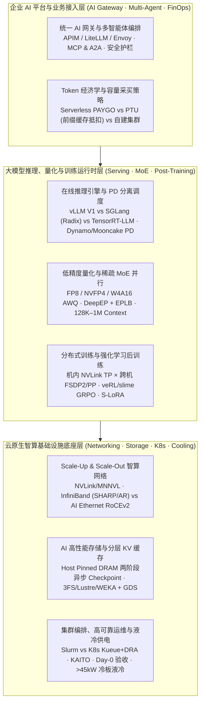

# 云与 AI 基础设施解决方案架构师（SA）实战选型知识库 (`ai-infra-research`)

> **Language / 语言**: **简体中文** | [English](./README.en.md) · [全部 458 篇双语总目录](./docs/full-catalog-zh.md) · [🎓 AI Infra 全景精学馆 H5 (`docs/h5/index.html`)](./docs/h5/index.html) · [📚 6 册推理与智算网络 H5 Academy](./docs/h5-academy/index.html) · [🔥 7合1全景精学中心 H5](./docs/h5/ai-infra-learning-hub.html) · [L0–L9 全栈分层地图](./docs/stack-map.md) · [SA 能力进阶路线](./docs/learning/roadmap.md) · [交互式容量与 TCO 工作台](./docs/reports/ai-infra-architect-workbench.html)

面向 **Cloud & AI Infrastructure Solution Architect（云与 AI 基础设施解决方案架构师）** 的中英双语架构选型、容量规划与 TCO 决策知识库。仓库摒弃脱离业务的晦涩低层源码碎片与跨学科算例，聚焦架构师在企业智算中心建设、公有云/混合云选型与大模型生产落地中最常面对的 **8 大核心架构决策域**，提供 **458 篇双语深度选型指南（`#001–#456` + 2 篇旗舰架构报告）、905 套自包含交互式容量计算器（Sizer）与 7-Card 4:5 视觉评测报告、69 套交互式 H5 精读页（`docs/h5/` & `docs/h5-academy/`），以及 464 套可一键复核的 Python 定量模型**。

---

## 1. 架构师一页纸全景视图（Solution Architect Decision Panorama）



---

## 2. 旗舰全栈案例与交互式容量测算台（Flagship Deep Dives & Workbench）

| 旗舰资产 | 架构师核心场景 | 关键架构结论与量化抓手 | 立即访问 |
|---|---|---|---|
| **阿里云 AI Infra 全栈架构深度测评（L0–L3）** | 评估公有云自研芯片、超节点、智算网络与企业 MaaS 平台选型 | 完整拆解平头哥真武 PPU（`810E`→`M890 144G`→`V900 216G`）、磐久 `AL128` 超节点、`HPN 7.0` 双平面多轨网络（训练提效 `+14.9%`）、`PAI` 训推潮汐抢占与 `百炼` `PAYGO / PTU / DTU / MU` 四阶选型树 | [中文报告](./docs/alibaba-cloud-ai-infra/README.md) · [English](./docs/alibaba-cloud-ai-infra/README.en.md) |
| **1024-GPU 训练与 PD 分离推理混合集群参考架构** | 设计千卡级预训练/后训练 + 在线高并发推理混合智算中心 | 8 轨无损网络 + 两阶段异步 Checkpoint（`9 TB` 停顿压至 `3.1 s`）+ Dynamo/Mooncake PD 分离（突发流量省卡 `26.5%–34.2%`）+ `126 kW` 冷板液冷闭环预算 | [中文报告](./docs/architectures/end-to-end-ai-infra-case.md) · [English](./docs/architectures/end-to-end-ai-infra-case.en.md) |
| **AI 基础设施架构师交互式工作台（5 合 1 Sizer）** | 客户汇报前快速测算集群 TCO、PD 实例配比、MoE 显存与 KV 卸载 | 零外部依赖单页 HTML 工具：实时交互测算 3 年单百万 Token 成本、SHARP 集合通信加速比、PD 分离收益、671B MoE 量化与 Checkpoint 好吞吐 | [打开交互式工作台](./docs/reports/ai-infra-architect-workbench.html) |
| **AI Infra 全景可视化精学中心 H5（7 大专题 + 动态图表 + 实时手算沙盘）** | 沉浸式交互精读 PD 分离、TP/PP/DP/EP、NVLink vs. RDMA、三道水位线算卡、TPM/TPS 换算与 TTFT/TPOT/Goodput | 内置 Colocated vs. PD 柱状图、HBM 显存堆叠瀑布图、Roofline 算力屋顶图、Throughput-Latency 帕累托曲线与实时滑块计算器 | [中文 H5 精学中心](./docs/h5/ai-infra-learning-hub.html) · [English H5](./docs/h5/ai-infra-learning-hub.en.html) |
| **6 册双语推理工程、智算网络与容量测算 H5 精学馆（H5 Academy）** | 分册深度交互精修：核心评估指标、TPM/TPS 容量规划、三道水位线算卡、PD 分离、TP/PP/DP/EP 加速与 RDMA/RoCEv2/NVLink | 配套 6 册离线可交互 H5 分册应用（`01`–`06`）与双语深度 FAQ 手册 | [打开 6 册 H5 精学馆](./docs/h5-academy/index.html) · [双语指南](./docs/inference-sizing-network/README.md) · [EN](./docs/inference-sizing-network/README.en.md) |

---

## 3. 八大核心架构决策域精选指南（Curated SA Selection Playbooks）

每篇指南均遵循 **一页纸核心结论 → 业务场景与痛点 Q&A → 架构权衡对比（Trade-offs） → 量化选型决策矩阵 → 上线前核对清单（Checklist）** 标准结构（以 [`ib-vs-ethernet-roce-selection-faq.md`](./docs/components/ib-vs-ethernet-roce-selection-faq.md) 为标杆范式）。完整 **397 篇** 列表见 **[双语总目录](./docs/full-catalog-zh.md)**。

### 3.1 智算网络与高速互连（Networking & Interconnects）

| 典型业务场景 (Scenario) | 核心架构权衡 (Architecture Trade-offs) | 推荐选型结论与红线 (SA Recommendation) | 双语指南与交互工具 |
|---|---|---|---|
| 新建百卡至万卡智算集群：选 InfiniBand 还是 AI 以太网 RoCEv2？ | IB 具备原生 Credit 无损、微秒级时延与 SHARP 网内归约，但生态绑定且交换机单价高；AI 以太网具备开放多云与 TCO 优势，但需严控 PFC 死锁与哈希极化 | `≥1,000 GPU` 同步预训练与重度跨机 MoE 优先 **IB NDR/XDR**；`≤512 GPU` 后训练、PD 分离推理与云原生共池优先 **AI 以太网 RoCEv2（Spectrum-X / UEC 路线）** | [中文](./docs/components/ib-vs-ethernet-roce-selection-faq.md) · [EN](./docs/components/ib-vs-ethernet-roce-selection-faq.en.md) · [评测卡](./docs/reports/rocev2-load-balancing-congestion-selection-cards.html) |
| 多轨 RoCEv2 训练出现尾延迟抖动或 PFC 暂停风暴 | 传统五元组静态 ECMP 对低熵 RDMA 大象流极易碰撞；纯靠 PFC 会引发级联反压锁死健康队列 | 采用 **Rail-Optimized 叶脊拓扑 + ECN 提前标记/DCQCN + 动态负载均衡（DLB/喷洒路由）**，强制开启交换机硬件 **PFC Watchdog** | [中文](./docs/components/rocev2-load-balancing-congestion-selection-faq.md) · [EN](./docs/components/rocev2-load-balancing-congestion-selection-faq.en.md) · [计算器](./docs/reports/rocev2-load-balancing-congestion-sizer.html) |
| 评估机内 PCIe 5.0 vs NVLink 与机柜级超节点（MNNVL / NVL72） | PCIe 带宽（64 GB/s）无法支撑高频张量并行 AllReduce；跨机柜超节点提升 EP/TP 域但放大单机柜液冷与供电故障爆炸半径 | **强制将 `TP` 锁死在 NVLink/MNNVL 域内**；跨机柜超节点必须以整个 Clique + CDU 回路为单位做拓扑感知成组调度 | [NVLink/PCIe/CXL](./docs/components/nvlink-pcie-cxl-scaleup-interconnect-selection-faq.md) · [MNNVL 超节点](./docs/components/gb200-mnnvl-imex-channels-nvlink-fabric-manager-isolation-selection-faq.md) · [光模块 LPO/CPO](./docs/components/ai-cluster-optical-interconnect-selection-faq.md) |

### 3.2 在线推理引擎、PD 分离与低延迟加速（Inference Serving & PD Disaggregation）

| 典型业务场景 (Scenario) | 核心架构权衡 (Architecture Trade-offs) | 推荐选型结论与红线 (SA Recommendation) | 双语指南与交互工具 |
|---|---|---|---|
| 生产标准化推理底座：选 vLLM、SGLang 还是 TensorRT-LLM？ | 模型覆盖面与异构硬件生态 vs 多轮共享前缀复用效率 vs 单型号 NVIDIA 极致算子榨取与编译维护成本 | 多模型通用平台首选 **vLLM V1**；多轮 Agent、长系统提示词 RAG（`>70%` 共享前缀）与 DeepSeek MoE 首选 **SGLang**；固定同构 NVIDIA 峰值压榨选 **TensorRT-LLM** | [中文](./docs/components/llm-inference-engine-selection-faq.md) · [EN](./docs/components/llm-inference-engine-selection-faq.en.md) · [评测卡](./docs/reports/llm-inference-engine-pd-selection-cards.html) |
| 长输入 RAG/Agent 在高并发下 Decode 卡顿（P99 TPOT 超标） | 共池混部（Co-located）架构简单，但长 Prompt Prefill 会周期性抢占同卡 Decode 显存带宽；PD 分离彻底解耦 SLA 但依赖高速 KV 传输网络 | `≤8–16 GPU` 或无 RDMA 环境用 **共池 + Chunked Prefill**；`≥16 GPU` 且具备 `100G–400G RDMA` 时启用 **Dynamo + Mooncake/NIXL PD 分离**（P99 TPOT 降 `3.76×`，达标成本省 `34%`） | [中文](./docs/components/pd-disaggregation-kv-offload-selection-faq.md) · [EN](./docs/components/pd-disaggregation-kv-offload-selection-faq.en.md) · [评测卡](./docs/reports/enterprise-pd-disaggregation-vs-colocated-inference-architecture-selection-cards.html) |
| 代码生成/交互式助手需在不降质前提下将输出速度翻倍 | 自回归 Decode 受限于 HBM 带宽利用率低；投机解码利用空闲算力并行验证多个候选 Token，但在超大 Batch 算力饱和时收益递减 | 中低并发交互池启用原生 **MTP（Multi-Token Prediction）或 EAGLE-3**（无损提速 `1.8×–2.6×`）；JSON/工具调用强制启用 **XGrammar / llguidance** 零开销位掩码约束 | [投机解码](./docs/components/speculative-decoding-selection-faq.md) · [前缀缓存](./docs/components/llm-inference-prefix-cache-radix-kv-routing-eviction-selection-faq.md) · [结构化输出](./docs/components/structured-output-constrained-decoding-selection-faq.md) |

### 3.3 模型量化、稀疏 MoE 与超长上下文（Quantization, MoE & Long Context）

| 典型业务场景 (Scenario) | 核心架构权衡 (Architecture Trade-offs) | 推荐选型结论与红线 (SA Recommendation) | 双语指南与交互工具 |
|---|---|---|---|
| 在 BF16、W8A8 FP8、W4A16 AWQ 与 Blackwell NVFP4 之间定精度 | 显存占用与算力吞吐翻倍 vs 复杂推理/数学/代码任务的精度退化风险，以及高并发下反量化（W4A16）的算子开销 | Hopper/MI300X 高并发首选 **Block-Scaled FP8**；单机显存受限中低并发选 **W4A16 AWQ**；Blackwell/CDNA4 经校准评估后首选硬件 **NVFP4/MXFP4** | [中文](./docs/components/llm-quantization-selection-faq.md) · [EN](./docs/components/llm-quantization-selection-faq.en.md) · [计算器](./docs/reports/enterprise-llm-quantization-bf16-fp8-int4-awq-hardware-sizer.html) |
| 私有化部署满血 DeepSeek-R1/V3 671B 或 Qwen 大规模 MoE | 671B 总权重必须常驻显存，若沿用稠密模型纯 TP 切分会导致跨机 AllReduce 彻底瘫痪，且热门专家负载倾斜会拖慢全集群 | 采用 **`Attention DP + Expert EP` 解耦并行 + `DeepEP` 异步通信 + `EPLB` 动态专家冗余均衡**；双机 H200/MI300X 可紧凑起步，高吞吐生产用多机 EP+PD 分离 | [MoE 并行指南](./docs/components/moe-parallelism-selection-faq.md) · [671B 部署定容](./docs/components/deepseek-v3-r1-671b-enterprise-private-deployment-sizing-selection-faq.md) · [MI300X MoE 实战](./docs/components/mi300x-large-moe-bf16-mxfp4-and-aipc-decision-sft.md) |
| 支持 128K–1M 超长文档分析与推理模型（o1/R1 类）慢思考 | 标准注意力二次方算力膨胀与 KV 显存爆炸；推理模型长思维链放大输出 Token 预算与尾部排队 | 结合 **FlashAttention-3/MLA + Ring/Ulysses 上下文并行 + FP8 KV Cache**；对推理时扩展设置分层预算路由（简单问题快模型，复杂任务推理模型） | [长上下文注意力](./docs/components/long-context-attention-parallelism-selection-faq.md) · [混合线性注意力](./docs/components/hybrid-linear-attention-mamba-mla-kv-architecture-selection-faq.md) · [推理时扩展 TTC](./docs/components/test-time-compute-long-cot-prm-routing-selection-faq.md) |

### 3.4 分布式训练、RLHF/GRPO 后训练与定制化（Training, RL & Customization）

| 典型业务场景 (Scenario) | 核心架构权衡 (Architecture Trade-offs) | 推荐选型结论与红线 (SA Recommendation) | 双语指南与交互工具 |
|---|---|---|---|
| 企业垂域落地：该做 Prompt/RAG、SFT 微调还是 RL 强化学习？ | 研发周期、标注数据门槛与训练算力投入 vs 事实实时性、输出格式遵从度与复杂推理上限 | **动态私有知识用 RAG**（支持秒级更新与权限溯源）；**固定格式/行文风格/小模型降本用 SFT+蒸馏**；**数学代码与多步工具决策用 GRPO/RL** | [RAG vs SFT vs RL](./docs/components/enterprise-llm-customization-prompt-rag-sft-distillation-selection-faq.md) · [EN](./docs/components/enterprise-llm-customization-prompt-rag-sft-distillation-selection-faq.en.md) · [SLM 蒸馏](./docs/components/enterprise-slm-distillation-synthetic-data-flywheel-architecture-selection-faq.md) |
| 64–2,048 卡训练并行切分与 RLHF/GRPO 训推引擎架构 | 纯 FSDP2 代码侵入最小但超百卡通信暴露增加；RLHF 中 Actor Rollout 生成占 70%+ 时间，同步等待长尾样本会严重拉低 GPU 利用率 | `≤64 GPU` 首选 **PyTorch FSDP2**；大规模预训练采用 **机内 TP=8 × 跨机 FSDP2 × DualPipe/ZB PP**；RL 后训练采用 **veRL / slime 混合共池或异步 Rollout 引擎** | [FSDP2 vs TP/PP](./docs/components/distributed-training-memory-parallelism-selection-faq.md) · [RLHF/GRPO 选型](./docs/components/llm-rl-post-training-colocated-vs-disaggregated-verl-slime-architecture-selection-faq.md) · [Multi-LoRA 服务](./docs/components/enterprise-multi-lora-serving-hundred-tenant-adapter-architecture-selection-faq.md) |

### 3.5 云原生 GPU 编排、Serverless 冷启动与多云治理（Orchestration, Cloud & Security）

| 典型业务场景 (Scenario) | 核心架构权衡 (Architecture Trade-offs) | 推荐选型结论与红线 (SA Recommendation) | 双语指南与交互工具 |
|---|---|---|---|
| 智算底座调度器：选裸金属 Slurm 还是 Kubernetes（Kueue + DRA）？ | Slurm 具备极简高性能拓扑作业调度优势，但缺乏微服务/网关生命周期治理；原生 K8s 必须补齐成组调度与设备拓扑感知插件 | 纯科研大训练可选 **Slurm（或 Slinky on K8s）**；企业训推一体共池统一采用 **Kubernetes + Kueue TAS（拓扑成组调度）+ DRA + 高低优潮汐抢占** | [Slurm vs K8s Kueue](./docs/components/ai-cluster-slurm-vs-kubernetes-kueue-dra-gang-scheduling-selection-faq.md) · [MIG vs MPS 共享](./docs/components/enterprise-gpu-sharing-mig-mps-timeslicing-fractional-scheduling-selection-faq.md) · [AKS+KAITO 弹性](./docs/components/enterprise-k8s-aks-kaito-keda-autoscaling-model-asset-fast-load-selection-faq.md) |
| AI Agent 代码沙箱与 Serverless GPU 副本冷启动耗时过长（分钟级） | 传统容器拉取数十 GB 镜像与初始化 CUDA/模型权重动辄 3–8 分钟，无法应对突发扩缩容 | 镜像层启用 **OCI 按需懒加载 + Dragonfly P2P 分发**；模型权重采用 **共享内存/NVMe 预热或 CRIU + `cuda-checkpoint` 显存快照秒级唤醒**；不可信代码隔离在 **Firecracker/Kata MicroVM** | [GPU 秒级冷启动](./docs/components/agentic-sandbox-gpu-coldstart-selection-faq.md) · [模型权重极速加载](./docs/components/model-weight-loading-oci-streaming-safetensors-rdma-broadcast-selection-faq.md) · [机密计算 GPU TEE](./docs/components/enterprise-confidential-ai-tee-gpu-attestation-privacy-selection-faq.md) |

### 3.6 AI 高性能存储、分层 KV 缓存与企业级生产 RAG（Storage, KV Offload & RAG）

| 典型业务场景 (Scenario) | 核心架构权衡 (Architecture Trade-offs) | 推荐选型结论与红线 (SA Recommendation) | 双语指南与交互工具 |
|---|---|---|---|
| 千卡训练频繁保存多 TB Checkpoint 导致训练长时间停顿；长会话 KV 反复重算 | 直接向远端存储同步写 Checkpoint 会阻塞全集群 GPU 数分钟；而长多轮对话驱逐 HBM KV 后重算 Prefill 浪费算力且拉高 TTFT | 训练强制开启 **Host Pinned DRAM 两阶段异步 Checkpoint**（`9 TB` 阻塞从 `225 s` 降至 `3.1 s`）+ **3FS/Lustre/WEKA + GDS**；长会话启用 **Pinned DRAM / RDMA 内存池分层 KV 卸载**（恢复 TTFT 快 `15×`） | [Checkpoint 架构](./docs/components/training-checkpoint-architecture-selection-faq.md) · [分层 KV 卸载](./docs/components/kv-cache-tiered-offload-selection-faq.md) · [3FS/Lustre/WEKA](./docs/components/ai-storage-3fs-lustre-weka-parallel-filesystem-selection-faq.md) |
| 构建十亿级向量检索与高准确率企业多模态生产 RAG 平台 | 纯内存 HNSW 延迟最低但十亿向量内存成本高昂；NVMe DiskANN 省内存但需权衡 IOPS；朴素切块 RAG 在跨表/全局总结问题上召回失真 | 千万至亿级热索引选 **HNSW + 标量/乘积量化**，十亿级温冷索引选 **NVMe DiskANN**，超高并发批检索选 **GPU CAGRA**；生产检索标配 **稠密+BM25 混合检索 + Cross-Encoder 重排** | [十亿级向量库选型](./docs/components/vector-database-billion-scale-hnsw-diskann-gpu-cagra-selection-faq.md) · [企业生产 RAG](./docs/components/enterprise-production-rag-architecture-acl-cdc-hybrid-graphrag-selection-faq.md) · [GraphRAG vs 向量 RAG](./docs/components/graphrag-vs-dense-hybrid-rag-indexing-selection-faq.md) |

### 3.7 集群验收排障、液冷供电与 Token FinOps（Reliability, Cooling & FinOps）

| 典型业务场景 (Scenario) | 核心架构权衡 (Architecture Trade-offs) | 推荐选型结论与红线 (SA Recommendation) | 双语指南与交互工具 |
|---|---|---|---|
| 新集群交付验收、训练慢节点（Straggler）与静默数值损坏（SDC）治理 | 单根劣化光模块或单卡隐性降频即可把千卡有效 MFU 拉低 20%–40%，传统主机 CPU/Ping 监控完全盲区 | 建立 **Day-0 三级压测门禁（单卡热稳态 + 机内 NVLink + 跨机同 Rail 两两 RDMA 矩阵）**，生产实时接入 **DCGM Xid/Row-Remap + OpenTelemetry Token 级追踪** | [Day-0 压测验收](./docs/components/ai-cluster-burn-in-acceptance-dcgm-nccl-validation-selection-faq.md) · [慢节点与灰故障](./docs/components/ai-cluster-gpu-straggler-grey-failure-telemetry-mitigation-selection-faq.md) · [GPU 可观测与 FinOps](./docs/components/enterprise-gpu-observability-dcgm-otel-genai-finops-governance-selection-faq.md) |
| 企业大模型成本测算（API 按量 PAYGO vs 预置吞吐 PTU vs 自建 GPU）与高密液冷规划 | 初期盲目买卡自建易因低利用率导致单 Token 成本倒挂；高密机柜超过风冷极限会导致 GPU 热降频与机房母线跳闸 | 日均利用率 `<25%` 选 **Serverless PAYGO + Batch**；稳态高并发标准模型用 **PTU（吃满前缀缓存折扣）+ 波峰溢出 PAYGO**；持续高负载或私有大模型再上 **自建/专属训推共池**。单柜 **`>45 kW` 切换冷板液冷（DLC）** | [PAYGO vs PTU vs 自建](./docs/components/cloud-llm-deployment-paygo-ptu-self-hosted-aks-kaito-tco-selection-faq.md) · [液冷与供电选型](./docs/components/ai-datacenter-cooling-power-selection-faq.md) · [GPU 硬件 SKU TCO](./docs/components/ai-gpu-hardware-sku-h100-h200-b200-gb200-mi325x-tco-selection-faq.md) |

### 3.8 企业 AI 网关、多智能体编排与重点行业方案（AI Platform, Agents & Verticals）

| 典型业务场景 (Scenario) | 核心架构权衡 (Architecture Trade-offs) | 推荐选型结论与红线 (SA Recommendation) | 双语指南与交互工具 |
|---|---|---|---|
| 建设集团级统一 AI Gateway、MCP/A2A 多智能体底座与安全护栏 | 各业务线直连模型 API 会造成密钥散落、限流踩踏与敏感数据外泄；长链路有状态 Agent 需兼顾检查点持久化与工具权限最小化 | 统一收口至 **企业 AI Gateway（Token 配额、语义缓存、跨区域/多模型自动降级）**；工具集成遵循 **MCP 标准 + OBO 权限交集（`User ∩ Agent`）+ 状态持久化编排** + 双层低延迟护栏 | [企业 AI Gateway](./docs/components/enterprise-ai-gateway-apim-litellm-kong-envoy-higress-selection-faq.md) · [Agent 编排框架](./docs/components/enterprise-agentic-orchestration-langgraph-temporal-autogen-foundry-selection-faq.md) · [Agent 身份与 MCP OBO](./docs/components/enterprise-ai-agent-identity-delegated-auth-obo-tool-permission-selection-faq.md) · [实时护栏架构](./docs/components/enterprise-llm-guardrails-prompt-shield-content-safety-latency-selection-faq.md) |
| 企业级云托管（PAYGO vs PTU）vs K8s 自建全口径 TCO、Copilot 扩展（Adopt vs Extend vs Build）与多模态知识底座 | 漏算 24×7 SRE 人力薪资会导致中小流量盲目买卡倒挂；100+ 场景全部写代码自建会拖垮交付周期；长视频 1-FPS 抽帧与全页 VLM 解析会产生天价账单 | 计入人力后稳态 **`>2,250 TPM` 选 P55 PTU + PAYGO 削峰**，超 **`4.6B Tokens/月` 再上 K8s 自建**；采用 **`50%` M365 声明式代理 + `30%` Copilot Studio + `20%` Foundry 全代码** 组合；文档/视频采用 **复杂度路由 + 镜头 pHash 去重** | [PAYGO vs PTU vs K8s 全成本](./docs/components/enterprise-cloud-managed-paas-ptu-paygo-vs-self-hosted-k8s-tco-selection-faq.md) · [M365 vs Studio vs Foundry](./docs/components/enterprise-m365-copilot-extensibility-foundry-studio-pro-code-selection-faq.md) · [文档解析选型](./docs/components/enterprise-multimodal-document-parsing-ocr-vlm-rag-ingestion-selection-faq.md) · [Video-RAG 选型](./docs/components/enterprise-multimodal-video-image-understanding-indexing-rag-selection-faq.md) |
| 金融、制造、医疗、电信、零售、能源等重点行业 AI 架构蓝图 | 不同行业在监管主权隔离、毫秒级边缘时延、多模态文档/影像解析与旧系统集成上约束迥异 | 提供覆盖合规红线、云边协同定容、RAG/Agent 链路与 TCO 回收测算的 **270+ 篇平台与行业端到端参考方案** | 详见 [完整总目录第 8 章（279 篇平台与行业指南）](./docs/full-catalog-zh.md) |

---

## 4. 仓库目录结构与本地验证命令（Repository Layout & Validation）

```text
ai-infra-research/
├── README.md / README.en.md                 # 中英双语解决方案架构师（SA）导航首页
├── docs/
│   ├── full-catalog-zh.md / full-catalog-en.md  # 全部 397 篇双语 SA 资产分类总目录
│   ├── h5/ai-infra-learning-hub.{html,en.html}  # AI Infra 全景可视化精学中心 H5（交互图表与实时沙盘）
│   ├── stack-map.md / stack-map.en.md           # L0–L9 云与 AI 基础设施十层架构地图
│   ├── learning/roadmap.{md,en.md}              # 云架构师 → AI Infra SA 六阶段能力进阶路线（含 7 天冲刺营）
│   ├── alibaba-cloud-ai-infra/README.{md,en.md} # 旗舰报告：阿里云 L0–L3 全栈 AI Infra 深度测评
│   ├── architectures/end-to-end-ai-infra-case.{md,en.md} # 旗舰报告：1024-GPU 训推一体混合集群参考架构
│   ├── components/*.{md,en.md}                  # 395 篇双语核心组件选型与行业方案 FAQ（共 790 份文档）
│   └── reports/*.html                           # 783 套自包含交互式容量计算器（Sizer）、7-Card 评测卡与全栈工作台
├── assets/svg/*.svg                         # 双语高可读架构总结图（SVG）
├── experiments/*/                           # 403 套基于 Python 3.12 标准库的可复核容量/性能/TCO 模型
├── scripts/validate_research.py             # 全仓死链扫描、双语资产对齐与安全合规门禁脚本
└── tests/                                   # 自动化回归测试套件
```

### 一键验证全仓链接完整性与定量模型

本仓库所有验证脚本与定量算例均仅依赖 **Python 3.12+ 标准库**（无需安装第三方依赖）：

```bash
# 1. 运行全仓自动化单元测试（校验定量模型与仓库验证器）
python -m unittest discover -s tests

# 2. 运行全仓 Markdown 死链检查、证据台账与敏感路径门禁
python scripts/validate_research.py
```

版权、来源归属与评测边界声明详见 [`THIRD_PARTY_NOTICES.md`](./THIRD_PARTY_NOTICES.md)。
