# Alibaba Cloud Full-Stack AI Infrastructure Architecture Review: From T-Head Silicon to Lingjun, PAI, and Bailian (Model Studio)

> **Language / 语言**: [简体中文](./README.md) | **English** · [Full Catalog](../full-catalog-en.md) · [Repository Home](../../README.en.md)

> **Executive Summary**: From a Cloud & AI Infrastructure Solution Architect perspective, this technical review deconstructs Alibaba Cloud's **"Qwen–Cloud–T-Head" (`L0–L3`) vertically integrated AI infrastructure stack** — spanning T-Head Zhenwu PPU silicon evolution (`810E` → `M890` → `V900`), Panjiu `AL128` 128-card supernode five-chip co-design, `HPN 7.0` dual-ToR × multi-rail × dual-plane RDMA networking (ACM SIGCOMM 2024, `+14.9%` training goodput), `PAI-Lingjun` tidal training/serving preemption, and `Bailian` (`Model Studio`) four-tier capacity sizing (`PAYGO`, `PTU`, `DTU`, `MU`).

---

## 0. One-Page Solution Architect Executive Summary

Alibaba Cloud is one of the very few hyperscalers globally — alongside Google Cloud (`TPU + OCS + Vertex AI + Gemini`) and AWS (`Trainium/Inferentia + Nitro/EFA + SageMaker + Bedrock`) — to achieve **full-stack vertical co-design across Foundation Models (Qwen), Cloud Infrastructure (Panjiu + HPN 7.0 + CPFS + PAI), and In-House Silicon (T-Head)**.

1. **L0 Silicon ("Compute–Storage–Network" Full Self-Research Closed Loop)**:
   - **AI Accelerator (PPU)**: Evolved from first-generation inference ASIC `Hanguang 800` (2019) to full-stack general-purpose `Zhenwu 810E` (`96 GB HBM2e`, `700 GB/s` ICN), `Zhenwu M890` (`144 GB HBM3`, `800 GB/s` 8-port ICN, native `FP8/FP4`, ~`3×` 810E throughput), and next-generation `Zhenwu V900` (`216 GB HBM`, `1,200 GB/s` ICN, another ~`3×` leap), with `Zhenwu J900` on the roadmap.
   - **Scale-Up & Scale-Out Interconnect Silicon**: In-house **`ICN Switch 1.0`** (`25.6 Tbps`, `< 150 ns` switch latency) powers 128-card unified-memory supernodes (`Panjiu AL128`), while **`Panmai 920`** AI SmartNIC delivers `400G/800G` dual-port hardware RDMA with sub-microsecond failover.
   - **Host CPU & Storage Controller**: Armv9 server CPU **`Yitian 710`** (128 cores, 8-ch DDR5, 96-lane PCIe 5.0) paired with **`Zhenyue 510`** PCIe 5.0 enterprise SSD controller (`3,400K IOPS`, `14 GB/s`, `4 μs` read latency) eliminates host I/O bottlenecks for checkpointing and KV cache tiering.
2. **L1 Supernode & Network Fabric (`Panjiu AL128` + `HPN 7.0` + `Solar-RDMA` + `CPFS`)**:
   - **`HPN 7.0` (ACM SIGCOMM 2024)**: Replaces fragile single-plane ECMP with **Dual-ToR Uplink + Rail-Optimized Multi-Rail + Dual Independent Core Planes**, connecting up to **15,000 GPUs in a two-tier 51.2T Clos** while eliminating single-ToR blast radius and hash polarization. Combined with `Solar-RDMA` and `ACCL`, end-to-end LLM training efficiency improves by **`+14.9%`**.
   - **`CPFS` Parallel File System**: Delivers up to `2 TB/s` aggregate throughput and `30M IOPS` with automated hot/cold tiering to `OSS` object storage.
3. **L1.5 / L2 AI Engineering & Cluster Platform (`PAI-Lingjun` & `PAI`)**:
   - **Tidal Training-Serving Co-Location (Parent/Child Quota Preemption)**: Production `PAI-EAS` online inference runs in high-priority parent quotas during daytime peaks while `PAI-DLC` post-training (`SFT`/`RLHF`) borrows idle GPUs overnight and yields within seconds on traffic spikes — lifting 24-hour cluster utilization above **`75%–85%`**.
   - **Disaggregated MoE Serving (`EP + PD Split` + `LLM Intelligent Router`)**: Native multi-node `Unit` gang scheduling with `unit.guard` fault barriers, `prefix-cache` / `pd-split` intelligent routing (**`-23.4%` to `-25.0%` TTFT**), and `AIMaster` + `EasyCKPT` minute-level asynchronous checkpoint recovery.
4. **L3 Enterprise MaaS (`Bailian` / `Model Studio`)**:
   - Offers a seamless four-step capacity ladder without requiring customers to manage Kubernetes or NCCL internals: **Serverless Token PAYGO** → **Provisioned Throughput (`PTU`, with `0.08×–0.25×` Prefix Cache quota discount saving `40%+` budget)** → **Dedicated Throughput (`DTU`)** → **Model Units (`MU`, offering managed native `PD Disaggregation` SKUs for custom post-trained `CPT/SFT/DPO/RL` weights)**.

---

## 1. Full-Stack `L0–L3` Architecture Panorama

```mermaid
flowchart TB
    subgraph L3["L3: Enterprise MaaS & Agent Platform — Alibaba Cloud Bailian (Model Studio)"]
        direction LR
        B_API["Serverless Token API & Context Cache<br/>Qwen3.8 / Qwen3.5 / Wan / DeepSeek"]
        B_TUNE["Managed Post-Training Pipeline<br/>CPT · SFT · DPO · GRPO/RL · EvalScope"]
        B_CAP["4-Tier Capacity Ladder<br/>PAYGO → PTU (Prefix Discount) → DTU → MU (Native PD Split)"]
        B_AGENT["Enterprise Agent & Multimodal RAG<br/>Bailian Workflows · Function Calling · MCP"]
    end

    subgraph L2["L2: Cloud-Native AI Engineering Platform — PAI"]
        direction LR
        DSW["PAI-DSW<br/>Interactive Dev Pods"]
        DLC["PAI-DLC Distributed Training<br/>AIMaster Straggler/Fault Guard + EasyCKPT"]
        EAS["PAI-EAS Elastic Serving<br/>Unit Multi-Node EP+PD · Prefix-Cache Router · GU30"]
        SCHED["Parent/Child Quota Tree<br/>Tidal Serving-First Preemption (>80% GPU Util)"]
    end

    subgraph L15["L1.5: Bare-Metal RoCE Supercomputing — PAI-Lingjun"]
        direction LR
        LJ_POOL["Lingjun Heterogeneous Pools<br/>GP9A Zhenwu Supernodes & Flagship GPU Clusters"]
        LJ_HZ["HPN Zone (hz) Topology Affinity<br/>Sub-Domain Rail Locality & Pairwise Health Checks"]
    end

    subgraph L1["L1: AI Compute, Network & Storage Infrastructure"]
        direction LR
        PANJIU["Panjiu AL128 Ortogonal Supernode<br/>128-PPU Cableless Unified Memory Domain"]
        CIPU["CIPU Offload Engine<br/>Zero-Hypervisor Bare-Metal Virtualization"]
        HPN["HPN 7.0 Dual-Plane Multi-Rail Clos<br/>15K-Card 2-Tier Fabric + Solar-RDMA + ACCL"]
        CPFS["CPFS Parallel File System + OSS Tiering<br/>2 TB/s Bandwidth · 30M IOPS"]
    end

    subgraph L0["L0: T-Head In-House Compute–Storage–Network Silicon"]
        direction LR
        PPU["Zhenwu PPU Family<br/>810E (96G) → M890 (144G) → V900 (216G)"]
        ICN["ICN Switch 1.0<br/>25.6 Tbps · <150 ns Scale-Up"]
        NIC["Panmai 920 SmartNIC<br/>400G/800G Dual-Port Solar-RDMA"]
        CPU_SSD["Yitian 710 Armv9 CPU<br/>+ Zhenyue 510 PCIe 5.0 SSD Controller"]
    end

    L3 --> L2 --> L15 --> L1 --> L0
```

---

## 2. L0 T-Head Silicon Matrix & Generational Comparison

### 2.1 Zhenwu PPU Generational Roadmap

| Dimension | Hanguang 800 | Zhenwu 810E | Zhenwu M890 | Zhenwu V900 |
|---|---|---|---|---|
| **Positioning** | Gen-1 Cloud Vision Inference ASIC | Gen-1 General-Purpose Training & Serving PPU | MoE Flagship Supernode PPU (`Lingjun GP9A`) | Trillion-Parameter MoE Next-Gen Flagship |
| **Memory Capacity & Type** | On-chip SRAM | **`96 GB` HBM2e** | **`144 GB` HBM3** (`+50%` vs. 810E) | **`216 GB` HBM** (`+50%` vs. M890) |
| **Scale-Up Interconnect (`ICN`)** | PCIe | `700 GB/s` (7× 100G ICN) | **`800 GB/s`** (8× ICN ports) | **`1,200 GB/s`** |
| **Precision Support** | INT8 / FP16 | FP32 / BF16 / FP16 / INT8 | **FP32 / BF16 / FP16 / FP8 / FP4** | Full-precision incl. native **FP8 / FP4** |
| **Relative Compute Leap** | Vision baseline | 1.0× PPU baseline (`>400K` cards deployed) | **~`3.0×` Zhenwu 810E** | **~`3.0×` Zhenwu M890** (~`9×` 810E) |
| **Software Ecosystem** | Custom SDK | **`HGGC` CUDA-compatible stack** (PyTorch / vLLM / SGLang) | **`HGGC` + Native MoE FP8/EP Kernels** | **`HGGC` Next-Gen Unified Compiler** |

> **SA Sizing Takeaway**: `144 GB` (`M890`) and `216 GB` (`V900`) HBM capacities directly target **large sparse MoE (`Qwen3.5-397B`, `DeepSeek-R1 671B`)** and **128K+ long-context KV Cache residency**. An 8-card `M890` node provides `1,152 GB` HBM, fitting full `671B FP8` weights plus generous KV Cache headroom on a single node without cross-node Tensor Parallelism.

### 2.2 Panjiu `AL128` Five-Chip Supernode Synergy

- **Scale-Up (`ICN Switch 1.0`)**: `25.6 Tbps` switching capacity (`128 × 200G` SerDes) with **`< 150 ns`** port-to-port latency and hardware multicast/in-network reduction, forming a cableless orthogonal 128-PPU rack supernode.
- **Scale-Out (`Panmai 920` AI SmartNIC)**: `400G/800G` dual-port native `Solar-RDMA` offload, hardware packet spraying, and `< 1 μs` dual-uplink failover.
- **Host & Storage (`Yitian 710` + `Zhenyue 510`)**: `3,400K IOPS` and `14 GB/s` per NVMe SSD (`4 μs` latency) eliminate host staging bottlenecks during `EasyCKPT` checkpoint flushes and multi-tier KV Cache swap.

---

## 3. L1 AI Networking & Storage Foundation (`HPN 7.0`, `Solar-RDMA`, `CPFS`)

| Bottleneck in Legacy RoCE Clos | `HPN 7.0` + `Solar-RDMA` Architectural Mechanism | SA Production Benefit |
|---|---|---|
| **Low-entropy ECMP hash collisions** (`>50%` link imbalance on 8–16 QP elephant flows) | **Rail-Optimized Multi-Rail + Dual Core Planes (`Plane A / Plane B`)** + `Solar-RDMA` multipath spray | Eliminates Spine hash polarization; raises end-to-end LLM training efficiency by **`+14.9%`** (SIGCOMM 2024) |
| **Single-ToR failure drops an entire 8-GPU node** | **Dual-ToR Active-Active Uplinks per NIC** (`Panmai 920` / dual-port 400G NIC) | Zero single-ToR blast radius; millisecond-free hardware failover without NCCL job abort |
| **PFC pause storms & victim-flow head-of-line blocking** | Receiver-driven `Solar-RDMA` congestion control + independent dual-plane isolation + `ACCL` topology awareness | Tolerates `10⁻³` transient packet drops without PFC deadlock across **15,000-card 2-tier 51.2T Clos** |
| **Checkpoint I/O stalls & cold dataset movement** | **`CPFS` (`2 TB/s`, `30M IOPS`)** + automated `OSS` namespace lazy load/flush | Sustains `>98%` training goodput with minute-level checkpointing |

---

## 4. L1.5 / L2 `PAI-Lingjun` & `PAI` Cloud-Native AI Platform

1. **HPN Zone (`hz`) Affinity Mandate**: When provisioning `PAI-Lingjun` clusters or `PAI-EAS` multi-node MoE services, always pin worker groups inside a **single `HPN Zone (hz)`** and mount RDMA interface `net0` so `EP` All-to-All traffic never traverses cross-pod aggregation hops.
2. **Tidal Training-Serving Co-Location (Parent/Child Quota Tree)**:
   - Place latency-critical `PAI-EAS` inference in high-priority quotas and `PAI-DLC` (`SFT`/`DPO`/`RL`) jobs in elastic child quotas with `EasyCKPT` enabled.
   - Daytime traffic spikes trigger clean checkpoint-and-yield preemption in seconds; nighttime troughs automatically backfill GPUs with post-training workloads (`>80%` 24h utilization).
3. **Production MoE `EP + PD Disaggregation` on `PAI-EAS`**:
   - `PAI-EAS` models multi-node Prefill (`TP=8`) and Decode (`EP=8/16, DP=8` + MTP) roles as a single atomic **`Unit`** with `unit.guard` coordinated health recovery and a built-in **`LLM Intelligent Router`** (`prefix-cache` & `pd-split` policies reducing TTFT by **`23.4%–25.0%`**).

---

## 5. L3 `Bailian` (`Model Studio`) Four-Tier Capacity Sizing Matrix

| Bailian Deployment Mode | Billing Unit | Physical Isolation | Native Prefix Cache Discount | Best-Fit Enterprise Scenario |
|---|---|---|---|---|
| **Serverless PAYGO + Batch** | $/1M Input & Output Tokens (`50%` off Batch; `80%` off explicit Context Cache hits) | Shared multi-tenant pool | Explicit/implicit Context Cache (`0.2×` input price) | Early prototyping, spiky traffic, asynchronous overnight batch pipelines |
| **Provisioned Throughput (`PTU`)** | Reserved `KTPM` / `PTU` (monthly/annual + Auto-Overflow to PAYGO) | Logical SLA reservation (`1.5×–2.0×` higher TPS) | **`0.08×–0.25×` capacity deduction** on cached system prompts (`40%+` PTU savings) | High-concurrency production RAG/Agents using standard base models with long shared prefixes (`>32K`) |
| **Dedicated Throughput (`DTU`)** | Dedicated instance hours | Dedicated tenant compute slice | Engine-native KV reuse | Strict compliance isolation on standard or LoRA/SFT models with predictable steady load |
| **Model Units (`MU` — incl. Native `PD Split` SKUs)** | `MU1` / `MU2` replica hours with autoscaling | Physical dedicated GPU group | Managed **native Prefill/Decode Disaggregation** + Radix KV reuse | Full-parameter custom `CPT/SFT/DPO/RL` large models (`Qwen3.5-397B`, `DeepSeek-V3/R1`) needing dedicated SLA without operating K8s/vLLM |

---

## 6. Cloud Hyperscaler AI Infrastructure Comparison & SA Selection Checklist

| Architectural Layer | Alibaba Cloud (`T-Head + Lingjun + PAI + Bailian`) | AWS (`Annapurna + SageMaker HyperPod + Bedrock`) | Google Cloud (`TPU + GKE/Vertex AI`) | Microsoft Azure (`Maia/NVIDIA + AKS/CycleCloud + Foundry`) |
|---|---|---|---|---|
| **In-House Silicon & Supernode** | `Zhenwu M890/V900` (`144G/216G HBM`) + `Panjiu AL128` (`ICN 25.6T`) + `Yitian 710` + `Zhenyue 510` | `Trainium2/3` (`NeuronLink` UltraServer) + `Graviton4` + `Nitro` | `TPU v5p / Trillium / Ironwood` (`ICI` 3D Torus + `OCS` optical circuit switches) | `Azure Maia` + flagship `GB200/GB300 NVL72` liquid-cooled fleets + `Cobalt` Arm CPU |
| **AI Scale-Out Fabric** | `HPN 7.0` Dual-ToR Dual-Plane Clos (`Solar-RDMA` + `ACCL`) | `EFAv2/v3` (`SRD` multipath unordered delivery) | `Jupiter / OCS` reconfigurable optical fabric + `gVNIC` | Quantum-2/X800 InfiniBand (`SHARP`) & Spectrum-X RoCEv2 |
| **MaaS & Open-Weight Advantage** | First-party **`Qwen` open + proprietary family** + `PTU` prefix-cache discount + managed `MU` PD split | Broadest third-party catalog (`Claude`, `Llama`, `Nova`) + global multi-region governance | First-party `Gemini` long-context multimodal + `TPU` inference economics | Exclusive `OpenAI` frontier models + `PTU` global Spillover + enterprise Entra/Purview integration |

### Solution Architect Actionable Selection Checklist

- [ ] **Exploration / Spiky Traffic (`< 20%` duty cycle)**: Start on **Bailian Serverless PAYGO** with explicit Context Caching (`20%` cached token rate) and 50%-off Batch APIs before reserving dedicated GPUs.
- [ ] **Steady Enterprise Agent / Long-Prompt RAG (`> 32K` fixed prefix)**: Purchase **Bailian `PTU`** sized to P50–P75 baseline with **Auto-Overflow to PAYGO** enabled, structuring prompts `[Static System + Tools] -> [Dynamic Query]` to capture the `0.08×–0.25×` Prefix Cache PTU multiplier.
- [ ] **Custom Post-Trained Weights (`SFT/DPO/RL`) Without Infra Ops Team**: Deploy on **Bailian `MU` (`PD-Disaggregated` SKU)** calibrated with `EvalScope` load profiles.
- [ ] **Hybrid Daytime Serving + Nighttime Post-Training (`≥ 32` GPUs)**: Adopt **`PAI-EAS` + `PAI-DLC` Parent/Child Quota Preemption** with `LLM Intelligent Router (prefix-cache)` and `EasyCKPT`.
- [ ] **671B/397B Full-Precision MoE Serving or `≥ 512`-Card Pre-Training**: Allocate **`PAI-Lingjun` inside a single `HPN Zone (hz)`** (`Panjiu AL128` or flagship GPU supernodes) + `CPFS` parallel storage + `PAI-EAS EP+PD` template.

---

## 7. Provenance & Evidence Boundaries

- All architectural specifications, capacity multipliers (`M890 ~3× 810E`, `V900 ~3× M890`, `HPN 7.0 +14.9%` training goodput, `PTU 1.5–2.0×` TPS, `PAI-EAS` router `-23.4%` to `-25.0%` TTFT), and quota rules are sourced directly from official Alibaba Cloud documentation, ACM SIGCOMM 2024 publications (`HPN 7.0`), and Apsara Conference technical disclosures cited in [Section 8 of the Chinese edition](./README.md).
- Undisclosed silicon parameters (foundry node nm, die area, exact package TDP, and raw TFLOPS tables not published in official T-Head whitepapers) are explicitly left unestimated rather than inferred from third-party speculation.
