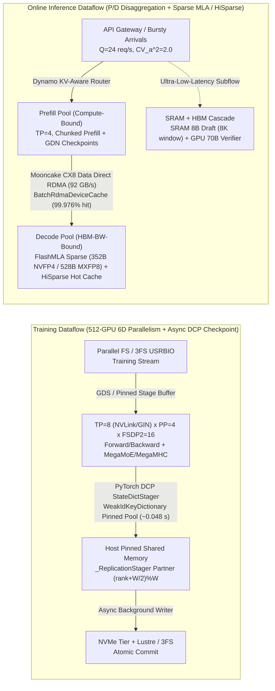
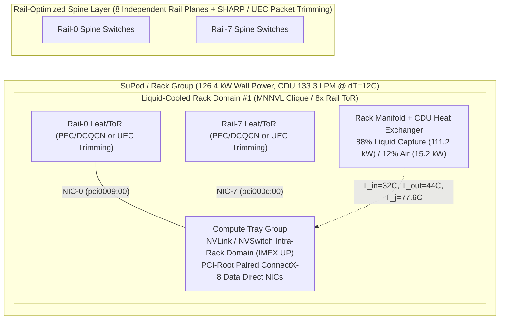

# End-to-End AI Infrastructure Reference Architecture: 1024-GPU Training & Disaggregated Prefill/Decode (P/D) Serving Cluster

> **Language / 语言**: [中文 (Chinese)](end-to-end-ai-infra-case.md) | **English**

- **Status**: Complete full-stack reference architecture spanning GPU/HBM, Scale-Up/Scale-Out fabrics, 6D parallel training, online inference SLOs, asynchronous checkpointing, topology-aware orchestration, Token/TCO economics, and rack-scale liquid cooling (`specification` / `implementation` / `own-offline`). Every quantitative budget is backed by deterministic Python 3.12 standard-library experiments in this repository (`--check`).
- **Component & Prerequisite Chain**:
  - **Hardware & Interconnect Foundation**: [GPU & HBM Architecture](../components/gpu-hbm.md) → [Interconnect & Network Stack](../components/interconnect-network.md) → [RDMA Verbs Lifecycle](../components/rdma-lifecycle.md) → [NCCL Topology & Transport](../components/nccl-topology-transport.md) → [NCCL Graph Search & Channel Mapping](../components/nccl-graph-channel-mapping.md) → [NCCL IB Port-Failover Invariants](../components/nccl-port-recovery-invariants.md) → [Tensor Layout & SM100 Kernel Dispatch](../components/kernel-dispatch-layout.md) → [NCCL Device API & `ncclGin` Symmetric Collectives](../components/nccl-device-gin-symmetric-collectives.en.md) → [DeepGEMM SM100 `MegaMoE` & `MegaMHC`](../components/deepgemm-sm100-mega-moe-mhc-hyperconnection.en.md) → [FlashInfer Frost DS4.1 Mixed `MXFP8/FP4` Decode & `Green Context`](../components/flashinfer-frost-ds41-mixed-mxfp8-fp4-decode.en.md) → [TE Blackwell FP8 Block-Scaling to MXFP8 Grouped GEMM Swizzle](../components/te-blackwell-fp8bs-grouped-gemm-mxfp8-swizzle.en.md) → [Mooncake 7-Class Auto-GID Re-Probing & Bounded Scatter Resharding](../components/mooncake-rdma-auto-gid-reprobe-bounded-reshard.en.md).
  - **Workloads & Systems Engineering**: [6D Distributed Training Parallelism](../components/training-parallelism.md) → [TorchTitan `FlexShard` (`BlockShard`/`Owned`) & GB200 `HybridEP`](../components/torchtitan-flexshard-distmuon-hybridep.en.md) → [veRL Low-Precision QAT Zero-Copy FP4 Refit & `forward_kl_topk_tail` OPD](../components/verl-qat-nvfp4-mxfp8-rollout-tail-kl-distillation.en.md) → [Inference Scheduling & P/D Disaggregation](../components/inference-slo.md) → [vLLM V1 Sparse MLA, `HiSparse` & `GDN`](../components/vllm-v1-sparse-mla-hisparse-gdn-hybrid.en.md) → [SGLang Zero-Realloc PD Role Switch & `PPConsensusStore`](../components/sglang-pd-role-switch-pp-consensus-offload.en.md) → [Storage GDS & Async Checkpointing](../components/storage-checkpoint.md) → [Cluster Orchestration & Elastic Recovery](../components/cluster-orchestration.md) → [Capacity & Token Economics](../components/capacity-economics.md) → [Rack Power & Liquid Cooling](../components/rack-power-cooling.md) → [100K-GPU AI Factory TCO Pareto](../components/ai-factory-tco-pareto.md).
- **Queue ID**: `architecture-case` (priority 10); prerequisites `cluster-orchestration`, `capacity-economics`, and `rack-power-cooling` are all `done`.
- **Mastery**: `not-assessed` (see [Competency Matrix](../learning/competency-matrix.md)).

---

## 1. Business Objectives, Workload Contracts & SLO Guardrails

This reference architecture targets Cloud and AI Infrastructure Solution Architects designing a **512-GPU pre-training/post-training cluster + 256-GPU low-latency disaggregated inference cluster (768 primary GPUs across 12 liquid/air-cooled rack domains, plus wafer/SRAM accelerator tiering)**:

| Dimension | Workload A: MoE / Dense Pre-Training & Long-Context Post-Training | Workload B: High-Concurrency Online Serving (P/D Disaggregation + Speculative Decoding) |
|---|---|---|
| **Representative Models & Precision** | 70B Dense (`BF16` / `FP8` compute + `FP32` master weights) & 671B/37B-Active Sparse MoE (`MXFP8FP4` / `NVFP4`) | 70B Dense & 671B Sparse MLA (`FP8` / `NVFP4` KV Cache), input $I=4096$–$131072$ tokens, output $O=512$ tokens |
| **Throughput & Latency SLOs** | 512-GPU effective step time $\le 4.8\,\text{s}$, Cluster Goodput (ETTR) $\ge 90\%$, $1\,\text{T}$ tokens wall-clock $\le 14.5$ days | Mean arrival rate $Q=24\,\text{req/s}$ (Gamma burstiness $CV_a^2=2.0$), **P95 TTFT $\le 1.5\,\text{s}$**, **TPOT $\le 25\,\text{ms/tok}$**, SLO Goodput $\ge 95\%$ |
| **Recovery & Fault Tolerance RTO** | $1\,\text{TiB}$ distributed checkpoint stall $T_{\text{stall}} \le 2.5\,\text{s}$ (`0.048 s` with cached `StateDictStager`); single-node/NIC recovery $\le 90\,\text{s}$ (`19.8 s` with NVRx in-process restart) | Sub-second faulty P/D instance eviction via Dynamo/Mooncake KV-aware routing; `< 5 ms` TPOT sub-flows routed to SRAM tier (`8B Draft + 70B Verifier`) |
| **Rack Power & Thermal Guardrails** | Liquid-cooled rack wall power $P_{\text{wall}} \le 130\,\text{kW}$, secondary inlet $T_{\text{in}} \le 35^\circ\text{C}$, GPU junction $T_j < 83^\circ\text{C}$ (0% thermal throttling) | Cold-start/recovery busbar ramp rate $\mathrm{d}P/\mathrm{d}t \le 125\,\text{kW/min}$ via Slurm token bucket + OCP ORv3 supercapacitor shelf (`87.1 F`) |

---

## 2. Three-View End-to-End Architecture Diagrams

### View A: Training & Disaggregated Inference Workload Dataflow

### View B: Rail-Optimized Multi-Rail Topology & 126.4 kW Liquid-Cooled Rack Domain

---

## 3. Verified Full-Stack Quantitative Ledger (`own-offline`)

| Subsystem | Baseline / Naive Configuration | Optimized Architecture Contract | Verified Gain (`experiments/*/results.json`) |
|---|---|---|---|
| **6D Training & FSDP2 / HFSDP** | Naive `FSDP=64` (`49.00 GiB`, `166.96 ms/step`); 120B OOM (`244.20 GiB`) | `TP=8 + SP + FSDP2` (`35.44 GiB`, `55.97 ms`); Megatron-FSDP `HFSDP` (`51.01 GiB`) | **`2.98x`** faster 70B step; **`4.79x`** lower 120B state memory |
| **NCCL Collectives (`SHARP`, `UB`, `GIN`)** | Ring AllReduce; SM-heavy NCCL (`+47.18%` GEMM slowdown); 3-kernel `RS+RMSNorm+AG` (`234.57 us`) | `NVLS + SHARP` (`27.91x`); `ncclCommWindowRegister` + `P2P_CUMEM` (`0` SMs); 1-kernel `RMSNormGIN` (`110.92 us`) | **`2.11x`** faster fused norm+collective; **`0.0%`** GEMM tail inflation |
| **SM100 MoE & Attention Kernels** | Unfused 6-kernel `mHC` (`184.79 us`, `984.38 MiB`); BF16 MLA KV (`1,152 B/tok`) | DeepGEMM `MegaMoE` (`24/8` store blocks) + `MegaMHC` (`96.44 us`, `-40.09%` HBM); `nvfp4_ds_mla` (`352 B/tok`) + `HiSparse`; FlashInfer Frost DS4.1 mixed `MXFP8/FP4` (`528B/288B`) + `tl.div_rn` | **`1.92x`** `MegaMHC` speedup; **`3.273x`** KV compression + **`12.8x`** HBM offload; **`3.0476x`** active KV BW reduction |
| **FlexShard & GB200 HybridEP** | Naive 6-rank `Shard(0)` on Kimi `wkv_a` (`4` broken matrices); FP32 NS (`8.757 ms`); `cf=1.0` EP buffer (`16,132.5 MiB`) | `BlockShard(0, (512, 64))` (`16` intact matrices); BF16 4-bucket DistMuon (`5.103 ms`); non-blocking `HybridEP` `cf=0.25` (`4,033.1 MiB`) | **`1.716x`** DistMuon speedup; **`-75.0%`** EP buffer memory with `0` drops |
| **Disaggregated KV & Role Switch** | Round-robin NIC selection (`4.074 ms` for `64 MiB`); `42.0 s` PD cold restart; `65 B` JSON consensus | Mooncake CX8 `Data Direct` (`0.779 ms`); SGLang zero-realloc `handle_pd_role_switch` (`180 ms`); `18 B` MsgPack + incremental tail offload (`38` tokens) | **`5.23x`** faster 64 MiB KV transfer; **`233.33x`** faster PD role switch; **`-72.31%`** ZMQ payload |
| **Fault Tolerance & Checkpointing** | Uncached DCP `pin_memory` (`3.993 s` stall); blind 16K-GPU hang timeout (`940.0 s`) | Cached `StateDictStager` (`0.048 s`, `83.2x`); `FlightRecorder` + `NCCL RAS` (`389–584 ms` root-cause) | **`99.993%`** checkpoint goodput; **`46.11x`** faster hang recovery |
