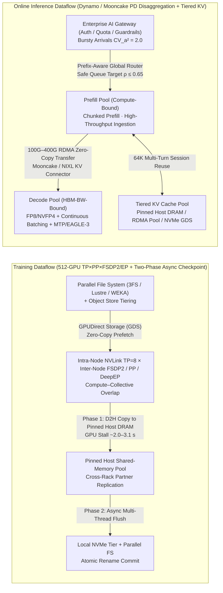
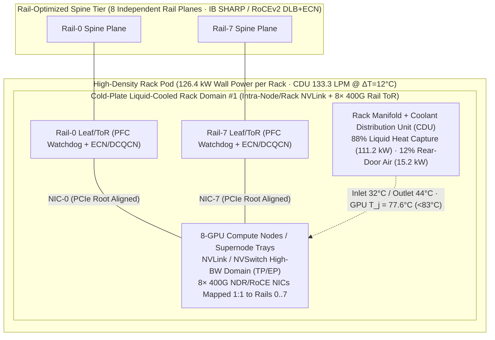

# End-to-End AI Infrastructure Reference Architecture: 1,024-GPU Training & Disaggregated Prefill/Decode (PD) Serving Cluster

> **Language / 语言**: [简体中文](./end-to-end-ai-infra-case.md) | **English** · [Full Catalog](../full-catalog-en.md) · [Interactive Architect Workbench](../reports/ai-infra-architect-workbench.html)

> **Executive Summary**: This reference architecture provides a production blueprint for Cloud & AI Infrastructure Solution Architects delivering a **hybrid ~1,000-GPU enterprise AI factory** combining synchronous pre-training/post-training with low-latency online LLM serving. By co-designing an **8-rail lossless network fabric**, **two-phase asynchronous checkpointing + GDS parallel storage**, **Dynamo/Mooncake Prefill-Decode (PD) disaggregation with prefix-aware routing**, **Kueue TAS + DRA topology-aware gang scheduling**, and **>45 kW/rack cold-plate liquid cooling with busbar ramp-rate limiting**, enterprises meet **P95 TTFT ≤ 1.5 s / P99 TPOT ≤ 25 ms** and **≥ 90% training goodput** while cutting bursty online serving GPU count by **26.5%–34.2%** and shrinking 9 TB checkpoint stalls to **under 3.1 s**.

---

## 1. Business Scenario, Workload Contracts & Hard Guardrails

Consider an enterprise building a **768–1,024 flagship GPU AI infrastructure platform** (`512+ GPUs` for continual pre-training / RLHF post-training + `256 GPUs` for low-latency production inference + warm-spare / tidal capacity). Four non-negotiable SLA contracts govern every architectural choice:

| Dimension | Workload A: Continual Pre-Training & RLHF/GRPO (`512+ GPUs`) | Workload B: High-Concurrency Online Serving & Agents (`256 GPUs`) | Linked SA Playbooks |
|---|---|---|---|
| **Target Models & Precision** | `70B Dense` (`BF16/FP8` compute + `FP32` master weights) & `671B/37B-Active MoE` (`FP8` / `NVFP4`) | `70B Dense` & `671B MoE` (`FP8` / `NVFP4` + tiered KV Cache), `4K–64K` input tokens, `512` output tokens | [Quantization Guide](../components/llm-quantization-selection-faq.en.md) · [MoE Parallelism Guide](../components/moe-parallelism-selection-faq.en.md) |
| **Throughput & Latency SLOs** | Effective Cluster Goodput **`≥ 90%`**; compute/collective overlap with zero cross-node Tensor Parallelism | Under bursty arrivals ($CV_a^2 = 2.0$): **P95 TTFT `≤ 1.5 s`**, **P99 TPOT `≤ 25 ms/tok`**, SLO compliance **`≥ 95%`** | [Inference Engine Guide](../components/llm-inference-engine-selection-faq.en.md) · [PD Disaggregation Guide](../components/pd-disaggregation-kv-offload-selection-faq.en.md) |
| **Storage & Fault Recovery RTO** | Multi-TB distributed checkpoint stall **`≤ 3.5 s`**; automated single-node/NIC fault failover **`≤ 90 s`** | Sub-second faulty Prefill/Decode replica eviction; multi-turn Prefix Cache hit ratio **`≥ 75%`** | [Checkpoint Storage Guide](../components/training-checkpoint-architecture-selection-faq.en.md) · [Fault Recovery Guide](../components/gpu-cluster-fault-recovery-selection-faq.en.md) |
| **Power, Cooling & Queue Headroom** | Rack wall power **`≤ 130 kW`**, secondary coolant inlet `≤ 35°C`, GPU junction **`< 83°C` (0% thermal throttle)** | Cold-start busbar ramp rate **`dP/dt ≤ 125 kW/min`**; online replica queueing utilization capped at **`ρ ≤ 0.65`** | [Cooling & Power Guide](../components/ai-datacenter-cooling-power-selection-faq.en.md) · [Grid Transients & BESS](../components/ai-cluster-grid-power-transients-bess-smoothing-selection-faq.en.md) |

---

## 2. Three-View End-to-End Reference Architecture Diagrams

### View A: Training & Disaggregated Serving Dataflow

### View B: 8-Rail Network Fabric & 126 kW Liquid-Cooled Rack Power Domain

### View C: Fault Detection, Warm-Spare Swap & Tidal Recovery State Machine

```mermaid
stateDiagram-v2
    [*] --> BurnInGate: Day-0 Pairwise RDMA/NVLink Burn-In + HPL/GEMM Thermal Soak
    BurnInGate --> HealthyRunning: Kueue TAS / Slurm Topology-Aware Gang Scheduling

    HealthyRunning --> TransientMitigation: Transient Self-Healing Warning\\n1. RoCEv2 ECN Marking / Correctable ECC\\n2. Minor Coolant Temp Drift (T_j < 80°C)
    TransientMitigation --> HealthyRunning: Hardware Retry / CDU Flow Compensation

    HealthyRunning --> FaultIsolation: Hard Fault or Grey Failure (Straggler / SDC)\\n1. DCGM Xid 79/94/95 or Uncorrectable HBM Row-Remap Failure\\n2. NVSwitch / RDMA Link Down or Dual-End Straggler Detection
    FaultIsolation --> CordonAndSwap: 1. Auto-Cordon Faulty Node or Supernode Clique\\n2. Token-Bucket Ramp (≤125 kW/min) Swaps in Warm-Spare Node\\n3. Serving Re-Routes Sub-Second; Training Resumes from Pinned/NVMe Checkpoint (<90s)
    CordonAndSwap --> HealthyRunning: Communicator Rebuilt & Steady-State Restored
```

---

## 3. Subsystem Trade-Offs & Verified Quantitative Sizing Matrix

| Subsystem | Common Anti-Pattern (Naive Baseline) | Recommended SA Target Architecture | Quantitative Gain & Decision Boundary | Reproducible Model & Playbook |
|---|---|---|---|---|
| **1. Scale-Out Fabric** | Static 5-tuple ECMP Ethernet on low-entropy RDMA elephant flows (hash polarization + PFC storms) | **InfiniBand NDR/XDR (SHARP + AR)** for `≥1K-GPU` synchronous pre-training; **AI Ethernet RoCEv2 (Rail-Optimized + ECN/DCQCN + DLB/Packet Spraying)** for `≤512-GPU` post-training & PD serving | Lifts multi-node collective effective bandwidth efficiency from `<55%` to **`85%–92%+`** with zero PFC deadlock | [`experiments/rocev2_load_balancing_selection/`](../../experiments/rocev2_load_balancing_selection/) · [IB vs RoCE Guide](../components/ib-vs-ethernet-roce-selection-faq.en.md) |
| **2. Parallelism & Precision** | Stretching `TP>8` across Ethernet/IB nodes or running unsharded `BF16` on 671B MoE | **Intra-node `TP=8 + SP` (pinned to NVLink) × Inter-node `FSDP2 / DualPipe PP`**; **`FP8/NVFP4 + Attention DP + Expert EP + DeepEP + EPLB`** for 671B MoE | `70B` per-GPU peak memory capped at **`35.4 GiB`** (**`2.98×`** faster step); `671B MoE FP8+EP` boosts SLA goodput **`2.65×`** (`-62%` TCO) | [`experiments/capacity_roofline/`](../../experiments/capacity_roofline/README.md) · [`experiments/moe_quantization_parallelism_selection/`](../../experiments/moe_quantization_parallelism_selection/README.md) |
| **3. Online Serving & PD Disaggregation** | Co-located serving pushed to `ρ > 0.85` utilization under bursty long-prompt arrivals | **SGLang / vLLM + Dynamo/Mooncake PD Disaggregation** on `≥16 GPUs` with `100G–400G RDMA` + global prefix-aware routing (`ρ ≤ 0.65`) | Cuts Decode `P99 TPOT` **`3.76×`** and saves **`26.5%–34.2%`** SLA GPU cost under bursty traffic; 75% prefix cache hit cuts TTFT **`3.45×`** | [`experiments/llm_inference_engine_pd_selection/`](../../experiments/llm_inference_engine_pd_selection/) · [PD Selection Cards](../reports/enterprise-pd-disaggregation-vs-colocated-inference-architecture-selection-cards.html) |
| **4. Checkpointing & Tiered KV Storage** | Synchronous blocking remote checkpoint writes; full Prefill recomputation after KV eviction | **Two-Phase Async Checkpointing** (`D2H` to pinned Host DRAM first + async NVMe/3FS/Lustre flush); **Pinned DRAM / RDMA+GDS Tiered KV Offload** | Shrinks `9 TB` checkpoint stall from `225 s` to **`3.125 s` (`72×` faster, `99.83%` goodput)**; speeds up `64K` multi-turn resume TTFT **`15×`** | [`experiments/ai_storage_checkpoint_kv_offload/`](../../experiments/ai_storage_checkpoint_kv_offload/README.md) · [Storage & KV Guide](../components/kv-cache-tiered-offload-selection-faq.en.md) |
| **5. Orchestration & Tidal Sharing** | Topology-blind K8s scheduling scattering pods across switches and deadlocking partial allocations | **Kubernetes `Kueue TAS` + `DRA` gang scheduling** (or bare-metal Slurm) with daytime high-priority serving + nighttime preemptible SFT/RL backfill | Eliminates gang-allocation deadlocks, preserves Rail/NVLink locality, and raises 24-hour fleet utilization to **`75%–85%+`** | [`experiments/ai_cluster_slurm_k8s_kueue_dra_scheduling_selection/`](../../experiments/ai_cluster_slurm_k8s_kueue_dra_scheduling_selection/) · [K8s vs Slurm Guide](../components/ai-cluster-slurm-vs-kubernetes-kueue-dra-gang-scheduling-selection-faq.en.md) |
| **6. Liquid Cooling & Power Ramp Control** | Forcing air cooling above `50 kW/rack` or waking 64+ nodes simultaneously after maintenance | **Cold-Plate Direct Liquid Cooling (DLC, 85%–90% liquid capture) above `45 kW/rack`** + scheduler token-bucket wake-up rate limiting + BESS smoothing | Holds `126.4 kW` rack GPU junction at **`77.6°C`** (0% thermal throttle) and bounds cold-start ramp to **`≤122.4 kW/min`** | [`experiments/ai_datacenter_cooling_power_selection/`](../../experiments/ai_datacenter_cooling_power_selection/) · [Cooling & Power Cards](../reports/ai-datacenter-cooling-power-selection-cards.html) |

---

## 4. Three High-Impact Solution Architect Anti-Patterns

1. **Anti-Pattern 1: Sizing Inference Fleets from `Mean QPS × Peak TFLOPS` Alone**
   - **Why It Fails**: Real enterprise Agent and RAG arrivals are bursty ($CV_a^2 \ge 2.0$). Pushing online replica utilization from `60%` to `92%` explodes queueing wait times past `4,000 ms`, collapsing P95 TTFT compliance below `10%`. **SA Rule**: Cap interactive serving utilization at `ρ ≤ 0.65` and monetize spare nighttime/trough cycles with preemptible batch/SFT workloads.
2. **Anti-Pattern 2: Confusing Total MoE Parameters with Active Parameters per Token**
   - **Why It Fails**: A `671B` sparse MoE activates only `~37B` parameters per token, yet **all `671B` expert weights must reside in HBM**. Sizing memory from `37B` causes immediate OOM, whereas computing MFU from `671B` inflates reported utilization by **18×** while masking `EP All-to-All` network bottlenecks.
3. **Anti-Pattern 3: Treating Rack-Scale NVLink Supernodes Like Standalone 8-GPU Servers**
   - **Why It Fails**: In `GB200 NVL72` or `128-card supernode` racks, trays share a unified Scale-Up switch domain and liquid-cooling manifold. Model the **entire supernode clique and CDU loop** as a first-class failure and scheduling domain, gated by [Day-0 pairwise burn-in acceptance](../components/ai-cluster-burn-in-acceptance-dcgm-nccl-validation-selection-faq.en.md).

---

## 5. Pre-Production Solution Architect Go-Live Checklist

- [ ] **Day-0 Hardware & Fabric Burn-In**: Pass per-GPU HPL/GEMM thermal soak, intra-node NVLink P2P matrix tests, and inter-node pairwise same-rail RDMA bandwidth/BER checks with `NCCL_CROSS_NIC=0` and hardware PFC watchdog enabled.
- [ ] **Distributed Training & Checkpoint Gate**: Confirm `TP` stays strictly inside NVLink domains, two-phase async checkpoint GPU stalls remain `< 3.5 s`, and simulated worker failure recovers automatically within `≤ 90 s`.
- [ ] **Online Serving SLA & TCO Gate**: Benchmark P95 TTFT and P99 TPOT under realistic skewed prompt distributions; compare co-located Chunked Prefill vs. PD Disaggregation on `$/1M SLA-compliant tokens` and verify `≥ 70%` Prefix Cache hit rate.
- [ ] **Liquid Cooling, Power & FinOps Telemetry**: Stream `DCGM + OpenTelemetry` GPU SM activity, Xid/row-remap health events, CDU inlet/outlet temperatures, and tenant-attributed `$/1M tokens` into unified FinOps dashboards.
