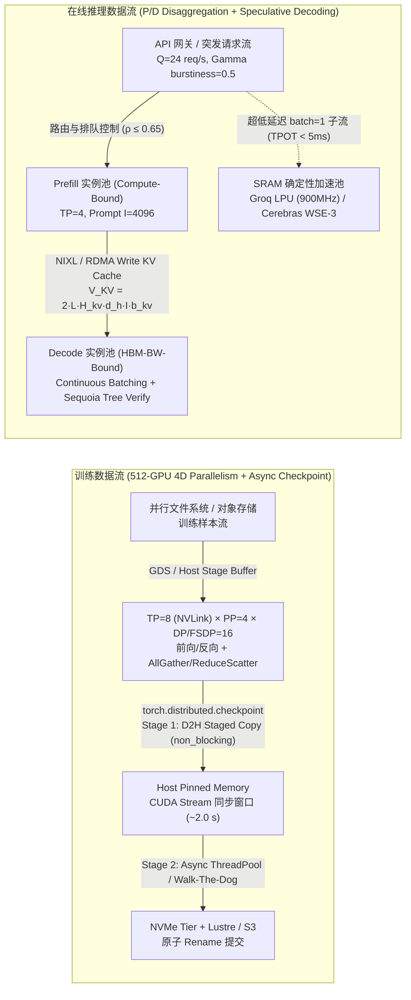
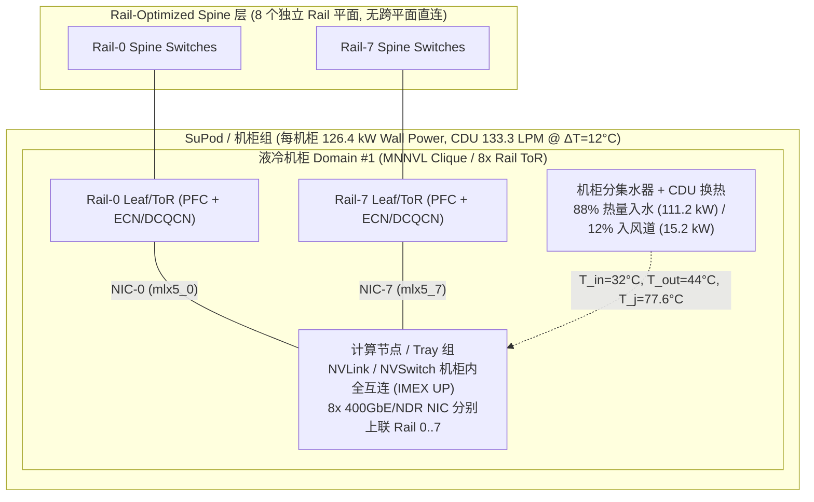
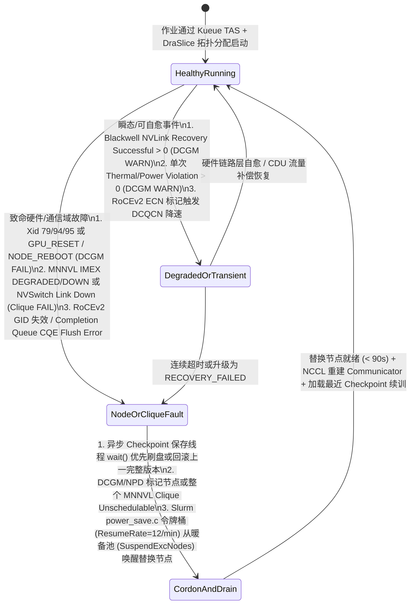

# 端到端 AI Infra 综合架构案例：1024-GPU 训练与分离式推理（P/D Disaggregation）混合集群全栈设计

> **Language / 语言**: **中文 (Chinese)** | [English (英文版)](end-to-end-ai-infra-case.en.md)

- **状态**：已建立覆盖 GPU/HBM、Scale-Up/Scale-Out 互连、并行训练、在线推理 SLO、异步 Checkpoint 存储、拓扑感知编排、容量/Token 经济学与机架液冷/功耗控制的端到端综合架构设计（`specification` / `implementation` / `own-offline`）；所有定量预算均由本仓库 11 套可复核标准库实验验证，未在真实 1024-GPU 液冷生产集群上执行实机压测（`own-hardware` 未生成）。
- **覆盖组件与先修链**：
  - 硬件与互连基座：[GPU 架构与 HBM](../components/gpu-hbm.md) → [互连与网络总览](../components/interconnect-network.md) → [RDMA Verbs 生命周期](../components/rdma-lifecycle.md) → [NCCL 拓扑与传输](../components/nccl-topology-transport.md) → [NCCL 图搜索与多轨 Channel 映射](../components/nccl-graph-channel-mapping.md) → [NCCL IB Port-Failover 与恢复不变量](../components/nccl-port-recovery-invariants.md) → [张量 Layout/Dtype 到 SM100 Kernel 分派](../components/kernel-dispatch-layout.md)。
  - 工作负载与系统工程：[分布式训练并行策略](../components/training-parallelism.md) → [在线推理服务与 P/D 分离](../components/inference-slo.md) → [训练存储与异步 Checkpoint](../components/storage-checkpoint.md) → [集群编排与故障自愈](../components/cluster-orchestration.md) → [容量、Token 经济学与功耗预算](../components/capacity-economics.md) → [机架功率、液冷与机柜级故障域](../components/rack-power-cooling.md) → [AI Infra 创新架构对比](../components/ai-infra-innovators.md)。
- **关联 queue ID**：`architecture-case`（priority 10）；先修 `cluster-orchestration`、`capacity-economics`、`rack-power-cooling` 均已 `done`。
- **掌握度**：`not-assessed`（见 [能力矩阵](../learning/competency-matrix.md)）。

## 1. 业务目标、工作负载契约与 SLO 边界

本综合案例面向一位负责交付 **512-GPU 预训练/后训练集群 + 256-GPU 低延迟在线推理集群（总计 768 张主力 GPU，分属 12 个液冷/风冷混合机柜域，并预留创新推理加速层接口）** 的云与 AI 基础设施解决方案架构师。系统必须同时满足以下两类严苛契约：

| 维度 | 负载 A：MoE / Dense 大模型持续预训练与长上下文微调 | 负载 B：高并发在线推理服务（Prefill / Decode 分离 + 投机解码） |
|---|---|---|
| **代表模型与精度** | 70B Dense (`BF16` 训练 / `FP32` Master Weights) & 671B/37B-Active MoE | 70B Dense (`FP8` / `BF16` KV Cache)，输入 $I=4096$ tokens，输出 $O=512$ tokens |
| **吞吐与延迟 SLO** | 512-GPU 集群有效训练步时间 $\le 4.8\,\text{s}$，训练有效好吞吐（Cluster Goodput）$\ge 90\%$，完成 $1\,\text{T}$ tokens 总墙钟时间 $\le 14.5$ 天 | 在线流量均值 $Q=24\,\text{req/s}$（Gamma 突发系数 $\text{burstiness}=0.5, CV_a^2=2.0$），满足 **TTFT $P_{95} \le 1.5\,\text{s}$** 且 **TPOT $\le 25\,\text{ms/token}$**，SLO Goodput $\ge 95\%$ |
| **恢复与容错 RTO** | 单次约 $1\,\text{TiB}$ 分布式 Checkpoint 阻塞训练时间 $T_{\text{stall}} \le 2.5\,\text{s}$；单节点/单 NIC 故障恢复时间 $\le 90\,\text{s}$ | 单 Prefill/Decode 实例故障通过 NIXL/RDMA KV 路由秒级摘除，长尾重算率 $< 1\%$；对于 `batch=1` 极低延迟（TPOT $< 5\,\text{ms}$）Agentic 子流量，支持路由至 Groq LPU / Cerebras WSE 或 Fireworks/Sequoia 投机解码层 |
| **机架与电力红线** | 单高密液冷机柜墙插功率 $P_{\text{wall}} \le 130\,\text{kW}$，二次侧进液温度 $T_{\text{in}} \le 35^\circ\text{C}$，GPU 结温 $T_j < 83^\circ\text{C}$（零热降频） | 集群冷启动/故障批量唤醒时，机房母线功率爬坡率 $\mathrm{d}P/\mathrm{d}t \le 125\,\text{kW/min}$；能耗计量误差 $\le 5\%$ |

---

## 2. 三视图端到端系统架构图（Dataflow、Topology/Rack Domain、Failure/Recovery State Machine）

### 视图 A：训练与分离式推理端到端数据流图（Workload Dataflow）

### 视图 B：物理网络、多轨 Rail-Optimized 拓扑与液冷机柜功率域（Physical/Logical Topology & Rack Power Domain）

### 视图 C：跨层故障检测、隔离、降级与恢复状态机（Failure & Recovery State Machine）

---

## 3. 全栈定量容量、网络、存储与电力/液冷预算表（Verified by `own-offline`）

以下端到端预算中的每一项指标均对应本仓库已提交并通过 `--check` 校验的实验脚本输出：

### 3.1 显存、并行策略与通信重叠预算（对应 [`experiments/capacity_roofline/`](../../experiments/capacity_roofline/README.md) 与 [`experiments/training_parallelism/`](../../experiments/training_parallelism/README.md)）

- **70B Dense 训练显存分解（`TP=8, SP, FSDP=8`，64–1024 张 H100 80GiB）**：
  - 单卡分片后参数、梯度、`FP32` 优化器状态与激活显存严格控制在 `35.44 GiB`（远低于 `80 GiB` HBM3 红线，单步耗时 `55.97 ms`，见 [`docs/components/training-parallelism.md`](../components/training-parallelism.md)）。
  - **反例警示**：若采用纯 `FSDP=64` 跨机切分而不开启 `TP=8 + SP` 机内张量/序列并行，单卡未切分激活暴涨至 `28.00 GiB`（总峰值 `49.00 GiB`），且跨节点 AllGather/ReduceScatter 暴露通信高达 `130.91 ms`（单步耗时恶化至 `166.96 ms`）。
- **NCCL 拓扑与协议选择（对应 [`experiments/rail_channel_cut/`](../../experiments/rail_channel_cut/README.md) 与 [`experiments/ib_failover_invariants/`](../../experiments/ib_failover_invariants/README.md)）**：
  - 机内 8-GPU NVSwitch 采用 `NVLS` / `Ring` `LL128` 或 `Simple` 协议；跨机 400GbE RoCEv2 / NDR IB 保持 `crossNic = 0` Rail 对齐并启用双端口选择性重传（`IBV_WR_RDMA_READ` 探测 `cmplsRecords` 节省 `75%` 重传流量）。

### 3.2 训练 Token 经济学与能耗积分预算（对应 [`experiments/capacity_economics/`](../../experiments/capacity_economics/README.md)）

| 指标 | 1024x H100 70B Dense 预训练 (`dense_70b_poisson_cached_prefix`) | 2048x H100 671B/37B-Active MoE (`moe_671b_37b_bursty_long_context`) | 公式与代码依据 |
|---|---|---|---|
| **有效参与 MatMul 参数量** | `68,950,000,000` (`68.95B`) | `26,950,000,000` (`26.95B`，远小于总参数 `671.10B`) | TorchTitan `get_num_params()` + `get_num_flop_per_token()` |
| **每 Token 训练 FLOPs** | `4.7812 × 10^11` (`478.12 GFLOP/tok`) | `2.0468 × 10^11` (`204.68 GFLOP/tok`) | $6 N_{\text{matmul}} + 12 L H d_h S$ |
| **实测/目标 MFU (BF16 989 TFLOPS 分母)** | `44.48%` (`439.87 TFLOPS/GPU`) | `34.77%` (`343.87 TFLOPS/GPU`，受 All-to-All 门控通信制约) | `BaseMetricsProcessor` 稠密峰值分母 |
| **集群有效 Token 吞吐** | `857,292.8 tok/s` | `3,027,763.2 tok/s` | $\text{TPS}_{\text{GPU}} \times G \times \eta_{\text{goodput}}$ |
| **每百万训练 Tokens 总成本 (含算力+电费)** | **`$0.9456 / 1M tokens`** (`19,800 J/step/GPU`，总墙钟 `324.02 h`) | **`$0.5355 / 1M tokens`** (`20,475 J/step/GPU`，FP8 下进一步降至 **`$0.3743`**) | Slurm `acct_gather_energy_gpu.c` 梯形积分 + GPU 租用成本 |

### 3.3 在线推理 P/D 分离、突发排队与创新架构加速预算（对应 [`experiments/inference_slo_scheduler/`](../../experiments/inference_slo_scheduler/README.md)、[`experiments/capacity_economics/`](../../experiments/capacity_economics/README.md) 与 [`experiments/innovator_arch_tradeoffs/`](../../experiments/innovator_arch_tradeoffs/README.md)）

1. **共池（Colocated）vs. P/D 分离（Disaggregated）容量对比**：
   - 在长上下文 Gamma 突发流量（`burstiness = 0.25`，即 $CV_a^2 = 4.0$，方差为泊松流的 4 倍）且未命中缓存 `7,168` tokens（单次 Prefill 耗时 `291.67 ms`、`SLO_TTFT = 600 ms`）下：
     - **92% 利用率盲目定容反例**：排队等待高达 `4,083.33 ms`（期望 TTFT `4,375.0 ms`），TTFT 达标率（Goodput）暴跌至 **`7.27%`**。
     - **共池基线 vs. P/D 分离架构（`moe_671b_37b_bursty_long_context`）**：按 Kingman 安全水位（$\rho_{\text{safe}} = 34.58\%$）定容时，共池混部需 **`392` 张 GPU**；改用 **P/D 分离架构（`31` 个 Prefill 实例 + `5` 个 Decode 实例 = `288` 张 GPU）直接节省 `104` 张 GPU（26.5% 算力）**，每百万达标输出 tokens 成本为 **`$12.3698`**；进一步将 Prefix Cache 命中率从 `12.5%` 提升至 `87.5%` 并开启 FP8（`fp8_quantized_moe_high_cache_hit`），总卡数压至 **`40` 张 GPU**，每百万达标输出 tokens 成本降至 **`$1.7180`（下降 86.1%）**。
2. **创新推理层（Fireworks / Together Sequoia / Groq / Cerebras）补充加速**：
   - 在 PCIe 双缓冲卸载场景下启用 **Together Sequoia 硬件感知树形投机解码**，在不增加 PCIe 权重传输字节数的前提下将有效卸载吞吐提升 **`5.40x–6.80x`**（从 `0.55–1.01 tok/s` 提至 `2.96–6.29 tok/s`）。
   - 对延迟极其敏感的 `batch=1` Agentic 代码生成子流，路由至 **Groq LPU 确定性 SRAM 机柜**（`32 kW` 风冷，`14.42 ms` 端到端确定性延迟，`13.33 J/token @ batch=1`）或 **Cerebras CS-3 液冷晶圆单元**（`25 kW` 液冷，东西边缘配置 `2–12` 列 `46 KB/PE` 硬件 FIFO 反压列，`1.74 J/token @ high-batch`）。

### 3.4 异步 Checkpoint 存储与拓扑感知调度预算（对应 [`experiments/checkpoint_recovery/`](../../experiments/checkpoint_recovery/README.md) 与 [`experiments/cluster_orchestration/`](../../experiments/cluster_orchestration/README.md)）

- **两阶段异步 Checkpoint（PyTorch DCP `BlockingAsyncStager` + 去重均衡）**：64 卡训练中跨 Rank 去重将落盘总量从 `5,184 GiB` 压至 `980 GiB`（`5.29x` 缩减），均衡指派（`save_to_lowest_rank = False`）将最慢 Rank 写出从 `45.94 GiB` 压至 `15.31 GiB`；配合 `BlockingAsyncStager` D2H 暂存与后台刷盘，将 256 节点集群在 `4` 热备节点 + `15 min` 检查点间隔下的单配置节点净产出从 `73.47%` 提升至 **`83.28%`（净增 `+9.81 pts`）**。
- **拓扑感知调度与故障风暴防御**：Kubelet 采用 `--topology-manager-policy=restricted` 拦截跨 Socket GPU/NIC 错位分配并放行整机 8-GPU 作业；Slurm `topology/block` 通过 `_choose_best_bblock` Best-Fit 反碎片分配保护完整空闲基础块。

### 3.5 机架电力、CDU 液冷热力学与 MNNVL 故障域预算（对应 [`experiments/rack_power_cooling/`](../../experiments/rack_power_cooling/README.md)）

| 架构控制项 | 设计设定值 | 定量验证结果 (`own-offline`) | 违反红线的失效后果 |
|---|---|---|---|
| **高密液冷机柜功率与 CDU 流量** | 单柜 `118.8 kW` IT 负载，$\eta_{\text{PSU}}=0.94$，纯水 $T_{\text{in}}=32^\circ\text{C}, \Delta T=12^\circ\text{C}, f_{\text{liq}}=88\%$ | 墙插功率 **`126.383 kW`**；液冷带走 **`111.217 kW`**（需 **`133.31 LPM`**），风道带走 **`15.166 kW`**（需 **`1,798.6 CFM`**）；GPU 结温 **`77.6 °C`**（距 `83 °C` 裕度 `+5.4 °C`） | 若切换 PG25 且一次侧水温升至 $45^\circ\text{C}$，结温达 **`88.6 °C`**，触发 `DCGM_CLOCKS_EVENT_REASON_HW_THERMAL` 硬件频率腰斩 |
| **Slurm 令牌桶唤醒浪涌控制** | `ResumeRate = 12 nodes/min`，`power_save_interval = 15s`，`SuspendExcNodes` 目标 `16` | 唤醒 64 台 `10.2 kW` 节点时，初始突发仅唤醒 **`3` 台（`30.6 kW`）**，随后每 `5000 ms` 唤醒 1 台，爬坡率严格受限于 **`122.4 kW/min`**（总耗时 `305.0 s`） | 若关闭令牌桶限流，64 台节点同时上电产生 **`652.8 kW`** 阶跃浪涌，触发机房 PDU 跳闸或 GPU `HW_POWER_BRAKE` |
| **DCGM `v4.6.1` MNNVL 机柜级健康状态机** | 监控 `DCGM_FI_IMEX_DOMAIN_STATUS (1502)`、`IMEX_DAEMON_STATUS (1503)` 与 Blackwell `RECOVERY_SUCCESSFUL/FAILED` | Blackwell NVLink 瞬态自愈成功（`RECOVERY_SUCCESSFUL > 0`）仅报 **`WARN`** 不中断训练；唯有 `IMEX = DEGRADED/DOWN` 或 `NVSwitch Link Down` 才置 **`FAIL`** 并隔离整个 MNNVL Clique | 若将 Blackwell 瞬态自愈误判为 `FAIL` 会造成频繁误杀；若忽略 `IMEX = DEGRADED` 只摘除单节点会导致跨节点 NVLink 作业死锁 |

---

## 4. 关键反例与常见架构误区（Counterexamples）

1. **误区一：“只按均值 QPS 和峰值 TFLOPS 规划推理与训练集群”**
   - *反证*：在 Gamma 突发流量（$CV_a^2 = 2.0$）下，若把推理实例利用率跑满到 $\rho = 0.90$，Kingman 排队等待因子 $\frac{\rho}{1-\rho}\cdot\frac{CV_a^2+CV_s^2}{2}$ 会急剧膨胀并击穿 TTFT $P_{95} \le 1.5\,\text{s}$；而在 MoE 训练中，若把 671B 总参数当作每 token 有效激活参数（36.69B），会人为虚报 **18 倍** MFU。
2. **误区二：“多轨 RoCEv2 网络只要交换机总带宽够，不需要 Rail-Optimized 隔离与端口恢复不变量”**
   - *反证*：在 [`docs/components/nccl-graph-channel-mapping.md`](../components/nccl-graph-channel-mapping.md) 与 [`docs/components/nccl-port-recovery-invariants.md`](../components/nccl-port-recovery-invariants.md) 已证明，若 `crossNic=1` 偏斜或机内跨 `PATH_PHB` 被多 Channel 叠加，共享链路时间下界会劣化 `4x–6x`；而双端口重传若采用无符号计数则会永久死锁。
3. **误区三：“把 40kW 风冷机柜的运维策略直接搬到 126kW MNNVL 液冷机柜”**
   - *反证*：在 126kW MNNVL 机柜中，（a）风冷根本无法提供 `15,000 CFM` 单柜风量；（b）单节点冷板微堵或重启若破坏 `nvidia-imex-ctl` 域状态（`DCGM_FI_IMEX_DOMAIN_STATUS = DEGRADED`），故障域不再是单台 8-GPU 节点，而是整个 72-GPU 机柜 Clique；（c）Slurm RAPL 插件若因系统升级丢失 `/dev/cpu/#/msr` 权限，会调用 `slurm_drain_node()` 将全集群节点瞬间排空。

---

## 5. 架构师端到端验收清单（Verification Checklist）

1. **硬件与液冷基线**：确认 CDU 额定流量 $\ge 1.25 \times \dot{V}_{\text{liquid, LPM}}$（留出 PG25 比热容折损与污垢热阻裕度），配置 DCGM Policy 在 $T_j \ge 80^\circ\text{C}$ 时告警、$T_j \ge 85^\circ\text{C}$ 时自动排空节点。
2. **电力浪涌与能耗采集**：在 `slurm.conf` 中设置 `ResumeRate` 与 `SuspendRate` 使 $R_{\text{resume}} \times P_{\text{node}} \le \text{母线允许爬坡率}$，配置 `SuspendExcNodes` 保留暖备节点池；核查 `/dev/cpu/*/msr` 权限与 Xeon DRAM $0.5^{16}\,\text{J}$ 单位特判。
3. **网络与通信域**：验证多轨网卡亲和性（`NCCL_CROSS_NIC=0`）、RoCEv2 ECN/PFC 阈值及 MNNVL `nvidia-imex-ctl -N -j` 状态为 `UP`（daemon 状态为 `5 = READY`）。
4. **训练与推理软件栈**：训练启用 TorchTitan MFU 真实激活参数统计与 PyTorch DCP 两阶段异步 Checkpoint；推理在 `I/O` 悬殊且突发显著时启用 vLLM P/D 分离，并限制单实例目标利用率 $\rho \le 0.65$。
