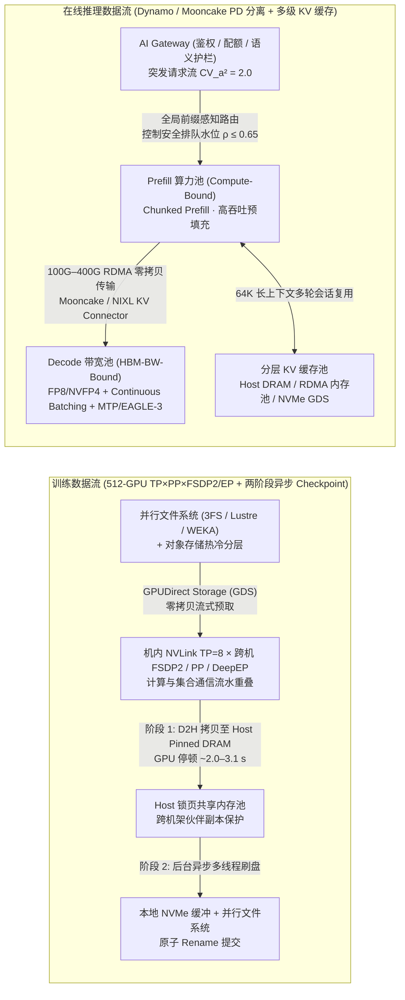
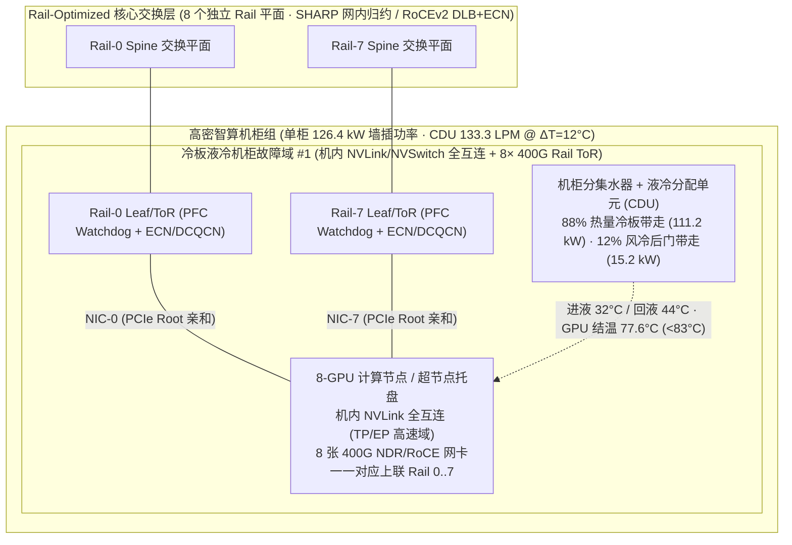
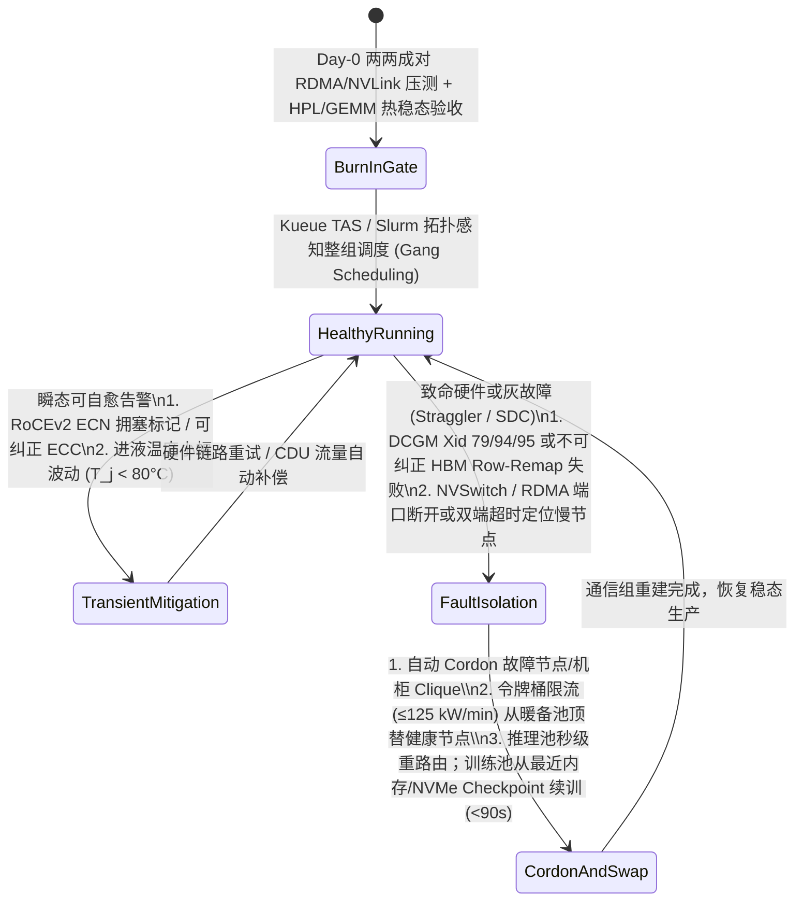

# 端到端 AI Infra 综合参考架构：1024-GPU 训练与分离式推理（PD Disaggregation）混合集群全栈设计

> **Language / 语言**: **简体中文** | [English](./end-to-end-ai-infra-case.en.md) · [返回总目录](../full-catalog-zh.md) · [交互式架构工作台](../reports/ai-infra-architect-workbench.html)

> **Executive Summary / 核心结论**：本参考架构面向负责交付 **千卡级预训练/后训练 + 高并发在线推理混合智算中心** 的云与 AI 基础设施解决方案架构师（SA）。通过将 **8 轨 Rail-Optimized 无损网络**、**两阶段异步 Checkpoint + 并行存储（3FS/Lustre + GDS）**、**Dynamo/Mooncake Prefill-Decode（PD）分离与前缀缓存路由**、**Kueue TAS + DRA 拓扑感知调度** 以及 **>45 kW/柜冷板液冷 + 母线爬坡限流** 组合成闭环方案，可在严守 **TTFT P95 ≤ 1.5 s / TPOT ≤ 25 ms** 与 **训练有效好吞吐（Goodput）≥ 90%** 的同时，将突发流量下的在线推理算力需求削减 **26.5%–34.2%**，并将 9 TB 分布式 Checkpoint 停顿压缩至 **3.1 s 以内**。

---

## 1. 业务场景、工作负载契约与架构红线（Workload & SLO Contracts）

假设企业建设一套 **768–1,024 张旗舰 GPU 规模的企业智算底座**（`512+ GPU` 持续预训练/RLHF 后训练池 + `256 GPU` 低延迟在线推理池 + `暖备与潮汐混部弹性池`），解决方案架构师必须在立项阶段锁定四条硬性 SLA 红线：

| 架构维度 | 负载 A：大模型持续预训练与 RLHF/GRPO 后训练 (`512+ GPUs`) | 负载 B：企业级高并发在线推理与长上下文 Agent (`256 GPUs`) | 关联选型指南 |
|---|---|---|---|
| **代表模型与数值精度** | `70B Dense` (`BF16/FP8` 计算 + `FP32` 主权重) 与 `671B/37B-Active MoE` (`FP8` / `NVFP4`) | `70B Dense` 与 `671B MoE` (`FP8` / `NVFP4` + 分层 KV Cache)，输入 `4K–64K` tokens，输出 `512` tokens | [量化选型指南](../components/llm-quantization-selection-faq.md) · [MoE 并行指南](../components/moe-parallelism-selection-faq.md) |
| **吞吐与延迟 SLO** | 集群有效训练好吞吐（Cluster Goodput）**`≥ 90%`**；单步计算与通信高度重叠，严禁跨机张量并行（TP） | 突发流量（Gamma $CV_a^2 = 2.0$）下 **P95 TTFT `≤ 1.5 s`**、**P99 TPOT `≤ 25 ms/tok`**、SLO 达标率 **`≥ 95%`** | [推理引擎选型](../components/llm-inference-engine-selection-faq.md) · [PD 分离选型](../components/pd-disaggregation-kv-offload-selection-faq.md) |
| **存储与故障恢复 RTO** | 多 TB 分布式 Checkpoint 阻塞训练时间 **`≤ 3.5 s`**；单节点/单网卡故障自动隔离与热备续训 **`≤ 90 s`** | 单 Prefill/Decode 副本故障秒级摘除；长对话多轮前缀缓存命中率 **`≥ 75%`**（避免重复重算 Prefill） | [Checkpoint 存储架构](../components/training-checkpoint-architecture-selection-faq.md) · [故障自愈指南](../components/gpu-cluster-fault-recovery-selection-faq.md) |
| **机柜供电、液冷与安全水位** | 单高密液冷机柜墙插功率 **`≤ 130 kW`**，进液温度 `≤ 35°C`，GPU 结温 **`< 83°C`（零热降频）** | 批量唤醒功率爬坡率 **`dP/dt ≤ 125 kW/min`**；在线单副本排队安全利用率控制在 **`ρ ≤ 0.65`** | [智算液冷与供电](../components/ai-datacenter-cooling-power-selection-faq.md) · [电网瞬态与 BESS](../components/ai-cluster-grid-power-transients-bess-smoothing-selection-faq.md) |

---

## 2. 三视图端到端参考架构（Dataflow · Fabric/Cooling Topology · Fault State Machine）

### 视图 A：训练与分离式推理端到端数据流（Workload Dataflow）

### 视图 B：8 轨 Rail-Optimized 网络与 126 kW 冷板液冷机柜域（Network & Rack Power Domain）

### 视图 C：集群排障、热备顶替与潮汐降级状态机（Failure & Elastic Recovery State Machine）

---

## 3. 核心子系统架构权衡与定量选型矩阵（Verified Offline Sizing Models）

| 子系统域 | 常见反模式（踩坑基线） | 架构师推荐配置（Target Architecture） | 定量收益与关键边界 | 配套可复核模型与工具 |
|---|---|---|---|---|
| **1. Scale-Out 网络选型** | 用传统五元组静态 ECMP 跑多机训练，极易触发哈希极化与 PFC 死锁风暴 | `≥1,000 GPU` 同步预训练优先 **InfiniBand NDR/XDR (SHARP + AR)**；`≤512 GPU` 后训练与 PD 分离推理优先 **AI 以太网 RoCEv2（Rail-Optimized + ECN/DCQCN + DLB/喷洒路由）** | 消除单链路哈希冲突，多机集合通信有效带宽利用率从 `<55%` 提升至 **`85%–92%+`** | [`experiments/rocev2_load_balancing_selection/`](../../experiments/rocev2_load_balancing_selection/) · [IB vs RoCE 指南](../components/ib-vs-ethernet-roce-selection-faq.md) |
| **2. 并行切分与显存规划** | 跨机盲目拉大 `TP>8` 或纯 `FSDP` 不开激活检查点/序列并行 | **机内 `TP=8 + SP`（锁死在 NVLink 域内）× 跨机 `FSDP2 / DualPipe PP`**；671B MoE 采用 **`Attention DP + Expert EP + DeepEP + EPLB`** | `70B` 训练单卡峰值显存压至 **`35.4 GiB`**（步耗时快 **`2.98×`**）；`671B MoE` 开启 `FP8 + EP` 单卡达标吞吐提升 **`2.65×`**、TCO 降 **`62%`** | [`experiments/capacity_roofline/`](../../experiments/capacity_roofline/README.md) · [`experiments/moe_quantization_parallelism_selection/`](../../experiments/moe_quantization_parallelism_selection/README.md) |
| **3. 在线推理调度与 PD 分离** | 长输入突发流量下采用共池混部且将单副本利用率推至 `ρ > 0.85` | 在 `≥16 GPU` + `100G–400G RDMA` 条件下采用 **SGLang / vLLM + Dynamo/Mooncake PD 分离**，配合全局前缀缓存路由（控制 `ρ ≤ 0.65`） | Decode `P99 TPOT` 降低 **`3.76×`**（消除 Prefill 抢占毛刺），突发流量下节省 **`26.5%–34.2%`** 达标算力成本；75% 前缀命中下 TTFT 再降 **`3.45×`** | [`experiments/llm_inference_engine_pd_selection/`](../../experiments/llm_inference_engine_pd_selection/) · [PD 分离选型卡片](../reports/enterprise-pd-disaggregation-vs-colocated-inference-architecture-selection-cards.html) |
| **4. Checkpoint 与分层 KV 存储** | 分布式训练直接同步阻塞写远端共享存储；多轮长对话驱逐 KV 后全量重算 | **两阶段异步 Checkpoint**（先 `D2H` 写入 Host Pinned DRAM，再后台异步刷 NVMe/3FS/Lustre）；长会话启用 **Host DRAM / RDMA+GDS 分层 KV 卸载** | `9 TB` Checkpoint 训练阻塞时间从 `225 s` 压至 **`3.125 s`（快 `72×`，好吞吐 `99.83%`）**；`64K` 多轮恢复 TTFT 加速 **`15×`** | [`experiments/ai_storage_checkpoint_kv_offload/`](../../experiments/ai_storage_checkpoint_kv_offload/README.md) · [存储与 KV 选型指南](../components/kv-cache-tiered-offload-selection-faq.md) |
| **5. 集群调度与训推潮汐复用** | 默认 K8s 调度器无拓扑感知散落分配 GPU，导致跨机柜通信退化与死锁 | 训练/推理统一启用 **K8s `Kueue TAS`（拓扑感知成组调度）+ `DRA`**（或裸金属 Slurm），白天推理优先、夜间低优抢占回填 SFT/RL 任务 | 消除部分 Pod 抢不到卡的死锁等待，保护同 Rail/NVLink 亲和性，全天集群有效利用率提升至 **`75%–85%+`** | [`experiments/ai_cluster_slurm_k8s_kueue_dra_scheduling_selection/`](../../experiments/ai_cluster_slurm_k8s_kueue_dra_scheduling_selection/) · [K8s vs Slurm 指南](../components/ai-cluster-slurm-vs-kubernetes-kueue-dra-gang-scheduling-selection-faq.md) |
| **6. 液冷热力学与供电爬坡保护** | 在 `>50 kW/柜` 高密机柜强推纯风冷，或故障恢复时数百节点同时满载上电 | 单柜 **`>45 kW` 切换冷板式液冷（DLC，85%–90% 热量入水）**；集群调度器启用令牌桶唤醒限流 + 储能/超级电容削峰 | `126.4 kW` 机柜下 GPU 结温稳控在 **`77.6°C`**（零热降频），集群冷启动母线爬坡率严格受控在 **`≤122.4 kW/min`** | [`experiments/ai_datacenter_cooling_power_selection/`](../../experiments/ai_datacenter_cooling_power_selection/) · [液冷与供电卡片](../reports/ai-datacenter-cooling-power-selection-cards.html) |

---

## 4. 解决方案架构师三大高频踩坑反例（Critical Anti-Patterns）

1. **反例一：按“平均 QPS × 峰值 TFLOPS”拍脑袋做推理容量规划**
   - **根因**：真实企业 Agent 与 RAG 流量呈显著突发分布（$CV_a^2 \ge 2.0$）。当在线利用率推高至 `92%` 时，排队等待时间呈非线性爆炸（`>4,000 ms`），`TTFT` 达标率会跌破 `10%`。**架构准则**：在线交互池必须预留排队余量（`ρ ≤ 0.65`），用离线批处理或异步 SFT 任务在低谷期吃满剩余算力。
2. **反例二：混淆 MoE“总参数量”与“每 Token 激活参数量”**
   - **根因**：`671B` 稀疏 MoE 每 Token 仅激活约 `37B` 参数，但 **显存驻留必须装下全部 `671B` 专家权重**。若按 `37B` 估算显存会直接 OOM；反之若按 `671B` 计算单 Token 计算量则会虚报 **18 倍** MFU，掩盖跨节点 `EP All-to-All` 的真实网络瓶颈。
3. **反例三：高密 MNNVL / 超节点机柜沿用传统“单机独立排障”流程**
   - **根因**：在 `GB200 NVL72` 或 `128 卡超节点` 机柜中，多节点共享同一 Scale-Up 交换域与液冷回路。必须将 **整个超节点 Clique 与 CDU 回路** 建模为一级故障域与拓扑调度域，并提前通过 [Day-0 压测验收](../components/ai-cluster-burn-in-acceptance-dcgm-nccl-validation-selection-faq.md) 拦截边缘光模块与静默数据损坏（SDC）。

---

## 5. 上线前架构师端到端验收清单（Go-Live Acceptance Checklist）

- [ ] **Day-0 硬件与网络压测**：完成单卡 HPL/GEMM 热稳态压测、机内 NVLink P2P 全矩阵压测与跨机同 Rail 两两成对（Pairwise）RDMA 带宽/误码率验收，确认 `NCCL_CROSS_NIC=0` 与 PFC Watchdog 生效。
- [ ] **分布式训练与存储门禁**：验证 `TP` 严格限制在机内 NVLink 域内，两阶段异步 Checkpoint 单次保存阻塞 `< 3.5 s`，并在模拟杀死单个 Worker 进程时验证 `≤ 90 s` 自动续训闭环。
- [ ] **在线推理 SLA 与成本护栏**：使用真实长短混合 Prompt 分布压测 P95 TTFT 与 P99 TPOT；对比共池 Chunked Prefill 与 PD 分离下的 `$/1M SLA 达标 Tokens`，开启 Prefix Cache 命中率监控（目标 `≥ 70%`）。
- [ ] **液冷、供电与 FinOps 可观测性**：接入 `DCGM + OpenTelemetry` 统一采集 GPU SM 活跃度、Xid/Row-Remap 硬件预警、CDU 进回液温差及按租户/业务线归因的单百万 Token 真实成本。
