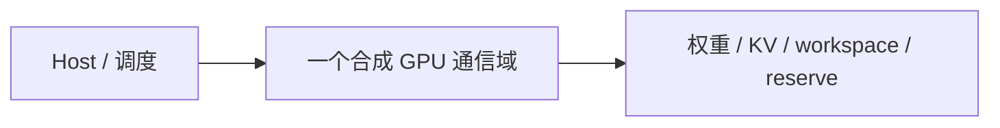
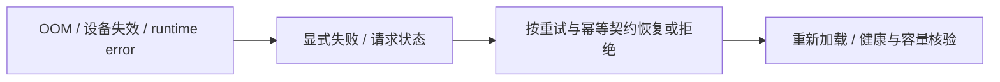

# 合成推理容量设计：模型账本不是上线承诺

状态：原创离线设计练习；不是实际模型配置、GPU 环境或生产架构。目的是把 [GPU/HBM](../components/gpu-hbm.md) 的原理接到解决方案需求。

## 需求与假设

设一个合成 decoder 具有 10 亿参数、BF16 权重、24 层、4 KV heads、128 head dimension。最多 8192 tokens，每个合成 batch 2 个序列，KV BF16。假设设备预算 4 GiB，workspace 256 MiB、allocator/runtime reserve 256 MiB。

这些是练习参数，不声明存在符合该全部配置的真实模型。真实权重/量化 metadata、graph/runtime、activation、通信 buffer 与安全余量要通过设备验证；假设 reserve 不保证一定覆盖这些项。

交互式场景必须另定义质量、TTFT/TPOT、并发/到达分布及可用性要求；本例没有设备测量，因而不承诺这些 SLO。

## 显存账本

| 项 | 合成计算 | 边界 |
|---|---|---|
| 权重 payload | `1e9 × 16/8 = 2000000000 bytes` | 未加格式/metadata/复制开销 |
| KV logical payload | `805306368 bytes = 0.75 GiB` | 同质 MHA/GQA，按给定 sequence/batch |
| Workspace | `268435456 bytes` | 用户给定，不是 profiler 峰值 |
| Reserve | `268435456 bytes` | 用户给定，不证明覆盖全部 omitted overhead |
| 建模合计 | `3342177280 bytes ≈ 3.113 GiB` | 不是 CUDA process total 或设备实测 |

与假设的 `4294967296 bytes` 预算比较，建模余量为 `952790016 bytes`。只能说“在给定模型中满足容量约束”，不能说“已经能以目标速度/质量部署”。

## 三张图的最小版本

这三图刻意不虚构多节点拓扑或高可用能力；单设备本身是故障域。要达到可用性要求，增加副本、路由和恢复契约后重新预算，不把未执行的恢复画成已经验证。

## 决策与反证

- 如果实际显存峰值超出 reserve，此设计的容量假设被推翻，需拆开 overhead/分配/graph 等项。
- 如果容量满足但 TPOT/SLO 不满足，要研究权重/KV 的流量、kernel、batch/排队和互连，不能仅追加显存。
- 权重 INT4 可改变权重 payload，但质量/metadata/kernel 支持另核验，KV BF16 不自动改变。
- 多卡分片可能扩容但引入通信/调度；设计从“单卡”变为“多卡”须重新画数据流与通信域。

验证入口是 [原创离线算例](../../experiments/capacity_roofline/README.md) 与 [学习练习](../learning/exercises.md)。真实硬件与 SLO 验证另行获批；本设计不宣称完成 queue 中的综合平台架构问题。
