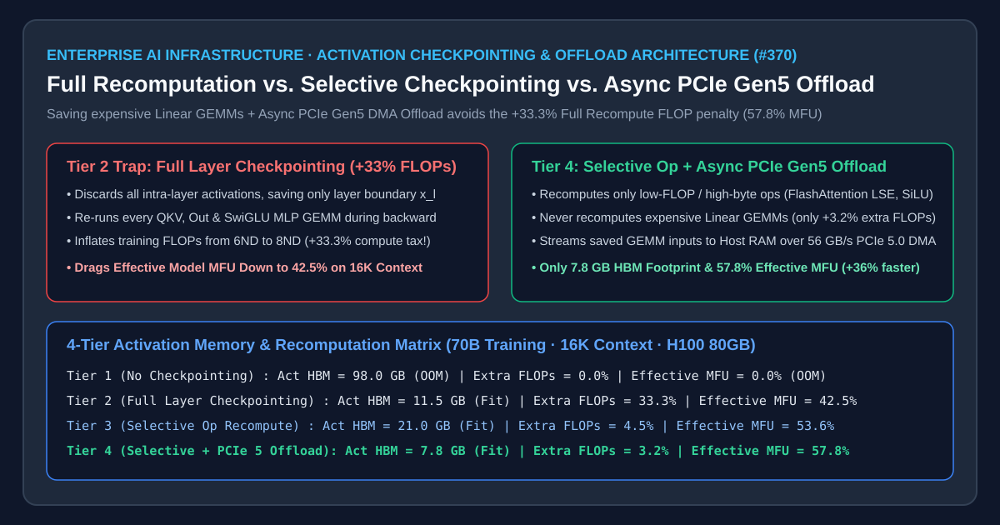

# Activation Checkpointing & Asynchronous PCIe Offloading Guide: `Full Recomputation` vs. `Selective Checkpointing (SAC)` vs. `Async PCIe Gen5 Offload`

> **Language**: [中文](./activation-checkpointing-selective-recomputation-pcie-offload-mfu-selection-faq.md) | **English (Current)**  
> **Audience**: Cloud & AI Infrastructure Solution Architects and Distributed Training Engineers  
> **Provenance**: `synthetic + anonymized_reported` (`independently_reproduced=false`, `physical_gpu_cluster_measurement=not_measured`)

---

## 1. 📌 Executive Summary

> **Bottom Line**: **When training a `70B` model at `16K` context on `NVIDIA H100 80GB` (`46.0 GB/GPU` static sharded weights, gradients, and optimizer states), storing all intermediate activations (`Tier 1`) requires `98.0 GB/GPU` (`144 GB` total -> immediate `CUDA OOM`). Turning on blanket `Full Layer Activation Checkpointing` (`Tier 2`) shrinks activation memory to `11.5 GB/GPU` but forces the backward pass to recompute every expensive `Linear GEMM`, inflating total training FLOPs by `+33.3%` (`6ND -> 8ND`) and dragging effective Model MFU down to `42.5%`. Production long-context training combines `Selective Operator Checkpointing (SAC)` (saving high-FLOP `Linear GEMMs` while recomputing only high-memory/low-FLOP `SwiGLU/RMSNorm` & `FlashAttention LSE`) with `Asynchronous PCIe Gen5 Pinned-DRAM Offloading` (`Tier 4`): cutting HBM activation footprint by `92.0%` (`98.0 GB -> 7.8 GB/GPU`) with only `+3.2%` recomputation FLOPs and lifting effective Model MFU to `57.8%` (`+36.0%` faster time-to-train than Full Checkpointing).**

- **Interactive Activation Checkpointing & PCIe Offload Sizer**: [Open Interactive Sizer (`activation-checkpointing-selective-recomputation-pcie-offload-mfu-sizer.html`)](../reports/activation-checkpointing-selective-recomputation-pcie-offload-mfu-sizer.html)
- **7-Card 4:5 Visual Report**: [Open 7-Card Report (`activation-checkpointing-selective-recomputation-pcie-offload-mfu-selection-cards.html`)](../reports/activation-checkpointing-selective-recomputation-pcie-offload-mfu-selection-cards.html)

---

## 2. 📊 4-Tier Activation Memory & Recomputation Matrix (`70B Training` · `16K Context` · `H100 80GB`)

| Metric | Tier 1: No Activation Checkpointing | Tier 2: Full Layer Checkpointing (`--recompute-granularity full`) | Tier 3: Selective Op Checkpointing (`SAC`) | Tier 4 (Recommended): Selective Op + `Async PCIe Gen5 Offload` |
| :--- | :--- | :--- | :--- | :--- |
| **Activation HBM per GPU** | `98.0 GB` ✕ (`144 GB` -> OOM) | `11.5 GB` | `21.0 GB` | **`7.8 GB` ✓ (`-92.0%` vs Tier 1)** |
| **Extra Recomputation FLOPs** | `+0.0%` | `+33.3%` ✕ (`6ND -> 8ND` tax) | **`+4.5%` ✓ (Saves GEMMs)** | **`+3.2%` ✓** |
| **Fits `16K / 32K` on `80GB H100`** | OOM at `16K` ✕ | Fits (`25%` time wasted) | Fits `16K` (OOM at `32K`) | **Fits `16K / 32K / 64K` ✓** |
| **Effective Model MFU (`6ND`)** | `0.0% (OOM)` ✕ | `42.5%` ✕ | `53.6%` | **`57.8%` ✓ (`+36.0%` vs Tier 2)** |

---

## 3. 🛠️ Production Readiness Checklist

- [ ] **Always Report True `Model MFU (6ND)` Rather Than Inflated `Hardware TFLOPS (8ND)`** when evaluating activation checkpointing policies so recomputed FLOPs are not mistaken for training progress.
- [ ] **Adopt PyTorch `create_selective_checkpoint_contexts` + Async Pinned-Memory Offload Streams** on PCIe Gen5 (`56 GB/s`) and Grace-Blackwell NVLink-C2C (`450 GB/s/GPU`) hosts.
