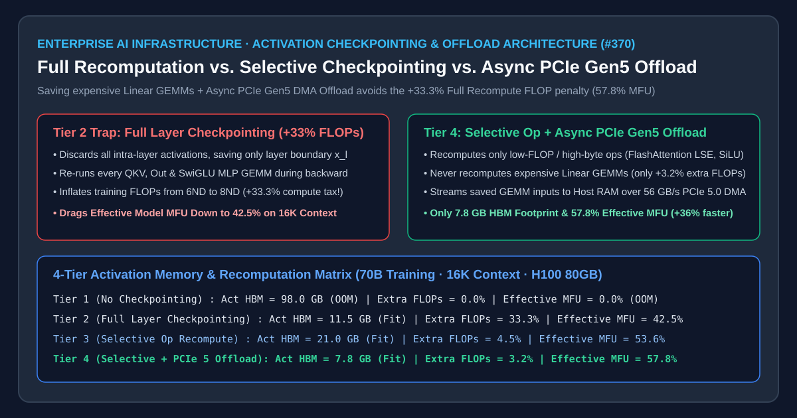
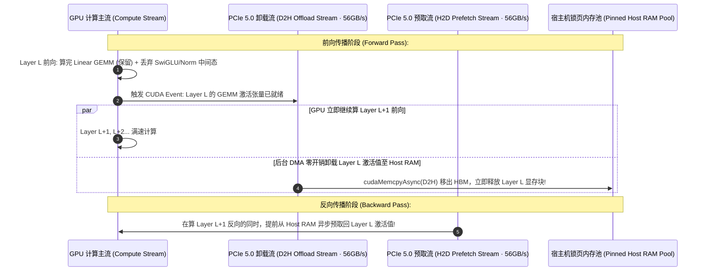

# 大模型激活重计算（Activation Checkpointing）与异步 PCIe 卸载选型：`Full Recomputation` vs. `Selective Checkpointing` vs. `PCIe Gen5 Async Offload` 显存-算力权衡与 MFU 优化指南

> **语言 / Language**: **中文 (当前)** | [English](./activation-checkpointing-selective-recomputation-pcie-offload-mfu-selection-faq.en.md)  
> **定位**：面向 Cloud & AI Infrastructure Solution Architect 与训练性能架构师的激活值显存治理技术选型（`Full Layer Activation Checkpointing`、`Selective Operator Checkpointing / SAC`、`Async PCIe Gen5 / CXL Pinned-DRAM Activation Offloading`）、避免全量重计算白扔 `+33.3%` 算力（从 `6ND` 膨胀至 `8ND`）的第一性原理白皮书  
> **合规与来源声明**：`synthetic + anonymized_reported`（`independently_reproduced=false`，`physical_gpu_cluster_measurement=not_measured`；完全面向通用企业级长上下文预训练与 SFT 微调显存优化设计）

---

## 1. 📌 核心选型结论速览（Executive Summary）

> **一句话结论**：**在 `H100 80GB` 上训练 `70B` 模型（`16K` 上下文，FSDP2 切分后静态权重+优化器+梯度占 `46.0 GB/GPU`）时，如果不开启激活值重计算（Tier 1），仅前向保存下来留给反向求导用的中间激活值就会高达 **`98.0 GB/GPU`**（总需求 `144 GB` 直接 `CUDA OOM`）！但若一刀切开启最省事的“全层重计算 `Full Activation Checkpointing`”（Tier 2，每层只存输入 $x_l$，反向传播时把整层所有的 `QKV/Out/MLP` 矩阵乘重算一遍），虽然把激活显存压到了 `11.5 GB/GPU`，却付出了**多算整整 1 次前向（额外增加 `+33.3%` FLOPs，训练计算量从 $6ND$ 暴涨至 $8ND$！）**的惨重代价，将有效模型 MFU 直接砸穿至 **`42.5%`**！生产环境的黄金准则是采用“算子级选择性重计算 `Selective Op Checkpointing (SAC)` + `PCIe Gen5` 异步双流锁页内存卸载（Tier 4）”：严格保留占 85% 算力的昂贵 `Linear GEMM` 结果不重算（只重算占大头显存但算力极轻的 `SiLU/SwiGLU` 与 `FlashAttention LSE`），并利用空闲的 `56 GB/s PCIe 5.0 DMA` 独立流将保存的激活值异步卸载至宿主机内存、反向前提前预取回 HBM——将 GPU 激活显存压至 **`7.8 GB/GPU`（省 `92%` 显存）**，同时把额外重算开销从 `+33.3%` 降至 **`+3.2%`**，推动有效 MFU 跃升至 **`57.8%`（训练速度比全量重算快 `+36.0%`）**！**

- **交互式激活重计算与 PCIe 卸载显存/MFU 计算器**：[打开交互式计算器 (`activation-checkpointing-selective-recomputation-pcie-offload-mfu-sizer.html`)](../reports/activation-checkpointing-selective-recomputation-pcie-offload-mfu-sizer.html)
- **7-Card 4:5 视觉评测报告**：[打开 7-Card 报告 (`activation-checkpointing-selective-recomputation-pcie-offload-mfu-selection-cards.html`)](../reports/activation-checkpointing-selective-recomputation-pcie-offload-mfu-selection-cards.html)

---

## 2. 🎯 客户与架构师灵魂拷问 Q&A（Deep-Dive Architecture FAQ）

### Q1：为什么 Transformer 一层里面的算子会有“有的吃算力不吃显存，有的吃显存不吃算力”的严重不对称？`Selective Checkpointing` 到底选谁存、选谁重算？
- **第一性原理：Transformer 层内的 `FLOPs-per-Byte` 极度不对称性**：
  1. **高算力、中低显存算子（绝对不能重算！必须保存或卸载）—— `Linear GEMMs`（`WQKV`, `WOut`, `MLP Gate/Up/Down`）**：
     - 它们占了整个 Transformer 前向传播 **85% 以上的计算量（FLOPs）**！如果丢弃它们的输出并在反向传播重算，就会白白浪费 ~30% 的 GPU 算力。
  2. **高显存、极低算力算子（最适合丢弃并现场重算！）—— `SwiGLU / GeLU` 逐元素激活、`RMSNorm / LayerNorm`、以及 `Attention Softmax` 中间态**：
     - 特别是 `SwiGLU` 中间维度高达 $3.5 \times d_{\text{model}}$（在 `70B` 中是 `28,672` 维），存下它的逐元素激活要吃掉整层近一半的显存，但重算一次 `SiLU(x) * y` 只需微不足道的逐元素指令（不到全层 `2%` 的耗时）！而 `FlashAttention-2/3` 更是天然只存极小的 `Log-Sum-Exp (LSE)` 向量，在反向 Kernel 的 SRAM 内直接重算 $P = \text{softmax}(QK^T)$。
- **结论**：使用 PyTorch `create_selective_checkpoint_contexts` 明确指定 **Save `aten.mm.default` & FlashAttention Output，Recompute 其余逐元素/归一化算子**，即可用 **`+4.5%` 的极小算力代价换取 `-78.6%` 的激活显存削减（`98GB -> 21GB`）**！

---

## 3. 🧭 直观可视化图解（Mermaid 选择性重计算 + PCIe 5.0 乒乓双流异步激活卸载时序图）

---

## 4. 📊 架构师四级激活值显存管理选型矩阵（`70B` 训练 · `16K` 上下文 · `H100 80GB`）

| 评估维度 | Tier 1：不开启重计算（全量驻留 HBM） | Tier 2：全层重计算 (`--recompute-granularity full`) | Tier 3：算子级选择性重计算 (`Selective Op Checkpointing`) | Tier 4（推荐）：选择性重计算 + `PCIe Gen5` 异步锁页内存卸载 |
| :--- | :--- | :--- | :--- | :--- |
| **单卡激活值占用显存 (`Act HBM`)** | `98.0 GB / 卡` ✕（总计 144GB 爆显存） | `11.5 GB / 卡` | `21.0 GB / 卡` | **`7.8 GB / 卡` ✓（比全存省 `92.0%`）** |
| **反向传播额外重算 FLOPs 税** | `+0.0%` | `+33.3%` ✕（从 `6ND` 膨胀至 `8ND`） | **`+4.5%` ✓（保留全部 GEMM）** | **`+3.2%` ✓** |
| **`80GB H100` 能否跑通 `16K/32K`** | `16K` 即 OOM ✕ | 能跑通（但算力浪费 1/4） | `16K` 跑通，`32K` OOM | **`16K / 32K / 64K` 全部轻松跑通 ✓** |
| **集群有效算力利用率 (`Effective MFU`)** | `0.0% (OOM)` ✕ | `42.5%` ✕ | `53.6%` | **`57.8%` ✓（比全层重算快 `+36.0%`）** |

---

## 5. 🛠️ 架构评审与生产落地 Checklist

- [ ] **立即排查训练脚本中的 `--activation-checkpointing / full` 配置**：区分“硬件观测到的虚高 TFLOPS（包含了无意义的重算 FLOPs）”与**“真正推进训练进度的有效 `6ND Model MFU`”**，切勿被重算刷高的假 TFLOPS 欺骗。
- [ ] **在 `PCIe Gen5 x16`（H100/H200/B200）或 `NVLink-C2C`（GH200/GB200，`900 GB/s`）节点上优先启用异步激活值卸载（`Activation Offloading`）**：在 `GB200` 超节点上，通过 `450 GB/s` 单卡 C2C 带宽卸载激活值几乎达到 **100% 零损耗隐藏**。
