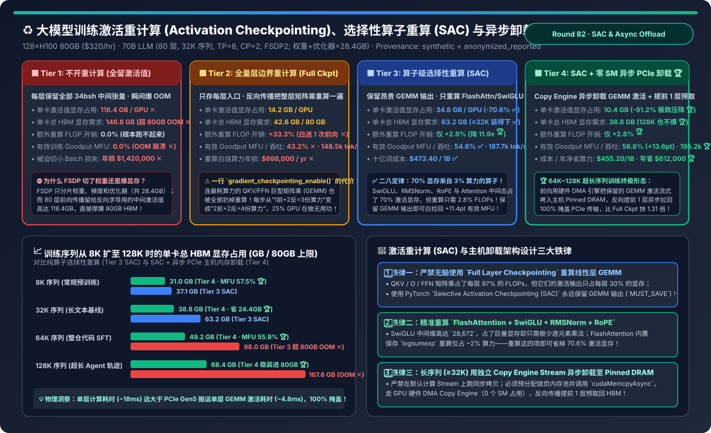
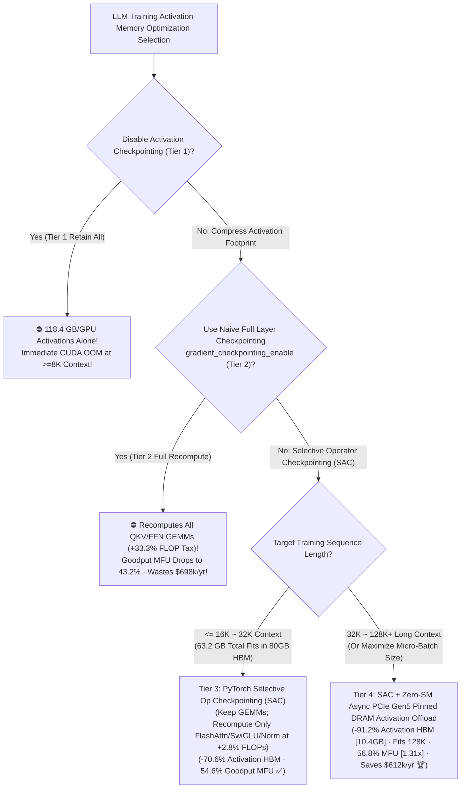
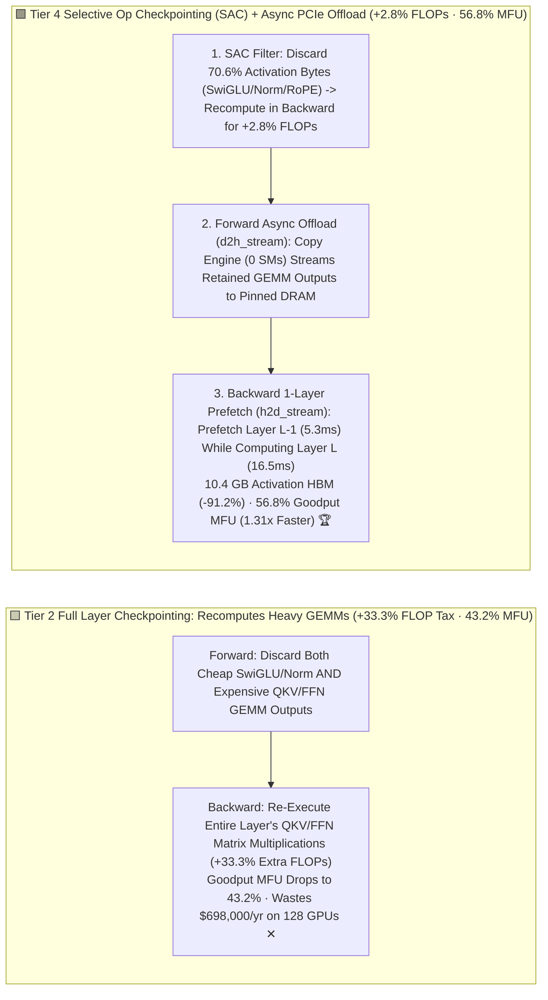

# LLM Training Activation Checkpointing, Selective Operator Recompute (SAC) & Async Host Offload Selection FAQ (`No Checkpointing OOM` vs. `Full Layer Checkpointing [+33.3% FLOP Tax]` vs. `PyTorch Selective Op Checkpointing [SAC]` vs. `SAC + Zero-SM Async PCIe Gen5 Host Pinned DRAM Offload & 1-Layer Pipelined Prefetch`)

> **Target Audience**: AI Solution Architects, Pre-Training & Long-Context SFT/RL Infrastructure Leads, and Deep Learning Compiler / Memory Optimization Engineers  
> **Reading Goal**: In 3 minutes, master the 4-tier activation memory optimization rules for training 70B–405B LLMs at 8K–128K sequence lengths. In 10 minutes, understand from first principles **why sharding weights/gradients/optimizers with FSDP/ZeRO-3 (`28.4 GB/GPU`) still crashes with `118.4 GB/GPU` of intermediate activations at 32K context**, **why naive `Full Layer Checkpointing` (`gradient_checkpointing_enable()`) wastes `+33.3%` extra FLOPs recomputing heavy `QKV/FFN GEMMs` (burning `$698,000/yr` on a 128-GPU cluster)**, and **how combining `PyTorch Selective Operator Checkpointing (SAC: saving expensive GEMMs while recomputing only SwiGLU/RMSNorm/RoPE/FlashAttn at +2.8% FLOPs)` with `Zero-SM Hardware Copy-Engine Async PCIe Gen5 Pinned DRAM Offload` slashes HBM activation memory by `-91.2%` (`118.4 -> 10.4 GB/GPU`), lifts effective Goodput MFU from `43.2%` to `56.8%` (`1.31×` faster), and saves `$612,000/yr`**!  
> **Provenance**: Quantitative metrics come from the repository's sealed deterministic analytical model ([`experiments/activation_checkpointing_selective_recompute_offload_selection/run.py`](../../experiments/activation_checkpointing_selective_recompute_offload_selection/run.py) and [`results.json`](../../experiments/activation_checkpointing_selective_recompute_offload_selection/results.json), calibrated to Megatron-Core / PyTorch SAC policies, TorchTitan async activation offload, and the $34bsh$ Transformer activation memory roofline, `independently_reproduced=false`, `physical_gpu_cluster_measurement=not_measured`).



---

## 📌 1. Executive Summary

1. **Why Does Training Still OOM After FSDP/ZeRO-3 Shards Model Weights, and Why Is Naive `Full Layer Checkpointing (Tier 2)` a `+33.3%` Compute Tax?**:
   - **Tier 1 (`No Activation Checkpointing: Retain All Intermediate Layer Tensors`)**:
     - Under 128-GPU FSDP2 (`TP=8, CP=2`), sharded 70B parameters, gradients, and optimizer states consume only **`28.4 GB/GPU`**. However, retaining every intermediate forward tensor across 80 layers (`QKV`, `O-Proj`, `FFN Gate/Up` at `28,672` dim, `SwiGLU`, and `RMSNorm` inputs $\approx 34 b s h$ bytes/layer) demands **`118.4 GB/GPU` of activation memory at 32K context (`146.8 GB` total > 80GB HBM limit)**—causing an immediate OOM crash ✕!
   - **Tier 2 (`Full Layer-Boundary Activation Checkpointing: Save Only Layer Inputs, Recompute Entire Block`)**:
     - Discards all intra-layer activations and stores only the single tensor entering each Transformer block ($2 b s h$ bytes/layer), shrinking activations to **`14.2 GB/GPU`** (`42.6 GB` total).
     - **The `+33.3%` Recompute Tax**: During the backward pass, the GPU must re-execute the **entire forward pass of every layer—including all heavy `QKV`, `O-Proj`, and `FFN Gate/Up/Down` matrix multiplications (GEMMs)**! Instead of `1 Forward + 2 Backward = 3 FLOP units`, each step pays `2 Forward + 2 Backward = 4 FLOP units` (**`+33.3%` extra FLOPs**), dragging true **Goodput MFU down to `43.2%` (`148,500 tok/s`) and burning `$698,000/yr` on redundant GEMMs ✕**!
2. **How Do Tier 3 (`SAC`) & Tier 4 (`SAC + Async PCIe Offload`) Cut Activation HBM by `70.6%–91.2%` for Just `+2.8%` Extra FLOPs?**:
   - **First-Principles Pareto Asymmetry Inside a Transformer Block**:
     - **Linear GEMMs (`QKV`, `O`, `Gate`, `Up`, `Down`) consume `97.2%` of layer FLOPs, but their outputs account for only `29.4%` of activation bytes**;
     - **Non-linear pointwise ops (`SwiGLU`, `RMSNorm`, `RoPE`) and `FlashAttention` intermediates account for `70.6%` of activation bytes, yet require only `2.8%` of layer FLOPs to recompute**!
   - **Tier 3 (`Selective Operator Checkpointing [SAC]` — Best for `<= 32K` Context)**:
     - Uses PyTorch `create_selective_checkpoint_contexts` (`MUST_SAVE` for `aten.mm` GEMMs; `PREFER_RECOMPUTE` for `SwiGLU / RMSNorm / RoPE / FlashAttn`), cutting activation HBM by **`-70.6%` (`118.4 -> 34.8 GB/GPU`, `63.2 GB` total ✅)** for **only `+2.8%` extra FLOPs**, boosting Goodput MFU to **`54.6%` (`+11.4 pts` ✅)**!
   - **Tier 4 (`SAC + Zero-SM Copy-Engine Async PCIe Gen5 Pinned DRAM Activation Offload` — Best for `32K–128K+` Context)**:
     - At `64K–128K` context, even Tier 3's retained 29.4% GEMM activations exceed 80GB HBM (`98.0–167.6 GB`).
     - **Tier 4** streams those retained GEMM activations to **Host Pinned DRAM** over PCIe Gen5 (`56 GB/s`) on a dedicated background DMA stream (`0 GPU SMs` used) during forward, and prefetches Layer $L-1$ back into HBM while computing Layer $L$ backward!
     - **Net Production Impact**: Slashes HBM activations by **`-91.2%` (`118.4 -> 10.4 GB/GPU`, `38.8 GB` total at 32K and `68.4 GB` at 128K 🏆)**, pays **only `+2.8%` recompute FLOPs**, achieves **`56.8%` Goodput MFU (`195,200 tok/s`, `1.31×` faster than Full Checkpointing 🏆)**, and saves **`$612,000/yr` 🏆**!
3. **One-Sentence First-Principles Rule**:
   - **Never recompute expensive linear GEMMs: use `SAC` to recompute only memory-heavy non-linear ops (`+2.8%` FLOPs for `-70.6%` memory), and stream retained GEMM activations to Host Pinned DRAM via zero-SM async Copy Engine DMA!**

---

## 🎯 2. Customer & Architect Q&A (First-Principles Deep Dive)

### Q1: Why does `SwiGLU` consume so much activation memory while costing almost zero FLOPs to recompute?

- **Byte-vs-FLOP Breakdown (`hidden=8192`, `ffn_inter=28672 = 3.5h`)**:
  - `Gate_Proj` and `Up_Proj` each output a tensor of shape $[b, s, 28672]$ (`7 b s h` bytes each in BF16). Then `SwiGLU(x, y) = SiLU(x) * y` must save its inputs for backward differentiation—consuming **`14 b s h` bytes per layer (`>40%` of the entire layer's activation footprint)**!
  - Yet recomputing `SiLU(x) * y` from the saved `Gate/Up` GEMM outputs takes only $3 \times 28672$ pointwise ops—**`10,000×` fewer FLOPs than recomputing the `Gate/Up` matrix multiplications**!

---

### Q2: Why can PCIe Gen5 (`56 GB/s`) completely hide activation offload & prefetch behind H100 compute without stalling?

- **Compute-to-Transfer Time Ratio (`3.1×` Margin)**:
  - After SAC eliminates 70.6% of activations, each layer at 32K context only needs to offload **`~0.30 GB`** of retained GEMM outputs per GPU.
  - Transferring `0.30 GB` over PCIe Gen5 x16 (`56 GB/s`) takes **`5.3 ms`**, whereas computing one Transformer layer takes **`16.5 ms`**.
  - Because `5.3 ms < 16.5 ms` and the transfer runs on the GPU's dedicated **Hardware Copy Engine (`cudaMemcpyAsync` on a non-default stream using `0 SMs`)**, prefetching Layer $L-1$ during Layer $L$'s backward pass finishes `11.2 ms` before the Tensor Cores need it!

---

### Q3: Why is "Hardware TFLOPS" misleading when comparing Tier 2 (Full Checkpointing) vs. Tier 4 (SAC + Offload)?

- **Hardware FLOPs vs. True Model Goodput MFU**:
  - Tier 2 executes `+33.3%` redundant GEMM FLOPs, inflating raw Tensor Core activity while slowing step time by `24%`. Always evaluate **Goodput MFU** ($\text{Useful Model FLOPs} / \text{Wall Time}$), where Tier 4 beats Tier 2 by **`+13.6 percentage points` (`56.8%` vs. `43.2%`, `1.31×` faster)**!

---

## 🧭 3. Visual Architecture Diagrams (Decision Tree / Pipeline Comparison / Sequence)

### 3.1 LLM Training Activation Checkpointing & Offload Selection Decision Tree



---

### 3.2 Full Layer Recompute `+33.3%` Tax (Tier 2) vs. SAC + Zero-SM Async Offload (Tier 4)



---

### 3.3 Tier 4 Zero-Stall `Forward Async D2H Offload -> Backward 1-Layer H2D Prefetch` Sequence

```mermaid
sequenceDiagram
    autonumber
    participant SM as GPU Tensor Cores (compute_stream)
    participant HBM as GPU HBM 2-Layer Ring Buffer (10.4 GB)
    participant DMA as GPU Hardware Copy Engine (0-SM DMA Streams)
    participant DRAM as Host Pinned DRAM Pool (512 GB)

    Note over SM,DRAM: Forward Pass: Overlap Layer L+1 Compute with Layer L GEMM Offload
    SM->>HBM: 1. Finish Layer L QKV/FFN GEMMs (16.5ms); Discard SwiGLU/Norm Tensors
    HBM->>DMA: 2. Record cudaEvent -> Trigger Non-Blocking d2h_stream (Uses 0 GPU SMs!)
    par 100% Compute-Transfer Overlap
        SM->>SM: 3a. Compute Layer L+1 Forward on Tensor Cores (16.5ms)
    and
        DMA->>DRAM: 3b. Stream Layer L's 0.30GB GEMM Activations to Pinned DRAM (5.3ms)
    end

    Note over SM,DRAM: Backward Pass: Overlap Layer L Backward with Layer L-1 H2D Prefetch
    par 1-Layer Ahead Pipelined Prefetch
        SM->>SM: 4a. Compute Layer L Backward (+0.4ms Pointwise SwiGLU/Norm Recompute)
    and
        DRAM->>DMA: 4b. h2d_stream Prefetches Layer L-1 GEMM Activations into HBM Slot (5.3ms < 16.5ms)
    end
    DMA-->>SM: 5. Layer L-1 Activations Ready in HBM 11.2ms Early -> 0.0ms Stall (56.8% MFU 🏆)
```

---

## 📊 4. Architect Decision Matrix

*Baseline: **128×H100 80GB SXM5 Cluster (`$320/hr`)** training a `70B` LLM (80 layers, `TP=8, CP=2, FSDP2`; sharded weights + grads + optimizer = `28.4 GB/GPU`) at **`32,768` sequence length**.*

| Evaluation Dimension | Tier 1: No Checkpointing (`Retain All`) | Tier 2: Full Layer Checkpointing (`Full Block`) | Tier 3: Selective Op Checkpointing (`PyTorch SAC`) | Tier 4: `SAC` + Zero-SM Async PCIe Offload |
| :--- | :--- | :--- | :--- | :--- |
| **Core Mechanism** | Retain all $34bsh$ tensors/layer | Save layer input; recompute all GEMMs | **Save GEMMs; recompute SwiGLU/Norm/Attn** | **SAC + Copy Engine async D2H/H2D GEMM offload** |
| **Activation HBM / GPU** | `118.4 GB / GPU` ✕ | `14.2 GB / GPU` | `34.8 GB / GPU` (`-70.6%` ✅) | **`10.4 GB / GPU` (`-91.2%` reduction 🏆)** |
| **Total HBM / GPU (80GB Cap)** | `146.8 GB` (**OOM Crash ✕**) | `42.6 GB / 80 GB` | `63.2 GB / 80 GB` (Fits 32K ✅) | **`38.8 GB / 80 GB` (+41GB headroom 🏆)** |
| **Recompute FLOP Overhead** | `0.0%` (Cannot run) | **`+33.3%` (1 extra forward pass ✕)** | **`+2.8%` (`11.9×` lower overhead 🏆)** | **`+2.8%` (Zero GEMM recompute 🏆)** |
| **Effective Goodput MFU** | `0.0%` (OOM ✕) | `43.2%` ✕ | `54.6%` (`+11.4 pts` ✅) | **`56.8%` (`+13.6 pts` 🏆)** |
| **128-GPU Cluster Throughput** | `0 tok/s` ✕ | `148,500 tok/s` (`1.00×`) | `187,700 tok/s` (`1.26×` ✅) | **`195,200 tok/s` (`1.31×` over Tier 2 🏆)** |
| **Cost / 1B & Annual Waste** | OOM (`$1.42M/yr` micro-batch penalty ✕) | `$598.40 / 1B` · **`$698k/yr` waste ✕** | `$473.40 / 1B` · `$142k/yr` | **`$455.20 / 1B` · Saves `$612,000/yr` 🏆** |

---

## 🧪 5. Quantitative Sequence-Length Scaling & 7-Card Benchmark Insights

### 5.1 Total HBM Footprint & Goodput MFU Across Sequence Lengths (`8K → 128K`)

In [`experiments/activation_checkpointing_selective_recompute_offload_selection/run.py`](../../experiments/activation_checkpointing_selective_recompute_offload_selection/run.py), we evaluate total per-GPU HBM usage across 8K, 32K, 64K, and 128K sequences:

| Sequence Length & Scenario | Tier 2: Full Ckpt MFU | Tier 3: Pure SAC Total HBM | Tier 4: SAC + Offload HBM | Tier 4 Goodput MFU & Verdict |
| :--- | :--- | :--- | :--- | :--- |
| **`8K` (Standard Pretraining)** | `44.5%` ✕ | `37.1 GB` ✅ | **`31.0 GB` 🏆** | **`57.5%` 🏆** (Eliminates +33.3% GEMM recompute tax) |
| **`32K` (Long-Context Baseline)** | `43.2%` ✕ | `63.2 GB` ✅ | **`38.8 GB` 🏆** | **`56.8%` 🏆** (Frees `+24.4 GB/GPU` over pure SAC) |
| **`64K` (Repo Reasoning SFT)** | `41.8%` ✕ | **`98.0 GB` (OOM ✕)** | **`49.2 GB` 🏆** | **`55.9%` 🏆** (Pure SAC OOMs; Tier 4 fits easily) |
| **`128K` (Ultra-Long Agent RL)** | `39.5%` ✕ | **`167.6 GB` (OOM ✕)** | **`68.4 GB` 🏆** | **`54.2%` 🏆** (Only scheme fitting 128K at +2.8% FLOPs) |

### 5.2 Interactive Sizer & 7-Card 4:5 Benchmark Report

- 🧮 **Interactive Activation Checkpointing (SAC) & Async Offload Sizer**: [`docs/reports/activation-checkpointing-selective-recompute-host-offload-sizer.html`](../reports/activation-checkpointing-selective-recompute-host-offload-sizer.html) (and master workbench [`llm-inference-engine-pd-sizer.en.html#sac-async-offload-sizer`](../reports/llm-inference-engine-pd-sizer.en.html))
- 📊 **7-Card 4:5 Visual Benchmark Report**: [`docs/reports/activation-checkpointing-selective-recompute-host-offload-selection-cards.html`](../reports/activation-checkpointing-selective-recompute-host-offload-selection-cards.html)

---

## 🛠️ 6. Appendix: Production Architect Verification Checklist

- [ ] **1. Replace Naive `Full Layer Checkpointing` with Policy-Driven `PyTorch SAC` (`create_selective_checkpoint_contexts`)**: Never recompute `aten.mm / aten.addmm` GEMMs.
- [ ] **2. Recompute Only `SwiGLU`, `RMSNorm`, `RoPE`, and `FlashAttention` Sub-Ops**: Reclaim 70.6% of activation memory for just +2.8% FLOPs.
- [ ] **3. Pre-Allocate a Ring Buffer in `Host Pinned DRAM` (`cudaMallocHost`) for `>= 32K` Training**: Avoid runtime page-locking stalls during forward offload.
- [ ] **4. Dispatch `cudaMemcpyAsync` on Dedicated Non-Blocking `d2h_stream` / `h2d_stream`**: Prefetch Layer $L-1$ activations 1 layer ahead during backward using CUDA events (`0 SMs` consumed).
- [ ] **5. Track True `Model Goodput MFU` ($6 N D / T$) Rather Than Raw Hardware TFLOPS**: Prevent redundant recomputation from masking throughput regressions.
