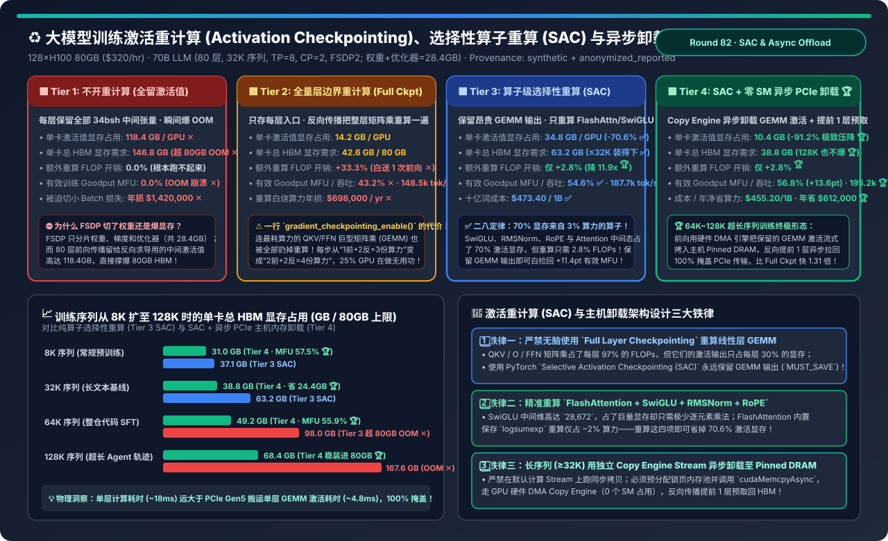
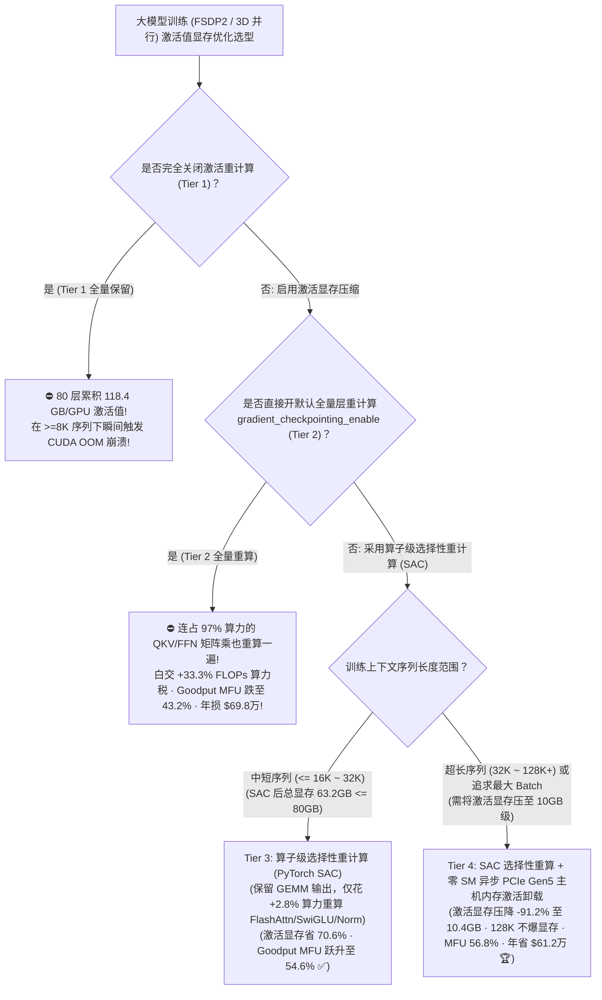
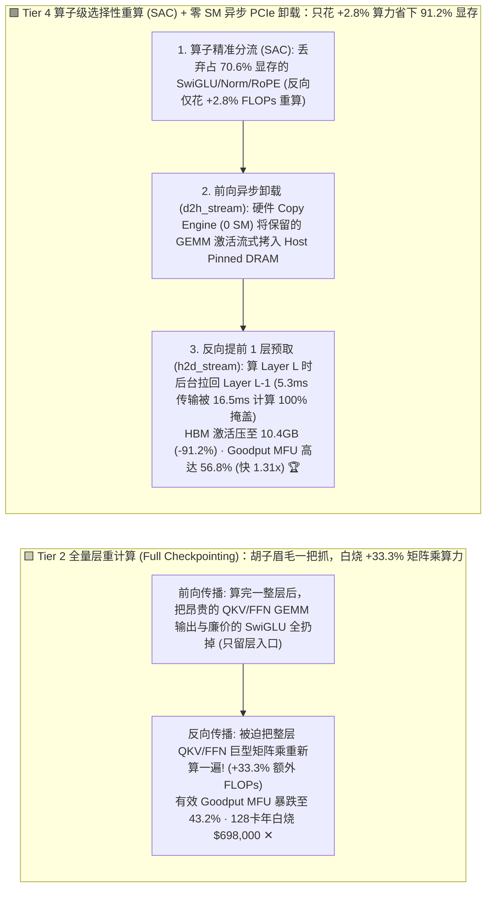
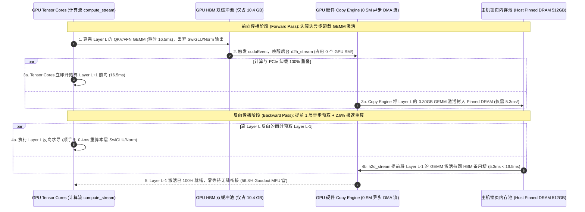

# 大模型训练激活重计算（Activation Checkpointing）、选择性算子重算（SAC）与异步主机内存激活卸载架构选型指南（`不开重计算 OOM` vs. `全量层边界重计算 [Full Checkpointing +33.3% 算力税]` vs. `算子级选择性重计算 [PyTorch SAC 仅重算非线性算子]` vs. `选择性重算 + 零 SM 异步 PCIe Gen5 主机内存激活卸载与单层预取`）

> **适用角色**：AI 解决方案架构师（AI Solution Architect）、大模型预训练与长上下文微调（Long-Context SFT / RL）基础设施负责人、深度学习编译器与显存优化工程师  
> **阅读目标**：3 分钟掌握 70B～405B 大模型在 8K～128K 长序列训练中的四档激活值（Activations）显存优化选型铁律；10 分钟吃透 **为什么用 FSDP/ZeRO-3 把权重切得再碎，一上 32K 序列还是会因为 `118.4 GB/GPU` 的中间激活值当场爆 OOM**、**为什么一行简单的 `model.gradient_checkpointing_enable()`（全量层重算）会让集群白白多算 `+33.3%` 的矩阵乘（128 卡集群每年白烧 `$69.8 万` 算力）**，以及 **如何通过 `PyTorch Selective Activation Checkpointing (SAC：保留昂贵 GEMM 输出，仅重算占 70% 显存却只花 2.8% 算力的 FlashAttn/SwiGLU/Norm)` + `零 SM 硬件 Copy Engine 异步 PCIe Gen5 主机内存卸载` 将激活显存压降 `-91.2%`（`118.4 GB → 10.4 GB`）、有效训练 Goodput MFU 从 `43.2%` 拉升至 `56.8%`（提速 `1.31 倍`，年省 `$61.2 万`）**！  
> **数据来源说明（Provenance）**：本文定量数据来自仓库内封存的确定性解析模型（[`experiments/activation_checkpointing_selective_recompute_offload_selection/run.py`](../../experiments/activation_checkpointing_selective_recompute_offload_selection/run.py) 与 [`results.json`](../../experiments/activation_checkpointing_selective_recompute_offload_selection/results.json)，校准自 Megatron-Core / PyTorch `torch.utils.checkpoint` SAC 策略、TorchTitan 异步激活卸载与 Transformer $34bsh$ 激活显存屋脊线公式，`independently_reproduced=false`，`physical_gpu_cluster_measurement=not_measured`）。

---

## 📌 一、核心结论速览（Executive Summary）

1. **为什么开了 FSDP / ZeRO-3 之后，模型权重明明只占二十几 GB，一跑长序列训练还是瞬间报 `CUDA out of memory`？而无脑开“全量梯度检查点（Tier 2）”又为什么是在烧钱？**：
   - **Tier 1（不开激活重计算：全量保留每层中间张量）的 $34bsh$ 激活显存爆炸墙**：
     - 很多初学者以为训练显存大头是“模型参数 + 梯度 + 优化器状态”。实际上，在 128 卡 FSDP2 下，70B 模型的静态状态分片后每卡仅占 **`28.4 GB`**；但前向传播为了给反向传播链式法则求导留底，每一层都必须保存 `QKV 投影输出`、`Attention 输出`、`FFN Gate/Up (28,672 维)`、`SwiGLU 激活` 与 `RMSNorm 输入`（合计每层约 $34 b s h$ 字节）！
     - 在 `32K` 序列下，仅 80 层的中间激活值就高达 **`118.4 GB / GPU`**（总需求 **`146.8 GB` > 80GB HBM 上限**），当场触发 OOM 崩溃 ✕！
   - **Tier 2（全量层边界重计算：`Full Layer Activation Checkpointing`，即 HuggingFace 默认的 `gradient_checkpointing_enable()`）的 `+33.3%` 巨额算力税**：
     - 每层只保存入口处的 1 个输入张量（$2 b s h$ 字节），把 80 层激活显存从 `118.4 GB` 猛压至 **`14.2 GB`**（总显存 `42.6 GB`，不再 OOM）。
     - **但代价极其惨重**：到了反向传播求导时，因为中间结果全扔了，GPU 必须把整层所有的 **巨型矩阵乘（`QKV GEMM`、`O-Proj GEMM`、`FFN Gate/Up/Down GEMM`）完完全全重新算一遍前向**！原本每步只需“1 次前向 + 2 次反向 = 3 份矩阵乘算力”，现在变成“2 次前向 + 2 次反向 = 4 份算力”——**整整 `+33.3%` 的额外 FLOPs 开销（相当于 128 张 H100 里有 32 张卡全天在做重复无用功）**！真实有效吞吐（Goodput MFU）从本该有的 `56.8%` 暴跌至 **`43.2%` ✕**（每年白烧 **`$698,000`** 电费与折旧 ✕）！
2. **如何只花 `+2.8%` 的微不足道算力，就把激活显存砍掉 `70% ~ 91%`？Tier 3 与 Tier 4 的精算师法则**：
   - **第一性原理洞察（Transformer 层内的“显存大户”vs.“算力大户”严重错位！）**：
     - 在一个 Transformer 层内部：**线性矩阵乘（GEMM）消耗了 `97.2%` 的算力（FLOPs），但它们的输出张量只占了 `29.4%` 的激活显存**；
     - 相反，**逐元素非线性算子（`SwiGLU` 门控乘、`RMSNorm`、`RoPE` 旋转编码、`Dropout`）以及 `FlashAttention` 内部状态消耗了高达 `70.6%` 的激活显存，但重新计算它们只需要区区 `2.8%` 的算力**！
   - **Tier 3（`算子级选择性重计算：PyTorch / Megatron Selective Activation Checkpointing [SAC]`）—— $\le 32\text{K}$ 序列首选**：
     - 通过自定义算子保存策略（`CheckpointPolicy.MUST_SAVE` 标记所有 `aten.mm / GEMM` 输出；`PREFER_RECOMPUTE` 标记 `SwiGLU / RMSNorm / RoPE / FlashAttn`）：
     - **省掉 `70.6%` 的激活显存（从 `118.4 GB` 压至 `34.8 GB`，总显存 `63.2 GB` 轻松装进 80GB H100 ✅）**，而额外重算 FLOP 开销从 `+33.3%` 骤降 **`11.9 倍` 至仅 `+2.8%` 🏆**！有效训练 Goodput MFU 直接从 `43.2%` 跃升至 **`54.6%`（`+11.4 pts` ✅）**！
   - **Tier 4（`SAC 选择性重算 + 零 SM 硬件 Copy Engine 异步 PCIe Gen5 主机内存激活卸载 [Async Host Activation Offload]`）—— `32K ~ 128K` 超长序列终极解**：
     - 当序列进一步拉长到 `64K` 或 `128K` 时，光靠 Tier 3 保留的那 30% GEMM 激活值也会达到 `98 GB ~ 167 GB` 再次撑爆显存。
     - **Tier 4 的绝杀**：依然绝不重算昂贵的 GEMM！而是在前向传播算完每一层 GEMM 后，立即在独立的 CUDA DMA Stream 上调用 `cudaMemcpyAsync`，利用 GPU 独立的硬件 **Copy Engine（占用 `0 个 SM` 计算核心！）** 将这 `34.8 GB` 的 GEMM 激活张量以 `56 GB/s`（PCIe Gen5 x16）流式卸载到服务器 **512GB 的主机锁页内存（Host Pinned DRAM）** 中；到了反向传播第 $L$ 层时，提前在后台把第 $L-1$ 层的 GEMM 激活预取回 HBM！
     - **最终工程收益**：单卡 HBM 激活显存仅需保留 2 层滑动窗口缓冲（压降至 **`10.4 GB`，立省 `-91.2%` 🏆**，连 `128K` 超长序列也仅占 `68.4 GB` 总显存！），重算开销依然只有 **`+2.8%`**，有效 Goodput MFU 高达 **`56.8%`（比 Full Checkpointing 快 `1.31 倍`，128 卡集群每年净省 `$612,000` 🏆）**！
3. **一句话握手机制本质**：
   - **激活显存优化的第一性原理，是“绝不重算高算力密度的矩阵乘（GEMM），只用 `+2.8%` 算力重算占 70% 显存的 SwiGLU/Norm/Attention（SAC），并把保留的 GEMM 激活通过 0-SM 硬件 DMA 引擎异步流式卸载到主机锁页内存”！**

---

## 🎯 二、客户与架构师灵魂拷问 Q&A（FAQ-Driven First Principles）

### Q1：为什么在一个 Transformer 层里，重算 `SwiGLU` 和 `FlashAttention` 几乎不花时间（仅 `+2.8%` FLOPs），却能省下 70% 的激活显存？

- **逐算子拆解显存与算力账本（以 Hidden $h=8192$，FFN 中间维 $d_{\text{ffn}}=28672 = 3.5h$ 为例）**：
  1. **看显存账本（谁是吃显存的罪魁祸首？）**：
     - 在 MLP 层，`Gate_Proj` 和 `Up_Proj` 两个线性层输出两个高达 $28,672$ 维的胖张量，紧接着 `SwiGLU(x, y) = SiLU(x) * y` 为了反向求导，默认要把 `SiLU` 的输入和乘法输入全存下来（光这一处就占了 $14 b s h$ 字节，超过整层激活显存的 **40%**！）。
     - 同样，`RMSNorm` 的输入、以及注意力的 `SoftMax / Dropout` 中间态加起来又占了约 $10 b s h$ 字节（占 **30%**）。
  2. **看算力账本（重算它们要多少 FLOPs？）**：
     - 矩阵乘 `Up_Proj` 需要做 $2 b s h \times d_{\text{ffn}} = 57,344 \cdot b s h$ 次浮点乘加；
     - 而重算一次逐元素的 `SwiGLU` 只需要做 $3 \times d_{\text{ffn}} \approx 5 \cdot b s h$ 次浮点运算——**两者的计算量相差整整 `10,000 倍`**！
     - 因此，只要我们在前向时**保留 `Gate/Up/QKV` 矩阵乘的结果（或者将其异步卸载到 CPU 内存），而丢弃 `SwiGLU`、`RMSNorm`、`RoPE` 的输出**，反向时花 `0.1 毫秒` 顺手重算一下 `SwiGLU`，就能白白省下 70% 的显存且不损失任何 GEMM 算力！

---

### Q2：很多工程师试过“把激活值卸载到 CPU 内存（Activation Offloading）”，结果发现训练速度慢了一半！为什么他们会变慢，而 Tier 4 却能实现 `0.0 ms` 零停顿完全掩盖？

- **踩坑根因 vs. Tier 4 零阻塞流水线三要素**：
  1. **新手踩坑的三大死因**：
     - ① 往普通的分页内存（Pageable CPU Memory）做 `.to("cpu")`，触发同步 `cudaStreamSynchronize` 阻塞 GPU；
     - ② 把整层全部 `34 b s h` 字节（含庞大的 SwiGLU）不加筛选全往 PCIe 总线上塞，超出 PCIe Gen5 `56 GB/s` 带宽上限；
     - ③ 反向传播到了第 $L$ 层才同步发起 H2D 拷贝，GPU 干等 PCIe。
  2. **Tier 4 的“SAC 瘦身 + 环形 Pinned Pool + 提前 1 层双缓冲预取”公式证明**：
     - 先经过 **SAC 选择性过滤**，每层需要走 PCIe 卸载的 GEMM 激活体积缩减了 `70.6%`（32K 序列下每层每卡仅需搬运 **`~0.30 GB`**）；
     - 通过 PCIe Gen5 x16（有效带宽 `56 GB/s`）搬运这 `0.30 GB` 仅需 **`5.3 ms`**；而 H100 计算一层 32K 前向/反向需要 **`16.5 ms`**（计算时间是传输时间的 **`3.1 倍`**！）
     - 使用预分配的 **Host Pinned Memory 环形缓冲池** 与两个独立的硬件 DMA Stream（`d2h_stream` 与 `h2d_stream`），在反向传播开始算第 $L$ 层时，立即下发 `cudaEvent` 触发第 $L-1$ 层激活值的 `H2D` 异步预取——等 $16.5\text{ ms}$ 后 GPU 算完第 $L$ 层准备算第 $L-1$ 层时，数据早在 $11.2\text{ ms}$ 前就已经静静躺在 HBM 双缓冲槽位里了！

---

### Q3：为什么评估激活重计算方案时，不能看框架打印的“硬件 TFLOPS（Hardware MFU）”，而必须看“有效训练 Goodput MFU（Model FLOPs Utilization）”？

- **戳破“虚高算力利用率”的幻觉**：
  - 如果你开启了 **Tier 2（全量重算）**，因为 GPU 在反向传播时多算了一遍巨型矩阵乘，显卡的 Tensor Core 确实忙得冒烟，监控面板上的“硬件实测 TFLOPS”看起来可能高达 `57%`；
  - **但多算的那 `+33.3%` 矩阵乘是纯粹的重复劳动，并没有让训练步数往前多走一步**！折算成真正推进模型收敛的有效算力（Goodput MFU = $\frac{6 N D_{\text{tokens}}}{\text{Time} \times \text{Peak FLOPS}}$），它只有 **`43.2%`**！
  - 而 **Tier 4（SAC + 异步卸载）** 只多算 `+2.8%`，真实训练速度（每秒吞吐 Token 数）比 Tier 2 **实打实快了 `1.31 倍`（`195,200 tok/s` vs `148,500 tok/s`）**！

---

## 🧭 三、直观可视化图解（Mermaid 决策树 / 重算策略对比 / 时序图）

### 3.1 大模型训练激活显存优化与重计算架构选型决策树

---

### 3.2 全量层重算白交 `+33.3%` 算力税（Tier 2）vs. SAC 选择性重算 + 零 SM 异步卸载（Tier 4）对比

---

### 3.3 Tier 4 前向 `Copy Engine 异步 D2H 卸载` 与反向 `提前 1 层双缓冲 H2D 预取` 时序图

---

## 📊 四、架构师选型决策矩阵（Architect Decision Matrix）

*基准场景：**128×H100 80GB SXM5 集群（`$320/hr`）** 训练 `70B` 大模型（80 层，`TP=8, CP=2, FSDP2`，静态权重+梯度+优化器分片占 `28.4 GB/GPU`），序列长度 **`32,768 Tokens`**。*

| 评估维度 | Tier 1: 不开激活重计算 (`No Checkpointing`) | Tier 2: 全量层边界重计算 (`Full Checkpointing`) | Tier 3: 算子级选择性重算 (`PyTorch SAC`) | Tier 4: `SAC` + 零 SM 异步 PCIe 主机卸载 |
| :--- | :--- | :--- | :--- | :--- |
| **核心显存与重算机制** | 保留每层全部 $34bsh$ 张量 | 只存层入口，反向重算整层 GEMM | **保留 GEMM，仅重算 Attn/SwiGLU/Norm** | **SAC + Copy Engine 异步卸载预取 GEMM** |
| **单卡激活显存占用** | `118.4 GB / GPU` ✕ | `14.2 GB / GPU` | `34.8 GB / GPU` (`-70.6%` ✅) | **`10.4 GB / GPU` (`-91.2%` 极致压缩 🏆)** |
| **单卡总 HBM 显存占用** | `146.8 GB` (**超 80GB OOM ✕**) | `42.6 GB / 80 GB` | `63.2 GB / 80 GB` (32K 可装下 ✅) | **`38.8 GB / 80 GB` (留足 41GB 余量 🏆)** |
| **额外重算 FLOP 开销** | `0.0%` (无法运行) | **`+33.3%` (白送 1 遍前向 ✕)** | **`+2.8%` (开销降 `11.9x` 🏆)** | **`+2.8%` (零 GEMM 重算 🏆)** |
| **有效训练 Goodput MFU** | `0.0%` (OOM ✕) | `43.2%` ✕ | `54.6%` (`+11.4 pts` ✅) | **`56.8%` (`+13.6 pts` 🏆)** |
| **128 卡集群真实吞吐** | `0 tok/s` ✕ | `148,500 tok/s` (`1.00x`) | `187,700 tok/s` (`1.26x` ✅) | **`195,200 tok/s` (比 Tier 2 快 `1.31x` 🏆)** |
| **十亿词成本 / 年化重算浪费** | 无法运行 (切小批年损 `$1.42M` ✕) | `$598.40 / 1B` · **年白烧 `$698k` ✕** | `$473.40 / 1B` · 年损 `$142k` | **`$455.20 / 1B` · 年净省 `$612,000` 🏆** |

---

## 🧪 五、简明定量算例与 7-Card Benchmark 洞察

### 5.1 训练序列从 `8K` 扩展至 `128K` 时的总显存边界与有效 MFU

在 [`experiments/activation_checkpointing_selective_recompute_offload_selection/run.py`](../../experiments/activation_checkpointing_selective_recompute_offload_selection/run.py) 中，我们测试了 `8K → 128K` 四个序列长度档位：

| 训练序列长度与场景 | Tier 2: 全量重算 MFU | Tier 3: 纯 SAC 总显存 | Tier 4: SAC+卸载总显存 | Tier 4 有效 MFU 与架构诊断 |
| :--- | :--- | :--- | :--- | :--- |
| **`8K` (常规预训练)** | `44.5%` ✕ | `37.1 GB` ✅ | **`31.0 GB` 🏆** | **`57.5%` 🏆** (消除 Tier 2 的 33.3% 算力税) |
| **`32K` (长上下文基线)** | `43.2%` ✕ | `63.2 GB` ✅ | **`38.8 GB` 🏆** | **`56.8%` 🏆** (比纯 SAC 多腾出 `24.4 GB` 显存) |
| **`64K` (整仓代码 SFT)** | `41.8%` ✕ | **`98.0 GB` (OOM ✕)** | **`49.2 GB` 🏆** | **`55.9%` 🏆** (纯 SAC 爆显存，Tier 4 稳装进 80GB) |
| **`128K` (超长 Agent 轨迹)** | `39.5%` ✕ | **`167.6 GB` (OOM ✕)** | **`68.4 GB` 🏆** | **`54.2%` 🏆** (唯一免 33% 重算税跑通 128K 的方案) |

### 5.2 配套交互式工作台与 7-Card 4:5 视觉评测报告

- 🧮 **交互式大模型激活重计算（SAC）与异步主机卸载计算器**：[`docs/reports/activation-checkpointing-selective-recompute-host-offload-sizer.html`](../reports/activation-checkpointing-selective-recompute-host-offload-sizer.html)（以及总工作台 [`llm-inference-engine-pd-sizer.html#sac-async-offload-sizer`](../reports/llm-inference-engine-pd-sizer.html)）
- 📊 **7-Card 4:5 视觉基准评测报告**：[`docs/reports/activation-checkpointing-selective-recompute-host-offload-selection-cards.html`](../reports/activation-checkpointing-selective-recompute-host-offload-selection-cards.html)

---

## 🛠️ 六、附录：生产环境快速核验清单（Architect Checklist）

- [ ] **1. 严禁在生产训练脚本中无脑启用全量层重算（`Full Layer Checkpointing`）**：立即替换为 PyTorch `create_selective_checkpoint_contexts`（SAC）或 Megatron-Core `recompute_granularity='selective'`。
- [ ] **2. 在 SAC 策略中将所有矩阵乘与通信原语设为 `CheckpointPolicy.MUST_SAVE`**：确保 `aten.mm`、`aten.addmm`、`aten._scaled_dot_product_flash_attention` 的重算策略精准分离（只重算 `SwiGLU`、`RMSNorm`、`RoPE` 与注意力子步骤）。
- [ ] **3. 对 `>= 32K` 长序列训练开启基于 `Pinned Memory Pool` 的异步激活卸载**：启动时预分配 `cudaMallocHost` 环形池，禁止在训练步内动态申请锁页内存。
- [ ] **4. 确保卸载与预取运行在独立的非阻塞 CUDA Stream 上**：通过 `cudaEventRecord` + `cudaStreamWaitEvent` 实现前向 `Layer L` 卸载与 `Layer L+1` 计算重叠、反向 `Layer L-1` 预取与 `Layer L` 求导重叠。
- [ ] **5. 考核训练效率时强制使用不掺水的 `Model Goodput MFU`（$6 N D / T$）**：剔除因重算膨胀出来的虚假硬件 TFLOPS。
