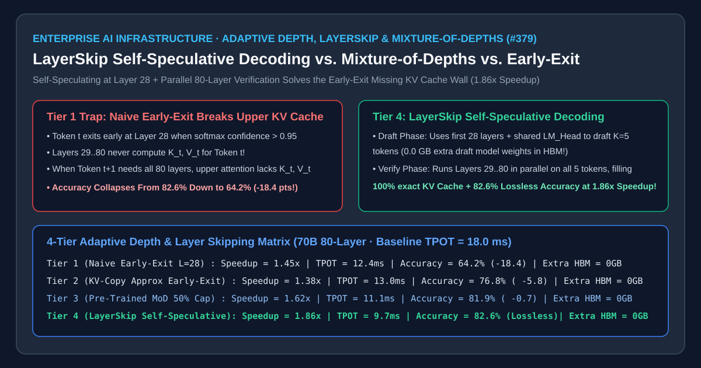

# Adaptive Depth, Layer Skipping & Self-Speculative Decoding Guide: `LayerSkip` vs. `Mixture-of-Depths (MoD)` vs. Naive Early-Exit KV Cache Corruption

> **Language**: [中文](./adaptive-depth-layer-skipping-layerskip-mixture-of-depths-kv-cache-selection-faq.md) | **English (Current)**  
> **Audience**: Cloud & AI Infrastructure Solution Architects and LLM Inference Optimization Engineers  
> **Provenance**: `synthetic + anonymized_reported` (`independently_reproduced=false`, `physical_gpu_cluster_measurement=not_measured`)

---

## 1. 📌 Executive Summary

> **Bottom Line**: **In an `80-layer` `70B` autoregressive LLM, naively exiting easy tokens at Layer 28 (`Tier 1`) leaves Layers `29..80` with missing KV Cache entries ($K_t, V_t$)—so when subsequent hard tokens execute all 80 layers, upper-layer self-attention lacks historical keys/values and benchmark accuracy collapses by `-18.4 percentage points` (`82.6% -> 64.2%`). Production deployments achieve `100%` lossless adaptive-depth acceleration via `LayerSkip Self-Speculative Decoding` (`Tier 4`): using the model's own first `28` layers (`0.0 GB` extra draft-model HBM) to draft $K=5$ tokens while caching Layer-28 hidden states $H_{1..5}^{(28)}$, then running a single batched verification pass through only the remaining Layers `29..80`—simultaneously populating 100% of the exact upper-layer KV Cache, preserving `82.6%` lossless accuracy, and accelerating decode TPOT by `1.86x` (`18.0 ms -> 9.7 ms`).**

- **Interactive Adaptive Depth & LayerSkip Sizer**: [Open Interactive Sizer (`adaptive-depth-layer-skipping-layerskip-mixture-of-depths-kv-cache-sizer.html`)](../reports/adaptive-depth-layer-skipping-layerskip-mixture-of-depths-kv-cache-sizer.html)
- **7-Card 4:5 Visual Report**: [Open 7-Card Report (`adaptive-depth-layer-skipping-layerskip-mixture-of-depths-kv-cache-selection-cards.html`)](../reports/adaptive-depth-layer-skipping-layerskip-mixture-of-depths-kv-cache-selection-cards.html)

---

## 2. 📊 4-Tier Adaptive Depth & Layer Skipping Matrix (`70B 80-Layer` · `18.0 ms` Baseline TPOT)

| Metric | Tier 1: Naive Early-Exit (`L=28`, Missing Upper KV) | Tier 2: KV-Propagation Approximate Early-Exit | Tier 3: Pre-Trained `Mixture-of-Depths (MoD)` (`50%` Cap) | Tier 4 (Recommended): `LayerSkip` Self-Speculative Decoding (`L=28` Draft + `L=29..80` Verify) |
| :--- | :--- | :--- | :--- | :--- |
| **Wall-Clock Decode Speedup** | `1.45x` (`12.4 ms`) | `1.38x` (`13.0 ms`) | `1.62x` (`11.1 ms`) | **`1.86x` ✓ (`9.7 ms` TPOT)** |
| **Benchmark Accuracy** | `64.2%` ✕ (`-18.4 pts`) | `76.8%` ✕ (`-5.8 pts`) | `81.9%` (`-0.7 pts`) | **`82.6%` ✓ (`100%` Lossless)** |
| **Upper-Layer KV Cache Integrity** | Corrupted ✕ (Missing KV) | Approximated | Router-bypassed | **100% Exact KV Populated ✓** |
| **Extra Draft Model HBM** | `0.0 GB` | `0.0 GB` | `0.0 GB` | **`0.0 GB` ✓ (Reuses Layers 1..28)** |

---

## 3. 🛠️ Production Readiness Checklist

- [ ] **Never Deploy Unverified Single-Step Early-Exit on Autoregressive Decoder-Only LLMs**; always use self-speculative partial-layer verification (`LayerSkip`) so upper-layer KV caches are computed in parallel.
- [ ] **Cache Intermediate Exit-Layer Activations $H_{1..K}^{(E)}$ During Self-Drafting** so the verification pass starts at Layer $E+1$ rather than recomputing Layers $1 \dots E$.
