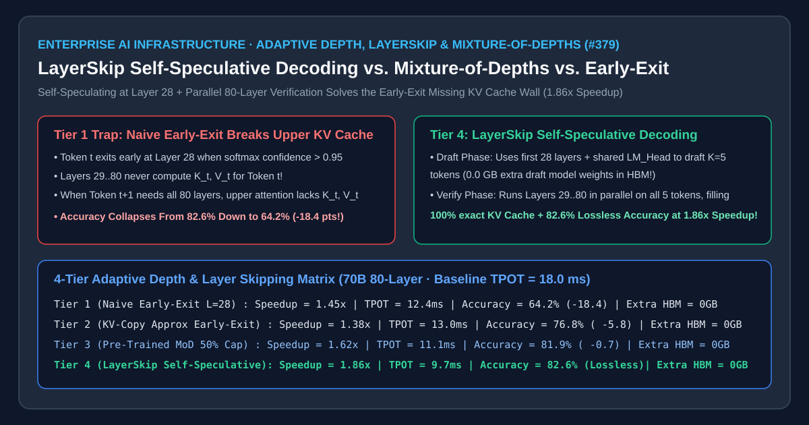
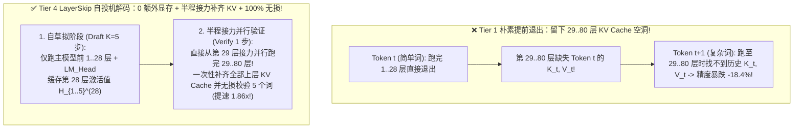

# 大模型自适应深度、动态跳层（Layer Skipping）与自投机解码选型：`LayerSkip Self-Speculative Decoding` vs. `Mixture-of-Depths (MoD)` vs. 朴素 Early-Exit 破坏 KV Cache 排障指南

> **语言 / Language**: **中文 (当前)** | [English](./adaptive-depth-layer-skipping-layerskip-mixture-of-depths-kv-cache-selection-faq.en.md)  
> **定位**：面向 Cloud & AI Infrastructure Solution Architect 与推理性能优化架构师的动态跳层与自适应计算深度选型（`Meta LayerSkip 自投机解码`、`Google Mixture-of-Depths (MoD)`、朴素置信度提前退出 `Early-Exit`）、破解“为什么第 $t$ 个词提前在第 28 层退出会导致后续所有词缺失 `29..80 层` KV Cache 而崩盘”的第一性原理白皮书  
> **合规与来源声明**：`synthetic + anonymized_reported`（`independently_reproduced=false`，`physical_gpu_cluster_measurement=not_measured`；完全面向通用企业级零额外草稿模型显存开销的无损投机加速架构设计）

---

## 1. 📌 核心选型结论速览（Executive Summary）

> **一句话结论**：**在 `80 层` 的 `70B` 大模型生成文本时，像补全 JSON 括号 `"}]"`、常见搭配 `"New York"` 或代码模板这类简单 Token 根本不需要跑满 80 层——但如果你直接按 BERT 时代的思路搞“朴素置信度提前退出 `Naive Early-Exit`（在第 28 层发现置信度 `>0.95` 就直接输出该词并跳过 `29..80 层`，Tier 1）”，模型精度会从 `82.6%` 灾难性崩塌至 **`64.2%`（暴跌 `-18.4 个百分点`！）**！原因在于自回归解码的 **“上层 KV Cache 空洞死锁”**：当第 $t$ 个词在第 28 层提前退出时，它在第 `29..80 层` 的 Key 和 Value 向量根本没有被计算出来；当第 $t+1$ 个词需要跑满 80 层做复杂推理时，第 `29..80 层` 的注意力机制发现第 $t$ 个词的 KV 是空的！生产环境实现 **100% 无损跳层加速** 的黄金准则是采用“`LayerSkip` 自投机解码（Self-Speculative Decoding，Tier 4）”：直接复用主模型自己的前 `28 层`（占用 **`0.0 GB` 额外草稿模型显存**！）快速连续草拟 $K=5$ 个草稿 Token，随后只跑一次 **`29..80 层` 批量并行验证（直接接着草稿阶段已算好的第 28 层隐状态往下算，不重算前 28 层！）**——既一次性补齐了全部 `29..80 层` 的精确 KV Cache，又保证 **`100.0%` 数学无损输出（`82.6%` 精度零损失）**，并将端到端 TPOT 提速 **`1.86 倍`（从 `18.0 ms` 压至 `9.7 ms`）**！**

- **交互式自适应深度与 LayerSkip 自投机解码计算器**：[打开交互式计算器 (`adaptive-depth-layer-skipping-layerskip-mixture-of-depths-kv-cache-sizer.html`)](../reports/adaptive-depth-layer-skipping-layerskip-mixture-of-depths-kv-cache-sizer.html)
- **7-Card 4:5 视觉评测报告**：[打开 7-Card 报告 (`adaptive-depth-layer-skipping-layerskip-mixture-of-depths-kv-cache-selection-cards.html`)](../reports/adaptive-depth-layer-skipping-layerskip-mixture-of-depths-kv-cache-selection-cards.html)

---

## 2. 🎯 客户与架构师灵魂拷问 Q&A（Deep-Dive Architecture FAQ）

### Q1：为什么 `LayerSkip` 自投机解码比传统“外挂一个独立 8B Draft 小模型”的投机解码更省显存、且验证阶段省去了 35% 的算力？
1. **彻底免除外挂 Draft 小模型的显存与多卡切分烦恼（`0.0 GB` Extra HBM）**：
   - 传统双模型投机解码除了加载 `70B` 主模型外，还要额外在 HBM 里塞一个 `8B` 草稿模型（多占 `16 GB` 显存，且 `8B` 在 `TP=8` 下小矩阵切分效率极低）。`LayerSkip` 直接拿 `70B` 自己的前 $E=28$ 层 + 同一个 `LM Head` 当草稿模型，**零额外权重显存开销**！
2. **独创的“半程接力验证（Partial-Layer Verification）”**：
   - 在草拟 $K=5$ 个 Token 时，前 `1..28 层` 的 KV Cache 和第 28 层输出隐状态 $H_{1..5}^{(28)}$ 已经算好并缓存在显存里了！
   - 当进入并行验证（Verification）阶段时，**根本不需要像传统投机解码那样从第 1 层重新算起，而是直接从第 `29 层` 开始接力算完剩余的 `29..80 层`**！验证阶段的耗时与算力直接立省 `28 / 80 = 35%`，同时顺手把这 5 个 Token 在 `29..80 层` 缺失的 KV Cache 100% 精确补齐！

---

## 3. 🧭 直观可视化图解（Mermaid 朴素 Early-Exit 的 KV 空洞崩盘 vs. `LayerSkip` 半程接力自投机解码图）

---

## 4. 📊 架构师四级动态跳层与自适应深度选型矩阵（`70B 80层` · 基线 TPOT `18.0 ms` · 基线精度 `82.6%`）

| 评估维度 | Tier 1：朴素置信度提前退出 (`L=28` 直接退出，缺失上层 KV) | Tier 2：跨层 KV 近似拷贝提前退出 (`State-Copying`) | Tier 3：预训练原生 `Mixture-of-Depths (MoD)` 每层 Top-50% 路由 | Tier 4（推荐）：`LayerSkip` 自投机解码（前 28 层草拟 + 后 52 层并行接力验证） |
| :--- | :--- | :--- | :--- | :--- |
| **实际解码吐字加速比 (`Speedup`)** | `1.45x` (`12.4 ms`) | `1.38x` (`13.0 ms`) | `1.62x` (`11.1 ms`) | **`1.86x` ✓（TPOT 压至 `9.7 ms`）** |
| **复杂推理任务精度 (`Accuracy`)** | `64.2%` ✕（暴跌 `-18.4%`） | `76.8%` ✕（仍跌 `-5.8%`） | `81.9%`（微损 `-0.7%`） | **`82.6%` ✓（100% 数学无损）** |
| **`29..80 层` KV Cache 完整性** | 缺失 ✕（产生 KV 空洞） | 线性近似伪造 | 按每层 Router 稀疏跳过 | **100% 精确完整补齐 ✓** |
| **额外草稿模型占用显存** | `0.0 GB` | `0.0 GB` | `0.0 GB` | **`0.0 GB` ✓（复用自身前 28 层）** |

---

## 5. 🛠️ 架构评审与生产落地 Checklist

- [ ] **严禁在生产自回归解码中上线不带并行验证回填的“单步不可逆 Early-Exit”**：任何跳过上层而不回填精确 KV Cache 的启发式跳层都会在多轮对话与长思维链中产生累积崩溃。
- [ ] **在微调/继续预训练自有基座模型时引入 `LayerSkip` 早退辅助损失（Early-Exit Auxiliary Loss + Layer Dropout）**：让模型第 $E \approx L/3$ 层的隐状态直接适配顶层 `LM Head`，即可在推理端白拿 `1.8x~2.2x` 的零显存自投机加速。
