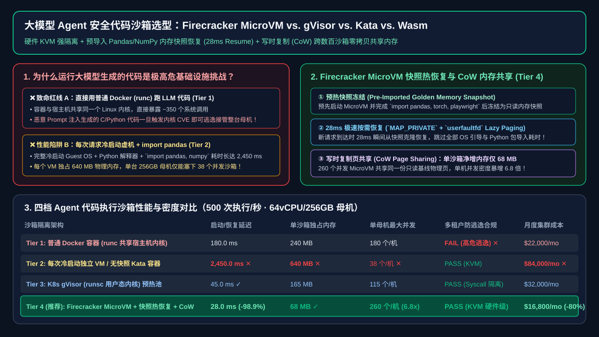

# Agentic Code Execution & Computer-Use Sandbox Architecture Guide: `Firecracker MicroVM` vs. `gVisor` vs. `Kata Containers` vs. `WebAssembly`, 28ms Snapshot Restore & Multi-Tenant Isolation

> **Language**: [中文](./agentic-code-execution-sandbox-firecracker-gvisor-kata-wasm-latency-selection-faq.md) | **English (Current)**  
> **Audience**: Cloud & AI Infrastructure Solution Architects and AI Agent Security Engineers  
> **Provenance**: `synthetic + anonymized_reported` (`independently_reproduced=false`, `physical_gpu_cluster_measurement=not_measured`)

---

## 1. 📌 Executive Summary

> **Bottom Line**: **Executing LLM-generated code (`Code Interpreter`, Coding Agents, Browser `Computer-Use`, and `RLVR` unit-test verifiers) inside standard `runc` Docker containers (`Tier 1`) is a critical security anti-pattern because untrusted code shares the host Linux kernel (`~350` syscalls). Conversely, cold-booting a full VM per session (`Tier 2`) adds `2,450 ms` of startup lag and consumes `640 MB` RSS per sandbox. Production agent platforms standardize on two tiers: (1) on bare-metal or nested-KVM nodes, deploy `Firecracker MicroVM` with Pre-Warmed Memory Snapshot Restore + `userfaultfd` Copy-on-Write (`CoW`) Page Sharing (`Tier 4`)—delivering hardware KVM isolation, `28.0 ms` resume latency (`-98.9%`), `68 MB` unique RSS per sandbox, and `260` concurrent sandboxes per 64-vCPU host (`6.84x` density, `-80.0%` TCO); (2) on managed Kubernetes without `/dev/kvm`, deploy `gVisor (runsc)` Warm Pod Pools (`45 ms` claim latency).**

- **Interactive Agent Sandbox Density & TCO Sizer**: [Open Interactive Sizer (`agentic-code-execution-sandbox-firecracker-gvisor-kata-wasm-latency-sizer.html`)](../reports/agentic-code-execution-sandbox-firecracker-gvisor-kata-wasm-latency-sizer.html)
- **7-Card 4:5 Visual Report**: [Open 7-Card Report (`agentic-code-execution-sandbox-firecracker-gvisor-kata-wasm-latency-selection-cards.html`)](../reports/agentic-code-execution-sandbox-firecracker-gvisor-kata-wasm-latency-selection-cards.html)

---

## 2. 📊 4-Tier Agent Code Sandbox Evaluation Matrix (`500 Exec/s` · `64vCPU / 256GB` Host)

| Metric | Tier 1: Standard Docker (`runc` Shared Kernel) | Tier 2: Cold-Boot VM / Uncached Kata | Tier 3: K8s `gVisor (runsc)` Warm Pod Pool | Tier 4 (Recommended): `Firecracker MicroVM` Snapshot + `CoW` |
| :--- | :--- | :--- | :--- | :--- |
| **Sandbox Startup / Resume** | `180.0 ms` | `2,450.0 ms` ✕ | `45.0 ms` ✓ | **`28.0 ms` ✓ (`-98.9%`)** |
| **Unique RSS Memory / Box** | `240.0 MB` | `640.0 MB` ✕ | `165.0 MB` | **`68.0 MB` ✓ (`CoW` shared snapshot)** |
| **Max Sandboxes / 64vCPU Host** | `180 / host` | `38 / host` ✕ | `115 / host` | **`260 / host` ✓ (`6.84x` density)** |
| **Kernel Escape Compliance** | **`FAIL` ✕ (Unsafe)** | `PASS` (KVM) | `PASS` (User-space kernel) | **`PASS` ✓ (Hardware KVM + Jailer)** |
| **Monthly Cluster TCO** | `$22,000 / mo` | `$84,000 / mo` ✕ | `$32,000 / mo` | **`$16,800 / mo` ✓ (`-80.0%`)** |

---

## 3. 🛠️ Production Readiness Checklist

- [ ] **Reseed PRNG Entropy (`/dev/urandom` & Python `random/secrets`) Immediately After Snapshot Restore** so cloned MicroVMs never generate identical cryptographic nonces or UUIDs.
- [ ] **Block Cloud Instance Metadata (`169.254.169.254`) and RFC1918 Private Networks** at the host TAP interface via eBPF/nftables to prevent SSRF credential theft.
