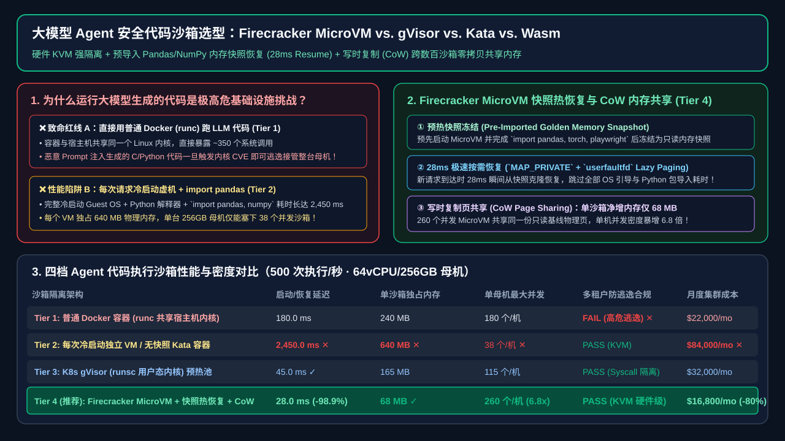
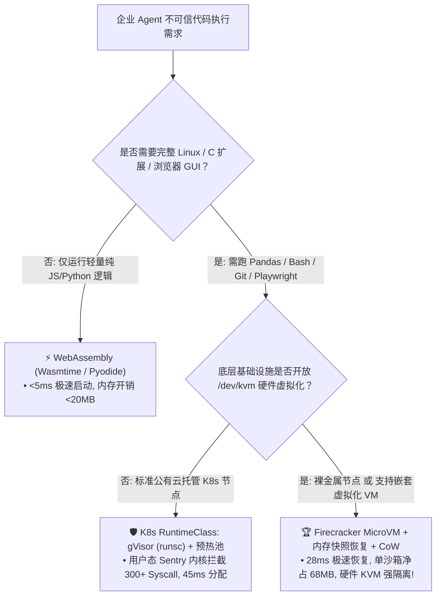

# 大模型 Agent 安全代码沙箱与计算机使用（Code Interpreter / Computer-Use Sandbox）选型：`Firecracker MicroVM` vs. `gVisor` vs. `Kata` vs. `Wasm`、28ms 快照热恢复与高密度隔离指南

> **语言 / Language**: **中文 (当前)** | [English](./agentic-code-execution-sandbox-firecracker-gvisor-kata-wasm-latency-selection-faq.en.md)  
> **定位**：面向 Cloud & AI Infrastructure Solution Architect 与企业 Agent 平台安全架构师的不可信大模型代码执行沙箱（Coding Agent、数据分析 `Code Interpreter`、无头浏览器 `Computer-Use`、强化学习 `RLVR` 代码验证器）隔离选型、内存快照恢复（`Snapshot Restore + userfaultfd CoW`）与高密度母机容量规划白皮书  
> **合规与来源声明**：`synthetic + anonymized_reported`（`independently_reproduced=false`，`physical_gpu_cluster_measurement=not_measured`；完全面向通用企业级 AI Agent 安全执行基础设施规划）

---

## 1. 📌 核心选型结论速览（Executive Summary）

> **一句话结论**：**大模型生成的代码本质上是“不可信的任意远程代码执行（RCE as a Service）”——绝不能用共享宿主机 Linux 内核的普通 Docker 容器（`runc`，Tier 1）直接跑 LLM 代码（极易通过内核 `io_uring / eBPF` 漏洞容器逃逸接管整台母机）；但也绝不能每次调用都从零冷启动一台虚拟机并重新 `import pandas, numpy`（Tier 2，耗时长达 `2,450 ms`，单沙箱占 `640 MB` 内存）！生产级黄金选型遵循双轨制：① 若拥有裸金属或支持嵌套虚拟化（`/dev/kvm`）的云主机，首选 `Firecracker MicroVM`（或 `E2B` 架构）开启“预导入库内存快照冻结 + `MAP_PRIVATE / userfaultfd` 写时复制（CoW）热恢复（Tier 4）”——具备硬件 KVM 级强隔离，恢复仅需 **`28.0 ms`（提速 `98.9%`）**，单沙箱净增私有内存仅 **`68 MB`**，单台 64vCPU/256GB 母机可高密承载 **`260 个`并发沙箱（密度提升 `6.8 倍`，月成本降低 `80.0%`）**；② 若跑在禁止嵌套虚拟化的托管 K8s（标准 GKE/EKS/AKS 节点）上，首选 `gVisor (runsc)` 用户态内核预热池（`45 ms` 分配，拦截 300+ 高危系统调用）！**

- **交互式 Agent 代码沙箱容量与 TCO 计算器**：[打开交互式计算器 (`agentic-code-execution-sandbox-firecracker-gvisor-kata-wasm-latency-sizer.html`)](../reports/agentic-code-execution-sandbox-firecracker-gvisor-kata-wasm-latency-sizer.html)
- **7-Card 4:5 视觉评测报告**：[打开 7-Card 报告 (`agentic-code-execution-sandbox-firecracker-gvisor-kata-wasm-latency-selection-cards.html`)](../reports/agentic-code-execution-sandbox-firecracker-gvisor-kata-wasm-latency-selection-cards.html)

---

## 2. 🎯 客户与架构师灵魂拷问 Q&A（Deep-Dive Architecture FAQ）

### Q1：四大主流沙箱技术（`Firecracker MicroVM`、`gVisor`、`Kata Containers`、`WebAssembly`）的物理隔离边界与适用场景分别是什么？
| 沙箱技术 | 隔离机制边界 | 启动/恢复耗时 | C/C++ 扩展与完整 Linux 兼容性 | 最适合的 Agent 业务场景 |
| :--- | :--- | :--- | :--- | :--- |
| **`Firecracker MicroVM`** | **硬件 KVM (`VT-x/AMD-V`) + 独立 Guest 内核** | **`28 ms` (快照恢复)** | **100% 兼容** (`Pandas/PyTorch/Playwright/Bash`) | **全功能 Code Interpreter、Computer-Use 与 RL 代码评测** |
| **`gVisor (runsc)`** | **Go 编写的用户态 Sentry 内核**（拦截 Guest Syscall） | `45 ms` (Warm Pod) | `~95%` 兼容（极少数底层 `ioctl` 受限） | **无 `/dev/kvm` 权限的公有云托管 K8s 集群** |
| **`Kata Containers`** | **硬件 KVM 轻量虚机**（原生对接 K8s CRI） | `180~600 ms` | **100% 兼容**（标准 K8s Pod YAML 即开即用） | **需要长生命周期（数小时）独立 K8s Pod 的研发环境** |
| **`WebAssembly (Wasm)`** | **编译器内存线性沙箱**（无内核、无原始 Socket） | **`< 5 ms`** | 仅限纯 Python (`Pyodide`) 或编译为 Wasm 的库 | **轻量级插件、无 C 扩展的确定性脚本执行** |

### Q2：`Firecracker` 是如何把“启动 Linux + 启动 Python + 导入 Pandas/NumPy”从 `2.45 秒` 压缩到 `28 毫秒`、且每个沙箱只占 `68 MB` 内存的？
1. **构建黄金内存快照（Golden Memory Snapshot）**：预先启动一个标准 MicroVM，在里面把 Python 解释器启动并执行完 `import numpy, pandas, matplotlib, sklearn`，等待内存页稳定后调用 Firecracker API 将整个 Guest 物理内存与 vCPU 寄存器状态冻结保存为 `snapshot.mem`（如 `512 MB`）。
2. **`mmap(MAP_PRIVATE)` + `userfaultfd` 写时复制（Copy-on-Write）恢复**：当 Agent 发起代码执行工具调用时，新 MicroVM 直接以只读写时复制模式映射同一份 `snapshot.mem`——**宿主机上 260 个并发 MicroVM 100% 共享那 450MB 已加载的 Python/Pandas 物理内存页**，只有每个沙箱自己新声明的变量（约 `68 MB` 脏页）才真正分配新内存！

---

## 3. 🧭 直观可视化图解（Mermaid Agent 安全代码沙箱选型决策树）

---

## 4. 📊 架构师多方案选型决策矩阵（`500 次执行/秒` · `64vCPU/256GB` 母机）

| 评估维度 | Tier 1：普通 Docker (`runc` 共享宿主机内核) | Tier 2：每次冷启动独立 VM / 无快照 Kata | Tier 3：K8s `gVisor (runsc)` 预热 Pod 池 | Tier 4（推荐）：`Firecracker MicroVM` 快照恢复 + `CoW` |
| :--- | :--- | :--- | :--- | :--- |
| **沙箱启动/恢复就绪耗时** | `180.0 ms` | `2,450.0 ms` ✕（每步工具调用卡顿） | `45.0 ms` ✓ | **`28.0 ms` ✓（提速 `98.9%`）** |
| **单沙箱净增独占内存 (`RSS`)** | `240.0 MB` | `640.0 MB` ✕ | `165.0 MB` | **`68.0 MB` ✓（只读快照页全机共享）** |
| **单台 256GB 母机最大并发数** | `180 个 / 机` | `38 个 / 机` ✕ | `115 个 / 机` | **`260 个 / 机` ✓（密度提升 `6.8 倍`）** |
| **多租户防内核逃逸合规性** | **`FAIL` ✕（严禁生产使用）** | `PASS` (KVM) | `PASS` (Syscall 隔离) | **`PASS` ✓（AWS Lambda 级硬件 KVM）** |
| **月度沙箱集群总成本 (TCO)** | `$22,000 / 月`（不安全） | `$84,000 / 月` ✕ | `$32,000 / 月` | **`$16,800 / 月` ✓（比冷启动 VM 省 `80%`）** |

---

## 5. 🛠️ 架构评审与生产落地 Checklist

- [ ] **严禁在共享宿主机内核的普通 Docker 容器（`runc`）中执行任何大模型生成的 Python/Bash 代码**。
- [ ] **快照恢复后第一时间重置伪随机数种子（PRNG Entropy Reseed）**：因为所有从同一个快照恢复的 MicroVM 拥有完全相同的初始内存状态，必须在恢复瞬间向 `/dev/urandom` 注入新宿主机熵并重置 Python `random/secrets/SSL` 状态，防止跨租户生成相同的密钥或 UUID！
- [ ] **严格封锁沙箱网卡 Egress 出口**：在宿主机 TAP 设备层用 `eBPF / nftables` 彻底阻断云厂商元数据地址 `169.254.169.254` 与企业内网私网段（`10.0.0.0/8`、`172.16.0.0/12`、`192.168.0.0/16`），防止 SSRF 窃取宿主云凭据。
