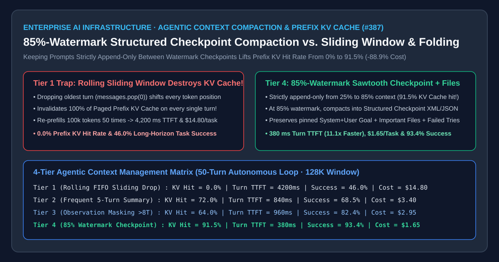

# Agentic Context Engineering, History Compaction & Prefix KV Cache Preservation Guide: `85%-Watermark Sawtooth Checkpoint` vs. `Sliding Window` & `Observation Masking`

> **Language**: [中文](./agentic-context-engineering-compaction-observation-masking-prefix-kv-selection-faq.md) | **English (Current)**  
> **Audience**: Cloud & AI Infrastructure Solution Architects and Autonomous Agent Platform Engineers  
> **Provenance**: `synthetic + anonymized_reported` (`independently_reproduced=false`, `physical_gpu_cluster_measurement=not_measured`)

---

## 1. 📌 Executive Summary

> **Bottom Line**: **In `50-turn` autonomous Coding and Deep Research Agent loops (`128K` window, `3,500` tokens/turn of tool outputs), popping the oldest message on every turn (`Tier 1: Rolling FIFO Sliding Window`) shifts token position `0` on every turn—invalidating `100%` of the engine's Paged `Prefix KV Cache` (`0.0%` hit rate), forcing a full `100K-token` re-prefill on every turn (`4,200 ms` TTFT/turn, `$14.80/task`), and dropping 50-turn task success to `46.0%`. Production agent harnesses deploy `85%-Watermark Sawtooth Append-Only Compaction + Structured Checkpoint Schema + Workspace Scratchpad Files` (`Tier 4`): keeping the message history strictly append-only across `20–25` consecutive turns (`91.5%` Prefix KV Cache hit rate, `380 ms` TTFT/turn) and compacting only when the context hits the `85%` watermark into an immutable structured `
` block (`<overview>`, `<work_done>`, `<technical_details>`, `<important_files>`, `<next_steps>`)—lifting 50-turn task success to `93.4%` and cutting per-task token cost by `88.9%` (`$14.80 -> $1.65/task`).**

- **Interactive Agentic Context Compaction & KV Cache Sizer**: [Open Interactive Sizer (`agentic-context-engineering-compaction-observation-masking-prefix-kv-sizer.html`)](../reports/agentic-context-engineering-compaction-observation-masking-prefix-kv-sizer.html)
- **7-Card 4:5 Visual Report**: [Open 7-Card Report (`agentic-context-engineering-compaction-observation-masking-prefix-kv-selection-cards.html`)](../reports/agentic-context-engineering-compaction-observation-masking-prefix-kv-selection-cards.html)

---

## 2. 📊 4-Tier Agentic Context Management Matrix (`50-Turn Autonomous Loop` · `128K Window`)

| Metric | Tier 1: Rolling FIFO Sliding-Window Drop (`pop(0)`) | Tier 2: Unstructured `5-Turn` LLM Summary | Tier 3: Stale Tool Observation Masking (`>8` Turns) | Tier 4 (Recommended): `85%-Watermark Sawtooth Checkpoint` + Scratchpad Files |
| :--- | :--- | :--- | :--- | :--- |
| **Prefix KV Cache Hit Rate** | `0.0%` ✕ (Index 0 shifts every turn) | `72.0%` | `64.0%` (Mid-prompt edits break tail KV) | **`91.5%` ✓ (Strictly append-only between ckpts)** |
| **Average Per-Turn TTFT** | `4,200.0 ms` ✕ (Re-prefills 100K) | `840.0 ms` | `960.0 ms` | **`380.0 ms` ✓ (`11.1x` faster)** |
| **50-Turn Task Success Rate** | `46.0%` ✕ (Goal & error amnesia) | `68.5%` ✕ (Loses line numbers) | `82.4%` | **`93.4%` ✓ (Preserves exact file/error state)** |
| **Cost per 50-Turn Task** | `$14.80 / task` ✕ | `$3.40 / task` | `$2.95 / task` | **`$1.65 / task` ✓ (`-88.9%` vs Tier 1)** |

---

## 3. 🛠️ Production Readiness Checklist

- [ ] **Keep the Prompt Prefix Strictly Immutable (`System Prompt + Deterministically Sorted Tool Schemas + Pinned User Goal + Latest Checkpoint`)** and never inject per-second timestamps at the top of the system prompt.
- [ ] **Include Explicit "Failed Approaches Not to Repeat" (`<technical_details>`) and "Exact File/Line Map" (`<important_files>`) Sections in Every Compaction Checkpoint** while offloading bulky raw tool outputs (`>20 KB`) to workspace scratchpad files.
