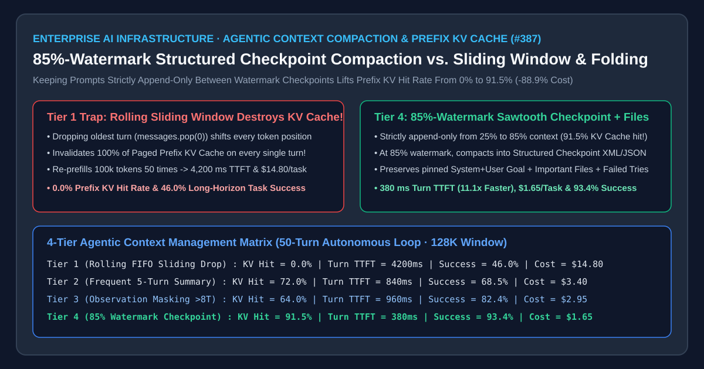
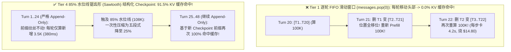

# 企业级长周期智能体上下文工程、历史压缩（Context Compaction）与 Prefix KV 缓存保活选型：`85% 水位线锯齿形结构化 Checkpoint` vs. `滑动窗口截断 (0% KV 命中灾难)` vs. `观察折叠` 指南

> **语言 / Language**: **中文 (当前)** | [English](./agentic-context-engineering-compaction-observation-masking-prefix-kv-selection-faq.en.md)  
> **定位**：面向 Cloud & AI Infrastructure Solution Architect 与自主智能体（Coding Agent / Deep Research / 自动运维）平台架构师的 50+ 轮长周期上下文治理选型（`85% 水位线锯齿形 Append-Only 压缩 + 结构化状态树 Checkpoint + 外部文件草稿本` vs. `逐轮 FIFO 滑动窗口截断` vs. `SWE-agent 观察输出折叠`）、破解“为什么滑动窗口删除最老一轮对话会导致 `vLLM / SGLang` Prefix KV Cache 命中率瞬间归零（`0.0%`）、账单暴涨 `9 倍`”的白皮书  
> **合规与来源声明**：`synthetic + anonymized_reported`（`independently_reproduced=false`，`physical_gpu_cluster_measurement=not_measured`；完全面向通用企业级长周期自主智能体架构与推理缓存友好型上下文设计）

---

## 1. 📌 核心选型结论速览（Executive Summary）

> **一句话结论**：**当一个自主编程或深度研究智能体连续运行 `50 轮` 工具调用（每轮新增 `3,500 Tokens` 的代码文件、日志或检索结果，`128K` 窗口）时，工程上最致命的反模式就是“每当上下文超限，就在每一轮开头执行 `messages.pop(1)` 踢掉最早的一轮对话”（Tier 1，逐轮 FIFO 滑动窗口）——因为 `vLLM / SGLang` 的 `Paged Prefix KV Cache`（以及云厂商的 Prompt Caching）是**严格从第 0 个 Token 开始计算级联前缀哈希的**！一旦你删掉了排在前面的第 1 轮对话，后面所有 `100,000 个 Token` 的绝对位置偏移和块哈希全部改变，导致 **Prefix KV Cache 命中率在每一轮都瞬间归零（`0.0%`）**，逼迫 GPU 连续 50 次从头重算 10 万字的 Prefill（每轮首字卡顿 **`4,200 ms`**，单任务账单暴涨至 **`$14.80`**），且因丢掉了早期关键线索导致成功率跌至 **`46.0%`**！生产环境的黄金准则是采用“`85% 高水位线锯齿形（Sawtooth）触发式压缩` + `严格 Append-Only 追加原则` + `五段式结构化 Checkpoint (<overview>/<work_done>/<technical_details>/<important_files>/<next_steps>)` + `外部文件草稿本持久化`（Tier 4）”：在水位从 `25%` 涨到 `85%` 的连续 20 多轮期间**绝不修改历史前缀中的任何一个字**（甚至严禁在 System Prompt 顶部塞动态秒级时间戳！），将 **Prefix KV Cache 命中率锁死在 `91.5%`**、每轮平均 TTFT 压至 **`380 ms`（快 `11.1 倍`）**、50 轮长程任务成功率推升至 **`93.4%`**，并将单任务成本暴砍 **`88.9%`（从 `$14.80` 降至 `$1.65`）**！**

- **交互式智能体上下文压缩与 Prefix KV 缓存成本计算器**：[打开交互式计算器 (`agentic-context-engineering-compaction-observation-masking-prefix-kv-sizer.html`)](../reports/agentic-context-engineering-compaction-observation-masking-prefix-kv-sizer.html)
- **7-Card 4:5 视觉评测报告**：[打开 7-Card 报告 (`agentic-context-engineering-compaction-observation-masking-prefix-kv-selection-cards.html`)](../reports/agentic-context-engineering-compaction-observation-masking-prefix-kv-selection-cards.html)

---

## 2. 🎯 客户与架构师灵魂拷问 Q&A（Deep-Dive Architecture FAQ）

### Q1：为什么连“在 System Prompt 第一行写一句 `当前时间: 2026-11-21 18:20:05`”或者“每轮把 8 轮前的工具输出折叠掉（Tier 3）”都会严重伤害 Prefix KV Cache？
1. **前缀哈希的“多米诺骨牌定律”**：
   - 在 `vLLM` 的 `Automatic Prefix Caching (APC)` 和 `SGLang RadixAttention` 中，第 $k$ 个物理 KV 块的哈希值定义为 $\text{Hash}_k = \text{SHA256}(\text{Hash}_{k-1}, \text{Tokens}_k)$。
   - **惨剧 A（顶部动态时间戳）**：如果在 System Prompt 第 1 行放了一个每秒变化的 `current_time`，第 0 个块的哈希每秒都变，后面哪怕跟着 `100,000` 个一模一样的历史 Token 也 **100% 全部缓存失效（命中率从 `91.5%` 暴跌至 `6.2%`）**！
   - **惨剧 B（每轮去历史中间挖洞折叠，Tier 3）**：如果第 15 轮去修改第 7 轮的工具输出（把 3,000 行日志改成一行占位符），那么从第 7 轮往后的第 8..14 轮缓存全部失效重算！
2. **Tier 4“锯齿形（Sawtooth）85% 水位线批量压缩”如何做到 `91.5%` 缓存命中**：
   - **平时绝不动前缀**：从第 1 轮到第 25 轮（上下文从 `10K` 增长到 `108K / 85%` 水位线），消息列表严格只做尾部 `append()`，前序 `100K` Token 每一轮都 **100% 命中显存 KV Cache（只需算本轮新增的 `3.5K` Token，`380 ms` 极速响应）**！
   - **触线一次性重置到 `25%` 锚点**：只有当触及 `85%` 水位线那一刻，才触发一次结构化压缩，把中间 20 轮浓缩为一篇 `8K Token` 的高质量结构化 `
` Checkpoint（并将原始大日志落盘到 `session-state/checkpoints/` 文件供按需查阅），随后在接下来的第 26..48 轮继续享受 100% Append-Only 缓存命中！

---

## 3. 🧭 直观可视化图解（Mermaid 逐轮滑动窗口 `0%` 缓存命中 vs. `85%` 水位线锯齿形压缩 `91.5%` 命中对比图）

---

## 4. 📊 架构师四级智能体上下文管理架构选型矩阵（`50 轮` 自主编程/研究任务 · `128K` 窗口）

| 评估维度 | Tier 1：逐轮 FIFO 滑动窗口截断 (`pop(0)`) | Tier 2：每 5 轮高频自由文本摘要 | Tier 3：过期工具观察输出原地折叠 (`>8` 轮前折叠) | Tier 4（推荐）：`85% 水位线锯齿形压缩` + 五段式结构化 Checkpoint + 外部文件草稿本 |
| :--- | :--- | :--- | :--- | :--- |
| **`Prefix KV Cache` 命中率** | `0.0%` ✕（每轮头部偏移全失效） | `72.0%` | `64.0%`（修改历史中段导致后半截失效） | **`91.5%` ✓（24 轮内 100% 纯追加）** |
| **每轮平均首字延迟 (`Turn TTFT`)** | `4,200.0 ms` ✕（每轮重算 10 万字） | `840.0 ms` | `960.0 ms` | **`380.0 ms` ✓（比滑窗快 `11.1 倍`）** |
| **50 轮长周期任务最终成功率** | `46.0%` ✕（遗忘初始目标与踩坑记录） | `68.5%` ✕（丢失精确行号与报错码） | `82.4%` | **`93.4%` ✓（保留已验证文件与失败教训）** |
| **单次 50 轮任务总 Token 成本** | `$14.80 / 次` ✕ | `$3.40 / 次` | `$2.95 / 次` | **`$1.65 / 次` ✓（立省 `88.9%` 成本！）** |

---

## 5. 🛠️ 架构评审与生产落地 Checklist

- [ ] **智能体 Prompt 架构铁律：前序不可变（Immutable Prefix）**：将 `System Prompt` + `Tool Definitions (按字母固定排序!)` + `原始 User Goal` + `最新 Checkpoint Summary` 严格固定在最前方；严禁在 System Prompt 中注入随每轮变化的动态计数器或秒级时间戳。
- [ ] **结构化 Checkpoint 必须强制包含 `<technical_details>`（记录已尝试但失败的死胡同方案，防止压缩后失忆重踩同一颗雷）与 `<important_files>`（精确文件路径与行号索引）**，并将超过 `20KB` 的超长工具原始输出自动转存至工作区临时文件。
