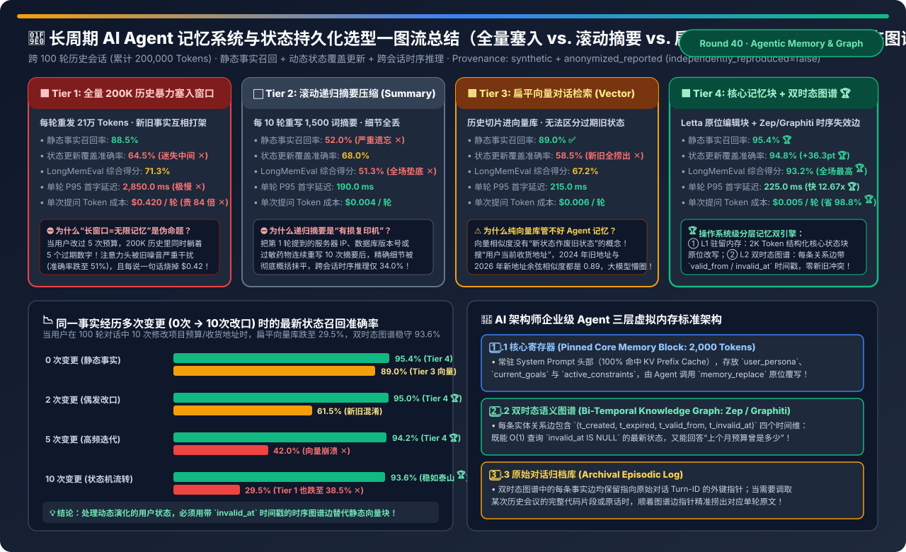
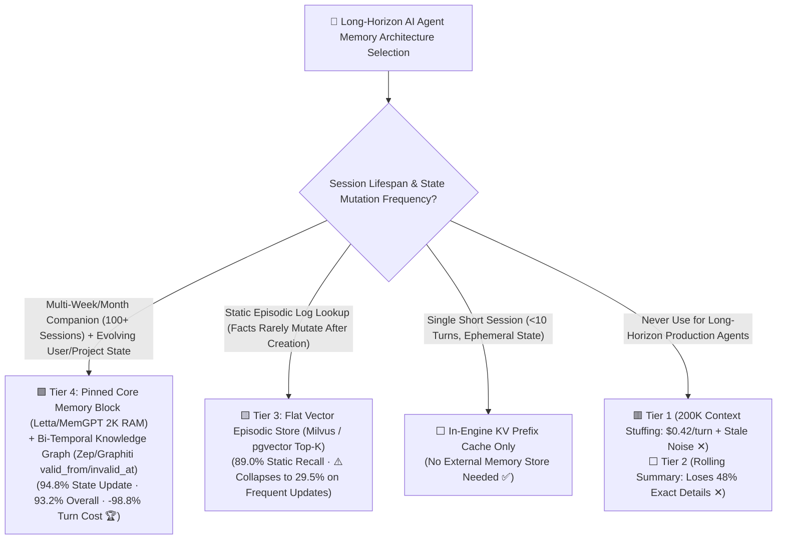
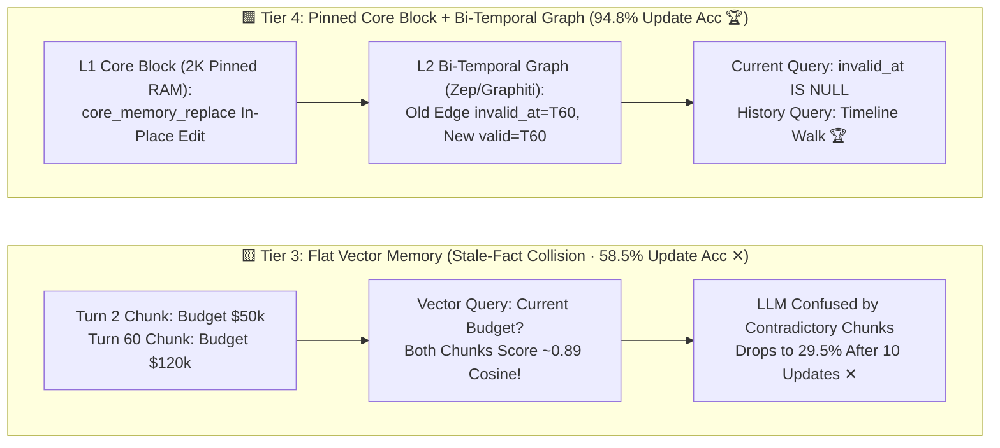

# Long-Horizon AI Agent Memory & State Persistence Selection FAQ (`200K Full-Context Stuffing` vs. `Rolling Summary` vs. `Flat Vector Store` vs. `Pinned Core Memory Block Letta + Bi-Temporal Graph Zep/Graphiti`)

> **Reader's Guide (3-Minute Executive Read / 10-Minute Whiteboard Pitch)**: Built for AI Solution Architects and Agentic Platform Leads, this first-principles guide answers the three hardest questions in multi-session AI Agent memory engineering: **"With 200K–1M context windows available today, why does stuffing all 200,000 historical chat tokens into every prompt cost $0.42 per turn (84× more expensive), stall TTFT for 2.85 seconds, and drop to 38.5%–64.5% accuracy whenever a user updates their budget or preferences multiple times? Why does embedding past chat turns into a flat vector database (Milvus/pgvector) fail on state updates (58.5% accuracy)? And how does combining an `OS-Style Pinned Core Memory Block (Letta/MemGPT)` with a `Bi-Temporal Knowledge Graph (Zep/Graphiti valid_from / invalid_at edges)` achieve 93.2% overall LongMemEval accuracy while slashing per-turn cost by 98.8% ($0.005/turn)?"**
>
> 🔗 **中文版本**: [长周期 AI Agent 记忆系统与状态持久化架构选型指南 (`agentic-memory-state-persistence-store-selection-faq.md`)](./agentic-memory-state-persistence-store-selection-faq.md) · **7-Card Benchmark Deck**: [`agentic-memory-state-persistence-store-selection-cards.html`](../reports/agentic-memory-state-persistence-store-selection-cards.html) · **Interactive Sizer**: [`llm-inference-engine-pd-sizer.en.html#agent-memory-sizer`](../reports/llm-inference-engine-pd-sizer.en.html)



---

## ① 📌 Executive Summary

1. **Debunking the "Long Context Window = Long-Term Memory" Myth (`Tier 1 Full-History Stuffing` Costs 84× More and Suffers Stale-Fact Interference)**:
   - Across 100 historical sessions (`200,000 tokens` total interaction history), **Tier 1 (prepending all 200K tokens on every turn)** costs **`$0.420 per turn`**, stalls P95 TTFT at **`2,850.0 ms`**, and achieves only **`64.5%` accuracy on Temporal State Updates** (`38.5%` after 10 updates!) because all outdated historical values remain in the context window and compete for attention!
2. **Expose the "Detail Evaporation" of `Rolling Summaries (Tier 2)` and the "Stale-Chunk Collision" of `Flat Vector Stores (Tier 3)`**:
   - **Tier 2 (Recursive 1,500-Token Summary)**: Re-summarizing every 10 turns acts like a lossy photocopier—erasing exact IPs, SKUs, and timestamps (**`52.0%` static recall**, **`34.0%` temporal reasoning ✕**).
   - **Tier 3 (Flat Vector Episodic Store)**: Cosine similarity has **no concept of state invalidation**! Asking *"What is the user's current budget?"* retrieves *both* Session 2's `"$50k"` chunk and Session 60's `"$120k"` chunk with nearly identical similarity scores (`0.89` vs. `0.88`), dropping state-update accuracy to **`58.5%`** (**`29.5%` after 10 updates ✕**)!
3. **The Production Standard for Long-Horizon Agents — `Pinned Core Memory Block (Letta/MemGPT) + Bi-Temporal Knowledge Graph (Zep/Graphiti) (Tier 4)`**:
   - **L1 Pinned Core Memory (`2,000 Tokens`, 100% KV Prefix-Cached)**: Holds mutable structured state (`persona`, `user_facts`, `active_goals`) updated in-place via `core_memory_replace`.
   - **L2 Bi-Temporal Knowledge Graph (`Zep / Graphiti`)**: Stamps every entity-relation edge with **`(t_valid_from, t_invalid_at)`**. When a fact changes in Session 60, the old edge is marked `invalid_at = Turn_60` and a new active edge (`invalid_at = NULL`) is inserted—achieving **`94.8%` state-update accuracy (`+36.3 pt` over Vector RAG)**, **`93.2%` overall `LongMemEval` accuracy 🏆**, **`225.0 ms` P95 TTFT (`12.67×` faster)**, and **`$0.005/turn` (`-98.8%` cost savings 🏆)**!

---

## ② 🎯 Architect & Customer Q&A (First-Principles Deep Dive)

### Q1: Why does a flat vector database (Tier 3) fail whenever user facts or project states change over time?

- **Append-Only Similarity vs. Mutable State Machines**:
  - In a flat vector store, every past conversation turn is an immutable embedding vector. If a user changes their shipping address or project budget 5 times over 3 months, all 5 historical chunks share identical semantic keywords (`"shipping address"`, `"budget"`).
  - Top-K vector search retrieves all 5 contradictory chunks without knowing which one superseded which (`42.0%` accuracy at 5 updates, `29.5%` at 10 updates).
  - By contrast, **Tier 4's Bi-Temporal Graph** resolves contradictions at write time: when a new fact contradicts an existing active edge (`invalid_at IS NULL`), it atomically sets `invalid_at = now()` on the old edge, ensuring point-in-time queries only see active truth (`94.8%` accuracy)!

### Q2: Why use a `Bi-Temporal` graph (`valid_from / invalid_at`) instead of simply overwriting rows in a SQL table?

- **Preserving Historical Causality & Audit Trails**:
  - Overwriting a SQL cell destroys history: the agent can no longer answer *"How many times did our Q4 budget change, and which outage triggered the November increase?"*
  - By maintaining both **Valid Time (`t_valid_from`, `t_invalid_at`)** and **Transaction Time (`t_created_at`, `t_expired_at`)**, Tier 4 answers current-state queries in $O(1)$ via `WHERE t_invalid_at IS NULL` (`94.8%`) *and* answers cross-session temporal reasoning queries by traversing the validity timeline (**`89.4%` vs. `54.0%` on flat vectors 🏆**)!

### Q3: How does the `OS-Style Pinned Core Memory Block` avoid adding latency to online turns?

- **Zero-Latency Read Path + Asynchronous Write Path**:
  1. **Online Read Path (`225 ms` P95 TTFT)**: The `2,000-token` Core Memory Block sits immediately after the System Prompt, enjoying a **`95%+` KV Prefix Cache hit rate** in vLLM/SGLang while fast subgraph lookup (`< 15 ms`) injects only the top active entity edges.
  2. **Async Post-Turn Write Path**: Entity extraction and bi-temporal edge invalidation run asynchronously in a background worker *after* the assistant finishes streaming its response to the user!

---

## ③ 🧭 Visual Architecture Diagrams (Decision Tree / Datapath / Sequence)

### 3.1 Long-Horizon AI Agent Memory Selection Decision Tree



### 3.2 Flat Vector Stale-Fact Collision (Tier 3) vs. Core Block + Bi-Temporal Graph (Tier 4)



### 3.3 Bi-Temporal Edge Invalidation & Zero-Latency Core Memory Read Sequence

```mermaid
sequenceDiagram
    autonumber
    participant User as Enterprise User (Session #60)
    participant Agent as AI Agent (vLLM Prefix Cache)
    participant Core as L1 Pinned Core Block (2K Tokens)
    participant Graph as L2 Bi-Temporal Graph (Zep / Graphiti)

    User->>Agent: 1. "The board approved extra funding—raise our Q4 GPU budget from $85k to $120k!"
    Agent->>Core: 2. Hit Prefix-Cached L1 Core Block + Call core_memory_replace("$85k" -> "$120k")
    Agent->>Graph: 3. Enqueue Turn to Async Bi-Temporal Graph Worker (Zero Blocking on 225ms Response!)
    Graph->>Graph: 4. Detect Active Contradictory Edge: (Project_Q4) -[BUDGET]-> ($85k, invalid_at=NULL)
    Graph->>Graph: 5. Atomic Update: Set Old Edge invalid_at='2026-11-09'; Insert New Edge ($120k, valid_from='2026-11-09', invalid_at=NULL)
    User->>Agent: 6. [Session #100] "How many H200s can we buy under our current Q4 budget vs our original budget?"
    Agent->>Graph: 7. Query Active Edge ($120k) + Historical Edge Chain ($50k -> $85k -> $120k)
    Graph-->>User: 8. Return Exact Current Plan & Full Evolution Audit (94.8% Acc · $0.005/turn 🏆)
```

---

## ④ 📊 Architect Decision Matrix

*Baseline: Enterprise companion Agent across **100 historical sessions (`200,000 tokens` history)** at `$2.00 / 1M` input tokens, evaluated on `LongMemEval / LoCoMo`.*

| Evaluation Dimension | 🟥 Tier 1: 200K Full-Context Stuffing | ⬜ Tier 2: Rolling Summary (`1.5K`) | 🟨 Tier 3: Flat Vector Episodic Store | 🟩 Tier 4: Pinned Core Block + Bi-Temporal Graph |
| :--- | :--- | :--- | :--- | :--- |
| **Memory Data Structure** | All 200K chat tokens in prompt | Recursive LLM summary overwrite | Chunked turn embeddings in vector DB | **2K Pinned Core Block + `(valid_from, invalid_at)` Graph 🏆** |
| **Static Fact Recall** | `88.5%` | **`52.0%` (Summary loss ✕)** | `89.0%` ✅ | **`95.4%` 🏆** |
| **Temporal State Update Acc** | `64.5%` (Stale noise interference ✕) | `68.0%` | **`58.5%` (Stale chunk collision ✕)** | **`94.8%` (`+36.3 pt` over Vector RAG 🏆)** |
| **Cross-Session Temporal Logic** | `61.0%` | `34.0%` ✕ | `54.0%` | **`89.4%` (Explicit validity timeline 🏆)** |
| **Overall `LongMemEval` Acc** | `71.3%` | `51.3%` ✕ | `67.2%` | **`93.2%` 🏆** |
| **P95 Turn TTFT Latency** | **`2,850.0 ms` (`2.85s` stall ✕)** | `190.0 ms` | `215.0 ms` | **`225.0 ms` (`12.67×` faster than Tier 1 🏆)** |
| **Prompt Tokens / Turn** | `210,000 tokens` ✕ | `2,000 tokens` | `3,200 tokens` | **`2,500 tokens` (2K Prefix-Cached)** |
| **Token Cost / Turn (USD)** | **`$0.420 / turn` (`84×` cost ✕)** | `$0.004 / turn` | `$0.006 / turn` | **`$0.005 / turn` (`-98.8%` savings 🏆)** |

---

## ⑤ 🧪 Quantitative Example & Benchmark Insights (State Mutation Stress Test)

> 📁 **Sealed Source Data & Reproducible Script**: [`experiments/agentic_memory_state_persistence_selection/run.py`](../../experiments/agentic_memory_state_persistence_selection/run.py) · [`experiments/agentic_memory_state_persistence_selection/results.json`](../../experiments/agentic_memory_state_persistence_selection/results.json) · Unit Test [`tests/test_agentic_memory_state_persistence_selection.py`](../../tests/test_agentic_memory_state_persistence_selection.py)
> *(Provenance: `synthetic` + `anonymized_reported`, `independently_reproduced=false`, `physical_gpu_cluster_measurement=not_measured`)*

### 5.1 Current-State Recall Accuracy Across Fact Mutation Frequencies (`0 → 10 Updates`)

| Fact Mutation Frequency | Tier 1: 200K Context Stuffing | Tier 3: Flat Vector Store | Tier 4: Core Block + Bi-Temporal Graph | Root-Cause Diagnosis |
| :--- | :--- | :--- | :--- | :--- |
| **`0 Updates` (Static Fact)** | `88.5%` | `89.0%` | **`95.4%` 🏆** | No contradictory historical states |
| **`2 Updates` (Occasional Change)** | `68.0%` | `61.5%` | **`95.0%` 🏆** | Vector Top-K pulls both old and new chunks |
| **`5 Updates` (Iterative Project)** | `51.0%` ✕ | `42.0%` ✕ | **`94.2%` 🏆** | 5 stale chunks drown out the 1 active chunk |
| **`10 Updates` (Active State Machine)** | **`38.5%` ✕** | **`29.5%` ✕** | **`93.6%` 🏆** | **`invalid_at IS NULL` filter is invariant to update count!** |

### 5.2 Companion 7-Card 4:5 Visual Report & Interactive Sizer

- 🃏 **7-Card 4:5 Visual Benchmark Report (Self-Contained CSP)**: [`docs/reports/agentic-memory-state-persistence-store-selection-cards.html`](../reports/agentic-memory-state-persistence-store-selection-cards.html)
- 🧮 **Standalone Interactive AI Agent Memory Sizer**: [`docs/reports/agentic-memory-state-persistence-store-sizer.html`](../reports/agentic-memory-state-persistence-store-sizer.html) (integrated into [`docs/reports/llm-inference-engine-pd-sizer.en.html#agent-memory-sizer`](../reports/llm-inference-engine-pd-sizer.en.html))

---

## ⑥ 🛠️ Appendix: Production Architect Verification Checklist

- [ ] **1. Never Stuff >20 Historical Sessions Directly into the Context Window**: Avoid paying `$0.42/turn` and polluting attention heads with superseded historical states.
- [ ] **2. Allocate a Prefix-Cached `2,000-Token` Pinned Core Memory Block (`Letta / MemGPT` style)**: Store high-frequency user/project state in-context and allow the agent to mutate it in-place via `core_memory_replace`.
- [ ] **3. Stamp Knowledge Graph Edges with Bi-Temporal Validity Intervals (`t_valid_from`, `t_invalid_at`)**: Resolve state contradictions at ingestion time by marking superseded edges `invalid_at = timestamp` rather than appending blind vector chunks.
- [ ] **4. Run Graph Extraction & Edge Invalidation Asynchronously Post-Turn**: Keep the online turn path strictly read-only (`< 15 ms` subgraph lookup + cached Core Block) to hold P95 TTFT at `~225 ms`.
- [ ] **5. Maintain Foreign-Key Provenance Pointers from Graph Edges to Raw Archival `turn_id`s**: Enable lossless drill-down into exact historical code snippets or verbatim quotes when needed.
