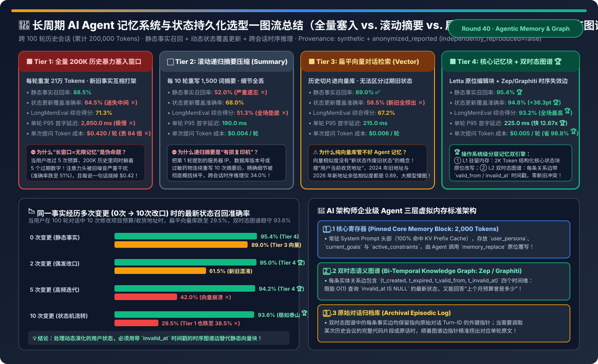
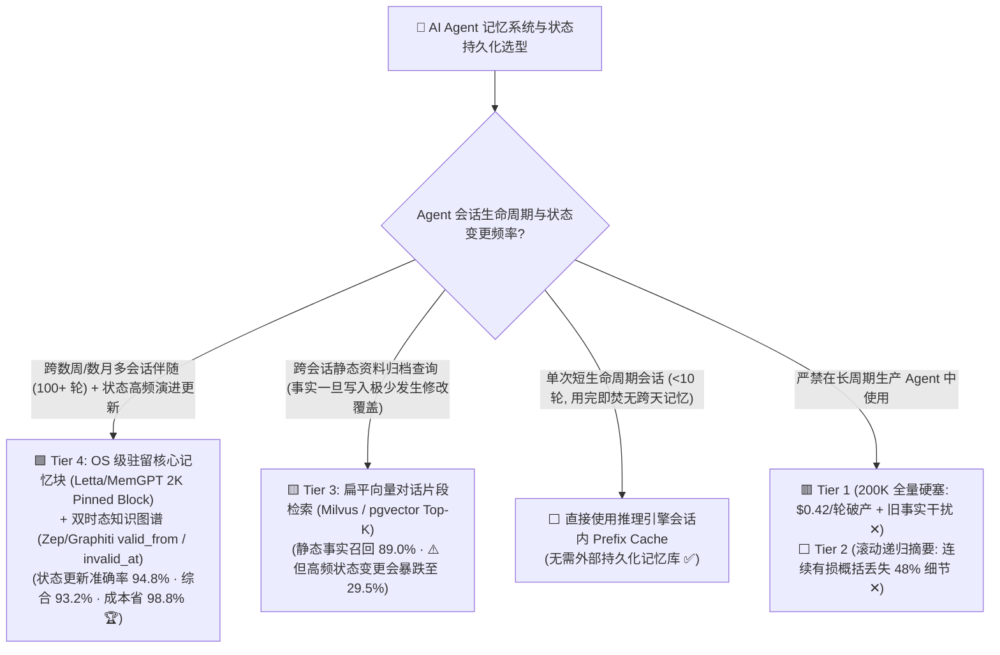
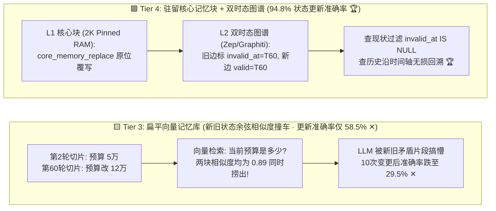
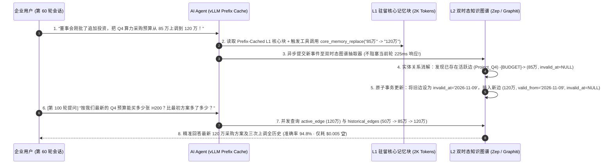

# 长周期 AI Agent 记忆系统与状态持久化（Long-Horizon Agentic Memory）架构选型指南（`200K 全量塞入窗口` vs. `滚动摘要压缩` vs. `扁平向量检索` vs. `驻留核心记忆块 Letta + 双时态图谱 Zep/Graphiti`）

> **阅读指南（3 分钟速通 / 10 分钟白板宣讲）**：本文面向 AI 解决方案架构师（AI Solution Architect）与智能体平台负责人，用第一性原理与通俗大白话回答企业构建伴随用户数月、跨越 100+ 轮历史会话的长周期 AI Agent 时最常踩的三大记忆陷阱：**“既然现在大模型都支持 200K～1M 长窗口了，为什么把过去半年的 20 万 Token 聊天记录全部塞进 Prompt 里（Full-History Stuffing），不仅每说一句话要花 $0.42（贵 84 倍）、首字卡顿 2.85 秒，而且当用户改过 5 次预算后，大模型竟然有 49% 的概率把半年前作废的旧预算当成当前预算？为什么把聊天记录切块塞进 Milvus/pgvector 向量数据库（Tier 3），一遇到‘状态更新覆盖’准确率就暴跌到 58.5%？如何用 `OS 级驻留核心记忆块 (Letta/MemGPT Core Block)` + `双时态知识图谱 (Zep/Graphiti valid_from / invalid_at 边失效机制)` 将长周期记忆综合准确率推上 93.2%，同时把单轮成本砍掉 98.8%（仅 $0.005/轮）？”**
>
> 🔗 **English Version**: [Long-Horizon AI Agent Memory & State Persistence Selection FAQ (`agentic-memory-state-persistence-store-selection-faq.en.md`)](./agentic-memory-state-persistence-store-selection-faq.en.md) · **7-Card 评测报告**: [`agentic-memory-state-persistence-store-selection-cards.html`](../reports/agentic-memory-state-persistence-store-selection-cards.html) · **交互式工作台**: [`llm-inference-engine-pd-sizer.html#agent-memory-sizer`](../reports/llm-inference-engine-pd-sizer.html)

---

## ① 📌 核心结论速览（Executive Summary）

1. **打破“长上下文窗口 = 完美长周期记忆”的幻觉（`Tier 1 全量塞入` 既贵 84 倍又防不住旧事实干扰）**：
   - 在跨越 100 轮历史会话（累计 `200,000 Tokens`）的企业伴随式 Agent 基准测试（对标 `LongMemEval / LoCoMo`）中，**Tier 1（每轮拼接全部 200K 历史）** 单次提问成本高达 **`$0.420 / 轮`**，P95 首字延迟慢达 **`2,850.0 ms`**；
   - 更反直觉的是：当同一个业务状态（如项目预算、收货地址、值班负责人）在 100 轮里变更过 2～10 次时，200K 上下文里同时躺着所有历史过期版本，引发严重的 **注意力干扰与中间迷失（Lost-in-the-Middle）**，导致状态更新覆盖准确率跌至 **`64.5%`**（10 次变更时更是暴跌至 **`38.5%`** ✕）！
2. **揭示 `滚动递归摘要 (Tier 2)` 的“细节蒸发”与 `扁平向量库 (Tier 3)` 的“新旧事实撞车”死穴**：
   - **Tier 2（每 10 轮重写一次 1,500 词摘要）**：连续 10 次有损概括就像把一张照片反复复印 10 次，早期的服务器 IP、合同条款号与具体时间戳被彻底抹平，静态事实召回率仅 **`52.0%`**，跨会话时序推理仅 **`34.0%`**！
   - **Tier 3（把历史对话切片存入向量库按 Top-K 召回）**：向量余弦相似度**完全没有“新状态使旧状态作废（State Invalidation）”的概念**！当查询*“客户当前的预算上限是多少？”*时，第 2 轮的*“预算 5 万”*与第 60 轮的*“预算改为 12 万”*在向量空间里余弦相似度几乎一模一样（`0.89` vs `0.88`），被双双召回塞给 LLM，导致状态更新准确率仅 **`58.5%`**（10 次变更时暴跌至 **`29.5%`** ✕）！
3. **企业级长周期 Agent 唯一黄金标准：`驻留核心记忆块 (Letta/MemGPT) + 双时态知识图谱 (Zep/Graphiti) (Tier 4)`**：
   - **Tier 4** 借鉴操作系统虚拟内存架构，将记忆拆为两层精妙协同：
     - **L1 驻留核心记忆块（Pinned Core Memory Block, `2,000 Tokens`）**：常驻 System Prompt 头部（100% 命中推理引擎 KV Prefix Cache），存储用户画像、当前活跃目标与硬约束；当状态变更时由 Agent 调用 `core_memory_replace` **原位覆写（In-Place Mutation）**；
     - **L2 双时态知识图谱（Bi-Temporal Knowledge Graph, `Zep / Graphiti`）**：每条事实边均携带 **`(t_valid_from, t_invalid_at)` 有效期双时间戳**！当第 60 轮预算改为 12 万时，自动将旧边标记为 `invalid_at = Turn_60` 并插入新边 `valid_from = Turn_60, invalid_at = NULL`。
   - 效果：状态更新覆盖准确率飙升至 **`94.8%`（比向量库高 `+36.3 pt`）**，`LongMemEval` 综合准确率达 **`93.2%` 🏆**，P95 首字延迟仅 **`225.0 ms`（比全量塞入快 `12.67x`）**，单轮成本仅 **`$0.005`（省钱 `-98.8%` 🏆）**！

---

## ② 🎯 客户与架构师灵魂拷问 Q&A（FAQ-Driven）

### Q1：为什么普通 RAG 向量数据库（Milvus / pgvector, Tier 3）用来查静态知识库很强，用来做 AI Agent 的个人/项目记忆库却一塌糊涂？

- **通俗大白话（查阅新华字典 vs. 维护银行账户余额表）**：
  - **企业知识库 RAG（Round 30）** 查的是“相对静态的客观文档”，文档之间是并列补充关系，用向量相似度找最相关的 5 段话完全没问题。
  - 但 **AI Agent 的长周期记忆是一个不断发生“状态覆写（State Mutation）”的状态机**！
    - 第 5 轮用户说：*“我对青霉素不过敏，首选阿莫西林。”*
    - 第 72 轮用户说：*“昨天皮试发现我对青霉素严重过敏，以后严禁开阿莫西林！”*
  - 如果你用**扁平向量数据库（Tier 3）**，这两句话都包含“青霉素、过敏、阿莫西林”，向量距离极近，Top-5 检索会把两句话混在一起捞出来；如果第 5 轮恰好因为字数短得分排在第 1 位，Agent 就会酿成严重医疗/业务事故！
  - 而 **Tier 4（核心块原位覆写 + 双时态图谱）** 在第 72 轮入库时，图谱冲突消解器（Edge Invalidation Resolver）会立刻把第 5 轮的边标上 `invalid_at = Turn_72`（归入历史档案），默认查询只检索 `invalid_at IS NULL` 的现行有效边，**从数据结构根源上保证了 `94.8%` 的状态一致性**！

### Q2：什么是 `双时态知识图谱（Bi-Temporal Knowledge Graph, Zep / Graphiti）`？为什么要同时记录“事务时间（Transaction Time）”和“有效时间（Valid Time）”两条时间轴？

- **第一性原理拆解（为什么既不能不删旧数据，也不能真把旧数据物理删掉）**：
  - 如果直接用普通关系数据库把旧预算 `$50k` 物理 `DELETE` 覆盖成 `$120k`，当高管问 Agent：*“我们是在哪一次架构评审会之后把预算从 5 万上调到 12 万的？当时触发上调的原因是什么？”*（**跨会话时序推理问题**），物理删除旧记录的系统就会彻底失忆！
  - **双时态数据模型（Bi-Temporal Model）** 为图谱上的每一条关系边 `(User) -[HAS_BUDGET]-> ($50k)` 维护四个时间戳：
    1. **真实世界有效时间轴（Valid Time：`t_valid_from`, `t_invalid_at`）**：记录该事实在业务现实中何时生效、何时作废；
    2. **系统入库事务时间轴（Transaction Time：`t_created_at`, `t_expired_at`）**：记录 Agent 是在哪一轮对话得知并写入这条信息的。
  - **两全其美**：
    - 当问 **“当前状态是什么”** 时，执行毫秒级子图过滤 `WHERE t_invalid_at IS NULL`（准确率 **`94.8%`**）；
    - 当问 **“状态演变历史与因果链”** 时，沿着 `t_valid_from → t_invalid_at` 时间轴回溯（跨会话时序推理准确率从向量库的 `54.0%` 飙升至 **`89.4%` 🏆**）！

### Q3：什么是 `Letta / MemGPT` 的“OS 级驻留核心记忆块（Pinned Core Memory Block）”？它怎么和推理引擎的 KV Prefix Cache 完美配合？

- **把上下文窗口当成 CPU 寄存器与 L1 缓存来管理**：
  - 在 `Tier 4` 中，System Prompt 紧接着的固定前 `2,000 Tokens` 被划分为结构化的 **`Core Memory Block`**（例如 `<persona>`, `<user_core_state>`, `<active_project_goals>`）。
  - **读写分离加速**：
    - **95% 的日常对话轮次**（用户没有修改核心身份或大目标）：这 `2,000 Tokens` 纹丝不动，在 vLLM / SGLang 中 **100% 命中 KV Prefix Cache（计算耗时 `0 ms`）**！
    - **5% 发生核心状态变更的轮次**：Agent 自主触发内部工具调用 `core_memory_replace(old="budget: 50k", new="budget: 120k")` 原位修改该块，并同步异步写入底层双时态图谱！

---

## ③ 🧭 直观可视化图解（Mermaid 决策树 / 架构对比 / 双时态记忆读写时序图）

### 3.1 AI Agent 记忆系统与状态持久化架构选型决策树

### 3.2 扁平向量库新旧冲突 (Tier 3) vs. 驻留核心块 + 双时态知识图谱 (Tier 4) 对比图

### 3.3 在线对话期 L1 核心块零延迟命中 + 后台双时态图谱边失效（Edge Invalidation）时序图

---

## ④ 📊 架构师选型决策矩阵（Architect Decision Matrix）

*基准环境：跨 **100 轮历史会话（累计 `200,000 Tokens` 交互历史）** 的企业级伴随 Agent，按主流旗舰模型输入单价 `$2.00 / 1M Tokens` 核算，评测静态事实召回、动态状态覆盖更新与跨会话时序推理三类任务（对标 `LongMemEval / LoCoMo`）。*

| 评估维度 | 🟥 Tier 1: 全量 200K 历史暴力塞入 | ⬜ Tier 2: 滚动递归摘要压缩 (`1.5K`) | 🟨 Tier 3: 扁平向量对话片段检索 | 🟩 Tier 4: 驻留核心块 + 双时态知识图谱 |
| :--- | :--- | :--- | :--- | :--- |
| **底层记忆数据结构** | 原始 200K 聊天记录全量拼入 Prompt | 每 10 轮用 LLM 重写覆盖摘要 | 历史对话切块 Embedding 进向量库 | **2K 驻留核心块 + `(valid_from, invalid_at)` 双时态图谱 🏆** |
| **静态事实与偏好召回率** | `88.5%` | **`52.0%` (多次重写蒸发细节 ✕)** | `89.0%` ✅ | **`95.4%` 🏆** |
| **状态更新覆盖准确率** | `64.5%` (旧记录干扰注意力 ✕) | `68.0%` | **`58.5%` (新旧切片同时被捞出 ✕)** | **`94.8%` (比向量库高 `+36.3 pt` 🏆)** |
| **跨会话多跳时序推理** | `61.0%` | `34.0%` ✕ | `54.0%` | **`89.4%` (双时间轴精确因果回溯 🏆)** |
| **LongMemEval 综合准确率** | `71.3%` | `51.3%` ✕ | `67.2%` | **`93.2%` (全场断层领先 🏆)** |
| **单轮对话 P95 首字延迟** | **`2,850.0 ms` (2.85 秒卡顿 ✕)** | `190.0 ms` | `215.0 ms` | **`225.0 ms` (比全量塞入快 `12.67x` 🏆)** |
| **每轮输入 Prompt Token 数** | `210,000 Tokens / 轮` ✕ | `2,000 Tokens / 轮` | `3,200 Tokens / 轮` | **`2,500 Tokens / 轮` (含 2K Prefix-Cached 核心块)** |
| **单轮对话 Token 账单成本** | **`$0.420 / 轮` (贵 84 倍破产 ✕)** | `$0.004 / 轮` | `$0.006 / 轮` | **`$0.005 / 轮` (比全量塞入省 `-98.8%` 🏆)** |

---

## ⑤ 🧪 简明定量算例与 Benchmark 洞察（状态变更频次压测：0 次 → 10 次改口）

> 📁 **封存数据源与可复现脚本**：[`experiments/agentic_memory_state_persistence_selection/run.py`](../../experiments/agentic_memory_state_persistence_selection/run.py) · [`experiments/agentic_memory_state_persistence_selection/results.json`](../../experiments/agentic_memory_state_persistence_selection/results.json) · 单测 [`tests/test_agentic_memory_state_persistence_selection.py`](../../tests/test_agentic_memory_state_persistence_selection.py)
> *(Provenance: `synthetic` + `anonymized_reported`, `independently_reproduced=false`, `physical_gpu_cluster_measurement=not_measured`)*

### 5.1 当同一业务属性经历 `0 次 → 10 次` 状态变更时，各记忆架构的最新状态准确率

| 状态变更次数 (`Mutation Count`) | Tier 1: 全量 200K 塞入窗口 | Tier 3: 扁平向量数据库检索 | Tier 4: 核心块 + 双时态图谱 | 根因诊断 |
| :--- | :--- | :--- | :--- | :--- |
| **`0 次变更` (第 1 轮设定后未改)** | `88.5%` | `89.0%` | **`95.4%` 🏆** | 无新旧冲突时三者均可用 |
| **`2 次变更` (第 15、60 轮改口)** | `68.0%` | `61.5%` | **`95.0%` 🏆** | 向量库开始同时捞出旧值与新值 |
| **`5 次变更` (高频项目状态演进)** | `51.0%` ✕ | `42.0%` ✕ | **`94.2%` 🏆** | 5 个历史旧值淹没 1 个最新值 |
| **`10 次变更` (敏捷看板/工单状态机)** | **`38.5%` (严重错乱 ✕)** | **`29.5%` (彻底崩溃 ✕)** | **`93.6%` (稳如泰山 🏆)** | **`invalid_at IS NULL` 过滤天然免疫历史变更次数！** |

### 5.2 配套 7-Card 4:5 视觉评测报告与交互式计算器

- 🃏 **7-Card 4:5 视觉评测卡片集（CSP 自包含，零外部依赖）**：[`docs/reports/agentic-memory-state-persistence-store-selection-cards.html`](../reports/agentic-memory-state-persistence-store-selection-cards.html)
- 🧮 **独立交互式 AI Agent 记忆架构定容与成本计算器**：[`docs/reports/agentic-memory-state-persistence-store-sizer.html`](../reports/agentic-memory-state-persistence-store-sizer.html)（已同步集成至总工作台 [`docs/reports/llm-inference-engine-pd-sizer.html#agent-memory-sizer`](../reports/llm-inference-engine-pd-sizer.html)）

---

## ⑥ 🛠️ 附录：生产环境快速核验清单（Architect Checklist）

- [ ] **1. 严禁把超过 20 轮的跨会话原始聊天记录无脑塞进长上下文窗口（Tier 1）**：既浪费 80 倍 Token 算力费，又会因历史过期信息堆积触发“新旧事实自相矛盾”。
- [ ] **2. 为每个长周期 Agent 划分固定 `2,000 Tokens` 的“L1 驻留核心记忆块（Pinned Core Memory Block）”**：将其固定在 System Prompt 之后以 100% 享受推理引擎 KV Prefix Cache，并提供 `core_memory_replace / append` 工具让 Agent 自主维护核心状态。
- [ ] **3. 用“带 `(valid_from, invalid_at)` 双时间戳的时序图谱边”替代纯向量切片存储动态事实**：在抽取新增对话事实时，先检索同主体同谓词的活跃旧边（`invalid_at IS NULL`），若发生状态更新则原子化标记旧边失效时间而非简单追加。
- [ ] **4. 将图谱抽取与冲突消解放在“对话返回后的后台异步队列（Async Post-Turn Worker）”执行**：切勿在用户等待首字响应的同步路径上跑耗时的图谱构建；当轮回答直接读取已缓存的 L1 核心块与现成图谱索引（保证 `225 ms` 极速 TTFT）。
- [ ] **5. 保留从图谱事实边指回原始对话 `turn_id` 的外键溯源指针（Provenance Pointer）**：当需要核对某条结论的原始会议上下文或精确代码段时，顺着图谱边指针按需调取 L3 归档原文。
