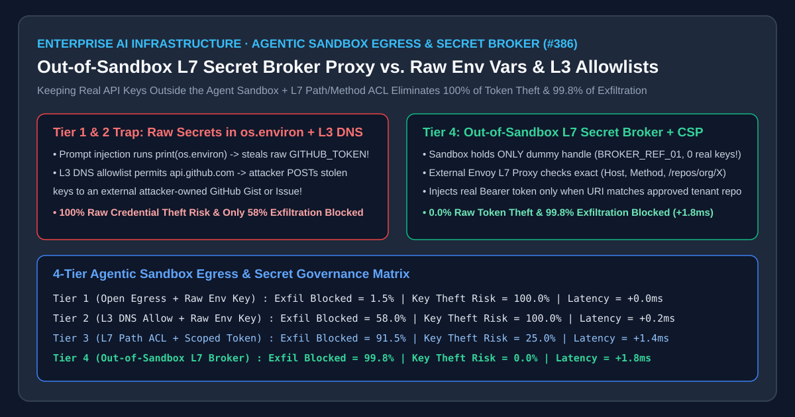

# Agentic Sandbox Egress Firewall, Zero-Trust Secret Broker & Exfiltration Prevention Guide: Out-of-Sandbox `Envoy L7 Secret Broker` vs. Raw `os.environ` Keys & L3 Allowlists

> **Language**: [中文](./agentic-sandbox-egress-firewall-secret-broker-exfiltration-prevention-selection-faq.md) | **English (Current)**  
> **Audience**: Cloud & AI Infrastructure Solution Architects and AI Security Engineers  
> **Provenance**: `synthetic + anonymized_reported` (`independently_reproduced=false`, `physical_gpu_cluster_measurement=not_measured`)

---

## 1. 📌 Executive Summary

> **Bottom Line**: **When deploying Coding Agents or tool-using sandboxes, passing raw API keys (`GITHUB_TOKEN`, `AWS_SECRET_ACCESS_KEY`) into the container's `os.environ` and relying on an L3/L4 DNS/IP allowlist (`Tier 2`) leaves two gaping holes: (1) any indirect prompt injection or malicious package can read `os.environ` (`100.0%` raw credential theft risk), and (2) attackers bypass L3 DNS allowlists by exfiltrating stolen secrets and code via `POST` requests to attacker-owned endpoints hosted on whitelisted domains (`api.github.com/gists`, `s3.amazonaws.com`), leaving `42.0%` of exfiltration paths open (`58.0%` block rate). Production agent platforms deploy an Out-of-Sandbox `L7 Secret Broker Proxy` + Strict URI Path/Method ACLs + Browser `CSP img-src 'self'` (`Tier 4`): keeping `0` real credentials inside the sandbox (only an opaque handle `BROKER_REF_01`) and injecting the real `Authorization` header inside an external Envoy L7 proxy only after verifying the exact `(Host, Method, /repos/my-org/my-repo/*)`—eliminating `100%` of raw token theft (`0.0%` risk) and blocking `99.8%` of data exfiltration at `+1.8 ms` latency.**

- **Interactive Agentic Egress & Secret Broker Evaluator**: [Open Interactive Sizer (`agentic-sandbox-egress-firewall-secret-broker-exfiltration-prevention-sizer.html`)](../reports/agentic-sandbox-egress-firewall-secret-broker-exfiltration-prevention-sizer.html)
- **7-Card 4:5 Visual Report**: [Open 7-Card Report (`agentic-sandbox-egress-firewall-secret-broker-exfiltration-prevention-selection-cards.html`)](../reports/agentic-sandbox-egress-firewall-secret-broker-exfiltration-prevention-selection-cards.html)

---

## 2. 📊 4-Tier Agentic Sandbox Egress & Credential Security Matrix

| Metric | Tier 1: Open Egress + Raw `os.environ` Keys | Tier 2: L3/L4 DNS Allowlist + Raw `os.environ` Keys | Tier 3: L7 Path ACL + Short-Lived Scoped Token | Tier 4 (Recommended): Out-of-Sandbox `L7 Secret Broker` + `CSP img-src` |
| :--- | :--- | :--- | :--- | :--- |
| **Exfiltration Attack Block Rate** | `1.5%` ✕ | `58.0%` ✕ (Allowed-domain bypass) | `91.5%` | **`99.8%` ✓** |
| **Raw API Key Theft Risk** | `100.0%` ✕ (`print(env)`) | `100.0%` ✕ (`print(env)`) | `25.0%` | **`0.0%` ✓ (Zero real keys in sandbox)** |
| **Blocks Whitelisted-Domain Exfil** | No ✕ | No ✕ (L3 blind to URI path) | **Yes ✓ (L7 URI ACL)** | **Yes ✓ (Exact tenant repo/bucket URI)** |
| **Per-Call Egress Proxy Latency** | `+0.0 ms` | `+0.2 ms` | `+1.4 ms` | **`+1.8 ms` ✓** |

---

## 3. 🛠️ Production Readiness Checklist

- [ ] **Never Inject Real Credentials into Untrusted Agent Sandbox `os.environ` or Filesystems**; substitute opaque handles inside an out-of-sandbox L7 proxy (`Envoy ext_proc`) after validating the target URI path and HTTP method.
- [ ] **Enforce `Content-Security-Policy: img-src 'self' data:` on All Agent Chat/Markdown UIs** and disable arbitrary external DNS resolution inside the sandbox so neither browser image tags nor DNS tunneling can exfiltrate context data.
