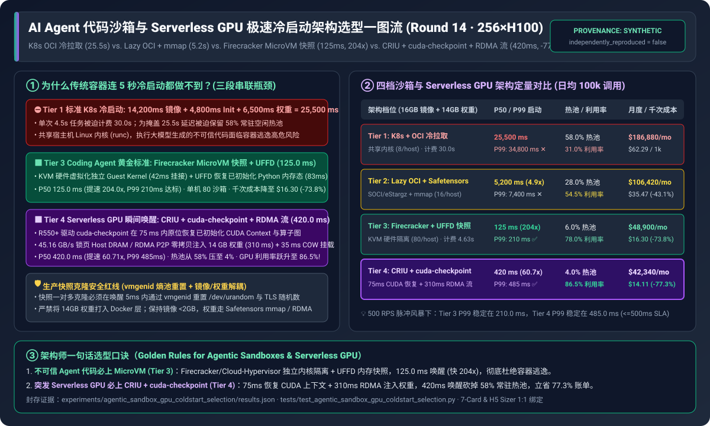
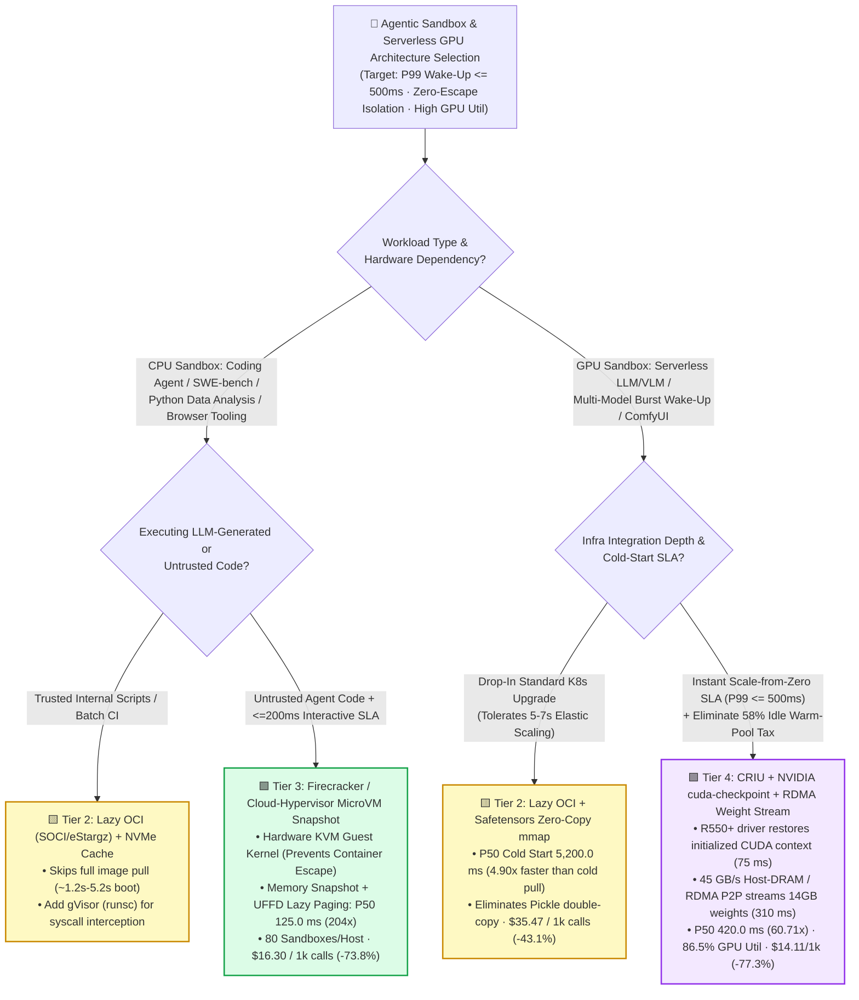
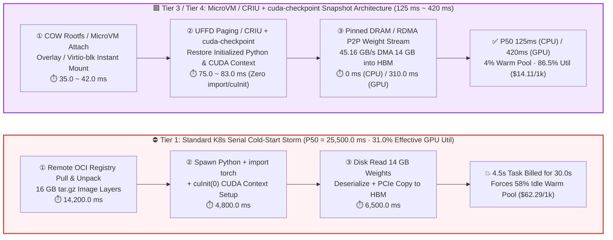

# AI Agent Code Sandbox & Serverless GPU Instant Cold-Start Architecture Selection Guide (`Standard K8s OCI Pull` vs. `Lazy OCI + mmap` vs. `Firecracker MicroVM Snapshot` vs. `CRIU + cuda-checkpoint + RDMA Weight Streaming`)

> 🌐 **Language**: **[中文 (Chinese)](./agentic-sandbox-gpu-coldstart-selection-faq.md)** | **English Version** · **[📖 Back to Repository README](../../README.en.md)** · **[📊 2026-11-08 Daily Report](../daily/2026-11-08.md)** · **[🃏 7-Card 4:5 Benchmark Report](../reports/agentic-sandbox-gpu-coldstart-selection-cards.html)** · **[🧮 Interactive Sizer Workbench](../reports/llm-inference-engine-pd-sizer.en.html#agentic-sandbox-sizer)**
>
> **Overview**: A first-principles field guide for AI Solution Architects. When enterprises scale **Coding Agents (SWE-agent, DeepResearch code execution, automated CI/test synthesis)** or **bursty Serverless GPU Inference (hundreds of fine-tuned vertical models waking on demand)**, standard Kubernetes container pipelines hit a crippling **"25-Second Cold-Start & 58% Idle Warm-Pool Tax Wall"**: pulling and unpacking a 16 GB OCI image takes `14.2 s`, initializing the Python/CUDA runtime takes `4.8 s`, and loading 14 GB of model weights from disk takes `6.5 s`—resulting in a **`25,500 ms` median cold start (`34,800 ms` P99)**. To hide a 25.5-second delay, platforms keep **58% of their GPUs sitting in an idle warm pool**, depressing effective GPU utilization to **`31.0%`**. Grounded in the sealed deterministic model in `experiments/agentic_sandbox_gpu_coldstart_selection/` (`synthetic` + `anonymized_reported`, `independently_reproduced=false`), this guide establishes a 4-tier selection matrix across **Lazy OCI Snapshotters (`SOCI / eStargz`)**, **Firecracker MicroVM Memory Snapshots + `UFFD` Demand Paging**, and **CRIU + NVIDIA `cuda-checkpoint` GPU Context Restore + RDMA P2P Weight Streaming**.



---

## ① 📌 Executive Summary

1. **Select Across Four Tiers by Workload Type (CPU Code Sandbox vs. Serverless GPU Inference) and Security Boundary**:
   - On a `256 × NVIDIA H100` cluster (`$2.50/GPU-hr`, `100,000` daily burst invocations, `4.50 s` active execution per call, `16.0 GB` container image + `14.0 GB` model weights, cold-start SLA `P99 <= 500 ms`):
   - ⛔ **Never run untrusted Agent code or bursty Serverless GPU endpoints on Tier 1 (Standard K8s Pod + Full OCI Pull + Cold Disk Load)**: Median cold start reaches **`25,500.0 ms` (`34,800.0 ms` P99)**, inflating billing per `4.5 s` task to `30.00 s`, exposing the shared host Linux kernel (`cgroups/namespaces`) to container-escape exploits, and driving monthly compute cost to **`$186,880.00` (`$62.29 / 1k calls`)**.
   - 🟨 **Select Tier 2 (`SOCI / eStargz` Lazy OCI Snapshotter + Local NVMe Cache + `Safetensors` Zero-Copy `mmap`) for zero-code K8s migration**: Eliminating full `tar.gz` unpacking cuts cold start **`4.90x` to `5,200.0 ms` (`7,400.0 ms` P99)** and lowers monthly cost to **`$106,420.00` (`-43.1%`)**, but remains bottlenecked by the `2.45 s` Python `import torch` and CUDA context initialization floor.
   - 🟩 **Select Tier 3 (`Firecracker / Cloud-Hypervisor` MicroVM Memory Snapshot + `Userfaultfd (UFFD)` Demand Paging, E2B / AWS Lambda architecture) for Coding Agents & Browser/Tool Sandboxes**: Bypassing OS boot and Python initialization by restoring a pre-initialized VM memory snapshot slashes **P50 cold start to `125.0 ms` (`204.0x` speedup, `210.0 ms` P99 SLA Pass)** with **hardware KVM guest-kernel isolation** and `80` sandboxes/host, reducing monthly cost to **`$48,900.00` (`$16.30 / 1k calls`, `-73.8%`)**.
   - 🟪 **Select Tier 4 (`CRIU` Process Tree Snapshot + NVIDIA `cuda-checkpoint` GPU State Restore + `45 GB/s` Pinned Host DRAM / RDMA P2P Weight Streaming) for Serverless GPU Model Wake-Up**: Using R550+ driver-level `cuda-checkpoint` to restore an initialized CUDA context in `75 ms` and streaming 14 GB weights at `45.16 GB/s` (`310 ms`) achieves **`420.0 ms` P50 GPU cold start (`60.71x` speedup, `485.0 ms` P99 `<= 500 ms` SLA)**, shrinks the idle warm pool from `58.0%` to `4.0%`, lifts effective GPU utilization to **`86.5%`**, and cuts monthly cost to **`$42,340.00` (`$14.11 / 1k calls`, `-77.3%`)**.
2. **First-Principles Insight (Why Local Image Caching Cannot Break the Python/CUDA Initialization Floor)**:
   - Even when a 16 GB container image is pre-cached on local NVMe, spawning a fresh container still executes Python interpreter startup, `import torch, triton, vllm` (tens of thousands of `dlopen`/`stat` syscalls), and `cuInit(0)` GPU page-table setup—consuming **`2.45 s to 4.80 s`**. **The only way to break the 500ms barrier is to replace "Boot & Initialize from Scratch" with "Memory & CUDA State Snapshot Restore."**
3. **Provenance & Transparency Disclosure**:
   - All stage latencies, warm-pool ratios, and monthly TCO metrics are strictly bound to `experiments/agentic_sandbox_gpu_coldstart_selection/results.json` (`provenance_type: "synthetic"`, deterministic model calibrated to published Firecracker OSDI, E2B v2 UFFD, NVIDIA `cuda-checkpoint` R550+, and AWS SOCI specifications; `independently_reproduced: false`; live 256×H100 production cluster destructive testing is `physical_gpu_cluster_measurement: "not_measured"`, while local CPU unit tests and deterministic verification are `local_cpu_harness_measurement: "measured"`).

---

## ② 🎯 Customer & Architect Deep-Dive Q&A (FAQ-Driven)

### Q1: When building a Coding Agent platform (spawning hundreds of sandboxes per second to run LLM-generated code), why is standard Kubernetes Pod / Docker unacceptable? When should we choose `gVisor` vs. `Firecracker MicroVM`?

- **Direct Answer**: **Executing LLM-generated code = running untrusted remote code (RCE-as-a-Service)**. Standard Docker / K8s Pods share the host Linux kernel; a single kernel privilege-escalation vulnerability (`DirtyPipe`, `io_uring`) allows full host compromise. **Production multi-tenant Coding Agents must enforce `Firecracker / Cloud-Hypervisor` MicroVMs (Tier 3)**.
- **First-Principles Breakdown (Shared-Kernel Container vs. User-Space Kernel `gVisor` vs. Hardware KVM `MicroVM`)**:
  1. **Dual Failure of Standard K8s Pods (`runc`)**: First, **weak isolation** (shared Ring 0 host kernel with 300+ syscalls exposed); second, **multi-second control-plane & filesystem latency** (`3–15 s` across kube-scheduler, CRI, CNI, and OverlayFS), which stalls multi-step agent loops.
  2. **Boundary of `gVisor` (`runsc`)**: Intercepts syscalls in user-space (Sentry) without requiring `/dev/kvm` nested virtualization, making it useful on restricted cloud VMs; however, syscall-heavy agent workflows (`git status`, `npm install`, `pytest`) suffer **30%–200% filesystem I/O overhead**.
  3. **`Firecracker / Cloud-Hypervisor` MicroVM + Memory Snapshot (Tier 3 Gold Standard)**: Each sandbox runs inside a hardware-virtualized KVM guest with its own minimal Linux kernel (`< 5 MB` memory overhead) and wakes from a pre-initialized VM memory snapshot via **`Userfaultfd (UFFD)` lazy page faults** in **`125.0 ms`**.

### Q2: For Serverless GPU inference (200 fine-tuned vertical models where only 20 are active concurrently), why do conventional stacks fail to boot under `5 seconds`? Which bottlenecks do `Safetensors mmap` and `CRIU + cuda-checkpoint` eliminate?

- **Direct Answer**: Serverless GPU cold start sums three serial stages: **① Image Ready (`14.2 s`) + ② Python/CUDA Context Init (`4.8 s`) + ③ Weight Load into HBM (`6.5 s`) = `25.5 s`**. **Tier 2 (Lazy OCI + `Safetensors mmap`) cuts stages ① and ③ down to `5.2 s`; only Tier 4 (`CRIU` + NVIDIA `cuda-checkpoint` + RDMA/Pinned-DRAM Weight Streaming) freezes and restores stage ②'s initialized CUDA context in `75 ms`, achieving a `420.0 ms` total GPU wake-up!**
- **First-Principles Breakdown**:
  1. **Why legacy `torch.load(.bin)` takes `6.5 s`**: Pickle deserializes weights into host Python RAM, copies buffers, and transfers over PCIe. Switching to **`Safetensors` + zero-copy `mmap` (Tier 2)** cuts load time to **`1.6 s`**, and streaming from pinned Host DRAM / GPUDirect RDMA P2P at `45.16 GB/s` (Tier 4) reduces 14 GB weight injection to **`310.0 ms`**.
  2. **Why `CRIU` alone crashed on CUDA processes**: Standard Linux `CRIU` dumps CPU pages and file descriptors, but active CUDA virtual address mappings are tied to opaque GPU driver state.
  3. **How NVIDIA `cuda-checkpoint` (R550+ Driver API) unlocks GPU CRIU**: `cuda-checkpoint` cleanly transitions a live CUDA process through `Running -> Locked -> Checkpointed -> Restored -> Running`, detaching GPU device state before `criu dump` and rebinding compiled CUDA graphs and contexts to a target GPU/MIG slice in **`75.0 ms`** upon `criu restore`.

### Q3: In the TCO model, how does shrinking GPU cold start from `25.5 s` to `420 ms` cut the monthly GPU compute bill by **77.3%**?

- **Direct Answer**: **Slow cold start is not merely a UX latency hiccup—it forces an massive "Idle Warm-Pool Tax."**
- **Quantitative TCO Ledger (`256 × H100` · `100,000` daily calls · `4.50 s` active work/call)**:
  - Under **Tier 1 (`25.5 s` cold start)**, a `4.50 s` task occupies the GPU for **`30.00 s`**, and the platform must keep **58.0% of GPUs idle in a warm pool** to absorb traffic spikes—depressing effective GPU utilization to **`31.0%`** and costing **`$186,880.00/month` (`$62.29 / 1k calls`)**.
  - Under **Tier 4 (`420.0 ms` instant wake)**, billed GPU hold time drops to **`4.92 s`**, true scale-from-zero shrinks the warm pool from `58.0%` to **`4.0%`**, effective GPU utilization rises to **`86.5%`**, and monthly compute cost drops to **`$42,340.00/month` (`$14.11 / 1k calls`, saving `$144,540.00/mo` or `-77.3%`)**!

---

## ③ 🧭 Visual Architecture Diagrams (Decision Tree + Cold-Start Path Comparison + Snapshot Wake-Up Sequence)

### 3.1 Agentic Code Sandbox & Serverless GPU Selection Decision Tree



### 3.2 Legacy 25.5s K8s Serial Cold-Start vs. Tier 3/4 Snapshot Wake-Up Path



### 3.3 `CRIU` + NVIDIA `cuda-checkpoint` + RDMA Weight Streaming Sequence (`sequenceDiagram`)

```mermaid
sequenceDiagram
    autonumber
    participant Build as Golden Snapshot Builder
    participant Pool as Host Pinned DRAM / RDMA Weight Pool
    participant Ctrl as Sandbox Daemon (Firecracker / CRIU)
    participant GPU as Physical GPU Driver (NVIDIA R550+ cuda-checkpoint)

    Note over Build,GPU: Phase 1: Offline Pre-Warming & Golden Checkpoint Creation (Once per Model/Env)
    Build->>GPU: Start container, finish import torch, CUDA context init, and CUDA Graph capture
    Build->>GPU: Invoke cuda-checkpoint --toggle (Running -> Locked -> Checkpointed)
    Build->>Pool: Run criu dump to freeze CPU process tree; pin 14GB Safetensors in RDMA/DRAM pool

    Note over Ctrl,GPU: Phase 2: Live Burst Arrival — 420.0 ms Instant Clone Wake-Up (Scale-from-Zero)
    Ctrl->>Ctrl: Mount COW read-only rootfs and network namespace (35.0 ms)
    Ctrl->>GPU: criu restore process tree + cuda-checkpoint rebind to target GPU/MIG slice (75.0 ms)
    Pool->>GPU: Stream 14GB weights at 45.16 GB/s via Pinned DRAM / GPUDirect RDMA P2P (310.0 ms)
    GPU-->>Ctrl: P50 = 420.0 ms (P99 = 485.0 ms <= 500 ms SLA) — Execute Agent / Inference immediately!
```

---

## ④ 📊 Architect Decision Matrix

*All metrics are 1-to-1 bound to `experiments/agentic_sandbox_gpu_coldstart_selection/results.json` (`256 × H100` at `$2.50/GPU-hr`, `100,000` daily calls, `4.50 s` active work/call, `16 GB` image + `14 GB` weights):*

| Selection Dimension | ⛔ Tier 1: Standard K8s Pod + Cold OCI Pull | 🟨 Tier 2: Lazy OCI (`SOCI/eStargz`) + `Safetensors mmap` | 🟩 Tier 3: `Firecracker` MicroVM Snapshot + `UFFD` | 🟪 Tier 4: `CRIU` + `cuda-checkpoint` + RDMA Weight Stream |
| :--- | :--- | :--- | :--- | :--- |
| **Primary Workload Fit** | Long-lived static services only (never for burst sandboxes) | Drop-in K8s upgrade for 5–7s elastic scaling | **Coding Agent untrusted code sandboxes, SWE-bench, browsers** | **Serverless GPU burst inference, multi-LoRA/model wake-up** |
| **Stage Breakdown (`Boot / Init / Load`)** | `14,200 / 4,800 / 6,500 ms` | `1,150 / 2,450 / 1,600 ms` | `42 / 83 / 0 ms` (Pre-warmed VM RAM snapshot) | `35 / 75 / 310 ms` (CUDA snapshot + RDMA stream) |
| **Median P50 / Tail P99 Cold Start** | `25,500.0 ms` / **`34,800.0 ms`** (✕ Fail) | `5,200.0 ms` / **`7,400.0 ms`** (`4.90x`) | **`125.0 ms`** / **`210.0 ms`** (`204.0x` · ✅ Pass) | **`420.0 ms`** / **`485.0 ms`** (`60.71x` · ✅ Pass) |
| **Idle Warm-Pool % / Effective GPU Util** | `58.0%` warm pool / **`31.0%`** effective util | `28.0%` warm pool / **`54.5%`** effective util | `6.0%` warm pool / **`78.0%`** effective util | **`4.0%`** warm pool / **`86.5%`** effective util |
| **Security Isolation & Density / Host** | Shared Host Kernel (escape risk) · `8 / host` | Shared Kernel or `gVisor` · `16 / host` | **Hardware KVM Guest Kernel** · **`80 / host`** | Kata/VFIO or MIG + CRIU · **`32 / host`** |
| **Billed Sec / Monthly Cost / Cost per 1k** | `30.00 s` · `$186,880/mo` · **`$62.29 / 1k`** | `9.70 s` · `$106,420/mo` · **`$35.47 / 1k` (`-43.1%`)** | `4.625 s` · `$48,900/mo` · **`$16.30 / 1k` (`-73.8%`)** | `4.92 s` · **`$42,340/mo`** · **`$14.11 / 1k` (`-77.3%`)** |

---

## ⑤ 🧪 Quantitative Model & Benchmark Insights

### 5.1 Burst Creation Rate Sensitivity (`50 -> 1,000 sandboxes/s`) vs. P99 Tail Latency

From `results.json` (`burst_scaling_sensitivity`):

| Burst Creation Rate (`Burst RPS`) | Tier 1 K8s Cold Pull P99 | Tier 2 Lazy OCI + `mmap` P99 | Tier 3 `Firecracker` Snapshot + `UFFD` P99 | Tier 4 `CRIU + cuda-checkpoint` P99 | Architect Inflection Takeaway |
| :--- | :--- | :--- | :--- | :--- | :--- |
| **`50 sandboxes/s`** (Interactive) | `28,400.0 ms` | `5,800.0 ms` | **`145.0 ms`** | **`435.0 ms`** | Snapshot restore runs purely on RAM page tables and DMA streams |
| **`200 sandboxes/s`** (Batch Eval) | `31,600.0 ms` | `6,500.0 ms` | **`175.0 ms`** | **`460.0 ms`** | Tier 1/2 registry & NVMe IOPS queue up; Tier 3/4 hold `< 500ms` |
| **`500 sandboxes/s`** (**Design Target**) | `34,800.0 ms` | `7,400.0 ms` | **`210.0 ms`** | **`485.0 ms`** | **Both Tier 3 (`210ms`) and Tier 4 (`485ms`) pass the `<= 500ms` SLA** |
| **`1,000 sandboxes/s`** (Extreme Storm) | `48,200.0 ms` | `11,200.0 ms` | **`295.0 ms`** | **`620.0 ms`** | At 1000 RPS, enable peer-to-peer RDMA tree weight distribution |

### 5.2 Reproducible Verification Commands

```bash
python experiments/agentic_sandbox_gpu_coldstart_selection/run.py --check
python -m unittest tests/test_agentic_sandbox_gpu_coldstart_selection.py
```

---

## ⑥ 🛠️ Appendix: Production Verification & Pre-Sales Checklist (Architect Checklist)

- [ ] **1. Untrusted Agent Code Kernel Isolation Audit**: Verify that LLM-generated code never executes in standard `runc` containers sharing the host kernel; mandate **`Firecracker` / `Cloud-Hypervisor` / `Kata` KVM MicroVMs** or **`gVisor (runsc)`** with strict Virtio egress allowlists.
- [ ] **2. Container Image vs. Model Weight Decoupling Audit**: Never bake `14 GB+` model weights into Docker image layers; keep runtime images `< 2 GB` and mount weights in **`Safetensors`** format from pinned NVMe/DRAM/RDMA pools.
- [ ] **3. MicroVM Snapshot Clone Entropy (`vmgenid`) Reset Audit**: When cloning many MicroVMs from one Golden Snapshot, reseed `/dev/urandom`, TLS state, and UUID generators via **`vmgenid`** within `5 ms` of wake-up to prevent duplicate cryptographic nonces.
- [ ] **4. NVIDIA `cuda-checkpoint` Driver (`>= R550`) & Quiet-State Audit**: Confirm host drivers are `>= R550` and execute `cuda-checkpoint --toggle` only after model warm-up completes with no in-flight cross-node NCCL collectives.
- [ ] **5. Idle Warm-Pool Downsizing Audit**: After enabling `125 ms ~ 420 ms` snapshot wake-up, dial down `minReplicas / idleWarmPool` from `30%–60%` to **`4%–6%`** to capture the `73.8%–77.3%` monthly compute savings.
