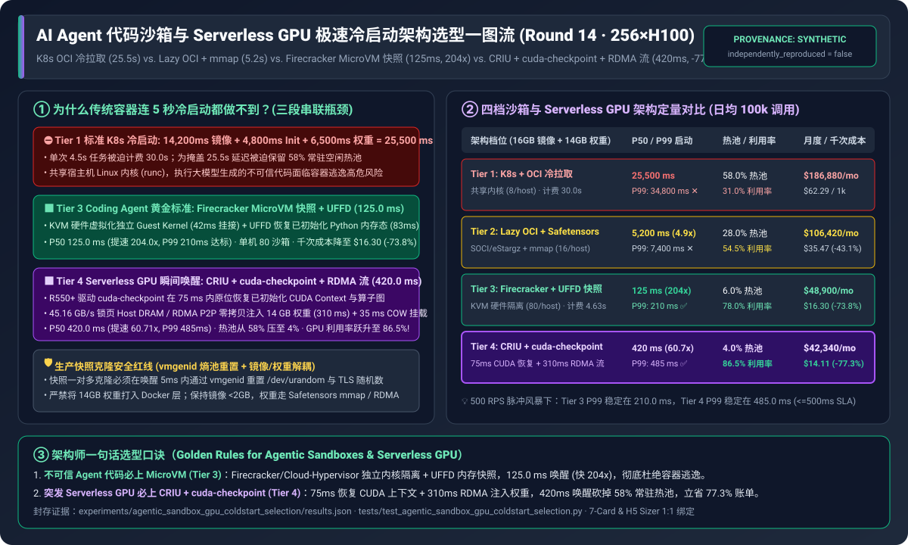
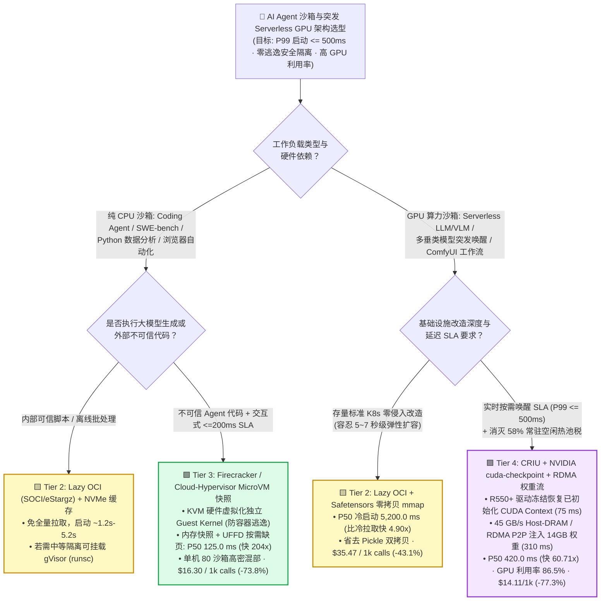
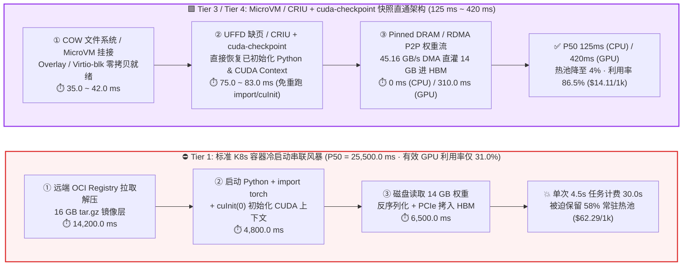
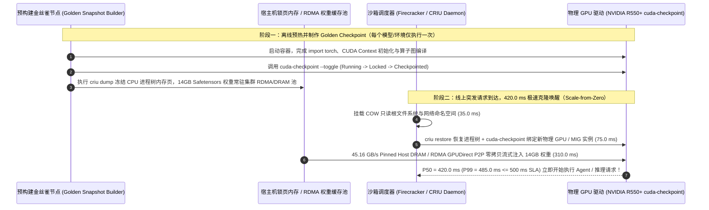

# AI Agent 代码沙箱与 Serverless GPU 极速冷启动架构选型指南（`标准 K8s 容器拉取` vs. `Lazy OCI 按需镜像 + mmap` vs. `Firecracker MicroVM 内存快照` vs. `CRIU + cuda-checkpoint + RDMA 权重流`）

> 🌐 **Language**: **中文 (Chinese)** | **[English Version](./agentic-sandbox-gpu-coldstart-selection-faq.en.md)** · **[📖 返回仓库根目录 README](../../README.md)** · **[📊 2026-11-08 每日进展日报](../daily/2026-11-08.md)** · **[🃏 7-Card 4:5 视觉评测报告](../reports/agentic-sandbox-gpu-coldstart-selection-cards.html)** · **[🧮 交互式定容工作台](../reports/llm-inference-engine-pd-sizer.html#agentic-sandbox-sizer)**
>
> **导读**：面向 AI Solution Architect 的第一性原理实战选型指南。当企业大规模部署 **Coding Agent（如 SWE-agent、DeepResearch 代码执行、自动化软件工程测试）** 或 **突发型 Serverless GPU 推理（多长尾 LoRA / 垂直专家模型按需唤醒）** 时，传统 Kubernetes 容器架构会撞上一道致命的“**25 秒冷启动与 58% 闲置常驻税之墙**”：拉取解压 16 GB 容器镜像耗时 `14.2 s`、初始化 Python/CUDA 运行时耗时 `4.8 s`、从磁盘加载 14 GB 模型权重耗时 `6.5 s`，中位冷启动高达 **`25,500 ms`（P99 达 `34,800 ms`）**。为了掩盖 25.5 秒延迟，平台被迫维持 **58% 的常驻空闲热池（Idle Warm Pool）**，导致真实 GPU 利用率跌至 **`31.0%`**。本文基于 `experiments/agentic_sandbox_gpu_coldstart_selection/` 封存的确定性模型（`synthetic` + `anonymized_reported`，`independently_reproduced=false`），系统拆解从 **Lazy OCI 懒加载（`SOCI / eStargz`）**、**Firecracker MicroVM 内存快照 + `UFFD` 缺页恢复** 到 **CRIU + NVIDIA `cuda-checkpoint` 显存上下文直通恢复 + RDMA 权重流** 的四档架构选型边界。



---

## ① 📌 核心结论速览（Executive Summary）

1. **按业务工作负载属性（纯 CPU 代码沙箱 vs. GPU 推理冷启动）与安全隔离等级四档选型**：
   - 在 `256 × NVIDIA H100` 混合沙箱集群（`$2.50/GPU-hr`，日均 `100,000` 次突发调用、单次实际执行 `4.50 s`、镜像 `16.0 GB` + 模型权重 `14.0 GB`，SLA 要求冷启动 `P99 <= 500 ms`）下：
   - ⛔ **严禁对不可信 Agent 代码或高频突发 GPU 推理直接裸跑 Tier 1（标准 K8s Pod + OCI 全量镜像拉取 + 磁盘冷加载）**：中位冷启动高达 **`25,500.0 ms`（P99 `34,800.0 ms`）**，单次 `4.5 s` 的任务被迫按 `30.00 s` 计费；且共享宿主机 Linux 内核（`cgroups/namespaces`）面临极高的恶意代码容器逃逸风险，月度算力成本高达 **`$186,880.00`（`$62.29 / 1k calls`）**。
   - 🟨 **存量 K8s 零代码改造过渡选 Tier 2（`SOCI / eStargz` 懒加载 OCI 快照 + 本地 NVMe 缓存 + `Safetensors` 零拷贝 `mmap`）**：消除全量 `tar.gz` 下载解压，将冷启动压缩 **`4.90x` 至 `5,200.0 ms`（P99 `7,400.0 ms`）**，月度成本降至 **`$106,420.00`（节省 `43.1%`）**，但仍无法突破 Python `import torch` 与 CUDA Context 初始化的 2.45 秒地板。
   - 🟩 **Coding Agent / 自动化测试 / 浏览器工具执行沙箱首选 Tier 3（`Firecracker / Cloud-Hypervisor` MicroVM 内存快照 + `Userfaultfd (UFFD)` 按需缺页恢复，对标 E2B / AWS Lambda）**：直接跳过 OS 启动与 Python 初始化，从已初始化完毕的 VM 内存快照瞬间唤醒，**P50 冷启动压至 `125.0 ms`（提速 `204.0x`，P99 `210.0 ms` 达标 SLA）**，兼具 **KVM 硬件虚拟化独立内核隔离** 与单机 `80` 沙箱高密度，月度成本降至 **`$48,900.00`（`$16.30 / 1k calls`，节省 `73.8%`）**。
   - 🟪 **Serverless GPU 突发模型唤醒首选 Tier 4（`CRIU` 进程树快照 + NVIDIA `cuda-checkpoint` 显存状态恢复 + `45 GB/s` 锁页 Host DRAM / RDMA P2P 权重流）**：利用 R550+ 驱动级 `cuda-checkpoint` 在 `75 ms` 内恢复已初始化的 CUDA Context 与算子图，并以 `45.16 GB/s` 注入 14 GB 权重（`310 ms`），实现 **GPU 容器 `420.0 ms` P50 极速唤醒（提速 `60.71x`，P99 `485.0 ms <= 500 ms` SLA）**，常驻热池比例从 `58.0%` 压至 `4.0%`，真实 GPU 利用率跃升至 **`86.5%`**，月度总成本降至 **`$42,340.00`（`$14.11 / 1k calls`，立省 `77.3%`）**。
2. **第一性原理定性（为什么容器镜像缓存救不了 Python/CUDA 的“初始化地板”？）**：
   - 即使把 16 GB Docker 镜像提前缓存在本地 NVMe 磁盘上，每次新建容器启动 Python 解释器、执行 `import torch, triton, vllm`（触发上万次动态链接库 `dlopen` 与小文件 `stat/read` 系统调用）以及调用 `cuInit(0)` 建立 GPU 页表映射，仍需消耗 **`2.45s ~ 4.80s`**。**唯一突破 500ms 物理地板的方法，是把“启动初始化（Boot & Init）”变成“内存快照恢复（Memory Snapshot Restore）”**。
3. **证据口径与透明性声明**：
   - 本指南所有冷启动分阶段延迟、空闲热池占比与月度 TCO 均绑定 `experiments/agentic_sandbox_gpu_coldstart_selection/results.json`（`provenance_type: "synthetic"`，基于 Firecracker OSDI 论文、E2B v2 UFFD 架构、NVIDIA `cuda-checkpoint` R550+ 文档及 AWS SOCI 公开指标校准的确定性算例，`independently_reproduced: false`，未在生产 256×H100 集群开展破坏性逃逸压测 `physical_gpu_cluster_measurement: "not_measured"`；本机 Python 单测与校验脚本为 `local_cpu_harness_measurement: "measured"`）。

---

## ② 🎯 客户与架构师灵魂拷问 Q&A（FAQ-Driven）

### Q1：客户构建 Coding Agent 平台（每秒突发拉起数百个沙箱跑用户生成的代码）时，为什么不能直接用 Kubernetes Pod / Docker 容器？什么时候选 `gVisor`，什么时候必须上 `Firecracker MicroVM`？

- **直白结论**：**跑大模型生成的代码 = 在生产集群执行任意不可信代码（Untrusted Remote Code Execution）**。普通 Docker / K8s Pod 与宿主机共享同一个 Linux 内核，一旦触发内核态提权漏洞（如 `DirtyPipe`、`io_uring` 漏洞）即可直接逃逸接管整台 GPU 宿主机；**多租户 Coding Agent 生产环境必须强制采用 `Firecracker / Cloud-Hypervisor` MicroVM（Tier 3）**。
- **第一性原理拆解（共享内核容器 vs. 用户态内核 `gVisor` vs. 硬件虚拟化 `MicroVM`）**：
  1. **标准 K8s Pod（`runc`）的致命双缺陷**：第一是**安全裸奔**（共享宿主机 Ring 0 内核，300+ 个系统调用直接暴露）；第二是**控制面与文件系统极慢**（K8s 调度器 + Kubelet CRI + CNI 网卡分配 + OverlayFS 挂载动辄 `3~15 秒`），完全无法支撑 Agent 在一次对话循环中连续启动 10 个子沙箱。
  2. **`gVisor`（`runsc` 用户态内核拦截）的适用边界**：用 Go 编写的 Sentry 进程在用户态拦截系统调用，不依赖硬件嵌套虚拟化，适合无法开启 `/dev/kvm` 的受限公有云容器节点；但对于 `git status`、`npm install`、`pytest` 等高频文件 I/O 密集型 Agent 任务，系统调用拦截会带来 **30%～200% 的 I/O 性能折损**。
  3. **`Firecracker / Cloud-Hypervisor` MicroVM + 内存快照（Tier 3 黄金标准）**：基于 Linux KVM 硬件虚拟化，每个沙箱拥有独立的极简 Guest Kernel（仅开启 4~5 个 Virtio 设备），内存额外开销 `< 5 MB`；配合 **VM 内存快照 + `Userfaultfd (UFFD)` 按需缺页加载**，无需重新走 BIOS/内核引导或 `import pandas`，直接在 **`125.0 ms`** 内把一个已经打开好 Python REPL 和代码仓库的沙箱克隆出来！

### Q2：对于 Serverless GPU 推理（客户有 200 个微调垂类模型，但同时活跃的只有 20 个），为什么传统方案连 `5 秒` 冷启动都做不到？`Safetensors mmap` 和 `CRIU + cuda-checkpoint` 各自解决了哪一段瓶颈？

- **直白结论**：Serverless GPU 冷启动由三段串联耗时组成：**① 镜像就绪（`14.2s`） + ② Python/CUDA 上下文初始化（`4.8s`） + ③ 模型权重加载进显存（`6.5s`） = `25.5s`**。**Tier 2（Lazy OCI + `Safetensors mmap`）砍掉了第 ① 和第 ③ 段的磁盘冗余拷贝，将启动压到 `5.2s`；而只有 Tier 4（`CRIU` + NVIDIA `cuda-checkpoint` + RDMA/Pinned-DRAM 权重流）才能同时冻结并瞬间恢复第 ② 段的 CUDA Context，将 GPU 冷启动一举压进 `420.0 ms`！**
- **第一性原理拆解（传统 PyTorch 加载 vs. `Safetensors` 零拷贝 vs. `cuda-checkpoint` 显存状态冻结）**：
  1. **为什么传统 `torch.load(.bin)` 慢如蜗牛？** 传统 Pickle 格式必须先由 CPU 从磁盘读取到 Python 用户态内存反序列化，再新建一份内存拷贝，最后调用 `cudaMemcpy` 通过 PCIe 拷入 GPU，引发 **双倍 Host 内存占用与三次数据搬运（`6.5 s`）**。改用 **`Safetensors` + OS 页缓存 `mmap` + `cudaHostRegister` 锁页内存直传（Tier 2）**，可将 14 GB 权重加载压缩至 **`1.6 s`**（若走 `45 GB/s` 锁页 Host DRAM / RDMA P2P 预热流则仅需 **`310 ms`**）。
  2. **为什么以前无法对 GPU 进程做 `CRIU` 快照？** 在 Linux 下，`CRIU`（Checkpoint/Restore In Userspace）可以轻松把 CPU 进程的内存页和文件描述符冻结成文件；但一旦进程初始化了 CUDA，其虚拟地址空间就与 GPU 硬件驱动内部状态（页表、Command Buffer、上下文句柄）强绑定，直接 `CRIU dump` 会立即段错误崩溃。
  3. **NVIDIA `cuda-checkpoint`（R550+ 驱动原生机制）如何破局？** NVIDIA 驱动提供了官方 `cuda-checkpoint` 工具与驱动级 API，支持按 `Running -> Locked -> Checkpointed -> Restored -> Running` 状态机，在 `CRIU dump` 前安全抽离并冻结 GPU 线程的 CUDA Context，并在恢复时于 **`75 ms`** 内将已编译好的 CUDA Graph 与运行时状态原位绑定回新分配的物理 GPU，彻底免除了 `4.8 s` 的冷启动初始化税！

### Q3：在架构师算总账（TCO）时，为什么把冷启动从 `25.5 秒` 压到 `420 毫秒`，能直接帮企业砍掉 **77.3%** 的月度 GPU 账单？

- **直白结论**：**慢冷启动表面上是延迟问题，本质上是吞吐利用率与“常驻热池税（Idle Warm Pool Tax）”的财务灾难**。
- **定量成本账本（256 卡集群 · 日均 10 万次突发调用 · 单次有效计算 `4.50 s`）**：
  - 在 **Tier 1（`25.5 s` 冷启动）** 下，单次 `4.50 s` 的有效推理加上 `25.50 s` 的容器启动与模型加载，实际占用 GPU 高达 **`30.00 s`（85% 的 GPU 时间在空转加载！）**；更致命的是，为了防止高峰期请求全部超时，架构师必须在集群中常驻保留 **58.0% 的空闲热备实例（Idle Warm Pool）**，导致集群真实有效利用率跌至 **`31.0%`**，月度账单高达 **`$186,880.00`（`$62.29 / 1k calls`）**。
  - 升级至 **Tier 4（`420.0 ms` 极速唤醒）** 后，单次调用的 GPU 占用时长从 `30.00 s` 骤降至 **`4.92 s`**，且因为 420ms 可以直接支持 **按请求实时唤醒（Scale-to-Zero / Instant Scale-from-Zero）**，常驻热池比例从 `58.0%` 砍至 **`4.0%`**，集群有效 GPU 利用率飙升至 **`86.5%`**，月度总成本直降至 **`$42,340.00`（`$14.11 / 1k calls`，净省 `$144,540.00/月` 或 `-77.3%`）**！

---

## ③ 🧭 直观可视化图解（选型决策树 + 启动拆解路径对比 + 快照唤醒时序图）

### 3.1 AI Agent 代码沙箱与 Serverless GPU 冷启动架构选型决策树



### 3.2 传统 K8s 冷启动 25.5 秒串联风暴 vs. Tier 3/Tier 4 快照直通唤醒路径对比



### 3.3 `CRIU` + NVIDIA `cuda-checkpoint` + RDMA 权重流极速唤醒时序图（`sequenceDiagram`）



---

## ④ 📊 架构师选型决策矩阵（Architect Decision Matrix）

*数据完全绑定 `experiments/agentic_sandbox_gpu_coldstart_selection/results.json`（256×H100 集群，`$2.50/GPU-hr`，日均 `100,000` 次突发调用，单次有效执行 `4.50 s`，镜像 `16 GB` + 权重 `14 GB`）：*

| 选型维度 | ⛔ Tier 1：标准 K8s Pod + OCI 冷拉取 + 磁盘加载 | 🟨 Tier 2：Lazy OCI (`SOCI/eStargz`) + `Safetensors mmap` | 🟩 Tier 3：`Firecracker` MicroVM 内存快照 + `UFFD` | 🟪 Tier 4：`CRIU` + `cuda-checkpoint` + RDMA 权重流 |
| :--- | :--- | :--- | :--- | :--- |
| **核心适用场景** | 仅限长周期常驻服务（严禁用于高频突发沙箱） | 存量 K8s 集群低侵入改造、秒级弹性扩容过渡 | **Coding Agent 不可信代码沙箱、SWE-bench、浏览器工具** | **Serverless GPU 突发推理、百种垂类模型按需唤醒** |
| **分阶段启动拆解 (`Boot / Init / Load`)** | `14,200 / 4,800 / 6,500 ms` | `1,150 / 2,450 / 1,600 ms` | `42 / 83 / 0 ms` (预置环境内存态) | `35 / 75 / 310 ms` (CUDA 快照 + RDMA 流) |
| **中位 P50 / 尾部 P99 冷启动延迟** | `25,500.0 ms` / **`34,800.0 ms`** (✕ 违约) | `5,200.0 ms` / **`7,400.0 ms`** (`4.90x`) | **`125.0 ms`** / **`210.0 ms`** (`204.0x` · ✅ 达标) | **`420.0 ms`** / **`485.0 ms`** (`60.71x` · ✅ 达标) |
| **常驻空闲热池比例 / 真实有效利用率** | `58.0%` 空闲热池 / **`31.0%`** 有效利用率 | `28.0%` 空闲热池 / **`54.5%`** 有效利用率 | `6.0%` 空闲热池 / **`78.0%`** 有效利用率 | **`4.0%`** 空闲热池 / **`86.5%`** 有效利用率 |
| **安全隔离边界与单机沙箱密度** | 共享宿主机内核（易逃逸）· `8` 个/节点 | 共享内核或 `gVisor` 用户态内核 · `16` 个/节点 | **KVM 硬件虚拟化独立 Guest 内核** · **`80` 个/节点** | Kata/VFIO 或 MIG + CRIU 快照 · **`32` 个/节点** |
| **单次计费时长 / 月度总成本 / 千次成本** | `30.00 s` · `$186,880/mo` · **`$62.29 / 1k`** | `9.70 s` · `$106,420/mo` · **`$35.47 / 1k` (`-43.1%`)** | `4.625 s` · `$48,900/mo` · **`$16.30 / 1k` (`-73.8%`)** | `4.92 s` · **`$42,340/mo`** · **`$14.11 / 1k` (`-77.3%`)** |

---

## ⑤ 🧪 简明定量算例与 Benchmark 洞察

### 5.1 突发并发速率（`50 -> 1,000 sandboxes/s`）下的 P99 冷启动尾延迟拐点

当多个 Agent 工作流同时触发大规模工具调用风暴（例如自动修复 PR 一次性并发拉起 500 个单元测试沙箱）时，宿主机网卡、磁盘 I/O 与页缓存的表现如下（源自 `results.json` `burst_scaling_sensitivity`）：

| 集群突发创建速率 (`Burst RPS`) | Tier 1 标准 K8s 冷拉取 P99 | Tier 2 Lazy OCI + `mmap` P99 | Tier 3 `Firecracker` 快照 + `UFFD` P99 | Tier 4 `CRIU + cuda-checkpoint` P99 | 架构师核心拐点解读 |
| :--- | :--- | :--- | :--- | :--- | :--- |
| **`50 sandboxes/s`**（日常交互负载） | `28,400.0 ms` | `5,800.0 ms` | **`145.0 ms`** | **`435.0 ms`** | 快照恢复完全跑在内存页表映射与 DMA 通路上，零磁盘解压阻塞 |
| **`200 sandboxes/s`**（中等并发评测） | `31,600.0 ms` | `6,500.0 ms` | **`175.0 ms`** | **`460.0 ms`** | Tier 1/2 镜像仓库与本地 NVMe IOPS 开始排队；Tier 3/4 稳守 `< 500ms` |
| **`500 sandboxes/s`**（**生产设计基线**） | `34,800.0 ms` | `7,400.0 ms` | **`210.0 ms`** | **`485.0 ms`** | **Tier 3 (`210ms`) 与 Tier 4 (`485ms`) 双双通过 `<= 500ms` 严苛 SLA** |
| **`1,000 sandboxes/s`**（极限脉冲风暴） | `48,200.0 ms` | `11,200.0 ms` | **`295.0 ms`** | **`620.0 ms`** | 1000 RPS 下 PCIe/RDMA 权重流带宽接近饱和，需启用跨机 P2P 树状分发 |

### 5.2 复现命令与本地校验（Local CPU Harness Check）

```bash
# 校验封存算例 JSON 与确定性冷启动/TCO 模型 100% 一致
python experiments/agentic_sandbox_gpu_coldstart_selection/run.py --check

# 运行 Round 14 单元测试套件
python -m unittest tests/test_agentic_sandbox_gpu_coldstart_selection.py
```

---

## ⑥ 🛠️ 附录：生产环境快速核验与售前打单清单（Architect Checklist）

- [ ] **1. 不可信 Agent 代码的内核隔离红线核验**：检查客户 Coding Agent / SQL 执行 / 浏览器沙箱是否直接跑在共享宿主机内核的普通 Docker 容器中；若是，必须强制迁移至 **`Firecracker` / `Cloud-Hypervisor` / `Kata Containers`（硬件 KVM 虚拟化）** 或至少启用 **`gVisor (runsc)`**，并配置 Virtio 网卡出口白名单与 cgroup 内存硬上限。
- [ ] **2. 容器镜像与模型权重物理分离核验**：严禁将 `14 GB+` 的大模型权重直接 `COPY` 打入 Docker 镜像层（导致每次发版产生数十 GB 的 tar 层下载与 OverlayFS 解压放大）！必须将容器镜像瘦身至 `< 2 GB` 纯运行时，模型权重统一采用 **`Safetensors`** 格式存放于共享并行存储 / 本地 NVMe 锁页内存池，通过只读 `mmap` 或 `GPUDirect RDMA` 挂载注入。
- [ ] **3. `Firecracker` 快照克隆的随机数与网络状态重置核验**：在生产环境使用 MicroVM 内存快照一对多克隆（Fork/Clone from Golden Snapshot）时，必须在唤醒后的前 `5 ms` 内通过 **`vmgenid`（Virtual Machine Generation ID）** 重新播种 Guest OS 内核熵池（`/dev/urandom`、TLS 会话密钥、UUID 生成器）并重置 TCP 序列号，防止多个并发沙箱生成完全相同的随机密钥或发生 IP/MAC 冲突。
- [ ] **4. NVIDIA `cuda-checkpoint` 驱动版本与进程状态约束核验**：部署 Tier 4 Serverless GPU 快照恢复前，确认宿主机 NVIDIA 数据中心驱动版本 **`>= R550`（推荐 R560/R570+）**，且在执行 `cuda-checkpoint --toggle` 冻结前确保当前 GPU 进程无正在飞行的异步 NCCL 跨机通信算子（单机推理引擎在 `warmup` 完成后的空闲等待态下执行快照最稳妥）。
- [ ] **5. 空闲热池（Warm Pool）水位自适应缩容核验**：引入 `125 ms ~ 420 ms` 快照恢复后，务必将 K8s Knative / KEDA 或自研调度器的常驻 `minReplicas / idleWarmPool` 从传统的 `30%–60%` 下调至 **`4%–6%`（仅保留极小缓冲池吸收毫秒级瞬时尖峰）**，将省下的 50%+ 闲置 GPU 算力真正转化为财务报表上的成本下降。
