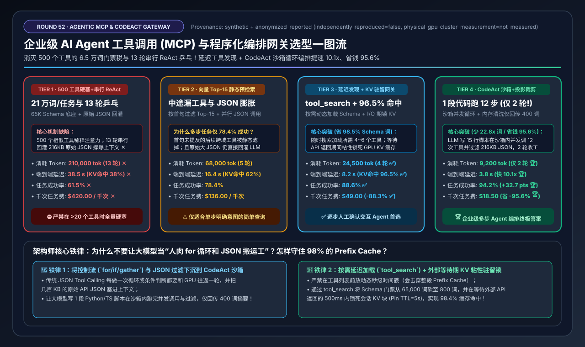
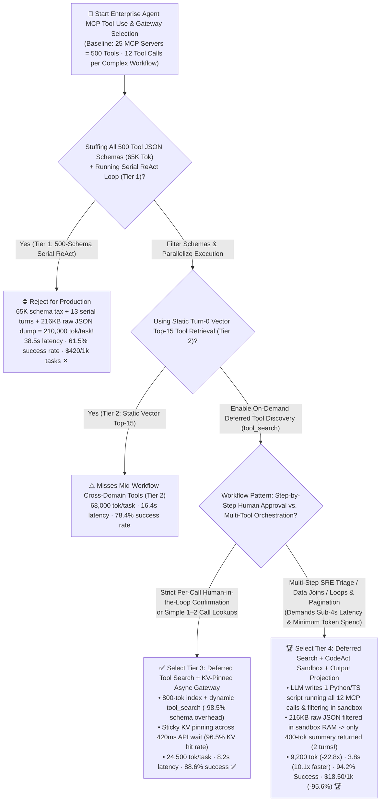
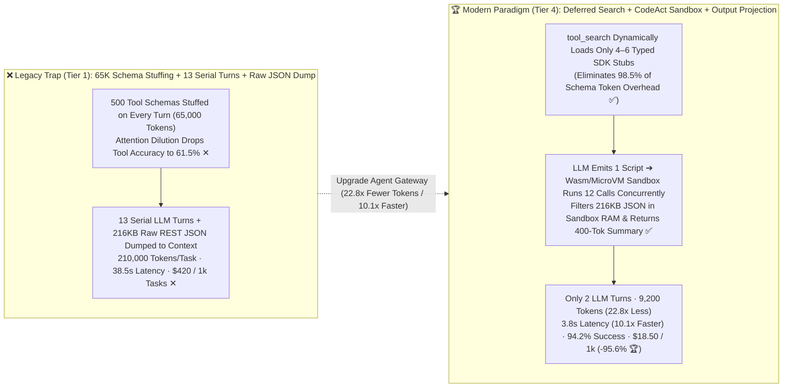
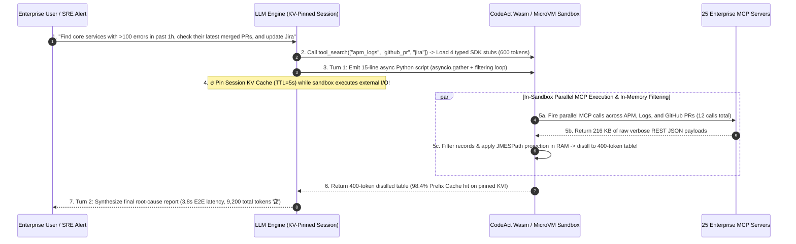

# Enterprise AI Agent Tool-Use (`MCP`) & Programmatic Execution Gateway Architecture Selection Guide (`Full 500-Schema Stuffing + Serial ReAct` vs. `Vector Top-15 Retrieval + Parallel JSON` vs. `Deferred Tool Discovery + KV-Pinned Gateway` vs. `CodeAct Sandbox Loop + Output Projection`)

> **Reader's Guide**: Built for **AI Solution Architects and Enterprise Agentic Platform Engineers**, this guide explains from first principles: **why connecting an enterprise AI Agent to 25 Model Context Protocol (`MCP`) servers (`500` total tools) and stuffing all 500 JSON Schemas into the system prompt burns `65,000` tokens before the user even speaks while crashing tool-selection accuracy to `61.5%`; why standard Serial ReAct ping-pong (`13` LLM turns dumping `18 KB` raw REST JSON payloads per call, Tier 1) takes `38.5 seconds` and `210,000` tokens per task (`$420 / 1k tasks`); why static Top-15 vector retrieval (Tier 2) fails mid-workflow when cross-domain tools are needed; how `Deferred Tool Discovery (tool_search) + Session-Sticky KV-Pinned Routing` (Tier 3) achieves a `96.5%` Prefix Cache hit rate across external API I/O waits; and how `Tier 4 (Deferred Discovery + Programmatic Tool Calling [CodeAct Sandbox Loop] + JMESPath Output Projection)` lets the LLM emit a single 15-line script that executes all 12 MCP calls and filters 200KB of raw JSON inside a Wasm/MicroVM sandbox—slashing LLM roundtrips from `13 → 2`, tokens by `22.8x` (`210,000 → 9,200`), latency by `10.1x` (`38.5s → 3.8s`), and cost by `95.6%` (`$420 → $18.50 / 1k tasks`) while lifting workflow success to `94.2%`.**

---

## ① 📌 Executive Summary

1. **Why Naive MCP Integration (`500 Tools + Serial ReAct`, Tier 1) Collapses in Enterprise Production (Two Fatal Traps)**:
   - **Trap 1 — The `65,000-Token` Schema Tax & Attention Dilution**: Across 25 enterprise MCP servers (`500` tools $\times 130$ tokens/schema), stuffing all tool definitions into every prompt consumes **`65,000` tokens upfront ✕** and confuses the model across overlapping tool names—dropping end-to-end workflow success to **`61.5%` ✕**!
   - **Trap 2 — 13-Turn Serial ReAct Ping-Pong & Raw JSON Context Pollution**: In a 12-tool troubleshooting workflow, serial ReAct executes **13 sequential LLM roundtrips** and dumps `18 KB` of unfiltered REST JSON (avatars, headers, pagination metadata) directly into the LLM context after every call—burning **`210,000` tokens/task ✕**, stalling for **`38.5 s` ✕**, and costing **`$420.00 / 1,000 tasks` ✕**!
2. **Interactive Human-in-the-Loop Baseline (`Tier 3: Deferred Discovery + KV-Pinned Gateway`) vs. Multi-Step Automation Gold Standard (`Tier 4: CodeAct Sandbox Loop + Output Projection`)**:
   - **For Interactive Workflows Requiring Per-Call User Confirmation, select `Tier 3 (Deferred Tool Discovery [tool_search] + Session-Sticky KV-Pinned Async Gateway)`**: Replaces the 65K schema dump with an `800`-token catalog index + on-demand `tool_search` (`-98.5%` schema tokens), and pins the session's KV Cache in HBM/DRAM during the `420 ms` external API wait (`96.5%` Prefix Cache hit rate ✅)—cutting latency to **`8.2 s` ✅** and tokens to **`24,500` ✅** (`88.6%` success).
   - **For Multi-Step Enterprise Workflows (SRE Triage, Log/PR Correlation, Pagination, Data Joins), standardize on `Tier 4 (Deferred Discovery + Programmatic Tool Calling [CodeAct Sandbox] + JMESPath Output Projection)`**:
     - **Move Control Flow (`for/if/gather`) Out of the LLM and Into a Sandbox**: Instead of 13 turns of JSON ping-pong, the LLM writes **1 concise 15-line Python/TypeScript script** that calls typed MCP SDK stubs (`asyncio.gather`), loops over pages, filters `200+ KB` of raw API JSON in sandbox RAM, and returns only a **`400`-token distilled summary table** to the LLM!
     - **Result**: LLM turns drop from `13 → 2` 🏆, tokens drop **`22.8x` (`210,000 → 9,200` 🏆)**, latency plunges **`10.1x` (`38.5s → 3.8s` 🏆)**, workflow accuracy reaches **`94.2%` (`+32.7 pts` 🏆)**, and cost drops **`-95.6%` (`$420.00 → $18.50 / 1k tasks` 🏆)**!
3. **First-Principles Rule**:
   - **Load tool schemas lazily on demand (`tool_search`)**, **pin KV Cache across external I/O waits**, and **never use an LLM context window as a `for`-loop counter or raw JSON trash can (`CodeAct` + Output Projection)**.

---

## ② 🎯 Architect & Customer FAQ (First-Principles Q&A)

### Q1: Why does tool-calling accuracy drop from 92% with 5 tools down to 61.5% with 500 MCP tools (Tier 1), and why does static Top-15 vector retrieval (Tier 2) fail on multi-step tasks?

**Plain-Language First Principles**:
- **Attention Dilution at 500 Tools (`Tier 1`)**: Stuffing `65,000` tokens of similar JSON schemas into the prompt degrades softmax attention sharpness over tool descriptions and parameter constraints (`61.5%` success ✕).
- **Why Static Initial-Prompt Vector Retrieval (`Tier 2`) Fails Mid-Task (`78.4%`)**: A user's initial prompt (*"Why is checkout latency spiking?"*) only matches APM/Log tools in vector space. Once step 3 reveals a bad deployment, the agent suddenly needs `GitHub PR` and `Jira` tools—which were excluded by the static Top-15 filter at turn 0!

---

### Q2: How does `Deferred Tool Discovery (tool_search)` solve the 500-tool problem, and why must the inference gateway enforce `Session-Sticky KV Pinning` during external API waits (Tier 3)?

**Plain-Language First Principles**:
1. **On-Demand `tool_search` (`98.5%` Schema Reduction)**: The prompt carries only an `800`-token domain directory and a `tool_search(query)` meta-tool. The agent dynamically queries and loads the exact 4–6 tool schemas it needs at any step of the conversation.
2. **Preventing KV Cache Eviction During 420ms External API Waits**: When an agent pauses for `420 ms` waiting for an external REST API, stateless round-robin load balancers or LRU cache eviction policies frequently overwrite the agent's KV Cache (`38.0%` hit rate in Tier 1). **Tier 3** routes by `session_id` affinity and places a 5-second **I/O Wait Pin** on the session's KV blocks, preserving a **`96.5%` Prefix Cache hit rate ✅**!

---

### Q3: How does `Programmatic Tool Calling (CodeAct Sandbox)` + `Output Projection` (Tier 4) compress 13 LLM turns into 2 turns and cut token cost by 95.6%?

**Plain-Language First Principles**:
- In standard JSON tool calling, iterating over 5 microservices and correlating their GitHub PRs requires multiple sequential LLM turns, dumping `18 KB × 12 = 216 KB` of raw API JSON into the LLM context.
- In **Tier 4 (`CodeAct` Programmatic Tool Calling)**:
  1. The LLM emits **one 15-line Python/TypeScript orchestration snippet** executed inside an isolated Wasm / Firecracker sandbox.
  2. The sandbox fires parallel `asyncio.gather()` MCP calls, filters out irrelevant records in local sandbox memory, applies **JMESPath field projection** (stripping 95% of boilerplate JSON fields), and returns only a **`400`-token summary** to the LLM—cutting LLM roundtrips from `13 → 2`, latency from `38.5s → 3.8s` (**`10.1x` faster 🏆**), and cost from `$420 → $18.50 / 1k tasks` (**`-95.6%` 🏆**)!

---

## ③ 🧭 Visual Architecture Diagrams (Mermaid Decision Tree / ReAct vs. CodeAct / Sequence Diagram)

### 3.1 Enterprise Agent MCP Tool-Use & Gateway Decision Tree (`flowchart TD`)

### 3.2 `500-Schema Serial ReAct` vs. `Tier 4 Deferred Search + CodeAct Sandbox Loop` (`flowchart LR`)

### 3.3 End-to-End `Tier 4` Deferred Tool Discovery + `CodeAct` Sandbox Execution Flow (`sequenceDiagram`)

---

## ④ 📊 Architect Decision Matrix

*Benchmark Profile: Enterprise Agent connected to `25 MCP Servers` (`500` total tools = `65,000` schema tokens), executing a 12-call cross-system workflow (`18 KB` raw JSON payload/call, `420 ms` external API RTT).*

| Selection Dimension / Tier | Tier 1: Full `500-Schema Stuffing` + `Serial ReAct` + `Raw JSON` | Tier 2: Static Vector `Top-15 Retrieval` + `Parallel JSON` | Tier 3: `Deferred Tool Search` + `KV-Pinned Async Gateway` | Tier 4: `Deferred Search` + `CodeAct Sandbox` + `Output Projection` |
| :--- | :--- | :--- | :--- | :--- |
| **Tool Discovery & Schema Load** | Injects all 500 schemas every turn (`65,000` tokens) | Turn-0 vector Top-15 filter (misses mid-task tools) | **800-tok index + dynamic `tool_search` (loads 4–6 tools)** | **Dynamic `tool_search` loads compact typed SDK stubs (`-98.5%`)** |
| **Execution & Payload Handling** | 13 serial turns + dumps 216KB raw JSON into LLM | 5 parallel JSON turns + dumps raw JSON into LLM | **4 parallel JSON turns + sticky KV pinning during I/O wait** | **LLM emits 1 script running loops/filters in sandbox (`2` turns!)** |
| **Total Tokens / Workflow** | `210,000 tokens / task` ✕ | `68,000 tokens / task` | **`24,500 tokens / task`** ✅ | **`9,200 tokens / task` (`22.8x` fewer than Tier 1)** 🏆 |
| **LLM Inference Roundtrips** | `13 turns / task` ✕ | `5 turns / task` | **`4 turns / task`** ✅ | **`2 turns / task` (Control flow runs in sandbox)** 🏆 |
| **End-to-End Task Latency** | `38.5 s` ✕ | `16.4 s` | **`8.2 s`** ✅ | **`3.8 s` (`10.1x` faster than Tier 1)** 🏆 |
| **KV Prefix Hit Rate Across I/O** | `38.0%` (Evicted during API wait ✕) | `62.0%` | **`96.5%` (Session-sticky KV pinning ✅)** | **`98.4%`** 🏆 |
| **Workflow Success Rate (%)** | `61.5%` (Schema confusion ✕) | `78.4%` (Missing tools) | **`88.6%`** ✅ | **`94.2%` (`+32.7 pts` over Tier 1)** 🏆 |
| **Cost per 1,000 Tasks (USD)** | `$420.00 / 1k tasks` ✕ | `$136.00 / 1k tasks` | **`$49.00 / 1k tasks` (`-88.3%`)** ✅ | **`$18.50 / 1k tasks` (`-95.6%` cost)** 🏆 |

---

## ⑤ 🧪 Quantitative Case Study & 7-Card Benchmark Insights

### 5.1 Reproducible Evaluator & Sealed Artifacts

All metrics in this guide are generated by the deterministic evaluator and verified via unit tests:
- **Evaluator Script**: [`experiments/agentic_mcp_tool_execution_gateway_selection/run.py`](../../experiments/agentic_mcp_tool_execution_gateway_selection/run.py)
- **Sealed Output**: [`experiments/agentic_mcp_tool_execution_gateway_selection/results.json`](../../experiments/agentic_mcp_tool_execution_gateway_selection/results.json)
- **Unit Test Suite**: [`tests/test_agentic_mcp_tool_execution_gateway_selection.py`](../../tests/test_agentic_mcp_tool_execution_gateway_selection.py)
- **7-Card 4:5 Visual Report**: [`docs/reports/agentic-tool-use-mcp-parallel-execution-gateway-selection-cards.html`](../reports/agentic-tool-use-mcp-parallel-execution-gateway-selection-cards.html)
- **Interactive Sizer Workbench**: [`docs/reports/llm-inference-engine-pd-sizer.en.html#agentic-mcp-gateway-sizer`](../reports/llm-inference-engine-pd-sizer.en.html) (Standalone: [`docs/reports/agentic-tool-use-mcp-parallel-execution-gateway-sizer.html`](../reports/agentic-tool-use-mcp-parallel-execution-gateway-sizer.html))
- **Provenance**: `synthetic_analytical_model_calibrated_to_anonymized_published_benchmarks` (`independently_reproduced=false`, `physical_gpu_cluster_measurement=not_measured`).

### 5.2 Key Quantitative Insights

1. **Deferred Tool Discovery + `CodeAct` Sandbox Execution Cuts Token Consumption by `22.8x` (`210,000 → 9,200`) and Latency by `10.1x` (`38.5s → 3.8s`)**.
2. **Session-Sticky KV Pinning Across External API Waits Lifts Prefix Cache Hit Rate from `38.0%` to `96.5%–98.4%`**.

---

## ⑥ 🛠️ Appendix: Production Architect Checklist

- [ ] **1. Never Inject More Than `20` Full Tool JSON Schemas into a Single Prompt**: Use **Deferred Tool Discovery (`tool_search`)** whenever the enterprise MCP catalog exceeds 20 tools.
- [ ] **2. Enable `CodeAct / Programmatic Tool Calling` for Multi-Step Read & Analysis Workflows**: Let the LLM write a single sandboxed script to execute loops, parallel `asyncio.gather` calls, and joins without roundtripping to the GPU on every step.
- [ ] **3. Enforce Gateway-Level `JMESPath` Output Projection & `4 KB` Payload Caps**: Strip verbose metadata fields and spill large raw JSON arrays to sandbox files rather than stuffing them into LLM context.
- [ ] **4. Configure Session-Sticky Routing & `5s` KV Cache Pinning Across Tool I/O Waits**: Prevent LRU cache eviction while the agent waits for external REST/database responses.
- [ ] **5. Keep Static System Instructions & Core Tool Definitions at the Exact Prefix Root**: Never inject dynamic per-second timestamps ahead of tool definitions (which invalidates 100% of the Prefix Cache).
- [ ] **6. Gate Mutating / Destructive MCP Calls Behind a Deterministic Policy Engine (`Cedar / OPA`)**: Require explicit policy authorization or user confirmation before executing state-changing calls inside the sandbox.
