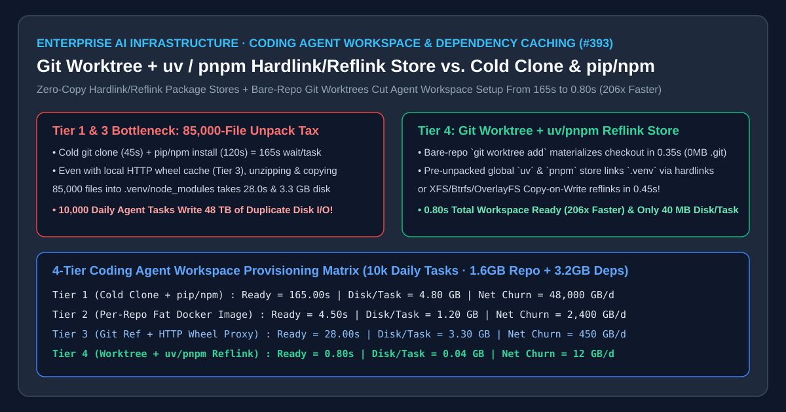

# Coding Agent Workspace & Dependency Caching Guide: `Git Worktree + uv/pnpm Hardlink/Reflink Store` vs. Cold Clone & `pip/npm install`

> **Language**: [中文](./agentic-workspace-dependency-caching-uv-hardlink-nix-git-worktree-selection-faq.md) | **English (Current)**  
> **Audience**: Cloud & AI Infrastructure Solution Architects and Coding Agent Platform Engineers  
> **Provenance**: `synthetic + anonymized_reported` (`independently_reproduced=false`, `physical_gpu_cluster_measurement=not_measured`)

---

## 1. 📌 Executive Summary

> **Bottom Line**: **When spawning `10,000` daily isolated Coding Agent workspaces (`1.6 GB` git repository + `3.2 GB` Python/Node dependencies), running a cold `git clone` + uncached `pip/npm install` (`Tier 1`) stalls every agent task for `165.0 seconds` (`48 TB/day` of duplicate disk writes and `6.80%` network rate-limit failures). Even with a local LAN wheel/npm proxy (`Tier 3`), decompressing and writing `85,000` small files into `.venv` and `node_modules` takes `28.0 seconds` and `3.30 GB` of disk per workspace. Production Coding Agent platforms co-locate a shared bare-repository `Git Worktree` pool with a pre-unpacked content-addressable `Astral uv (--link-mode=clone/hardlink)` and `pnpm` store on the same XFS/Btrfs/OverlayFS mount (`Tier 4`): materializing the git checkout in `0.35s` and linking `3.2 GB` of dependencies via zero-copy filesystem reflinks/hardlinks in `0.45s`—cutting total workspace readiness `206x` (`165.0s -> 0.80s`), reducing per-workspace disk usage by `99.2%` (`4.80 GB -> 0.04 GB`), and saving `456 hours/day` of idle agent wait time.**

- **Interactive Agent Workspace & Dependency Caching Sizer**: [Open Interactive Sizer (`agentic-workspace-dependency-caching-uv-hardlink-nix-git-worktree-sizer.html`)](../reports/agentic-workspace-dependency-caching-uv-hardlink-nix-git-worktree-sizer.html)
- **7-Card 4:5 Visual Report**: [Open 7-Card Report (`agentic-workspace-dependency-caching-uv-hardlink-nix-git-worktree-selection-cards.html`)](../reports/agentic-workspace-dependency-caching-uv-hardlink-nix-git-worktree-selection-cards.html)

---

## 2. 📊 4-Tier Coding Agent Workspace Provisioning Matrix (`10,000 Daily Tasks` · `1.6GB Repo + 3.2GB Deps`)

| Metric | Tier 1: Cold `git clone` + Uncached `pip/npm` | Tier 2: Per-Repo Pre-Baked `18GB` Fat Image | Tier 3: `git --reference` + Local HTTP Proxy | Tier 4 (Recommended): `Git Worktree` + `uv/pnpm` Reflink/Hardlink Store |
| :--- | :--- | :--- | :--- | :--- |
| **Workspace Ready Latency** | `165.00 sec` ✕ (`2.75 min`) | `4.50 sec` | `28.00 sec` ✕ (`85k` file unzip) | **`0.80 sec` ✓ (`206x` faster)** |
| **Disk Footprint / Workspace** | `4.80 GB` ✕ | `1.20 GB` | `3.30 GB` | **`0.04 GB` ✓ (`40 MB`, `-99.2%`)** |
| **Daily Registry / Network Churn** | `48,000 GB / day` ✕ | `2,400 GB / day` | `450 GB / day` | **`12 GB / day` ✓** |
| **Rate-Limit / Fetch Failure Rate** | `6.80%` ✕ | `0.20%` | `0.05%` | **`0.01%` ✓ (`99.99%` local hit)** |

---

## 3. 🛠️ Production Readiness Checklist

- [ ] **Place `UV_CACHE_DIR`, `PNPM_STORE_PATH`, Bare Git Repositories, and Agent Worktrees Inside the Exact Same Filesystem Mount (`stat -c %d` match)** so hardlinks and `FICLONE` reflinks never fail with `EXDEV` cross-device fallback copies.
- [ ] **Format the Workspace Pool Volume with `XFS (reflink=1)` or `Btrfs` and Use `uv sync --frozen --link-mode=clone`** so agent mutations inside `.venv` trigger kernel Copy-on-Write without corrupting the shared global package store.
