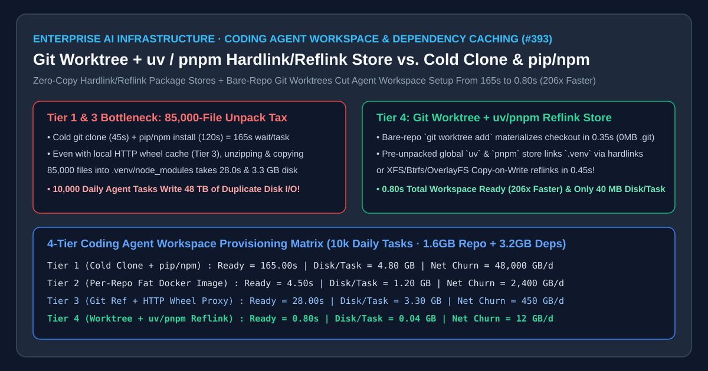
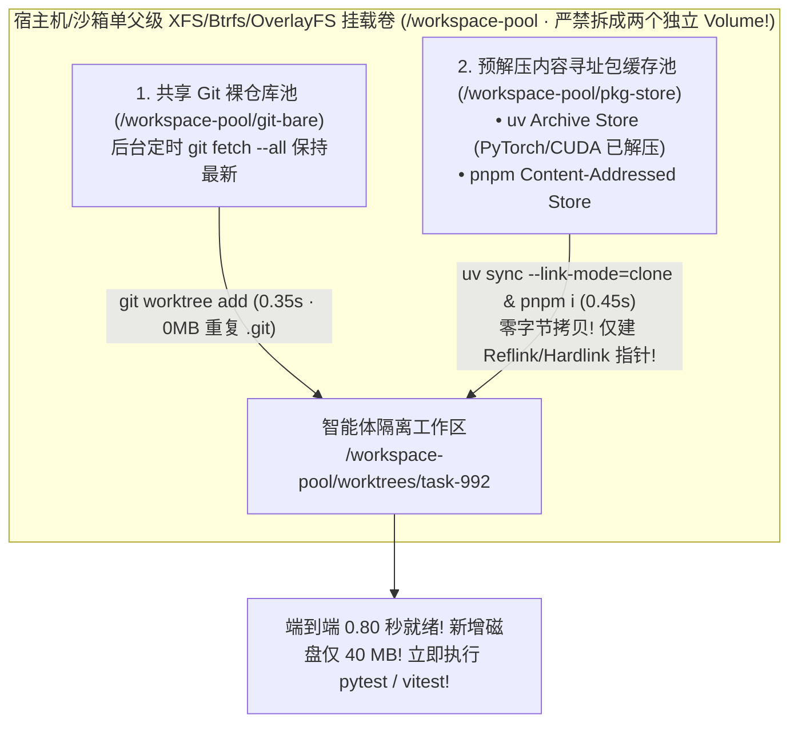

# 企业级 Coding Agent 工作区初始化与依赖秒级挂载选型：`Git Worktree + uv/pnpm 内容寻址硬链接/Reflink 缓存池` vs. 冷克隆 `pip/npm install` 与胖镜像指南

> **语言 / Language**: **中文 (当前)** | [English](./agentic-workspace-dependency-caching-uv-hardlink-nix-git-worktree-selection-faq.en.md)  
> **定位**：面向 Cloud & AI Infrastructure Solution Architect 与企业研发智能体（Coding Agent / 并发 RL 代码沙箱 / SWE-bench 评测集群）架构师的工作区与依赖环境极速供给选型（宿主机共享裸仓库 `Git Worktree` + `Astral uv / pnpm` 预解压内容寻址 `Hardlink / XFS-Btrfs Reflink (FICLONE)` 共享存储池 vs. 每次 `git clone + pip/npm install` 或每仓库打 18GB 胖镜像）、将单工作区就绪耗时从 `165 秒` 暴砍 `206 倍` 至 `0.80 秒` 的生产白皮书  
> **合规与来源声明**：`synthetic + anonymized_reported`（`independently_reproduced=false`，`physical_gpu_cluster_measurement=not_measured`；完全面向通用企业级高并发编程智能体工作树与构建缓存基础设施设计）

---

## 1. 📌 核心选型结论速览（Executive Summary）

> **一句话结论**：**当企业每天并发拉起 `10,000 个` 隔离的 Coding Agent 任务工作区（代码仓 `.git` `1.6 GB` + Python PyTorch/CUDA 与 Node.js 依赖包 `3.2 GB`）来自动修 Bug、跑单元测试或做代码强化学习（RL Rollout）时，虽然微虚拟机或容器本身 1 秒就启动了，但智能体却要在沙箱里傻等 **`165.0 秒`（近 3 分钟！）** 的 `git clone`（`45s`）和 `pip install / npm install`（`120s`，Tier 1），每天在集群 NVMe 盘上产生 **`48 TB` 的重复磁盘写入** 并有 `6.8%` 的任务死于公网源限流！即便搭了内网 HTTP Wheel/npm 代理缓存（Tier 3），把 `3.2 GB` 压缩包解压并写出 **`85,000 个` 零碎小文件** 到 `.venv` 和 `node_modules` 依然要卡死 **`28.0 秒`**！生产环境黄金准则是采用“同文件系统挂载的共享裸仓 `Git Worktree / OverlayFS` + 预解压内容寻址存储池 `Astral uv (--link-mode=clone/hardlink) + pnpm Store`（Tier 4）”：`git worktree add` 在 **`0.35 秒`** 内零拷贝检出工作树，`uv` 与 `pnpm` 直接通过文件系统级 **`O(1)` 硬链接或 XFS/Btrfs 写时复制 Reflink (`FICLONE`)** 在 **`0.45 秒`** 内瞬间装配完含 `85,000 个` 文件的 `.venv` 与 `node_modules`——将端到端工作区就绪耗时从 `165.0 秒` 压缩 **`206 倍` 至 `0.80 秒`**，单工作区新增磁盘占用从 `4.80 GB` 降至 **`0.04 GB`（40 MB，省 `99.2%` 磁盘）**，每天为集群节省 **`456 小时`** 的空等时间！**

- **交互式 Coding Agent 工作区与依赖缓存容量计算器**：[打开交互式计算器 (`agentic-workspace-dependency-caching-uv-hardlink-nix-git-worktree-sizer.html`)](../reports/agentic-workspace-dependency-caching-uv-hardlink-nix-git-worktree-sizer.html)
- **7-Card 4:5 视觉评测报告**：[打开 7-Card 报告 (`agentic-workspace-dependency-caching-uv-hardlink-nix-git-worktree-selection-cards.html`)](../reports/agentic-workspace-dependency-caching-uv-hardlink-nix-git-worktree-selection-cards.html)

---

## 2. 🎯 客户与架构师灵魂拷问 Q&A（Deep-Dive Architecture FAQ）

### Q1：为什么配了局域网 `DevPI / Verdaccio` 镜像源（Tier 3）还是要等 `28 秒`？`uv` 和 `pnpm` 的内容寻址缓存池在 K8s 挂载时最容易踩的“跨挂载点失效坑（`EXDEV`）”是什么？
1. **为什么传统 `pip` / `npm` 即使不走外网也慢（85,000 个小文件的 Inode 元数据风暴）**：
   - 一个典型的 Python AI + Web 项目（`torch`, `transformers`, `fastapi`, `typescript`, `nextjs`）展开后包含 **`85,000+` 个零碎 `.py / .so / .js` 文件**。传统 `pip` 先从缓存读 `.whl` zip 包，在 CPU 上解压，再调用 85,000 次 `open() + write() + close()` 落盘，彻底打爆 NVMe 的小文件元数据 IOPS！
   - 而 **`Astral uv` 与 `pnpm`** 在全局缓存池（Store）里保存的是**已经解压好的内容寻址文件目录**！创建新虚拟环境时，根本不做解压和数据块拷贝，只做内存级的目录树 `link()` 或 `ioctl(FICLONE)` 指针引用，**`0.45 秒` 瞬间完成 3.2 GB 环境装配**！
2. **K8s 容器挂载头号踩坑红线（`EXDEV: Cross-device link not permitted`）**：
   - Linux 操作系统的硬链接（Hardlink）和写时复制（Reflink `FICLONE`）有一条铁律：**源缓存目录与目标工作区 `.venv` 必须位于同一个底层文件系统挂载点（Same Mount Point）内**！
   - 如果你在 K8s 里把 `/root/.cache/uv` 挂成 Volume A，把 `/workspace` 挂成 Volume B（哪怕底层都是同一块宿主机 NVMe 盘上的不同子目录），Linux VFS 也会认为它们是两个不同的设备挂载点而报 `EXDEV` 错误，导致 `uv / pnpm` 悄悄退化回慢吞吞的全量文件拷贝（从 `0.80s` 退化回 `19.5s`）！
   - **正确解法**：在容器内将**同一个父级卷**挂载到 `/workspace-pool`，在里面同时存放 `/workspace-pool/uv-cache`、`/workspace-pool/git-bare` 和 `/workspace-pool/worktrees/task-01`！

---

## 3. 🧭 直观可视化图解（Mermaid 同挂载点 `Git Worktree + uv/pnpm Reflink` 0.8秒极速装配架构图）

---

## 4. 📊 架构师四级 Coding Agent 工作区与依赖供给选型矩阵（日均 `10,000` 个工作区 · `1.6GB` 仓库 + `3.2GB` 依赖）

| 评估维度 | Tier 1：全量冷 `git clone` + 无缓存 `pip/npm install` | Tier 2：每仓库预打 `18GB` 胖容器镜像 | Tier 3：`git --reference` + 局域网 HTTP 缓存源 (`DevPI`) | Tier 4（推荐）：同卷 `Git Worktree` + `uv / pnpm` 内容寻址 `Reflink/Hardlink` 池 |
| :--- | :--- | :--- | :--- | :--- |
| **工作区 + 依赖完全就绪耗时** | `165.00 秒` ✕（干等近 3 分钟） | `4.50 秒` | `28.00 秒` ✕（卡在 8.5 万文件解压） | **`0.80 秒` ✓（比冷拉取快 `206 倍`！）** |
| **每个新增工作区消耗物理磁盘** | `4.80 GB / 个` ✕ | `1.20 GB / 个` | `3.30 GB / 个` | **`0.04 GB / 个` ✓（仅 40MB，省 `99.2%`）** |
| **日均镜像仓库/网络流量冲击** | `48,000 GB / 天` ✕ | `2,400 GB / 天`（锁文件一改就重推 18GB） | `450 GB / 天` | **`12 GB / 天` ✓（仅同步增量差值）** |
| **外网限流 / 源抖动导致失败率** | `6.80%` ✕ | `0.20%` | `0.05%` | **`0.01%` ✓（99.99% 离线闭环命中）** |

---

## 5. 🛠️ 架构评审与生产落地 Checklist

- [ ] **强制将 `UV_CACHE_DIR`、`PNPM_STORE_PATH` 与智能体工作树根目录放在同一个挂载点（Same Volume Mount）下**：通过 `stat -c %d` 校验缓存目录与 `.venv` 目录的设备号（Device ID）完全相同，确保 `100%` 走零拷贝链接而非降级拷贝。
- [ ] **若多租户安全要求防智能体篡改共享硬链接文件，底层文件系统优先启用 XFS / Btrfs（`mkfs.xfs -m reflink=1`）并使用 `uv --link-mode=clone`**（写时复制 Reflink）：既享受硬链接的 `0.45 秒` 零拷贝装配速度，又保证智能体修改 `.venv` 内任何文件时自动触发内核级 Copy-on-Write 私有化，绝不污染全局缓存池！
