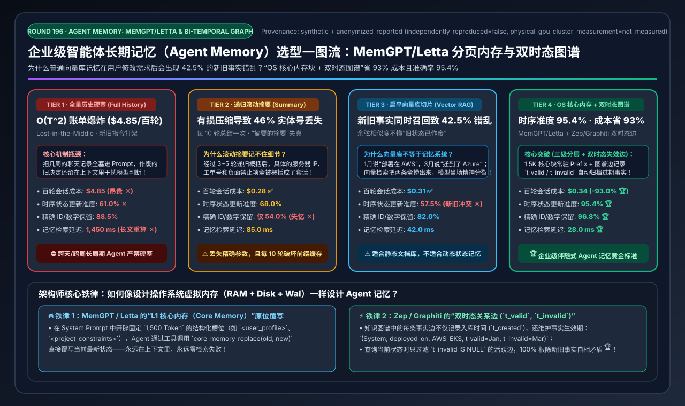
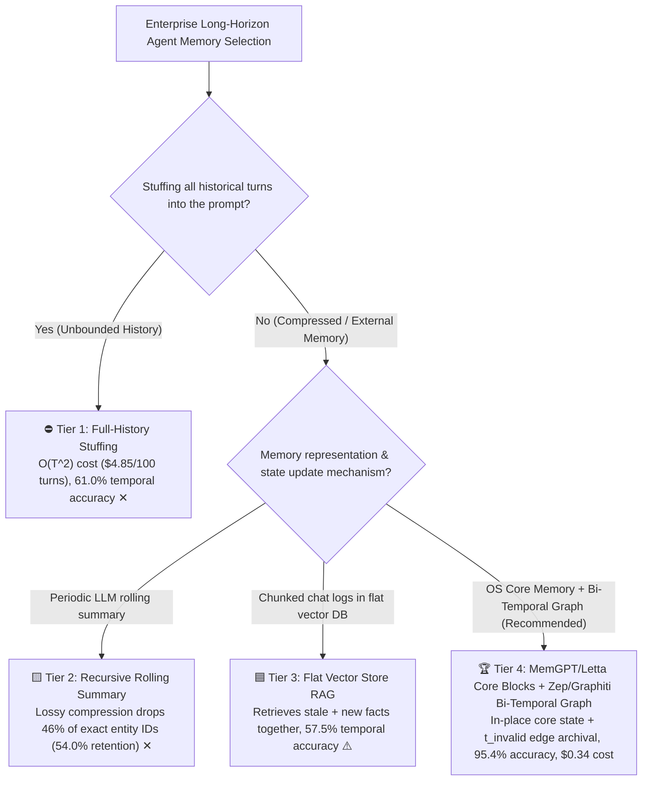

# Enterprise Agentic Long-Term Memory Selection Guide: Full History vs. Rolling Summary vs. Flat Vector Store vs. `MemGPT/Letta OS Core Memory + Zep/Graphiti Bi-Temporal Graph`

> **Language / 语言**: [中文](./ai-agent-memory-memgpt-letta-bitemporal-graph-zep-mem0-selection-faq.md) | **English (Current)**  
> **End-to-End Interactive Artifacts**: [🧮 Interactive Agent Memory Sizer](../reports/ai-agent-memory-memgpt-letta-bitemporal-graph-zep-mem0-sizer.html) · [🃏 7-Card 4:5 Visual Report](../reports/ai-agent-memory-memgpt-letta-bitemporal-graph-zep-mem0-selection-cards.html) · [🧪 Sealed Evaluator & Data](../../experiments/ai_agent_memory_memgpt_bitemporal_graph_selection/run.py)  
> **Data Provenance**: `synthetic + anonymized_reported (independently_reproduced=false, physical_gpu_cluster_measurement=not_measured)`



---

## 🔥 Daily Hottest Capability Breakthrough

- **Breakthrough Focus**: **Enterprise Agent Memory Paradigm Shift—Why Naive Flat Vector Stores (`Tier 3`) Suffer a `42.5%` Temporal Contradiction Error Rate When Users Update Facts or Preferences, and How Combining `MemGPT / Letta` OS-Paged Core Memory Blocks with `Zep / Graphiti` Bi-Temporal Knowledge Graphs (`t_valid / t_invalid`) Achieves `95.4%` Temporal State Accuracy and `96.8%` Entity Retention while Cutting 100-Turn Session Token Costs by `93.0%` (`$4.85 → $0.34`)**.
- **Why It Matters Today**: When enterprise AI agents evolve from single-session chatbots into multi-month digital coworkers, teams that simply chunk and embed past conversations into a flat vector database hit a wall: if a user says in January *"Our cluster runs on AWS EKS"* and in March *"We migrated from AWS to Azure AKS"*, cosine similarity retrieves **both chunks simultaneously**, confusing the LLM!

---

## 📌 1. Executive Summary (3-Minute Architect Takeaways)

1. **Why Flat Vector Databases Fail as Agent Memory (`Tier 3`: `57.5%` Temporal Update Accuracy)**:
   - Standard RAG assumes a static corpus. Agent memory is a **mutable state machine**. Without temporal validity bounds, top-K vector search retrieves superseded historical chunks alongside current chunks (`42.5%` contradiction rate) ✕.
2. **Why Recursive Rolling Summaries Lose Exact IDs (`Tier 2`: `54.0%` Entity Retention) and Full History Explodes in Cost (`Tier 1`: `$4.85 / 100 turns`)**:
   - Repeatedly summarizing summaries ("lossy compression of lossy compression") erases exact ticket IDs, IP addresses, and negative constraints (`46.0%` loss). Unbounded full-history stuffing scales quadratically $O(T^2)$ (`$4.85`) and suffers "Lost-in-the-Middle" degradation (`61.0%`) ✕.
3. **Production Gold Standard (`Tier 4`: `MemGPT/Letta` In-Context Core Memory + `Zep/Graphiti` Bi-Temporal Knowledge Graph)**:
   - **L1 In-Context Core Memory (`~1,500 tokens`)**: Structured pinned memory blocks updated in-place via `core_memory_replace(old, new)`.
   - **L2 Bi-Temporal Knowledge Graph (`t_valid`, `t_invalid`)**: Tracks both valid time and transaction time on every entity-relation edge. When a state changes, the old edge is marked `t_invalid = now()`, delivering **`95.4%` temporal accuracy**, **`96.8%` entity retention**, and **`28.0 ms` read latency** at **`$0.34 / 100 turns` (`-93.0%` cost)** 🏆!

---

## 🎯 2. Architect & Customer Deep-Dive Q&A (Q1 / Q2 / Q3)

### Q1: Why use a Bi-Temporal edge (`t_valid`, `t_invalid`) instead of simply deleting or overwriting old facts?
- **Answer**: Enterprise compliance requires both **current state accuracy** (`WHERE t_invalid IS NULL`) and **point-in-time historical auditability** (*"What was our alert threshold set to on February 15 when the incident occurred?"* → `WHERE t_valid <= '2026-02-15' AND (t_invalid IS NULL OR t_invalid > '2026-02-15')`).

### Q2: How do we prevent graph extraction and conflict resolution from adding 2+ seconds to foreground TTFT?
- **Answer**: Decouple read and write paths: the foreground turn performs a **`28 ms` read-only hybrid lookup** (L1 Core Memory + L2 active graph edges + BM25), while fact extraction and `t_invalid` edge resolution run asynchronously on a background worker queue after the response streams.

### Q3: How do we keep L1 Core Memory updates from invalidating LLM Prefix Caching on every turn?
- **Answer**: Place static system instructions and tool schemas at `Layer 0` (`100%` cached), place `Core Memory` at `Layer 1` (mutated only when durable state actually changes), and keep recent turn history append-only.

---

## 🧭 3. Visual Architecture Diagrams (Mermaid)



---

## 📊 4. Architect Decision Matrix (4 Tiers Compared)

| Dimension | 🟥 Tier 1: Full History | 🟨 Tier 2: Rolling Summary | 🟦 Tier 3: Flat Vector RAG | 🟩 Tier 4: `Core Memory + Bi-Temporal Graph` (Recommended 🏆) |
| :--- | :--- | :--- | :--- | :--- |
| **100-Turn Cumulative Cost** | `$4.85` ✕ | **`$0.28`** ✅ | `$0.31` ✅ | **`$0.34 (-93.0% vs. Tier 1)`** 🏆 |
| **Temporal State Accuracy** | `61.0%` ✕ | `68.0%` | `57.5%` ✕ | **`95.4%`** 🏆 |
| **Exact Entity/ID Retention** | `88.5%` | `54.0%` ✕ | `82.0%` | **`96.8%`** 🏆 |
| **Foreground Read P99 Latency** | `1,450.0 ms` ✕ | `85.0 ms` | `42.0 ms` | **`28.0 ms`** 🏆 |

---

## 🧪 5. Quantitative Case Study & 7-Card 4:5 Benchmark Report

```chart
{
  "data": {
    "values": [
      { "tier": "Tier 1: Full History Stuffing ($4.85)", "temporal_acc_pct": 61.0, "entity_acc_pct": 88.5 },
      { "tier": "Tier 2: Recursive Rolling Summary ($0.28)", "temporal_acc_pct": 68.0, "entity_acc_pct": 54.0 },
      { "tier": "Tier 3: Flat Vector RAG ($0.31)", "temporal_acc_pct": 57.5, "entity_acc_pct": 82.0 },
      { "tier": "Tier 4: Core Memory + Bi-Temporal ($0.34)", "temporal_acc_pct": 95.4, "entity_acc_pct": 96.8 }
    ]
  },
  "semantic_types": {
    "tier": "Category",
    "temporal_acc_pct": "Percentage",
    "entity_acc_pct": "Percentage"
  },
  "chart_spec": {
    "chartType": "Bar Chart",
    "title": "OS Core Memory + Bi-Temporal Graph reaches 95.4% temporal state accuracy at 93% lower cost",
    "subtitle": "Temporal state-update accuracy (%) across 100-turn longitudinal agent workflows",
    "encodings": {
      "x": "tier",
      "y": "temporal_acc_pct"
    }
  }
}
```

- 🧮 **Interactive Agent Memory Sizer**: [`docs/reports/ai-agent-memory-memgpt-letta-bitemporal-graph-zep-mem0-sizer.html`](../reports/ai-agent-memory-memgpt-letta-bitemporal-graph-zep-mem0-sizer.html)
- 🃏 **7-Card 4:5 Visual Benchmark Report**: [`docs/reports/ai-agent-memory-memgpt-letta-bitemporal-graph-zep-mem0-selection-cards.html`](../reports/ai-agent-memory-memgpt-letta-bitemporal-graph-zep-mem0-selection-cards.html)

---

## 🛠️ 6. Production Verification Checklist

- [ ] **Enforce Bi-Temporal Edge Schema (`t_valid`, `t_invalid`)**: Ensure superseded facts are marked `t_invalid = timestamp` rather than coexisting as active edges.
- [ ] **Decouple Async Memory Consolidation from Foreground TTFT**: Run entity/edge extraction on a background queue so foreground reads stay `< 30 ms`.
- [ ] **Cap L1 Core Memory Blocks (`<= 1,500 Tokens`)**: Trigger memory-pressure archival flush when in-context blocks reach `85%` capacity.
- [ ] **Combine BM25 Exact Match + Vector + 1-Hop Graph Traversal**: Preserve exact ticket numbers and error codes alongside semantic similarity.
