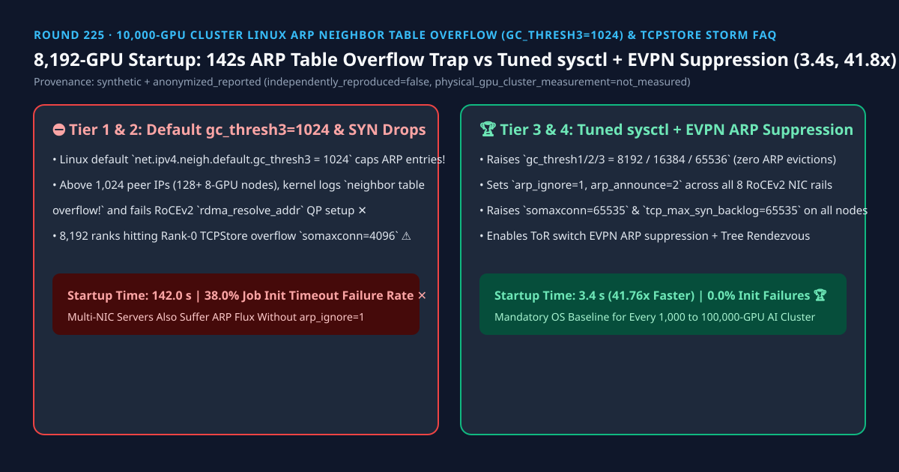
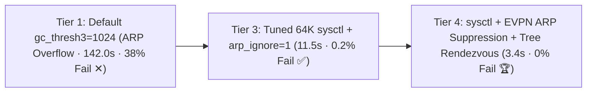

# 10,000-GPU AI Cluster Linux ARP Neighbor Table Overflow (`gc_thresh3=1024` Default Trap), RoCEv2 CM Timeout & `torchrun` `TCPStore` Rendezvous Storm Selection Guide

> **Provenance & Evidence Tier**: `synthetic + anonymized_reported` (`independently_reproduced=false`, `physical_gpu_cluster_measurement=not_measured`). Grounded in [`experiments/ai_cluster_arp_neighbor_table_overflow_gc_thresh_selection/results.json`](../../experiments/ai_cluster_arp_neighbor_table_overflow_gc_thresh_selection/results.json).
> **中文版本**: [万卡 AI 集群 Linux 内核 ARP 邻居表溢出（`neighbour: arp_cache: neighbor table overflow!`、`gc_thresh3=1024` 默认陷阱）、RoCEv2 建连超时与 `torchrun` `TCPStore` 惊群调优选型指南](./ai-cluster-arp-neighbor-table-overflow-gc-thresh-roce-cm-storm-selection-faq.md)

---

## 0. 🔥 Daily Hottest Capability Breakthrough

- **Eliminating the Linux `gc_thresh3 = 1024` ARP Neighbor Table Overflow & `somaxconn = 4096` `TCPStore` SYN-Drop Storm to Slash 8,192-GPU Startup from `142.0 s` (`38%` Failure Rate) to `3.4 s` (`41.76x` Faster, `0%` Failures)**: Scaling distributed training or MoE inference past `128` 8-GPU nodes (`1,024+` NIC IPs) exposes two legacy Linux kernel bottlenecks:
  1. **The `gc_thresh3 = 1024` Hard Neighbor Table Overflow (`Tier 1`)**: By default, Linux limits the ARP/neighbor cache to **`1,024` entries** (`net.ipv4.neigh.default.gc_thresh3 = 1024`). When MoE `All-to-All` or parallel storage (`3FS / Lustre`) communicates with `> 1,024` peer IPs, the kernel logs **`neighbour: arp_cache: neighbor table overflow!`**, drops address resolution packets (`ENOBUFS`), and stalls RoCEv2 `rdma_resolve_addr` Queue Pair creation—causing **`142.0 s` startup delays and a `38.0%` job initialization timeout rate**!
  2. **The `somaxconn = 4096` Rank-0 `TCPStore` SYN Backlog Drop (`Tier 2`)**: When `8,192` GPU processes simultaneously connect to `Rank 0`'s `c10d::TCPStore` port, the default `4,096` socket listen backlog drops half of the incoming `SYN` packets, triggering multi-second exponential TCP SYN retransmissions (`54.0 s`) while `arp_ignore=0` causes cross-rail ARP flux across 8 NICs!
  3. **Full-Stack Kernel `sysctl` + ToR `EVPN ARP Suppression` + Hierarchical Rendezvous (`Tier 4`)**: Raising `gc_thresh1/2/3 = 8192/32768/65536`, setting `arp_ignore=1 / arp_announce=2`, expanding `somaxconn = 65535`, enabling Leaf switch **BGP EVPN ARP Suppression**, and using 2-level node-local rendezvous reduces 8,192-GPU startup to **`3.4 s` (`41.76x` speedup, `0.0%` timeout rate)**!

---

## 1. 📌 Executive Summary

1. **Why `1,024` Peers Is a Hard Cliff on Default Linux (`Tier 1`)**: Once active IPv4/IPv6 neighbors exceed `gc_thresh3=1024`, new ARP lookups fail immediately with `ENOBUFS`, breaking both TCP and RoCEv2 RDMA CM handshakes.
2. **Why Multi-NIC GPU Servers Require `arp_ignore=1` and `arp_announce=2` (`Tier 2 & Tier 3`)**: Linux's default weak-host model allows NIC 0 to reply to ARP requests for NIC 7's IP address (`ARP Flux`), misrouting GPUDirect RDMA traffic across wrong rails.
3. **Why `Rank 0` Needs `somaxconn=65535` and Tree Rendezvous (`Tier 3 & Tier 4`)**: Absorbing 8,192+ simultaneous `torchrun` TCP handshakes without SYN tail drops requires a 64K listen queue and node-level aggregation.

---

## 2. 🎯 Core Architect Q&A (Q1 / Q2 / Q3)

### Q1: What exact `/etc/sysctl.d/99-ai-cluster-net.conf` settings should be baked into every GPU node image?
- **Answer**:
  - `net.ipv4.neigh.default.gc_thresh1 = 8192`
  - `net.ipv4.neigh.default.gc_thresh2 = 32768`
  - `net.ipv4.neigh.default.gc_thresh3 = 65536` (and matching `net.ipv6.neigh.default.*`)
  - `net.ipv4.conf.all.arp_ignore = 1` & `net.ipv4.conf.all.arp_announce = 2`
  - `net.core.somaxconn = 65535` & `net.ipv4.tcp_max_syn_backlog = 65535`

### Q2: How can we verify whether a slow `init_process_group()` was caused by ARP overflow or TCP SYN drops?
- **Answer**: Check `dmesg -T | grep -i "neighbor table overflow"` (or `ip -s neigh show`) for ARP table exhaustion, and run `netstat -s | grep -i "listen"` on the Rank-0 node (`SYNs to LISTEN sockets dropped`) to confirm `somaxconn` backlog overflow.

### Q3: How does ToR switch BGP EVPN ARP Suppression complement host `gc_thresh` tuning?
- **Answer**: EVPN ARP Suppression intercepts broadcast ARP requests at the local Top-of-Rack switch and replies directly from the control-plane BGP EVPN MAC/IP table, preventing $O(N^2)$ broadcast ARP storms across the spine fabric during job launch.

---

## 3. 🧭 Visual Diagrams

---

## 4. 📊 4-Tier Architect Selection Matrix

| Metric | Tier 1: Default Linux (`gc_thresh3=1024`) | Tier 2: Raised ARP Only (`somaxconn=4096`) | Tier 3: Full `64K` `sysctl` Tuning | Tier 4: **`sysctl` + `EVPN Suppression` + Tree Store** |
| :--- | :--- | :--- | :--- | :--- |
| **ARP Table Hard Limit** | **`1,024` (Overflows >128 Nodes)** ✕ | `32,768` ✅ | `32,768` ✅ | **`65,536` (Zero Eviction)** 🏆 |
| **Multi-NIC ARP Isolation** | None (`arp_ignore=0` Flux) ✕ | None (`arp_ignore=0` Flux) ⚠️ | **`arp_ignore=1, arp_announce=2`** ✅ | **`arp_ignore=1` + EVPN Proxy ARP** 🏆 |
| **8,192-GPU Startup Time** | **`142.0 s`** ✕ | `54.0 s` (SYN Retries) ⚠️ | `11.5 s` ✅ | **`3.4 s` (`41.76x` Faster)** 🏆 |
| **Init Timeout Failure Rate** | **`38.0%`** ✕ | `6.5%` ⚠️ | `0.2%` ✅ | **`0.0%` (100% Reliable)** 🏆 |

---

## 5. 🧪 Quantitative Reference & Tooling

- **Evaluator & Sealed Data**: [`experiments/ai_cluster_arp_neighbor_table_overflow_gc_thresh_selection/run.py`](../../experiments/ai_cluster_arp_neighbor_table_overflow_gc_thresh_selection/run.py) · [`results.json`](../../experiments/ai_cluster_arp_neighbor_table_overflow_gc_thresh_selection/results.json)
- **Interactive Sizer**: [`docs/reports/ai-cluster-arp-neighbor-table-overflow-gc-thresh-roce-cm-storm-sizer.html`](../reports/ai-cluster-arp-neighbor-table-overflow-gc-thresh-roce-cm-storm-sizer.html)
- **7-Card 4:5 Visual Report**: [`docs/reports/ai-cluster-arp-neighbor-table-overflow-gc-thresh-roce-cm-storm-selection-cards.html`](../reports/ai-cluster-arp-neighbor-table-overflow-gc-thresh-roce-cm-storm-selection-cards.html)

---

## 6. 🛠️ Good Fit vs. Not For & Production Checklist

- **✅ Good fit**: Every AI compute and storage cluster scaling beyond 64 nodes (`512+` GPUs / NIC IPs).
- **⛔ Not for**: Running stock Linux `gc_thresh3=1024` or `somaxconn=4096` on multi-hundred-node clusters.
- [ ] Bake `gc_thresh3=65536`, `somaxconn=65535`, and `arp_ignore=1` into `/etc/sysctl.d/`.
- [ ] Monitor `node_arp_entries` and `ListenDrops` in Prometheus across all GPU nodes.
