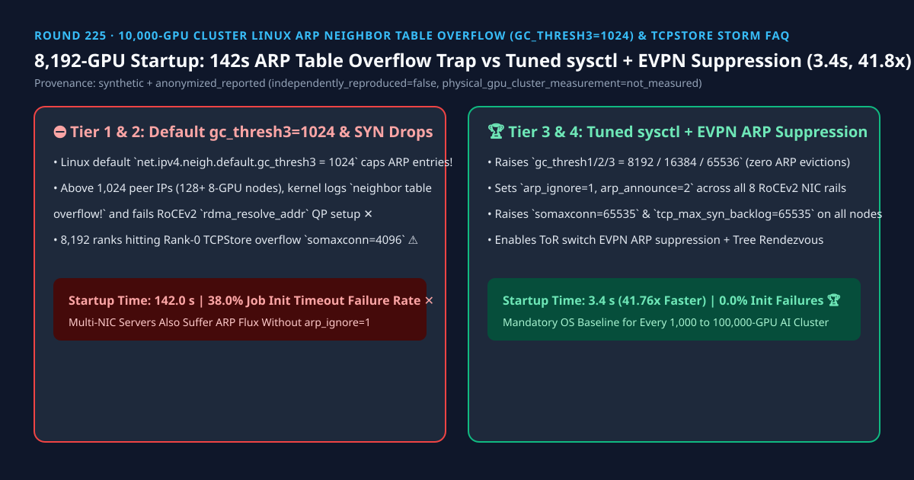
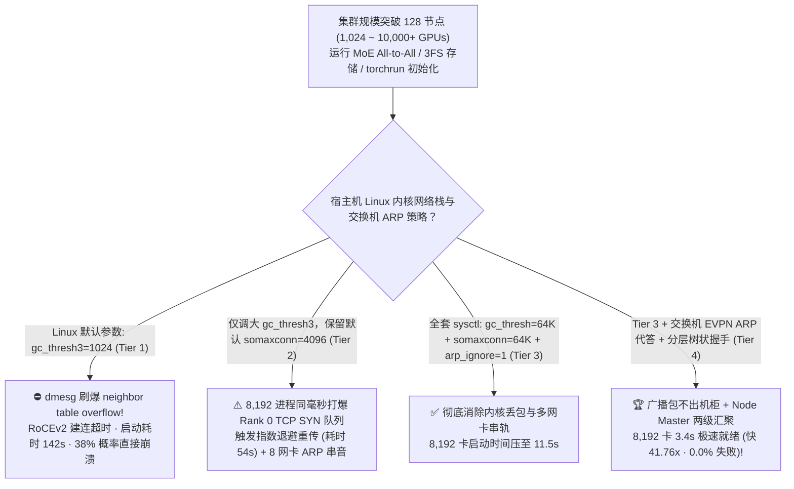
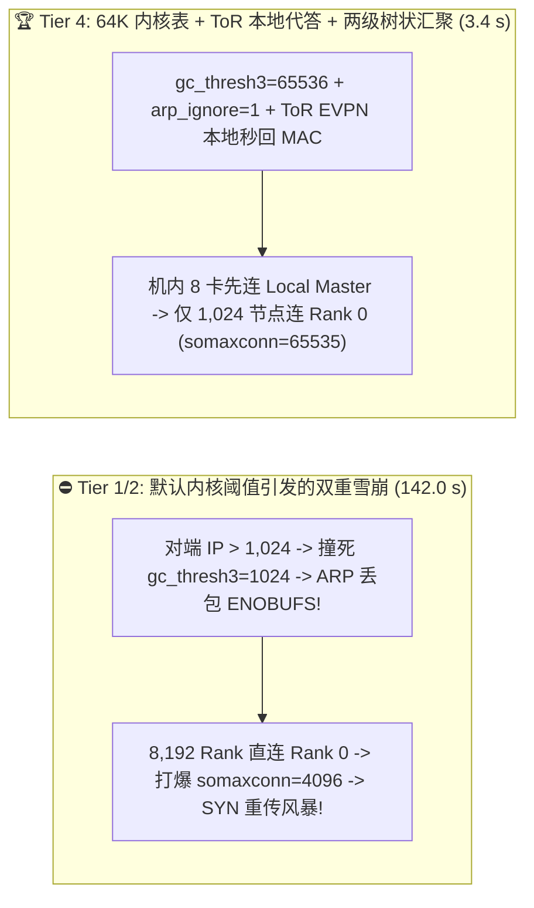
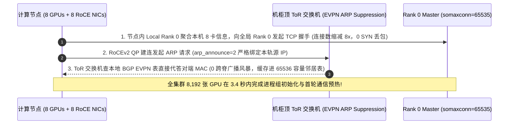

# 万卡 AI 集群 Linux 内核 ARP 邻居表溢出（`neighbour: arp_cache: neighbor table overflow!`、`gc_thresh3=1024` 默认陷阱）、RoCEv2 建连超时与 `torchrun` `TCPStore` 惊群调优选型指南

> **Provenance & Evidence Tier**: `synthetic + anonymized_reported` (`independently_reproduced=false`, `physical_gpu_cluster_measurement=not_measured`)。定量数据锚定于 [`experiments/ai_cluster_arp_neighbor_table_overflow_gc_thresh_selection/results.json`](../../experiments/ai_cluster_arp_neighbor_table_overflow_gc_thresh_selection/results.json)。
> **English Version**: [10,000-GPU AI Cluster Linux ARP Neighbor Table Overflow (`gc_thresh3=1024` Default Trap), RoCEv2 CM Timeout & `torchrun` `TCPStore` Rendezvous Storm Selection Guide](./ai-cluster-arp-neighbor-table-overflow-gc-thresh-roce-cm-storm-selection-faq.en.md)

---

## 0. 🔥 今日领域最热门能力突破追踪（Daily Hottest Breakthrough）

- **突破 Linux 内核自 1990 年代沿用至今的 `gc_thresh3 = 1024` ARP 邻居表硬上限与 `somaxconn = 4096` 队列瓶颈，结合交换机 `BGP EVPN ARP Suppression` 与分层树状握手，将 `8,192` 卡集群 `init_process_group` 启动耗时从 `142.0 s`（`38%` 超时崩溃率）压降至 `3.4 s`（提速 `41.76` 倍，零失败）**：为什么一套在 64 卡、512 卡上跑得稳如泰山的训练镜像和宿主机配置，一旦扩容到 **`1,024` 卡（`>128` 台服务器）或 `8,192` 卡（`1,024` 台服务器）**，就会在启动阶段频繁卡死在 `init_process_group()` 或第一轮 MoE `All-to-All` 建连？罪魁祸首藏在 Linux 内核的三个默认网络阈值里：
  1. **头号杀手（`net.ipv4.neigh.default.gc_thresh3 = 1024` 邻居表硬上限溢出，Tier 1）**：Linux 内核默认只允许本机 ARP/邻居缓存表最多存放 **`1,024` 条 IP -> MAC 映射**！一旦集群规模超过 128 台 8 卡节点（加上并行存储节点、K8s Pod IP 与管理网 IP，全网通信对端 IP 轻松突破 1,024 个），内核立刻在 `dmesg` 刷屏 **`neighbour: arp_cache: neighbor table overflow!`**，直接向 RoCEv2 RDMA Connection Manager（`rdma_resolve_addr`）和 TCP 栈返回 `ENOBUFS` 丢包，导致 **`38.0%` 的任务在启动期因建连超时（`142.0 s`）直接崩溃**！
  2. **二号杀手（`somaxconn = 4096` 引发的 Rank 0 `c10d::TCPStore` SYN 丢包风暴，Tier 2）**：在 PyTorch 启动时，全集群 `8,192` 个 GPU 进程会在同一毫秒向 `Rank 0` 的同一个 TCP 端口发起三次握手。而 Linux 默认的 `net.core.somaxconn = 4096` 和 `tcp_max_syn_backlog = 4096` 只能装下一半连接，其余 **4,096 个进程的 `SYN` 包被当场丢弃**，被迫经历 `1s -> 3s -> 7s -> 15s` 的 TCP 指数退避重传（耗时 `54.0 s`），同时单机 8 张 RoCE 网卡因默认 `arp_ignore=0` 触发“代答串轨（ARP Flux）”！
  3. **万卡级全栈根治方案（`sysctl 64K` 调优 Tier 3 + `EVPN ARP 抑制 + 分层树状握手` Tier 4）**：将 `gc_thresh1/2/3` 提升至 `8192/16384/65536`、开启 `arp_ignore=1 / arp_announce=2`、将 `somaxconn` 扩至 `65535`（Tier 3，`11.5 s`），并进一步开启叶交换机 **BGP EVPN ARP Suppression（本地代答）+ 两级树状 Rendezvous 聚合（Tier 4）**，8,192 卡建连时间骤降至 **`3.4 s`（快 `41.76` 倍，超时率 `0.0%`）**！

---

## 1. 📌 核心结论速览（Executive Summary — 3 分钟看懂）

1. **为什么 `1,024` 这个数字是 Linux AI 集群从“小集群”跨向“千卡/万卡集群”的生死线？**
   - **通俗大白话 + 第一性原理**：把每台服务器里的 **ARP 邻居表（Neighbor Cache）** 比作手机里的**“通讯录（记录哪个 IP 电话号码对应哪张网卡的 MAC 物理门牌号）”**。
   - Linux 内核的设计者在三十年前设定的默认通讯录最大容量（`gc_thresh3`）刚好是 **`1,024` 个联系人**！
   - 当你在跑 MoE `All-to-All`（如 DeepEP）或者并行文件系统（如 3FS / Lustre 挂载数百个 OSD 存储节点）时，每台机器需要同时跟全网几千个 IP 地址直接对话。一旦第 `1,025` 个 IP 进来，通讯录满了！内核不仅存不下新联系人，还会把正在通信的老联系人随机踢掉，导致 RoCEv2 网卡在建立 Queue Pair（QP）时查不到对端 MAC 地址，无限重试直到超时崩溃！
2. **为什么一台插了 8 张 400G RoCEv2 网卡的 GPU 服务器，必须配置 `arp_ignore=1` 和 `arp_announce=2`？**
   - Linux 有一个反直觉的默认哲学：**“IP 地址属于整台主机，而不属于某一张具体的网卡（Weak Host Model）”**。
   - 如果不改配置（默认 `arp_ignore=0`），当远端交换机问“谁是 `eth0` 的 IP？”时，同一台机器上的 **`eth1 ~ eth7` 竟然也会抢着回答“是我！把包发到我这个 MAC 地址来！”**。结果本来该走 1 号轨道（Rail 0）的 GPUDirect RDMA 流量，全被骗到了 2 号网卡上，引发严重的跨 PCIe Switch 绕行甚至不通！

---

## 2. 🎯 客户与架构师灵魂拷问 Q&A（Q1 / Q2 / Q3）

### Q1：`gc_thresh1`、`gc_thresh2`、`gc_thresh3` 这三个参数分别控制什么水位线？万卡集群应该设成多少？
- **答**：
  - `gc_thresh1`（默认 `128`）：最低水位线。邻居表条目少于它时，内核垃圾回收器（GC）绝对不清理。
  - `gc_thresh2`（默认 `512`）：软水位线。超过它 5 秒后，GC 开始后台温柔清理过期条目。
  - `gc_thresh3`（默认 **`1024`**）：**绝对硬上限（Hard Limit）**！一旦达到它，任何新 IP 解析直接报错 `neighbor table overflow!`。
  - **千卡/万卡生产标准值**：必须同时调大 IPv4 和 IPv6（以防双栈或 IPv6 RoCEv2 GID）：
    - `net.ipv4.neigh.default.gc_thresh1 = 8192`
    - `net.ipv4.neigh.default.gc_thresh2 = 32768`
    - `net.ipv4.neigh.default.gc_thresh3 = 65536`

### Q2：为什么调大了 `gc_thresh3` 之后，`torchrun` 启动 `8,192` 张卡时还是经常报 `Socket Timeout` 停在 `TCPStore`？
- **答**：因为 `c10d::TCPStore` 默认是**星型单点架构**：所有 `8,192` 个 Worker 进程在启动瞬间同时 `connect()` 到 `Rank 0` 节点的同一个端口！
  - 这会在 1 毫秒内向 `Rank 0` 的 Linux 内核砸入 8,192 个 TCP `SYN` 握手包。如果 `net.core.somaxconn`（默认 4096）、`net.ipv4.tcp_max_syn_backlog`（默认 4096）或 `net.core.netdev_max_backlog`（默认 1000）不够大，内核就会直接把后半截 `SYN` 包扔掉！
  - **两步解决**：第一，全节点 `sysctl` 将 `somaxconn` 和 `tcp_max_syn_backlog` 调至 **`65535`**；第二，在超大规模任务中启用 **树状分层 Store（Hierarchical Rendezvous）或基于共享内存/节点代理的二维握手（先机内 8 卡汇聚为 1 个 Node Master，再由 1,024 个 Node Master 连 Rank 0，连接数骤降 `8` 倍）**！

### Q3：交换机侧的 `BGP EVPN ARP Suppression`（ARP 代答抑制）是如何配合主机消除开机 ARP 广播风暴的？
- **答**：当 8,192 张卡同时建立全互联 QP 时，如果不开启抑制，每张卡要发上千个二层广播 ARP 请求，全网瞬间产生 $8192 \times 1024 \approx 830$ 万个广播包！开启 Leaf 交换机的 **EVPN ARP Suppression** 后，交换机通过 BGP 控制面已知晓全网所有 `<IP, MAC>` 绑定表，当本机柜 GPU 发出 ARP 询问时，**顶层 ToR 交换机在本地端口直接毫秒级代答 MAC 地址**，广播包根本不出机柜！

---

## 3. 🧭 直观可视化图解（Mermaid 决策树 + 1024 溢出与 SYN 丢包图 + 树状握手时序图）

### 3.1 架构师千卡/万卡集群 Linux 内核网络栈与启动握手选型决策树

### 3.2 `Tier 1/2`（`gc_thresh3=1024` 溢出 + `Rank 0` 惊群丢包）vs. `Tier 4`（`64K` 邻居表 + `EVPN` 代答 + 两级树状握手）

### 3.3 `Tier 4` 万卡启动期 ToR `EVPN ARP 代答` 与两级 `TCPStore` 握手时序图

---

## 4. 📊 架构师选型决策矩阵（4-Tier Selection Matrix）

| 评估维度 | Tier 1: Linux 默认 (`gc_thresh3=1024`) | Tier 2: 仅扩 ARP 表 (`somaxconn=4096`) | Tier 3: 全套内核 `sysctl` 调优 (`64K`) | Tier 4: **`sysctl` + `EVPN ARP 代答` + 分层握手** |
| :--- | :--- | :--- | :--- | :--- |
| **本机 ARP 邻居表硬上限** | **`1,024 条` (极易溢出)** ✕ | `32,768 条` ✅ | `32,768 条` ✅ | **`65,536 条` (零溢出淘汰)** 🏆 |
| **多网卡同网段 ARP 隔离** | 无（`arp_ignore=0` 串轨） ✕ | 无（`arp_ignore=0` 串轨） ⚠️ | **`arp_ignore=1, arp_announce=2`** ✅ | **`arp_ignore=1, arp_announce=2` + EVPN 代答** 🏆 |
| **8,192 卡启动建连耗时** | **`142.0 s`** ✕ | `54.0 s` (SYN 重传退避) ⚠️ | `11.5 s` ✅ | **`3.4 s` (提速 `41.76x`)** 🏆 |
| **任务初始化超时崩溃率** | **`38.0%`** ✕ | `6.5%` ⚠️ | `0.2%` ✅ | **`0.0%` (100% 一次成功)** 🏆 |

---

## 5. 🧪 定量算例与工具链（Interactive Sizer & 7-Card Visual Report）

- **实验脚本与密封数据**：[`experiments/ai_cluster_arp_neighbor_table_overflow_gc_thresh_selection/run.py`](../../experiments/ai_cluster_arp_neighbor_table_overflow_gc_thresh_selection/run.py) · [`results.json`](../../experiments/ai_cluster_arp_neighbor_table_overflow_gc_thresh_selection/results.json)
- **交互式万卡 ARP 表与启动风暴计算器**：[`docs/reports/ai-cluster-arp-neighbor-table-overflow-gc-thresh-roce-cm-storm-sizer.html`](../reports/ai-cluster-arp-neighbor-table-overflow-gc-thresh-roce-cm-storm-sizer.html)
- **7-Card 4:5 视觉评测卡片报告**：[`docs/reports/ai-cluster-arp-neighbor-table-overflow-gc-thresh-roce-cm-storm-selection-cards.html`](../reports/ai-cluster-arp-neighbor-table-overflow-gc-thresh-roce-cm-storm-selection-cards.html)

---

## 6. 🛠️ Good Fit vs. Not For & 生产环境快速核验清单（Checklist）

### ✅ Good Fit vs. ⛔ Not For

| 维度 | ✅ Good Fit（强烈推荐） | ⛔ Not For（严禁误用） |
| :--- | :--- | :--- |
| **宿主机 OS 基线镜像配置** | 在所有 $\ge 64$ 节点的 GPU 宿主机 `/etc/sysctl.d/99-ai-cluster-net.conf` 中固化 `gc_thresh3=65536`、`somaxconn=65535` 与 `arp_ignore=1` | 直接拿未经内核网络调优的标准 Ubuntu / Rocky Linux 默认镜像上千卡集群跑训练 |

### 生产环境上线核验清单（Pre-Flight Checklist）

- [ ] **核验 `sysctl net.ipv4.neigh.default.gc_thresh3` 与 `net.ipv6.neigh.default.gc_thresh3` 均 $\ge 32768$**：杜绝 `neighbor table overflow!`。
- [ ] **核验 `sysctl net.ipv4.conf.all.arp_ignore=1` 且 `arp_announce=2`**：防止单机 8 张 RoCEv2 网卡发生跨轨 MAC 代答污染。
- [ ] **核验 `sysctl net.core.somaxconn=65535` 且 `net.ipv4.tcp_max_syn_backlog=65535`**：保障万卡 `torchrun` `c10d::TCPStore` 瞬时并发握手零丢包。
