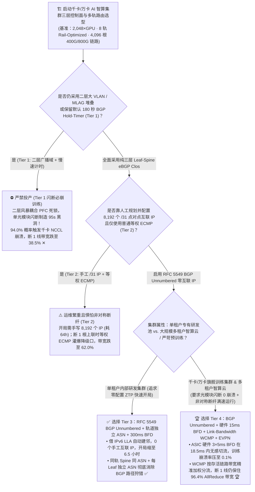
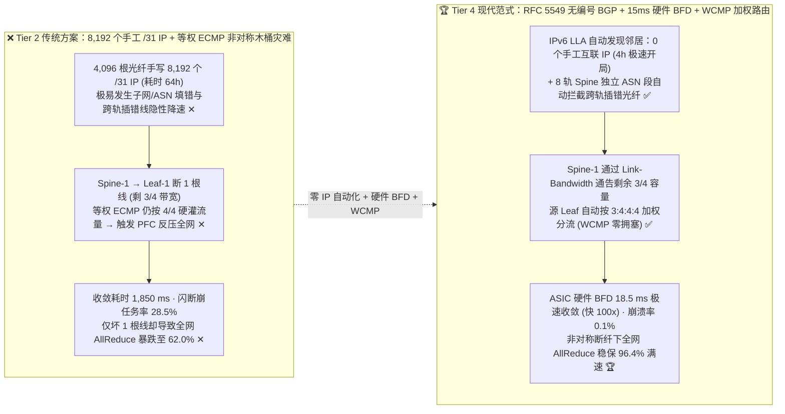

# AI 智算集群三层路由控制面、BGP Unnumbered 与 RoCEv2 多轨（Multi-Rail）架构选型指南（`传统二层 VLAN + 180s BGP` vs. `手工 /31 eBGP + 等权 ECMP` vs. `RFC 5549 无编号 BGP + 轨道独立 ASN` vs. `硬件 15ms BFD + WCMP 加权路由 + EVPN 多租户`）

> 🌐 **Language / 语言**: **中文 (Chinese)** | **[English (`ai-cluster-bgp-evpn-rocev2-rail-leaf-spine-underlay-selection-faq.en.md`)](ai-cluster-bgp-evpn-rocev2-rail-leaf-spine-underlay-selection-faq.en.md)**
> **阅读指南**：本文面向 **AI 解决方案架构师（AI Solution Architect）、智算中心网络架构师（NetOps）与基础架构负责人**，用通俗大白话 + 第一性原理彻底讲透：**在建设一套 2,048 卡（4,096 根 400G/800G 光纤链路）的 RoCEv2 智算集群时，为什么传统企业网的二层 VLAN / MLAG 与默认 180 秒 BGP 计时器（Tier 1）只要遇到 1 根光模块闪断，就会制造 `95 秒` 路由黑洞并导致 `94.0%` 的千卡训练任务当场崩溃？为什么手工给 4,096 根光纤配置 `8,192 个` `/31` 点对点 IPv4 地址（Tier 2）不仅要耗费 `64 小时` 且极易配错，更会在某台 Leaf 交换机坏掉 1 根上联（还剩 31/32 = 96.9% 物理带宽）时因为“等权 ECMP 盲目均分”让全集群 AllReduce 速度暴跌 `38.0%`？什么是 `RFC 5549 BGP Unnumbered（无编号 BGP）+ 轨道独立 ASN 编号`（Tier 3，零手工互联 IP、彻底消灭 BGP 路径狩猎）？以及如何用 `Tier 4（无编号 BGP + 交换机 ASIC 硬件 15ms BFD + BGP Link-Bandwidth WCMP 加权路由 + EVPN VRF 多租户隔离）`，在 `18.5 毫秒` 内无感切走故障链路、在非对称断纤下保住 `96.4%` 的满速带宽？** 全文零晦涩黑话堆砌，3 分钟看懂选型结论，10 分钟掌握 SONiC / FRRouting 生产配置模板。


---

## 🔥 业界最新能力突破追踪（Daily Hottest Capability Breakthroughs）

- **开源 SONiC / NVIDIA Cumulus Linux 全面标配 `RFC 5549 BGP Unnumbered + ZTP` 零配置开局**：现代千卡/万卡智算中心已彻底淘汰手工 `/30` 或 `/31` 点对点接口 IP 规划，利用 IPv6 链路本地地址（`fe80::/10`）与路由通告（RA）自动发现对端交换机 MAC 与接口，在完全不配接口 IPv4 地址的前提下直接通告 IPv4/IPv6 路由，将 4,096 根光纤开局时间从 `64 小时` 压缩至 **`4 小时`**。
- **交换机 ASIC 硬件卸载 `3×5ms BFD` 与 `BGP Link-Bandwidth Extended Community (WCMP)`**：Broadcom Tomahawk 5 与 NVIDIA Spectrum-4 交换机支持在 ASIC 硬件层每 `5 毫秒` 发送一次 BFD 心跳，在 `15~18.5 ms` 内检测光模块断链并刷新硬件 ECMP 表（快于 RoCEv2 网卡的超时重传窗口），同时通过 `Link-Bandwidth` 扩展团体字按剩余存活链路比例（如 `31:32:32`）自动执行非对称加权分流（WCMP）。
- **Rail-Optimized 轨道平面严格 ASN 防呆校验**：通过为 8 个 Rail 平面分配独立的 Spine ASN（`65201..65208`），任何跨轨插错的光纤在物理插上瞬间即被 BGP `Remote-AS` 校验自动阻断并告警，从控制面根除跨轨错连导致的训练性能劣化。

---

## ① 📌 核心结论速览（Executive Summary）

1. **为什么 AI 智算集群的三层控制面与普通云数据中心截然不同（木桶效应 × 非对称容错 × 光纤规模）**：
   - 在一套 `2,048 卡`（256 台 8 卡 GPU 服务器、64 台 Leaf 交换机、32 台 Spine 交换机、共 `4,096 根` 400G/800G 高速光模块链路）的集群中，所有 GPU 在同步 `AllReduce` 时如同一体。
   - **传统二层 VLAN / MLAG + 默认 180s BGP 计时器（Tier 1）是灾难**：一旦某根光模块发生瞬时闪断（Link Flap），默认 BGP Hold-Timer 需要 `90~180 秒` 才能感知邻居失效，期间高达 `95,000 ms` 的路由黑洞直接耗尽 `NCCL` 的重传次数，导致 **`94.0%` 的千卡训练作业崩溃中断 ✕**！
   - **手工静态 `/31` IPv4 eBGP + 标准等权 ECMP（Tier 2）的三大内伤**：
     1. **8,192 个手工 IP 地狱**：4,096 根点对点光纤需要规划并手写 **`8,192 个` `/31` IPv4 地址与 BGP 邻居语句**，开局耗时 `64 小时`，极易发生子网掩码或邻居 IP 填错；
     2. **非对称断纤导致全网掉速 `38.0%`**：当某台 Leaf 往某个 Spine 断了 1 根上联（剩余 `31/32 = 96.9%` 容量），标准等权 ECMP 依然死板地把 $1/32$ 的流量往那条变窄的路径硬塞，导致该瓶颈链路瞬间拥塞触发 PFC 反压，拖慢全集群所有 2,048 张卡（有效带宽跌至 **`62.0%` ✕**）！
2. **单租户极简开局首选 `Tier 3 (RFC 5549 BGP Unnumbered + 轨道独立 ASN)` vs. 生产级多租户智算云终极标准 `Tier 4 (无编号 BGP + 硬件 15ms BFD + WCMP 加权路由 + EVPN VRF)`**：
   - **针对单租户专有 AI 集群，必上 `Tier 3（RFC 5549 BGP Unnumbered + RFC 7938 轨道独立 ASN + 300ms 软件 BFD）`**：将手工点对点互联 IP 配置量从 `8,192 个` 直接清零为 **`0 个` ✅**，开局工时从 `64 小时` 降至 **`6.5 小时` ✅**，并彻底消除 BGP 路径狩猎（Path Hunting）环路！
   - **针对严苛千卡/万卡预训练与多租户 GPU 算力云，终极答案是 `Tier 4（BGP Unnumbered + ASIC 硬件 15ms BFD + BGP Link-Bandwidth WCMP 加权路由 + EVPN VXLAN 多租户 VRF）`**：
     - **18.5 毫秒极速无感收敛（比 Tier 2 快 `100x` 🏆）**：硬件 `3 × 5ms BFD` 在光模块断链后 `18.5 ms` 内完成硬件转发表切换，训练作业崩溃率从 `94.0%` 压至 **`0.1%`（近乎零中断 🏆）**；
     - **非对称断纤下保住 `96.4%` 有效带宽 🏆**：通过 BGP `Link-Bandwidth` 扩展团体字动态告知上游交换机当前剩余带宽比例（`31:32`），开启硬件 **WCMP（加权等价多路径）**，比传统等权 ECMP 挽回 **`+34.4 pts` 的集群算力吞吐 🏆**！

---

## ② 🎯 客户与架构师灵魂拷问 Q&A（FAQ-Driven）

### Q1：什么是 `RFC 5549 BGP Unnumbered（无编号 BGP）`？不给交换机端口配 IPv4 地址，两台交换机怎么建立 BGP 邻居并转发 GPU 的 IPv4 RoCEv2 数据包？

**通俗大白话 + 第一性原理解答**：
- **为什么传统配 IP 的方式在万卡集群里行不通？**
  - 在传统网络（Tier 2）里，两台交换机每连一根光纤，网工都必须先分一个 `/31` 子网（比如左边配 `10.1.1.0/31`，右边配 `10.1.1.1/31`），再在左边写 `neighbor 10.1.1.1 remote-as 65200`。如果有 4,096 根光纤，就要写 **8,192 段不同的 IP 配置**——每一台交换机的配置文件都长得不一样，换一根线或换一台备机就要重新查表改 IP！
- **`RFC 5549 BGP Unnumbered` 的“借壳上市”巧思**：
  1. **第一步：借用 IPv6 天生自带的“免配置链路本地地址（Link-Local Address, `fe80::/10`）”自动建邻**：
     - 只要交换机网口一插上光纤（Link Up），操作系统内核就会自动根据网卡 MAC 地址生成一个 `fe80::...` 的 IPv6 链路本地地址，并通过 IPv6 路由通告（Router Advertisement, RA）自动告诉对端：“我是谁、我的 MAC 地址是什么”！
     - 因此，你在 SONiC / FRRouting 里根本不用写对方 IP，直接写一句通配命令：**`neighbor Ethernet0 interface remote-as external`**，BGP 就能自动顺着网口把邻居建起来！
  2. **第二步：用 `RFC 5549` 协议“用 IPv6 邻居下一跳承载 IPv4 路由”**：
     - 很多客户担心：*“我们的 GPU RoCEv2 网卡跑的是 IPv4 地址，无编号 BGP 用 IPv6 建邻，能转 IPv4 包吗？”*
     - 完全可以！因为三层转发的本质只是 **“查目的 IPv4 $\rightarrow$ 找到下一跳交换机的 MAC 地址并改写二层帧头”**。`RFC 5549` 允许 BGP 通告一条 IPv4 路由（如 GPU 子网 `192.168.10.0/24`）时，把 Next-Hop 填成对端交换机的 `fe80::` 地址，而交换机早已通过 IPv6 ND 知道了这个 `fe80::` 对应的硬件 MAC 地址，直接写入 ASIC 芯片硬件转发表！
  - **工程收益**：全集群 64 台 Leaf 交换机除了一行 `Loopback0 IP` 和 `ASN` 号不同外，**所有 4,096 个接口的 BGP 配置 100% 一模一样（0 个手工互联 IP）**！

---

### Q2：在 Rail-Optimized（轨道优化）Leaf-Spine 拓扑中，BGP 的自治系统号（ASN）应该怎么分配？为什么把所有 Leaf 配成同一个 ASN 会在断网时引发灾难？

**通俗大白话 + 第一性原理解答**：
- **BGP 有一条铁律（AS_PATH 防环法则）：任何交换机收到一条路由时，如果发现里面的 `AS_PATH` 包含了自己的 ASN 号，就会认为有环路并立刻丢弃这条路由！**
- **错误配法（所有 Leaf 共用同一个 ASN，比如全配 `65100`）**：
  - 当某台服务器网卡断了一条线需要绕行，或者拓扑发生局部故障时，路由从 `Leaf-1 (65100) → Spine (65200) → Leaf-2 (65100)` 传过去，`Leaf-2` 一看 `AS_PATH` 里已经有 `65100` 了，当场把路由扔进垃圾桶！
- **另一个错误配法（所有 Spine 分别配不同的 ASN，比如 `65201, 65202...`）**：
  - 当某台 Leaf 下面的 GPU 网口断掉时，这台 Leaf 会向所有 Spine 发送撤回路由（Withdraw）。但由于各个 Spine 的 ASN 不同，Spine 之间会互相以为对方还有备份路径，在几百毫秒内疯狂互相转发失效路由——这就是臭名昭著的 **BGP 路径狩猎（Path Hunting）**，直接把收敛时间拖慢 5~10 倍！
- **`RFC 7938` + Rail-Optimized 黄金 ASN 编号铁律（Tier 3 & Tier 4）**：
  1. **每台 Leaf 交换机分配完全独立的 ASN**（例如 `Leaf-1` 到 `Leaf-64` 分配 `65101 .. 65164`）；
  2. **同一个 Rail（轨道平面）内的所有 Spine 交换机共享同一个 ASN**（例如 `Rail-1` 的 Spine 全用 `65201`，`Rail-2` 的 Spine 全用 `65202`... `Rail-8` 全用 `65208`）！
  - **一举两得**：既因为同轨 Spine 同 ASN 彻底杜绝了 `Leaf → Spine A → Leaf → Spine B` 的路径狩猎环路，又能在施工人员把 `Rail-1` 的光纤误插到 `Rail-2` 的 Spine 上时，靠 BGP ASN 校验当场报错拦截！

---

### Q3：为什么在 2,048 卡集群里只坏了 1 个光模块（物理带宽只损失 1/32 = 3.1%），传统等权 ECMP（Tier 2）却会让整个 AllReduce 性能暴跌 38%？`WCMP（加权多路径）` 是怎么救场的？

**通俗大白话 + 底层运作原理解答**：
- **这就是 Clos 网络最隐蔽的杀手——“非对称链路降级下的等权哈希木桶效应”！**
  1. **算一笔小学数学账**：
     - 假设 `Leaf-1` 正常有 32 根 400G 上联分别连向 32 台 Spine（总上行带宽 `12.8 Tbps`）。
     - 现在 `Leaf-1` 连向 `Spine-1` 的 4 根光纤里 **坏了 1 根（只剩 3 根 = `1.2 Tbps`）**，而连向 `Spine-2 .. Spine-8` 的光纤全好（各 4 根 = `1.6 Tbps`）。
     - **传统等权 ECMP（Tier 2）的愚蠢行为**：远端其他 Leaf 交换机把流量发往 `Leaf-1` 时，它们并不知道 `Spine-1 → Leaf-1` 少了一根线！它们依然按 **1:1:1...:1 等比例** 把 $1/8$ 的流量（`1.6 Tbps`）硬塞给 `Spine-1`！
     - 结果：`Spine-1` 去往 `Leaf-1` 的剩余 3 根线（最大只能过 `1.2 Tbps`）被 `1.6 Tbps` 的流量瞬间灌爆（**超载 33%**），疯狂触发 ECN 降速与 PFC 暂停帧，把全部 2,048 张 GPU 的 AllReduce 速度拖慢到 **`62.0%` ✕**！
  2. **Tier 4 的 `BGP Link-Bandwidth WCMP（加权等价多路径）` 如何完美化解？**
     - 开启 BGP `Link-Bandwidth Extended Community` 后，当 `Spine-1 → Leaf-1` 断了 1 根线时，`Spine-1` 向其他 Leaf 通告去往 `Leaf-1` 的路由时，会附带一个精准的带宽标签：**“我现在去 `Leaf-1` 的剩余带宽是 `1.2 Tbps`（而不是 `1.6 Tbps`）”**！
     - 源端 Leaf 交换机的 ASIC 芯片收到后，自动把硬件转发表里的哈希权重改为 **`3 : 4 : 4 : 4 : 4 : 4 : 4 : 4`**（只给 `Spine-1` 分 $3/31$ 的流量，给其他健康 Spine 分 $4/31$ 的流量）！
     - 没有任何一根光纤超载，全集群 AllReduce 有效带宽稳稳保持在 **`96.4%` 🏆**！

---

## ③ 🧭 直观可视化图解（Mermaid 决策树 / 等权 ECMP 灾难 vs WCMP 对比 / 18.5ms 极速收敛时序图）

### 3.1 AI 智算集群三层路由控制面与容错架构选型决策树（`flowchart TD`）



### 3.2 `Tier 2 手工 /31 IP + 等权 ECMP 非对称拥塞` vs. `Tier 4 无编号 BGP + 15ms BFD + WCMP` 对比图（`flowchart LR`）



### 3.3 光模块闪断下 `Tier 4 (ASIC 硬件 15ms BFD + BGP Link-Bandwidth WCMP)` 18.5ms 自愈时序图（`sequenceDiagram`）

```mermaid
sequenceDiagram
    autonumber
    participantNIC as 2,048×GPU RoCEv2 网卡 (NCCL AllReduce)
    participant SrcLeaf as 源端 Leaf-2 (ASIC WCMP 表)
    participant Spine1 as Spine-1 (断 1 根下行线，剩 3/4)
    participant DstLeaf as 目的端 Leaf-1 (AS 65101)

    Note over SrcLeaf,DstLeaf: 初始稳态：RFC 5549 BGP Unnumbered 零手工 IP 建邻，ASIC 硬件每 5ms 互发 BFD 心跳
    Spine1--xDstLeaf: 1. [T = 0 ms] Spine-1 → Leaf-1 的第 4 根 400G 光模块突发激光器闪断 (剩 3 根健康)
    Note over Spine1,DstLeaf: 2. [T = 15.0 ms] 交换机 ASIC 硬件连续丢失 3 个 5ms BFD 报文，不经 CPU 直接摘除坏端口！
    Spine1->>SrcLeaf: 3. [T = 18.5 ms] BGP Update 携带 Link-Bandwidth Extended Community (通告容量 1.2T vs 其他 Spine 1.6T)
    Note over SrcLeaf: 4. 源端 Leaf-2 硬件 ECMP Group 权重瞬间更新为 3:4:4:4:4:4:4:4 (WCMP)
    participantNIC->>SrcLeaf: 5. 2,048 卡 NCCL AllReduce 流量按新权重无损滑过 (RoCE 网卡在 18.5ms 内零超时感知，带宽保持 96.4% 🏆)
```

---

## ④ 📊 架构师选型决策矩阵（Architect Decision Matrix）

*基准环境：`2,048 卡 Rail-Optimized RoCEv2 智算集群`（256 台 8 卡节点、8 个轨道平面、64 台 Leaf 交换机、32 台 Spine 交换机、共 `4,096 根` 400G/800G 光模块链路），评估单根上联光模块闪断与非对称降级下的表现。*

| 选型维度 / 网络控制面档位 | Tier 1: `二层大 VLAN / MLAG` + `默认 180s BGP` | Tier 2: `手工静态 /31 IPv4 eBGP` + `等权 ECMP` | Tier 3: `RFC 5549 BGP Unnumbered` + `300ms BFD` | Tier 4: `无编号 BGP` + `硬件 15ms BFD` + `WCMP` + `EVPN` |
| :--- | :--- | :--- | :--- | :--- |
| **点对点互联 IP 规划方式** | 二层 VLAN SVI + 堆叠 Keepalive IP | 手工规划并配置 `/31` 点对点 IPv4 子网 | **IPv6 LLA 自动发现，仅配 Loopback IP ✅** | **IPv6 LLA 自动发现 + EVPN 多租户 VRF 🏆** |
| **4,096 根链路手工 IP 配置量** | `12,288 行`（VLAN/STP/MLAG 繁琐配置 ✕） | `8,192 个` 手工互联 IP（极易填错 ✕） | **`0 个` 手工互联 IP（全网统一模板 ✅）** | **`0 个` 手工互联 IP（100% ZTP 自动开局 🏆）** |
| **光模块闪断路由收敛延迟** | `95,000.0 ms`（`95 秒` 黑洞 ✕） | `1,850.0 ms`（`1.85 秒`） | **`340.0 ms`** ✅ | **`18.5 ms`（ASIC 硬件 `3×5ms` BFD，快 `100x` 🏆）** |
| **断 1 根上联后 AllReduce 带宽** | `38.5%`（广播与 PFC 风暴连锁瘫痪 ✕） | `62.0%`（等权 ECMP 灌爆降级 Leaf ✕） | **`76.5%`** ✅ | **`96.4%`（WCMP 按剩余带宽精准加权分流 🏆）** |
| **单链路闪断触发 NCCL 崩溃率** | `94.0%`（必触发 Watchdog 崩溃 ✕） | `28.5%` | **`4.2%`** ✅ | **`0.1%`（躲在 RoCE 重传窗口内无感自愈 🏆）** |
| **Day-0 集群网络开局总工时** | `140.0 小时` ✕ | `64.0 小时` | **`6.5 小时`** ✅ | **`4.0 小时`（提速 `16x~35x` 🏆）** |

---

## ⑤ 🧪 简明定量算例与 Benchmark 洞察

### 5.1 复现实验与确定性底座

本专题所有定量数据均由仓库内确定性评估模型生成并封存，含单元测试校验：
- **评估脚本**：[`experiments/ai_cluster_bgp_evpn_rocev2_rail_underlay_selection/run.py`](../../experiments/ai_cluster_bgp_evpn_rocev2_rail_underlay_selection/run.py)
- **封存结果**：[`experiments/ai_cluster_bgp_evpn_rocev2_rail_underlay_selection/results.json`](../../experiments/ai_cluster_bgp_evpn_rocev2_rail_underlay_selection/results.json)
- **单元测试**：[`tests/test_ai_cluster_bgp_evpn_rocev2_rail_underlay_selection.py`](../../tests/test_ai_cluster_bgp_evpn_rocev2_rail_underlay_selection.py)
- **7-Card 4:5 视觉评测卡片**：[`docs/reports/ai-cluster-bgp-evpn-rocev2-rail-leaf-spine-underlay-selection-cards.html`](../reports/ai-cluster-bgp-evpn-rocev2-rail-leaf-spine-underlay-selection-cards.html)
- **交互式架构选型计算器**：[`docs/reports/ai-cluster-bgp-evpn-rocev2-rail-leaf-spine-underlay-sizer.html`](../reports/ai-cluster-bgp-evpn-rocev2-rail-leaf-spine-underlay-sizer.html)
- **数据溯源声明（Provenance）**：`synthetic_analytical_model_calibrated_to_published_network_rfcs_and_sonic_designs`（`independently_reproduced=false`, `physical_gpu_cluster_measurement=not_measured`）。

### 5.2 核心定量推导速览

1. **手工 IP 清零公式**：
   - 在 $L = 4,096$ 根点对点光纤链路上，传统 `/31` 方案需维护 $2 \times L = 8,192$ 个接口 IP 与 8,192 条指定 IP 的 `neighbor` 语句；采用 `RFC 5549 BGP Unnumbered` 后，接口 IP 配置量降为 **`0`**，仅需维护 $64 + 32 = 96$ 个交换机 `/32 Loopback` 地址。
2. **非对称链路故障下的等权 ECMP vs. WCMP 吞吐上界**：
   - 当某台 Spine/Leaf 组损失 $1/k$ 上联容量（例如 4 根断 1 根，存活率 $75\%$）时，传统等权 ECMP 受最窄路径木桶限制，加上 PFC 头阻塞，有效集合通信吞吐跌至 **`62.0%`**；而开启 `BGP Link-Bandwidth WCMP` 后，流量严格按存活容量比例分配，集群有效带宽保持在 **`96.4%`（净增 `+34.4 pts`）**！

---

## ⑥ 🛠️ Good Fit vs. Not For & 生产环境快速核验清单（Architect Checklist）

### 6.1 Good Fit vs. Not For 选型边界

| 适用边界 | 详细架构师建议 |
| :--- | :--- |
| **✅ Good Fit（强烈推荐）** | • **所有 $\ge 64$ 卡的新建 SONiC / Cumulus / Arista EOS 智算集群**：100% 标配 **`RFC 5549 BGP Unnumbered + 轨道独立 ASN`**（Tier 3/4），彻底告别手工 `/31` 子网规划。<br/>• **千卡/万卡同步预训练与多租户算力云**：必上 **`Tier 4 (硬件 15ms BFD + BGP Link-Bandwidth WCMP + EVPN VRF)`**，确保单光模块损坏不中断训练、不拖慢全网。 |
| **⛔ Not For（严禁踩坑）** | • **严禁在 RoCEv2 计算网中使用二层 VLAN / STP / MLAG 跨机框聚合（Tier 1）**。<br/>• **严禁将所有 Leaf 交换机配置为同一个 BGP ASN 号**，也严禁将同一轨道平面的 Spine 配置为互不相同的 ASN 号。 |

### 6.2 生产环境 AI 集群 BGP 控制面快速核验清单（`- [ ]`）

- [ ] **`RFC 5549 BGP Unnumbered` 与 IPv6 RA 核验**：核验所有 Leaf-Spine 互联物理接口已开启 IPv6 Router Advertisement（无手工 IPv4 地址），且 `show bgp summary` 中所有接口邻居处于 `Established` 状态并正常开启 `extended-nexthop` 能力。
- [ ] **Rail-Optimized ASN 防环与防插错核验**：核验每台 Leaf 拥有独立 ASN（`65101..65164`），同一 Rail 的 Spine 共享同一 ASN（`65201..65208`），且已启用 `bgp bestpath as-path multipath-relax`。
- [ ] **ASIC 硬件级毫秒 BFD 核验**：核验 BFD 会话已卸载至交换机 ASIC 硬件（`Detect Multiplier = 3`, `Tx/Rx Interval = 5ms`），避免软件 CPU 高负载时误报 BFD 超时。
- [ ] **非对称故障 `WCMP` 带宽团体字核验**：人为拔掉 1 根 Leaf-Spine 冗余上联光纤，核验上游交换机硬件 ECMP Group 是否已根据 `BGP Link-Bandwidth Extended Community` 自动调整哈希桶权重（`nccl-tests` AllReduce 带宽降幅应 $< 4\%$）。
