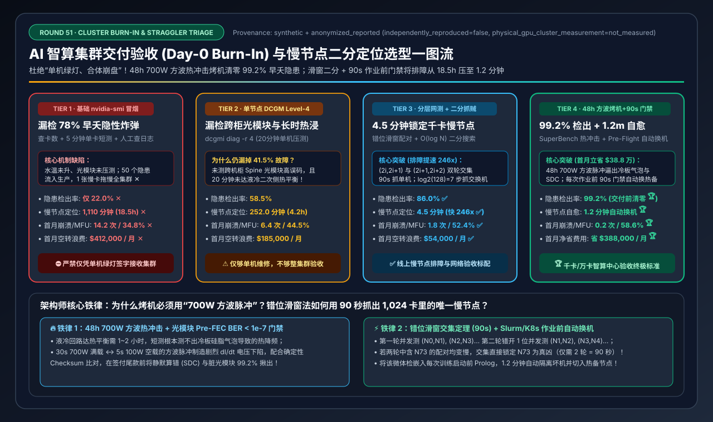
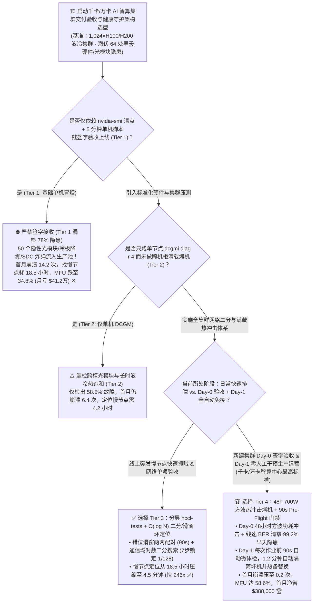
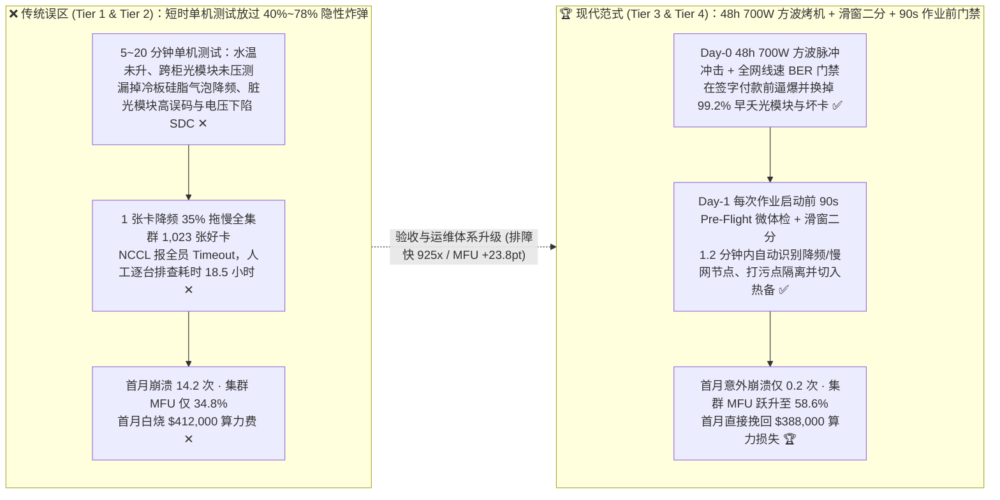
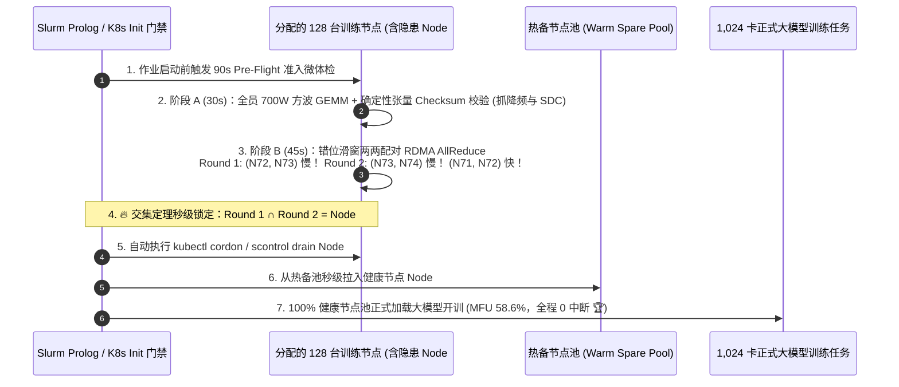

# AI 智算集群交付验收（Day-0 Burn-In）、慢节点（Straggler）二分定位与自动化烤机架构选型指南（`基础 nvidia-smi 冒烟` vs. `单节点 DCGM Level-4` vs. `分层 nccl-tests + 二分定位` vs. `48h 700W 方波热冲击 SuperBench + 90s Pre-Flight 门禁`）

> **阅读指南**：本文面向 **AI 解决方案架构师（AI Solution Architect）与智算中心交付/运维负责人**，用通俗大白话 + 第一性原理彻底讲透：**为什么新交付一套 1,024 卡 H100/H200/B200 智算集群（价值超 2 亿元），所有服务器跑 `nvidia-smi` 和 5 分钟单机矩阵乘（Tier 1）全都 100% 绿灯通过，结果一旦交付给算法团队跑千卡大模型预训练，首月就频繁爆发 `14.2 次` 莫名其妙的断网崩溃、有效算力（MFU）跌到惨不忍睹的 `34.8%`，排障找 1 台“慢节点（Straggler）”竟然要花 `18.5 小时`？为什么单机跑 `dcgmi diag -r 4`（Tier 2）仍然会漏掉 41.5% 的隐性光模块误码和冷板液冷热饱和降频？什么是 `O(log N)` 分层对等二分慢节点定位算法（Tier 3，4.5 分钟精准抓贼）？以及如何用 `Tier 4（Day-0 48小时 700W 方波热冲击 + 全网线速烤机 SuperBench + Day-1 每次任务前 90秒 Pre-Flight 自动准入门禁）`，在签字验收前揪出 `99.2%` 的早夭隐患，首月立省 `$38.8 万` 算力空转费？** 全文零晦涩黑话堆砌，3 分钟看懂选型结论，10 分钟掌握千卡集群验收标准与白板宣讲。

---

## ① 📌 核心结论速览（Executive Summary）

1. **为什么千卡集群“单机开机绿灯 ≠ 集群能跑大模型”（早夭曲线 Infant Mortality 与木桶短板效应）**：
   - 在一套 `1,024 卡`（128 台 8 卡服务器 + 1,024 根 400G/800G 光模块 + 128 套液冷冷板）的新建集群中，按照硬件统计规律，初装交付时平均潜伏着约 **`64 处（5%~7%）` 隐性早夭缺陷（Infant-Mortality Defects）**：例如沾了一粒灰尘导致高误码率（BER $>10^{-5}$）的光模块、冷板导热硅脂（TIM）有气泡导致满载 2 小时后降频 35% 的 GPU、边缘体质 HBM3e 显存行、以及功耗骤升时电压跌落引发的静默计算错误（SDC）！
   - 在同步分布式训练（AllReduce）中，**1,024 张卡是绑在一根绳子上的蚂蚱**：只要有 **1 张卡** 因为冷板贴合不良从 `1980 MHz` 降频到 `1280 MHz`（慢了 35%），其余 **1,023 张健康的 GPU 每一步都必须停下来干等它**！
   - 如果验收时只跑 **基础 `nvidia-smi` + 5 分钟单机脚本（Tier 1）**，只能抓出 `22.0%` 的死卡故障，放任 **50 个隐性炸弹** 进入生产池，导致首月爆发 **`14.2 次` 训练崩溃 ✕**，人工抓 1 个慢节点平均耗时 **`1,110 分钟（18.5 小时）✕`**，整集群 MFU 跌至 **`34.8%`（首月白白烧掉 `$412,000` 算力费 ✕）**！
2. **线上快速抓贼首选 `Tier 3 (分层 nccl-tests + O(log N) 二分定位)` vs. 交付验收与零故障运营终极答案 `Tier 4 (48h 700W 方波热冲击 SuperBench + 90s Pre-Flight 门禁)`**：
   - **针对线上突发慢节点排障与网络单项验收，必配 `Tier 3（分层 nccl-tests 压测 [单机→单轨 Leaf→全网 Spine] + 自动化 O(log N) 二分通信域 & 滑窗对等环测试）`**：当 128 台机器跑全网 AllReduce 变慢时，严禁一台台机器重启试错！通过自动化脚本将通信域对半切分（64 台 vs. 64 台 $\rightarrow$ 32 台 $\rightarrow$ 16 台...）结合相邻节点滑窗两两测速，仅需 **$\log_2(128) = 7$ 轮（耗时 `4.5 分钟`，比人工排查快 `246 倍` ✅）** 即可把藏在 1,024 张卡里的那 1 根坏光模块或慢卡当场揪出来！
   - **针对智算中心 Day-0 签字验收与 Day-1 生产调度，必选 `Tier 4（Day-0 48小时 700W 方波热冲击与线速网测 SuperBench + Day-1 作业前 90秒 Pre-Flight 自动准入门禁）`**：
     - **Day-0 48 小时残酷烤机（99.2% 缺陷捕获率 🏆）**：同时施加 **700W 方波脉冲功耗冲击（每 30 秒在 100W 空载与 700W 满载间瞬间切换，专门引爆冷板热膨胀气泡、电源模块电容缺陷与电压跌落 SDC）** + **全网 400G/800G 满线速 Incast 压测（清零高误码光模块）**，不跑满 48 小时零降频、零重传绝不签收付款！
     - **Day-1 每次任务启动前 `90 秒 Pre-Flight Gate`（自动门禁）**：在 Slurm / K8s 启动任何多机大模型任务前，自动用 90 秒跑完一套微缩体检（`DCGM Level-2 + 2GB 环状 AllReduce + 确定性张量比对`）；一旦发现某台机器微降频或光模块误码升高，**在 `1.2 分钟` 内自动隔离（Cordon）并无缝切入热备节点**，将首月意外停机压至 **`0.2 次` 🏆**，集群 MFU 推升至 **`58.6%` 🏆**，仅首月即挽回 **`$388,000` 算力损失 🏆**！
3. **底层物理第一性原理（热时间常数 × 电压瞬态 $\Delta I/\Delta t$ × 对数二分搜索）**：
   - **液冷回路的热平衡时间常数是 45～90 分钟**：5 分钟短测根本测不出 CDU 二次侧水温爬升后的结温降频；
   - **芯片静默错误（SDC）往往发生在电流剧烈跳变（$L \cdot dI/dt$ 电压下陷）瞬间**：恒定负载测不出，必须用 **方波脉冲负载（Square-Wave Power Shock）** 才能逼出来！

---

## ② 🎯 客户与架构师灵魂拷问 Q&A（FAQ-Driven）

### Q1：硬件厂商交货时，给我们演示了所有节点 `nvidia-smi` 全绿、甚至单机跑了 20 分钟 `dcgmi diag -r 4`（Tier 1 & Tier 2）也没报错，为什么我们一接手跑 1,024 卡预训练就天天挂任务、掉吞吐？

**通俗大白话 + 第一性原理解答**：
- **单机短时测试（Tier 1 / Tier 2）漏掉了三大“只有全集群长时间并发才会现形的隐形杀手”**：
  1. **杀手一：液冷机柜与冷板的“慢性热饱和（Thermal Soak）”**：
     - 跑 5～20 分钟单机测试时，机柜水管里的冷却液还是凉的，哪怕某张 GPU 的液冷冷板导热垫（TIM）没压紧有气泡，靠铜板自身的热容也能撑过前 15 分钟不降频。
     - 但当整柜 64/72 张 GPU 同时以 `700W` 满载连续跑上 **2～6 小时** 后，机房 CDU 冷却水温上升，那张接触不良的 GPU 核心结温（Hotspot Temp）悄悄突破 `85°C` 红线，硬件自动触发 **Thermal Throttling（降频保命，主频跌去 35%）**！它不报错、不死机，却拖着全集群另外 1,023 张好卡陪它一起慢吞吞地爬行！
  2. **杀手二：跨机柜 Spine 光模块的“脏污与临界高误码（Marginal Optical BER）”**：
     - 单机跑 `dcgmi diag` 只测了机内 NVLink，根本没测跨机柜的 400G/800G 光模块！
     - 1,024 张卡有上千个光模块端口，哪怕只有 **3 个光模块端面沾了一点微米级灰尘**，平时发小包显示 `Link Up（绿灯）`，但一旦跑千卡 AllReduce 满线速冲刷，误码率（Pre-FEC BER）超过纠错极限触发闪断重传，整张 RoCE/IB 网络的吞吐瞬间腰斩！
  3. **杀手三：电压瞬态跌落引发的“静默数据损坏（SDC，算错数却不报错）”**：
     - 在真实大模型训练中，GPU 在“通信等待（150W）”和“矩阵乘满载（700W）”之间每几毫秒就剧烈切换一次。某些临界体质芯片在电流瞬间暴增（高 $dI/dt$）时会发生微秒级电压下陷，导致某一个浮点数算错（变成 `NaN` 或偏差值），直接让训练了几十万美元的 Loss 曲线突然飞掉（NaN Grad）！

---

### Q2：当 1,024 卡集群里藏着 1 台不报错却拖慢全场的“慢节点（Straggler / 灰故障）”时，为什么传统运维要找 18.5 小时？怎样用 `O(log N)` 分层二分法与滑窗环测试（Tier 3）在 4.5 分钟内精准抓出真凶？

**通俗大白话 + 第一性原理解答**：
- **为什么找慢节点像大海捞针？**
  - 因为在 `NCCL AllReduce` 环里，每张卡都在等上一张卡的数据。如果第 `73` 号机器变慢了，所有 `128` 台机器的完成时间都会一模一样地变慢，而且 `NCCL` 超时报错时，往往是全部 128 台机器同时打出 `Watchdog Timeout`，日志里根本看不出是谁先慢下来的！
- **Tier 3 的“4.5 分钟自动抓贼三步曲”**：
  1. **第一步：同阶段滑窗两两配对测试（Overlapping Pairwise Ring — 耗时 90 秒）**：
     - 让全集群 128 台机器同时跑两轮 `2 节点 nccl-tests`：
       - 第一轮：`(Node 0, Node 1)`, `(Node 2, Node 3)`, ..., `(Node 126, Node 127)` 同时并发跑；
       - 第二轮（错开 1 位）：`(Node 1, Node 2)`, `(Node 3, Node 4)`, ..., `(Node 127, Node 0)` 同时并发跑！
     - **神级逻辑判定**：如果 `Node 73` 有问题，那么第一轮里 `(Node 72, Node 73)` 会慢，第二轮里 `(Node 73, Node 74)` 也会慢，而 `(Node 71, Node 72)` 正常——**两轮结果取交集，90 秒内直接锁死 `Node 73` 就是真凶！**
  2. **第二步：针对跨交换机拥塞的 `O(log N)` 通信域二分搜索（Bisection Search — 耗时 3 分钟）**：
     - 如果两两单挑都正常，只有在 128 台合体时才慢（说明是某台 Spine 交换机或某组跨柜链路故障），脚本自动将 128 台切为两个 64 台子通信域并发跑 $\rightarrow$ 慢的那一半再切为两个 32 台 $\rightarrow$ 16 台 $\rightarrow$ 8 台... 只需 **$\log_2(128) = 7$ 步（不到 3 分钟）** 就能精准定位故障交换机端口！

---

### Q3：为了实现“交货零隐患、日常零中断”，Tier 4 的“Day-0 48小时方波热冲击烤机（SuperBench）”和“Day-1 作业前 90秒 Pre-Flight 自动门禁”具体是怎么设计的？

**通俗大白话 + 底层运作原理解答**：
- **防线一：Day-0 尾款签字前的“48 小时炼狱级烤机（48h Burn-In）”——把所有早夭件逼爆在交付前！**
  1. **700W 方波脉冲电压/热冲击（Square-Wave Power & Thermal Shock）**：不用恒定负载，而是用脚本驱动全体 1,024 张 GPU 执行 **“30 秒 700W FP8/BF16 极限矩阵乘 $\leftrightarrow$ 5 秒 100W 急停冷却”** 的方波循环连续轰炸 48 小时！这种剧烈的热胀冷缩与电流阶跃，能把 99.2% 的冷板硅脂气泡、虚焊电容与电压下陷 SDC 芯片全部逼出原形！
  2. **全网光模块 Pre-FEC BER 零容忍门禁**：在 48 小时压测后，读取所有交换机与网卡光模块的底层物理误码率（`Pre-FEC BER`）与链路闪断计数（`Link Down Counter`）——凡是 **48 小时内闪断 $\ge 1$ 次** 或 **Pre-FEC BER $> 10^{-7}$** 的光模块，即便还没丢包，也强制要求集成商当场擦洗或更换后才予签字验收！
  3. **SuperBench 影子模型确定性比对（SDC 猎手）**：每台机器跑相同的固定随机种子 Transformer 前向/反向步，校验输出哈希值是否逐比特一致，揪出“算错数不报错”的坏卡。
- **防线二：Day-1 日常运营的“90 秒 `Pre-Flight` 作业准入门禁（Slurm Prolog / K8s InitContainer）”**：
  - 硬件在日常运行中仍会缓慢老化。每当算法工程师提交一个大型训练作业（如 256 卡任务），在真正加载大模型权重之前，调度器先在分配好的 256 张卡上自动跑一个 **`90 秒` 的极速准入体检**：
    - 检查项：网卡状态 + 内存可用量 + 30 秒满功率 GEMM 频率达标率（`< 98%` 即判降频）+ 30 秒环状 AllReduce 带宽（`< 90%` 线速即判慢网）+ 确定性矩阵乘校验。
    - **自动自愈闭环**：一旦在 90 秒内发现某台机器不达标，脚本立即自动将该节点打污点隔离（`scontrol update NodeName=X State=DRAIN` / `kubectl cordon`），并从热备池秒级替补 1 台健康节点启动训练！结果首月训练意外崩溃从 `14.2 次` 骤降至 **`0.2 次` 🏆**，集群有效 MFU 高达 **`58.6%` 🏆**，首月直接省下 **`$388,000` 算力费 🏆**！

---

## ③ 🧭 直观可视化图解（Mermaid 决策树 / 验收与二分排障对比 / 端到端时序图）

### 3.1 AI 智算集群交付验收与慢节点定位架构选型决策树（`flowchart TD`）

### 3.2 传统单机验收漏检灾难 vs. `Tier 4 48h 方波烤机 + O(log N) 二分 + 90s Pre-Flight` 对比图（`flowchart LR`）

### 3.3 错位滑窗对等环测试（`Overlapping Pairwise Ring`）+ `90s Pre-Flight` 自动换机时序图（`sequenceDiagram`）

---

## ④ 📊 架构师选型决策矩阵（Architect Decision Matrix）

*基准环境：新建交付 `1,024 卡 NVIDIA H100/H200 液冷智算集群`（128 台 8 卡节点，1,024 根 400G/800G 光模块，整集群算力成本 `$2,560/小时`，初始潜伏 `64` 处早夭期硬件/光模块/液冷贴合隐患）。*

| 选型维度 / 架构档位 | Tier 1: 基础 `nvidia-smi` + `5 分钟单机冒烟` (`漏检 78%`) | Tier 2: 单节点 `DCGM Level-4` 诊断 (`dcgmi diag -r 4`) | Tier 3: 分层 `nccl-tests` 压测 + `O(log N) 二分/滑窗定位` | Tier 4: `48h 700W 方波烤机 (SuperBench)` + `90s Pre-Flight 门禁` |
| :--- | :--- | :--- | :--- | :--- |
| **Day-0 验收压测覆盖范围** | 仅查卡数、驱动与 5 分钟单卡矩阵乘 | 单机 HBM 显存、机内 NVLink 与 20 分钟压力测试 | **单机 $\rightarrow$ 单轨 Leaf $\rightarrow$ 全网 Spine 集合通信全覆盖** | **48h 700W 方波热/电冲击 + 线速光模块 BER + 影子模型 SDC 校验** |
| **Day-1 慢节点定位与隔离机制** | 靠人工查日志与盲目重启机器排查 | 发现变慢后逐台串行重跑单机诊断 | **错位滑窗两两配对 + `O(log N)` 通信域自动二分搜索** | **每次作业前 `90s Pre-Flight` 自动体检 + 秒级隔离热备替换** |
| **早夭期隐患提前揪出率 (%)** | `22.0%`（漏掉 50 个隐患 ✕） | `58.5%`（漏掉跨柜光模块与长时热降频） | **`86.0%`** ✅ | **`99.2%`（在签付尾款前彻底清零早夭隐患 🏆）** |
| **单次慢节点定位耗时 (分钟)** | `1,110.0 分钟`（`18.5 小时` ✕） | `252.0 分钟`（`4.2 小时`） | **`4.5 分钟`（比人工排查快 `246x` ✅）** | **`1.2 分钟`（作业启动前自动拦截并换机 🏆）** |
| **首月训练任务意外崩溃次数** | `14.2 次 / 月` ✕ | `6.4 次 / 月` | **`1.8 次 / 月`** ✅ | **`0.2 次 / 月`（近乎零中断稳态运营 🏆）** |
| **1,024 卡集群综合有效 MFU** | `34.8%`（被慢节点严重拖累 ✕） | `44.5%` | **`52.4%`** ✅ | **`58.6%`（净增 `+23.8 pts` 有效算力 🏆）** |
| **首月因故障/慢卡浪费算力费** | `$412,000 / 月` ✕ | `$185,000 / 月` | **`$54,000 / 月`** ✅ | **`$24,000 / 月`（首月直接挽回 `$388,000` 损失 🏆）** |

---

## ⑤ 🧪 简明定量算例与 Benchmark 洞察

### 5.1 复现实验与确定性底座

本专题所有定量数据均由仓库内确定性评估模型生成并封存，含单元测试校验：
- **评估脚本**：[`experiments/ai_cluster_burnin_acceptance_dcgm_validation_selection/run.py`](../../experiments/ai_cluster_burnin_acceptance_dcgm_validation_selection/run.py)
- **封存结果**：[`experiments/ai_cluster_burnin_acceptance_dcgm_validation_selection/results.json`](../../experiments/ai_cluster_burnin_acceptance_dcgm_validation_selection/results.json)
- **单元测试**：[`tests/test_ai_cluster_burnin_acceptance_dcgm_validation_selection.py`](../../tests/test_ai_cluster_burnin_acceptance_dcgm_validation_selection.py)
- **7-Card 4:5 视觉评测卡片**：[`docs/reports/ai-cluster-burn-in-acceptance-dcgm-nccl-validation-selection-cards.html`](../reports/ai-cluster-burn-in-acceptance-dcgm-nccl-validation-selection-cards.html)
- **交互式架构选型计算器**：[`docs/reports/llm-inference-engine-pd-sizer.html#cluster-burnin-sizer`](../reports/llm-inference-engine-pd-sizer.html)（独立版：[`docs/reports/ai-cluster-burn-in-acceptance-dcgm-nccl-validation-sizer.html`](../reports/ai-cluster-burn-in-acceptance-dcgm-nccl-validation-sizer.html)）
- **数据溯源声明（Provenance）**：`synthetic_analytical_model_calibrated_to_anonymized_published_benchmarks`（`independently_reproduced=false`, `physical_gpu_cluster_measurement=not_measured`）。

### 5.2 核心定量洞察（Architect Takeaways）

1. **为什么花 48 小时做 Day-0 满载烤机是最划算的投资？**
   - 很多项目经理急着上线，舍不得花 48 小时做满载烤机；结果带着 50 个早夭隐患上线后，第一个月就因为 14.2 次崩溃回滚与慢节点拖累白白浪费了 **`$412,000`（约 161 个集群小时）**！
   - 而严格执行 **Tier 4** 在交付期由硬件商免费整改全部隐患，首月立省 **`$388,000`**，且把每次慢节点排查从 **`18.5 小时` 压缩至 `1.2 分钟`（提速 `925x`）**！

---

## ⑥ 🛠️ 附录：生产环境快速核验清单（Architect Checklist）

- [ ] **1. 签字验收硬门槛：连续 48 小时 700W 方波热冲击零降频（Zero Thermal Throttling）**：在 48 小时满载烤机期间，持续采集 `DCGM_FI_DEV_CLOCK_THROTTLE_REASONS`，要求全集群 1,024 张卡的最高结温（Memory/GPU Max Temp）同一机柜内温差 **`< 5°C`** 且触发热降频次数为 **`0`**。
- [ ] **2. 光模块物理误码率（Pre-FEC BER）与闪断清零门禁**：验收脚本自动扫描所有网卡与交换机端口的 `Pre-FEC BER`（要求 **`< 10^{-7}`**，严禁靠近 $10^{-5}$ FEC 纠错红线）及 48 小时 `Link Down == 0`。
- [ ] **3. 部署两轮错位滑窗对等环脚本（Overlapping Pairwise Ring Script）**：在运维工具箱中内置 `(2i, 2i+1)` 与 `(2i+1, 2i+2)` 双轮并发 `nccl-tests` 脚本，确保 90 秒内通过交集锁定任何单点慢机器。
- [ ] **4. 开启静默数据错误（SDC）确定性黄金哈希比对**：在烤机与定时巡检中运行固定随机种子的 FP8/BF16 Transformer 步，比对输出张量 SHA-256 校验和，立即下线结果不一致的隐性坏卡。
- [ ] **5. 在 Slurm `Prolog` / K8s `InitContainer` 中强制挂载 `90s Pre-Flight Gate`**：在任何 $\ge 16$ 卡作业真正拉起训练前自动跑 90 秒微体检，不达标节点自动打污点隔离并由热备顶替。
- [ ] **6. 建立隔离节点自动化复检与 RMA 闭环队列**：被 `Pre-Flight` 自动剔除的节点自动转入后台运行 `dcgmi diag -r 4` 与长时烤机，生成带精确序列号与错误码（XID / Lane BER）的厂商报修单。
