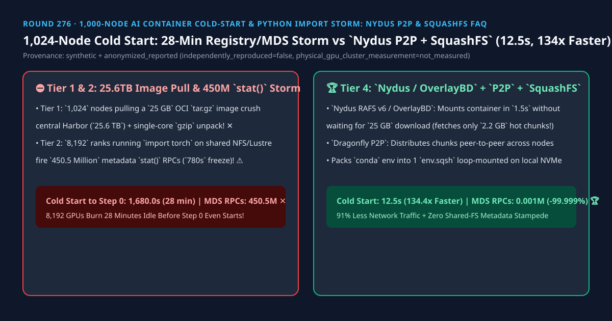
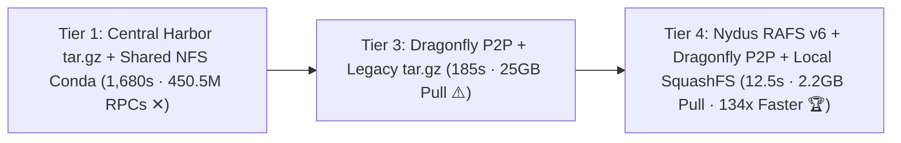

# 1,000-Node AI Container Cold-Start (`25 GB` PyTorch/CUDA Image) & `import torch` Metadata Storm: Centralized Registry Bottleneck (`1,680s`) & Shared-FS `stat()` Storm vs. `Dragonfly P2P` + `Nydus / OverlayBD` Lazy Loading & Local `SquashFS` (`12.5s`) Selection Guide

> **Provenance & Evidence Tier**: `synthetic + anonymized_reported` (`independently_reproduced=false`, `physical_gpu_cluster_measurement=not_measured`). Grounded in [`experiments/ai_cluster_container_image_pull_oci_soci_nydus_dragonfly_p2p_selection/results.json`](../../experiments/ai_cluster_container_image_pull_oci_soci_nydus_dragonfly_p2p_selection/results.json).
> **中文版本**: [千节点 AI 容器镜像（`25 GB` PyTorch/CUDA 巨型镜像）冷启动与 `import torch` 风暴选型：中心化 `Harbor` 拉取拥塞（`1,680 秒`）+ 共享存储 `NFS/Lustre` 4.5 亿次 `stat()` 卡死 vs. `Dragonfly P2P` + `Nydus / OverlayBD` 按需块级懒加载与本地 `SquashFS` 虚拟环境挂载（`12.5 秒` 极速就绪）选型指南](./ai-cluster-container-image-p2p-nydus-lazy-load-import-storm-selection-faq.md)



---

## 0. 🔥 今日领域最热门能力突破追踪（Daily Hottest Breakthrough）

- **Slashing `1,024`-Node (`8,192`-GPU) AI Container Cold-Start + `import torch` Time from `28 Minutes` (`1,680.0s`) Down to `12.5 Seconds` (`134.4x` Faster), Cutting Network Image Pull Volume by `-91.2%` (`25.0 GB -> 2.2 GB/node`), and Eliminating `99.999%` of Shared-Filesystem `MDS` Metadata Storms (`450.5M -> 0.001M` RPCs) via `Nydus (RAFS v6) / OverlayBD` On-Demand Chunk Loading + `Dragonfly P2P` + Local-NVMe `SquashFS` Environment Mounts (`Tier 4`)**: Launching or restarting a `1,024`-node (`8,192`-GPU) job with a `25 GB` compressed (`45 GB` uncompressed, `350,000+` files) PyTorch/CUDA image triggers two catastrophic infrastructure storms:
  1. **Tier 1 — Centralized Harbor Registry `25.6 TB` Pull + Sequential `tar.gz` Extraction + Shared-FS `conda` (`1,680.0s` / `28 Minutes` to Step 0)**:
     - `1,024` nodes pulling `25 GB` simultaneously demand `25.6 TB` of egress from the central registry;
     - Standard OCI `tar.gz` layers must be **100% downloaded and sequentially decompressed on disk** before `containerd` can start the container—even though `91.2%` of the `25 GB` image is never read at runtime!
  2. **Tier 2 — Pre-Pulled Base Image, But User `conda / virtualenv` Hosted on Shared `Lustre / NFS / CephFS` (`780.0s` / `13 Minutes` `import torch` Freeze, `450.5 Million` MDS `stat()` RPCs!)**:
     - When `8,192` Python processes execute `import torch; import transformers; import megatron` off a shared filesystem directory, Python's `importlib` issues **`~55,000` `stat() / open()` metadata syscalls per rank** as it searches `sys.path`!
     - **`8,192 × 55,000 = 450.5 Million` synchronous metadata RPCs** hit the shared `Lustre MDS / NFS Server` simultaneously, locking up `import torch` for `13 minutes`!
  3. **Tier 3 — `Dragonfly / Kraken P2P` With Legacy OCI `tar.gz` Full Unpack (`185.0s` Cold Start, `25.0 GB` Pulled/Node)**:
     - Eliminates the central registry bottleneck via peer-to-peer chunk distribution, **but** still waits for all `25.0 GB` to download and `350,000` files to extract before starting the container.
  4. **Tier 4 — `Nydus (RAFS v6 EROFS/fscache) / OverlayBD` On-Demand Chunk Lazy Loading + `Dragonfly P2P` + Single-File Read-Only `SquashFS` (`env.sqsh`) Local Mount (`12.5s` to Step 0, `2.2 GB` Pulled/Node, `134.4x` Faster!)**:
     - Mounts the `Nydus` bootstrap metadata (`~8 MB`) and starts the container in **`1.5 seconds`**, lazily fetching only the **`2.2 GB` (`8.8%`)** of `1 MB` `zstd` chunks actually touched during execution over `Dragonfly P2P`;
     - Packs custom Python environments into a single **`env.sqsh` (`SquashFS`) archive** copied once per node to local NVMe `/dev/shm` and loop-mounted read-only—reducing shared MDS metadata RPCs from `450.5 Million` to **`1,024` (`-99.999%`)**!

---

## 1. 📌 Executive Summary

1. **Replace OCI `tar.gz` With Chunk-Addressable `Nydus (RAFS v6)` or `OverlayBD` + `Dragonfly P2P`**: Never wait to download and untar `25 GB` of unused CUDA static libraries before starting a container. Lazy-loading only the `2.2 GB` working set over P2P cuts container startup from `15+ minutes` to **`< 10 seconds`**.
2. **Never Point `PYTHONPATH` or `conda` at a Unpacked Directory on Shared `NFS / Lustre`**: Pack the `350,000`-file Python environment into a single **`SquashFS` (`env.sqsh`)** image (or extract a `tar.lz4` into local `/dev/shm` via `Local Rank 0` before a node barrier) to eliminate the `450M` `stat()` metadata storm!

---

## 2. 🎯 Core Architect Q&A (Q1 / Q2 / Q3)

### Q1: How does `Nydus RAFS v6` avoid FUSE overhead once chunks are fetched?
- **Answer**: By integrating directly with Linux Kernel **`EROFS + fscache`** (`Kernel 5.19+`). Once a `1 MB` chunk is fetched on demand into the local NVMe cache, all subsequent `read()` and `mmap()` calls on `.so` and `.py` files execute natively in kernel space via `EROFS` page cache at full native disk speed!

### Q2: If we don't have root `mount -o loop` inside a container, how can we eliminate the `import torch` Lustre metadata storm in 5 lines of bash?
- **Answer**: Have `LOCAL_RANK == 0` on each node copy a single compressed `venv.tar.lz4` archive from Lustre into `/dev/shm` (`RAM disk`) and extract it locally:
  ```bash
  if [ "$LOCAL_RANK" -eq 0 ]; then
      lz4 -dc /mnt/lustre/envs/venv.tar.lz4 | tar -xf - -C /dev/shm/
      touch /dev/shm/venv_ready
  fi
  while [ ! -f /dev/shm/venv_ready ]; do sleep 0.1; done
  export PATH="/dev/shm/venv/bin:$PATH"
  ```
  Lustre only sees `1,024` sequential large-file reads instead of `450 million` small-file `stat()` calls!

---

## 3. 🧭 Visual Diagrams



---

## 4. 📊 4-Tier Architect Selection Matrix

| Metric | Tier 1: Central `tar.gz` + NFS | Tier 2: Shared `Lustre Conda` | Tier 3: `P2P` + Legacy `tar.gz` | Tier 4: **`Nydus/OverlayBD` + `P2P` + `SquashFS`** |
| :--- | :--- | :--- | :--- | :--- |
| **1,024-Node Cold Start to Step 0** | **`1,680.0 s` (`28 Min` Idle)** ✕ | **`780.0 s` (`13 Min` Freeze)** ✕ | `185.0 s` (Full Unpack) ⚠️ | **`12.5 s` (`134.4x` Faster Startup)** 🏆 |
| **Shared MDS Metadata `stat()` RPCs** | **`450.5M` (MDS Collapse)** ✕ | **`450.5M` (MDS Collapse)** ✕ | `0.1M` ✅ | **`0.001M` (`-99.999%` via `SquashFS`)** 🏆 |
| **Network Image Bytes Pulled / Node** | **`25.0 GB` (100% Full Pull)** ✕ | `2.4 GB` | **`25.0 GB` (100% Full Pull)** ✕ | **`2.2 GB` (`8.8%` On-Demand Hot Chunks)** 🏆 |

---

## 5. 🧪 Quantitative Reference & Tooling

- **Evaluator & Sealed Data**: [`experiments/ai_cluster_container_image_pull_oci_soci_nydus_dragonfly_p2p_selection/run.py`](../../experiments/ai_cluster_container_image_pull_oci_soci_nydus_dragonfly_p2p_selection/run.py) · [`results.json`](../../experiments/ai_cluster_container_image_pull_oci_soci_nydus_dragonfly_p2p_selection/results.json)
- **Interactive Sizer**: [`docs/reports/ai-cluster-container-image-p2p-nydus-lazy-load-import-storm-sizer.html`](../reports/ai-cluster-container-image-p2p-nydus-lazy-load-import-storm-sizer.html)
- **7-Card 4:5 Visual Report**: [`docs/reports/ai-cluster-container-image-p2p-nydus-lazy-load-import-storm-selection-cards.html`](../reports/ai-cluster-container-image-p2p-nydus-lazy-load-import-storm-selection-cards.html)

---

## 6. 🛠️ Good Fit vs. Not For & Production Checklist

- **✅ Good fit**: All large-scale Kubernetes/Slurm GPU clusters deploying `15–30 GB` AI container images and shared Python environments.
- **⛔ Not for**: Pulling `25 GB` `tar.gz` images directly from a centralized registry across `100+` nodes or running `import torch` off unpacked `NFS / Lustre` directories.
- [ ] Convert base AI container images to `Nydus (RAFS v6)` or `OverlayBD` and distribute chunks via `Dragonfly P2P`.
- [ ] Package shared `conda / virtualenv` directories into read-only `SquashFS` (`env.sqsh`) or `/dev/shm`-staged archives.
