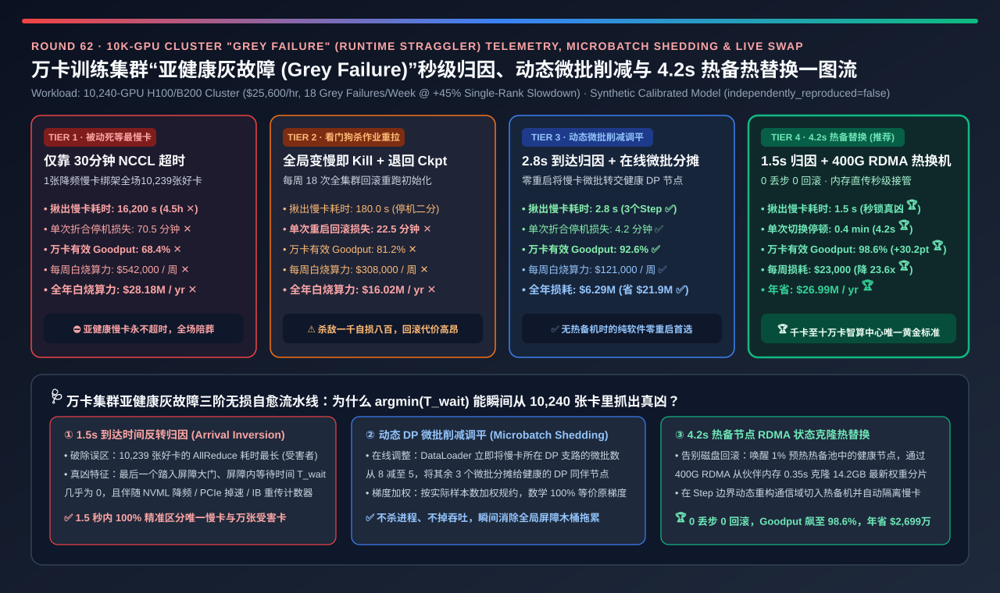
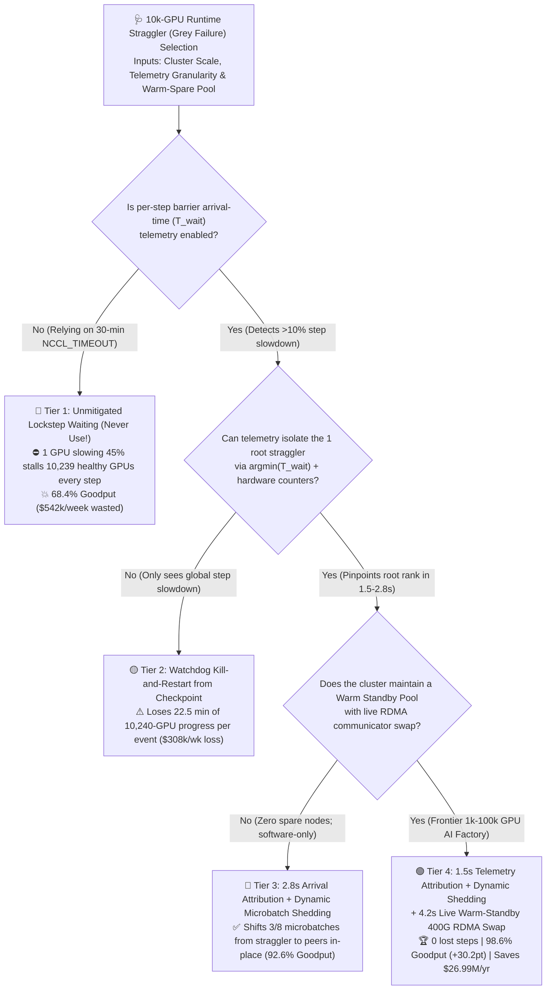
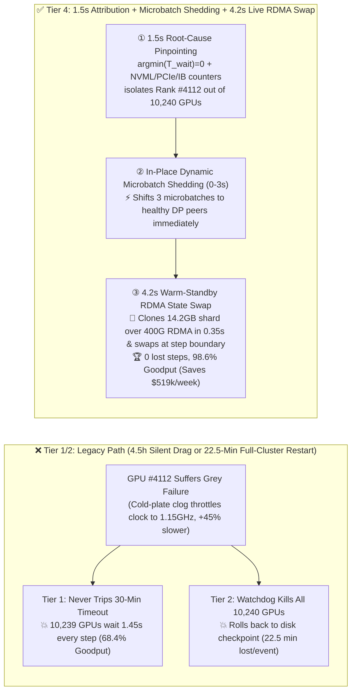
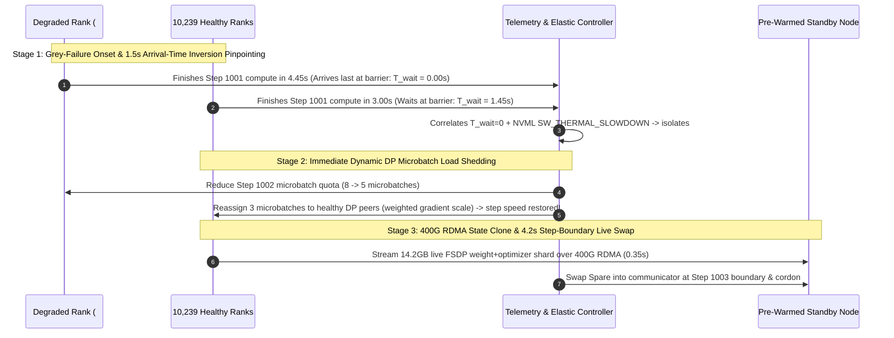

# 10k-GPU Training Cluster "Grey Failure" (Runtime Straggler) Sub-Second Attribution, Dynamic Microbatch Shedding & Live Node Swap Selection Guide (`Unmitigated Lockstep Wait` vs. `Watchdog Kill-and-Restart` vs. `2.8s Arrival-Time Attribution + Dynamic Microbatch Shedding` vs. `1.5s Telemetry Attribution + 4.2s Live Warm-Standby RDMA Swap`)

> **Reader's Guide (3-Minute Executive Scan / 10-Minute Whiteboard Pitch)**: Written for **AI Solution Architects and 10k-GPU Cluster SRE / Training Framework Leads**. Using first principles, this guide tackles the #1 silent killer of large-scale synchronous training Goodput—**why a single GPU out of 10,240 suffering a "Grey Failure" (e.g., cold-plate micro-clog thermal throttling to `1,150 MHz`, PCIe Gen5→Gen3 lane degradation, or optical FEC retry micro-stalls that slow it down by `45%` without crashing or tripping the 30-minute `NCCL_TIMEOUT`) forces all 10,239 healthy GPUs to sit idle at every collective barrier, collapsing cluster Goodput to `68.4%` (`$542,000/week` wasted); why coarse watchdog kill-and-restart policies (Tier 2) still lose `22.5 minutes` of 10,240-GPU compute per event; and how combining `argmin(T_wait)` Collective Arrival Attribution (`1.5–2.8s`), Dynamic DP Microbatch Load Shedding (Tier 3), and `4.2s` Live Warm-Standby RDMA State Cloning (Tier 4) achieves `98.6%` Goodput with zero lost steps, saving `$26.99M/year`.**

---

## ① 📌 Executive Summary

1. **Why "Sub-Health Grey Failures" Are 10x More Destructive Than Hard GPU Crashes on 10k-GPU Clusters**:
   - **Hard Crashes (`XID 79 / Process Exit`)** fail fast and trigger immediate automated failover.
   - **Grey Failures (Runtime Stragglers)** keep the GPU alive and green in `nvidia-smi` while running **`30%–65%` slower** (due to thermal clock throttling, PCIe lane width downgrade, host CPU NUMA interference, or optical transceiver FEC retries).
   - Because the degraded GPU never hangs for 30 minutes, default `NCCL_TIMEOUT` never fires (Tier 1). Yet in synchronous `FSDP / DP × PP × TP` training, every collective barrier moves at the speed of the **single slowest GPU out of 10,240**—stalling all 10,239 healthy GPUs on every step, dragging cluster Goodput down to **`68.4%` ✕**, and burning **`$542,000/week` (`$28.18M/year` ✕)**!
2. **When to Retire Watchdog Kill-and-Restart (Tier 2) and Enable Dynamic Microbatch Load Shedding (Tier 3)**:
   - **Why Tier 2 (`Watchdog Kill + Checkpoint Reload`) Wastes `$308k/week`**: Killing a 10,240-GPU job whenever step time degrades by `>15%` discards all progress since the last checkpoint and pays a **`22.5-minute` full-cluster rollback and initialization penalty** on every single grey failure (`18 events/week = 6.75 hours/week` lost ✕).
   - **Software-Only Zero-Restart Mitigation — Tier 3 (`2.8s Collective Arrival-Time Attribution` + `Dynamic DP Microbatch Load Shedding`)**:
     - Separates per-rank **Pure Compute Time ($T_{\text{compute}}$)** from **Collective Barrier Wait Time ($T_{\text{wait}}$)**: the **true root-cause straggler is the rank with `argmin(T_wait) ≈ 0`** (arrived last at the barrier!), whereas the 10,239 victims show high $T_{\text{wait}}$. This pinpoints the exact straggler in **`2.8 seconds` (3 steps) ✅**.
     - Without restarting the job, the DataLoader shifts `2–3` microbatches per step away from the degraded DP rank to healthy peers (with sample-weighted gradient averaging), restoring **`92.6%` Goodput ✅** in-place!
3. **The Gold Standard for Frontier AI Factories (Tier 4: `1.5s Hardware+Kernel Attribution` + `Dynamic Shedding` + `4.2s Live Warm-Standby RDMA Swap`)**:
   - Bridges the first 3 steps via Dynamic Microbatch Shedding while waking a pre-warmed spare node (`Warm Standby Pool`), cloning the degraded rank's `14.2 GB` FSDP shard directly from a healthy peer's memory over `400G RDMA` in **`0.35 seconds`**, and swapping the spare into the active communicator at the next step boundary in **`4.2 seconds` total pause (`0` lost steps, `0` checkpoint rollbacks 🏆)**!
   - **Quantified Outcome**: Sustains **`98.6%` cluster Goodput (`+30.2 pts` vs. Tier 1 🏆)** and cuts weekly grey-failure waste by **`23.6x` (`$542k → $23k/week`, saving `$26.99M/year` 🏆)**.

---

## ② 🎯 Architect & Customer First-Principles Q&A

### Q1: Why do naive NCCL profilers blame the 10,239 healthy GPUs instead of the 1 true straggler, and how does `argmin(T_wait)` solve it in `1.5–2.8 seconds`?

- **The "Late-to-the-Meeting" Paradox**:
  - When 10,239 healthy GPUs finish forward/backward compute at $t = 3.00\text{ s}$ and wait inside `ncclAllReduce` until the 1 throttled GPU arrives at $t = 4.45\text{ s}$, naive profilers report `ncclAllReduce = 1.45s` on all 10,239 healthy GPUs and `ncclAllReduce = 0.05s` on the straggler!
  - Recording a lightweight CUDA event timestamp right before each collective call ($T_{\text{arrive}}$) inverts the signal: **the rank with the latest $T_{\text{arrive}}$ and `T_wait ≈ 0` is 100% guaranteed to be the compute straggler**, while cross-correlating ring-pair transfer throughput with `NVML / PCIe / IB port_xmit_wait` pinpoints network link stragglers in **`1.5 seconds`**.

### Q2: How does Dynamic DP Microbatch Load Shedding (Tier 3) neutralize a straggler without restarting the job or altering model convergence?

- **Proportional Microbatch Re-Weighting**:
  - If DP Rank $k$ runs `37.5%` slower due to thermal throttling (`1,150 MHz`), reducing its per-step microbatch count from $m_k = 8$ to $m_k = 5$ while assigning $m_j = 9$ to three healthy peers equalizes wall-clock completion time across all DP ranks. Scaling each rank's local gradient sum by $m_i / \sum_r m_r$ before `ReduceScatter` preserves the **exact mathematical expectation of the global batch gradient** with zero restarts!

### Q3: How does Tier 4 swap out a grey-failing node in `4.2 seconds` without rolling back to a disk checkpoint?

- **In-Memory Peer-to-Peer RDMA State Cloning + Step-Boundary Communicator Swap**:
  - Disk checkpoint restores waste 15–30 minutes of progress. Because FSDP/hybrid-sharded training already holds redundant or peer-accessible shards in cluster RAM/VRAM, a pre-initialized warm standby node pulls the exact `14.2 GB` live state over `400 Gbps RDMA` in `0.35 s` and joins the communicator at the end of the current optimizer step (`4.2 s` total pause).

---

## ③ 🧭 Visual Architecture Diagrams (Decision Tree / Attribution Path / 4.2s Swap Sequence)

### 3.1 AI Cluster Runtime Straggler ("Grey Failure") Mitigation Decision Tree

### 3.2 Lockstep Drag / Full-Job Restart vs. Tier 4 Live RDMA Warm-Standby Swap

### 3.3 End-to-End Sequence from Grey-Failure Onset to `4.2s` Zero-Restart Node Swap

---

## ④ 📊 Architect Decision Matrix

| Evaluation Dimension | Tier 1: Unmitigated Lockstep Wait | Tier 2: Watchdog Kill & Checkpoint Restart | Tier 3: `2.8s` Attribution + Dynamic Microbatch Shedding | Tier 4: `1.5s` Telemetry + `4.2s` Live RDMA Warm Swap |
| :--- | :--- | :--- | :--- | :--- |
| **Core Detection & Mitigation Stack** | 30-min `NCCL_TIMEOUT` + manual hunt | Global step watchdog kills job & reloads disk ckpt | **`argmin(T_wait)` attribution + elastic DP microbatch shift** | **Kernel/HW telemetry + shedding + 400G RDMA live spare swap** |
| **Straggler Attribution Latency (`s`)** | `16,200 s` ✕ (4.5h manual triage) | `180.0 s` ⚠️ (Offline bisection) | **`2.8 s` ✅ (3 steps)** | **`1.5 s` 🏆 (Instant barrier + HW counter fusion)** |
| **Lost / Dragged Time per Event (`Min`)** | `70.5 min` ✕ | `22.5 min` ✕ (Checkpoint rollback + init) | `4.2 min` ✅ (Zero-restart load shedding) | **`0.4 min` 🏆 (`4.2 s` live swap, `0` lost steps)** |
| **Effective Cluster Goodput (`%`)** | `68.4%` ✕ (`31.6%` wasted) | `81.2%` ✕ | **`92.6%` ✅** | **`98.6%` 🏆 (`+30.2 pts` vs Tier 1)** |
| **Weekly Wasted GPU Compute (`USD / Wk`)** | **`$542,000 / wk` ✕** | `$308,000 / wk` ✕ | `$121,000 / wk` ✅ | **`$23,000 / wk` 🏆 (Saves `$519,000/wk`)** |
| **Annual Wasted GPU Compute (`USD / Yr`)** | `$28,184,000 / yr` ✕ | `$16,016,000 / yr` ✕ | `$6,292,000 / yr` ✅ | **`$1,196,000 / yr` 🏆 (Saves `$26.99M/yr`)** |
| **Best Fit & Architect Verdict** | **Strictly banned at scale** | Legacy frameworks without elastic DP/RDMA swap | **Best software-only fix when no spare nodes exist** | **Mandatory standard for 1k–100k GPU AI factories** |

---

## ⑤ 🧪 Quantitative Evaluator & 7-Card Benchmark Insights

> **Provenance Disclosure**: All metrics in this guide and the companion 7-Card report are generated by [`experiments/ai_cluster_straggler_grey_failure_mitigation_selection/run.py`](../../experiments/ai_cluster_straggler_grey_failure_mitigation_selection/run.py) and sealed in [`results.json`](../../experiments/ai_cluster_straggler_grey_failure_mitigation_selection/results.json) (`independently_reproduced=false`, `physical_gpu_cluster_measurement=not_measured`), calibrated against Meta Llama-3 16,384-GPU operations, ByteDance MegaScale straggler mitigation, and NVIDIA NVRx resiliency studies.

- **7-Card 4:5 Visual Benchmark Deck**: [`docs/reports/ai-cluster-gpu-straggler-grey-failure-telemetry-mitigation-selection-cards.html`](../reports/ai-cluster-gpu-straggler-grey-failure-telemetry-mitigation-selection-cards.html)
- **Interactive Grey-Failure Straggler Mitigation Sizer**: [`docs/reports/llm-inference-engine-pd-sizer.en.html`](../reports/llm-inference-engine-pd-sizer.en.html)

---

## ⑥ 🛠️ Appendix: Production Readiness Checklist

- [ ] **1. Alert on `argmin(T_wait)` (Barrier Last-Arrival Rank), NOT longest `ncclAllReduce` duration**: High NCCL kernel duration marks the *victims* waiting at the barrier; near-zero wait time marks the *straggler*.
- [ ] **2. Fuse 1-second hardware health counters (`NVML clocks_event_reasons`, `PCIe Link Width/Speed`, `IB port_xmit_wait`, `Optical Pre-FEC BER`) with step arrival telemetry**.
- [ ] **3. Implement Dynamic DP Microbatch Load Shedding in the training DataLoader**: Rebalance microbatch counts across DP ranks with sample-weighted gradient reduction to absorb throttling without restarts.
- [ ] **4. Maintain a `1%–2%` Pre-Warmed Standby Node Pool (`Warm Spares`)** with initialized containers and compiled kernel caches.
- [ ] **5. Clone live FSDP/optimizer shards peer-to-peer over `400G RDMA` (`<0.5s`) instead of rolling back to disk checkpoints**.
- [ ] **6. Automatically cordon and run 700W thermal/RDMA stress validation on evicted grey-failure nodes** before returning them to the cluster pool.
