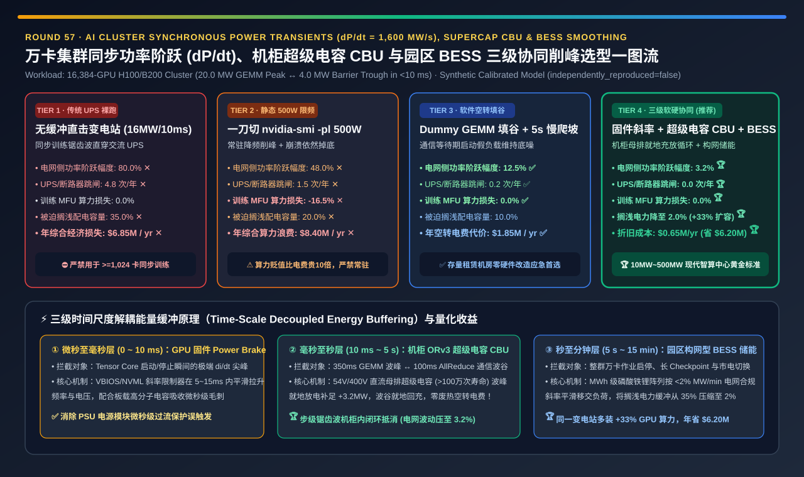
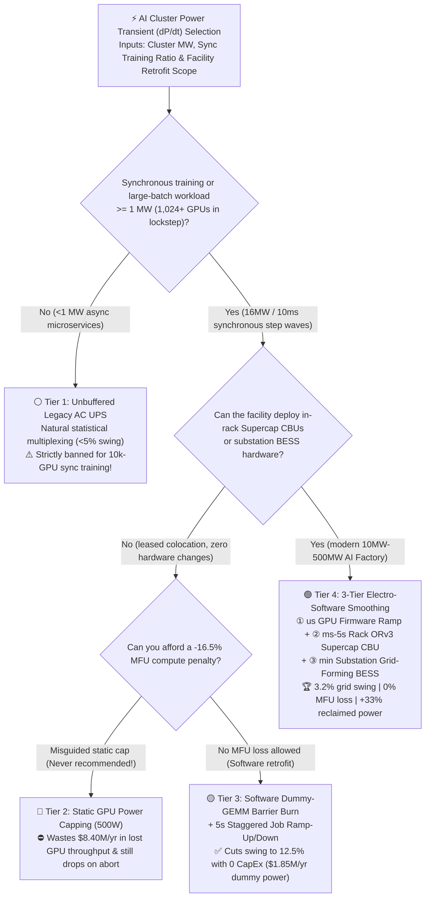
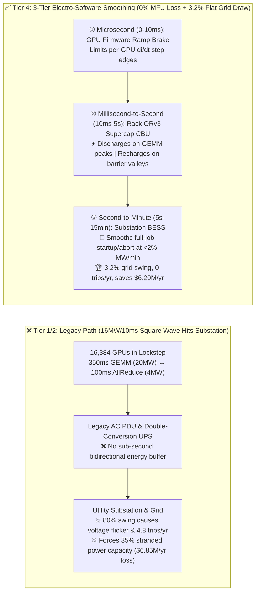

# 10k-GPU AI Cluster Synchronous Power Transients (`dP/dt` Power Swing), Supercapacitor Peak-Shaving & Grid BESS Smoothing Selection Guide (`Unbuffered AC UPS` vs. `Static 500W Power Cap` vs. `Software Dummy-GEMM Barrier Burn` vs. `Rack ORv3 Supercap CBU + Firmware Ramp Control + Substation BESS`)

> **Reader's Guide (3-Minute Executive Scan / 10-Minute Whiteboard Pitch)**: Written for **AI Solution Architects and AI Datacenter Infrastructure Leads**. Using first principles, this guide explains why synchronous large-model training clusters terrify electrical utilities and datacenter MEP engineers—**why 16,384 GPUs marching in lockstep create a `16.0 MW` (`80%` load) step-wave in under `10 milliseconds` (`dP/dt = 1,600 MW/s`), triggering substation voltage flicker, `4.8` UPS trips/year, and forcing `35%` of contracted datacenter power capacity to sit stranded; why naive `nvidia-smi -pl 500W` static power capping wastes `$8.40M/yr` in throttled GPU throughput; and how a 3-Tier Electro-Software Smoothing Architecture (`Microsecond GPU Firmware Ramp Control + Millisecond Rack ORv3 Supercapacitor CBU + Minute Substation BESS`) compresses grid-seen power swings from `80.0%` down to `3.2%` with `0.0%` MFU loss while reclaiming `+33%` stranded power capacity.**

[](../../README.en.md)
[](./ai-cluster-grid-power-transients-bess-smoothing-selection-faq.md)
[](../reports/ai-cluster-grid-power-transients-bess-smoothing-selection-cards.html)
[](../reports/llm-inference-engine-pd-sizer.en.html)



---

## ① 📌 Executive Summary

1. **Why a 10k-GPU AI Cluster Behaves Nothing Like a Traditional Cloud Datacenter (`16 MW` in `10 ms`, `dP/dt = 1,600 MW/s`)**:
   - In a traditional 20 MW cloud datacenter, 100,000 independent CPU servers process uncorrelated user requests. By the Central Limit Theorem, aggregate facility power is a flat line (`< 3%` variance).
   - In a **16,384-GPU H100/B200 synchronous pre-training cluster (`20.0 MW` peak IT load)**, all 16,384 GPUs are locked to the exact same training step clock: during forward/backward Tensor Core GEMMs, the entire building draws **`20.0 MW`**; a few hundred milliseconds later, when all GPUs hit an inter-rack `AllReduce` barrier, checkpoint flush, or global `Job Abort`, all 16,384 GPUs drop to idle in **`< 10 ms` (`4.0 MW`)**!
   - Exposing a legacy double-conversion AC UPS and utility substation directly to this **`80.0%` sub-second square wave (Tier 1)** causes **`4.8` UPS/breaker overload trips per year ✕** and forces operators to leave **`35.0%` of contracted utility power stranded/unused** as safety headroom (`$6.85M/yr` economic penalty ✕).
2. **When to Strictly Ban Static Power Capping (Tier 2) vs. When to Use Software Dummy-GEMM Barrier Burn (Tier 3)**:
   - **Never use permanent `nvidia-smi -pl 500W` static power capping (Tier 2) to smooth grid transients**: Capping 700W GPUs at 500W still leaves a `48.0%` drop on job crashes or checkpoints, while permanently throttling Tensor Core GEMM clocks by **`-16.5%` MFU ✕**—destroying **`$8.40M/yr` in GPU compute value ✕** on a `$50M/yr` cluster!
   - **For zero-CapEx retrofits in existing colocation facilities, use Tier 3 (`Software Dummy-GEMM Barrier Burn + 5s Staggered Job Ramp`)**: Whenever a rank waits `> 20 ms` on a collective barrier or checkpoint, a lightweight background stream fires a synthetic dummy matmul to hold GPU power high, while the job scheduler staggers startup/shutdown over 5 seconds. This flattens grid swings to **`12.5%` ✅** with `0.0%` MFU loss, at the cost of burning **`$1.85M/yr` in wasted dummy electricity**.
3. **The Production Gold Standard for 10MW–500MW AI Factories (Tier 4: 3-Tier Electro-Software Smoothing)**:
   - Decouple power transients by physical time scale across three coordinated layers:
     1. **`0–10 ms` (Microsecond/Millisecond Layer)**: **GPU Firmware `di/dt` Ramp-Rate Controller** smooths instant clock/voltage edges;
     2. **`10 ms – 5 s` (Step-Level Training Peaks & Valleys)**: **In-Rack OCP ORv3 54V/400V Supercapacitor CBU (Capacitor Backup Unit)** shelves discharge locally onto the rack DC busbar during `350 ms` GEMM peaks and recharge locally during `100 ms` AllReduce valleys—recycling energy inside the rack with **zero wasted dummy electricity**!
     3. **`5 s – 15 min` (Job Launch/Teardown & Grid Compliance)**: **Substation Grid-Forming LiFePO4 BESS** absorbs macro job ramps at `< 2% MW/min` and unlocks **`98.0%` of contracted utility power** (reclaiming **`+33.0%` stranded power capacity** to deploy more GPUs).
   - **Quantified Outcome**: Grid-seen power swing drops from `80.0%` to **`3.2%` (`25.0x` smoother 🏆)**, breaker trips drop to **`0.0/yr` 🏆**, training MFU loss is **`0.0%` 🏆**, saving **`$6.20M/yr` net 🏆**.

---

## ② 🎯 Architect & Customer First-Principles Q&A

### Q1: Why do synchronous AI clusters create `1,600 MW/s` power swings when traditional cloud datacenters have flat power profiles?

- **Statistical Multiplexing vs. Lockstep Barrier Resonance**:
  1. **Uncorrelated Cloud Servers ($\sigma \propto 1/\sqrt{N}$)**: Ten thousand web servers average out their peaks and valleys; relative facility variance is `< 1%`.
  2. **Synchronous Training Lockstep ($\sigma \propto N$)**: Every rank executes `350 ms` of Tensor Core GEMM (`20.0 MW` total) followed by `100 ms` of NCCL collective wait (`4.0 MW` total). Because all 16,384 GPUs synchronize at the end of every step, their transients add constructively (`16.0 MW` swing in `< 10 ms`), exciting `0.2–10 Hz` sub-synchronous oscillations on utility transformers and tripping UPS inverters.

### Q2: Why is `nvidia-smi -pl 500W` (Tier 2) a `$8.4M/yr` mistake, and what is the trade-off of Software Dummy-GEMM Burn (Tier 3)?

- **Compute Depreciation vs. Electricity Cost**:
  1. **Tier 2 (`500W` Static Cap)**: GPU hardware amortizes at `~$2.00–$3.50/GPU-hr`, whereas electricity costs `~$0.06–$0.08/GPU-hr`. Throttling a `$50M/yr` cluster by **`-16.5%` MFU** wastes **`$8.25M/yr` in stranded silicon** just to shave a few megawatts off the peak—and still suffers a `48%` power cliff whenever a job crashes!
  2. **Tier 3 (`Software Dummy-GEMM Barrier Burn`)**: Keeping GPUs warm during long barriers eliminates `0.2–5 Hz` grid swings (`12.5%` residual swing, `0.0%` MFU loss) without buying hardware, but converts `14,500 MWh/yr` of electricity into pure waste heat (`$1.85M/yr`).

### Q3: How does Tier 4 (`Firmware Ramp + Rack Supercapacitor CBU + Substation BESS`) achieve `3.2%` flat grid load without burning dummy power or losing MFU?

- **Three-Stage Time-Scale Filtering**:
  1. **Stage 1 (`0–10 ms` — GPU Firmware Ramp Controller)**: Hardware power brake limits per-GPU $dP/dt$ slopes across the first few milliseconds of kernel launch/exit.
  2. **Stage 2 (`10 ms – 5 s` — In-Rack ORv3 Supercapacitor CBU)**: High-cycle EDLC/Li-ion capacitor shelves (`>1,000,000` cycles, `>96%` round-trip efficiency) sit directly on the 54V/400V rack busbar. They discharge `+3.2 MW` during the `350 ms` GEMM peak and absorb `-12.8 MW` during the `100 ms` communication trough, acting as a passive low-pass filter so the upstream AC PDU sees a steady `~16.8 MW` average draw.
  3. **Stage 3 (`5 s – 15 min` — Substation Grid-Forming BESS)**: MWh-scale LiFePO4 battery arrays buffer full-cluster job startups, teardowns, and checkpoint pauses, guaranteeing utility ramp rates `< 2% MW/min` and reclaiming `33%` of previously stranded facility power capacity.

---

## ③ 🧭 Visual Architecture Diagrams (Decision Tree / 3-Tier Energy Buffer / Step Sequence)

### 3.1 AI Cluster Power Transient (`dP/dt`) Mitigation Decision Tree



### 3.2 Unbuffered Grid Shock vs. Tier 4 Time-Scale Decoupled Smoothing



### 3.3 End-to-End Sequence Diagram Across One Training Step & Job Teardown

```mermaid
sequenceDiagram
    autonumber
    participant S as Scheduler & NCCL Runtime
    participant G as 16,384x GPU Firmware (0-10ms)
    participant C as Rack 54V/400V Supercap CBU (10ms-5s)
    participant B as Substation BESS & Utility Grid (5s-15min)

    Note over S,G: Phase 1: Forward/Backward Tensor Core GEMM Burst (350 ms, True IT Load = 20.0 MW)
    S->>G: Launch GEMM kernels
    G->>G: Firmware ramp controller smoothly slews power to 20.0 MW over 8 ms
    C->>G: Rack Supercap CBU discharges +3.2 MW locally onto DC busbar
    B->>C: Upstream rectifiers & utility grid supply steady 16.8 MW average (<3.2% ripple)

    Note over S,G: Phase 2: Inter-Rack AllReduce Barrier Trough (100 ms, True IT Load Drops to 4.0 MW)
    S->>G: Enter NCCL AllReduce wait, Tensor Cores idle
    G->>C: GPU draw drops to 4.0 MW (zero dummy GEMM electricity burned!)
    B->>C: Grid & rectifiers maintain ~16.8 MW draw, recharging Rack Supercap CBU locally!

    Note over S,B: Phase 3: Macro Job Completion or Emergency Abort (20 MW -> 4 MW Step Down)
    S->>B: Job teardown signal; Supercap CBU bridges first 5 seconds
    B->>B: Substation BESS absorbs surplus grid power and ramps down utility draw at <2% MW/min!
```

---

## ④ 📊 Architect Decision Matrix

| Evaluation Dimension | Tier 1: Unbuffered Legacy AC UPS | Tier 2: Static GPU Power Cap (`500W`) | Tier 3: Software Dummy-GEMM Burn + Staggered Ramp | Tier 4: 3-Tier Smoothing (Firmware + Rack Supercap CBU + BESS) |
| :--- | :--- | :--- | :--- | :--- |
| **Core Smoothing Mechanism** | None; raw 16MW/10ms step wave hits UPS/grid | Hardcaps GPUs at `500W` via `nvidia-smi -pl` | Fires dummy matmul on `>20ms` barriers + 5s job ramp | **us Firmware Ramp + ms–5s Rack Supercap CBU + min Grid BESS** |
| **Grid-Seen Power Swing (`% of Peak`)** | `80.0%` ✕ (Violates utility grid codes) | `48.0%` ✕ (Still drops on job crash/I/O) | **`12.5%` ✅** | **`3.2%` 🏆 (`25.0x` smoother than Tier 1)** |
| **UPS / Breaker Overload Trips (`trips / yr`)** | `4.8 / yr` ✕ | `1.5 / yr` ✕ | `0.2 / yr` ✅ | **`0.0 / yr` 🏆 (Zero transient trips)** |
| **Training Compute Loss (`MFU Loss %`)** | `0.0%` | **`16.5%` ✕ (Severe GEMM clock throttling)** | **`0.0%` ✅** | **`0.0%` 🏆 (Full unthrottled TDP)** |
| **Stranded Facility Power (`% Unused MW`)** | **`35.0%` ✕ (One-third of capacity stranded)** | `20.0%` ✕ | `10.0%` ⚠️ | **`2.0%` 🏆 (Reclaims `+33%` power for more GPUs)** |
| **Annual Economic Penalty / Waste (`USD / yr`)** | `$6,850,000 / yr` ✕ | `$8,400,000 / yr` ✕ (Compute waste) | `$1,850,000 / yr` ✅ (Dummy power bill) | **`$650,000 / yr` 🏆 (Saves `$6.20M/yr` vs Tier 1)** |
| **Best Fit & Architect Verdict** | `<1 MW` async inference only; **banned for sync training** | Emergency chiller failure derating only | **Best software-only retrofit for leased colos** | **Mandatory standard for 10MW–500MW AI factories (GB200/B200)** |

---

## ⑤ 🧪 Quantitative Evaluator & 7-Card Benchmark Insights

> **Provenance Disclosure**: All quantitative metrics in this guide and the companion 7-Card visual report are generated by the deterministic analytical model [`experiments/ai_cluster_power_transients_bess_smoothing_selection/run.py`](../../experiments/ai_cluster_power_transients_bess_smoothing_selection/run.py) and sealed in [`results.json`](../../experiments/ai_cluster_power_transients_bess_smoothing_selection/results.json) (`independently_reproduced=false`, `physical_gpu_cluster_measurement=not_measured`), calibrated against OCP Open Rack v3 CBU transient specifications, utility grid ramp-rate codes, and NVIDIA GB200/B200 power smoothing studies.

1. **Why Rack Supercapacitors (Tier 4) Beat Static Power Capping (Tier 2) by `$7.75M/yr`**:
   - Static power capping (Tier 2) sacrifices `16.5%` of a `$50M/yr` GPU cluster's training throughput (`$8.40M/yr` total penalty). Tier 4 recycles step-level peaks and valleys inside the rack's 54V/400V DC busbar via high-cycle supercapacitors (`0.0%` MFU loss), costing only `$650k/yr` in amortized storage hardware and saving **`$7.75M/yr` vs. Tier 2** (`$6.20M/yr` vs. Tier 1).
2. **Interactive Assets**:
   - **7-Card 4:5 Visual Benchmark Deck**: [`docs/reports/ai-cluster-grid-power-transients-bess-smoothing-selection-cards.html`](../reports/ai-cluster-grid-power-transients-bess-smoothing-selection-cards.html)
   - **Interactive Power Transient & BESS Sizer Workbench**: [`docs/reports/llm-inference-engine-pd-sizer.en.html`](../reports/llm-inference-engine-pd-sizer.en.html)

---

## ⑥ 🛠️ Appendix: Production Readiness Checklist

- [ ] **1. Simulate `2–10 Hz` synchronous square-wave load (`100% TDP GEMM ↔ 20% TDP Barrier`) during MEP commissioning**: Never size AI training transformers or UPS inverters using steady-state cloud averages.
- [ ] **2. Ban permanent `nvidia-smi -pl` static power capping as a grid-smoothing fix**: Reserve power capping strictly for emergency thermal runaway / chiller loss events.
- [ ] **3. Equip high-density AI racks (`GB200/B200 NVL72`) with OCP ORv3 Supercapacitor CBU shelves**: Absorb `10 ms – 5 s` training step swings locally on the DC busbar before they ever reach the AC PDU.
- [ ] **4. Enable GPU Firmware Ramp-Rate Control (`Power Brake / Smoothing Profile`)**: Eliminate sub-10ms $di/dt$ spikes at kernel boundaries.
- [ ] **5. Deploy `>20 ms` Barrier Dummy-GEMM Floor Regulation + `5 s` Staggered Job Ramp in legacy colocation sites**: Protect legacy UPS systems immediately via software until rack CBU hardware is installed.
- [ ] **6. Pair 50 MW+ substations with Grid-Forming LiFePO4 BESS**: Guarantee `< 2% MW/min` utility ramp compliance and unlock `30%+` stranded facility power capacity for additional GPU racks.
