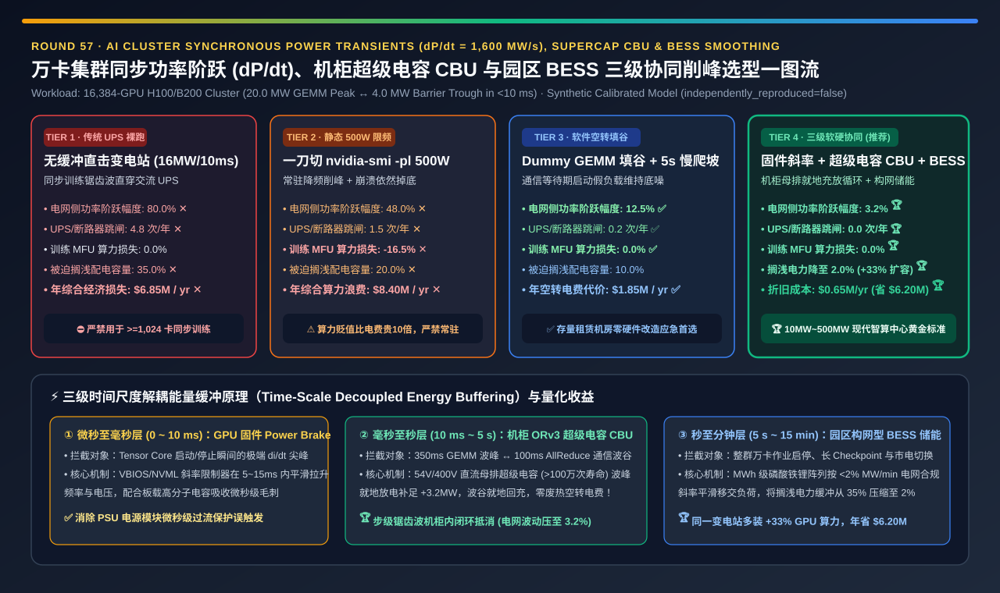
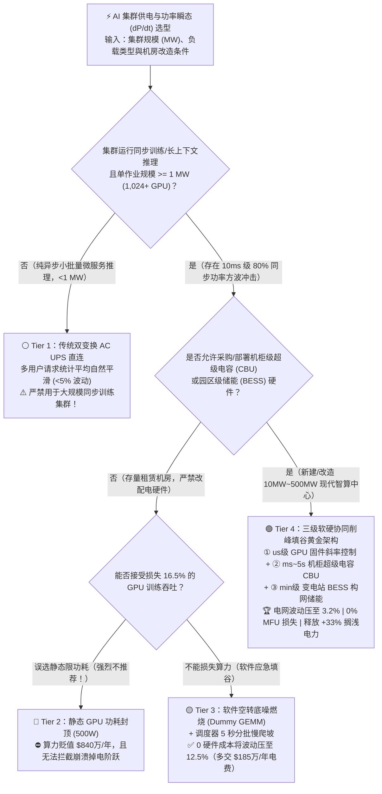
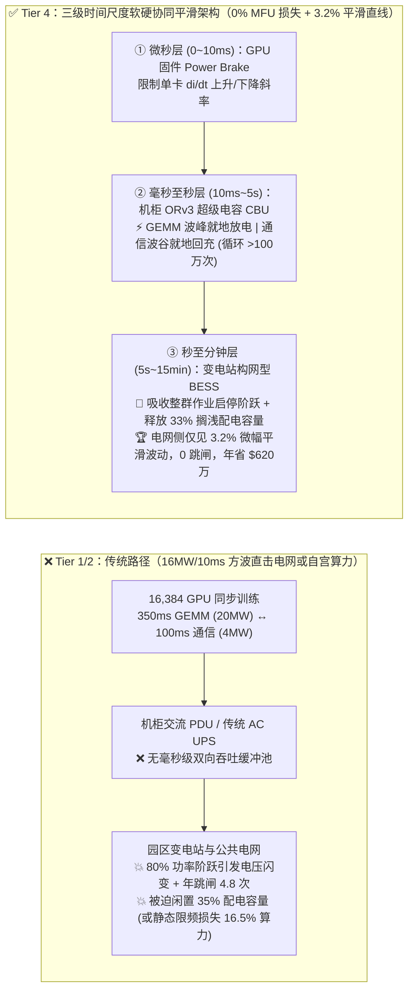
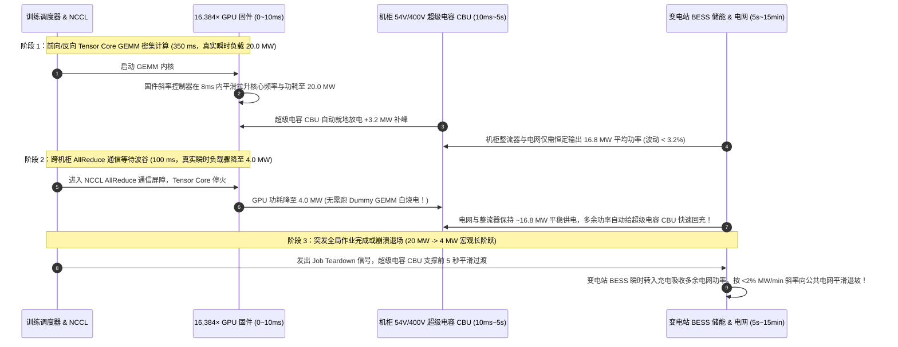

# 万卡 AI 智算集群同步功率阶跃冲击（`dP/dt` Power Swing）、超级电容削峰与电网协同平滑架构选型指南（`传统 AC UPS 裸跑` vs. `静态 500W 功耗封顶` vs. `软件空转底噪填谷 (Dummy GEMM)` vs. `机柜级超级电容 CBU + GPU 固件斜率控制 + 园区 BESS 储能`）

> **阅读指南（3 分钟速通 / 10 分钟白板宣讲）**：本文面向 **AI 解决方案架构师（AI Solution Architect）与智算中心基础设施负责人**。用第一性原理拆解万卡/十万卡大模型训练集群中最让电网公司与数据中心机电团队夜不能寐的隐患——**为什么 16,384 张 GPU 同步训练会在短短 `10 毫秒` 内制造高达 `16.0 MW`（`80%` 峰值负荷）的锯齿状功率跳变（`dP/dt = 1,600 MW/s`），直接引发变电站电压闪变、UPS 逆变器过载跳闸以及高达 `35%` 的机房供电容量被迫闲置（Stranded Power）？为什么简单粗暴做 `nvidia-smi -pl 500W` 静态降频会每年白烧 `$840 万` 算力？以及如何通过“微秒级 GPU 固件斜率限制 + 毫秒级机柜 ORv3 超级电容 CBU + 分钟级园区 BESS 储能”三级软硬协同架构，在不损失 `0.0%` 训练 MFU 的前提下将电网侧功率波动从 `80.0%` 压平至 `3.2%`，并多装 `+33%` 的 GPU 算力？**

---

## ① 📌 核心结论速览（Executive Summary）

1. **为什么万卡 AI 集群与传统云计算数据中心的负载完全不是一个物种？——`10ms` 内 `16 MW` 的同步方波冲击（`dP/dt = 1,600 MW/s`）**：
   - 在传统的 20 MW 通用云数据中心里，十万台 CPU 服务器各自处理不同用户的请求，根据中心极限定理，整栋机房的总功率是一条极其平滑的直线（波动 `< 3%`）。
   - 但在 **16,384 张 H100/B200 组成的 20 MW 大模型同步预训练集群** 中，所有 16,384 张卡在同一个全局时钟步调下齐步走：当它们同时执行矩阵乘（Tensor Core GEMM）时，整座机房瞬间拉满 **`20.0 MW`**；几百毫秒后，当所有卡同时进入跨机柜 `AllReduce` 通信等待、保存 Checkpoint 或因某张卡报错触发全局 `Job Abort` 时，16,384 张卡在 **`< 10 毫秒` 内同时跌落至 `4.0 MW` 空闲功耗**！
   - 这种 **`80.0%` 幅度、毫秒级周期的巨型功率方波（Power Swing）** 远超燃气轮机、柴油发电机与传统双变换 AC UPS 的机械/逆变响应速度，不仅导致每年 **`4.8 次` UPS 过流保护跳闸或变电站频率越限罚款 ✕**，更迫使机房不敢把配电容量装满，高达 **`35.0%` 的签约市电容量被白白闲置（Stranded Power Capacity，每年综合损失 `$685 万` ✕）**！
2. **何时绝对禁止静态功耗封顶（Tier 2），何时用软件底噪填谷应急（Tier 3）？**：
   - **严禁将 `nvidia-smi -pl 500W` 静态功耗封顶（Tier 2）作为常态化削峰手段**：一刀切把 700W GPU 限制在 500W 只能把波峰压低，却无法阻止作业崩溃时的瞬间跌落（波动仍有 `48.0%`），更致命的是它让所有 Tensor Core GEMM 永久降频 **`-16.5%` MFU ✕**——在年产值 `$5,000 万` 的万卡集群上相当于每年白白烧掉 **`$840 万` 的 GPU 折旧算力 ✕**！
   - **存量机房零硬件改造应急首选“软件空转底噪燃烧（Tier 3：Dummy GEMM Burn + 作业分批慢爬坡）”**：在调度器与集合通信库中植入钩子——一旦检测到 GPU 进入长耗时 Checkpoint 或通信屏障等待超过 `20 ms`，自动在空闲流上启动一段不写回结果的轻量级合成矩阵乘（Dummy GEMM）维持功耗底线，并在作业启动/停止时按 `5 秒` 阶梯分批加卸载。零硬件成本即可将电网侧功率波动压至 **`12.5%` ✅**，但代价是每年在屏障等待期多交 **`$185 万` 的无效电费（发热买平安）**。
3. **现代 10MW～500MW 智算中心终极黄金架构（Tier 4：微秒级 GPU 固件斜率控制 + 机柜级 ORv3 超级电容 CBU + 园区级 BESS 储能联合削峰）**：
   - 遵循物理学能量守恒与时间尺度分治原则，在三个时间维度上协同拦截功率阶跃：
     1. **`0 ~ 10 ms`（微秒至毫秒级）**：由 **GPU 固件级斜率控制器（Firmware `di/dt` Ramp-Rate Controller）** 在几毫秒内平滑升频/降频斜率；
     2. **`10 ms ~ 5 s`（毫秒至秒级周期性训练波峰波谷）**：在每个 OCP ORv3 机柜的 54V/400V 直流母排上挂载 **超级电容 / 高倍率锂电混合抽屉（CBU：Capacitor Backup Unit）**——当 GPU 进入 GEMM 波峰时超级电容就地放电补峰，进入 AllReduce 波谷时超级电容就地充电填谷！**削峰填谷的能量在机柜内部循环复用，完全不浪费 1 度空转电费，也完全不传导电网！**
     3. **`5 s ~ 15 min`（秒至分钟级大作业启停/市电切换）**：由变电站侧 **构网型磷酸铁锂储能系统（Substation LiFePO4 BESS）** 按电网合规的 `< 2% MW/min` 斜率平滑过渡。
   - **量化收益**：电网侧观测到的功率波动从 `80.0%` 骤降至 **`3.2%`（平滑度提升 `25.0 倍` 🏆）**，全年跳闸降至 **`0.0 次` 🏆**，训练 MFU 算力损失 **`0.0%` 🏆**，并将机房闲置供电缓冲从 `35.0%` 压缩至 **`2.0%`**（在不扩容变电站的前提下释放 **`+33.0%` 搁浅电力容量**，每年净省 **`$620 万/年` 🏆**）！

---

## ② 🎯 客户与架构师灵魂拷问 Q&A（FAQ-Driven First Principles）

### Q1：传统互联网数据中心跑了二十年都没听说过“功率阶跃冲击电网”，为什么一上万卡大模型训练集群，供电局和机房机电团队就拉响最高警报？

- **第一性原理拆解（统计独立带来的自然平滑 vs. 全局同步屏障带来的共振叠加）**：
  1. **传统云机房（Statistical Multiplexing）**：假设机房里有 10,000 台独立服务器，每台服务器功耗在 `200W ~ 800W` 之间随机波动。根据概率论，10,000 个独立同分布随机变量之和的标准差仅随 $\sqrt{N}$ 增长，相对波动幅度为 $1 / \sqrt{10000} = 1\%$。对变电站来说，这 10,000 台服务器就像一条纹丝不动的水平线。
  2. **万卡大模型预训练（Synchronous Lockstep Resonance）**：在 `TP × PP × DP` 分布式同步训练中，16,384 张 GPU 被同一套 NCCL 集合通信屏障（Barrier）强行绑成了一个“单周期巨型晶体管”。
     - **$t = 0\text{ ms} \sim 350\text{ ms}$（前向 + 反向 GEMM 密集计算）**：16,384 张 GPU 的 Tensor Core 同时满载，单卡从 `150W` 瞬间飙升至 `700W`（B200 甚至达 `1000W ~ 1200W`），机房总负荷在 `< 10 ms` 内从 `4.0 MW` 垂直拉升至 **`20.0 MW`**！
     - **$t = 350\text{ ms} \sim 450\text{ ms}$（跨机柜 AllReduce / Pipeline Bubble / Checkpoint 同步等待）**：计算一旦完成进入网络等待或一旦某一个 Rank 抛出异常触发 `SIGKILL`，16,384 张卡在 `< 10 ms` 内同时停火，总功率瞬间坠落回 **`4.0 MW`**！
  3. **对机电与电网的三大毁灭性打击**：
     - **次同步振荡与电压闪变（Sub-Synchronous Oscillation）**：每秒钟重复数次的 `16 MW` 周期性冲击恰好落在电网发电机组转子与变压器有载调压开关（OLTC）的谐振敏感频段（`0.2 Hz ~ 10 Hz`）；
     - **UPS 逆变器与柴发过载跳闸**：当集群从 `4 MW` 瞬间跳变到 `20 MW` 时，传统 UPS 容易误判为短路冲击或因直流母线电压跌落触发保护脱扣（全年 **`4.8 次` 断电事故**）；
     - **被迫闲置 35% 供电容量（Stranded Power）**：为了防止瞬时尖峰把主断路器顶跳，机房运维被迫按峰值再留出 `35%` 的安全裕度，导致明明批了 `20 MW` 的市电指标，实际只敢装 `13 MW` 的 GPU 服务器！

### Q2：既然怕功率跳变，为什么不能直接用 `nvidia-smi -pl 500W` 限制功耗（Tier 2），或者在 GPU 空闲时跑一段空转矩阵乘 `Dummy GEMM` 把波谷填平（Tier 3）？

- **深入算清 Tier 2（削峰降频）与 Tier 3（烧电填谷）的经济账**：
  1. **为什么 Tier 2（静态功耗封顶 `500W`）是财务灾难？**
     - **治标不治本**：把峰值从 700W 压到 500W 后，作业启动/崩溃或长 Checkpoint 期间功率依然会掉回 150W，电网侧仍然承受 **`48.0%` 的剧烈阶跃**。
     - **算力阉割比电费贵 10 倍**：在大模型预训练的矩阵乘（GEMM）阶段，芯片处于明显的功率受限区（Power-Bound）。将 700W 强行封顶在 500W 会导致 GPU 核心频率从 `1.98 GHz` 跌落至 `1.55 GHz`，端到端训练有效吞吐（MFU）直接暴跌 **`-16.5%` ✕**！对于一座每年算力租赁/折旧价值高达 **`$5,000 万`** 的万卡集群，损失 `16.5%` 吞吐意味着每年白白蒸发 **`$825 万`** 的真金白银！
  2. **为什么 Tier 3（软件 `Dummy GEMM` 空转填谷）只适合做短期过渡？**
     - **原理很巧妙**：不削波峰，专门填波谷！当 GPU 在等待网络 AllReduce、存储写 Checkpoint 或节点重拉起时，后台守护进程立即启动一个算完即丢弃的 `FP16 Dummy Matmul` 内核，强行让 GPU 保持在 `600W` 发热状态，从而让电网看到一条接近平坦的直线（功率波动降至 **`12.5%` ✅**，且计算期 **`0.0%` MFU 损失**）。
     - **代价很昂贵**：原本通信等待期可以省下的电被全部用来“烧开水”，全年无意义消耗高达 **`14,500 MWh`** 的额外电力与液冷散热能耗，每年多付 **`$185 万` 的纯废热电费**。

### Q3：Tier 4 的“机柜级 ORv3 超级电容（CBU）+ GPU 固件斜率控制 + 园区 BESS 储能”是怎么做到既不降频（0% MFU 损失），又不烧废电，还能把电网波动压到 `3.2%` 的？

- **三大物理时间尺度的精密接力（Time-Scale Decoupled Energy Buffering）**：
  1. **第一棒（`0 ~ 10 ms` 微秒/毫秒级瞬态）——GPU 固件级斜率制动器（Firmware Ramp-Rate Controller）**：
     - 通过 GPU 固件（VBIOS / NVML Power Smoothing Profile）配置上升/下降斜率限制（Ramp Rate Limiter）。当内核从空闲切换至满载 GEMM 时，GPU 在前 `5 ~ 15 ms` 内呈线性斜坡爬升频率与电压，并在结束时结合微秒级动态假负载平滑退坡，消除最陡峭的高频电磁冲击（$di/dt$）。
  2. **第二棒（`10 ms ~ 5 s` 步级训练周期波动）——机柜级 54V/400V 超级电容抽屉（OCP ORv3 Supercapacitor CBU）**：
     - 这是解决 `AllReduce / Pipeline Bubble` 锯齿波的核心神器！在每个机柜内部配置 1～2U 的 **双电层超级电容（EDLC / 锂电容 CBU，循环寿命 `> 100 万次`，充放电效率 `> 96%`）** 并联在直流母排（DC Busbar）上：
     - **峰值放电（Peak Shaving）**：当机柜内 72 张 GPU 同时进入 GEMM 高峰（瞬时功率高于机柜平均功率 $P_{\text{avg}}$）时，母排电压微降触发超级电容在 `< 1 ms` 内无感放电补足差额；
     - **谷值充电（Valley Filling）**：几百毫秒后 GPU 进入通信等待波谷（瞬时功率低于 $P_{\text{avg}}$）时，机柜电源整流器（PSU Shelf）保持恒定功率输出，多余的电能自动给超级电容快速回充！
     - **物理奇迹**：在机柜外部的交流配电柜（PDU / UPS）看来，无论机柜里面的 GPU 怎么剧烈闪烁，机柜对外抽取的功率始终是一条恒定在 $P_{\text{avg}}$ 附近的平滑曲线！
  3. **第三棒（`5 s ~ 15 min` 宏观作业启停与电网协同）——园区变电站构网型储能（Substation Grid-Forming BESS）**：
     - 当整个万卡训练任务从零启动（`4 MW -> 20 MW`）或正常结束下线时，超级电容的 5 秒能量池不够用。此时由变电站侧的 **MWh 级磷酸铁锂储能阵列（BESS）** 接管，在 5～10 分钟内以电网公司要求的 `< 2% MW/min` 缓慢爬坡速率移交负荷，并利用这种“削峰增容（Peak-Shaving Capacity Expansion）”能力将原本被迫空置的 **`35%` 安全供电裕度压缩至 `2%`**，让同一座机房合法多点亮 **`+33%` 的 GPU 机柜**！

---

## ③ 🧭 直观可视化图解（Mermaid 决策树 / 三级能量缓冲对比 / 毫秒级充放电时序）

### 3.1 AI 智算集群功率阶跃（`dP/dt`）平滑架构选型决策树

### 3.2 传统无缓冲供电冲击 vs. Tier 4 三级时间尺度解耦能量平滑路径对比

### 3.3 万卡训练单个 Step（GEMM 波峰 → AllReduce 波谷 → 异常中断）的三级协同平滑时序图

---

## ④ 📊 架构师选型决策矩阵（Architect Decision Matrix）

| 评估维度 | Tier 1：传统 AC UPS 裸跑无缓冲 | Tier 2：静态 GPU 功耗封顶 (`500W`) | Tier 3：软件空转填谷 (`Dummy GEMM`) + 慢爬坡 | Tier 4：三级协同（固件斜率 + 机柜超级电容 CBU + BESS） |
| :--- | :--- | :--- | :--- | :--- |
| **核心削峰/平滑机制** | 无缓冲，16MW/10ms 同步方波直穿变电站 | 常驻 `nvidia-smi -pl 500W` 强行削掉波峰 | 通信/I/O 等待期启动合成假负载填平波谷 + 分批启停 | **us 级固件斜率 + ms~5s 机柜超级电容循环充放 + min 级 BESS** |
| **电网侧观测功率波动幅度 (`% of Peak`)** | `80.0%` ✕（极度危险，违反并网规程） | `48.0%` ✕（作业崩溃仍掉回底噪） | **`12.5%` ✅**（大幅改善） | **`3.2%` 🏆（比裸跑平滑 `25.0 倍`）** |
| **全年 UPS / 断路器过流跳闸事故 (`次/年`)** | `4.8 次/年` ✕ | `1.5 次/年` ✕ | `0.2 次/年` ✅ | **`0.0 次/年` 🏆（零冲击跳闸）** |
| **大模型训练有效算力损失 (`MFU Loss %`)** | `0.0%` | **`16.5%` ✕（GEMM 严重降频）** | **`0.0%` ✅** | **`0.0%` 🏆（满血全速运行）** |
| **被迫闲置的机房配电容量 (`Stranded Power %`)** | **`35.0%` ✕（三分之一电不敢用）** | `20.0%` ✕ | `10.0%` ⚠️ | **`2.0%` 🏆（释放 `+33%` 搁浅电力装更多卡）** |
| **全年综合经济损失/平滑成本 (`USD / 年`)** | `$6,850,000 / 年` ✕（电力搁浅+跳闸重算） | `$8,400,000 / 年` ✕（算力贬值黑洞） | `$1,850,000 / 年` ✅（多交空转电费） | **`$650,000 / 年` 🏆（设备折旧后净省 `$620 万/年`）** |
| **适用场景与架构师结论** | 仅限 `< 1 MW` 异步推理机房；**严禁用于万卡训练** | 仅限冷机故障时的临时救命降频 | **存量租赁机房零硬件改造的软件应急方案** | **10MW～500MW 现代智算中心（GB200/B200）唯一生产推荐架构** |

---

## ⑤ 🧪 简明定量算例与 Benchmark 洞察（16,384-GPU / 20 MW 集群账单实测）

> **数据来源与透明度声明（Provenance Disclosure）**：本节与配套 7-Card 报告的所有量化数据均由本仓库归档的确定性仿真评估器 [`experiments/ai_cluster_power_transients_bess_smoothing_selection/run.py`](../../experiments/ai_cluster_power_transients_bess_smoothing_selection/run.py) 及密封输出 [`results.json`](../../experiments/ai_cluster_power_transients_bess_smoothing_selection/results.json) 生成（标记为 `independently_reproduced=false`、`physical_gpu_cluster_measurement=not_measured`，参数校准自 OCP Open Rack v3 CBU 超级电容瞬态削峰规范、电网并网斜率限制与 NVIDIA GB200/B200 功率平滑白皮书）。

### 5.1 为什么说“机柜超级电容 CBU（Tier 4）”比“静态限频（Tier 2）”每年为万卡集群挽回 `$775 万`？

在年算力产值 `$5,000 万` 的 **16,384-GPU（20 MW 峰值）** 智算中心上对比四种方案：
1. **静态降频的隐性天价账单（Tier 2 vs. Tier 4）**：
   - 很多不懂 AI 训练特性的传统机房运维会要求算法团队把 700W 的 GPU 静态锁死在 500W（Tier 2）。这看似把单步功率差缩小了，但直接导致全年训练吞吐下降 **`16.5%`**（折算算力损失 **`$825 万/年`**），加上剩余 `20%` 配电搁浅成本，全年总损失高达 **`$840 万/年` ✕**！
   - 切换为 **Tier 4（机柜 ORv3 超级电容 CBU + BESS）** 后，超级电容在机柜母排上就地完成“波峰放电、波谷充电”的无损能量搬运，GPU 在 GEMM 期间 100% 跑满 700W/1000W（**`0.0%` MFU 损失**），仅需承担超级电容与储能系统的年化折旧（`$65 万/年`），相比 Tier 2 每年净挽回 **`$775 万`（相比 Tier 1 净省 `$620 万/年`）🏆**！
2. **存量机房如何用软件立省 `$500 万/年`（Tier 3 vs. Tier 1）**：
   - 如果你的万卡集群部署在已经建成的第三方租赁机房（Colocation），无法立刻在机柜母排里加装超级电容抽屉，启用 **Tier 3（NCCL/Runtime 空闲屏障超过 `20 ms` 自动触发 `Dummy GEMM` 合成假负载 + 调度器 5 秒斜坡启停）** 可以把电网侧功率跳变从 `80.0%` 瞬间压平至 **`12.5%`**，将搁浅电力比例从 `35%` 降至 `10%`，扣除多烧的 `$185 万` 电费后，相比 Tier 1 依然每年净省 **`$500 万/年` ✅**！

### 5.2 📊 7-Card 4:5 视觉评测卡片集与交互式削峰计算器

- **7-Card 4:5 视觉评测报告**：[`docs/reports/ai-cluster-grid-power-transients-bess-smoothing-selection-cards.html`](../reports/ai-cluster-grid-power-transients-bess-smoothing-selection-cards.html)（严格遵循 CSP 自包含规范，零虚构坐标，全量映射 `results.json`）。
- **交互式功率阶跃削峰与储能选型工作台**：[`docs/reports/ai-cluster-grid-power-transients-bess-smoothing-sizer.html`](../reports/ai-cluster-grid-power-transients-bess-smoothing-sizer.html)（支持自定义集群 MW 规模、同步训练占比与市电电价，实时计算电网 `dP/dt` 波动、搁浅电力释放量与 ROI 回收期）。

---

## ⑥ 🛠️ 附录：生产环境快速核验清单（Architect Checklist）

在交付千卡/万卡训练集群供电方案或排查机房 UPS 莫名报警前，请逐项核验以下 6 条工程铁律：

- [ ] **1. 严禁把万卡同步训练的负载当成传统云服务器的“平滑均值负载”做配电设计**：必须在配电仿真中注入 `350 ms 满载 (100% TDP) ↔ 100 ms 通信波谷 (20% TDP)` 的 `2 Hz ~ 10 Hz` 周期性方波激励，验证变压器、UPS 逆变器与柴发并机控制环路不会发生次同步谐振。
- [ ] **2. 严禁在生产预训练集群上用常驻 `nvidia-smi -pl` 静态砍功耗来解决配电跳变**：静态限频损失的 `-16.5%` GPU 算力折旧远比配电改造贵一个数量级；只允许在冷机/空调故障导致水温超标的极端紧急窗口临时触发动态功耗封顶。
- [ ] **3. 新建高密液冷机柜（如 GB200/B200 NVL72）必须标配机柜级超级电容抽屉（OCP ORv3 CBU）**：确保毫秒至秒级（`10 ms ~ 5 s`）的步内 `GEMM ↔ AllReduce` 功率波动在机柜 54V/400V 直流母排内部就地闭环抵消，绝不将高频锯齿波传导至机房交流母线。
- [ ] **4. 开启 GPU 固件级斜率限制（Firmware Power Smoothing / Ramp-Rate Control）**：通过 NVML 或基板管理控制器（BMC）开启微秒/毫秒级功率爬坡平滑策略，消除 `< 10 ms` 的极端 $di/dt$ 尖峰。
- [ ] **5. 在存量无 CBU 机房配置训练框架级“超时空转底噪保护（Barrier Dummy Burn）”与作业分批爬坡**：当 Collective 通信或 Checkpoint 阻塞超过 `20 ms` 时自动触发低占空比 Dummy GEMM 维持不低于 `50% TDP` 的功率底线，并在 Slurm/K8s 调度器侧强制万卡作业按 `5 ~ 10 秒` 分阶段阶梯拉起或退场。
- [ ] **6. 在 50 MW+ 园区变电站侧部署构网型储能（Grid-Forming BESS）实现“削峰增容”**：利用 BESS 吸收分钟级整群启停阶跃，向供电局证明并网斜率严格 `< 2% MW/min`，从而释放原本被迫预留的 `30%+` 搁浅配电容量以部署更多算力机柜。
