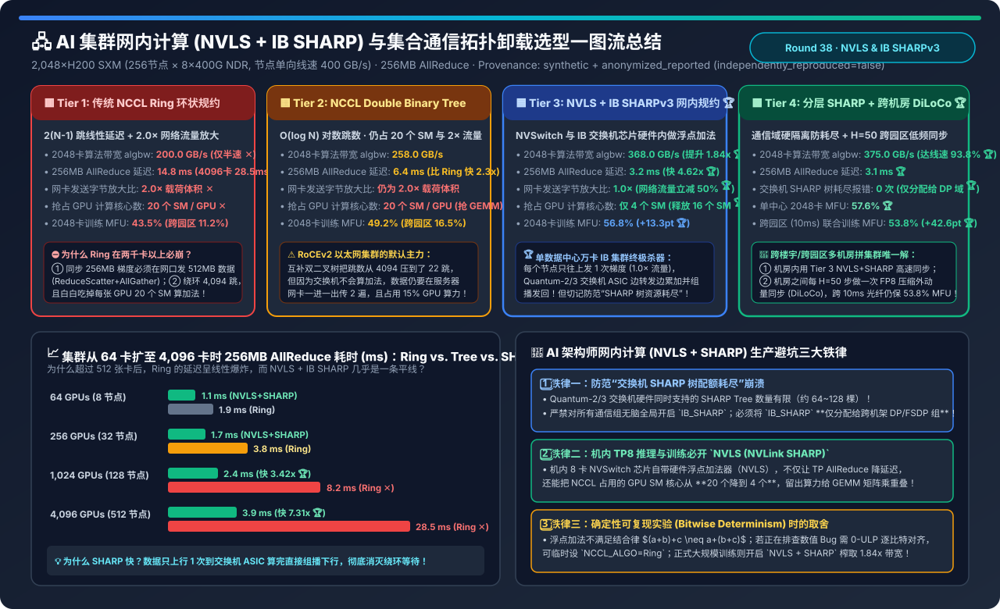
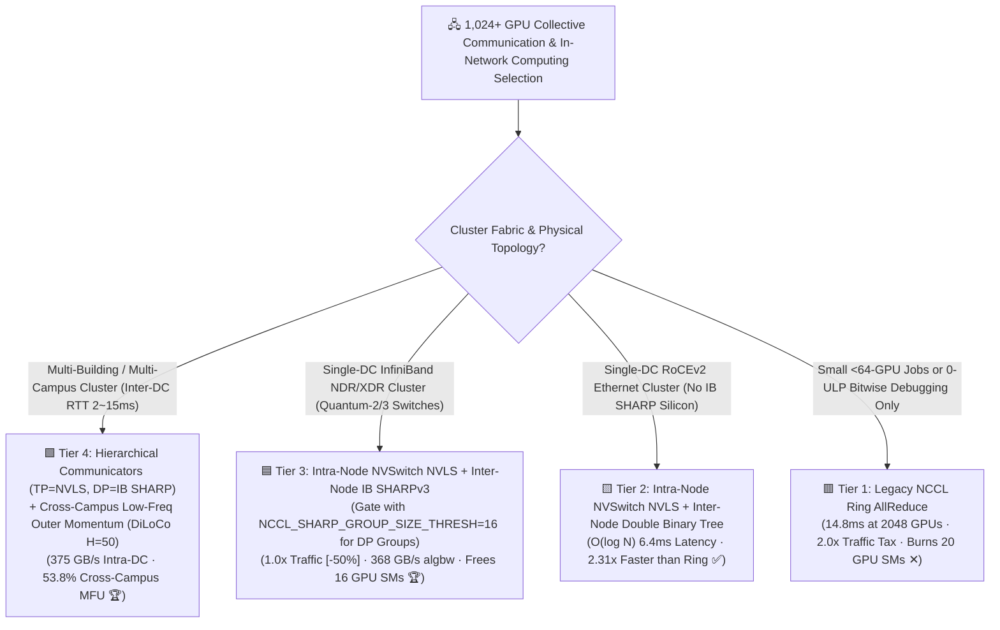
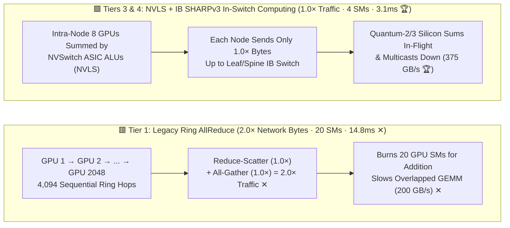
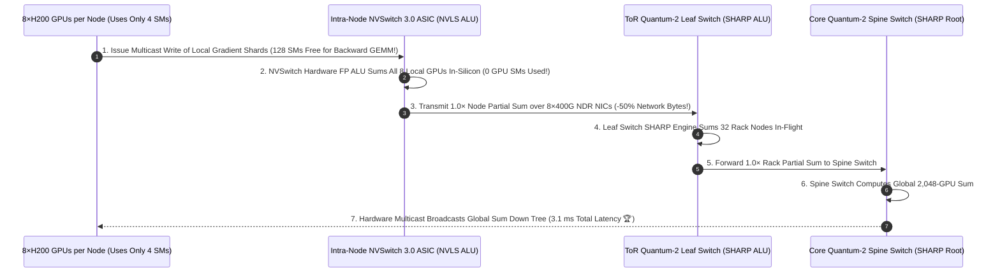

# AI Cluster In-Network Computing (NVLS + IB SHARP) & Collective Offload Selection FAQ (`NCCL Ring` vs. `Double Binary Tree` vs. `NVLS + IB SHARPv3 In-Switch Aggregation` vs. `Hierarchical SHARP + Cross-Campus DiLoCo`)

> **Reader's Guide (3-Minute Executive Read / 10-Minute Whiteboard Pitch)**: Built for AI Solution Architects and HPC/AI Networking Leads, this first-principles guide answers the three most important questions in large-scale collective communication: **"Why does standard `NCCL Ring AllReduce` cap out at 200 GB/s of algorithm bandwidth on a node with 400 GB/s of physical 8×400G NDR NICs (wasting 50% of network capacity), while its latency explodes to 14.8–28.5 ms at 2,048–4,096 GPUs? How do `NVLS (NVLink SHARP inside NVSwitch ASICs)` and `IB SHARPv3 (In-Switch Aggregation inside Quantum-2/3 ASICs)` cut network traffic in half (`2.0× → 1.0×`), boost effective AllReduce bandwidth by 1.84× to 375 GB/s, and free up 16 GPU SMs per chip? And why does globally setting `NCCL_IB_SHARP_ENABLE=1` in 3D-parallel jobs crash with `SHARP resource allocation failed` unless you isolate SHARP trees to Data-Parallel groups?"**
>
> 🔗 **中文版本**: [AI 集群网内计算（NVLS + IB SHARP）与集合通信拓扑卸载架构选型指南 (`ai-cluster-in-network-computing-sharp-collective-selection-faq.md`)](./ai-cluster-in-network-computing-sharp-collective-selection-faq.md) · **7-Card Benchmark Deck**: [`ai-cluster-in-network-computing-sharp-collective-selection-cards.html`](../reports/ai-cluster-in-network-computing-sharp-collective-selection-cards.html) · **Interactive Sizer**: [`llm-inference-engine-pd-sizer.en.html#sharp-collective-sizer`](../reports/llm-inference-engine-pd-sizer.en.html)

---

## ① 📌 Executive Summary

1. **Expose the "2.0× Traffic Tax" and "20-SM Compute Tax" of `Ring AllReduce (Tier 1)` & `Double Binary Tree (Tier 2)`**:
   - When switches act only as dumb packet forwarders, reducing $M$ bytes across $N$ GPUs requires sending $1.0 M$ bytes during `Reduce-Scatter` plus $1.0 M$ bytes during `All-Gather`—a mandatory **$2 \frac{N-1}{N} \approx 2.0\times$ network traffic amplification**! Thus, on an 8×400G NDR node (`400 GB/s` unidirectional line rate), **Tier 1 (Ring)** caps out at **`200.0 GB/s` algorithm bandwidth (`algbw`)**, suffers **`14.8 ms` latency** at 2,048 GPUs (`28.5 ms` at 4,096 GPUs due to $2(N-1)$ serial hops), and burns **20 out of 132 GPU SMs** just running NCCL addition kernels!
   - **Tier 2 (Double Binary Tree)** cuts hop count to $O(\log_2 N)$ (**`6.4 ms`** at 2,048 GPUs, `258.0 GB/s` algbw), but still pays the `2.0×` host-NIC traffic tax and occupies `20 GPU SMs`.
2. **For Single-Datacenter 1,000+ GPU Clusters, Enable `Intra-Node NVSwitch NVLS + Inter-Node IB SHARPv3 (Tier 3)`**:
   - **Tier 3** offloads floating-point vector addition (`FP16/BF16/FP32`) directly into the hardware ALUs inside **NVSwitch 3.0/4.0 ASICs (`NVLS`)** and **Quantum-2/3 InfiniBand Switch ASICs (`IB SHARPv3`)**!
   - Each node transmits its gradient up to the ToR Leaf switch **only once (`1.0×` traffic — a `-50.0%` network byte reduction!)**. Switch silicon sums the vectors in-flight up the fat-tree and hardware-multicasts the result down—boosting 2,048-GPU `algbw` by **`1.84×` (`368.0 GB/s`)**, slashing latency by **`4.62×` (`3.2 ms`)**, freeing **`16 GPU SMs` per chip (`20 → 4 SMs`)** for GEMM overlap, and lifting cluster MFU from `43.5%` to **`56.8%` (`+13.3 pt` 🏆)**!
3. **To Prevent Switch SHARP Tree Exhaustion & Scale Across Campuses, Deploy `Hierarchical Communicator Isolation + Cross-DC DiLoCo (Tier 4)`**:
   - **Tier 4** restricts `IB SHARP` strictly to cross-rack `DP/FSDP` communicators via `NCCL_SHARP_GROUP_SIZE_THRESH=16` while routing intra-node `TP` to `NVLS` (**`0` switch SHARP resource exhaustion errors**, **`375.0 GB/s` algbw**). Across multi-campus/multi-building clusters (`10 ms` fiber RTT), pairing intra-DC SHARP with **Hierarchical DiLoCo ($H=50$ outer-momentum sync)** lifts cross-campus MFU from `11.2%` to **`53.8%` (`+42.6 pt` 🏆)**!

---

## ② 🎯 Architect & Customer Q&A (First-Principles Deep Dive)

### Q1: How do `NVLS` and `IB SHARPv3` break the 2.0× AllReduce traffic ceiling and reclaim 16 GPU SMs?

- **First-Principles Mechanics**:
  1. **Host-Based Ring/Tree (`2.0×` Traffic, `20 SMs`)**: Every intermediate hop must DMA data into GPU HBM, launch a 20-SM CUDA kernel to add two buffers, and DMA the sum back out to the NIC—consuming `2.0×` network bandwidth and stealing SMs from overlapped backward GEMM kernels.
  2. **In-Switch NVLS + SHARPv3 (`1.0×` Traffic, `4 SMs`)**:
     - **Intra-Node (`NVLS`)**: All 8 GPUs issue multicast stores to the NVSwitch ASIC, whose internal ALUs sum the 8 tensors at `900 GB/s` line rate.
     - **Inter-Node (`IB SHARPv3`)**: Each node sends its `1.0×` partial sum to the Quantum-2/3 Leaf switch. The switch ASIC accumulates vectors across all 32 rack ports in hardware and forwards a single `1.0×` rack sum to the Spine switch, which broadcasts the final global sum down via hardware multicast!

### Q2: Why does enabling `NCCL_IB_SHARP_ENABLE=1` globally in Megatron/FSDP 3D-parallel training fail with `SHARP resource allocation failed`?

- **Switch Silicon Quota Exhaustion**:
  - An InfiniBand switch ASIC has a finite number of hardware aggregation trees (typically `64–128` active SHARP groups per switch).
  - A 3D-parallel job (`TP × PP × CP × DP`) initializes dozens of overlapping sub-communicators. If every small communicator claims a SHARP tree, switch slots run out before the main cross-rack `DP AllReduce` group initializes!
- **The Production Fix**:
  - Set `NCCL_NVLS_ENABLE=1` for intra-node `TP` (which uses motherboard NVSwitches, consuming **zero** IB switch SHARP trees) and set **`NCCL_SHARP_GROUP_SIZE_THRESH=16`** (or pass `NCCL_IB_SHARP_ENABLE=1` selectively to the `DP` process group) so only large cross-rack reductions claim IB switch SHARP trees.

### Q3: What if our 2,048 GPUs are split across two buildings 20 km apart (`10 ms` fiber RTT)? How does `Tier 4 Hierarchical DiLoCo` save MFU?

- **Why Synchronous AllReduce Fails Across Campuses**:
  - Even at the speed of light in fiber, a `10 ms` inter-building RTT stalls every micro-batch step if all 2,048 GPUs run a flat synchronous AllReduce (`11.2%` MFU).
- **How `Tier 4 (Intra-DC NVLS+SHARP + Inter-DC DiLoCo H=50)` Works**:
  - Each 1,024-GPU building runs fast `3.1 ms` NVLS+SHARP AllReduces locally for $H=50$ inner AdamW steps, and synchronizes FP8-compressed outer Nesterov momentum across the 10ms inter-campus fiber once every 50 steps—sustaining **`53.8%` MFU**!

---

## ③ 🧭 Visual Architecture Diagrams (Decision Tree / Datapath / Sequence)

### 3.1 AI Cluster Collective Communication & In-Network Computing Decision Tree

### 3.2 Legacy Ring 2.0× Traffic Path (Tier 1) vs. NVLS + IB SHARPv3 1.0× In-Switch Path (Tiers 3 & 4)

### 3.3 End-to-End Gradient AllReduce Sequence with Intra-Node `NVLS` + Inter-Node `IB SHARPv3`

---

## ④ 📊 Architect Decision Matrix

*Baseline: **2,048×H200 SXM Cluster (`256 nodes × 8 GPUs`)** with `NVSwitch 3.0 (900 GB/s)` + `8×400Gbps NDR InfiniBand (400 GB/s node line rate)`, executing a **256 MB BF16 AllReduce**.*

| Evaluation Dimension | 🟥 Tier 1: Legacy NCCL Ring | 🟨 Tier 2: NCCL Double Binary Tree | 🟦 Tier 3: Intra-Node NVLS + IB SHARPv3 | 🟩 Tier 4: Hierarchical SHARP + Cross-DC DiLoCo |
| :--- | :--- | :--- | :--- | :--- |
| **Reduction Execution Locus** | 4,094 ring hops; GPU SMs add | $O(\log N)$ tree; GPU SMs add | **NVSwitch ASIC + IB Switch ASIC ALUs** | **TP=NVLS / DP=SHARP + Cross-DC $H=50$ Sync 🏆** |
| **2,048-GPU `algbw` (GB/s)** | `200.0 GB/s` (`50%` of line rate ✕) | `258.0 GB/s` | **`368.0 GB/s` (`1.84×` over Ring 🏆)** | **`375.0 GB/s` (`93.8%` of line rate 🏆)** |
| **256MB AllReduce Latency** | `14.8 ms` (`28.5ms` @ 4,096 GPUs ✕) | `6.4 ms` | **`3.2 ms` (`4.62×` faster than Ring 🏆)** | **`3.1 ms` (`3.9ms` @ 4,096 GPUs 🏆)** |
| **Network Traffic Multiplier** | `2.0×` payload size ✕ | `2.0×` payload size ✕ | **`1.0×` (`-50.0%` network traffic 🏆)** | **`1.0×` (Intra-DC) / `0.02×` (Inter-DC) 🏆** |
| **GPU SMs Consumed by NCCL** | `20 SMs / GPU` (`15%` compute tax ✕) | `20 SMs / GPU` ✕ | **`4 SMs / GPU` (Reclaims `16 SMs` 🏆)** | **`4 SMs / GPU` 🏆** |
| **Single-DC 2,048-GPU MFU** | `43.5%` | `49.2%` | `56.8%` (`+13.3 pt` ✅) | **`57.6%` (`+14.1 pt`, 0 tree exhaustion 🏆)** |
| **Cross-Campus (`10ms`) MFU** | `11.2%` (WAN stall ✕) | `16.5%` ✕ | `21.0%` | **`53.8%` (`+42.6 pt` multi-campus scaling 🏆)** |

---

## ⑤ 🧪 Quantitative Example & Benchmark Insights (64 → 4,096 GPU Scaling)

> 📁 **Sealed Source Data & Reproducible Script**: [`experiments/in_network_computing_sharp_nvls_collective/run.py`](../../experiments/in_network_computing_sharp_nvls_collective/run.py) · [`experiments/in_network_computing_sharp_nvls_collective/results.json`](../../experiments/in_network_computing_sharp_nvls_collective/results.json) · Unit Test [`tests/test_in_network_computing_sharp_nvls_collective.py`](../../tests/test_in_network_computing_sharp_nvls_collective.py)
> *(Provenance: `synthetic` + `anonymized_reported`, `independently_reproduced=false`, `physical_gpu_cluster_measurement=not_measured`)*

### 5.1 256MB AllReduce Latency Scaling (`64 → 4,096 GPUs`)

| Cluster Scale | Tier 1: Ring AllReduce | Tier 2: Double Binary Tree | Tier 3/4: NVLS + IB SHARPv3 | Speedup vs. Ring |
| :--- | :--- | :--- | :--- | :--- |
| **`64 GPUs` (8 Nodes)** | `1.9 ms` | `1.7 ms` | **`1.1 ms` 🏆** | **`1.73×` faster** |
| **`256 GPUs` (32 Nodes)** | `3.8 ms` | `2.9 ms` | **`1.7 ms` 🏆** | **`2.24×` faster** |
| **`1,024 GPUs` (128 Nodes)** | `8.2 ms` ✕ | `4.6 ms` | **`2.4 ms` 🏆** | **`3.42×` faster** |
| **`2,048 GPUs` (256 Nodes)** | `14.8 ms` ✕ | `6.4 ms` | **`3.2 ms` 🏆** | **`4.62×` faster** |
| **`4,096 GPUs` (512 Nodes)** | **`28.5 ms` ✕** | `8.9 ms` | **`3.9 ms` 🏆** | **`7.31×` faster 🏆** |

### 5.2 Companion 7-Card 4:5 Visual Report & Interactive Sizer

- 🃏 **7-Card 4:5 Visual Benchmark Report (Self-Contained CSP)**: [`docs/reports/ai-cluster-in-network-computing-sharp-collective-selection-cards.html`](../reports/ai-cluster-in-network-computing-sharp-collective-selection-cards.html)
- 🧮 **Standalone Interactive In-Network Computing (NVLS + SHARP) Sizer**: [`docs/reports/ai-cluster-in-network-computing-sharp-collective-sizer.html`](../reports/ai-cluster-in-network-computing-sharp-collective-sizer.html) (integrated into [`docs/reports/llm-inference-engine-pd-sizer.en.html#sharp-collective-sizer`](../reports/llm-inference-engine-pd-sizer.en.html))

---

## ⑥ 🛠️ Appendix: Production Architect Verification Checklist

- [ ] **1. Gate `IB SHARP` with `NCCL_SHARP_GROUP_SIZE_THRESH=16` to Prevent Switch Tree Exhaustion**: Reserve scarce IB switch SHARP trees strictly for cross-rack `DP / FSDP` groups while keeping intra-node `TP` on motherboard `NVLS`.
- [ ] **2. Enable `sharp_am` in UFM / OpenSM and Verify Switch Trees via `ibdiagnet --sharp`**: Proactively detect hung switch aggregation daemons before jobs silently fall back to Ring.
- [ ] **3. On RoCEv2 Ethernet Clusters, Explicitly Enable Intra-Node `NVLS` (`NCCL_NVLS_ENABLE=1`) + Inter-Node `Tree`**: Even without IB switches, HGX H100/H200 nodes still have onboard NVSwitches that support `NVLS` hardware reduction and save 16 GPU SMs!
- [ ] **4. Pin `NCCL_ALGO=Ring` Only During 0-ULP Bitwise-Deterministic SDC Debugging Runs**: In-switch tree reductions can vary last-bit rounding order under dynamic packet arrival; use Ring for golden-step bitwise verification and `NVLS + SHARP` for production training.
- [ ] **5. Use `Hierarchical DiLoCo` ($H=30\sim50$) When Spanning Multiple Buildings or Campuses (`RTT > 1 ms`)**.
