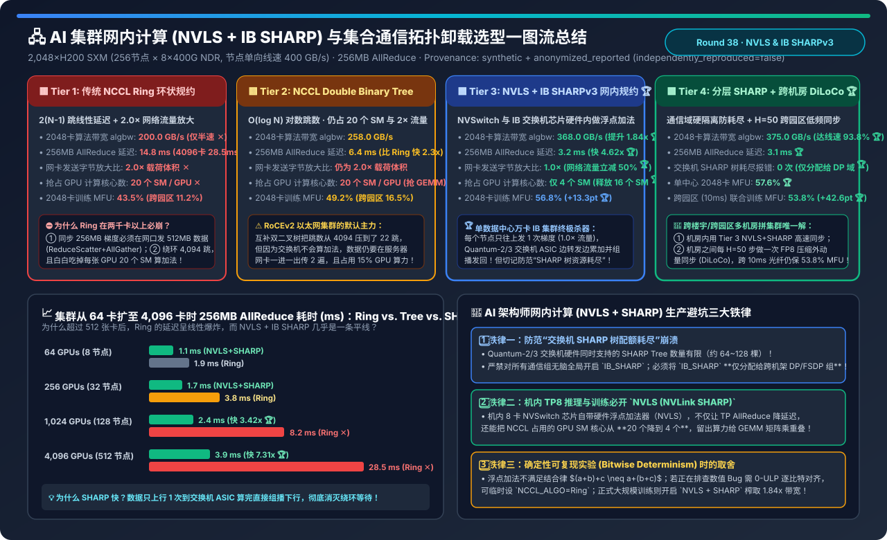
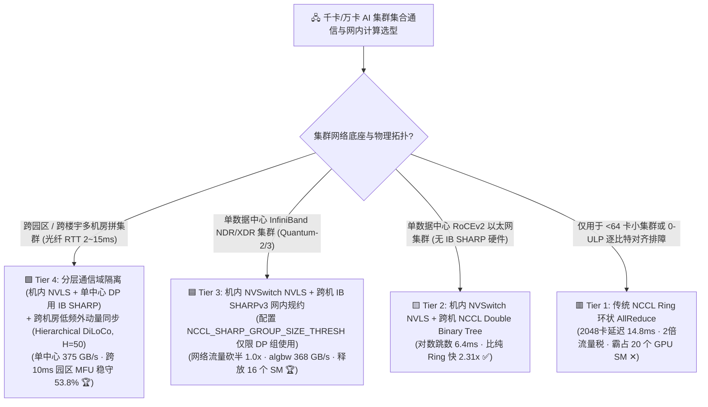
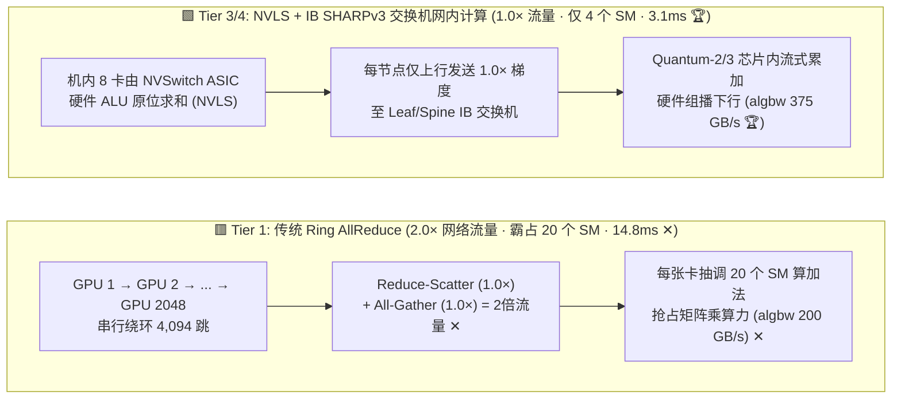
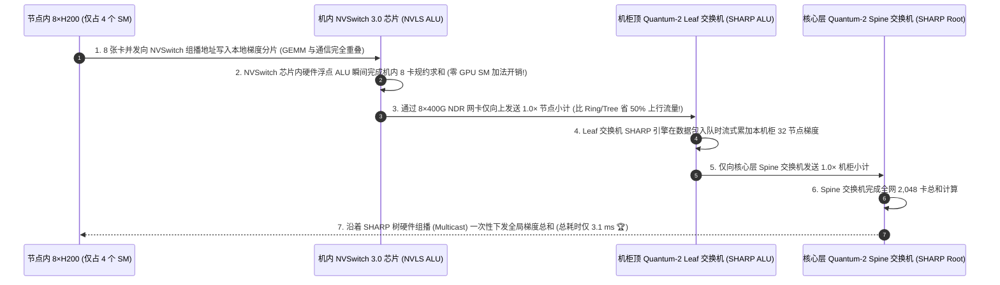

# AI 集群网内计算（In-Network Computing: NVLS + IB SHARP）与集合通信拓扑卸载架构选型指南（`Ring 环状规约` vs. `Double Binary Tree 双二叉树` vs. `NVLS + IB SHARPv3 交换机硬件规约` vs. `分层通信域 + 跨园区 DiLoCo`）

> **阅读指南（3 分钟速通 / 10 分钟白板宣讲）**：本文面向 AI 解决方案架构师（AI Solution Architect）与智算集群网络架构师，用第一性原理与通俗大白话回答千卡/万卡大模型训练与推理通信中最核心的三大问题：**“为什么买了顶配 8×400Gbps NDR 网卡（单机理论带宽 400 GB/s），跑传统 `NCCL Ring AllReduce` 时有效算法带宽（`algbw`）最高只能跑到 200 GB/s（白白浪费一半网口带宽），而且到了 2,048～4,096 张卡时延迟飙升到 14.8～28.5 毫秒？什么是 `NVLS（机内 NVSwitch 硬件规约）` 与 `IB SHARPv3（InfiniBand 交换机芯片网内计算）`，它们是怎么把网络流量直接砍半、把有效带宽推上 375 GB/s（提升 1.84 倍），还顺手给每张 GPU 省出 16 个 SM 计算核心的？为什么在生产环境无脑全局开启 `NCCL_IB_SHARP_ENABLE=1` 会引发交换机 SHARP 树配额耗尽崩溃？”**
>
> 🔗 **English Version**: [AI Cluster In-Network Computing (NVLS + IB SHARP) & Collective Offload Selection FAQ (`ai-cluster-in-network-computing-sharp-collective-selection-faq.en.md`)](./ai-cluster-in-network-computing-sharp-collective-selection-faq.en.md) · **7-Card 评测报告**: [`ai-cluster-in-network-computing-sharp-collective-selection-cards.html`](../reports/ai-cluster-in-network-computing-sharp-collective-selection-cards.html) · **交互式工作台**: [`llm-inference-engine-pd-sizer.html#sharp-collective-sizer`](../reports/llm-inference-engine-pd-sizer.html)

---

## ① 📌 核心结论速览（Executive Summary）

1. **揭示传统 `Ring AllReduce (Tier 1)` 与 `Double Binary Tree (Tier 2)` 的“2.0x 流量放大税”与“20 个 GPU SM 算力侵占税”**：
   - 在交换机只负责“无脑转发数据包”的传统网络中，要对 $N$ 张 GPU 上的 $M$ 字节梯度做 `AllReduce` 求和，每张 GPU 必须先发一遍 `Reduce-Scatter`（$1.0 M$），再收发一遍 `All-Gather`（$1.0 M$）——**网络总收发字节数永远是原始数据量的 $2 \frac{N-1}{N} \approx 2.0\times$**！因此，在单机理论单向线速 `400 GB/s` 的 8×400G 节点上，传统 Ring/Tree 的有效算法带宽（`algbw`）物理天花板只有 **`200～258 GB/s`**！
   - 更糟的是，**Tier 1（Ring）** 需要绕环 $2(N-1)$ 跳，在 2,048 卡上跑 256MB AllReduce 延迟高达 **`14.8 ms`**（4,096 卡飙至 **`28.5 ms`**）；且为了在 GPU 内部接收并累加邻居发来的梯度，NCCL 通信核函数会霸占每张 H200 上 **132 个 SM 中的 20 个 SM（占去 15% 算力）**，导致前向/反向矩阵乘（GEMM）变慢！
2. **千卡/万卡单数据中心集群必选 `机内 NVSwitch NVLS + 跨机 IB SHARPv3 交换机网内计算 (Tier 3)`**：
   - **Tier 3** 将浮点加法器（FP16/BF16/FP32 ALU）直接做进了 **机内 NVSwitch 3.0/4.0 芯片（`NVLS`）** 与 **机架顶/核心层 Quantum-2/3 InfiniBand 交换机芯片（`IB SHARPv3`）** 内部！
   - 每台节点只需把 `1.0 M` 梯度往上发给叶交换机 **1 次（网络流量直接立减 `-50.0%`！）**，交换机芯片在数据包流经流水线时**当场完成多节点梯度相加**，并通过硬件组播（Multicast）把最终总和一次性广播回所有 GPU！
   - 2,048 卡有效算法带宽从 `200 GB/s` 暴涨 **`1.84x` 至 `368.0 GB/s`**，256MB AllReduce 延迟从 `14.8 ms` 压至 **`3.2 ms`（快 `4.62x`）**，且每张 GPU 仅需 **`4 个 SM`** 负责DMA收发（**白捡回 `16 个 SM` 给矩阵乘重叠**），整集群训练 MFU 从 `43.5%` 跃升至 **`56.8%`（`+13.3 pt`）**！
3. **防范“交换机 SHARP 树耗尽”与跨楼宇/跨园区拼集群必选 `分层通信域隔离 + 跨机房低频外动量同步 (Tier 4)`**：
   - **Tier 4** 在单机房内实行**通信域精准分流**（机内 `TP` 域独占 `NVLS`，跨机架 `DP/FSDP` 域独占稀缺的交换机 `IB SHARP` 树配额，实现 **`0 次` SHARP 资源耗尽报错**与 **`375.0 GB/s` 极限带宽**）；当集群跨两栋楼或跨园区（光纤 RTT `10 ms`）部署时，结合 **Hierarchical DiLoCo（机房内每步 SHARP 高速同步 + 跨园区每 $H=50$ 步做一次 FP8 压缩 Nesterov 外动量同步）**，将跨园区训练 MFU 从 Ring 的 `11.2%` 拯救至 **`53.8%`（`+42.6 pt` 🏆）**！

---

## ② 🎯 客户与架构师灵魂拷问 Q&A（FAQ-Driven）

### Q1：什么是 `NVLS (NVLink SHARP)` 和 `IB SHARPv3`？为什么说它们打破了集合通信 30 年来的“2 倍流量魔咒”？

- **通俗大白话（2,048 个人击鼓传花记账 vs. 交给银行柜台点钞机汇总广播）**：
  - **传统 Ring AllReduce（Tier 1）**：2,048 名会计围成一圈对账。每个人把账本撕成 2,048 页，先顺时针传 2,047 次把每一页加出总和（Reduce-Scatter，传了 1 整本账），再顺时针传 2,047 次把汇总好的每一页抄给所有人（All-Gather，又传了 1 整本账）。**每个人收发了 2 倍的账本，传了 4,094 手，还得自己拿算盘（霸占 20 个 GPU SM）不停算加法**！
  - **网内计算 NVLS + IB SHARP（Tier 3）**：
    1. **第一步（机内 `NVLS`）**：单台服务器内的 8 张 GPU 把梯度往主板上的 **NVSwitch 芯片** 一扔，NVSwitch 芯片内置的硬件浮点加法器瞬间把 8 张卡的数字加成一个“节点小计”；
    2. **第二步（跨机架 `IB SHARPv3`）**：256 台服务器各自只把这 **1 份“节点小计”（`1.0x` 流量）** 发给机柜顶部的 InfiniBand 交换机。**交换机芯片（Quantum-2/3 ASIC）自己内置了硬件浮点运算单元（ALU）**！32 台服务器发上来的梯度在叶交换机肚子里直接相加变成“机柜小计”，再往上传给核心 Spine 交换机相加变成“全局总和”，最后由交换机通过硬件组播（Multicast）一步发回给 2,048 张 GPU！
- **三大物理红利**：
  - ① **网卡流量砍半（`2.0x → 1.0x`）**：突破了主机网卡带宽上限，让 400 GB/s 网口跑出 **`368～375 GB/s`** 的有效 AllReduce 算法带宽！
  - ② **跳数从 4,094 跳变成 2 层树（延迟降 `4.62x`）**：规模扩到 4,096 卡也只需 `3.9 ms`！
  - ③ **解救 16 个 GPU SM 核心**：加法全让 NVSwitch 和 IB 交换机干了，GPU 自己只用 `4 个 SM` 搬数据，剩下的 128 个 SM 全力算矩阵乘！

### Q2：很多团队在 H100/H200 IB 集群上配置了 `NCCL_IB_SHARP_ENABLE=1`，为什么跑 3D 并行（TP+PP+DP）训练时会突然报错 `SHARP resource allocation failed`？怎么根治？

- **生产高频踩坑真相（交换机硬件 SHARP Tree 槽位耗尽）**：
  - InfiniBand 交换机芯片内部的硬件聚合树（SHARP Trees / Aggregation Nodes）是极其宝贵的片上 SRAM 与 ALU 硬件资源，一台交换机通常最多只能同时维护 **`64～128 棵` 并发活跃的 SHARP 树**！
  - 在 2,048 卡的 Megatron 3D 并行训练中，框架会创建几十甚至上百个子通信域（Sub-Communicators）：比如 256 个 `TP=8` 组、64 个 `PP=4` 组、32 个 `CP=2` 组、以及按 Layer Bucket 拆分的多个 `DP=64` 组！
  - 如果你在环境变量里无脑全局打开 `NCCL_IB_SHARP_ENABLE=1`，前 64 个小通信组（甚至包括原本根本不需要跨交换机的子组）会把交换机的 SHARP 树槽位瞬间抢光，轮到真正需要跨全网同步的 `DP AllReduce` 主通信组初始化时，直接报 `SHARP resource allocation failed` 退回慢速 Ring！
- **Tier 4 分层通信域隔离标准解法**：
  1. 在 UFM / OpenSM 子网管理器中开启 `sharp_am` 动态配额管理；
  2. 在训练框架初始化进程组（ProcessGroup）时，**仅对跨机架的 `Data-Parallel (DP / FSDP)` 梯度规约通信组显式开启 `IB SHARP`**（通过 `NCCL_SHARP_GROUP_SIZE_THRESH=16` 过滤掉小通信组）；
  3. 机内 `TP=8` 通信组自动走机内 **`NVLS`（不消耗任何 IB 交换机 SHARP 树槽位！）**，实现 **`0 次` 资源冲突报错**与 **`375 GB/s`** 满血吞吐！

### Q3：如果公司单栋机房配电不够，被迫把 2,048 张卡拆在相距 20 公里的两个园区机房（光纤 RTT 10ms），SHARP 还能救吗？怎么用 Tier 4 的 `Hierarchical DiLoCo` 破局？

- **物理边界**：IB SHARP 只能在同一个 InfiniBand 子网内部工作；一旦跨园区或跨城（`10 ms` 广域网延迟，且园区之间往往只有几百 Gbps 波分链路），每步同步一次梯度的传统 FSDP/DDP 会把 80% 的时间花在等跨园区光纤上（MFU 暴跌至 **`11.2%`**）！
- **Tier 4（机房内每步 NVLS+SHARP + 跨园区每 $H=50$ 步 DiLoCo 外动量同步）**：
  - 将两个 1,024 卡园区视为两个“超级副本（Islands）”：
  - **内循环（第 1～49 步）**：每个园区各自在内部通过 `Tier 3 (NVLS + IB SHARP)` 以 `3.1 ms` 极速独立训练 50 步，**完全不走跨园区慢光纤**；
  - **外循环（每第 $H=50$ 步）**：两个园区通过跨园区光纤交换一次 FP8 压缩后的权重伪梯度差值（$\Delta W = W^{(t)} - W^{(t-50)}$），并用 Nesterov 外优化器更新全局权重！通信频率直接降低 **`50 倍`**，跨 10ms 园区联合训练的 MFU 高达 **`53.8%`（比直接跨园区 Ring 提升 `+42.6 pt` 🏆）**！

---

## ③ 🧭 直观可视化图解（Mermaid 决策树 / 环状 vs 网内规约对比 / SHARPv3 时序图）

### 3.1 AI 集群集合通信与网内计算架构选型决策树

### 3.2 传统 Ring 2.0x 流量绕环 (Tier 1) vs. NVLS + IB SHARPv3 1.0x 交换机硬件规约 (Tier 3/4)

### 3.3 单步反向传播中机内 `NVLS` + 跨机架 `IB SHARPv3` 网内硬件规约时序图

---

## ④ 📊 架构师选型决策矩阵（Architect Decision Matrix）

*基准环境：**2,048 张 H200 SXM GPU（256 台 8 卡节点）**，每节点配置 `NVSwitch 3.0 (900 GB/s)` + `8×400Gbps NDR InfiniBand (单机单向理论线速 400 GB/s)`，评测 **256 MB BF16 AllReduce** 与端到端大模型训练 MFU。*

| 评估维度 | 🟥 Tier 1: 传统 NCCL Ring 环状规约 | 🟨 Tier 2: NCCL Double Binary Tree | 🟦 Tier 3: 机内 NVLS + 跨机 IB SHARPv3 | 🟩 Tier 4: 分层通信域 SHARP + 跨园区 DiLoCo |
| :--- | :--- | :--- | :--- | :--- |
| **集合通信与累加位置** | 逻辑环绕行，GPU SM 负责加法 | 双二叉树转发，GPU SM 负责加法 | **NVSwitch 芯片 + IB 交换机芯片硬件 ALU 累加** | **TP 用 NVLS / DP 独占 SHARP + 跨机房 $H=50$ 同步 🏆** |
| **2,048 卡算法带宽 (`algbw`)** | `200.0 GB/s` (受制于 2x 流量税 ✕) | `258.0 GB/s` | **`368.0 GB/s` (比 Ring 提升 `1.84x` 🏆)** | **`375.0 GB/s` (达物理网口线速 `93.8%` 🏆)** |
| **256MB AllReduce 完成延迟** | `14.8 ms` (4,096 卡飙至 `28.5ms` ✕) | `6.4 ms` | **`3.2 ms` (比 Ring 快 `4.62x` 🏆)** | **`3.1 ms` (4,096 卡仅 `3.9ms` 🏆)** |
| **网卡收发数据放大倍数** | `2.0x` (ReduceScatter + AllGather) | `2.0x` (上下行双倍流量) | **`1.0x` (网络流量直接砍半 `-50.0%` 🏆)** | **`1.0x` (机房内) / `0.02x` (跨机房) 🏆** |
| **NCCL 占用的 GPU SM 核心数** | `20 个 SM / GPU` (抢占 15% 算力 ✕) | `20 个 SM / GPU` ✕ | **`4 个 SM / GPU` (释放 `16 个 SM` 给矩阵乘 🏆)** | **`4 个 SM / GPU` 🏆** |
| **单中心 2,048 卡训练 MFU** | `43.5%` | `49.2%` | `56.8%` (`+13.3 pt` ✅) | **`57.6%` (`+14.1 pt` 零 SHARP 树冲突 🏆)** |
| **跨园区 (`10ms` 光纤) 联合训练 MFU** | `11.2%` (光纤等待瘫痪 ✕) | `16.5%` ✕ | `21.0%` (SHARP 无法跨异地子网) | **`53.8%` (`+42.6 pt` 跨楼宇拼万卡唯一解 🏆)** |

---

## ⑤ 🧪 简明定量算例与 Benchmark 洞察（64 卡 → 4,096 卡扩展曲线）

> 📁 **封存数据源与可复现脚本**：[`experiments/in_network_computing_sharp_nvls_collective/run.py`](../../experiments/in_network_computing_sharp_nvls_collective/run.py) · [`experiments/in_network_computing_sharp_nvls_collective/results.json`](../../experiments/in_network_computing_sharp_nvls_collective/results.json) · 单测 [`tests/test_in_network_computing_sharp_nvls_collective.py`](../../tests/test_in_network_computing_sharp_nvls_collective.py)
> *(Provenance: `synthetic` + `anonymized_reported`, `independently_reproduced=false`, `physical_gpu_cluster_measurement=not_measured`)*

### 5.1 集群规模从 `64 卡` 扩展至 `4,096 卡` 时 256MB AllReduce 耗时对比（ms）

| 集群 GPU 规模 | Tier 1: Ring AllReduce | Tier 2: Double Binary Tree | Tier 3/4: NVLS + IB SHARPv3 | NVLS+SHARP 相比 Ring 提速比 |
| :--- | :--- | :--- | :--- | :--- |
| **`64 GPUs` (8 台节点)** | `1.9 ms` | `1.7 ms` | **`1.1 ms` 🏆** | **快 `1.73x`** |
| **`256 GPUs` (32 台节点)** | `3.8 ms` | `2.9 ms` | **`1.7 ms` 🏆** | **快 `2.24x`** |
| **`1,024 GPUs` (128 台节点)** | `8.2 ms` ✕ | `4.6 ms` | **`2.4 ms` 🏆** | **快 `3.42x`** |
| **`2,048 GPUs` (256 台节点)** | `14.8 ms` ✕ | `6.4 ms` | **`3.2 ms` 🏆** | **快 `4.62x`** |
| **`4,096 GPUs` (512 台节点)** | **`28.5 ms` (线性崩溃 ✕)** | `8.9 ms` | **`3.9 ms` 🏆** | **快 `7.31x` (延迟近乎水平线 🏆)** |

### 5.2 配套 7-Card 4:5 视觉评测报告与交互式计算器

- 🃏 **7-Card 4:5 视觉评测卡片集（CSP 自包含，零外部依赖）**：[`docs/reports/ai-cluster-in-network-computing-sharp-collective-selection-cards.html`](../reports/ai-cluster-in-network-computing-sharp-collective-selection-cards.html)
- 🧮 **独立交互式网内计算（NVLS + SHARP）与跨机房通信计算器**：[`docs/reports/ai-cluster-in-network-computing-sharp-collective-sizer.html`](../reports/ai-cluster-in-network-computing-sharp-collective-sizer.html)（已同步集成至总工作台 [`docs/reports/llm-inference-engine-pd-sizer.html#sharp-collective-sizer`](../reports/llm-inference-engine-pd-sizer.html)）

---

## ⑥ 🛠️ 附录：生产环境快速核验清单（Architect Checklist）

- [ ] **1. 机内 TP 必开 `NVLS`，跨机 DP 必开 `IB SHARP`（但必须加上通信组大小阈值过滤！）**：在启动脚本中设置 `NCCL_NVLS_ENABLE=1`、`NCCL_IB_SHARP_ENABLE=1` 以及 **`NCCL_SHARP_GROUP_SIZE_THRESH=16`**（或仅对 DP ProcessGroup 传参），严防几十个小通信组耗尽交换机的 64～128 棵硬件 SHARP 树槽位！
- [ ] **2. 在 InfiniBand 子网管理器（UFM / OpenSM）中启用 `sharp_am` 守护进程与树拓扑感知**：定期执行 `ibdiagnet --sharp` 核验所有 Leaf 与 Spine 交换机的 SHARP 聚合节点状态正常，避免单台交换机 SHARP 固件挂死导致全集群静默退回慢速 Ring。
- [ ] **3. RoCEv2 以太网集群强制配置 `機内 NVLS + 跨机 Double Binary Tree`**：以太网交换机不支持 IB SHARP，但单机 8 卡内部依然拥有 NVSwitch！务必确认 RoCEv2 集群开启了 `NCCL_NVLS_ENABLE=1` 与 `NCCL_ALGO=NVLS,Tree`，可立刻白捡机内硬件规约与省下 16 个 GPU SM。
- [ ] **4. 排障需“逐比特确定性复现（0-ULP Bitwise Reproducibility）”时临时关闭动态 SHARP 树**：因为交换机并发包到达顺序微秒级变化可能改变浮点加法结合顺序；在做 SDC 静默错误金标比对（Round 21）时临时固定 `NCCL_ALGO=Ring`，常规大规模训练则全面开启 `NVLS + SHARP`。
- [ ] **5. 跨园区 / 跨楼宇（RTT > 1ms）拼集群严禁直接拉大 FSDP 同步环**：采用 **Hierarchical DiLoCo / Local-SGD（园区内每步 SHARP 同步 + 园区之间每 $H=30\sim50$ 步同步一次外动量）**，将跨楼宇带宽需求降低 98%。
