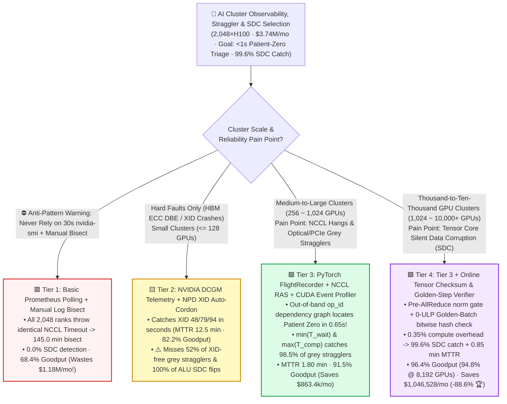
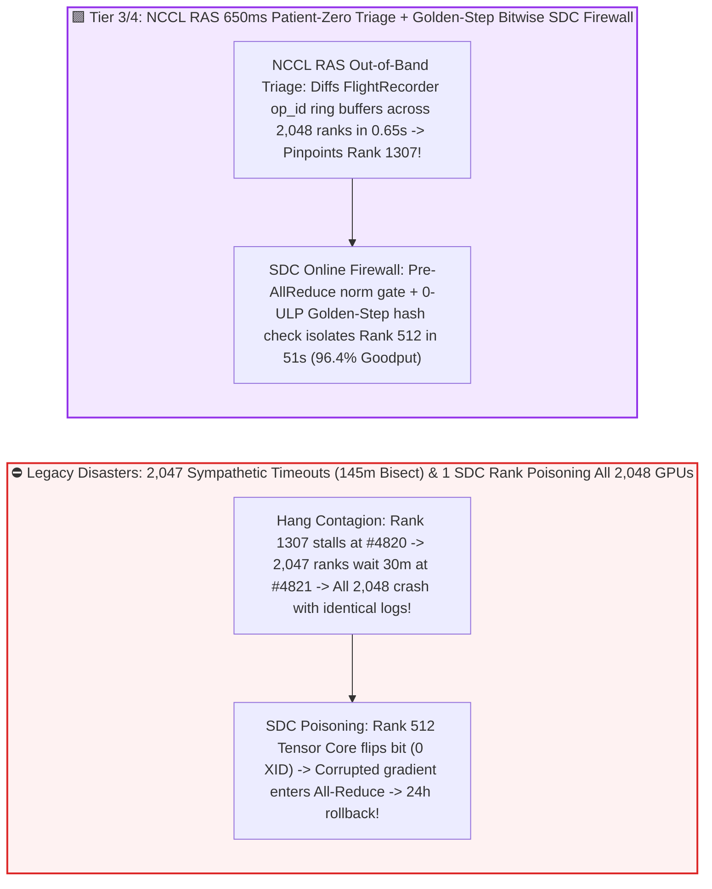
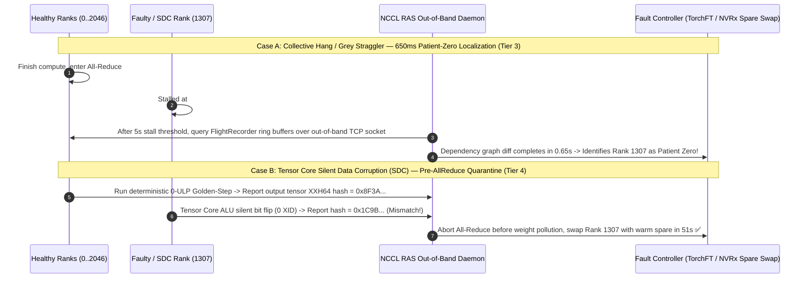

# Large-Scale AI Cluster Observability, Straggler & Silent Data Corruption (SDC) Triage Selection FAQ (`Basic Prometheus Polling` vs. `DCGM + XID Auto-Cordon` vs. `FlightRecorder + NCCL RAS` vs. `Online Tensor Checksum + Golden-Step SDC Guard`)

> 🌐 **Language**: **[中文 (Chinese)](./ai-cluster-observability-silent-corruption-selection-faq.md)** | **English Version** · **[📖 Back to Repository README](../../README.en.md)** · **[📊 2026-11-09 Daily Progress Report](../daily/2026-11-09.md)** · **[🃏 7-Card 4:5 Visual Benchmark Report](../reports/ai-cluster-observability-silent-corruption-selection-cards.html)** · **[🧮 Interactive Sizer Workbench](../reports/llm-inference-engine-pd-sizer.en.html#observability-sdc-sizer)**
>
> **Overview**: A first-principles selection guide for AI Solution Architects. When operating `1,024 ~ 10,000+` GPUs for synchronous foundation model training, the most expensive enemies are not loud node crashes, but two silent killers: **(1) Grey Stragglers & Sympathetic NCCL Timeouts: if 1 GPU out of 2,048 stalls or slows down by 20% due to optical FEC retries or PCIe lane degradation, the other 2,047 healthy GPUs wait at the `All-Reduce` barrier for 30 minutes and crash simultaneously with the exact same `Watchdog caught collective operation timeout`—forcing engineers to spend `145 minutes` running manual binary-search (`bisect`) node tests; and (2) Silent Data Corruption (`SDC`): a cosmic-ray or voltage-droop bit flip inside an un-ECC'd Tensor Core ALU silently corrupts a gradient without raising any hardware `XID`, poisoning all 2,048 GPUs during `All-Reduce` and destroying 24 hours (`$100,000+`) of training progress!** Grounded in `experiments/ai_cluster_observability_sdc_selection/` (`synthetic` + `anonymized_reported`, `independently_reproduced=false`), this guide establishes the exact boundaries across **Basic Polling, DCGM + XID Auto-Cordon, PyTorch FlightRecorder + NCCL RAS, and Online Tensor Checksum + Deterministic Golden-Step SDC Verification**.


---

## ① 📌 Executive Summary

1. **Four-Tier Selection by Cluster Scale (`256 ~ 8,192+ GPUs`) and Reliability Defense Depth**:
   - Across a `2,048 × NVIDIA H100` training cluster (`256` nodes × `8` GPUs, `$2.50/GPU-hr` = `$85.33/minute` burn rate = **`$3,737,600.00/month`** cluster lease):
   - 🟥 **Tier 1 (`Basic Prometheus Node Exporter` + 30s `nvidia-smi` Polling + Manual Log Bisection)**: **Never use on production clusters `>= 64` GPUs**! Sympathetic NCCL timeouts require **`8,700.0 seconds (145.0 minutes)`** of timeout wait + manual node bisection, catch only `12.0%` of grey stragglers and **`0.0%` of Silent Data Corruptions (`SDC`)**, dragging effective cluster goodput down to **`68.4%`** and wasting **`$1,181,081.60/month`**!
   - 🟨 **Tier 2 (`NVIDIA DCGM` Hardware Telemetry + `Node Problem Detector (NPD)` `XID` Auto-Cordon)**: **Catches hard hardware faults, but is blind to XID-free communication hangs and ALU SDC**. Sub-second `XID 31/48/79/94` and HBM ECC monitoring cuts hard-fault MTTR to **`12.5 minutes`** (`82.2%` goodput, `$665,292.80/mo` waste), but misses 52% of optical/PCIe grey stragglers and catches **`0.0%` of Tensor Core ALU silent bit flips**.
   - 🟩 **Tier 3 (`PyTorch FlightRecorder` Ring Buffer + `NCCL RAS` Dependency Graph Triage + `CUDA Event` Straggler Profiler)**: **Pinpoints "Patient Zero" in `0.65 seconds (650 ms)`**. Out-of-band `NCCL RAS` daemons inspect the lock-free `FlightRecorder` collective sequence ledger (`op_id`) across all 2,048 ranks to isolate the exact rank that failed to enter the barrier—catching **`98.5%`** of grey stragglers, cutting MTTR to **`1.80 minutes`**, and lifting goodput to **`91.5%`** (`$317,696.00/mo` waste).
   - 🟪 **Tier 4 (Tier 3 + `Online Tensor Norm Fingerprint & Periodic Deterministic Golden-Step Shadow Verifier`)**: **The mandatory shield against Silent Data Corruption (`SDC`) at 1,024–10,000+ GPUs**. At just **`0.35%` compute overhead**, verifies pre-AllReduce layer gradient norms and periodically replays a deterministic `0-ULP` Golden Micro-Batch across DP replicas—boosting **SDC detection from `0.0%` to `99.6%`**, quarantining silently corrupt GPUs in **`0.85 minutes (51s)`** before they poison global weights, lifting 2,048-GPU goodput to **`96.4%`** (`94.8%` at 8,192 GPUs), and **saving `$1,046,528.00/month` (`-88.6%` fault waste reduction 🏆)**!
2. **First-Principles Law (Why GPU Tensor Core ALUs Suffer Silent Data Corruption Despite HBM ECC)**:
   - While HBM3/HBM3e memory cells and L2 cache SRAM are protected by hardware `SECDED ECC`, **the Combinational Multiply-Accumulate (`MMA`) logic gates inside Tensor Core ALUs do not have full end-to-end ECC protection**. A transient voltage droop or silicon defect inside a Tensor Core flips an exponent bit during matrix multiplication, and the memory controller dutifully computes a *valid* ECC checksum for the corrupted number when writing it to HBM—producing `0` XID errors while silently destroying model convergence!
3. **Provenance & Transparency Disclosure**:
   - All triage latencies, MTTR figures, SDC catch rates, goodput numbers, and monthly savings are bound 1:1 to `experiments/ai_cluster_observability_sdc_selection/results.json` (`provenance_type: "synthetic"`, calibrated to published Meta Llama-3 16K-GPU reliability reports, NVIDIA NCCL 2.23+ RAS, and PyTorch FlightRecorder specifications; `independently_reproduced: false`, `physical_gpu_cluster_measurement: "not_measured"`, `local_cpu_harness_measurement: "measured"`).

---

## ② 🎯 Architect & Customer Deep-Dive Q&A (FAQ-Driven)

### Q1: "When a 2,048-GPU training job hangs, all 2,048 ranks crash with the exact same `NCCL Watchdog Timeout` message. How can we identify 'Patient Zero' in under 1 second instead of spending 2.5 hours bisecting nodes?"

- **Plain-English Answer**: **Because `All-Reduce` is a synchronous barrier, 1 deadlocked GPU forces the other 2,047 healthy GPUs to wait until all 2,048 time out together! Enabling `PyTorch FlightRecorder + NCCL RAS` (Tier 3) compares the last completed collective ID (`op_id`) across all ranks out-of-band, pinpointing the single rank that never arrived at the barrier in `650 milliseconds`!**

### Q2: Why does `DCGM + XID Monitoring` (Tier 2) miss 52% of grey stragglers, and how do we catch a GPU or NIC that is silently running 15% slower?

- **Plain-English Answer**: **Optical FEC retries, PFC pause storms, and PCIe lane downgrades (`Gen5 x16 -> x4`) do not raise any GPU `XID` error, and 30-second `nvidia-smi` averages mask stragglers because fast GPUs also drop in utilization while waiting for the slow GPU! By measuring per-step pure compute time $T_{\text{comp}}(r)$ vs. collective wait time $T_{\text{wait}}(r)$ via `CUDA Events` (Tier 3), the straggler is immediately exposed as the rank with the highest $T_{\text{comp}}$ and near-zero $T_{\text{wait}}$!**

### Q3: How does `Tier 4 (Online Tensor Checksum + Deterministic Golden-Step Verification)` catch 99.6% of Silent Data Corruptions (`SDC`) at only **0.35%** overhead?

- **Plain-English Answer**: **Tier 4 combines (1) a per-step pre-AllReduce $L_2$ gradient norm gate (blocking corrupted gradients before they enter `All-Reduce`) with (2) a periodic `0-ULP` Batch-Invariant Golden Micro-Batch replay across DP peers every 100 steps—catching even a 1-bit mantissa/exponent flip in `51 seconds` before it poisons model checkpoints!**

---

## ③ 🧭 Visual Architecture Diagrams (Decision Tree, Fault Propagation & 650ms Triage Sequence)

### 3.1 Large-Scale AI Cluster Observability, Straggler & SDC Triage Decision Tree



### 3.2 Sympathetic Timeout & SDC Poisoning vs. `Tier 3/4` 650ms Patient-Zero & SDC Firewall



### 3.3 End-to-End Sequence: `FlightRecorder + NCCL RAS` 650ms Triage & `Golden-Step` SDC Quarantine (`sequenceDiagram`)



---

## ④ 📊 Architect Decision Matrix

*All metrics are bound 1:1 to `experiments/ai_cluster_observability_sdc_selection/results.json` (2,048×H100 across 256 nodes at `$5,120/hr` = `$3,737,600.00/mo` cluster lease):*

| Dimension | 🟥 Tier 1: `Basic Prometheus` + Manual Bisect | 🟨 Tier 2: `DCGM Telemetry` + `XID` Auto-Cordon | 🟩 Tier 3: `FlightRecorder` + `NCCL RAS` | 🟪 Tier 4: Tier 3 + `Golden-Step` SDC Verifier |
| :--- | :--- | :--- | :--- | :--- |
| **Primary Workload Fit** | Single-node dev only | Small clusters (`<= 128~256 GPUs`) | **256–1,024 GPUs hang & straggler triage** | **1,024–10,000+ GPUs foundation pre-training** |
| **Patient-Zero Triage Latency** | **`8,700.0 s`** (`145.0 min` bisect ✕) | `45.0 s` (hard XID faults only) | **`0.65 s (650 ms)`** (collective graph ✅) | **`0.65 s (650 ms)`** (graph + tensor hash 🏆) |
| **Mean Time To Recovery (`MTTR`)** | `145.0 min` | `12.5 min` | **`1.80 min`** | **`0.85 min (51 sec)`** |
| **Grey Straggler Catch Rate** | `12.0%` ✕ | `48.0%` ⚠️ | **`98.5%`** ($\min T_{\text{wait}} \cap \max T_{\text{comp}}$ ✅) | **`99.4%`** 🏆 |
| **Silent Data Corruption (`SDC`) Catch** | **`0.0%`** (24h rollback on NaN ✕) | **`0.0%`** (ALU flips raise 0 XIDs ✕) | `15.0%` (extreme Inf/NaN only) | **`99.6%`** (1-ULP deterministic hash 🏆) |
| **Telemetry Overhead / `Goodput`** | `0.05%` · **`68.4%` Goodput** | `0.10%` · **`82.2%` Goodput** | `0.18%` · **`91.5%` Goodput** | `0.35%` · **`96.4%` Goodput** |
| **Monthly Fault Waste / Savings** | Wastes **`$1,181,081.60 / mo`** | Wastes `$665,292.80 / mo` (Saves `$515.8k`) | Wastes `$317,696.00 / mo` (Saves `$863.4k`) | Wastes `$134,553.60 / mo` · **Saves `$1,046,528.00/mo` (`-88.6%` 🏆)** |

---

## ⑤ 🧪 Quantitative Case Study & Benchmark Insights

### 5.1 Cluster Scale Sensitivity (`256 -> 8,192 GPUs`) & The Synchronous Fault Multiplier

Because a single straggler or hang stalls **all $N$ GPUs** in a synchronous job, fault waste compounds rapidly with scale (from `results.json` `cluster_scale_goodput_sensitivity`):

| Cluster Scale (`Cluster GPUs`) | Tier 1 `Basic Polling` Goodput | Tier 2 `DCGM + XID` Goodput | Tier 3 `FlightRecorder + RAS` Goodput | Tier 4 `Full Stack + SDC Guard` Goodput | Architect Crossover & Takeaway |
| :--- | :--- | :--- | :--- | :--- | :--- |
| **`256 GPUs`** (32 Nodes) | `86.0%` | `91.5%` | **`95.2%`** | **`97.5%`** | Tier 3 (`95.2%`) suffices for 256-GPU runs |
| **`1,024 GPUs`** (128 Nodes) | `76.5%` | `86.4%` | `93.4%` | **`96.9%`** | Weekly grey stragglers & ALU SDC events make Tier 4 mandatory |
| **`2,048 GPUs`** (**256-Node Baseline**) | `68.4%` | `82.2%` | `91.5%` | **`96.4%`** | **Tier 4 beats Tier 1 by `+28.0` pct pts, saving `$1.05M/month`** |
| **`8,192 GPUs`** (1,024 Nodes) | `42.0%` ✕ | `69.5%` | `86.8%` | **`94.8%` 🏆** | **At 8K+ GPUs, Tier 1 collapses (`42.0%`); Tier 4 holds `94.8%` goodput!** |

### 5.2 Reproducibility & Local Harness Verification

```bash
# Verify results.json matches the deterministic observability & SDC model 100%
python experiments/ai_cluster_observability_sdc_selection/run.py --check

# Run Round 21 unit tests
python -m unittest tests/test_ai_cluster_observability_sdc_selection.py
```

---

## ⑥ 🛠️ Production Verification Checklist (Architect Checklist)

1. - [ ] **Enable `PyTorch FlightRecorder` & `NCCL RAS` by Default**: Set `TORCH_NCCL_TRACE_BUFFER_SIZE=2000` and `TORCH_NCCL_DUMP_ON_TIMEOUT=1` with NCCL 2.23+ RAS daemons on every multi-node job.
2. - [ ] **Deploy $\min(T_{\text{wait}}) \cap \max(T_{\text{comp}})$ Per-Step Straggler Detection**: Flag any rank whose pure compute time exceeds the peer median by `>3σ` while its barrier wait time approaches zero for 5 consecutive steps.
3. - [ ] **Automate `XID` Cordon & Active Pre-Flight Burn-In**: Auto-cordon nodes on `XID 31/48/63/74/79/94` or PCIe link-width downgrades, and require a 10-minute `dcgmi diag -r 3` + `nccl-tests` gate before returning repaired nodes to Kueue/Slurm.
4. - [ ] **Enforce Pre-AllReduce Gradient Norm Gates & Periodic `0-ULP` Golden-Step Hash Checks**: Catch silent Tensor Core bit flips before corrupted gradients pollute global model weights.
5. - [ ] **Monitor Optical Transceiver FEC Uncorrectable Counters & Switch PFC Pause Frames**: Correlate switch-side ECN/PFC telemetry with NCCL QP retry counters to isolate degrading optical cables in sub-second time.
