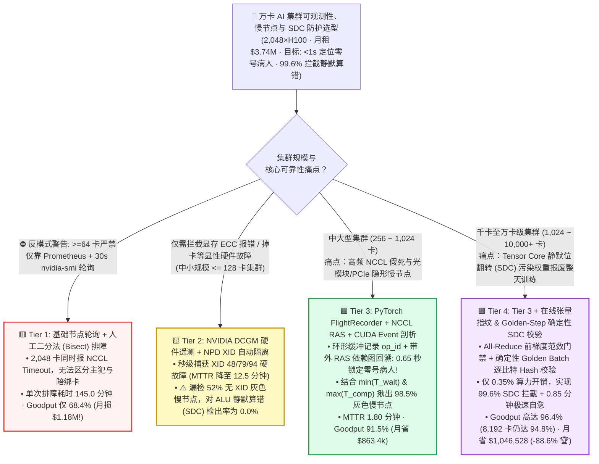
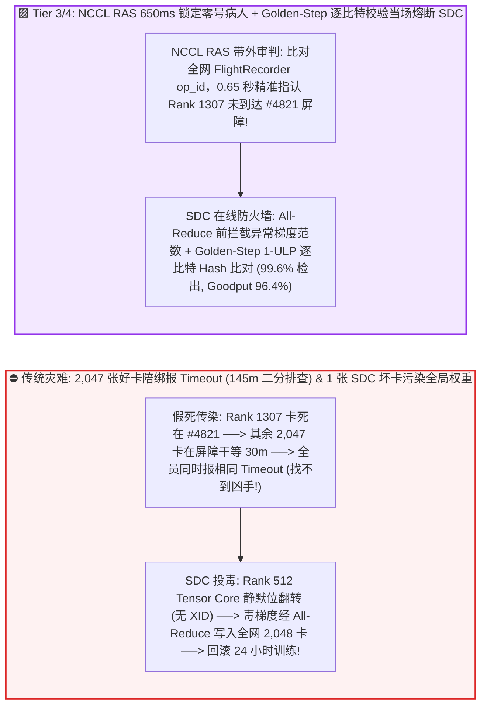
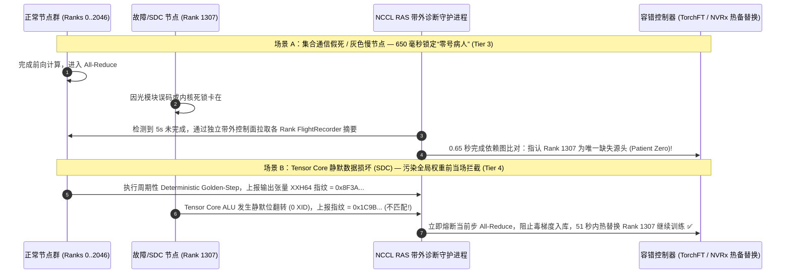

# 万卡 AI 集群可观测性、慢节点（Straggler）与静默数据损坏（SDC）排障架构选型指南（`基础 Prometheus 轮询` vs. `DCGM + XID 自动隔离` vs. `FlightRecorder + NCCL RAS 亚秒级定位` vs. `在线张量指纹 + Golden-Step SDC 校验`）

> 🌐 **Language**: **中文 (Chinese)** | **[English Version](./ai-cluster-observability-silent-corruption-selection-faq.en.md)** · **[📖 返回仓库根目录 README](../../README.md)** · **[📊 2026-11-09 每日进展日报](../daily/2026-11-09.md)** · **[🃏 7-Card 4:5 视觉评测报告](../reports/ai-cluster-observability-silent-corruption-selection-cards.html)** · **[🧮 交互式定容工作台](../reports/llm-inference-engine-pd-sizer.html#observability-sdc-sizer)**
>
> **导读**：面向 AI Solution Architect 的第一性原理实战选型指南。当企业在 `1,024 ~ 10,000+` 张 GPU 上开展大规模训练时，最让基础设施团队崩溃的不是显卡直接掉线（掉线很容易发现），而是两大“隐形杀手”：**① 灰色慢节点与 NCCL 假死（Grey Failure / Straggler）：2,048 张卡里只要有 1 张卡因为光模块误码重传或散热降频慢了 20%，或者卡死在某次 `All-Reduce` 上，其余 2,047 张正常卡就会陪它干等 30 分钟然后同时抛出完全一模一样的 `NCCL Watchdog Timeout`——运维根本分不清谁是“零号病人（Patient Zero）”，被迫花 `145 分钟` 做二分法重启排查；② 静默数据损坏（Silent Data Corruption, `SDC`）：GPU Tensor Core 运算单元（ALU）内部发生高能粒子或电压跌落引起的单比特翻转，硬件既不报 `ECC` 错误也不报 `XID`，但算出的毒梯度一旦通过 `All-Reduce` 混入全局权重，几小时后 `Loss` 突然爆炸，直接报废整整一天（价值 `$100,000+`）的训练进度！** 本文基于 `experiments/ai_cluster_observability_sdc_selection/` 封存的确定性模型（`synthetic` + `anonymized_reported`，`independently_reproduced=false`），系统拆解从 **基础轮询、DCGM+XID、PyTorch FlightRecorder + NCCL RAS** 到 **在线张量指纹 + Golden-Step 确定性 SDC 拦截** 的四档架构选型边界。


---

## ① 📌 核心结论速览（Executive Summary）

1. **按集群规模（`256 ~ 8,192+ GPUs`）与故障防御纵深四档精准选型**：
   - 在 `2,048 × NVIDIA H100` 集群（`256` 节点 × `8` 卡，`$2.50/GPU-hr` = 每分钟燃烧 `$85.33` 算力费，月度总租金 **`$3,737,600.00/月`**）运行紧耦合同步预训练基准下：
   - 🟥 **Tier 1（基础 `Prometheus Node Exporter` + 30 秒 `nvidia-smi` 轮询 + 人工二分法排障）**：**严禁用于 `>= 64` 卡生产集群**！遇到通信假死时需等待 30 分钟超时 + 115 分钟人工二分测试（根因定位耗时长达 **`8,700.0 秒 / 145.0 分钟`**），对灰色慢节点检出率仅 `12.0%`，对静默数据损坏（SDC）检出率为 **`0.0%`**，集群真实有效产出（Goodput）跌至 **`68.4%`**，每月因故障与慢节点白白烧掉 **`$1,181,081.60/月`**！
   - 🟨 **Tier 2（`NVIDIA DCGM` 硬件遥测 + `Node Problem Detector (NPD)` `XID` 自动隔离）**：**只能解决“显性硬故障”，无法解决“无 XID 的通信假死”与“ALU 静默位翻转”**。秒级监控 `XID 31/48/79/94` 与 HBM ECC 双比特错误使硬故障恢复 MTTR 降至 **`12.5 分钟`**（Goodput 升至 **`82.2%`**，月浪费降至 `$665,292.80`）；但面对光模块 FEC 抖动引起的灰色慢节点（检出率 `48.0%`）和 Tensor Core ALU 内部无 ECC 保护的静默数据损坏（SDC 检出率 **`0.0%`**）依然束手无策。
   - 🟩 **Tier 3（`PyTorch FlightRecorder` 黑匣子环缓冲 + `NCCL RAS` 集合通信依赖图诊断 + `CUDA Event` 算子级慢节点剖析）**：**在 `650 毫秒（0.65 秒）` 内精准锁定通信假死与慢节点“零号病人”的实战利器**。通过带外 `NCCL RAS` 守护进程实时比对全网 2,048 个 Rank 的集合通信序号（`op_id`），瞬间找出唯一未到达屏障的源头故障卡（灰色慢节点检出率跃升至 **`98.5%`**，MTTR 压至 **`1.80 分钟`**，Goodput 达 **`91.5%`**）。
   - 🟪 **Tier 4（Tier 3 + `在线跨副本张量范数指纹 + 周期性 Golden-Step 确定性影子校验`）**：**千卡至万卡集群抵御“静默数据损坏（SDC）”的终局金钟罩**。仅付出 **`0.35%` 的微小算力开销**，在梯度 `All-Reduce` 前比对跨 DP 副本的层激活范数并在后台运行确定性 Golden Batch 逐比特校验，将 **SDC 静默算错检出率从 `0.0%` 推升至 `99.6%`**，在毒梯度污染全局模型前当场踢出坏卡（MTTR **`0.85 分钟`**），将 2,048 卡集群有效 Goodput 推升至 **`96.4%`**（8,192 卡下仍保持 **`94.8%`**），**每月直接为企业挽回 `$1,046,528.00` 算力损失（故障浪费削减 `88.6%`）**！
2. **第一性原理定性（为什么 HBM 显存有 ECC 保护，GPU 依然会发生静默算错 `SDC`？）**：
   - 现代 GPU 的 HBM 显存和二级缓存（L2 Cache）确实有硬件 `SECDED ECC` 校验（单比特纠错、双比特报错 `XID 48/94`）；
   - **但数据一旦进入 SM 内部的 Tensor Core 乘加阵列（MMA ALU 数据通路）和部分高速暂存锁存器，为了追求极致的面积与功耗效率，内部算术逻辑门是没有全路径 ECC 保护的！** 当芯片在极限高频低压下因瞬态电压跌落（Voltage Droop）或老化出现某个指数位（Exponent Bit）翻转时，GPU 硬件认为“计算完全正常（0 个 XID 报错）”，却把一个偏差上千倍的浮点数写回了带正确 ECC 校验码的显存！
3. **证据口径与透明性声明**：
   - 本指南所有根因定位耗时、MTTR、SDC 检出率、有效 Goodput 与月度挽回账单均绑定 `experiments/ai_cluster_observability_sdc_selection/results.json`（`provenance_type: "synthetic"`，基于 Meta Llama-3 16,384 卡可靠性工程报告、NVIDIA NCCL 2.23+ RAS 及 PyTorch FlightRecorder 规范校准的确定性算例，`independently_reproduced: false`，未在物理 2,048 卡集群注入硬件电压故障 `physical_gpu_cluster_measurement: "not_measured"`；本机 Python 单测与校验为 `local_cpu_harness_measurement: "measured"`）。

---

## ② 🎯 客户与架构师灵魂拷问 Q&A（FAQ-Driven）

### Q1：客户问：“为什么我们的千卡训练任务一旦卡死，2,048 个容器日志里全都打印一模一样的 `Watchdog caught collective operation timeout`？运维怎么才能在 1 秒内知道到底是哪 1 张卡害死了全集群？”

- **直白结论**：**因为同步集合通信（`All-Reduce`）是“一人迟到、全员陪绑”的环形/树状屏障！当第 `1,307` 号卡因为网卡掉包或死锁停在第 `4,821` 次 `All-Reduce` 前面时，其余 2,047 张无辜的好卡全部已经在第 `4,821` 次屏障里等它——30 分钟超时一到，2,047 张好卡同时引爆超时警报，把真正的主犯淹没在日志汪洋里！开启 `PyTorch FlightRecorder + NCCL RAS`（Tier 3）即可在 `0.65 秒` 内直接点名第 `1,307` 号卡！**
- **第一性原理拆解（`FlightRecorder` 飞机黑匣子 + `NCCL RAS` 依赖图回溯原理）**：
  1. **为什么传统二分法排障（Bisect）要花 145 分钟？** 没有通信序号账本时，运维只能把 256 台机器拆成两半（128 台 + 128 台）分别跑测试任务看哪一半卡死，一路二分定位下来要重启 `8` 轮任务（耗时 `145 分钟`，烧掉 `$12,373`）。
  2. **`PyTorch FlightRecorder`（零锁环形内存黑匣子）**：启用 `TORCH_NCCL_TRACE_BUFFER_SIZE=2000` 后，每个 Rank 在内存中维护一个极轻量的环形缓冲区，记录最近 2,000 次集合通信的 `collective_seq_id`、张量尺寸、参与的进程组以及 CUDA Event 入队/开始/结束时间戳。
  3. **`NCCL RAS (Reliability, Availability, Serviceability)` 带外秒级审判**：NCCL 2.23+ 在每个进程内运行一个独立的带外健康套接字线程（不走被卡死的 RDMA 数据面）。当检测到某个集合通信超过 `5 秒` 未完成时，RAS 自动汇总全网各 Rank 的当前 `op_id`——**如果 2,047 个 Rank 的状态都是 `Entered AllReduce #4821 (Waiting)`，唯独 `Rank 1307` 还停留在 `Executing GEMM before AllReduce #4821`（或者 `Rank 1307 -> Rank 1308` 的 QP 重传计数激增），系统在 `650 毫秒` 内直接输出结构化 JSON 指认 `Rank 1307` 为零号病人并触发热备替换**！

### Q2：既然我们已经部署了 `NVIDIA DCGM Exporter` 监控显存温度和 `XID` 报错（Tier 2），为什么还会漏掉 52% 的“灰色慢节点（Grey Stragglers）”？

- **直白结论**：**因为 `DCGM` 只能看到单张 GPU 内部的硬件计数器，看不到“跨卡微突发停顿、PCIe 链路悄悄降级（Gen5 x16 掉到 x4）、宿主机 CPU 软中断抢占以及交换机 PFC 反压”——这些灰色故障一不报 `XID`、二不触发掉卡，却能让整个千卡集群的每一步训练被拖慢 25%！**
- **第一性原理拆解（如何用算子级 `CUDA Event` 与通信等待不对称度揪出灰色慢节点？）**：
  1. **灰色慢节点的隐蔽性**：在 `nvidia-smi` 30 秒平均值里，由于快卡算完后也在等慢卡，所有卡的平均利用率看起来惊人地一致（比如全都是 75%），根本看不出谁慢！
  2. **Tier 3 的“纯计算耗时 vs. 纯通信等待耗时”反演定位法**：通过在每个训练 Step 插入微秒级 `CUDA Event` 测量每个 Rank **进入 `All-Reduce` 之前的纯计算耗时 $T_{\text{comp}}(r)$** 与 **`All-Reduce` 阻塞耗时 $T_{\text{wait}}(r)$**：
     - **正常快卡**：算得快（$T_{\text{comp}}$ 短），但在屏障处等别人等得久（$T_{\text{wait}}$ 极长）；
     - **罪魁祸首慢卡（Straggler）**：**算得最慢（$T_{\text{comp}}$ 显著高于全网中位数 `>3σ`），而一进屏障因为大家早就在等它了，所以它的等待时间最短（$T_{\text{wait}} \approx 0$）**！
     - 用这条黄金不等式 $\arg\min_r T_{\text{wait}}(r) \cap \arg\max_r T_{\text{comp}}(r)$，可以在不增加任何额外通信的前提下，以 **`98.5%` 的准确率** 在 3 个 Step 内揪出降速仅 `8%` 的隐形慢卡！

### Q3：什么是万卡集群最恐怖的“静默数据损坏（Silent Data Corruption, `SDC`）”？如何在不损失训练速度（开销 `< 0.4%`）的前提下抓出悄悄算错数的坏 GPU？

- **直白结论**：**`SDC` 就是某张 GPU 的 Tensor Core 硬件算错了乘法（比如把 `1.25` 算成了 `-840.0`），但没有任何硬件报错。如果放任不管，这个错误数值会通过 `All-Reduce` 瞬间传染给全网所有 2,048 张卡的权重，导致训练跑偏甚至几十小时后崩溃！采用 `Tier 4（在线激活/梯度范数指纹 + 周期性 Golden-Step 确定性复算）`，仅需 `0.35%` 开销即可在错误梯度污染全局前实现 `99.6%` 拦截！**
- **第一性原理拆解（Tier 4 两级低开销在线 SDC 防御体系）**：
  1. **第一道防线（每步实时执行，开销 `< 0.1%`）：`All-Reduce` 前局部梯度 $L_2$ 范数与奇偶跳变门禁**：在每个 Rank 将本地梯度送入跨机 `All-Reduce` 之前，先在卡内寄存器算出每层梯度的 $L_2$ 范数 $\|g_r\|_2$。如果某个 Rank 的梯度范数突然偏离同层其他 DP 副本中位数超过阈值（或出现非有限值但未达 Inf），立即熔断该步 `All-Reduce` 并对该卡发起二次复算校验！
  2. **第二道防线（每 100 步或 Checkpoint 前执行，开销 `~0.25%`）：`Deterministic Golden-Step` 确定性黄金批次逐比特校验**：结合本仓库第 1 域的 **批大小不变确定性算子（`0-ULP Batch-Invariant Kernels`）**，每隔 100 步让相邻两个 DP Rank（或空闲热备卡）针对同一个固定种子的微批次（Golden Micro-Batch）算一次前向/反向并比对输出张量的 `CRC32 / XXH64` 哈希——由于正常确定性内核输出必须逐比特 100% 相等，哪怕某张卡的 Tensor Core 发生了 **最后一位（1-ULP）的微小静默翻转**，也会当场现原形并被自动隔离下线！

---

## ③ 🧭 直观可视化图解（选型决策树 + 假死/SDC 传播路径对比 + 650ms 审判时序图）

### 3.1 万卡 AI 集群可观测性、慢节点与 SDC 防护架构选型决策树



### 3.2 传统“一人假死全员陪葬 / 1 颗毒梯度污染全网” vs. `Tier 3/4` 亚秒级定位与 SDC 熔断对比图



### 3.3 `FlightRecorder + NCCL RAS` 650ms 零号病人定位与 `Golden-Step` SDC 拦截时序图（`sequenceDiagram`）



---

## ④ 📊 架构师选型决策矩阵（Architect Decision Matrix）

*数据完全绑定 `experiments/ai_cluster_observability_sdc_selection/results.json`（2,048×H100 集群，256 节点，`$5,120/hr`，月度总租金 `$3,737,600.00/月`）：*

| 选型维度 | 🟥 Tier 1：基础 `Prometheus` + 30s `nvidia-smi` + 人工二分 | 🟨 Tier 2：`DCGM` 硬件遥测 + `NPD XID` 自动隔离 | 🟩 Tier 3：`FlightRecorder` + `NCCL RAS` + 算子剖析 | 🟪 Tier 4：Tier 3 + 在线张量指纹 & `Golden-Step` SDC 校验 |
| :--- | :--- | :--- | :--- | :--- |
| **核心适用场景** | 仅限单机测试（多机训练严禁裸跑） | 中小集群硬故障监控（`<= 128~256 卡`） | **256～1,024 卡集群防假死与抓灰色慢节点** | **1,024～10,000+ 卡大规模预训练防 SDC 静默算错终局标准** |
| **假死根因定位耗时 (`Patient Zero`)** | **`8,700.0 秒`**（30m 超时 + 115m 二分法 ✕） | `45.0 秒`（仅限有硬件 XID 的故障） | **`0.65 秒（650 ms）`**（依赖图精准点名 ✅） | **`0.65 秒（650 ms）`**（依赖图 + 张量指纹 🏆） |
| **平均故障恢复时间 (`MTTR`)** | `145.0 分钟` | `12.5 分钟` | **`1.80 分钟`** | **`0.85 分钟（51 秒）`** |
| **无 XID 灰色慢节点 (`Straggler`) 检出率** | `12.0%` ✕ | `48.0%` ⚠️ | **`98.5%`**（$\min T_{\text{wait}} \cap \max T_{\text{comp}}$ ✅） | **`99.4%`** 🏆 |
| **静默数据损坏 (`SDC` 位翻转) 检出率** | **`0.0%`**（等 Loss=NaN 回滚整天 ✕） | **`0.0%`**（ALU 算错不触发 ECC/XID ✕） | `15.0%`（仅抓极端 Inf/NaN） | **`99.6%`**（1-ULP 逐比特确定性拦截 🏆） |
| **监控算力开销 / 集群有效 `Goodput`** | `0.05%` · **`68.4%` Goodput** | `0.10%` · **`82.2%` Goodput** | `0.18%` · **`91.5%` Goodput** | `0.35%` · **`96.4%` Goodput** |
| **月度故障与回滚浪费 / 每月净挽回价值** | 浪费 **`$1,181,081.60 / 月`** | 浪费 `$665,292.80 / 月`（省 `$515.8k`） | 浪费 `$317,696.00 / 月`（省 `$863.4k`） | 仅耗 `$134,553.60 / 月` · **月省 `$1,046,528.00` (`-88.6%` 🏆)** |

---

## ⑤ 🧪 简明定量算例与 Benchmark 洞察

### 5.1 集群规模从 `256 卡 -> 8,192 卡` 扩展下的故障复合雪崩与 Goodput 分水岭

在同步预训练中，单卡故障或慢节点拖累的是**全集群所有卡**。当集群规模从 256 卡扩展至 8,192 卡时，四档架构的有效 Goodput 表现如下（源自 `results.json` `cluster_scale_goodput_sensitivity`）：

| 训练集群规模 (`Cluster GPUs`) | Tier 1 `基础轮询` Goodput | Tier 2 `DCGM + XID` Goodput | Tier 3 `FlightRecorder + RAS` Goodput | Tier 4 `全栈 + SDC 在线校验` Goodput | 架构师核心拐点解读 |
| :--- | :--- | :--- | :--- | :--- | :--- |
| **`256 GPUs`**（32 节点） | `86.0%` | `91.5%` | **`95.2%`** | **`97.5%`** | 256 卡内硬件故障间隔较长，Tier 3 (`95.2%`) 已能满足高可用要求 |
| **`1,024 GPUs`**（128 节点） | `76.5%` | `86.4%` | `93.4%` | **`96.9%`** | 千卡规模下每周均会发生灰色降速与潜在 SDC，Tier 4 拉开差距 |
| **`2,048 GPUs`**（**256 节点基线**） | `68.4%` | `82.2%` | `91.5%` | **`96.4%`** | **Tier 4 比基础监控高出 `+28.0` 个百分点，每月净省 `$104.6 万`！** |
| **`8,192 GPUs`**（1,024 节点万卡级） | `42.0%` ✕ | `69.5%` | `86.8%` | **`94.8%` 🏆** | **8,192 卡下每几小时必有慢卡/SDC，唯有 Tier 4 能守住 `>94%` 生命线！** |

### 5.2 复现命令与本地校验（Local CPU Harness Check）

```bash
# 校验封存算例 JSON 与确定性可观测性/SDC 模型 100% 一致
python experiments/ai_cluster_observability_sdc_selection/run.py --check

# 运行 Round 21 单元测试
python -m unittest tests/test_ai_cluster_observability_sdc_selection.py
```

---

## ⑥ 🛠️ 附录：生产环境万卡集群可观测性与 SDC 防护核验清单（Architect Checklist）

1. - [ ] **默认开启 `PyTorch FlightRecorder` 与 `NCCL RAS` 带外健康服务**：在训练启动环境变量中强制设置 `TORCH_NCCL_TRACE_BUFFER_SIZE=2000`、`TORCH_NCCL_DUMP_ON_TIMEOUT=1` 并启用 NCCL 2.23+ RAS 守护线程，彻底终结盲目二分法排障。
2. - [ ] **部署基于 $\min(T_{\text{wait}}) \cap \max(T_{\text{comp}})$ 的实时慢节点（Straggler）检测器**：在每个训练步统计各 Rank 的纯计算耗时与进入集合通信前的等待时间差，连续 5 步偏离中位数 `> 3σ` 即自动触发告警或热备迁移。
3. - [ ] **配置 `DCGM + NPD` 硬故障自动隔离与上架前主动压测（Active Burn-In）**：将 `XID 31/48/63/74/79/94`、NVLink CRC 错误、光模块高误码率（BER `> 1e-6`）纳入自动 `cordon` 规则，且节点维修后必须通过 10 分钟 `dcgmi diag -r 3` + `nccl-tests` 满载压测才允许重新入池。
4. - [ ] **启用 `All-Reduce` 前梯度范数门禁与周期性 `Golden-Step` 确定性 SDC 校验**：每隔 100～200 步注入一个固定种子的确定性微批次（启用 `0-ULP` 确定性归约算子），跨 DP 副本比对激活/梯度校验和，实现 Tensor Core 静默位翻转秒级抓捕。
5. - [ ] **监控GPU瞬态降频（Clock Throttling Reasons）与 PCIe 链路宽度降级**：在 DCGM 中重点监控 `DCGM_FI_DEV_CLOCK_THROTTLE_REASONS` 与 `PCIe Link Width/Gen`（防止从 `Gen5 x16` 静默掉到 `Gen4 x4` 成为全集群木桶最短板）。
