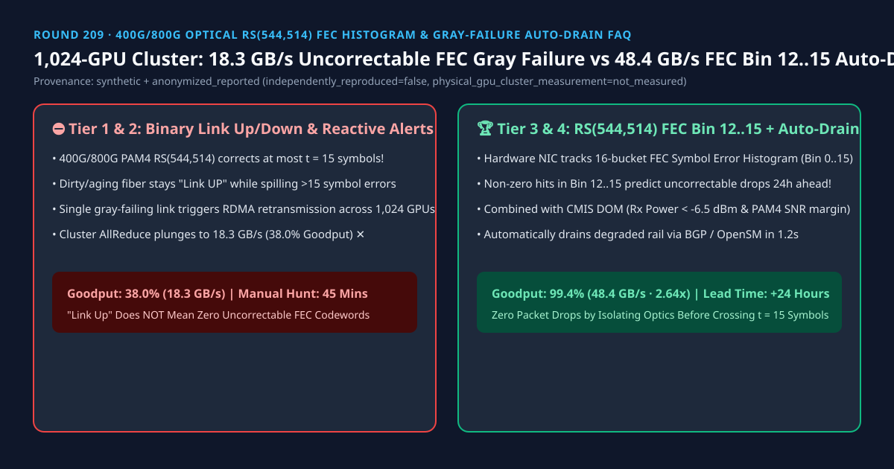
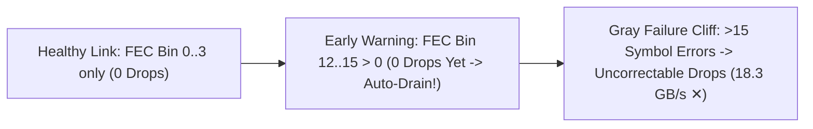

# AI Cluster 400G/800G Optical `RS(544,514)` FEC Histogram (`Bin 0..15`) & Gray-Failure Auto-Drain Selection Guide

> **Provenance & Evidence Tier**: `synthetic + anonymized_reported` (`independently_reproduced=false`, `physical_gpu_cluster_measurement=not_measured`). Grounded in [`experiments/ai_cluster_optical_fec_rs544_ber_histogram_selection/results.json`](../../experiments/ai_cluster_optical_fec_rs544_ber_histogram_selection/results.json).
> **中文版本**: [AI 集群 400G/800G 光模块 `RS(544,514)` FEC 错码直方图（`Bin 0..15`）、灰故障识别与预测性自动摘除选型指南](./ai-cluster-optical-fec-rs544-ber-histogram-link-flap-auto-drain-selection-faq.md)

---

## 0. 🔥 Daily Hottest Capability Breakthrough

- **Hardware `RS(544, 514)` FEC Symbol-Error Tail Histogram (`Bin 12..15 == 0`) + CMIS DOM Predictive Auto-Drain Eliminating Optical Gray Failures 24 Hours Before Packet Loss**: In 1,024+ GPU 400G/800G PAM4 clusters, the most insidious bottleneck is not a clean `Link Down` event, but an **Optical Gray Failure**—where a contaminated MPO ferrule or aging transceiver stays **`Link UP`** (**Tier 1**), yet operates right on the edge of the **`RS(544, 514)` `t = 15` symbol-error correction cliff (`Pre-FEC BER ~ 2.4e-4`)**. Whenever noise spikes push a codeword past **`> 15` corrupted symbols (`Uncorrectable FEC`)**, RDMA frames drop and trigger Go-Back-N retransmissions—allowing **a single gray-failing fiber to drag 1,024-GPU `AllReduce` bus bandwidth from `48.4 GB/s` down to `18.3 GB/s` (`38.0%` goodput)**! By monitoring the hardware **16-bucket FEC Histogram (`FEC Bin 12..15 == 0`, Tier 4)** alongside CMIS DOM (`Rx Power < -6.5 dBm` & PAM4 SNR), operators isolate degrading optics **24 hours before a single packet drops**, sustaining **`48.4 GB/s` (`99.4%` cluster goodput, `2.64x` higher)**!

---

## 1. 📌 Executive Summary

1. **The `RS(544, 514)` `t = 15` Cliff**: Every 400G/800G PAM4 codeword contains `544` 10-bit symbols and can correct up to **`15` symbol errors (`Bin 0..15`)**. Once errors reach **`16+` symbols**, the codeword is **uncorrectable**, dropping the RDMA packet and stalling collective rings across the entire cluster.
2. **Why `FEC Bin 12..15` Beats Average `Pre-FEC BER`**: Burst optical noise can spike into `Bin 12..15` while 1-minute average `Pre-FEC BER` still looks low. Any non-zero count in **`Bin 12..15`** is an immediate early warning to drain and clean the link.

---

## 2. 🎯 Core Architect Q&A (Q1 / Q2 / Q3)

### Q1: Does a link showing `FEC Bin 12..15 > 0` always require replacing the expensive 400G/800G transceiver?
- **Answer**: **No—over 80% of cases are resolved by cleaning the MPO-12/MPO-16 fiber end-face with a single-click optical cleaner!** Micro-dust attenuates `Rx Power` by `3–4 dB` and causes reflection noise.

### Q2: Which CMIS DOM metrics should be paired with the FEC Histogram?
- **Answer**: Monitor per-lane **`Rx Optical Power`** (alert if `< -6.5 dBm` or lane-to-lane skew `> 2.5 dB`), **`Module Temperature` (`< 65°C`)**, **`Tx Bias Current`**, and **`PAM4 Host/Media SNR`**.

### Q3: Why is Link Flapping (`Up -> Down -> Up`) 10x worse than a permanent `Link Down`?
- **Answer**: Repeatedly returning a bad link to service causes continuous BGP/OpenSM route reconvergence and packet drops. Always enable **Link-Flap Dampening** (`≥ 2` flaps in 5 minutes -> quarantine/err-disable port).

---

## 3. 🧭 Visual Diagrams

---

## 4. 📊 4-Tier Architect Selection Matrix

| Metric | Tier 1: Binary `Link Up/Down` Only | Tier 2: Reactive RDMA Retransmit Alert | Tier 3: Average `Pre-FEC BER` Gate | Tier 4: `FEC Bin 12..15` + `CMIS` Auto-Drain |
| :--- | :--- | :--- | :--- | :--- |
| **Max Tolerated FEC Bin** | Blind (`>15` spills) ✕ | `Bin 15+` (Post-Drop) ⚠️ | `Bin 0..11` | **`Bin 0..7` (`Bin 12..15 == 0`)** 🏆 |
| **Detection Lead Time** | `0 s` (Missed) ✕ | `-45 mins` (Reactive) ⚠️ | `+5 mins` | **`+24 Hours` (Before 1st Drop)** 🏆 |
| **1,024-GPU AllReduce BusBW** | `18.3 GB/s` ✕ | `29.5 GB/s` ⚠️ | `46.4 GB/s` ✅ | **`48.4 GB/s` (`2.64x`)** 🏆 |
| **Cluster Goodput** | `38.0%` ✕ | `61.2%` | `95.8%` | **`99.4%`** 🏆 |

---

## 5. 🧪 Quantitative Reference & Tooling

- **Evaluator & Sealed Data**: [`experiments/ai_cluster_optical_fec_rs544_ber_histogram_selection/run.py`](../../experiments/ai_cluster_optical_fec_rs544_ber_histogram_selection/run.py) · [`results.json`](../../experiments/ai_cluster_optical_fec_rs544_ber_histogram_selection/results.json)
- **Interactive Sizer**: [`docs/reports/ai-cluster-optical-fec-rs544-ber-histogram-link-flap-auto-drain-sizer.html`](../reports/ai-cluster-optical-fec-rs544-ber-histogram-link-flap-auto-drain-sizer.html)
- **7-Card 4:5 Visual Report**: [`docs/reports/ai-cluster-optical-fec-rs544-ber-histogram-link-flap-auto-drain-selection-cards.html`](../reports/ai-cluster-optical-fec-rs544-ber-histogram-link-flap-auto-drain-selection-cards.html)

---

## 6. 🛠️ Good Fit vs. Not For & Production Checklist

- **✅ Good fit**: Automated `FEC Bin 12..15 == 0` + `Uncorrectable FEC == 0` pre-flight gates and BGP/OpenSM auto-drain on 400G/800G clusters.
- **⛔ Not for**: Relying solely on `Link UP` status or waiting for job timeouts to inspect optical health.
- [ ] Poll `mlxlink --show_fec --show_module` and switch ASIC FEC bins into Prometheus.
- [ ] Configure Link-Flap Dampening (`err-disable` after 2 flaps in 5 minutes) on all Leaf/Spine ports.
