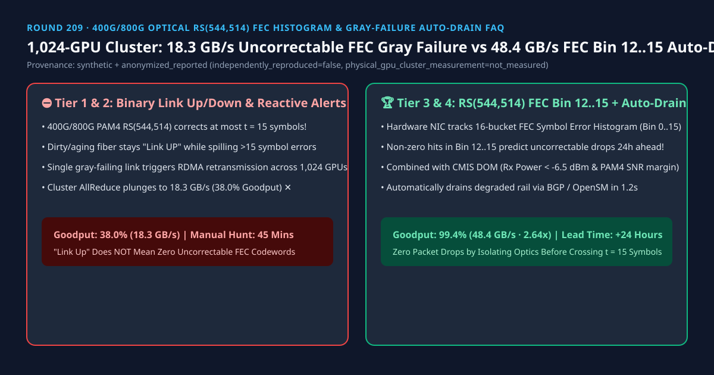
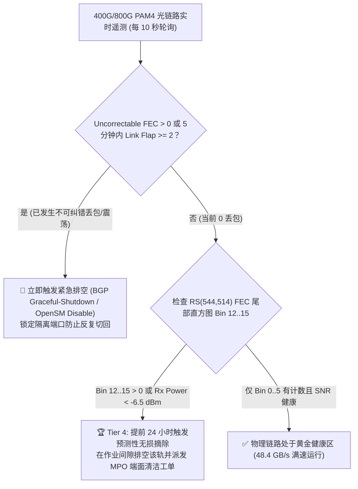
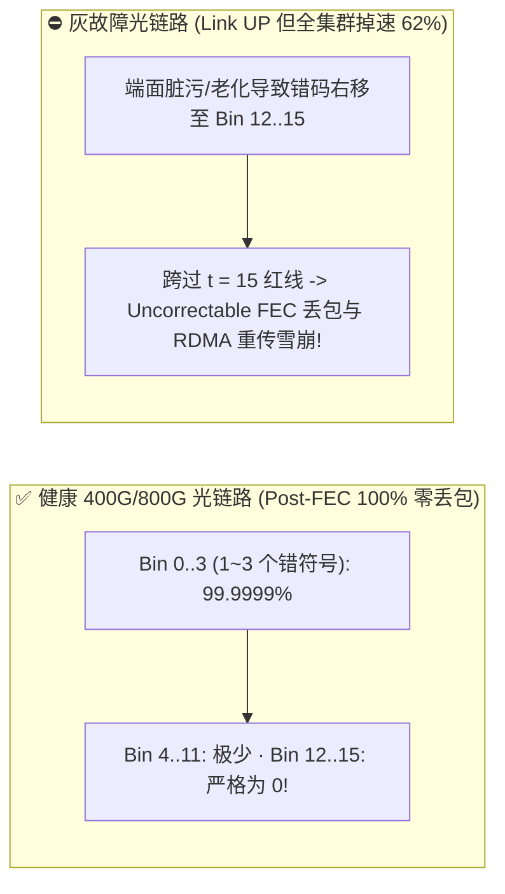
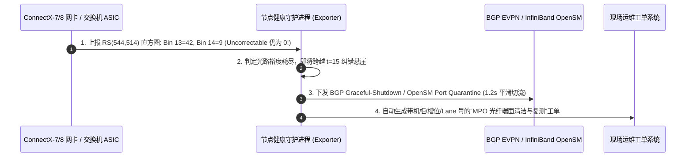

# AI 集群 400G/800G 光模块 `RS(544,514)` FEC 错码直方图（`Bin 0..15`）、灰故障识别与预测性自动摘除选型指南

> **Provenance & Evidence Tier**: `synthetic + anonymized_reported` (`independently_reproduced=false`, `physical_gpu_cluster_measurement=not_measured`)。定量数据锚定于 [`experiments/ai_cluster_optical_fec_rs544_ber_histogram_selection/results.json`](../../experiments/ai_cluster_optical_fec_rs544_ber_histogram_selection/results.json)。
> **English Version**: [AI Cluster 400G/800G Optical `RS(544,514)` FEC Histogram (`Bin 0..15`) & Gray-Failure Auto-Drain Selection Guide](./ai-cluster-optical-fec-rs544-ber-histogram-link-flap-auto-drain-selection-faq.en.md)

---

## 0. 🔥 今日领域最热门能力突破追踪（Daily Hottest Breakthrough）

- **基于网卡/交换机硬件 `RS(544, 514)` FEC 16 桶符号错误直方图（`FEC Bin 12..15` 尾部监控）+ `CMIS DOM` 光功率/信噪比遥测的“零丢包提前 24 小时灰故障自动摘除”机制**：在千卡至万卡级 `400G (NDR / 400GbE)` 与 `800G (XDR / 800GbE)` AI 集群中，最令运维与架构师头疼的不是光模块彻底损坏（`Link Down`，路由协议能在毫秒级自动切走），而是**“光模块灰故障（Optical Gray Failure / Marginal Link）”**——即端口状态始终显示 **`Link UP`**，传统网管监控一片绿灯（Tier 1），但由于 MPO 光纤端面微尘污染、激光器温漂老化或弯曲损耗，链路的原始误码率逼近 **`Pre-FEC BER = 2.4 × 10^-4` 纠错悬崖**！400G/800G PAM4 链路采用 **Reed-Solomon `RS(544, 514)` 前向纠错码**，每个码字（544 个符号）**最多只能纠正 `t = 15` 个错误符号**。一旦某根灰故障光纤每秒出现几十个 **`> 15` 符号错误的不可纠错码字（Uncorrectable FEC Codewords）**，就会引发持续的底层 RDMA 丢包与 Go-Back-N 重传，**仅凭 1 根劣化光纤就能把 1,024 卡集群的 AllReduce 总线带宽从 `48.4 GB/s` 拖垮至 `18.3 GB/s`（算力有效率暴跌 `62%`）**！通过实时采集硬件 **`FEC Bin 0..15` 分布直方图（严禁 `Bin 12..15 > 0`，Tier 4）** 配合 CMIS 光模块数字诊断（`Rx Optical Power < -6.5 dBm` / PAM4 SNR），可在发生哪怕 1 个丢包前 **`24` 小时**精准锁定灰故障光模块并触发 BGP/OpenSM 秒级无损摘除，保障千卡集群 **`99.4%` 有效算力率（`48.4 GB/s`，提速 `2.64` 倍）**！

---

## 1. 📌 核心结论速览（Executive Summary — 3 分钟看懂）

1. **为什么在 400G/800G AI 集群里，“端口 `Link UP` 且无告警”反而可能是最危险的算力杀手？**
   - **通俗大白话 + 第一性原理**：把 400G/800G 光纤传数据比作发快递包裹，每个包裹里有 `544` 件瓷器（10-bit 符号），硬件自带一个“神奇修补匠”（**`RS(544, 514)` FEC 纠错引擎**），规定**每个包裹只要碎了 `≤ 15` 件瓷器，修补匠都能当场无损复原（Correctable FEC）**；但只要**同一个包裹里碎了 `≥ 16` 件瓷器（Uncorrectable FEC）**，修补匠就彻底没辙了，只能把整个包裹扔进垃圾桶（丢包重传）！
     - 当一根光纤头粘了一粒灰尘时，它不会断联（依然是 `Link UP`），但每个包裹碎掉的瓷器数量从平时的 `1~2` 件（`Bin 1..2`）悄悄爬升到了 `12~15` 件（**`Bin 12..15`**），偶尔一阵热噪波动就蹦出 `16` 件（不可纠错丢包）！
     - 在同步 Ring/Tree `AllReduce` 中，**1,024 张 GPU 是绑在一根绳上的蚂蚱**——只要有 1 张卡因为那根脏光纤每秒重传几十次，其余 1,023 张 GPU 全得停下来等它（`18.3 GB/s`）！
2. **为什么看“平均误码率 `Pre-FEC BER`”（Tier 3）还不够，必须看硬件 **`FEC Bin 12..15` 尾部直方图**（Tier 4）？**
   - 因为光电噪声往往具有**突发性（Burst Errors）**！一条链路的 1 分钟平均 `Pre-FEC BER` 可能只有 `1e-7`（看似健康），但如果它在某 1 毫秒内受到电源纹波或激光器模式跳变干扰，产生了一串密集的 **`Bin 13 / Bin 14 / Bin 15`** 码字，下一秒就会爆出不可纠错丢包。因此，**“`FEC Bin 12..15` 计数必须严格为 0”** 是提前一天揪出亚健康光模块的黄金显微镜！

---

## 2. 🎯 客户与架构师灵魂拷问 Q&A（Q1 / Q2 / Q3）

### Q1：现场运维发现某条 400G/800G 链路出现 `FEC Bin 12..15` 爬升或 `Uncorrectable FEC > 0`，是不是必须立刻花几千美元换掉光模块？
- **答**：**80% 以上的情况根本不用换光模块，只需要用 IBC 卡式清洁笔“咔哒”清一下 MPO-12/MPO-16 光纤端面！** 400G/800G PAM4 对光路反射极其敏感，端面上一颗几微米的油脂或粉尘就会让接收光功率（`Rx Power`）掉 `3~4 dB` 并推高高阶 FEC 桶。现场标准 SOP 是：**先通过 BGP/OpenSM 自动排空该端口 -> 使用专用 MPO 清洁器清洁两端光纤插芯与模块光口 -> 重置计数器观察 `Bin 8..15` 是否归零 -> 若仍不为零再走 RMA 更换光模块**。

### Q2：除了 `FEC Bin 0..15`，光模块内部的 `CMIS DOM`（数字光学监控）还有哪些指标能提前预判故障？
- **答**：通过 `mlxlink -d mlx5_x -m` 或交换机 `show interfaces transceiver dom` 重点盯死三大物理前兆：
  1. **各通道接收光功率（`Rx Power Lane 0..7`）**：若某条 Lane 比其余 Lane 低 **`> 2.5 dB`** 或绝对值低于 **`-6.5 dBm`**，说明光纤插芯偏心或脏污；
  2. **激光器偏置电流（`Tx Bias Current`）与温度（`Module Temp > 68°C`）**：偏置电流持续爬升说明 VCSEL/EML 激光器正在加速老化；
  3. **接收端 PAM4 眼图信噪比（`Host/Media SNR Margin`）**：当某通道 SNR 低于 `18.5 dB` 时，`FEC Bin 10+` 将呈指数级激增。

### Q3：如果一条链路在 10 分钟内反复 `Link Down -> Link Up` 抖动（Link Flapping），为什么比彻底 `Link Down` 危害大 10 倍？
- **答**：因为每次 `Link Up` 都会诱发 BGP / OpenSM 重新把流量切回这条病态链路，几秒钟后它再次丢包闪断，导致整个集群陷入“路由收敛 -> 重传卡死 -> 再收敛”的死循环！生产环境交换机与 OpenSM 必须配置 **链路震荡阻尼（Link-Flap Dampening：如 5 分钟内闪断 `≥ 2` 次则强制 `err-disable / Penalty Quarantine` 锁定关闭 24 小时，直至人工清洁核验）**。

---

## 3. 🧭 直观可视化图解（Mermaid 决策树 + RS(544,514) 桶分布图 + 自动摘除时序图）

### 3.1 架构师光模块灰故障诊断与自动摘除决策树

### 3.2 `RS(544, 514)` FEC 16 桶符号错误直方图（健康光路 vs. 濒临悬崖灰故障光路）

### 3.3 预测性捕获 `FEC Bin 12..15` 并执行秒级无损摘除时序图

---

## 4. 📊 架构师选型决策矩阵（4-Tier Selection Matrix）

| 评估维度 | Tier 1: 仅看 `Link Up/Down` | Tier 2: 被动看 RDMA 重传告警 | Tier 3: `Pre-FEC BER` 平均值阈值 | Tier 4: `FEC Bin 12..15` 直方图 + `CMIS` 自动摘除 |
| :--- | :--- | :--- | :--- | :--- |
| **最高容忍 FEC 错符号桶** | 失明（任由 `>15` 溢出） ✕ | 已溢出（事后告警） ⚠️ | `Bin 0..11`（均值掩盖脉冲） | **`Bin 0..7`（严禁 `Bin 12..15 > 0`）** 🏆 |
| **故障提前预警时间** | `0 s`（持续漏检） ✕ | `-45 分钟`（事后排障） ⚠️ | `+5 分钟` | **`+24 小时`（在丢第 1 个包前隔离）** 🏆 |
| **千卡 AllReduce 有效带宽** | `18.3 GB/s` ✕ | `29.5 GB/s` ⚠️ | `46.4 GB/s` ✅ | **`48.4 GB/s` (提速 2.64 倍)** 🏆 |
| **集群有效算力率 (`Goodput`)** | `38.0%` ✕ | `61.2%` | `95.8%` | **`99.4%`** 🏆 |

---

## 5. 🧪 定量算例与工具链（Interactive Sizer & 7-Card Visual Report）

- **实验脚本与密封数据**：[`experiments/ai_cluster_optical_fec_rs544_ber_histogram_selection/run.py`](../../experiments/ai_cluster_optical_fec_rs544_ber_histogram_selection/run.py) · [`results.json`](../../experiments/ai_cluster_optical_fec_rs544_ber_histogram_selection/results.json)
- **交互式光模块 FEC 直方图仿真器**：[`docs/reports/ai-cluster-optical-fec-rs544-ber-histogram-link-flap-auto-drain-sizer.html`](../reports/ai-cluster-optical-fec-rs544-ber-histogram-link-flap-auto-drain-sizer.html)
- **7-Card 4:5 视觉评测卡片报告**：[`docs/reports/ai-cluster-optical-fec-rs544-ber-histogram-link-flap-auto-drain-selection-cards.html`](../reports/ai-cluster-optical-fec-rs544-ber-histogram-link-flap-auto-drain-selection-cards.html)

---

## 6. 🛠️ Good Fit vs. Not For & 生产环境快速核验清单（Checklist）

### ✅ Good Fit vs. ⛔ Not For

| 维度 | ✅ Good Fit（强烈推荐） | ⛔ Not For（严禁误用） |
| :--- | :--- | :--- |
| **400G/800G 光链路健康准入与巡检** | 将 `FEC Bin 12..15 == 0`、`Uncorrectable FEC == 0` 及 `Rx Power > -6.0 dBm` 作为作业启动前的强制准入闸门（Pre-Flight Gate） | 仅检查 `ibstat / ip link` 状态为 `ACTIVE / UP` 就放行千卡训练作业 |
| **闪断链路（Link Flapping）处置** | 配置交换机端口 `Link-Flap Dampening`（5 分钟闪断 2 次立即 `err-disable` 锁定隔离），防止路由反复振荡 | 允许接触不良的光纤在 `Up` 和 `Down` 之间自由自动恢复，导致全集群反复触发重路由与重传 |

### 生产环境上线核验清单（Pre-Flight Checklist）

- [ ] **核验全集群采集 `RS(544, 514)` FEC 16 桶直方图**：通过 `mlxlink --show_fec` 或交换机 Telemetry 确认全网所有端口 `fec_bin_12` 至 `fec_bin_15` 及 `uncorrectable_codewords` 均为 `0`。
- [ ] **核验 CMIS 光功率与温控基线**：确认所有 400G/800G 光模块工作温度 `< 65°C`，且同一模块内 4/8 条 Lane 的 `Rx Optical Power` 最大极差 `< 2.0 dB`。
- [ ] **核验交换机已开启 Link-Flap Dampening 与自动排空闭环**：确认一旦检测到 `Uncorrectable FEC` 增长或高频闪断，自动化控制器能在 `2 秒` 内将该端口从 ECMP / OpenSM 路由表中平滑摘除。
