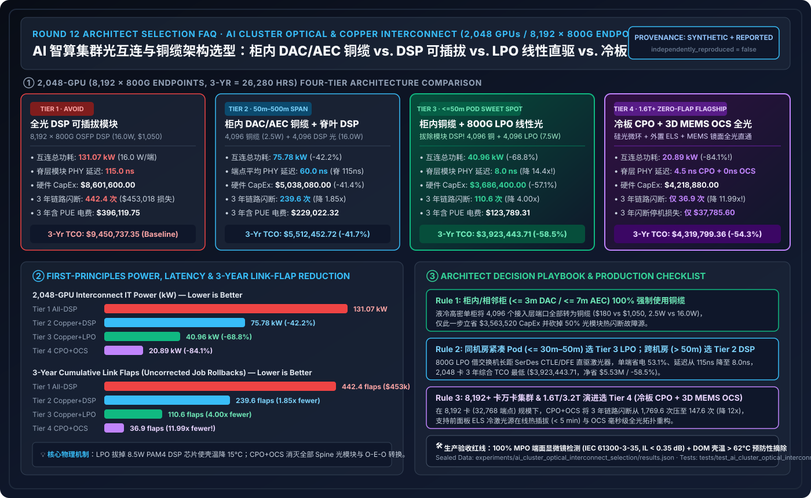
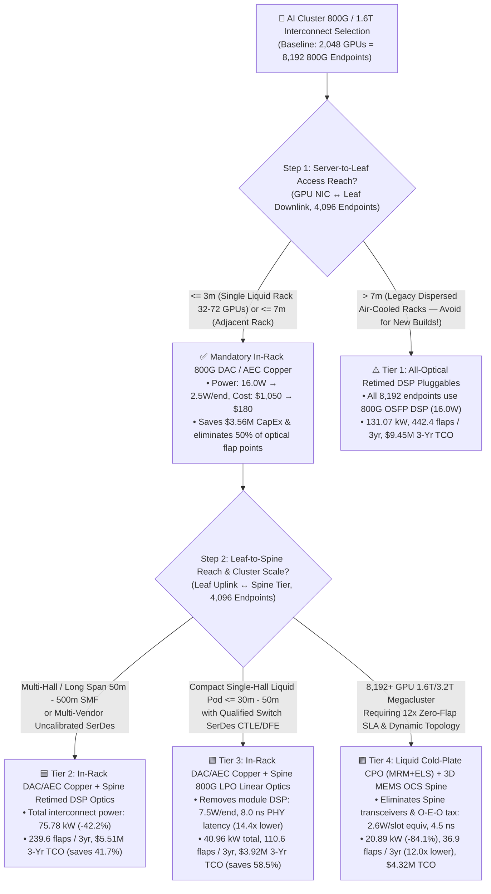
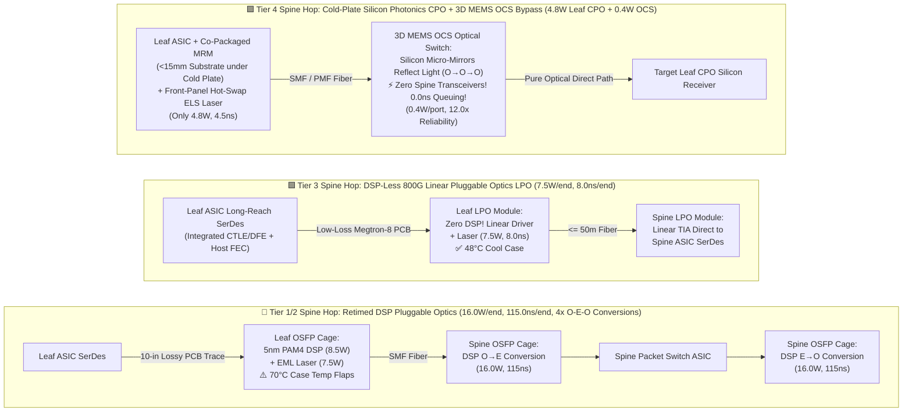

# AI Cluster Optical & Copper Interconnect Architecture Selection Guide (`DAC / AEC Copper` vs. `Retimed DSP Pluggable Optics` vs. `Linear Pluggable Optics LPO` vs. `Co-Packaged Optics CPO + 3D MEMS OCS`)

> **[中文版](./ai-cluster-optical-interconnect-selection-faq.md)** | **[Back to Documentation Index](../../README.en.md)** | **[Interactive Optical Interconnect Power & Flap TCO Sizer](../reports/llm-inference-engine-pd-sizer.en.html#optical-interconnect-sizer)** | **[7-Card 4:5 Visual Benchmark Report](../reports/ai-cluster-optical-interconnect-selection-cards.html)**



---

## ① 📌 Executive Summary

> **Provenance & Reproduction Disclosure**: Hardware silicon and optical specifications in this guide reference published **NVIDIA Quantum-X800 / Spectrum-X800 CPO (TSMC COUPE silicon photonics)**, **Broadcom Bailly 51.2T CPO**, **OIF / OFC 800G-LPO / 1.6T-LRO MSA standards**, and **Google TPU v4/v5p Palomar 3D MEMS OCS** literature (classified as `anonymized_reported`, `independently_reproduced=false`). All **2,048-GPU (`8,192` 800G endpoints) 3-year (`26,280-hour`) power, latency, link-flap reliability, and TCO figures** are generated by the deterministic analytical model in [`experiments/ai_cluster_optical_interconnect_selection/run.py`](../../experiments/ai_cluster_optical_interconnect_selection/run.py) (classified as `synthetic`; physical 2,048-GPU datacenter optical fabric measurement is `not_measured`; local CPU deterministic validation and unit tests are `measured`).

1. **One-Sentence Architectural Selection Verdict (4 Tiers by Reach, Rack Density, and Scale)**:
   - **In-Rack & Adjacent-Rack (`<= 3m` Passive `DAC` / `<= 7m` Active `AEC` Copper) Golden Rule: Never Use Fiber Where Copper Reaches!** In high-density liquid-cooled racks, replacing all **`4,096` Server-to-Leaf endpoints (50% of the fabric)** with `800G DAC/AEC Copper` (**Tier 2: In-Rack Copper + Spine DSP Optics**) slashes server-leaf power from `16.0 W` to **`2.5 W/endpoint`** and unit cost from `$1,050` to **`$180`**, cutting 2,048-GPU interconnect power from `131.07 kW` to **`75.78 kW (-42.2%)`** and 3-year TCO from **`$9,450,737.35`** to **`$5,512,452.72`** (saving **`$3,938,284.63` / `-41.7%`**).
   - **Compact Single-Hall Liquid-Cooled Pods (`<= 30m–50m` Leaf-to-Spine reach): Choose Tier 3 (In-Rack `DAC/AEC` + Spine `800G LPO` Linear Pluggable Optics)**. Stripping the power-hungry `5nm/7nm PAM4 DSP` retimer chip out of the optical transceiver and driving the laser linearly from the switch ASIC's SerDes cuts module power in half (`16.0 W` $\rightarrow$ **`7.5 W`**), slashes one-way module PHY latency from `115.0 ns` to **`8.0 ns` (`14.4x` lower)**, lowers module case temperature to cut 3-year link flaps from `442.4` to **`110.6` (`4.00x` fewer flaps)**, and brings 3-year TCO down to **`$3,923,443.71`** (saving **`$5,527,293.64` / `-58.5%`**).
   - **10,000-GPU `1.6T / 3.2T` Clusters & Mission-Critical Zero-Flap Training SLAs: Advance to Tier 4 (Liquid-Cooled Co-Packaged Optics `CPO + ELS` + `3D MEMS OCS` Optical Circuit Switching)**. Co-packaging silicon photonics micro-ring modulators (`MRM`) directly on the cold-plate switch substrate (**`4.8 W/port`**) and replacing active electrical Spine switches + Spine transceivers with a passive mirror-based **3D MEMS Optical Circuit Switch (`OCS`, `0.4 W/port` equiv)** yields **`2.6 W/slot`** equivalent on the upper tier, cuts fabric interconnect power to **`20.89 kW (-84.1%)`**, slashes 3-year link flaps from `442.4` to **`36.9` (`11.99x` reduction)**, and reduces 3-year flap downtime cost from `$453,017.60` to **`$37,785.60`** (3-year TCO **`$4,319,799.36`**, saving **`$5,130,937.99` / `-54.3%`**).
2. **First-Principles Insight (Why Pluggable "Optics Tax" and "Thermal Link Flaps" Are the #1 Hidden Killer in Large GPU Clusters)**:
   - In a 2-tier non-blocking Leaf-Spine Clos fabric, **every GPU's 800G NIC traverses `4` 800G transceiver endpoints** (NIC `1` + Leaf downlink `1` + Leaf uplink `1` + Spine port `1`; or **`6 endpoints/GPU`** in a 3-tier Clos). Populating all `8,192` endpoints of a 2,048-GPU cluster with `16.0 W`, `$1,050` retimed `DSP` pluggable transceivers costs **`$8.60M` in module CapEx alone**. Worse, running 16W inside a tiny OSFP cage at `$70^\circ\text{C}$` causes laser drift and DSP thermal stress (`1.80%` annual flap rate) — triggering **`442.4` link flaps over 3 years** (an unmasked job crash roughly every 2.5 days)!
3. **Core Architect Trade-off Rule**:
   - Use **`DAC/AEC` Copper for `<= 7m`**; use **`800G LPO` for `7m–50m`** compact liquid-cooled pods with qualified switch SerDes; use **retimed `DSP` pluggables for `50m–500m`** multi-hall spans; and deploy **`CPO + 3D MEMS OCS`** for `1.6T+` hyperscale fabrics requiring `12x` link reliability and dynamic optical topology reconfiguration.

---

## ② 🎯 Customer & Architect Soul-Searching Q&A (FAQ-Driven First Principles)

### Q1: When scoping a 2,048-GPU 800G RoCEv2 / InfiniBand cluster, why do optical transceivers alone consume nearly $10M of the BOM? What are the "Optics Tax" and the "Thermal Link-Flap Wall"?

- **Plain-Language First Principles (What is it, and where does the all-optical bottleneck come from?)**:
  - Architects coming from cloud software often assume "2,048 GPUs require 2,048 transceivers." In reality, in a standard 2-tier 1:1 non-blocking Rail-Optimized Leaf-Spine fabric:
    1. **Lower Tier (Server $\leftrightarrow$ Leaf Access)**: 2,048 GPU NICs connect to Leaf switch downlinks, requiring 2 endpoints per cable = **`4,096` 800G endpoints**;
    2. **Upper Tier (Leaf $\leftrightarrow$ Spine Aggregation)**: To maintain 1:1 non-blocking bisection bandwidth, 2,048 Leaf uplinks connect to Spine switches, requiring another **`4,096` 800G endpoints**.
  - **The Multiplier (`4 × 800G endpoints per GPU`)**: A 2,048-GPU cluster requires **`8,192` 800G endpoints** (and a 3-tier Fat-Tree requires **`6 × endpoints per GPU`**).
  - If an architect blindly specifies **Tier 1 (All-Optical Retimed `800G OSFP DSP` Pluggables at `$1,050` and `16.0 W` each)** across all 8,192 ports:
    - **CapEx Optics Tax**: Transceiver hardware alone costs **`$8,601,600.00`**;
    - **Power & Cooling Tax**: The transceivers burn **`131.07 kW`** continuously (`$396,119.75` over 3 years at `$0.115/kWh` PUE-adjusted), with more than half of each module's power (`~8.5 W`) spent inside its onboard `5nm/7nm PAM4 DSP` chip just equalizing signal loss across 10 inches of switch PCB copper trace;
    - **The Thermal Link-Flap Wall**: Packing 64 × 16W pluggable cages onto a switch faceplate pushes laser junction temperatures toward `$70^\circ\text{C}$`, yielding a **`1.80%` annual link-flap/failure rate (AFR)**. Across 8,192 endpoints over 3 years, that produces **`442.4` link flaps**, costing **`88.48 hours`** of lost 2,048-GPU training time (`12.0 min = 0.20 hr` rollback/restart penalty per flap × `$5,120/hr` = **`$453,017.60`**).

### Q2: What are `LPO` (Linear Pluggable Optics) and `1.6T LRO`? How does removing the onboard DSP chip cut module power by 53% and PHY latency by 14.4x, and when is LPO NOT suitable?

- **First-Principles Mechanism Breakdown**:
  - **Why does a traditional `DSP` optical module need a DSP in the first place?** As a 112G PAM4 electrical signal travels 8–12 inches from the center of a switch ASIC across standard PCB copper traces to the front-panel OSFP cage, high-frequency attenuation distorts the eye diagram. Traditional modules embed a **5nm/7nm `PAM4 DSP` retimer chip** inside the pluggable module to perform Clock and Data Recovery (CDR), equalization, and FEC framing before driving the laser. That DSP chip accounts for **~50% of module power (`8.5 W`), ~35% of BOM cost (`$330+`), and `>100 ns` of serialization/FEC latency**.
  - **How `LPO` (Linear Pluggable Optics) breaks the bottleneck**: Modern switch ASICs (such as Broadcom Tomahawk 5 and NVIDIA Spectrum-4) integrate ultra-capable long-reach SerDes with advanced Continuous-Time Linear Equalizers (`CTLE`) and Decision Feedback Equalizers (`DFE`). **`LPO` completely removes the DSP chip from the optical transceiver**, retaining only a highly linear Trans-Impedance Amplifier (`Linear TIA`) and `Linear Laser Driver` driven directly by the switch ASIC's SerDes over low-loss Megtron-7/8 PCB traces:
    - **Module power drops from `16.0 W` to `7.5 W` (`-53.1%`)**;
    - **One-way module PHY latency drops from `115.0 ns` to `8.0 ns` (`14.4x` reduction)**;
    - **Module price drops from `$1,050` to `$720` (`-31.4%`)**, and eliminating the 8.5W DSP heat source lowers module case temperature by `$15\text{--}20^\circ\text{C}$`, cutting annual optical flap rates from `1.80%` to **`0.75%`**.
  - **Where LPO hits physical limits & the rise of `1.6T LRO` (Linear Receive Optics)**:
    1. **Reach Limit (`<= 30m–50m`)**: Without in-module retiming, dispersion and link budget constrain `800G LPO` to `<= 30m–50m` single-hall Leaf-to-Spine spans. Multi-hall `100m–500m` links must use retimed `DSP` modules (Tier 2).
    2. **Host SerDes Qualification**: LPO requires end-to-end channel qualification (`pre-FEC BER < 1e-6`) with the specific switch/NIC ASIC.
    3. **`224G/lane` (`1.6T`) Evolution to `LRO`**: At 224G PAM4 per lane (`1.6T OSFP`), pure bidirectional linear drive has tight SNR margins; `1.6T LRO` keeps a lightweight DSP only on the transmit path (`Tx`) while using DSP-less linear drive on the receive path (`Rx`), capturing ~30% power savings with robust multi-vendor interoperability.

### Q3: What are `CPO` (Co-Packaged Optics) and `3D MEMS OCS` (Optical Circuit Switching)? How do they physically eliminate both front-panel thermal flaps and Spine "O-E-O" conversion taxes?

- **Mechanism 1: `CPO` (Co-Packaged Optics with Hot-Swappable External Laser Source `ELS`)**:
  - **How it works**: Instead of driving electrical signals 10 inches across lossy PCB copper to a front-panel cage, **`CPO` (e.g., NVIDIA Quantum-X800 / Spectrum-X800 CPO using TSMC COUPE silicon photonics, Broadcom Bailly 51.2T) solders silicon photonics engines (Micro-Ring Modulators `MRM`) directly onto the same package substrate within `< 15 mm` of the switch ASIC die, cooled directly under the liquid cold plate**!
  - **Why decouple the laser into a front-panel `ELS` (External Laser Source)?** Silicon modulators modulate light, while Indium Phosphide (InP) Continuous-Wave (`CW`) lasers generate the light and are the most thermally sensitive component. CPO places the CW lasers inside **field-replaceable, hot-swappable front-panel `ELS` cages** that feed unmodulated light via polarization-maintaining fiber into the cold-plate silicon photonics engine. This drops 800G optical port power to **`4.8 W`** (`4.5 ns` PHY latency) while keeping lasers cool and serviceable in `< 5 minutes` without touching the liquid loop!
- **Mechanism 2: `3D MEMS OCS` (Micro-Electro-Mechanical Mirror Optical Circuit Switch, e.g., Google TPU v4/v5p Palomar OCS)**:
  - **The Spine "O-E-O" Tax in Electrical Packet Fabrics**: In a conventional Leaf-Spine fabric, light leaving Leaf A enters a Spine transceiver (**Optical-to-Electrical `O-to-E`**), traverses the Spine packet switch ASIC, and exits another Spine transceiver (**Electrical-to-Optical `E-to-O`**) toward Leaf B — burning `4,096` Spine-tier optical modules and dozens of high-power Spine switch chassis.
  - **Pure Speed-of-Light Mirror Reflection (`O-O-O`) in `3D MEMS OCS`**: A 3D MEMS OCS contains zero packet-switching silicon and zero Spine transceivers. Instead, an array of steerable silicon micro-mirrors physically reflects the light beam coming from Leaf A directly into the fiber going to Leaf B (**`0.0 ns` electronic buffering latency, `0.4 W` equivalent power per port, and zero Spine transceivers to flap**)!
  - **Combined Tier 4 Impact**: Combining in-rack copper (`4,096` endpoints at `2.5 W`) with Leaf cold-plate `CPO` (`2,048` ports at `4.8 W`) and passive `3D MEMS OCS` (`2,048` ports at `0.4 W` equiv = **`2.6 W/slot` average across the 4,096 upper-tier slots**) cuts total interconnect power by **`84.1%` (`20.89 kW`)**, slashes 3-year link flaps by **`11.99x` (`442.4` $\rightarrow$ `36.9` flaps)**, and enables dynamic topology reconfiguration around failed racks in milliseconds!

---

## ③ 🧭 Visual Architecture Diagrams (Mermaid Decision Tree + 4-Tier Signal Path Comparison + CPO+OCS Reconfiguration Sequence)

### 3.1 AI Cluster Optical & Copper Interconnect Selection Decision Tree (`flowchart TD`)



### 3.2 Physical Signal Path Comparison: Retimed DSP vs. Linear LPO vs. CPO + 3D MEMS OCS (`flowchart LR`)



### 3.3 Tier 4 `CPO + 3D MEMS OCS` Proactive Laser Hot-Swap & Optical Topology Reconfiguration (`sequenceDiagram`)

```mermaid
sequenceDiagram
    autonumber
    participant ELS as Front-Panel Hot-Swap Laser (ELS)
    participant CPO as Leaf Cold-Plate Silicon Photonics (CPO MRM)
    participant OCS as Spine 3D MEMS Optical Circuit Switch (OCS)
    participant SDN as Optical SDN / Fabric Controller
    participant Job as 2,048-GPU Training Job (NCCL Collectives)

    Note over ELS,OCS: Steady State: CPO MRM cooled under 35°C cold plate; MEMS OCS mirrors lock Rail-Optimized topology (0 Spine pluggables)
    ELS->>CPO: Feeds unmodulated Continuous-Wave (CW) laser light via PMF fiber (isolated from ASIC heat)
    CPO->>OCS: Silicon Micro-Ring Modulator (MRM) encodes 800G optical stream (4.8W, 4.5ns PHY latency)
    OCS->>CPO: 3D MEMS micro-mirrors physically reflect beam to destination Leaf CPO (O-O-O bypass, 0.0ns queuing)

    Note over ELS,SDN: Event A: Front-panel ELS laser reports pre-fail optical power margin degradation (< +2.5 dB)
    ELS-->>SDN: Telemetry alerts declining laser bias margin before any link drop occurs
    SDN->>OCS: Steers MEMS mirror plane to drain rail traffic onto standby optical circuit (< 15 ms hitless switch)
    Note over ELS: Technician hot-swaps front-panel ELS blind-mate module in < 5 min without opening liquid cold plate

    Note over CPO,Job: Event B: Workload transitions from Dense 3D Parallelism to MoE All-to-All Expert Parallelism
    Job->>SDN: Requests high-bisection All-to-All optical mesh across Leaf switches
    SDN->>OCS: Re-angles 3D MEMS mirror matrix to directly interconnect high-traffic Leaf pairs
    OCS-->>Job: Delivers direct optical circuit topology without Spine packet congestion
```

---

## ④ 📊 Architect Decision Matrix

*Baseline Scenario: `2,048 GPUs` (`256 nodes × 8 GPUs`, `800G` backend fabric), 2-tier non-blocking Leaf-Spine topology with **`4,096` bidirectional 800G links = `8,192` endpoints** (`4,096` Server-Leaf + `4,096` Leaf-Spine), **3-year (`26,280-hour`)** horizon, `$0.115/kWh` PUE-adjusted electricity rate (`$0.10/kWh × 1.15 PUE`), and `12.0 min = 0.20 hr` average NCCL job rollback/restart penalty per unmasked link flap (`$5,120.00/hr` 2,048-GPU cluster rate). All numbers are bound 1-to-1 to [`experiments/ai_cluster_optical_interconnect_selection/results.json`](../../experiments/ai_cluster_optical_interconnect_selection/results.json).*

| Evaluation Dimension | Tier 1: All-Optical Retimed `DSP` Pluggables (All 8,192 Endpoints 800G OSFP) | Tier 2: In-Rack `DAC/AEC` Copper + Spine `DSP` Pluggables (Multi-Hall Baseline) | Tier 3: In-Rack `DAC/AEC` Copper + Spine `800G LPO` Linear Optics (Compact Pod Sweet Spot) | Tier 4: Cold-Plate `CPO + ELS` + Spine `3D MEMS OCS` Optical Bypass (Hyperscale Flagship) |
| :--- | :--- | :--- | :--- | :--- |
| **Best-Fit Scenario** | Legacy dispersed air-cooled racks where Server-to-ToR `> 7m` (**Never use for new AI builds**) | High-density liquid racks with long Leaf-to-Spine spans (**`50m–500m`** across halls) or multi-vendor switches | **Top Recommendation**: Compact single-hall liquid pods (**`<= 30m–50m`** Leaf-to-Spine) maximizing TCO ROI | **Megacluster Flagship**: `8,192+` GPU `1.6T/3.2T` clusters, zero-flap frontier training & dynamic optical topologies |
| **Access / Spine Media Mix** | Access: `4,096 × DSP` (`16.0W`)<br/>Spine: `4,096 × DSP` (`16.0W`) | Access: `4,096 × DAC/AEC` (`2.5W`)<br/>Spine: `4,096 × DSP` (`16.0W`) | Access: `4,096 × DAC/AEC` (`2.5W`)<br/>Spine: `4,096 × LPO` (`7.5W`) | Access: `4,096 × DAC/AEC` (`2.5W`)<br/>Spine: `2,048 CPO` (`4.8W`) + `OCS` (`0.4W`) |
| **Total Power & Spine PHY Latency** | **`131.07 kW`**<br/>`115.0 ns` (PAM4 DSP + FEC) | **`75.78 kW`** (`-42.2%`)<br/>`115.0 ns` (Spine) / `60.0 ns` (avg) | **`40.96 kW`** (**`-68.8%`**)<br/>**`8.0 ns`** (**`14.4x` lower** Spine PHY) | **`20.89 kW`** (**`-84.1%`**)<br/>**`4.5 ns`** (CPO) + **`0.0 ns` OCS mirror** |
| **Core Underlying Mechanism** | Every port runs an onboard 5nm PAM4 DSP retimer + FEC, concentrating 16W heat inside each pluggable cage | Exploits `<=3m–7m` in-rack liquid density to replace all 4,096 access optics with passive/active copper | Strips the DSP chip out of the optical module; switch ASIC SerDes (`CTLE/DFE`) linearly drives the laser | Co-packages silicon MRM on cold-plate ASIC substrate + hot-swap front-panel `ELS` + `3D MEMS` mirror reflection |
| **3-Year Link Flaps & Downtime Cost** | **`442.4 flaps`** (`88.48 hrs` lost)<br/>**`$453,017.60`** downtime (`1.00x`) | **`239.6 flaps`** (`47.92 hrs` lost)<br/>**`$245,350.40`** (`1.85x` fewer flaps) | **`110.6 flaps`** (`22.12 hrs` lost)<br/>**`$113,254.40`** (**`4.00x`** fewer flaps) | **`36.9 flaps`** (only `7.38 hrs` lost)<br/>**`$37,785.60`** (**`11.99x`** fewer flaps) |
| **Ecosystem Openness & Max Spine Reach** | 🟢 Highest (IEEE/MSA plug-and-play across **`500m+`** SMF) | 🟢 Highest (standard OSFP copper + standard DSP optics up to **`500m`**) | 🟡 Medium-High (OIF LPO MSA; requires qualified switch SerDes channel, **`<= 50m`**) | 🟡 Flagship Integrated (NVIDIA Quantum-X800 / Broadcom Bailly / TPU OCS, up to **`2,000m`** SMF) |
| **Total 3-Year Interconnect TCO** | **`$9,450,737.35`** (Baseline)<br/>(`$8.60M` CapEx + `$0.40M` pwr + `$0.45M` flap) | **`$5,512,452.72`**<br/>(Saves **`$3,938,284.63` / `-41.7%`**) | **`$3,923,443.71`**<br/>(Saves **`$5,527,293.64` / `-58.5%`**) | **`$4,319,799.36`**<br/>(Saves **`$5,130,937.99` / `-54.3%`**) |

---

## ⑤ 🧪 Reproducible Quantitative Case Study & Benchmark Insights

The deterministic evaluator is in [`experiments/ai_cluster_optical_interconnect_selection/run.py`](../../experiments/ai_cluster_optical_interconnect_selection/run.py), sealed outputs are in [`experiments/ai_cluster_optical_interconnect_selection/results.json`](../../experiments/ai_cluster_optical_interconnect_selection/results.json), and unit tests are in [`tests/test_ai_cluster_optical_interconnect_selection.py`](../../tests/test_ai_cluster_optical_interconnect_selection.py).

### 5.1 2,048-GPU (`8,192` 800G Endpoints) 4-Tier Power, Link-Flap & 3-Year TCO Breakdown

| Architecture Tier | Total Power (kW) | Spine Module PHY Latency (ns) | Hardware CapEx ($) | 3-Yr PUE Power Cost ($) | 3-Yr Link Flaps / Downtime Cost ($) | Total 3-Yr Interconnect TCO ($) | Net Savings vs. Tier 1 |
| :--- | :--- | :--- | :--- | :--- | :--- | :--- | :--- |
| **Tier 1: All-Optical DSP Pluggables** | `131.07 kW` | `115.0 ns` | `$8,601,600.00` | `$396,119.75` | `442.4 flaps` / `$453,017.60` | **`$9,450,737.35`** | `Baseline (0.0%)` |
| **Tier 2: In-Rack Copper + Spine DSP** | `75.78 kW` | `115.0 ns` | `$5,038,080.00` | `$229,022.32` | `239.6 flaps` / `$245,350.40` | **`$5,512,452.72`** | **`-$3,938,284.63 (-41.7%)`** |
| **Tier 3: In-Rack Copper + Spine LPO** | **`40.96 kW`** | **`8.0 ns`** (`14.4x`) | **`$3,686,400.00`** | `$123,789.31` | `110.6 flaps` / `$113,254.40` | **`$3,923,443.71`** | **`-$5,527,293.64 (-58.5%)`** |
| **Tier 4: Cold-Plate CPO + 3D MEMS OCS** | **`20.89 kW`** | **`4.5 ns`** + `0ns OCS` | `$4,218,880.00` | **`$63,133.76`** | **`36.9 flaps` (`11.99x`)** / **`$37,785.60`** | **`$4,319,799.36`** | **`-$5,130,937.99 (-54.3%)`** |

### 5.2 Cluster Scale Sensitivity (`512` / `2,048` / `8,192 GPUs`) & Selection Inflection Points

| Cluster Scale (`800G` NICs) | Total 800G Endpoints | Tier 1 (All DSP) 3-Yr TCO | Tier 2 (Copper + DSP) | Tier 3 (Copper + LPO) | Tier 4 (CPO + MEMS OCS) | Architect Recommended Selection |
| :--- | :--- | :--- | :--- | :--- | :--- | :--- |
| **`512 GPUs` (Department Pod)** | `2,048 endpoints` | `$2,362,684.34` | `$1,378,113.18` | **`$980,860.93`** | `$1,079,949.84` | **Select Tier 3 (In-Rack Copper + `<=50m 800G LPO`)**: Fits in 8 liquid racks under `$1.0M` total 3-year TCO |
| **`2,048 GPUs` (Mainstream Training Pod)** | `8,192 endpoints` | `$9,450,737.35` | `$5,512,452.72` | **`$3,923,443.71`** | `$4,319,799.36` | **Select Tier 3 (`LPO`) for `<=50m` pod, Tier 2 (`DSP`) for `>50m` multi-hall, or Tier 4 (`CPO+OCS`) for zero-flap SLA** |
| **`8,192 GPUs` (Hyperscale Megacluster)** | `32,768 endpoints` | `$37,802,949.40` | `$22,049,810.88` | `$15,693,774.84` | **`$17,279,197.44`** | **Select Tier 4 (`CPO + 3D MEMS OCS`)**: Overcomes 50m reach limit (`2,000m`) while cutting 3-year flaps from `1,769.6` to `147.6` |

---

## ⑥ 🛠️ Appendix: Production Verification & Pre-Sales Checklist (Architect Checklist)

- [ ] **1. Rack Layout & Middle-of-Rack Copper Radius Audit (Eliminating 50% of Optics)**: Have you positioned Leaf/ToR switches in the middle of each liquid-cooled rack (or adjacent rack) so that **100% of Server-to-Leaf links stay within `<= 3m` (passive `DAC`) or `<= 7m` (active `AEC` copper)**, strictly forbidding `$1,050` optical modules on in-rack links?
- [ ] **2. Leaf-to-Spine Cable Tray Length & `LPO` Channel Qualification**: For single-hall pods selecting Tier 3 (`800G LPO`), is the physical fiber path (including overhead tray slack) strictly **`<= 30m–50m`**? Are the switch ASICs (e.g., Spectrum-4 / Tomahawk 5) and LPO transceivers mutually qualified on the vendor HCL for `pre-FEC BER < 1e-6`?
- [ ] **3. Automated Fiber End-Face Inspection (`IEC 61300-3-35`) Gate**: At 800G/1.6T PAM4, a single 2-micron dust particle on an MPO-12/MPO-16 connector causes back-reflection and intermittent FEC symbol errors. Does the deployment SOP enforce **100% automated digital microscope end-face pass/fail archiving + insertion loss testing (`< 0.35 dB`)** prior to cluster burn-in?
- [ ] **4. Proactive Pluggable DOM Thermal & Rx-Power Eviction (`< 62°C` Threshold)**: Are `ethtool -m` / `mlxreg` Digital Optical Monitoring (DOM) metrics scraped every 15 seconds to flag any optical module exceeding **`62°C` case temperature or `> 2.0 dB` Rx power degradation** for proactive drain-and-replace at the next checkpoint boundary?
- [ ] **5. `1.6T (224G/lane)` Generation Transition Readiness (`LRO` vs `CPO`)**: For upcoming `1.6T` fabrics, have you evaluated `1.6T LRO` (retimed Tx + linear Rx) vs. cold-plate `CPO + hot-swappable front-panel ELS` manifold and serviceability workflows?
- [ ] **6. Rail-Optimized Adaptive Routing & `OCS` Hitless Failover Drill**: Have you verified through fault-injection drills that unplugging a single Leaf uplink or ELS laser triggers `< 15 ms` Adaptive Routing / OCS mirror failover without inducing a fabric-wide PFC pause storm?
