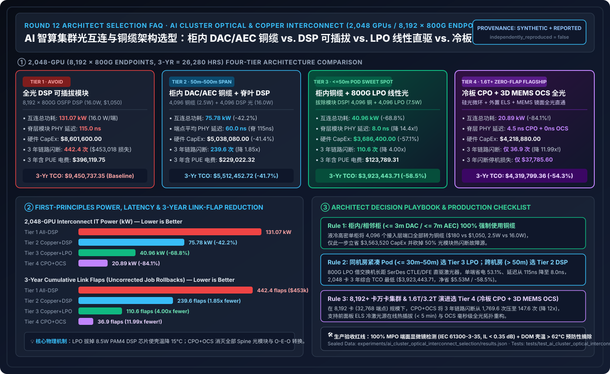
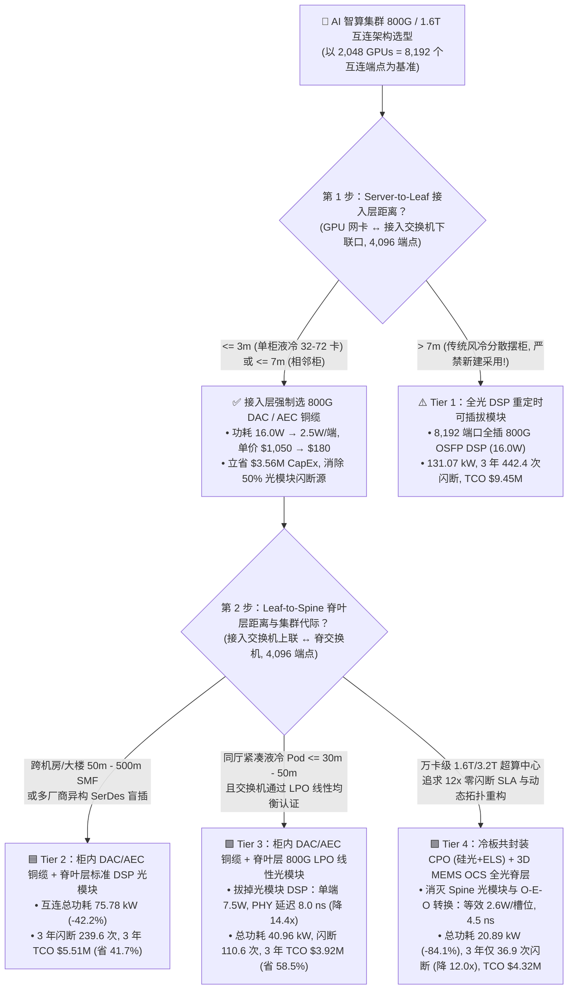
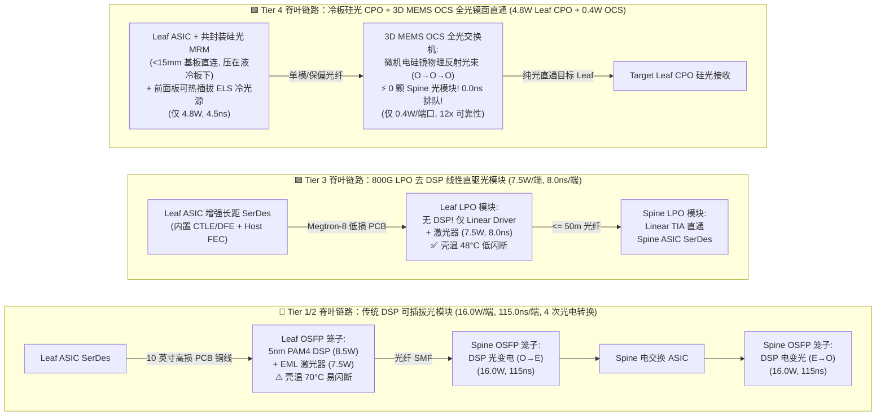
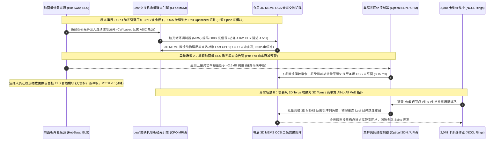

# AI 智算集群光互连与铜缆架构选型指南（`DAC / AEC 铜缆` vs. `DSP 重定时可插拔光模块` vs. `LPO 线性直驱光模块` vs. `CPO 共封装光学 + 3D MEMS OCS 全光交换`）

> **[English Version](./ai-cluster-optical-interconnect-selection-faq.en.md)** | **[返回文档中心](../../README.md)** | **[交互式光互连功耗与闪断 TCO 计算器](../reports/llm-inference-engine-pd-sizer.html#optical-interconnect-sizer)** | **[7-Card 4:5 视觉评测报告](../reports/ai-cluster-optical-interconnect-selection-cards.html)**

---

## ① 📌 核心结论速览（Executive Summary）

> **数据口径与复现声明（Provenance Disclosure）**：本文硬件芯片与光学标准参数引用自 **NVIDIA Quantum-X800 / Spectrum-X800 CPO（TSMC COUPE 硅光引擎）**、**Broadcom Bailly 51.2T CPO**、**OIF / OFC 800G-LPO / 1.6T-LRO MSA 规范** 及 **Google TPU v4/v5p Palomar 3D MEMS OCS 论文基准**（标注为 `anonymized_reported`，`independently_reproduced=false`）；**2,048 卡（`8,192` 个 800G 互连端口）3 年（`26,280 小时`）功耗、延迟、链路闪断率（Link Flaps）与综合 TCO** 由本仓库 [`experiments/ai_cluster_optical_interconnect_selection/run.py`](../../experiments/ai_cluster_optical_interconnect_selection/run.py) 确定性仿真生成（标注为 `synthetic`，物理 2,048 卡机房光网络实测标注为 `not_measured`；本机 CPU 校验与单测已实测通过 `measured`）。

1. **一句话架构选型结论（按布线物理距离、机柜液冷密度与集群规模四档选型）**：
   - **机柜内与相邻柜（`<= 3m` 无源铜缆 `DAC` / `<= 7m` 有源铜缆 `AEC`）铁律：能用铜绝不用光！** 在液冷高密机柜内，将全部 **`4,096` 个 Server-to-Leaf 下联端口（占全网 50%）** 替换为 `800G DAC/AEC 铜缆`（**Tier 2 柜内铜缆 + 脊叶层 DSP 光模块**），平均单端功耗从 `16.0 W` 骤降至 **`2.5 W`**，单端采购成本从 `$1,050` 降至 **`$180`**，直接将 2,048 卡集群互连总功耗从 `131.07 kW` 砍至 **`75.78 kW (-42.2%)`**，3 年总 TCO 从 **`$9,450,737.35`** 降至 **`$5,512,452.72`**（净省 **`$3,938,284.63` / `-41.7%`**）。
   - **紧凑型液冷 Pod 脊叶互连（`<= 30m–50m` 同机房跨柜）：优选 Tier 3（柜内 `DAC/AEC` + 脊叶层 `800G LPO` 线性直驱可插拔光模块）**。砍掉光模块内部高耗电的 `5nm/7nm PAM4 DSP` 重定时芯片，由交换机 ASIC SerDes 线性直驱激光器：单光模块功耗从 `16.0 W` 砍半至 **`7.5 W`**，光模块单向 PHY 延迟从 `115.0 ns` 骤降至 **`8.0 ns`（降低 `14.4x`）**，模块工作壳温下降使 3 年链路闪断从 `442.4 次` 降至 **`110.6 次`（降低 `4.00x`）**，3 年总 TCO 压至 **`$3,923,443.71`**（净省 **`$5,527,293.64` / `-58.5%`**）。
   - **万卡级 `1.6T / 3.2T` 超算中心与零闪断训练 SLA：演进至 Tier 4（冷板共封装光学 `CPO + 外置光源 ELS` + 脊层 `3D MEMS OCS` 全光交换）**。将硅光微环调制器（`MRM`）直接共封装在交换芯片冷板下方（单端仅 **`4.8 W`**），并用无源微机电镜面反射全光交换机（`3D MEMS OCS`）替代有源电交换 Spine 及脊层光模块（摊销至每上联槽位等效仅 **`2.6 W`**），全网互连功耗降至 **`20.89 kW (-84.1%)`**，3 年链路闪断从 `442.4 次` 压至 **`36.9 次`（降低 `11.99x`）**，3 年闪断停机损失从 `$453,017.60` 骤降至 **`$37,785.60`**（综合 TCO **`$4,319,799.36`**，净省 **`$5,130,937.99` / `-54.3%`**）。
2. **第一性原理洞察（为什么可插拔光模块的“光税 Optics Tax”与“热闪断 Link Flap”成了千卡集群的头号隐形杀手？）**：
   - 在 2 层无阻塞胖树（Leaf-Spine Clos）网络中，**每块 GPU 的 800G 网卡需要串联 `4 个` 800G 互连模块**（网卡端 `1` + Leaf 下联端 `1` + Leaf 上联端 `1` + Spine 端 `1`；若为 3 层 Clos 则高达 **`6 个/GPU`**）。当 8,192 个端口全部插满 `16.0 W`、`$1,050` 的传统 `800G DSP` 光模块时：仅光模块采购就高达 **`$8.60M`**，更致命的是 16W 狭小壳体在风道末端长期处于 `$70^\circ\text{C}$` 高温，激光器波长漂移与 DSP 过热导致年化闪断率高达 **`1.80%/端`**——全集群 3 年累计发生 **`442.4 次` 链路闪断（平均每 2.5 天炸一次训练作业）**！
3. **架构师核心权衡准则**：
   - **`<= 7m` 用 `DAC/AEC` 铜缆**（零光转换、零激光器寿命衰减）；**`7m–50m` 同厅紧凑液冷集群用 `LPO`**（前提是主机/交换机 SerDes 通过线性均衡认证）；**`50m–500m` 跨机房长距混插用标准 `DSP` 可插拔模块**；**`1.6T+` 超大规模集群与动态拓扑重构用 `CPO + 3D MEMS OCS`**。

---

## ② 🎯 客户与架构师灵魂拷问 Q&A（FAQ-Driven First Principles）

### Q1：客户建设 2,048 卡 800G RoCEv2 / InfiniBand 集群时，为什么网络报单里光模块一项就吃掉了近千万美元？什么是 AI 集群的“光税（Optics Tax）”与“热致闪断墙（Link-Flap Wall）”？

- **通俗第一性原理（它是什么？传统全光方案卡在什么物理瓶颈？）**：
  - 很多软件背景的架构师以为“2,048 块 GPU 就只需要 2,048 个光模块”。实际上，在标准的 2 层 Rail-Optimized Leaf-Spine 拓扑中：
    1. **下半段（Server $\leftrightarrow$ Leaf 接入层）**：2,048 张 GPU 网卡连接到 Leaf 交换机下联口，每条光纤两端各需 1 个模块，共 **`4,096 个` 800G 端点**；
    2. **上半段（Leaf $\leftrightarrow$ Spine 汇聚层）**：为保证 1:1 无阻塞（Non-blocking）全双工线速，Leaf 上联到 Spine 交换机同样需要 2,048 条链路，两端又是 **`4,096 个` 800G 端点**。
  - **算总账（`4 × 800G 端点 / GPU`）**：2,048 卡集群共计 **`8,192 个` 800G 端点**（若上规模到 3 层 Fat-Tree，则膨胀至 **`6 × 端点 / GPU`**）。
  - 如果不加区分地全网采购传统 **Tier 1（`800G OSFP DSP` 可插拔光模块，`$1,050/只`，`16.0 W/只`）**：
    - **CapEx 光税**：仅光模块采购就要 **`$8,601,600.00`**；
    - **功耗与散热税**：光模块自身就要烧掉 **`131.07 kW`** IT 电力（3 年含 PUE 电费 **`$396,119.75`**），而且其中超过一半功耗（~`8.5 W/只`）花在了光模块肚子里那颗用来给 PCB 走线做信号整形的 `PAM4 DSP` 芯片上；
    - **热致闪断墙（Link-Flap Wall）**：可插拔光模块插在交换机前面板高密风道口，16W 发热使内部激光器结温逼近 `$70^\circ\text{C}$` 红线，年化故障/闪断率（AFR）达 **`1.80%`**。8,192 只光模块在 3 年内会触发 **`442.4 次` 链路闪断**，每次闪断导致千卡 NCCL 作业回滚重跑（平均耗时 `12.0 分钟 = 0.20 小时`），直接烧掉 **`88.48 小时` 全集群算力（折合 `$453,017.60` 停机损失）**！

### Q2：什么是 `LPO`（Linear Pluggable Optics，线性直驱可插拔光模块）与 `1.6T LRO`？为什么砍掉光模块里的 DSP 芯片能省下一半功耗和 93% 延迟？什么情况下不能用 LPO？

- **第一性原理机制拆解**：
  - **传统 `DSP` 光模块为什么这么耗电？** 当信号从交换机中心的交换芯片（Switch ASIC）穿过长达 8～12 英寸的印刷电路板（PCB 铜走线）到达前面板笼子时，高频 112G PAM4 电信号已经严重衰减变形。因此传统光模块必须在模块内部塞进一颗 **7nm/5nm `PAM4 DSP` 芯片**，先把电信号采样还原（CDR + 均衡 + FEC 编解码），再驱动激光器发光。这颗 DSP 芯片独占了模块 **~50% 的功耗（`8.5 W`）、~35% 的 BOM 成本（`$330+`）以及 `>100 ns` 的排队处理延迟**。
  - **`LPO`（线性直驱）是怎么破局的？** 随着新一代交换芯片（如 Broadcom Tomahawk 5、NVIDIA Spectrum-4）自带了极其强大的长距 SerDes 与高阶连续时间线性均衡器（CTLE / DFE），**`LPO` 直接把光模块里的 DSP 芯片彻底拔掉**！模块内部只保留高线性度的跨阻放大器（Linear TIA）和激光驱动器（Linear Driver），由交换芯片的 SerDes 隔着低损耗 PCB 板材（Megtron-7/8 或 Flyover 飞线）直接线性驱动光引擎：
    - **单模块功耗从 `16.0 W` 骤降至 `7.5 W`（节省 `53.1%`）**；
    - **单模块 PHY 延迟从 `115.0 ns` 骤降至 `8.0 ns`（降低 `14.4x`）**，对小包 AllReduce 延迟极度友好；
    - **单模块成本从 `$1,050` 降至 `$720`（节省 `31.4%`）**，且去掉了 DSP 发热源后模块壳温下降 `$15\text{--}20^\circ\text{C}$`，光模块年化闪断率从 `1.80%` 降至 **`0.75%`**。
  - **LPO 的物理边界与 `1.6T LRO`（何时不能盲目用 LPO？）**：
    1. **距离边界（`<= 30m–50m`）**：LPO 没有模块内信号整形，色散与链路预算受限，仅适合紧凑型液冷 Pod 内部 `<= 30m–50m` 的 Leaf-to-Spine 短距互连；跨机房 `100m–500m` 必须退回标准 `DSP` 模块（Tier 2）。
    2. **互操作性边界**：LPO 强依赖宿主机交换芯片/网卡 SerDes 参数调优，跨厂商盲插兼容性弱于 DSP 模块。
    3. **单通道 `224G PAM4`（`1.6T` 时代）折中方案 `LRO`（Linear Receive Optics）**：在 1.6T（8×224G）速率下，全线性 LPO 链路余量过紧，业界推出 **`LRO`（发射端保留轻量化 DSP 整形以保证发光眼图质量，接收端采用去 DSP 线性直驱）**，省下 ~30% 功耗同时兼顾 224G 互操作性。

### Q3：什么是 `CPO`（共封装光学）与 `3D MEMS OCS`（全光电路交换机）？它们是如何从物理根源上终结光模块热闪断与脊层“光电光（O-E-O）”转换税的？

- **核心机制一：`CPO`（Co-Packaged Optics，共封装光学 + 外置光源 `ELS`）**：
  - **怎么运作的？** 既然把电信号从交换芯片拉到前面板要走 10 英寸铜线并损耗几十瓦功率，**`CPO`（如 NVIDIA Quantum-X800 / Spectrum-X800 CPO、Broadcom Bailly 51.2T）直接把硅光引擎（Silicon Photonics Engine，采用微环调制器 `MRM`）封装在交换芯片同一个封装基板上，紧挨着 ASIC 边缘（距离 `< 15 mm`），并一起压在液冷冷板（Cold Plate）下面**！
  - **为什么把激光器拆到外面做 `ELS`（External Laser Source）？** 硅本身不发光，而传统光模块最怕热的正是磷化铟（InP）连续波激光器（CW Laser）。CPO 将易损耗的激光器独立做成前面板可热插拔的 **外置光源模块（`ELS`）**，通过保偏光纤把冷光源送进芯片旁的硅光调制器。这样既把单 800G 端口光引擎功耗压到惊人的 **`4.8 W`**（`4.5 ns` 延迟），又让最娇贵的激光器远离交换芯片热源且支持在线秒级热插拔更换！
- **核心机制二：`3D MEMS OCS`（微机电镜面反射全光交换机，如 Google TPU Palomar OCS）**：
  - **传统电 Spine 交换机的“光电光（O-E-O）冤枉路”**：在传统 Leaf-Spine 网络中，光纤从 Leaf A 出来进到 Spine 交换机时，必须先通过 Spine 光模块**由光变电（O-to-E）**，进 Spine ASIC 解析转发，再通过另一个 Spine 光模块**由电变光（E-to-O）**发往 Leaf B——整个 Spine 层多用了 `2,048 × 2 = 4,096` 只光模块和几十台高耗电 Spine 交换机！
  - **`3D MEMS OCS` 的纯物理镜面反射直通（`O-O-O`）**：OCS 内部没有电交换芯片、不解析以太网/IB 数据包，而是由数千面微米级硅基微机电反射镜（3D MEMS Mirrors）组成。当集群调度器规划好通信拓扑后，MEMS 微镜偏转角度，**直接把来自 Leaf A 的光束在真空中物理反射进通往 Leaf B 的光纤（纯光速直通，`0.0 ns` 电排队延迟，整台千端口 OCS 功耗仅 ~`100–200 W`，合每端口 `0.4 W`）**！
  - **双剑合璧收益**：在 **Tier 4（柜内铜缆 + Leaf 端冷板 `CPO` + Spine 层无源 `3D MEMS OCS`）** 下，Spine 层的 2,048 只高故障率可插拔光模块被 **100% 物理消灭**，Leaf 上联由液冷冷板 CPO 承载，3 年链路闪断次数从 `442.4 次` 暴降至 **`36.9 次`（可靠性提升 `11.99x`）**，且支持毫秒级绕过故障机柜动态重构 3D 环网/胖树拓扑！

---

## ③ 🧭 直观可视化图解（Mermaid 选型决策树 + 四代光互连演进对比 + CPO+OCS 拓扑自愈时序）

### 3.1 AI 集群光互连与铜缆架构选型决策树（`flowchart TD`）

### 3.2 传统 DSP 可插拔光模块 vs. LPO 线性直驱 vs. CPO + 3D MEMS OCS 物理信号路径对比（`flowchart LR`）

### 3.3 Tier 4 `CPO + 3D MEMS OCS` 激光器热插拔与全光拓扑毫秒级绕障时序图（`sequenceDiagram`）

---

## ④ 📊 架构师选型决策矩阵（Architect Decision Matrix）

*基准环境：`2,048 GPUs`（`256 台 × 8 卡`，`800G` 后端网络），2 层无阻塞 Leaf-Spine 拓扑共 **`4,096 条` 800G 链路 = `8,192 个` 互连端点**（下联 `4,096` + 上联 `4,096`），3 年（`26,280 小时`）TCO 周期，含 PUE 综合电价 `$0.115/kWh`，单次未屏蔽链路闪断导致集群回滚重跑惩罚 `12.0 分钟 = 0.20 小时`（集群算力价值 `$5,120.00/小时`）。所有指标严格绑定 [`experiments/ai_cluster_optical_interconnect_selection/results.json`](../../experiments/ai_cluster_optical_interconnect_selection/results.json)。*

| 架构评估维度 | Tier 1：全光 `DSP` 重定时可插拔（全网 8,192 只 800G OSFP） | Tier 2：柜内 `DAC/AEC` 铜缆 + 脊叶层 `DSP` 光模块（跨厅通用基线） | Tier 3：柜内 `DAC/AEC` 铜缆 + 脊叶层 `800G LPO` 线性光模块（紧凑 Pod 首选） | Tier 4：冷板硅光 `CPO + ELS` + 脊层 `3D MEMS OCS` 全光交换（万卡旗舰） |
| :--- | :--- | :--- | :--- | :--- |
| **核心适用场景** | 传统风冷分散摆柜（Server 到 ToR `> 7m`）历史遗留机房（**新建智算中心严禁采用**） | 液冷高密柜内铜连，但 Leaf 到 Spine 跨机房/跨楼层（**`50m–500m`**）或需多厂商盲插 | **强烈推荐**：单机房紧凑液冷 Pod（Leaf-to-Spine **`<= 30m–50m`**），追求极致性价比 | **超大规模首选**：`8,192+` 卡 `1.6T/3.2T` 集群、高闪断敏感预训练与动态光拓扑编排 |
| **接入层 / 脊叶层介质配置** | 接入 `4,096 × DSP` (`16.0W`) 脊叶 `4,096 × DSP` (`16.0W`) | 接入 `4,096 × DAC/AEC` (`2.5W`) 脊叶 `4,096 × DSP` (`16.0W`) | 接入 `4,096 × DAC/AEC` (`2.5W`) 脊叶 `4,096 × LPO` (`7.5W`) | 接入 `4,096 × DAC/AEC` (`2.5W`) 脊叶 `2,048 CPO` (`4.8W`) + `OCS` (`0.4W`) |
| **互连总功耗 & 脊层单端 PHY 延迟** | **`131.07 kW`** `115.0 ns`（含 PAM4 DSP + FEC） | **`75.78 kW`**（`-42.2%`） `115.0 ns`（脊层）/ `60.0 ns`（均值） | **`40.96 kW`**（**`-68.8%`**） **`8.0 ns`**（脊层降低 **`14.4x`**） | **`20.89 kW`**（**`-84.1%`**） **`4.5 ns`**（CPO）+ **`0.0 ns` OCS 反射** |
| **底层核心物理机制** | 每个端口内置 5nm PAM4 DSP 做 CDR 重定时与 FEC，功耗与发热高度集中在模块壳体 | 利用液冷高密同柜 `<=3m–7m` 物理短距，用无源/有源铜缆消灭下半段 4,096 只光模块 | 拔除光模块内 DSP 芯片，由交换机 ASIC SerDes（CTLE/DFE）通过低损 PCB 直接线性驱动激光器 | 硅光微环（MRM）共封装在 ASIC 冷板下 + 外置热插拔 `ELS` 光源 + `3D MEMS` 微镜纯光反射直通 |
| **3 年累计链路闪断 & 停机损失** | **`442.4 次`**（`88.48 hrs` 停机） 算力损失 **`$453,017.60`** (`1.00x`) | **`239.6 次`**（`47.92 hrs` 停机） 算力损失 **`$245,350.40`** (`1.85x` 改善) | **`110.6 次`**（`22.12 hrs` 停机） 算力损失 **`$113,254.40`** (**`4.00x`** 改善) | **`36.9 次`**（仅 `7.38 hrs` 停机） 算力损失 **`$37,785.60`** (**`11.99x`** 改善) |
| **生态开放度与最大脊叶覆盖距离** | 🟢 极高（IEEE/MSA 标准盲插，支持 **`500m+`** SMF） | 🟢 极高（柜内标准 OSFP 铜缆 + 脊层标准 DSP 光模块，**`500m`**） | 🟡 中高（遵循 OIF LPO MSA，需同代交换机信道联合认证，限 **`<= 50m`**） | 🟡 专用旗舰生态（NVIDIA Quantum-X800 / Broadcom Bailly / TPU OCS，支持 **`2,000m`** SMF） |
| **3 年综合互连 TCO（CapEx + 电费 + 闪断）** | **`$9,450,737.35`**（基准） （CapEx `$8.60M` + 电 `$0.40M` + 闪断 `$0.45M`） | **`$5,512,452.72`** （净省 **`$3,938,284.63` / `-41.7%`**） | **`$3,923,443.71`** （净省 **`$5,527,293.64` / `-58.5%`**） | **`$4,319,799.36`** （净省 **`$5,130,937.99` / `-54.3%`**） |

---

## ⑤ 🧪 简明定量算例与 Benchmark 洞察（Reproducible Quantitative Case Study）

本算例脚本位于 [`experiments/ai_cluster_optical_interconnect_selection/run.py`](../../experiments/ai_cluster_optical_interconnect_selection/run.py)，封存数据位于 [`experiments/ai_cluster_optical_interconnect_selection/results.json`](../../experiments/ai_cluster_optical_interconnect_selection/results.json)，单元测试位于 [`tests/test_ai_cluster_optical_interconnect_selection.py`](../../tests/test_ai_cluster_optical_interconnect_selection.py)。

### 5.1 2,048 卡（`8,192` 个 800G 端点）四档互连架构功耗、闪断与 3 年 TCO 拆解

| 方案档位 | 互连总功耗 (kW) | 脊层模块单向延迟 (ns) | 硬件采购 CapEx ($) | 3 年含 PUE 电费 ($) | 3 年链路闪断次数 / 停机损失 ($) | 3 年综合互连 TCO ($) | 相比 Tier 1 净节省 |
| :--- | :--- | :--- | :--- | :--- | :--- | :--- | :--- |
| **Tier 1：全光 DSP 可插拔** | `131.07 kW` | `115.0 ns` | `$8,601,600.00` | `$396,119.75` | `442.4 次` / `$453,017.60` | **`$9,450,737.35`** | `基准 (0.0%)` |
| **Tier 2：柜内铜缆 + 脊叶 DSP** | `75.78 kW` | `115.0 ns` | `$5,038,080.00` | `$229,022.32` | `239.6 次` / `$245,350.40` | **`$5,512,452.72`** | **`-$3,938,284.63 (-41.7%)`** |
| **Tier 3：柜内铜缆 + 脊叶 LPO** | **`40.96 kW`** | **`8.0 ns`** (`14.4x`) | **`$3,686,400.00`** | `$123,789.31` | `110.6 次` / `$113,254.40` | **`$3,923,443.71`** | **`-$5,527,293.64 (-58.5%)`** |
| **Tier 4：冷板 CPO + 3D MEMS OCS** | **`20.89 kW`** | **`4.5 ns`** + `0ns OCS` | `$4,218,880.00` | **`$63,133.76`** | **`36.9 次` (`11.99x`)** / **`$37,785.60`** | **`$4,319,799.36`** | **`-$5,130,937.99 (-54.3%)`** |

### 5.2 不同集群规模（`512 卡` / `2,048 卡` / `8,192 卡`）下的 3 年互连 TCO 敏感度与选型拐点

| 集群规模 (`800G` 网卡) | 全网 800G 端点数 | Tier 1 (全 DSP 光) 3 年 TCO | Tier 2 (柜内铜 + DSP 光) | Tier 3 (柜内铜 + LPO 光) | Tier 4 (冷板 CPO + MEMS OCS) | 架构师推荐落地方案 |
| :--- | :--- | :--- | :--- | :--- | :--- | :--- |
| **`512 GPUs`（中小集群）** | `2,048 端点` | `$2,362,684.34` | `$1,378,113.18` | **`$980,860.93`** | `$1,079,949.84` | **选 Tier 3（柜内铜缆 + 50m 内 `800G LPO`）**：8 机柜紧耦合摆位，百万美元内搞定全网无阻塞 800G 互连 |
| **`2,048 GPUs`（主力训练 Pod）** | `8,192 端点` | `$9,450,737.35` | `$5,512,452.72` | **`$3,923,443.71`** | `$4,319,799.36` | **`<=50m` 同厅选 Tier 3 (`LPO`)；`>50m` 跨厅选 Tier 2 (`DSP`)；高 SLA 预训练选 Tier 4 (`CPO+OCS`)** |
| **`8,192 GPUs`（万卡旗舰中心）** | `32,768 端点` | `$37,802,949.40` | `$22,049,810.88` | `$15,693,774.84` | **`$17,279,197.44`** | **必选 Tier 4（`CPO + 3D MEMS OCS`）**：突破 50m 距离限制（直达 `2,000m`），且将 32,768 端口的 3 年闪断从 `1,769.6 次` 压至 `147.6 次` |

---

## ⑥ 🛠️ 附录：生产环境快速核验与售前打单清单（Architect Checklist）

- [ ] **1. 机柜物理摆位与 ToR 铜缆半径核查（消灭下联 50% 光税）**：在审阅客户机房平面图时，是否已将 ToR（Leaf）交换机部署在液冷计算柜正中（Middle-of-Rack）或紧邻柜，确保 **100% 的 Server-to-Leaf 链路控制在 `<= 3m`（使用无源铜缆 `DAC`）或 `<= 7m`（使用有源铜缆 `AEC`）**，严禁在机柜内/相邻柜使用 `$1,050` 的可插拔光模块？
- [ ] **2. Leaf-to-Spine 光纤走线长度与 `LPO` 准入核查**：对于同机房紧凑液冷 Pod，上联光纤走线长度（含走线架余量）是否严格 **`<= 30m–50m`**？所选 Leaf/Spine 交换机（如 Spectrum-4 / Tomahawk 5）是否在厂商 HCL 矩阵中通过了对应 `800G LPO` 模块的 Pre-FEC 误码率（`BER < 1e-6`）认证？
- [ ] **3. 光纤端面微尘清洁度（IEC 61300-3-35）强制门禁**：`800G / 1.6T` MPO-12/MPO-16 光纤端面极度敏感（一颗 2 微米灰尘即可引起反射衰减触发间歇性 CRC 错包与 NCCL 超时降速）。上架验收时是否已强制执行 **100% 自动端面显微镜拍照归档 + 单链光功率计衰减测试（插入损耗 `< 0.35 dB`）**？
- [ ] **4. 可插拔光模块壳温遥测告警（`< 62°C` 预防性摘除）**：在采用 Tier 2/Tier 3 可插拔光模块的集群中，是否已通过 `ethtool -m` / `mlxreg` / Prometheus Exporter 实时采集 DOM（Digital Optical Monitoring）温度与接收光功率（`Rx Power`），并在壳温 `> 62°C` 或 `Rx Power` 衰减 `> 2.0 dB` 时在训练作业定界 Checkpoint 窗口主动排空替换，避免盘中突然 `Link Down`？
- [ ] **5. `1.6T (224G/lane)` 升级路径评估（`LRO` vs `CPO`）**：针对下一代 Blackwell Ultra / Rubin `1.6T` 网络规划，是否已评估 `1.6T LRO`（发射端重定时 + 接收端线性直驱）与冷板 `CPO + 外置热插拔 ELS` 的机房液冷分水器和前面板盲插维护流程？
- [ ] **6. 双轨道 / `OCS` 故障域隔离验证**：当单台 Spine 交换机或单颗光模块发生闪断时，是否正确配置了 Rail-Optimized 自适应路由（AR）或 `3D MEMS OCS` 备用光平面秒级切换，避免单端口抖动引发全网 PFC 死锁风暴？
