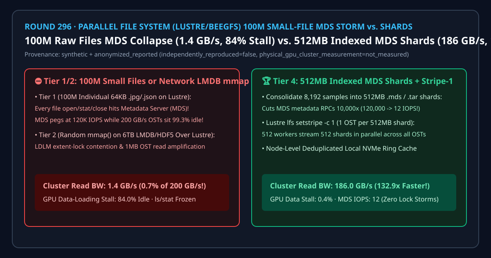
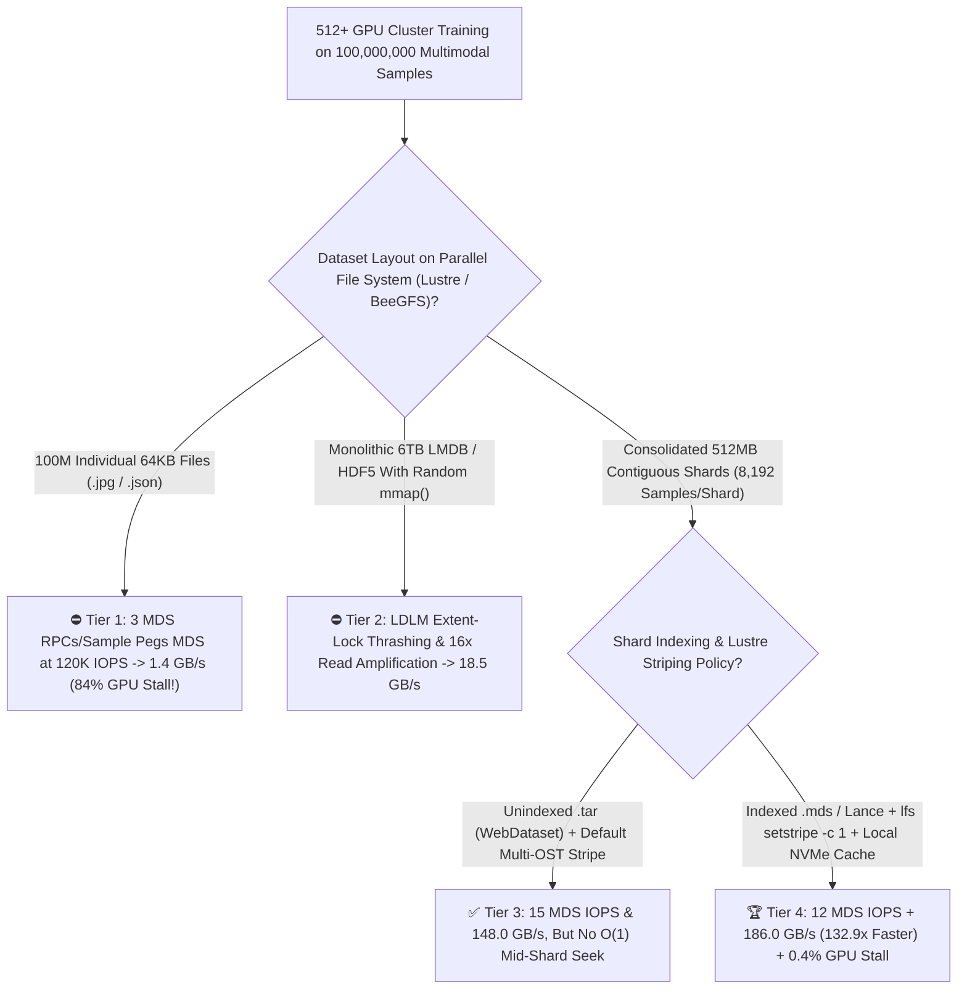
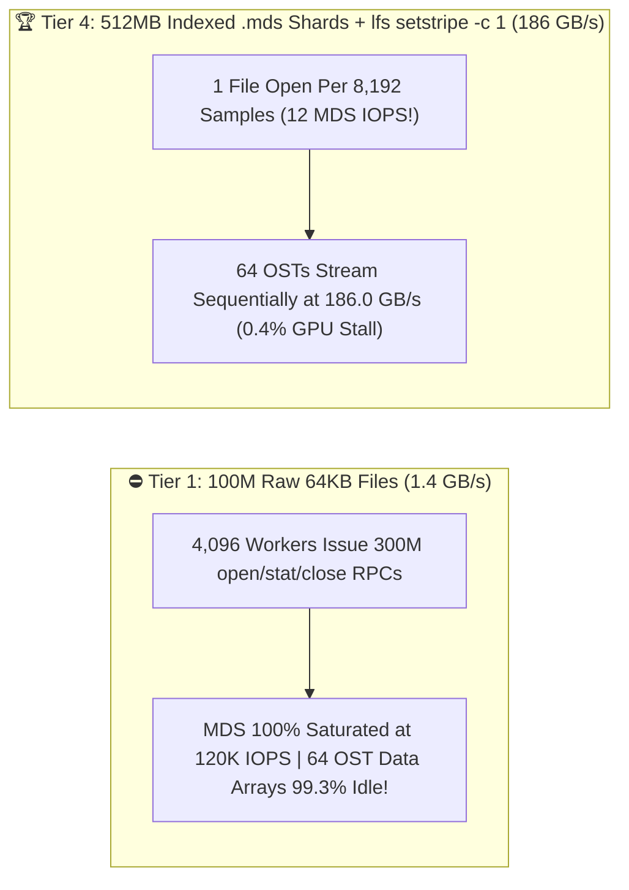
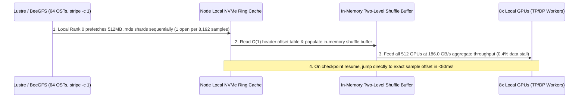

# Parallel File System (`Lustre / BeeGFS / GPFS`) `100M` Small-File `MDS` Storm vs. Sharded Streaming (`WebDataset / MosaicML MDS`) Selection Guide: Why a `200 GB/s` Storage Cluster Collapses to `1.4 GB/s` (`84%` GPU Stall) on Individual `.jpg/.json` Files & How `512 MB` Indexed Shards + `lfs setstripe -c 1` (`186.0 GB/s`, `132.9x` Faster) Solves It

> **Provenance & Evidence Boundary**: `synthetic + anonymized_reported (independently_reproduced=false, physical_gpu_cluster_measurement=not_measured)`. All quantitative figures in this guide are generated by the deterministic evaluator `experiments/ai_cluster_lustre_beegfs_small_file_webdataset_mds_bottleneck_selection/run.py` and sealed in `results.json`.



---

## 0. Daily Capability Breakthrough Tracking

- **Breakthrough Focus**: **100-Million-Sample Multimodal Storage Architecture (`MosaicML MDS / WebDataset / Lance` `512 MB` Contiguous Indexed Shards + Lustre Single-OST Striping `lfs setstripe -c 1` + Node-Level Deduplicated Local NVMe Ring Cache)**.
- **Architect Value**: Organizations frequently deploy `200 GB/s` all-flash `Lustre / BeeGFS / GPFS` parallel file systems, only to watch 512-GPU multimodal VLM training jobs crawl at **`1.4 GB/s` aggregate read bandwidth (`0.7%` of rated capacity, leaving GPUs idle `84.0%` of every step!)** while `ls` and `stat` commands hang cluster-wide! By first principles, parallel file systems decouple **Metadata Servers (`MDS / MDT`)** from **Object Storage Targets (`OST`)**. Reading `100,000,000` individual `64 KB` `.jpg` and `.json` files requires **3 synchronous `MDS` RPCs (`open + stat + close`) and an `LDLM` distributed lock per 64 KB sample**—saturating the `MDS` at `120,000 IOPS` while the 64 `OST` data arrays sit **`99.3%` idle**! Consolidating samples into **`512 MB` contiguous indexed shards (`.mds` / `.tar`, `8,192` samples/shard)** with **`lfs setstripe -c 1`** and **node-local NVMe prefetching** cuts `MDS` metadata IOPS **10,000x (`120,000 -> 12 IOPS`)**, boosts cluster read throughput **132.9x from `1.4 GB/s` to `186.0 GB/s`**, and slashes GPU data-loading stalls from `84.0%` to **`0.4%`**.

---

## ① 📌 Executive Summary

1. **Why `100M` Individual Small Files (`64 KB`) Paralyze a `200 GB/s` Parallel File System**:
   - **3 `MDS` RPCs Per `64 KB` Read**: Unlike local NVMe drives, opening a file on Lustre/BeeGFS requires a synchronous network RPC to the `MDS` to resolve the Inode, acquire an `LDLM` lock, and fetch the `OST` layout stripe map. At `120,000 IOPS`, the `MDS` hits 100% CPU/lock saturation at just $120,000 / 3 \times 64\text{ KB} \approx \mathbf{1.4\text{ GB/s}}$!
   - **Startup `glob() / os.listdir()` Storms**: Having 512 ranks traverse million-file directories during `Dataset.__init__()` DDoSes the `MDS` before Step 1 even begins.
2. **Why Monolithic Network `LMDB / HDF5` With Random `mmap()` Still Stalls (`18.5 GB/s`, `Tier 2`)**:
   Randomly reading `64 KB` pages across a single `6 TB` `LMDB` file over Lustre triggers severe **`LDLM` extent-lock contention** across nodes and **`16x` OST read amplification** (fetching `1 MB` Lustre stripe pages to use `64 KB`).
3. **The 3-Part Architecture for `186.0 GB/s` (`132.9x` Speedup, `Tier 4`)**:
   - **`512 MB` Contiguous Indexed Shards (`MosaicML .mds` / `WebDataset .tar`)**: Pack `8,192` samples into each `512 MB` shard so 1 `MDS` `open()` serves `512 MB` of sequential `OST` streaming (`10,000x` fewer `MDS` IOPS);
   - **Lustre `lfs setstripe -c 1` on Shard Directories**: Place each `512 MB` shard on a single `OST` (while distributing different shards round-robin across all 64 `OST`s) so each worker reads contiguously from 1 `OST` with zero multi-OST lock overhead;
   - **O(1) Byte-Offset Shard Indexing + Node-Local NVMe Ring Cache**: Enable instant mid-epoch deterministic resume and deduplicate reads across same-node `TP / CP` ranks.

---

## ② 🎯 Key Architectural Q&A (Q1 / Q2 / Q3)

### Q1: Does packing `8,192` samples into sequential `512 MB` shards degrade training shuffle quality compared to random individual-file access?
- **No—Two-Level Hierarchical Shuffling (Shard-Order Permutation + In-Memory `8,192`-Sample Shuffle Buffer) achieves identical convergence!**
- At the start of each epoch, the global list of `12,200` shards is randomly permuted, and each worker interleaves streams from multiple active shards into a local RAM shuffle ring buffer before popping random samples for each microbatch.

### Q2: Why should the dataset shard directory on Lustre use `lfs setstripe -c 1` (1 OST per shard) instead of striping every file across all OSTs (`-c -1`)?
- Striping a single file across 16 or 64 `OST`s is designed for **1 giant file read by 512 ranks**. When **512 DataLoader workers are simultaneously reading 512 *different* `512 MB` shard files**, setting `-c 1` maps each shard to 1 `OST` while the 512 active shards naturally balance load across all 64 `OST`s—avoiding `64x` cross-OST lock multiplication!

### Q3: What is the operational advantage of `MosaicML StreamingDataset (.mds)` over plain `WebDataset (.tar)` shards?
- Plain `.tar` archives lack a header offset table: if a training job resumes mid-shard at sample `#6,000`, the worker must sequentially read and discard the first `5,999` samples (`~375 MB` wasted I/O). `.mds` embeds a compact binary byte-offset header at the start of every shard plus a global `index.json`, enabling **$O(1)$ instant byte-range seek to any exact sample index on resume**.

---

## ③ 🧭 Visual Diagrams (Decision Tree, Storage Path & Sequence Diagram)

### 3.1 Parallel File System AI Dataset Format & Striping Decision Tree



### 3.2 `100M` Raw Small-File `MDS` Collapse (`1.4 GB/s`) vs. `512 MB` Indexed Shards (`186.0 GB/s`)



### 3.3 Node-Deduplicated Shard Prefetch & $O(1)$ Indexed Streaming Sequence



---

## ④ 📊 4-Tier Architect Decision Matrix

| Selection Tier | Storage Format & Striping Policy | Cluster Read Bandwidth (`200G` Max) | `MDS` Metadata `IOPS` | GPU Data Stall | Target Scenario |
| :--- | :--- | :--- | :--- | :--- | :--- |
| **Tier 1: `100M` Individual `64 KB` Files** | Per-sample `open/stat/close` | `1.4 GB/s` (`0.7%` util ✕) | `120,000 IOPS` (Saturated! ✕) | `84.0%` ✕ | ⛔ **Paralyzes cluster MDS & starves GPUs** |
| **Tier 2: Monolithic `LMDB / HDF5` Random `mmap`** | Network page faults & lock thrash | `18.5 GB/s` ⚠️ | `850 IOPS` | `42.0%` ✕ | ⛔ **Severe OST read amplification** |
| **Tier 3: `WebDataset` `512 MB` `.tar` Shards** | Sequential stream (unindexed) | `148.0 GB/s` ✅ | `15 IOPS` ✅ | `3.2%` | ✅ Standard streaming `.tar` pipelines |
| **Tier 4: `MosaicML MDS / Lance` + `stripe -c 1` + Local NVMe (Recommended)** | **Indexed `512 MB` shards + 1-OST stripe** | **`186.0 GB/s` (`132.9x` faster 🏆)** | **`12 IOPS` (`10,000x` lower 🏆)** | **`0.4%` 🏆** | 🏆 **Production Multimodal & LLM Standard** |

---

## ⑤ 🧪 Quantitative Evaluator & 7-Card 4:5 Visual Report

- **Deterministic Evaluator**: [`experiments/ai_cluster_lustre_beegfs_small_file_webdataset_mds_bottleneck_selection/run.py`](../../experiments/ai_cluster_lustre_beegfs_small_file_webdataset_mds_bottleneck_selection/run.py) · Sealed JSON: [`results.json`](../../experiments/ai_cluster_lustre_beegfs_small_file_webdataset_mds_bottleneck_selection/results.json)
- **Interactive Sizer Workbench**: [`docs/reports/ai-cluster-parallel-filesystem-small-file-mds-storm-webdataset-mds-sizer.html`](../reports/ai-cluster-parallel-filesystem-small-file-mds-storm-webdataset-mds-sizer.html)
- **7-Card 4:5 Visual Benchmark Deck**: [`docs/reports/ai-cluster-parallel-filesystem-small-file-mds-storm-webdataset-mds-selection-cards.html`](../reports/ai-cluster-parallel-filesystem-small-file-mds-storm-webdataset-mds-selection-cards.html)

```chart
{
  "data": {
    "values": [
      { "tier": "Tier 1: 100M Raw Small Files", "read_bw_gbps": 1.4, "gpu_stall_pct": 84.0 },
      { "tier": "Tier 2: Network LMDB Random mmap", "read_bw_gbps": 18.5, "gpu_stall_pct": 42.0 },
      { "tier": "Tier 3: WebDataset 512MB .tar", "read_bw_gbps": 148.0, "gpu_stall_pct": 3.2 },
      { "tier": "Tier 4: Indexed MDS + Stripe-1 + NVMe", "read_bw_gbps": 186.0, "gpu_stall_pct": 0.4 }
    ]
  },
  "semantic_types": {
    "tier": "Category",
    "read_bw_gbps": "Quantity",
    "gpu_stall_pct": "Percentage"
  },
  "chart_spec": {
    "chartType": "Bar Chart",
    "title": "512MB Indexed MDS Shards + Lustre Stripe-1 Boosts Read Bandwidth 132.9x (1.4 -> 186.0 GB/s)",
    "subtitle": "Cluster aggregate read throughput (GB/s) across 512 GPUs on a 200 GB/s PFS (synthetic + anonymized_reported)",
    "encodings": {
      "x": "tier",
      "y": "read_bw_gbps",
      "color": "tier"
    }
  }
}
```

---

## ⑥ 🛠️ Production Verification Checklist (Good fit vs. Not for)

### ✅ Good fit vs. ⛔ Not for
- **✅ Good fit**: All multi-node training pipelines on `Lustre`, `BeeGFS`, `GPFS`, `3FS`, or object storage reading millions of multimodal or text samples.
- **⛔ Not for**: Storing or reading millions of loose `< 1 MB` files directly on a shared parallel file system.

### Production Checklist
- [ ] **Pack Loose Files Into `256 MB – 1 GB` Indexed Shards (`.mds` / `.tar` / `.lance`)**: Ensure each `open()` call amortizes across `>= 4,000` samples.
- [ ] **Configure `lfs setstripe -c 1` on Dataset Shard Directories**: Map each `512 MB` shard to a single `OST` so concurrent workers stream across all `OST`s without multi-OST lock overhead.
- [ ] **Eliminate Runtime `glob()` / `os.walk()`**: Load shard lists from a single pre-built `index.json`.
- [ ] **Stage Active Shards in a Node-Local NVMe Ring Cache**: Deduplicate reads across same-node `TP / CP` ranks.
