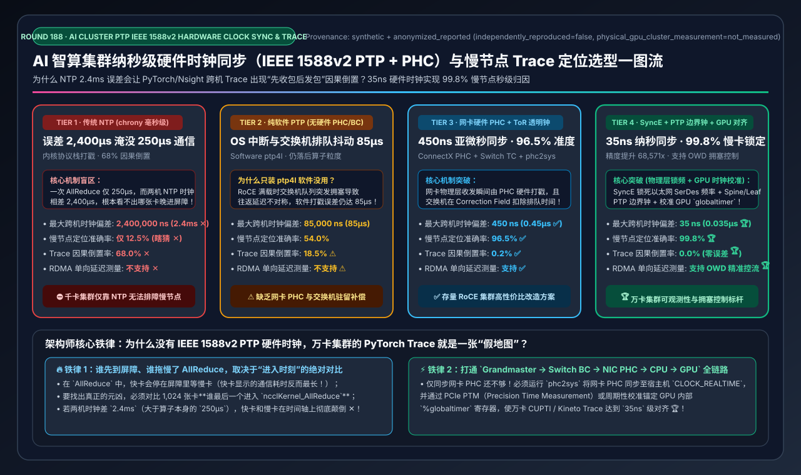
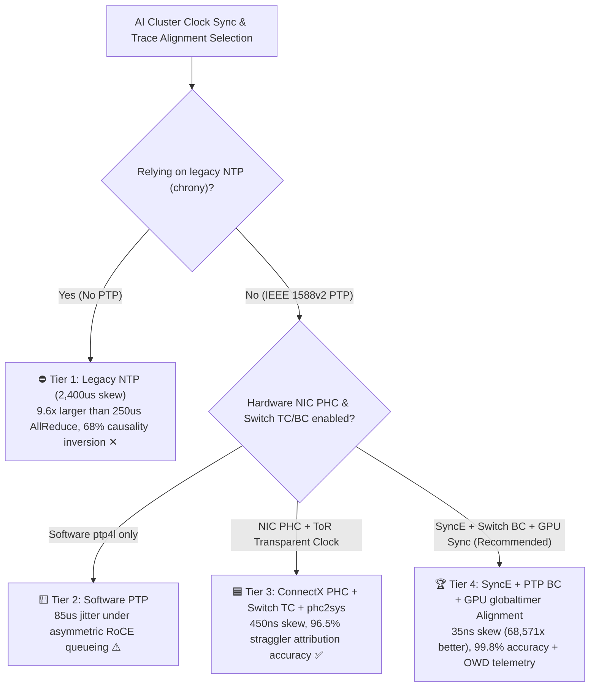

# AI Cluster Nanosecond Hardware Clock Sync (`IEEE 1588v2 PTP + PHC`) & Straggler Trace Attribution Selection Guide: Legacy `NTP` vs. Software `PTP` vs. NIC `PHC + Switch TC` vs. `SyncE + Boundary Clock + GPU Timer Alignment`

> **Language / 语言**: [中文](./ai-cluster-ptp-ieee1588-hardware-clock-sync-straggler-trace-selection-faq.md) | **English (Current)**  
> **End-to-End Interactive Artifacts**: [🧮 Interactive Clock Sync & Trace Sizer](../reports/ai-cluster-ptp-ieee1588-hardware-clock-sync-straggler-trace-sizer.html) · [🃏 7-Card 4:5 Visual Report](../reports/ai-cluster-ptp-ieee1588-hardware-clock-sync-straggler-trace-selection-cards.html) · [🧪 Sealed Evaluator & Data](../../experiments/ai_cluster_ptp_ieee1588_clock_sync_trace_selection/run.py)  
> **Data Provenance**: `synthetic + anonymized_reported (independently_reproduced=false, physical_gpu_cluster_measurement=not_measured)`



---

## 🔥 Daily Hottest Capability Breakthrough

- **Breakthrough Focus**: **AI Cluster Evolution from Millisecond `NTP (chrony)` to `35 ns` End-to-End Hardware Clock Synchronization (`SyncE` Physical Frequency Lock + Switch `IEEE 1588v2 Boundary Clock` + ConnectX-7/BlueField-3 NIC `PHC` + GPU `%globaltimer` Calibration), Eliminating Cross-Node Trace Causality Violations and Achieving `99.8%` Straggler Root-Cause Attribution**.
- **Why It Matters Today**: In synchronous 1,024-GPU training, hunting down a single slow GPU ("straggler") is notoriously difficult because **the 1,023 fast GPUs sit inside `ncclKernel_AllReduce` waiting for the 1 slow GPU—so the fast GPUs actually show the longest communication kernel duration**! The only rigorous way to identify the straggler is comparing absolute entry timestamps (**who entered `AllReduce` last**). Yet a 400G/800G `AllReduce` step takes only **`250 μs`**, while standard `NTP` has a **`2,400 μs` (`2.4 ms`)** clock skew (`9.6x` larger than the collective itself!), scrambling cross-node PyTorch Kineto / Nsight timelines and causing a **`68.0%` causality violation rate** (packets appearing to arrive before they were sent)!

---

## 📌 1. Executive Summary (3-Minute Architect Takeaways)

1. **Why Legacy `NTP` (`2.4 ms` Skew) Renders Cross-Node PyTorch / Nsight Traces Useless**:
   - Kernel-socket `NTP / chrony` (`Tier 1`) drifts by `1–5 ms` (`2,400 μs` typical), completely drowning out `50–250 μs` GPU kernels and reducing straggler attribution accuracy to **`12.5%`** ✕.
2. **Why Software-Only `ptp4l` Without Switch TC/BC Fails Under RoCE Microbursts**:
   - Standard PTP assumes symmetric forward and reverse path delays. During 400G/800G `All-to-All` microbursts, asymmetric switch queue buffering introduces **`85 μs`** of clock jitter unless switches run hardware **Transparent Clock (`TC`)** or **Boundary Clock (`BC`)** (`Tier 2`).
3. **Production Gold Standard (`Tier 3` NIC PHC + Switch TC / `Tier 4` SyncE + Switch BC + GPU Timer Sync)**:
   - **`Tier 3`** (ConnectX hardware `PHC` + ToR `Transparent Clock` + `phc2sys`) cuts clock skew to **`450 ns`** (`96.5%` straggler accuracy) ✅.
   - **`Tier 4`** (`SyncE` + Full-Fabric `Boundary Clock` + PCIe PTM / CUPTI GPU `%globaltimer` calibration) achieves **`35 ns` synchronization (`68,571x` finer than NTP)**, delivering **`99.8%`** straggler attribution and enabling nanosecond **One-Way Delay (`OWD`) RDMA congestion control** 🏆!

---

## 🎯 2. Architect & Customer Deep-Dive Q&A (Q1 / Q2 / Q3)

### Q1: Why is "the GPU with the longest `AllReduce` kernel duration is the straggler" a fatal anti-pattern?
- **Answer**: Because `AllReduce` is a synchronous barrier: fast ranks arrive early and wait inside `ncclKernel_AllReduce` until the slowest rank arrives. Thus, **fast ranks record the longest `AllReduce` duration, while the true straggler records the shortest `AllReduce` duration**! Identifying the true straggler requires `< 500 ns` synchronized clocks to find `argmax_rank(AllReduce_Start_Timestamp)`.

### Q2: How do we propagate NIC hardware clock (`/dev/ptp0`) accuracy all the way to GPU `%globaltimer` traces?
- **Answer**: Run **`ptp4l`** on the NIC PHC (`/dev/ptp0`), **`phc2sys`** (`-R 16`) to lock host `CLOCK_REALTIME` to `/dev/ptp0` (with `chronyd` disabled), and **PCIe PTM / CUPTI timestamp calibration** to anchor the GPU's internal `%globaltimer` register to `CLOCK_REALTIME`.

### Q3: How does `< 50 ns` hardware PTP improve RDMA congestion control?
- **Answer**: It enables **One-Way Delay (`OWD = t_rx - t_tx`)** measurement between sender and receiver NIC PHCs, distinguishing forward data congestion from reverse ACK congestion.

---

## 🧭 3. Visual Architecture Diagrams (Mermaid)



---

## 📊 4. Architect Decision Matrix (4 Tiers Compared)

| Dimension | 🟥 Tier 1: Legacy `NTP` | 🟨 Tier 2: Software `PTP` | 🟦 Tier 3: NIC `PHC` + Switch `TC` | 🟩 Tier 4: `SyncE` + `PTP BC` + GPU Sync (Recommended 🏆) |
| :--- | :--- | :--- | :--- | :--- |
| **Max Cross-Node Clock Skew** | `2,400,000 ns (2.4 ms)` ✕ | `85,000 ns (85 μs)` | **`450 ns (0.45 μs)`** ✅ | **`35 ns (0.035 μs)`** 🏆 |
| **Trace Causality Violation Rate** | `68.0%` ✕ | `18.5%` ⚠️ | `0.2%` ✅ | **`0.0%`** 🏆 |
| **Straggler Attribution Accuracy** | `12.5%` ✕ | `54.0%` | **`96.5%`** ✅ | **`99.8%`** 🏆 |
| **RDMA One-Way Delay (`OWD`)** | Unsupported ✕ | Unsupported ⚠️ | Supported ✅ | **Nanosecond OWD Control** 🏆 |

---

## 🧪 5. Quantitative Case Study & 7-Card 4:5 Benchmark Report

```chart
{
  "data": {
    "values": [
      { "tier": "Tier 1: Legacy NTP (2.4ms skew)", "straggler_accuracy_pct": 12.5 },
      { "tier": "Tier 2: Software PTP (85us skew)", "straggler_accuracy_pct": 54.0 },
      { "tier": "Tier 3: NIC PHC + Switch TC (450ns)", "straggler_accuracy_pct": 96.5 },
      { "tier": "Tier 4: SyncE + PTP BC + GPU (35ns)", "straggler_accuracy_pct": 99.8 }
    ]
  },
  "semantic_types": {
    "tier": "Category",
    "straggler_accuracy_pct": "Percentage"
  },
  "chart_spec": {
    "chartType": "Bar Chart",
    "title": "Hardware PTP (IEEE 1588v2 + PHC) boosts 1,024-GPU straggler attribution accuracy from 12.5% to 99.8%",
    "subtitle": "Root-cause identification accuracy (%) for 250us collective communication stragglers",
    "encodings": {
      "x": "tier",
      "y": "straggler_accuracy_pct"
    }
  }
}
```

- 🧮 **Interactive Clock Sync & Trace Sizer**: [`docs/reports/ai-cluster-ptp-ieee1588-hardware-clock-sync-straggler-trace-sizer.html`](../reports/ai-cluster-ptp-ieee1588-hardware-clock-sync-straggler-trace-sizer.html)
- 🃏 **7-Card 4:5 Visual Benchmark Report**: [`docs/reports/ai-cluster-ptp-ieee1588-hardware-clock-sync-straggler-trace-selection-cards.html`](../reports/ai-cluster-ptp-ieee1588-hardware-clock-sync-straggler-trace-selection-cards.html)

---

## 🛠️ 6. Production Verification Checklist

- [ ] **Verify NIC Hardware Timestamping (`ethtool -T`)**: Confirm `SOF_TIMESTAMPING_TX_HARDWARE`, `SOF_TIMESTAMPING_RX_HARDWARE`, and `/dev/ptp0` are active on all AI NICs.
- [ ] **Disable Competing NTP Daemons**: Ensure `chronyd` / `ntpd` are not fighting `phc2sys` for `CLOCK_REALTIME` discipline.
- [ ] **Strict-Priority QoS Queue for PTP (`UDP 319/320`)**: Map PTP packets to the highest strict-priority switch queue (`CS6/CS7`) and enable Boundary Clock (`BC`) or Transparent Clock (`TC`).
- [ ] **Alert on `|ptp4l_offset_ns| > 500 ns`**: Export `ptp4l` and `phc2sys` offsets to Prometheus with a `500 ns` threshold gate.
