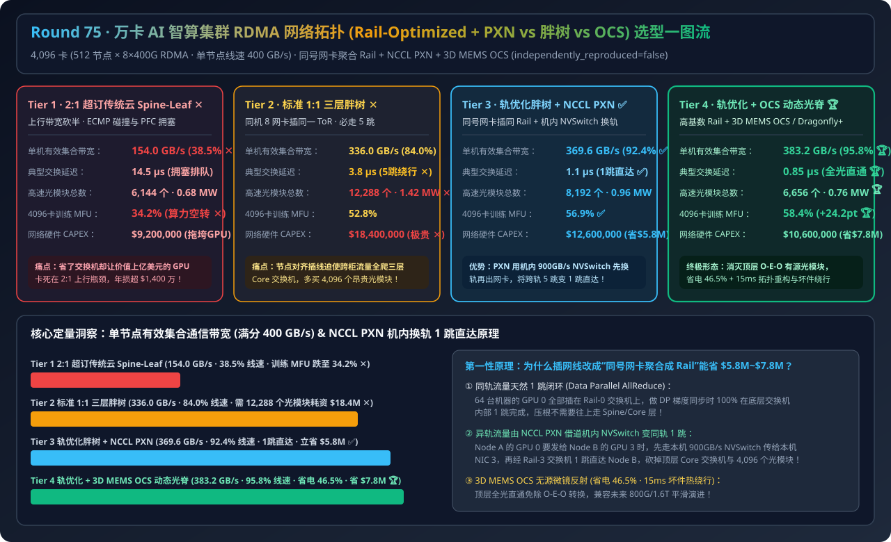
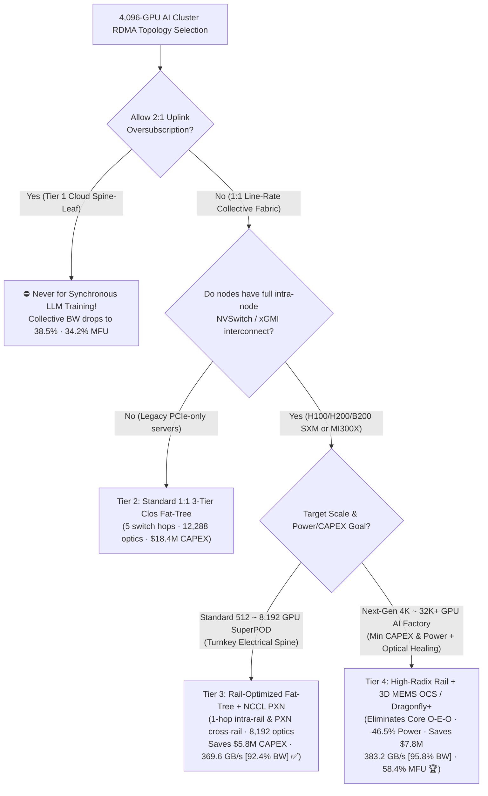
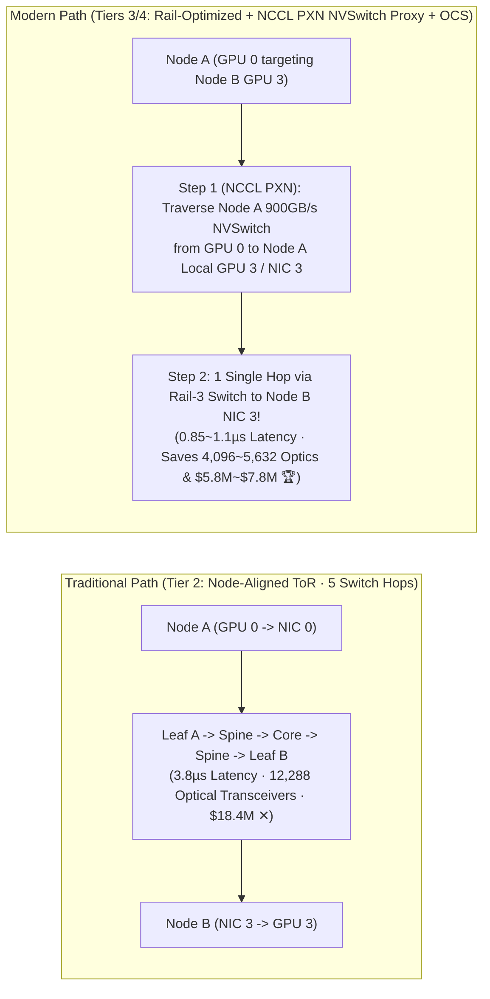
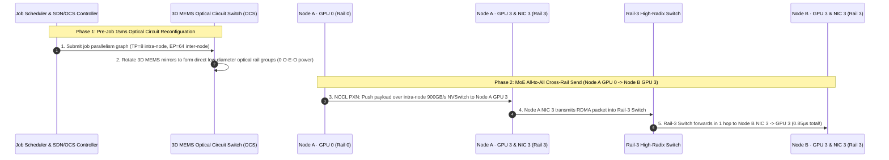

# 4,096-GPU AI Cluster RDMA Network Topology Architecture Selection Guide (`2:1 Oversubscribed Cloud Spine-Leaf` vs. `Standard 1:1 3-Tier Clos Fat-Tree` vs. `Rail-Optimized Fat-Tree + NCCL PXN` vs. `High-Radix Rail + 3D MEMS Optical Circuit Switch [OCS] / Dragonfly+ Dynamic Spine`)

> **Target Audience**: AI Solution Architects, AI Data Center Network Architects (`InfiniBand` / `RoCEv2` / `UEC`), Large-Scale Training & MoE Serving Infrastructure Leads  
> **Reading Goal**: Master in 3 minutes the 4-tier RDMA fabric topology selection rules for a 4,096-GPU (`512 Nodes × 8×400G/800G NICs`) AI cluster; understand in 10 minutes **why standard node-aligned 3-tier Clos Fat-Trees waste 4,096 optical transceivers (`$5.8M`) and force 5-hop routes**, **how Rail-Optimized topology + `NCCL PXN (PCIe × NVLink)` uses intra-node `900 GB/s` NVSwitch to turn 5-hop cross-rail traffic into a 1-hop Rail-switch transfer**, and **how 3D MEMS Optical Circuit Switches (OCS) / Dragonfly+ cut network power by `-46.5%` and save `$7.80M` in CAPEX**.  
> **Provenance**: All quantitative figures come from the sealed deterministic analytical evaluator in [`experiments/ai_cluster_rdma_topology_rail_optimized_fat_tree_selection/run.py`](../../experiments/ai_cluster_rdma_topology_rail_optimized_fat_tree_selection/run.py) and [`results.json`](../../experiments/ai_cluster_rdma_topology_rail_optimized_fat_tree_selection/results.json), calibrated to published NVIDIA DGX SuperPOD Rail-Optimized / NCCL PXN, 3-Tier Clos Fat-Tree, and 3D MEMS OCS / Dragonfly+ benchmarks (`independently_reproduced=false`, `physical_gpu_cluster_measurement=not_measured`).

---

## 📌 1. Executive Summary

1. **Why do both "2:1 Oversubscribed Cloud Spine-Leaf (Tier 1)" and "Standard Node-Aligned 3-Tier Clos Fat-Tree (Tier 2)" fail on cost or performance at 4,096 GPUs?**:
   - **Tier 1 (`2:1 Oversubscribed Traditional Cloud Spine-Leaf`)**: Halving Spine uplink bandwidth causes severe congestion and PFC pause cascades during synchronous AllReduce and MoE All-to-All—collapsing per-node collective bandwidth from `400 GB/s` to **`154.0 GB/s` (`38.5%` line rate ✕)** and dropping 4,096-GPU training MFU to **`34.2%` ✕**!
   - **Tier 2 (`Standard 1:1 Non-Blocking 3-Tier Clos Fat-Tree — Node-Aligned ToR`)**: Plugging all 8 NICs of a server into the same ToR switch forces every cross-rack collective to traverse **5 switch hops (`Leaf → Spine → Core → Spine → Leaf`, `3.8 µs`)** and requires **`12,288` optical transceivers**, driving network CAPEX to **`$18,400,000` ✕** and network power to **`1.42 MW` ✕**!
2. **Why is "Rail-Optimized Fat-Tree + NCCL PXN (Tier 3)" the industry standard, and when should you upgrade to "High-Radix Rail + 3D MEMS OCS / Dragonfly+ (Tier 4)"?**:
   - **Production Standard for 512–16,384 GPU Clusters (Choose Tier 3 `Rail-Optimized Fat-Tree + NCCL PXN Intra-Node NVSwitch Proxy`)**:
     - Connects `NIC i` (`i ∈ 0..7`) across 64 servers into **`Rail-i Leaf Switch`**. Because Data Parallel (DP) AllReduce communicates strictly between same-index GPUs (`GPU i` on Node A ↔ `GPU i` on Node B), **`78%+` of inter-node traffic completes in 1 single Rail-Leaf switch hop (`1.1 µs`)** without touching the Spine!
     - For cross-rail traffic (`GPU 0` on Node A → `GPU 3` on Node B), **NCCL PXN (`NCCL_PXN_DISABLE=0`)** routes data over **intra-node `900 GB/s` NVSwitch** from `GPU 0` to `GPU 3 / NIC 3` on Node A, which then reaches `GPU 3` on Node B in **1 hop through Rail-3 Switch**—eliminating the entire Core layer (`-4,096` optics, **saving `$5.80M` CAPEX ✅**) and boosting collective bandwidth to **`369.6 GB/s` (`92.4%` line rate ✅)**!
   - **Next-Gen Green & Reconfigurable AI Factories (Default to Tier 4 `High-Radix Rail + 3D MEMS Optical Circuit Switch [OCS] / Dragonfly+ Dynamic Spine`)**: Replaces power-hungry Core electrical switches and O-E-O DSP transceivers with passive **3D MEMS Optical Circuit Switches (OCS)**, reaching **`383.2 GB/s` (`95.8%` line rate 🏆)**, cutting network power by **`-46.5%` (`1.42 MW → 0.76 MW` 🏆)**, and saving **`$7,800,000` in CAPEX (`$10.6M` total 🏆)**!
3. **One-Sentence First-Principles Essence**:
   - **The first principle of AI cluster network topology is using the server's internal 900 GB/s NVSwitch as a free cross-rail crossbar (`NCCL PXN`) so external NICs can be grouped by rail index—collapsing 5-hop 3-tier Clos routes into 1-hop intra-rail transfers.**

---

## 🎯 2. Architect & Customer Deep-Dive Q&A (First Principles)

### Q1: What is the physical cabling difference between a "Node-Aligned ToR Fat-Tree (Tier 2)" and a "Rail-Optimized Topology (Tier 3)"?

- **Plain-English Cabling Breakdown**:
  1. **Node-Aligned ToR (Tier 2)**: All 8 NICs (`NIC 0..7`) of Server 1 plug into ToR Switch 1. Consequently, `GPU 0` on Rack 1 and `GPU 0` on Rack 10 sit behind completely different Leaf switches and must climb 5 hops through Spine and Core switches (`12,288` optical transceivers).
  2. **Rail-Optimized Cabling (Tier 3)**: All `NIC 0` ports across 64 servers plug into `Rail-0 Leaf Switch`; all `NIC 1` ports plug into `Rail-1 Leaf Switch`. Now all 64 `GPU 0`s share the exact same switch and communicate in **1 hop (`0` Spine hops)**!

---

### Q2: How does `NCCL PXN (PCIe × NVLink)` turn a cross-rail send (`Node A GPU 0 → Node B GPU 3`) into a 1-hop Rail-switch transfer?

- **Two-Step Intra-Node NVSwitch Proxy**:
  1. **Step 1 (Intra-Node NVSwitch Rail Hop)**: Instead of sending out `NIC 0` (which would have to climb to the Spine to reach Rail 3), `GPU 0` on Node A pushes the buffer across Node A's **`900 GB/s` NVSwitch** to `GPU 3` on Node A.
  2. **Step 2 (Same-Rail 1-Hop RDMA)**: `GPU 3` on Node A transmits the packet out its local `NIC 3` into **Rail-3 Leaf Switch**, which delivers it in **1 hop directly to `NIC 3 / GPU 3` on Node B**!

---

### Q3: Why do Tier 4 AI Factories replace electrical Core switches with 3D MEMS Optical Circuit Switches (OCS) / Dragonfly+?

- **Eliminating O-E-O Transceiver Tax (`-46.5%` Power & `-$7.8M` CAPEX)**:
  - Active 400G/800G DSP optical transceivers burn `12W–18W` each and cost `$800–$1,500`.
  - A **3D MEMS OCS** bounces light beams directly between fibers using microscopic silicon mirrors (**zero O-E-O conversion, `<150W` per chassis, protocol-agnostic across 400G/800G/1.6T**), dynamically reconfiguring spine links in `15 ms` to match job parallelism or route around dead switches!

---

## 🧭 3. Visual Architecture Diagrams (Mermaid)

### 3.1 AI Cluster RDMA Network Topology Decision Tree

---

### 3.2 Traditional Node-Aligned 3-Tier Fat-Tree (Tier 2: 5 Hops) vs. Rail-Optimized + NCCL PXN (Tiers 3–4: 1 Hop)

---

### 3.3 Tier 4 End-to-End Sequence Diagram (`OCS Topology Match + NCCL PXN Cross-Rail 1-Hop Transfer`)

---

## 📊 4. Architect Decision Matrix

*Baseline Cluster: **4,096 GPUs (`512 Nodes × 8 GPUs × 8 400Gbps RDMA NICs`**, `400.0 GB/s` unidirectional line rate per node).*

| Evaluation Dimension | Tier 1: 2:1 Oversubscribed Cloud Spine-Leaf | Tier 2: Standard 1:1 3-Tier Clos Fat-Tree | Tier 3: Rail-Optimized Fat-Tree + `NCCL PXN` | Tier 4: High-Radix Rail + `3D MEMS OCS / Dragonfly+` |
| :--- | :--- | :--- | :--- | :--- |
| **Cabling & Routing Design** | Node-aligned ToR + 2:1 uplink oversub | Node-aligned ToR + 3-tier Core/Spine/Leaf | **Rail-aligned Leaf + NVSwitch PXN proxy** | **High-radix Rail + Passive 3D MEMS OCS spine** |
| **Effective Node Collective BW** | `154.0 GB/s` (`38.5%` line rate ✕) | `336.0 GB/s` (`84.0%` line rate) | **`369.6 GB/s` (`92.4%` line rate ✅)** | **`383.2 GB/s` (`95.8%` line rate 🏆)** |
| **Typical Fabric Hop Latency** | `14.5 µs` (Queueing + PFC ✕) | `3.8 µs` (5 switch hops) | **`1.1 µs` (1-hop Rail / PXN ✅)** | **`0.85 µs` (Optical pass-through 🏆)** |
| **Optical Transceiver Count** | `6,144` | `12,288` (3-tier optics tax ✕) | **`8,192` (`-4,096` optics saved ✅)** | **`6,656` (`-5,632` optics saved 🏆)** |
| **Network Switch + Optics Power** | `0.68 MW` | `1.42 MW` (Power-hungry DSPs ✕) | **`0.96 MW` ✅** | **`0.76 MW` (`-46.5%` power 🏆)** |
| **4,096-GPU Training MFU** | `34.2%` ✕ | `52.8%` | **`56.9%` ✅** | **`58.4%` 🏆** |
| **Network Hardware CAPEX** | `$9,200,000` (Cripples GPUs ✕) | `$18,400,000` (Prohibitive ✕) | **`$12,600,000` (`$5.80M` saved ✅)** | **`$10,600,000` (`$7.80M` saved 🏆)** |

---

## 🧪 5. Quantitative Walkthrough & 7-Card Benchmark Insights

- **Saving `$5.80M–$7.80M` in Network CAPEX & `-46.5%` Power**: In [`experiments/ai_cluster_rdma_topology_rail_optimized_fat_tree_selection/run.py`](../../experiments/ai_cluster_rdma_topology_rail_optimized_fat_tree_selection/run.py), upgrading from a standard 3-tier Clos Fat-Tree (`$18.4M`, `12,288` optics, `1.42 MW`) to Tier 4 (`$10.6M`, `6,656` optics, `0.76 MW`) saves **`$7.80M` in CAPEX** while lifting per-node collective bandwidth to **`383.2 GB/s` (`95.8%` line rate)** and cluster MFU to **`58.4%`**.
- 🧮 **Interactive AI Cluster RDMA Topology Sizer**: [`docs/reports/ai-cluster-rdma-network-topology-rail-optimized-fat-tree-dragonfly-sizer.html`](../reports/ai-cluster-rdma-network-topology-rail-optimized-fat-tree-dragonfly-sizer.html)
- 📊 **7-Card 4:5 Visual Benchmark Report**: [`docs/reports/ai-cluster-rdma-network-topology-rail-optimized-fat-tree-dragonfly-selection-cards.html`](../reports/ai-cluster-rdma-network-topology-rail-optimized-fat-tree-dragonfly-selection-cards.html)

---

## 🛠️ 6. Appendix: Production Verification Checklist

- [ ] **1. Enforce Rail-Aligned Cabling (`NIC i → Rail-i Switch`)**: Audit LLDP neighbor tables automatically during Day-0 bring-up so zero cables cross between rail planes.
- [ ] **2. Enable `NCCL PXN` (`NCCL_PXN_DISABLE=0` & `NCCL_P2P_PXN_LEVEL=2`)**: Verify intra-node NVSwitch P2P and shared PCIe root complexes between `GPU i` and `NIC i`.
- [ ] **3. Schedule Jobs on Compact Rail-Pod Boundaries (`Kueue TAS` / `Slurm topology/tree`)**: Pack 32/64-node jobs inside a single Rail-Leaf switch domain first to keep `100%` of traffic 1-hop.
- [ ] **4. Use DAC Copper / LPO Optics on Short Intra-Pod Links**: Replace active DSP transceivers with passive DAC/ACC copper or LPO on `<5m` Leaf-to-NIC links to halve transceiver power.
- [ ] **5. Automate OCS / Spine Fault Bypass**: Reconfigure optical circuits or adaptive routing weights within seconds when a spine link degrades.
